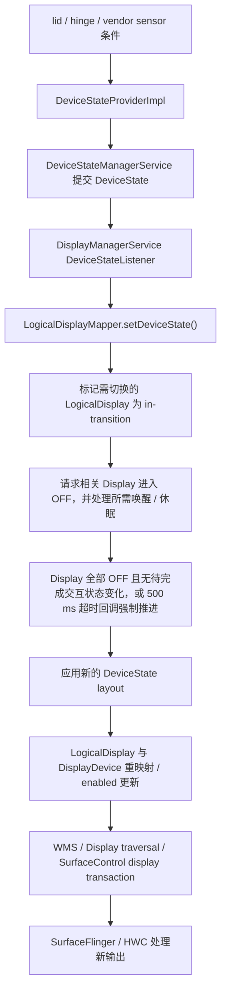

# 折叠屏显示切换、窗口连续性与渲染性能

折叠屏的性能问题常被简化成“大屏像素更多，所以 GPU 更慢”，但像素量只解释得了一部分。一次折叠或展开，往往同时触发一连串事件：

- 设备 posture（姿态） 变化；
- 内建物理 Display（显示设备） 的开关或重映射；
- WMS（WindowManagerService，窗口管理服务） 里 DisplayContent、Task、Window 与 Insets（窗口避让区域） 的更新；
- Shell 与 SystemUI 的可选 unfold transition（展开转场）；
- 应用窗口尺寸、资源配置与布局变化；
- SurfaceFlinger 为目标 Display 重新构建可见 layer（合成图层） 集合；
- HWC（Hardware Composer，硬件合成器） 针对新 Display、mode（显示模式） 和 layer 属性重新选择合成策略。

这些阶段分属不同进程、各有各的时间边界。我们排查时要先判断问题落在哪一层，再去讨论 GPU、Activity 重建或铰链传感器。

> 源码基线：AOSP `android-17.0.0_r1`，Android 17 / API 37；Android 12～16 仅用于说明演进。

## 1. 先建立对象模型

后面所有排查都落在这份对象模型上：物理面板、系统包装的显示设备、对外的逻辑显示与合成输出各是一层对象，我们先把它们分清楚。

### 1.1 Physical Display、DisplayDevice 与 LogicalDisplay

Android 显示框架把物理设备和系统对外使用的逻辑 Display 分开：

- **物理 Display**：面板与 HWC display，由物理地址标识；
- **`DisplayDevice`**：DisplayManager 对物理或虚拟显示设备的包装；
- **`LogicalDisplay`**：系统用于组织 layer stack（图层栈）、`DisplayInfo`、display group（显示组） 和窗口内容的逻辑对象；
- **SurfaceFlinger Display 与 CompositionEngine Output**：针对最终输出建立合成状态并执行 present（送显）。

折叠设备的具体做法由厂商配置决定：可以让一个稳定的 logical display ID（逻辑显示标识） 在不同设备状态下映射到不同内建面板，也可以保留多个逻辑 Display，在 layout（显示布局配置） 里改变它们的 enabled（是否启用） 状态。

这三条经验在排查时会反复用到：

- “内屏与外屏切换”在回调上可能很安静，未必出现 `DisplayListener.onDisplayRemoved()` 后再调用 `onDisplayAdded()` 的组合；
- logical display ID 稳定只说明编号没换，物理面板、分辨率、density（像素密度）、mode 都可能已经换过，要对照 layout 与物理地址确认；
- 两个内建面板同时存在时，能否同时点亮取决于设备是否支持并发内屏，见 1.3 节。

### 1.2 DeviceStateToLayoutMap 的布局选择

`DeviceStateToLayoutMap` 按以下顺序选择一个 display layout 配置文件：

```text
/data/system/displayconfig/display_layout_configuration.xml
/vendor/etc/displayconfig/display_layout_configuration.xml
```

`getConfigFile()` 在 data 文件存在时直接选择它，否则选择 vendor（设备厂商） 文件；两份配置不会合并。排查配置未生效时，先核对 `Loading display layouts from ...` 日志中的实际路径。[源码：`DeviceStateToLayoutMap.java` L90–98、L137–144]

选中的文件按 device state（设备状态） 描述显示布局。每个 layout 可以为 Display 配置：

- 物理 `DisplayAddress`；
- 是否为默认 Display（`defaultDisplay`）；
- 是否 enabled；
- display group；
- 前后位置；
- lead display（联动显示中的主显示）；
- brightness、refresh-rate、thermal、power（电源） throttling（亮度、刷新率、热管理和功耗限制） 策略 ID。

logical display ID 由框架分配：`Layout.createDisplayLocked()` 调用 `DisplayIdProducer.getId(isDefault)`，把结果保存在 layout 中；`LogicalDisplayMapper` 再为默认 Display 返回 `DEFAULT_DISPLAY`，为非默认 Display 递增分配 ID。我们分析状态切换时，就用 `dumpsys display` 核对 layout 保存的 ID 与物理地址映射。[源码：`DeviceStateToLayoutMap.java` L168–179；`Layout.java` L155–163；`LogicalDisplayMapper.java` L223–224]

刷新率和亮度策略可以随 layout 改变，但 AOSP 没有“展开态固定 120 Hz、折叠态固定低刷新率”的通用规则。具体 mode 还要经过 `DisplayModeDirector`、设备配置、内容帧率投票、热限制和用户设置。

### 1.3 多内屏并发与设备能力

`config_supportsConcurrentInternalDisplays` 表示设备是否支持同时点亮多个内建 Display。layout 还要把要并发的 Display 设为 enabled，系统才会进入并发内屏状态。

两个 Display 同时工作时，硬件资源未必完全隔离。HWC 按 Display 处理合成与 present（验证合成方案并送显） 请求，但 overlay（硬件叠加平面）、内存带宽、GPU、显示控制器和功耗预算可能受 SoC 与 vendor 实现的共同约束。

## 2. 设备状态主线

对象模型建好之后，我们沿主线走一遍：传感器条件如何变成 DeviceState，DeviceState 又如何变成显示布局，切换中间为什么会出现黑场。

### 2.1 状态来源与设备配置

设备状态从哪来？`DeviceStateProviderImpl` 从 vendor 或 data 分区的 `device_state_configuration.xml` 读取状态及条件。条件可以引用：

- lid switch（开合检测开关）；
- 指定 string type（字符串类型名） 与 name 的 sensor（传感器）；
- 一个 sensor 的一个或多个数值范围。

Provider 按 ID 从小到大检查条件，选择首个匹配状态。所需传感器会以 `SENSOR_DELAY_FASTEST` 注册，但事件频率仍受具体 sensor 能力与 HAL（Hardware Abstraction Layer，硬件抽象层） 行为限制。

条件怎么组合由厂商配置决定：hall sensor（霍尔传感器）、hinge angle（铰链角度）、lid switch 都可以出现在条件里，`TYPE_HINGE_ANGLE` 只是其中一种选择。DeviceState ID 同样来自设备配置，跨设备的脚本应当先查询再使用，写死 `STATE_OPEN = ...` 在别的设备上未必行得通。

### 2.2 从 DeviceState 到显示 layout

从传感器条件到 SurfaceFlinger，关键路径可以概括为：



`DeviceStateManagerService` 提交状态时会写入：

- `DeviceStateChanged` trace instant；
- `debug.tracing.device_state` system property（系统属性）；
- `DEVICE_STATE_CHANGED` stats atom（系统统计事件）。

这条路径先把连续的传感器条件归纳成离散 DeviceState，再选择相应 display layout。DisplayManager 收到回调后，先向 WMS 投递 device state 消息，再调用 `LogicalDisplayMapper.setDeviceState()`。源码注释说明，这个次序是为了让 WMS 的 device-state 更新与 display change 事件保持可控的先后关系。

<!-- gracker-diagram: ch02-16-display-remapping -->


图：设备状态选择对应的 display layout。需要切换的 Display 先进入 transition 并关闭输出；正常条件满足，或延迟超时回调 force 推进后，框架应用新的逻辑显示与设备映射，再更新 WMS / SF。已经满足关闭与交互条件时可以直接切换，不必等待超时。

### 2.3 切换过程中的黑场与过渡层

切换过程中为什么会出现黑场或过渡层？`LogicalDisplayMapper` 比较新 layout 时，以下情况会把 Display 标为 `in-transition`（正在切换）：

- enabled 状态变化；
- 同一个物理 DisplayDevice 将映射到新的 logical display id；
- DisplayDevice 只出现在新旧 layout 的一侧；
- LogicalDisplay 已有切换标记（`mIsInTransition == true`，由 `isInTransitionLocked()` 读取）。

这里记录的是 `LogicalDisplay` 的布尔标记，由 `resetLayoutLocked()` 设置或清除。排查黑场时看该标记与物理设备的 `OFF` 状态；WMS `Transition` 的 `STATE_COLLECTING`、`STATE_STARTED` 另用于窗口转场的收集与启动。[源码：`LogicalDisplayMapper.java` L1280–1338；`LogicalDisplay.java` L197–200、L1192–1206；`Transition.java` L165–175]

系统先发送 transition 阶段更新，让相关 Display 关闭。正常推进要求所有 transitioning Display（正在切换的显示设备） 确认 `OFF`，且没有待完成的设备唤醒或休眠——`finishStateTransitionLocked(false)` 检查的就是 `displaysOff && !waitingToWakeDevice && !waitingToSleepDevice`。后两项由设备状态、`mIsInteractive`、启动完成情况及折叠休眠设置等条件决定。这些条件满足后，系统才清除 transition 标记、应用新 layout 并发出后续更新；500 ms 超时则以 `force=true` 强制推进。[源码：`LogicalDisplayMapper.java` L116、L683–705、L720–835、L1748–1752]

display blanking（暂时关闭显示输出） 的作用是遮住 resize 过程中可能出现的错误尺寸。500 ms 只是 Handler（消息处理器） 超时消息的延迟配置：消息回调执行后才会强制推进，实际执行还受队列调度影响，深睡眠也会增加延迟。要量黑场或折叠动画的时长，以 trace 里的实际区间为准。[源码：`LogicalDisplayMapper.java` L669–670；`Handler.java` L730–734、L752–775]

“固定丢 1～3 帧”“第一帧高 30%～50%”这类数值没有 AOSP 保证：设备的面板时序、power sequence（面板上电与下电顺序）、Shell transition、应用重绘和 HWC 能力都会改变观测结果，结论要以自己设备上的 trace 为准。

### 2.4 layout 应用与 SurfaceFlinger 的分工

layout 应用这一侧，`applyLayoutLocked()` 会：

1. 按 layout 中的物理地址查找 `DisplayDevice`；
2. 查找或创建对应 `LogicalDisplay`；
3. 必要时交换 `LogicalDisplay` 背后的 `DisplayDevice`；
4. 更新 position、lead display、refresh-rate zone（刷新率策略区域）、thermal throttling（热限制） 与 enabled 状态。

后续 DisplayManager traversal（显示设备遍历） 使用 `SurfaceControl.Transaction` 更新 display layer stack、flags（标志位）、projection（投影与旋转映射）、size 和 surface。SurfaceFlinger 接收 display transaction，并为新的 display 与 output 状态构建合成输入。

分工到这里就清楚了：SurfaceFlinger 不识别手机处于书本姿态还是桌面姿态，它处理的是 system_server（承载系统核心服务的进程） 已转换好的 Display 与 layer 状态。

## 3. WMS、Shell 与应用窗口

显示 layout 重映射之后，轮到窗口这一层：WMS 更新窗口树，Shell 播转场动画，应用窗口拿到新的尺寸与配置。这一节把三条线分开看。

### 3.1 Display 树与 Surface 树

进入 WMS 一侧，我们先分清两棵树。WMS 按以下对象组织窗口：

```text
RootWindowContainer
  DisplayContent
    DisplayArea / TaskDisplayArea
      Task / TaskFragment
        ActivityRecord（继承 WindowToken）
          WindowState
```

这棵树表达的是应用窗口在 WMS 中的管理关系：`ActivityRecord` 本身就是 `WindowToken` 的子类，所以树里没有单独的 `WindowToken` 层。它与 SurfaceFlinger 的 layer tree 也不一一对应，排查时应分别核对。[源码：`ActivityRecord.java` L372]

Shell transition 可以创建 leash（转场期间使用的临时父 Surface），把 Task 或窗口 Surface reparent（更换父节点）到 leash 上，再对 leash 设置 matrix（变换矩阵）、crop（裁剪）、corner radius（圆角）和 position。

所以折叠动画期间看到 task leash 在缩放，还说明不了 App 在每次 progress（进度回调） 回调时都重新提交了完整 buffer，两件事要分别确认。

### 3.2 可选的 unfold 动画

是否启用 unfold 动画，由平台资源 `config_unfoldTransitionEnabled` 与 `config_unfoldTransitionHingeAngle` 决定。启用基于 hinge angle 的进度时，SystemUI 的 `HingeSensorAngleProvider` 获取 `TYPE_HINGE_ANGLE`，并通过后台 Handler 以 `SENSOR_DELAY_FASTEST` 接收事件。

`PhysicsBasedUnfoldTransitionProgressProvider` 把 hinge angle 映射到 0～1 的 progress，再用 spring animation（弹簧动画） 平滑更新。

WM Shell 的 `UnfoldTransitionHandler` 在进度回调中创建 `SurfaceControl.Transaction`，让 task animator（任务动画器） 更新 leash。以 fullscreen task 为例，AOSP 的 animator 主要更新：

- `setWindowCrop()`；
- `setMatrix()`；
- `setCornerRadius()`；
- `show()`。

这些调用只更新 layer 几何；App 仍按自己的 Choreographer、View 与 HWUI 或其他 Producer 路径生产内容。

动画由资源和设备能力控制。未启用这组模块的设备、厂商自定义 transition、锁屏与 AOD（Always-On Display，息屏显示） 和半开状态都可能走不同路径。

### 3.3 Configuration 与 WindowLayoutInfo 的到达顺序

物理 Display 切换、窗口 bounds（边界） 更新和 WindowManager Extensions posture 更新来自不同组件。很多人把下面这条顺序当成前提：

```text
WindowLayoutInfo → Configuration → onConfigurationChanged
```

这些事件可能按不同顺序到达，我们写代码时应假设次序会变。一次折叠或展开可能改变 `screenSize`、`smallestScreenSize`、`screenLayout`、`orientation`、`density` 或其他配置；具体集合取决于物理面板、windowing mode（窗口模式）、rotation（旋转） 与厂商实现。

默认情况下，Activity 未声明自行处理的 configuration change（配置变化） 会触发重建。若使用 `android:configChanges`，应用就要重新读取受影响的资源并更新 UI；只在回调里记录一下就原样返回，算不上自行处理。

### 3.5 Shell Transition 状态机与 BLAST（应用窗口缓冲队列适配层） 同步

Shell Transition 把窗口状态管理、同步事务和动画播放分开：WMS 收集窗口变化，`BLASTSyncEngine` 协调同步事务，WM Shell 接收动画目标并播放。同步结束只表示事务可以交给动画端；应用的新布局显示出来没有，还要看对应 buffer 的 latch 与目标 Display 的 present。

#### 3.5.1 进程边界与两条 Binder 通知

WMS 在 `system_server`，WM Shell 通常运行在 SystemUI 进程内。`ITransitionPlayer` 是 `oneway` AIDL 接口，启动与就绪分别通过以下通知传递：

- `requestStartTransition(token, request)`：WMS 发送 transition 标识和请求信息。`Transition.mToken` 由 `new Token(this)` 创建，`Token` 继承 `Binder`，内部以弱引用关联 `Transition`。
- `onTransitionReady(token, info, startT, finishT)`：WMS 发送 `TransitionInfo`（包含 Roots、每个参与容器的 Changes、leash Surface） 中的动画目标、root leash 和变化信息，以及动画初态事务 `startT`、结束时恢复父子关系与层级等状态的 `finishT`。

Shell 的 `TransitionPlayerImpl` 收到 Binder 通知后，将处理投递到 `mMainExecutor`。在未启用 `transitMixpatcherBase` 的分支中，`Transitions.requestStartTransition()` 先分发请求、处理 Display 变化，再调用 `mOrganizer.startTransition()` 回告 WMS；启用该标志时则转交 Mixpatcher。WMS 的 `WindowOrganizerController` 也可能将 `transition.start()` 与窗口事务应用投递到 Handler。因此，一次 Binder 调用返回只能证明消息送达，两端状态是否同步推进，要以两侧各自的观测为准。[源码：`ITransitionPlayer.aidl` L42–66；`Transitions.java` L1337–1418、L2036–2052；`WindowOrganizerController.java` L397–444；`Transition.java` L410–416、L4955–4959]

#### 3.5.2 Transition 状态机

WMS 侧正常路径与可中止路径如下：

```text
STATE_PENDING → STATE_COLLECTING → STATE_STARTED → STATE_PLAYING → STATE_FINISHED
STATE_PENDING / STATE_COLLECTING / STATE_STARTED → STATE_ABORT
```

状态沿这条链推进：`STATE_PENDING` 表示对象已创建、尚未开始收集；`startCollecting()` 进入 `STATE_COLLECTING` 时创建 SyncGroup；`start()` 进入 `STATE_STARTED` 后应用就绪状态。`isCollecting()` 对 `COLLECTING` 和 `STARTED` 都返回 true，所以这两个阶段都还能继续收集参与者。

非中止路径的 `onTransactionReady()` 先提交可见性，再设置 `STATE_PLAYING`、保存初态事务，随后计算动画目标与 `TransitionInfo`、分配 track、调用 `moveToPlaying()`，最后通知 Shell。WMS 进入 `PLAYING` 与 Shell 开始执行动画仍有时间间隔。

动画结束时，Shell 的普通完成路径应用合并后的结束事务，再调用 `mOrganizer.finishTransition(token, wct)`。WMS 经 `WindowOrganizerController.finishTransition()` 和 `TransitionController.finishTransition()` 完成窗口状态清理。`abort()` 只允许在 `PENDING`、`COLLECTING` 或 `STARTED` 阶段中止；播放后不能再沿这条路径中止。[源码：`Transition.java` L165–199、L832–898、L1949–1977、L2034–2128、L2247–2284；`Transitions.java` L1276–1325；`WindowOrganizerController.java` L514–535]

<!-- gracker-diagram: ch02-16-transition-handshake -->


图：WMS 发启动请求，Shell 接收后通过 executor 处理并回告 startTransition；同步事务 ready 后 WMS 构造目标并发 onTransitionReady，Shell 再排队和播放。普通完成路径应用结束事务并回告 finishTransition。WMS 进入 PLAYING、Shell 开始动画和目标显示帧 present 是三个不同边界。

`isPopulated()` 的实现是 `mState >= STATE_STARTED && allReady()`，表示预期参与者与就绪条件已齐备；它保证的是“收齐了”，绘制是否完成、能否并行收集，还要看其他条件。[源码：`Transition.java` L1267–1275]

#### 3.5.3 BLAST 同步的完成条件与事务合并

正常完成时，`SyncGroup.tryFinish()` 要求 group 已 ready、依赖为空、根成员的 `isSyncFinished(group)` 均满足。这里检查的是容器的同步就绪条件，离“每个窗口都交付了新布局的首帧”还有距离：不可见或全透明窗口可以跳过等待；已有绘制结果且无需重绘的窗口可以直接完成；上层已就绪且覆盖父容器的子窗口可以遮住下层。`WindowState.prepareSync()` 对 wallpaper 仍保留添加同步支持的 TODO，wallpaper 的新 buffer 也就落在统一首帧保证之外。[源码：`BLASTSyncEngine.java` L198–216；`WindowState.java` L5967–6029；`WindowContainer.java` L3515–3539]

同步事务按以下路径合并：

1. 通用 `WindowContainer.prepareSync()` 递归准备子树并将自身标为 `READY`；需要等待绘制的 `WindowState` 随后进入 `WAITING_FOR_DRAW`。同步期间 `getSyncTransaction()` 返回各容器的 `mSyncTransaction`。
2. `WindowState.finishDrawing(postDrawTransaction, syncSeqId)` 检查绘制序号，满足当前请求后调用 `onSyncFinishedDrawing()`；需要同步的绘制事务合并进该窗口的 `mSyncTransaction`。
3. `finishNow()` 创建 `merged`，合并已有的 orphan 事务，再对根成员调用 `finishSync(merged, group, false)`，递归把各容器事务直接合并进 `merged`。`mOrphanTransaction` 专门保存同步期间已移除根子树的遗留操作。
4. `mListener.onTransactionReady(syncId, merged)` 把结果交给 `Transition`，由 WMS 构造动画初态后发给 Shell。

这些步骤分别对应 `WindowContainer.java` L2852–2860、L3415–3420、L3454–3505，`WindowState.java` L6048–6129，以及 `BLASTSyncEngine.java` L166–177、L219–291。

`TransitionController.SYNC_METHOD` 在类初始化时读取 `persist.wm.debug.shell_transit_blast`：`true` 选择 `METHOD_BLAST`（完整 BLAST 同步），应用交出 buffer，由同步事务统一应用；`false` 选择 `METHOD_NONE`（仅 App 内部绘制报告，不做 BLAST 级 buffer 同步），应用自行绘制和显示并报告完成。所以看到 SyncGroup 存在，还要先确认这条属性选出的 sync method，再谈 buffer 同步。

同步等待还有超时路径。该基线给 `TRANSIT_CHANGE` 配置 2000 ms，其余类型配置 5000 ms；超时会记录未完成容器或依赖，调用 `onSyncGroupTimeout()` 后执行 `finishNow()`。它可能使 transition 在绘制尚未全部就绪时推进到播放，这是超时兜底，与 `abort()` 语义不同；这两个数值只约束同步等待，不表示动画时长。[源码：`TransitionController.java` L116–124、L443–447；`BLASTSyncEngine.java` L90–94、L408–457；`Transition.java` L880–887、L4424–4436]

<!-- gracker-diagram: ch02-16-blast-sync-join -->


图：正常 tryFinish 需要 group ready、依赖清空、根容器同步条件满足；超时也可强制走 finishNow。窗口绘制事务、容器事务与 orphan 事务合并后交给 Transition。不可见、无需重绘等窗口可以跳过等待，METHOD_NONE 更不保证 BLAST 级 buffer 同步；最终显示仍需核对实际 buffer 与 present。

#### 3.5.4 TransitionController 的三个队列与并行收集

`TransitionController` 用以下容器管理收集与等待：

- `mCollectingTransition`：当前接收新变化的 transition，可处于 `COLLECTING` 或 `STARTED`。
- `mWaitingTransitions`：已 populated（`isPopulated()=true`）、为新的 collecting transition 让出位置，但仍在等待同步完成的 transition。
- `mQueuedTransitions`：尚不能开始收集的条目。普通条目已经持有 `Transition` 对象；legacy 同步条目持有 SyncGroup，`mTransition` 可以为空。

`startCollectOrQueue()` 先保持已有队列顺序；没有活跃同步时直接开始收集；存在 collecting transition 时，只有 `canStartCollectingNow()` 允许，才把旧的移入 waiting、让新的开始收集。该检查要求当前 collecting 已 populated，并对它及所有 waiting transition 调用 `TransitionController.getCanBeIndependent(collecting, queued)`。

`getCanBeIndependent()` 默认返回 false。该基线的放行分支针对测试用的双方 `PARALLEL_TYPE_MUTUAL`，以及带附加限制的 `PARALLEL_TYPE_RECENTS` 场景；跨 Display 检查位于 recents 分支内部。所以存在第二个 Display，离“允许并行收集”还差得远：即使 `getCanBeIndependent()` 返回 true，SyncGroup 依赖仍可能让它等待；播放阶段还要经 `getIsIndependent()` 判断与已播放 transition 的独立性（`true` 表示可独立播放），`assignTrack()` 据此分配 track 或设置同步标记。[源码：`TransitionController.java` L188–229、L1303–1364、L1406–1542、L1766–1798]

<!-- gracker-diagram: ch02-16-transition-collection-queues -->


图：没有活跃同步时可直接收集；存在当前 collecting 时，只有旧 transition 已 populated、且对当前与所有 waiting 的独立性检查通过，新 transition 才能开始收集。旧的移入 waiting 继续等同步，其余请求留在 queued。不同 Display 本身不构成通用放行条件。

#### 3.5.5 折叠/展开分析的观察点

折叠与展开常伴随 Task、Display、窗口尺寸及 starting window（启动窗口） 的变化，我们排查时按下面几类分别记录：

- 收集与启动：对齐 transition token、sync ID、Shell 收到请求与 WMS 执行 `start()` 的时间。`start()` 遇到已启动、已播放或已中止状态会提前返回；结合超时日志判断原因；状态不再是 `COLLECTING`，本身证明不了回告顺序错误。
- 同步就绪：确认实际 sync method，再检查 ready 条件、依赖和未完成容器；把 `WindowState.finishDrawing()` 的序号与应用 `Choreographer#doFrame` 对照。
- 队列等待：区分 queued、waiting 和 playing，检查 `isPopulated()` 与 controller 的独立性判断，避免把所有等待都归为应用绘制慢。
- 动画与显示：Shell 收到 ready 后仍可能等待 track 或同步屏障；继续核对 Handler、leash 事务、目标 buffer 的 latch 与 present。

Logcat 可辅助查看 `TransitionController`、`Transition`、`BLASTSyncEngine` 和 `ShellTransitions`，详细状态还需相应 ProtoLog 分组与窗口 trace。观察入口对应 `Transition.java` L880–887，`Transitions.java` L145、L798–858，以及前述同步与队列方法。

## 4. Jetpack WindowManager：面向应用的窗口 posture

### 4.1 WindowInfoTracker 的职责

转过系统侧，我们再看应用能拿到什么。Jetpack WindowManager 的 `WindowInfoTracker.windowLayoutInfo(activity)` 返回持续更新的 `WindowLayoutInfo` 异步数据流。`displayFeatures` 中可能包含 `FoldingFeature`（窗口内的折叠或铰链特征）。

`FoldingFeature` 描述当前应用窗口坐标系中的 fold 或 hinge 特征：

- `bounds`：feature 在应用窗口中的矩形；
- `state`：`FLAT` 或 `HALF_OPENED`；
- `orientation`：fold 或 hinge 轴线为 `HORIZONTAL` 或 `VERTICAL`；
- `occlusionType`：`NONE` 或 `FULL`；
- `isSeparating`：该 feature 是否把可用窗口视为两个逻辑区域。

`FoldingFeature` 没有 `CLOSED` 状态，也不提供精确 hinge angle；应用切到外屏后，当前窗口可能就不再包含 folding feature。我们把它当作“描述当前窗口如何布局”的接口来用就好，底层物理铰链的完整状态要看第 5 节的 sensor。

### 4.2 orientation 的含义

这个字段的名字容易读反：`FoldingFeature.Orientation.HORIZONTAL` 表示 feature 的宽大于高、铰链线沿水平方向；`VERTICAL` 表示铰链线沿垂直方向。

判断 tabletop posture（桌面半开姿态）时通常检查：

```kotlin
foldingFeature.state == FoldingFeature.State.HALF_OPENED &&
    foldingFeature.orientation == FoldingFeature.Orientation.HORIZONTAL
```

这段条件把“半开”和“水平铰链”合并为桌面姿态；判断 book posture（书本姿态）时把方向换成 `VERTICAL`。双屏设备即使报告 `FLAT`，hinge 仍可能保持 separating（分隔窗口）。

### 4.3 occlusion 与 separating 的分工

- `occlusionType == FULL`：feature bounds 内的内容不可见或不可触达；
- `occlusionType == NONE`：feature 自身不遮挡内容；
- `isSeparating == true`：布局应把 feature 视作两个逻辑区域的边界。

连续柔性屏在平放时可以 `NONE` 且不 separating；半开时通常 separating。双面板 hinge 可以 separating，即使 feature bounds 的某个维度为零。`occlusionType` 回答“是否遮挡”，`isSeparating` 回答“是否应分区布局”，两者各有分工。

布局代码应分别判断 bounds、遮挡和分隔状态；只用 `state == FLAT` 推导“整个窗口没有铰链约束”，会把遮挡和分区信息一并丢掉。

<!-- gracker-diagram: ch02-16-folding-feature-layout -->


图：HORIZONTAL 指铰链线沿水平方向，HALF_OPENED 可对应 tabletop；VERTICAL 指垂直轴线，可对应 book。bounds 使用当前窗口坐标。occlusionType 决定特征区域是否遮挡，isSeparating 决定是否按两个区域布局，FLAT 也可能仍分隔。

### 4.4 生命周期安全的收集方式

官方建议在 `STARTED` 生命周期内收集，停止时自动取消。`windowLayoutInfo(Activity)` 的首值不会早于 `Activity.onStart()`；具体设备可能立即交付、长时间延迟，也可能始终没有值。初始布局应能在尚无姿态信息时工作，避免等待首值才显示页面。下面是 `MainActivity.onCreate()` 中的订阅节选，放在 `super.onCreate()` 和 UI 初始化之后；需依赖 `androidx.lifecycle:lifecycle-runtime-ktx:2.4.0` 或后续版本，`renderPosture()` 是应用自行实现的 UI 更新函数：

```kotlin
lifecycleScope.launch(Dispatchers.Main) {
    lifecycle.repeatOnLifecycle(Lifecycle.State.STARTED) {
        WindowInfoTracker.getOrCreate(this@MainActivity)
            .windowLayoutInfo(this@MainActivity)
            .collect { layoutInfo ->
                val fold = layoutInfo.displayFeatures
                    .filterIsInstance<FoldingFeature>()
                    .firstOrNull()
                renderPosture(fold)
            }
    }
}
```

这段代码在 Activity 低于 `STARTED` 状态时停止收集，再次进入 `STARTED` 时重新订阅。官方 [Lifecycle 协程文档](https://developer.android.com/topic/libraries/architecture/views/coroutines-views#restartable-lifecycle-aware) 提醒，`launchWhenX` 在停止时只挂起协程，上游 Flow 可能仍在后台运行；收集 Flow 应优先使用 `repeatOnLifecycle()`。生命周期绑定不限制重组或 View layout 成本，回调里可先把姿态归一化为小而稳定的 UI 状态，再让受影响的区域读取它。

该 Flow 关联传入的 Activity，跨重建持有它会出问题——例如把旧 Activity 的 Flow 存入保留的 ViewModel，可能泄漏或收到错误窗口信息；新 Activity 应重新创建订阅。[`WindowInfoTracker.windowLayoutInfo(Activity)` API](https://developer.android.com/reference/androidx/window/layout/WindowInfoTracker#windowLayoutInfo(android.app.Activity)) 明确列出了首值交付和重建边界。

能力查询另有版本要求：`supportedPostures` 自 Jetpack WindowManager 1.4.0 提供，要求设备的 `WindowSdkExtensions.extensionVersion >= 6`，低于 6 会抛出 `UnsupportedOperationException`；派生测试类未实现该方法时会抛出 `NotImplementedError`。能力集合在运行期间不变，当前姿态仍从 `WindowLayoutInfo` 读取。调用前检查库版本与扩展版本，只看 Android 平台版本会漏判。[`getSupportedPostures()` API](https://developer.android.com/reference/androidx/window/layout/WindowInfoTracker#getSupportedPostures())

## 5. 原始 hinge angle sensor 的特性与用法

`FoldingFeature` 给出的是离散姿态；要连续的角度变化，就得回到原始 sensor。我们先看它的上报特性，再看三条消费链路。

### 5.1 TYPE_HINGE_ANGLE 是 on-change sensor

`Sensor.TYPE_HINGE_ANGLE` 的类型值是 36，string type 为 `android.sensor.hinge_angle`。AOSP 传感器规范将它定义为：

- on-change reporting mode（值变化时才报告）；
- 角度单位为 degree；
- 默认传感器是 wake-up sensor（可唤醒系统处理事件的传感器）。

这台传感器属于可选硬件，应用要先检查 `getDefaultSensor(TYPE_HINGE_ANGLE)` 是否返回 null。

on-change 的节奏跟着角度变化走，我们指望不上它提供固定的 60 Hz 或 120 Hz 周期；`SENSOR_DELAY_FASTEST` 只是请求尽快交付，实际节奏仍受 sensor 的 min delay（最小报告间隔）、HAL 去抖和事件变化规律限制。

### 5.2 精确角度动画与设备校准

Android 官方提醒：不同设备的上报范围和精度可能不同，基于精确角度的动画或业务逻辑需要针对设备调校。

面向普通应用：

- posture 与 layout 优先使用 `FoldingFeature`；
- 只有需要连续角度体验时再订阅 sensor；
- 在后台线程接收并保存最新值；
- 按 UI frame（界面帧） 节奏采样最新值，避免每个 sensor event 都触发全树 `requestLayout()`；
- 页面停止或不需要动画时及时注销。

“角度回调到屏幕超过两帧即可感知”这类说法没有统一依据；我们按目标刷新率、设备、动画速度和输入到显示的测量结果来定门槛。

### 5.3 三条角度消费链路

DeviceStateProvider 可以用 hinge sensor 条件产生离散设备状态；SystemUI 可能直接用 hinge angle 驱动 unfold progress；App 还可以注册自己的 listener（监听器）。这是三条不同的消费链路，线程、过滤、权限与消费时机都不同。

Perfetto 中出现 `DeviceStateChanged`，只证明 DeviceState 已提交；原始 hall 或 hinge 的采样时间，要看 sensor 侧自己的记录。要测 sensor-to-photon（从传感器事件到屏幕像素变化的延迟），需要平台 tracepoint（跟踪点）、App 自定义 trace 或外部硬件时间基准。

<!-- gracker-diagram: ch02-16-hinge-three-consumers -->


图：DeviceStateProvider 可把传感器条件归纳成设备状态；可选 SystemUI unfold 模块把角度映射为平滑进度，再由 Shell 更新 leash；应用也能自行订阅并按 UI 帧采样。三条链路各自调度，DeviceStateChanged 不能代替原始采样时间。

## 6. 应用连续性与布局成本

系统侧的链路走完了，我们回到应用自己：一次折叠会让 Activity 面临重建、重排和状态保留的取舍。

### 6.1 Activity 重建与 ViewModel

默认 configuration handling（配置变化处理） 会销毁并重建 Activity，但 `ViewModel` 通常不会被一起重建：Architecture Components 通过 `ViewModelStore`（保存 ViewModel 实例的容器） 跨 configuration change 保留实例。系统回收应用进程时，`ViewModel` 也会丢失；`SavedStateHandle`、`rememberSaveable` 等保存状态 API 用于保存恢复 UI 所需的少量数据。

需要保留的状态通常包括：

- 导航位置；
- 列表滚动位置；
- 输入中的表单；
- 媒体播放位置；
- 当前选中的 pane（窗格） 或 item（条目）；
- 尚未提交的编辑内容。

这些状态应与窗口尺寸和姿态分离：折叠或展开只改变布局，业务状态应原样保留，导航也停在原来的 destination（目的页面） 上。

保存状态时只记录恢复所需的 ID、滚动位置或少量输入。大型草稿、图片和其他业务数据应持久化到数据库或文件，保存状态中保留读取它们所需的标识；复杂对象的序列化发生在主线程，可能增加配置变化时的卡顿。`SavedStateHandle` 和 `rememberSaveable` 只管恢复这少量数据，长期存储要交给数据库或文件。

<!-- gracker-diagram: ch02-16-continuity-state-lifetimes -->


图：折叠引发配置重建时，ViewModel 通常跨重建保留，但它不能跨进程死亡保存。保存状态 API 承载少量恢复数据；大型草稿和业务内容持久化到数据库或文件。窗口大小、姿态与 pane 策略应驱动布局，不能覆盖用户导航和编辑状态。

保存状态的持久化有自己的节奏。官方 [Save UI states](https://developer.android.com/topic/libraries/architecture/saving-states#savedstateregistry) 明确说明：Activity 已停止期间的写入，需再次经历 `onStart()`、`onStop()` 才会保存。用户划掉任务、强行停止应用或结束 Activity 后，原有保存记录未必还能恢复出编辑内容。这些 AndroidX/Compose 机制使用 `Bundle`，用 `PersistableBundle` 替代它来实现长期保存同样行不通。

### 6.2 自行处理 configChanges 的代价

下面的 manifest 声明让 Activity 自行处理列出的四类配置变化：

```xml
android:configChanges="orientation|screenSize|smallestScreenSize|screenLayout"
```

任何未声明变化仍可能触发重建。自行处理还要求：

- 重新读取尺寸与资源；
- 更新 View 与 Compose 的 layout state（布局状态）；
- 处理 display、density、Insets 与 camera preview（相机预览） 等派生状态；
- 验证资源限定符是否重新生效。

这是一项生命周期选择，不是通用性能开关。Activity 重建较慢时，先检查视图加载、同步 I/O、重复初始化或状态恢复成本；这些成本加 `configChanges` 是盖不住的。

### 6.3 Compose 的失效范围与重组成本

Compose 中 window size 或 posture state 改变后，读取该 state 的 composable（可组合函数） 会失效，随后可能发生 recomposition（重组）、remeasure（重新测量） 和 redraw（重绘）。

成本取决于依赖范围与布局结构：“`BoxWithConstraints` 必然慢”“Crossfade 在 RenderThread 上所以更快”这类通用结论都立不住。

建议：

- 在靠近自适应布局决策的位置读取 `WindowSizeClass` 与 posture；
- 传递稳定、语义化的 compact、medium、expanded（紧凑、中等、展开） 或 pane strategy（窗格策略）；
- 避免把原始 hinge angle 放进页面根节点的高频 state；
- 用 Layout Inspector、Compose tracing 与 Perfetto 查找失效的具体范围；
- 对 list-detail（列表与详情）、supporting pane（辅助窗格） 等结构优先使用 Material 3 Adaptive 组件。

### 6.4 大屏行为

Android 16 起，平台会对 target 36 的应用忽略其大屏方向、宽高比与 resizability 限制，同时提供临时退出项。

Android 17 对 target SDK 37 应用移除该 opt-out（临时退出项）；`DisplayContent.isLargeScreen()` 以 `smallestScreenWidthDp >= 600` 判断大屏，在这类 Display 上，以下限制不再能作为布局前提：

- `screenOrientation` 的 `portrait`、`reversePortrait`、`sensorPortrait`、`userPortrait`、`landscape`、`reverseLandscape`、`sensorLandscape`、`userLandscape`；
- 对应的 `setRequestedOrientation()` 和 `getRequestedOrientation()`；
- `resizeableActivity="false"`；
- `minAspectRatio` 与 `maxAspectRatio`。

`locked` 不在上述八个方向值中，`ActivityRecord.isRestrictedFixedOrientation()` 显式排除了它；讨论方向限制时，以这八个值为准。[源码：`DisplayContent.java` L7188–7192；`ActivityRecord.java` L3153–3161]

官方列出的例外包括：按 `android:appCategory` 分类的 game（游戏）、smallest width（最小宽度） 小于 600 dp 的屏幕，以及用户在设备比例设置中选择应用默认行为的情况。

这项变更会让应用遇到更多旋转、resize、折叠和桌面窗口边界变化，但 BLAST、SurfaceFlinger 和 HWC 的基本显示管线没有变。

## 7. SurfaceFlinger、HWC 与像素成本

窗口与 layer 状态到位后，剩下的合成与上屏都发生在 SurfaceFlinger 和 HWC。

### 7.1 目标 Display 与 Output

SurfaceFlinger FrontEnd 接收 App、WMS 和 Shell 的 layer transaction。CompositionEngine 针对每个 Display 与 Output 构建可见 layer 集合，HWC 按 Display 处理合成校验与 present 请求。`validate` 并不是每帧必经：没有 `CLIENT` 合成且满足 present 时序条件时，`HWComposer::getDeviceCompositionChanges()` 可以调用 `presentOrValidate()`；直接 present 成功后会跳过独立的 validate。[源码：`HWComposer.cpp` L537–602]

分析并发内外屏时，需要分别记录：

- display id 与物理地址；
- active mode（当前显示模式）、resolution（分辨率）、density 与 refresh rate；
- 目标 Output 的 visible layers（可见图层）；
- `DEVICE` composition（由 HWC 合成） 与 `CLIENT` composition（由 RenderEngine 合成）——分别由 HWC 和 RenderEngine 合成；
- 每个 Display 目标帧的 present fence（标记显示提交完成的同步栅栏） 及其 signal 时间。

present 调用返回与 fence signal 是不同时间点。HWC 契约中，video-mode 面板的 present fence 在该帧合成结果开始出现的 VSync 触发，command-mode 面板在开始向面板内存传输时触发；虚拟 Display 则在输出 buffer 写入完成、可安全读取时触发。整屏内容完整可见的光学时间点，要另行测量。[源码：`IComposerClient.hal` L690–699]

同一 layer 经 mirror（镜像） 或 projection（投影映射） 出现在两个 Output 时，两次 present 分属两条时间线，我们分别记录。

### 7.2 展开后的像素成本

展开后的 App Window 可能有更大像素面积，影响：

- HWUI、游戏、视频的渲染分辨率；
- RenderEngine client target（客户端合成目标） 面积；
- GPU texture（纹理）、render target（渲染目标） 与带宽；
- buffer 内存占用；
- HWC scaler（缩放器） 和 overlay 约束。

最终成本还取决于 damage（需要更新的区域）、遮挡、`DEVICE` composition、动态分辨率、buffer format（像素格式）、刷新率和内容复杂度。不同设备的内外屏尺寸差异很大，“内屏固定是外屏 2～3 倍像素”这类经验值只能当参考，我们以实测为准。

### 7.3 几何、buffer 与 present 三条线索

折叠 transition 中常同时出现：

- Shell 与 WMS 对 task leash 的 matrix、crop、position；
- App 按新 bounds 提交的 BLAST buffer；
- SF 与 HWC 针对目标 Display 的 present。

新 geometry（几何状态） 可以暂时显示旧 buffer，系统也可能用 snapshot、starting window 或背景层遮住重绘间隙。判断“第一帧已适配”时，应同时确认：

1. 应用收到新 window bounds 与 configuration；
2. 对应 App Window 提交了包含新布局内容的 buffer；
3. SF latch 了该 buffer；
4. 目标 Display 对应帧的 present fence 已 signal。

buffer 尺寸变了，内容未必完成适配；尺寸没变，内容也可能已经适配。`SurfaceHolder.setFixedSize()` 可以让 Surface 保持固定尺寸，对 SurfaceView 该设置须在其窗口所属线程调用。排查时我们还要核对内容布局和缩放关系，“新尺寸 buffer”只是其中一条线索。[源码：`SurfaceHolder.java` L185–202]

<!-- gracker-diagram: ch02-16-first-adapted-frame-evidence -->


图：先确认应用收到新窗口信息，再找包含新布局内容的 buffer、SF 对该 buffer 的 latch，以及目标 Display 对应帧的 present fence signal。Shell 几何更新、旧 buffer 缩放和 snapshot 都可能先出现；尺寸变化只能辅助判断，不能代替内容核对。

## 8. 性能测量的起点与终点

### 8.1 推荐的时间点

量折叠切换的性能，我们先把起点和终点定义清楚。一次 display switch 可以记录：

| 时间点 | 含义 | 可用证据 |
|---|---|---|
| T0 | 原始物理动作 | 外部夹具、平台 sensor trace 或 App 自定义 sensor trace |
| T1 | DeviceState 已提交 | `DeviceStateChanged` trace instant（瞬时事件） |
| T2 | display transition 与 WMS switch 开始 | DisplayThread（显示服务线程）、WMS 与 Shell transition |
| T3 | App 已收到新窗口信息 | configuration 与 WindowLayoutInfo 自定义 trace |
| T4 | App 适配后内容的 buffer 被 SF 采纳 | App frame、`BufferTX`、latch |
| T5 | 目标 Display 对应帧的 present fence signal | DisplayFrame、HWC、present fence |

测量前我们先声明范围：是 T1→T5、T3→T5，还是 T0→光学显示。前两者以目标帧的 fence signal 为软件终点，分别观察系统状态提交后和应用收到窗口信息后的响应；完整物理动作到光学显示的延迟需要外部测量，present 调用返回和 fence signal 都顶替不了这个终点。

### 8.2 Perfetto 采集

快速采集可以覆盖调度、图形、窗口、Binder、power 与 system_server 类别；`ss` 用于启用 `DeviceStateChanged` 所属的 system-server trace tag：

```bash
adb shell perfetto \
  -o /data/misc/perfetto-traces/fold-switch.perfetto-trace \
  -t 20s \
  sched freq idle binder_driver gfx view wm power ss
```

这条命令采集 20 秒，并把结果写入设备上的指定 trace 文件。`DeviceStateManagerService` 使用 `TRACE_TAG_SYSTEM_SERVER` 写入事件，`atrace.cpp` 将它映射为 `ss`；只开 `wm`，这个起点就看不到。[源码：`DeviceStateManagerService.java` L660–672；`atrace.cpp` L122]

在这条源码基线中，Perfetto 的 `CreateConfigFromOptions()` 遇到 `gfx` 类别会自动加入 `android.surfaceflinger.frametimeline` 数据源，因此这条快速命令也会请求 FrameTimeline。实际设备是否支持并产出该数据源，仍需确认；使用自定义配置时应显式加入它，`gfx` 的 atrace tag 本身说明不了帧数据齐全。[源码：Perfetto `src/perfetto_cmd/config.cc` L123–138] 分析时重点找：

- system_server 的 `DeviceStateChanged`；
- `DisplayThread` 上的 DeviceState、DisplayManagerService 和 WMS 工作；
- `LogicalDisplayMapper`、display power state 与 logical display events；
- WM Shell transition、task leash transaction；
- 设备启用对应模块时的 `FoldUnfoldTransitionInProgress` 异步 slice 与 counter（时间片与计数器，设备启用对应模块时）；
- App `onConfigurationChanged`、Activity recreation（重建）、`Choreographer#doFrame`、measure、layout、Compose recomposition；
- App Window `BufferTX`、latch 与 FrameTimeline；
- SurfaceFlinger 每个目标 Display 的 composition 与 present。

系统不保证默认 trace 中包含原始 `android.sensor.hinge_angle` 连续轨道。需要原始角度时，我们应显式加入可控的 App 或 platform instrumentation（埋点与测试插桩）。

### 8.3 功能自动化与性能测试的分工

[Espresso Device API 官方文档](https://developer.android.com/studio/test/espresso-api)更新于 2026-10-28，其中要求 Android Studio Iguana、AGP 8.3、Android Emulator 33.1.10 或各自的后续版本；AVD 需运行 API 24 或以上系统，并具备所测试的设备模式。文档当前示例依赖为 `androidx.test.espresso:espresso-device:1.1.0`。

测试控制通道需要网络权限，在 `src/androidTest/AndroidManifest.xml` 的 `<manifest>` 内加入以下声明；其中 `ACCESS_LOCAL_NETWORK` 适用于本文的 target SDK 37 测试：

```xml
<uses-permission android:name="android.permission.INTERNET" />
<uses-permission android:name="android.permission.ACCESS_NETWORK_STATE" />
<uses-permission android:name="android.permission.ACCESS_LOCAL_NETWORK" />
```

这些权限属于测试 APK 的配置。还需在 `gradle.properties` 启用实验开关 `android.experimental.androidTest.enableEmulatorControl=true`，并在模块构建脚本开启 emulator control。以下是 `build.gradle.kts` 配置节选：

```kotlin
android {
    testOptions {
        emulatorControl {
            enable = true
        }
    }
}

dependencies {
    androidTestImplementation("androidx.test.espresso:espresso-device:1.1.0")
}
```

上述两处开关允许测试向模拟器发送控制命令。target SDK 37 测试还必须在设备操作前授予 `ACCESS_LOCAL_NETWORK`；使用 `ScreenOrientationRule` 时，授权必须先于该规则运行。官方用 `RuleChain` 固定顺序，规则配置节选如下：

```kotlin
val grantPermissionRule = GrantPermissionRule.grant(
    android.Manifest.permission.ACCESS_LOCAL_NETWORK
)
val composeTestRule = createComposeRule()
val screenOrientationRule = ScreenOrientationRule(ScreenOrientation.PORTRAIT)

@get:Rule
val chain = RuleChain.outerRule(grantPermissionRule)
    .around(composeTestRule)
    .around(screenOrientationRule)
```

这里的规则类型分别来自 `androidx.test.rule.GrantPermissionRule`、`org.junit.rules.RuleChain`、`org.junit.Rule`、`androidx.compose.ui.test.junit4.createComposeRule`、`androidx.test.espresso.device.rules.ScreenOrientationRule` 和 `androidx.test.espresso.device.action.ScreenOrientation`；测试类需导入相应类型。只声明权限或并列声明多个 `@Rule`，都没有保证授权先于设备规则执行。

环境与权限就绪后，在测试方法内通过 `androidx.test.espresso.device.EspressoDevice.onDevice` 执行模式切换：

```kotlin
onDevice().setClosedMode()
onDevice().setFlatMode()
```

这两行分别模拟 closed（闭合） 和 flat（展开） 模式，适合验证 compact 与 expanded UI、pane、导航和状态保存。`@RequiresDeviceMode` 可跳过不支持相应 mode 的设备。

模拟器适合功能回归，产出代表用户设备的性能结论则要靠物理设备，官方 Macrobenchmark（宏基准测试） 文档也是这个建议。性能测试可以使用 `FrameTimingMetric` 和系统 trace，前提是提供稳定、可重复的折叠触发方式，例如人工节拍、机械夹具或受控系统测试接口。

### 8.4 device_state shell 命令

设备状态调试命令如下：

```bash
adb shell cmd device_state print-states
adb shell cmd device_state state <STATE_ID>
adb shell cmd device_state state reset
```

其中 `print-states` 用于查询可用状态，`state` 用于设置或重置模拟状态。`state <STATE_ID>` 请求的是 emulated device state（模拟设备状态）：shell 帮助明确说明，它改变的是系统看到的状态，设备的物理姿态保持不变。

它可以覆盖 DMS（DisplayManagerService）、WMS、SF 的状态切换测试，却跳过真实 hall 与 hinge 运动、面板机械过程以及部分 power timing（电源时序）。

`STATE_ID` 来自当前设备配置，先用 `print-states` 查询，测试结束后记得执行重置。

### 8.5 dumpsys 快照

以下命令分别读取设备状态、DMS/WMS 对象以及 SF 的显示标识、显示设备和合成输出：

```bash
adb shell dumpsys devicestate
adb shell dumpsys display
adb shell dumpsys window displays
adb shell dumpsys SurfaceFlinger --display-id
adb shell dumpsys SurfaceFlinger --displays
adb shell dumpsys SurfaceFlinger --comp-displays
```

SF 的 `--display-id` 输出物理 Display ID、HWC display ID 与标识信息；`--displays` 输出物理和虚拟显示设备快照；`--comp-displays` 输出 CompositionEngine 的 Display 状态。这些选项对应不同的 dump 入口，需分别调用。[源码：`SurfaceFlinger.cpp` L6665–6690、L6809–6868]

这些命令可以回答：

- base、pending、committed 三种 DeviceState 与 override（覆盖状态）；
- DeviceState layout、LogicalDisplay、DisplayDevice、enabled、state、mode；
- WMS 的 DisplayContent、Task 和窗口边界；
- SF 侧物理 Display 与 HWC 标识的对应关系、显示设备与合成 Output 配置。

快照没有时间信息，代替不了 Perfetto。我们最好在切换前、异常时、稳定后各保存一份，并用 display ID、physical address（物理地址） 和 layer stack 对齐。

## 9. 常见故障模式

前面各节的机制，落到具体故障上就是下面几类。

### 9.1 切换后旧布局闪现

检查顺序：

1. 新 Configuration 与 WindowLayoutInfo 的到达时间；
2. Activity 是否重建，旧 window 是否仍可见；
3. 包含新布局内容的首个 buffer 何时提交；
4. Shell transition 是否在缩放旧 buffer 或 snapshot；
5. SF 何时 latch 新 buffer。

### 9.2 折叠时状态丢失

先确认 Activity recreation 和进程生命周期，再检查 ViewModel、SavedStateHandle、`rememberSaveable` 与业务持久化。layout mode（布局模式） 本身当不了导航状态。

### 9.3 动画跟手性差

区分：

- 原始 angle 交付慢；
- SystemUI progress thread（进度线程） 或 spring 更新慢；
- Shell transaction 提交慢；
- SF 与 HWC present 晚；
- App 自己用 angle 驱动大范围 layout。

只看 App `onSensorChanged()` 间隔，定位不到显示后段；后段的线索在上面五类里。

Shell 端没有进度回调时，先沿同一个 transition token 与 sync ID 检查请求、同步就绪、动画分发和显示提交：

- 停在 `STATE_COLLECTING`：核对 Shell 是否收到启动请求、WMS 是否执行 `start()`，以及 ready 条件是否仍未满足；Handler 投递与超时都可能改变两端观测顺序。
- 停在 `STATE_STARTED`：检查 `BLASTSyncEngine.tryFinish()` 的 ready、依赖和容器条件，并查看超时日志。属性值决定 sync method，SyncGroup 存在本身证明不了 buffer 同步已开启。
- Shell 已收到 ready：检查 `TransitionInfo` 的 track、同步或 sleep 屏障、动画处理器是否接手，以及任务是否存在可播放的变化。
- 新 transition 排队：检查 `mQueuedTransitions`、`mWaitingTransitions`，以及 `canStartCollectingNow()` 对 populated 和 `TransitionController.getCanBeIndependent()` 的判断；不同 Display 不自动允许并行收集。
- 画面闪烁：对照新窗口 buffer、同步事务合并、starting window 和 leash 的可见时段，再检查目标 Display 的 latch 与 present，区分内容尚未更新和动画几何变化。

这些检查的源码入口都在 3.5 节；同步完成、Shell 开始动画和屏幕显示新内容，三件事要分别确认。

### 9.4 展开后 GPU/功耗上升

记录新旧 Display 的：

- render target 与 app buffer 尺寸；
- refresh rate 和 display mode；
- `CLIENT` 与 `DEVICE` composition；
- visible layer set 与 transition leash；
- GPU frequency、busy（频率与忙碌度）、内存带宽和 thermal 状态。

面积、刷新率、合成策略和动画可能同时变化，我们应逐项对照。

### 9.5 双屏模式只有一侧更新

先确认设备是否处于支持 concurrent internal displays（并发内建显示） 的 state，两个 logical Display 是否 enabled，目标内容是 extended（扩展）、mirrored（镜像），还是 rear display 或 dual-display session（后屏或双屏会话）。

随后再分别检查每个 Display 的 layer stack、Output 和 present。

## 10. 版本演进

| 平台 | 相关变化 | 分析边界 |
|---|---|---|
| Android 11（API 30） | `TYPE_HINGE_ANGLE` 进入平台 sensor API | sensor 可选、on-change；不等同于窗口 posture |
| Android 12（API 31） | 这里使用的现代 BLAST 与 FrameTimeline 基线 | 可按 App buffer、SF layer、DisplayFrame 分阶段分析 |
| Android 12L（API 32） | 大屏系统体验与 Activity Embedding（在同一任务内并排显示多个 Activity）进入主流支持范围 | foldable 展开态常进入多 pane 或 split（分栏）布局，但要运行时查询能力 |
| Android 13（API 33） | 多窗口与大屏路径继续演进 | 不改变 DeviceState、LogicalDisplay、App Window、SF Output 的分层 |
| Android 14（API 34） | 公开 `SurfaceSyncGroup`（协调多个 Surface 同步提交）；部分设备提供 rear 或 dual display mode | 同步 API 与 fold posture API 职责不同；特殊 display mode 需查询设备能力 |
| Android 15（API 35） | 部分设备提供 WindowManager Extensions 6 的 supported posture 能力查询 | 应用还需 Jetpack WindowManager 1.4.0，并检查扩展版本；低于 6 会抛 `UnsupportedOperationException`，能力信息不表示当前姿态 |
| Android 16（API 36） | target SDK 36 大屏方向、比例、resizability 限制忽略，保留临时 opt-out | 应用要覆盖更多 resize、rotation 与展开态 |
| Android 17（API 37） | 移除上述 opt-out；当前平台源码锚点 | smallest width 至少 600 dp（sw600dp 及以上）时不能依赖固定方向与不可缩放声明 |

## 11. 源码与官方文档入口

### Android 17 AOSP

- [`DeviceStateProviderImpl.java`](https://android.googlesource.com/platform/frameworks/base/+/refs/tags/android-17.0.0_r1/services/core/java/com/android/server/policy/DeviceStateProviderImpl.java)：vendor 条件、lid 与 sensor 监听和 state 选择；
- [`DeviceStateManagerService.java`](https://android.googlesource.com/platform/frameworks/base/+/refs/tags/android-17.0.0_r1/services/core/java/com/android/server/devicestate/DeviceStateManagerService.java)：pending 与 committed state、trace 和 callback；
- [`LogicalDisplayMapper.java`](https://android.googlesource.com/platform/frameworks/base/+/refs/tags/android-17.0.0_r1/services/core/java/com/android/server/display/LogicalDisplayMapper.java)：transition、`OFF` 等待、500 ms 超时、logical 与 physical remap；[`LogicalDisplay.java`](https://android.googlesource.com/platform/frameworks/base/+/refs/tags/android-17.0.0_r1/services/core/java/com/android/server/display/LogicalDisplay.java)：设备状态切换的布尔标记与读写入口；
- [`DeviceStateToLayoutMap.java`](https://android.googlesource.com/platform/frameworks/base/+/refs/tags/android-17.0.0_r1/services/core/java/com/android/server/display/DeviceStateToLayoutMap.java) 与 [`Layout.java`](https://android.googlesource.com/platform/frameworks/base/+/refs/tags/android-17.0.0_r1/services/core/java/com/android/server/display/layout/Layout.java)：每个 state 的 display layout；
- [`DisplayManagerService.java`](https://android.googlesource.com/platform/frameworks/base/+/refs/tags/android-17.0.0_r1/services/core/java/com/android/server/display/DisplayManagerService.java)：DeviceState callback、logical display event、Display traversal；
- [`HingeSensorAngleProvider.kt`](https://android.googlesource.com/platform/frameworks/base/+/refs/tags/android-17.0.0_r1/packages/SystemUI/unfold/src/com/android/systemui/unfold/updates/hinge/HingeSensorAngleProvider.kt) 与 [`PhysicsBasedUnfoldTransitionProgressProvider.kt`](https://android.googlesource.com/platform/frameworks/base/+/refs/tags/android-17.0.0_r1/packages/SystemUI/unfold/src/com/android/systemui/unfold/progress/PhysicsBasedUnfoldTransitionProgressProvider.kt)：可选 angle-to-progress 路径；
- [`UnfoldTransitionHandler.java`](https://android.googlesource.com/platform/frameworks/base/+/refs/tags/android-17.0.0_r1/libs/WindowManager/Shell/src/com/android/wm/shell/unfold/UnfoldTransitionHandler.java) 与 [`FullscreenUnfoldTaskAnimator.java`](https://android.googlesource.com/platform/frameworks/base/+/refs/tags/android-17.0.0_r1/libs/WindowManager/Shell/src/com/android/wm/shell/unfold/animation/FullscreenUnfoldTaskAnimator.java)：Shell task leash 动画；
- [`SurfaceFlinger.cpp`](https://android.googlesource.com/platform/frameworks/native/+/refs/tags/android-17.0.0_r1/services/surfaceflinger/SurfaceFlinger.cpp) 与 [`CompositionEngine`](https://android.googlesource.com/platform/frameworks/native/+/refs/tags/android-17.0.0_r1/services/surfaceflinger/CompositionEngine/)：display transaction、snapshot 与 per-display output。
- [`TransitionController.java`](https://android.googlesource.com/platform/frameworks/base/+/refs/tags/android-17.0.0_r1/services/core/java/com/android/server/wm/TransitionController.java)：transition 的创建、收集、播放、完成；`mCollectingTransition` / `mWaitingTransitions` / `mQueuedTransitions` 三队列与 `canStartCollectingNow`。
- [`Transition.java`](https://android.googlesource.com/platform/frameworks/base/+/refs/tags/android-17.0.0_r1/services/core/java/com/android/server/wm/Transition.java)：`PENDING`、`COLLECTING`、`STARTED`、`PLAYING`、`FINISHED` 状态与播放前的 `ABORT` 分支，`onTransactionReady` 回调。
- [`BLASTSyncEngine.java`](https://android.googlesource.com/platform/frameworks/base/+/refs/tags/android-17.0.0_r1/services/core/java/com/android/server/wm/BLASTSyncEngine.java)：SyncGroup 就绪与超时、事务合并和回调。
- [`WindowContainer.java`](https://android.googlesource.com/platform/frameworks/base/+/refs/tags/android-17.0.0_r1/services/core/java/com/android/server/wm/WindowContainer.java)：`getSyncTransaction` / `prepareSync` / `finishSync` / `onSyncFinishedDrawing` 隔离与合并事务。
- [`WindowState.java`](https://android.googlesource.com/platform/frameworks/base/+/refs/tags/android-17.0.0_r1/services/core/java/com/android/server/wm/WindowState.java)：窗口绘制序号、同步跳过条件和 wallpaper 同步支持边界；[`ActivityRecord.java`](https://android.googlesource.com/platform/frameworks/base/+/refs/tags/android-17.0.0_r1/services/core/java/com/android/server/wm/ActivityRecord.java)：应用窗口的 WindowToken 子类。
- [`WindowOrganizerController.java`](https://android.googlesource.com/platform/frameworks/base/+/refs/tags/android-17.0.0_r1/services/core/java/com/android/server/wm/WindowOrganizerController.java)：Shell → WMS 的 Binder 服务端，`startTransition`（Shell 经 `WindowOrganizerController` 回告 WMS） / `finishTransition`。
- [`Transitions.java`](https://android.googlesource.com/platform/frameworks/base/+/refs/tags/android-17.0.0_r1/libs/WindowManager/Shell/src/com/android/wm/shell/transition/Transitions.java)：Shell 端 `requestStartTransition` / `onTransitionReady` / `playTransition` / `onFinish`，含内嵌 `TransitionPlayerImpl`。
- [`DefaultTransitionHandler.java`](https://android.googlesource.com/platform/frameworks/base/+/refs/tags/android-17.0.0_r1/libs/WindowManager/Shell/src/com/android/wm/shell/transition/DefaultTransitionHandler.java)：系统默认 Handler 链一环，`startAnimation` 驱动 `DefaultSurfaceAnimator`。
- [`ITransitionPlayer.aidl`](https://android.googlesource.com/platform/frameworks/base/+/refs/tags/android-17.0.0_r1/core/java/android/window/ITransitionPlayer.aidl)：WMS → Shell 的启动与就绪通知接口。
- [`atrace.cpp`](https://android.googlesource.com/platform/frameworks/native/+/refs/tags/android-17.0.0_r1/cmds/atrace/atrace.cpp)：`ss` 与 system-server trace tag 的映射；Perfetto [`config.cc`](https://android.googlesource.com/platform/external/perfetto/+/refs/tags/android-17.0.0_r1/src/perfetto_cmd/config.cc)：快速命令的类别与数据源配置。
- [`display-layout-config.xsd`](https://android.googlesource.com/platform/frameworks/base/+/refs/tags/android-17.0.0_r1/services/core/xsd/display-layout-config/display-layout-config.xsd)：显示布局配置字段；[`Handler.java`](https://android.googlesource.com/platform/frameworks/base/+/refs/tags/android-17.0.0_r1/core/java/android/os/Handler.java)：延迟消息的 uptime 时间基准与队列语义。
- [`DisplayContent.java`](https://android.googlesource.com/platform/frameworks/base/+/refs/tags/android-17.0.0_r1/services/core/java/com/android/server/wm/DisplayContent.java)：`isLargeScreen()` 的 600 dp 等号边界；方向值排除条件见上述 `ActivityRecord.java`。
- [`HWComposer.cpp`](https://android.googlesource.com/platform/frameworks/native/+/refs/tags/android-17.0.0_r1/services/surfaceflinger/DisplayHardware/HWComposer.cpp)：`presentOrValidate()` 与跳过校验的条件；[`IComposerClient.hal`](https://android.googlesource.com/platform/hardware/interfaces/+/refs/tags/android-17.0.0_r1/graphics/composer/2.1/IComposerClient.hal)：物理与虚拟 Display 的 present fence signal 契约。
- [`SurfaceHolder.java`](https://android.googlesource.com/platform/frameworks/base/+/refs/tags/android-17.0.0_r1/core/java/android/view/SurfaceHolder.java)：Surface 固定尺寸与随布局调整尺寸的区别、SurfaceView 的调用线程要求。

### 应用与测试文档

- [Make your app fold aware](https://developer.android.com/develop/adaptive-apps/guides/foldables/make-your-app-fold-aware)：窗口折叠特征、桌面与书本姿态，以及精确铰链角度的设备校准边界；
- [`FoldingFeature` API](https://developer.android.com/reference/androidx/window/layout/FoldingFeature)：state、orientation、occlusion、separating 的定义；
- [`WindowInfoTracker` API](https://developer.android.com/reference/androidx/window/layout/WindowInfoTracker)：Activity Flow 的首值与重建限制、supported posture 的库版本和扩展版本要求；
- [Use Kotlin coroutines with lifecycle-aware components (Views)](https://developer.android.com/topic/libraries/architecture/views/coroutines-views)：Lifecycle 依赖、`repeatOnLifecycle()` 的重启与取消，以及 `launchWhenX` 的后台上游警告；
- [Save UI states](https://developer.android.com/topic/libraries/architecture/saving-states)：ViewModel、少量恢复数据和持久化存储的分工，以及停止后的写入保存边界；
- [Android 17 大屏方向与缩放行为](https://developer.android.com/about/versions/17/changes/ff-restrictions-ignored)：target 37 规则与例外；
- [Configuration and continuity](https://developer.android.com/guide/topics/large-screens/configuration-and-continuity)：Activity 重建、自行处理配置与状态连续性；
- [Espresso Device API](https://developer.android.com/studio/test/espresso-api)：虚拟设备上的 closed 与 flat mode 功能测试；
- [AOSP hinge angle sensor](https://source.android.com/docs/core/interaction/sensors/sensor-types#hinge_angle)：on-change、wake-up 与单位。

## 小结

折叠屏显示切换应按五层理解：

1. vendor 条件产生离散 DeviceState；
2. DMS 选择 layout，并在需要时先关闭 transitioning Display；
3. WMS 与 Shell 更新 Display、窗口树和 transition leash；
4. App 处理新 window bounds、configuration 与 `FoldingFeature`；
5. SurfaceFlinger 与 HWC 为每个目标 Display 合成并 present。

分析性能时，我们用明确的起止时间对齐这五层；固定帧数或毫秒结论，要在同一设备、状态和刷新率下拿到 trace 与显示证据后才成立。
