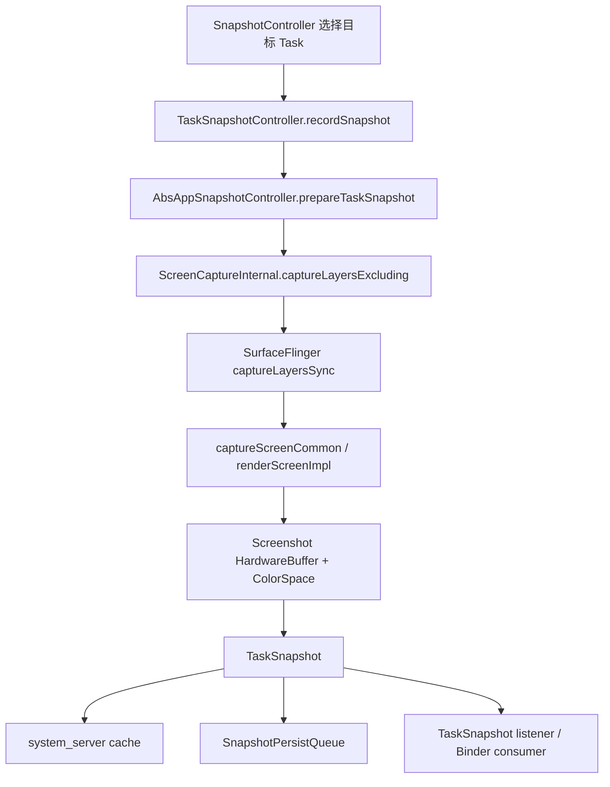
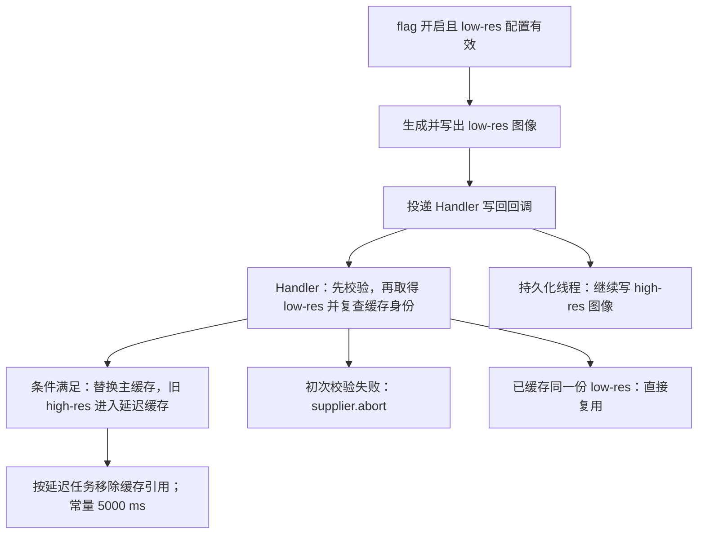
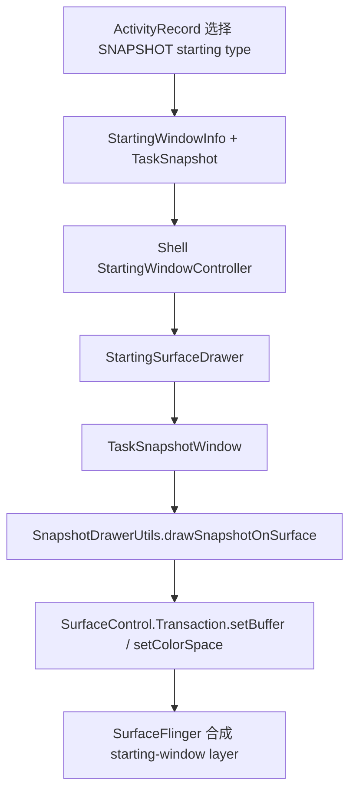

# TaskSnapshot 捕获、Overview（最近任务界面） 缩略图与启动窗口

TaskSnapshot 从 Android 8.0 开始统一了两类历史能力：最近任务缩略图和 WindowManager 保存的 Surface。到了 Android 17，同一份 `TaskSnapshot`（任务画面捕获结果及其元数据）仍在多个场景里复用，只是各场景真正显示的对象不同。

先区分四个容易混用的概念：

| 概念 | 内容来源 | 显示位置 | Android 17 的主要对象 |
|---|---|---|---|
| TaskSnapshot | WMS（WindowManagerService）请求捕获 Task Surface 子树 | 缓存、磁盘或跨进程传递 | `android.window.TaskSnapshot` |
| Overview 静态缩略图 | TaskSnapshot 包装成 hardware `Bitmap` | Launcher 与 Quickstep 的窗口 | `ThumbnailData`、`TaskThumbnailView` |
| Overview live tile（实时任务卡片） | 正在参与 Recents animation 的真实 Task Surface | remote animation leash | `RemoteAnimationTarget`、leash |
| snapshot starting window（快照启动窗口） | 旧 TaskSnapshot 作为启动占位 | 独立 starting-window Surface | `TaskSnapshotWindow` |

这四者的 buffer（图像缓冲区）、SurfaceControl（控制图层树节点的系统对象）、生命周期和性能瓶颈各不相同：我们在 Overview 里看到一张卡片时，屏幕上未必存在一个名叫 TaskSnapshot 的独立 SurfaceFlinger（系统图层合成服务） layer。

> 源码基线：AOSP `android-17.0.0_r1`；Launcher 侧参考 `packages/apps/Launcher3` 的同名 tag（源码版本标签）；Android 8～16 仅用于说明版本演进。

## 1. TaskSnapshot 保存了什么

### 1.1 TaskSnapshot 的构成

`TaskSnapshot` 包含：

- 捕获结果 `HardwareBuffer`（可跨进程共享的硬件图形缓冲区）；
- `ColorSpace`（色彩空间）；
- top Activity component（顶部 Activity 组件名）；
- orientation（方向） 与 display rotation（显示旋转）；
- 原始 task size（任务尺寸）；
- content insets（内容边距） 与 letterbox insets（信箱模式留边）；
- 分辨率级别（高或低）标记；
- real snapshot（真实画面快照） 或 app-theme snapshot（应用主题占位快照）标记；
- windowing mode（窗口模式）、system-bar appearance（系统栏外观）、translucency（是否半透明）；
- 是否包含 IME（输入法） Surface；
- 屏幕密度（DPI）；
- snapshot ID 与 capture time（捕获时间）。

这些元数据决定消费端怎么旋转、裁剪、缩放和判断兼容性。反过来说，只保存一张 PNG 或 JPEG，复现不了 starting-window 与 Overview 的行为。

`HardwareBuffer` 跨进程时经 Binder（Android 跨进程通信机制） 传的是底层 buffer 句柄和引用，整张像素图不必复制进 Parcel（Binder 序列化容器）。不过接收方一侧仍有成本：我们拿到的是引用，要管理它的生命周期、等待 buffer 可用，再交给 GPU（图形处理器） 或 HWC（Hardware Composer，硬件合成器） 合成。省掉了像素复制，省不掉这些开销。

### 1.2 TaskSnapshot 与 LayerSnapshot 的职责区分

SurfaceFlinger FrontEnd 使用 `LayerSnapshot` 描述当前帧的 layer 可见性、几何、Z-order（Z 轴顺序）、buffer 与效果状态；WMS 的 `TaskSnapshot` 则是对一个 Task Surface 子树执行 screen capture（屏幕捕获） 后生成的可复用图像。

两者在链路上的关系是：

```text
SF LayerSnapshot 集合
  → screen capture 合成
    → 新的 screenshot HardwareBuffer
      → WMS TaskSnapshot
```

所以我们在 Perfetto 或源码里看到 `LayerSnapshotBuilder` 时，先别急着当作缩略图生成：它很可能只是 SurfaceFlinger 为普通显示帧更新 FrontEnd 状态。

## 2. 快照在什么时候捕获

系统产出快照的时机主要就三类：transition（转场） 提交前、设备休眠前，以及特权调用方主动请求。我们先看最主要的 transition 路径。

### 2.1 Shell transition 在 transaction ready（同步事务就绪） 阶段记录

现代 transition 路径的入口是 `SnapshotController.onTransactionReady()`，它逐个检查 `Transition.ChangeInfo`（转场中对象的变化信息）；对满足条件且即将不可见的 Task，系统会在 transition transaction（转场图层事务） 启动前调用：

```text
SnapshotController.onTransactionReady()
  → TaskSnapshotController.recordSnapshot(task, changeInfo)
    → AbsAppSnapshotController.recordSnapshotInner()
```

这条调用链赶在转场事务提交前记录符合条件的 Task。下面的情形会被排除或特殊处理：

- home 与 PiP（画中画）change；
- organizer（任务组织器） 创建的 Task（`Task.mCreatedByOrganizer`）；
- transient hide（转场中的临时隐藏）；
- Task 仍 `isVisibleRequested()` 为 true；只有 `!task.isVisibleRequested()` 的 Task 才会被记录；
- 某些 display change 同时改变 bounds（边界） 的场景。

为什么要把 `ChangeInfo` 传进来？因为 Task configuration（任务配置） 可能在 transition 准备阶段已经改变，捕获时仍要用关闭前的 rotation（旋转） 和 bounds，避免旧画面配上新几何。

### 2.2 休眠前还有一条捕获路径

屏幕即将关闭或设备进入 sleep（休眠） 时，还有第二条路径：`snapshotForSleeping(displayId)` 会遍历对应 Display 上可见的 leaf Task（`Task.isVisible()` 为 true 且没有子 Task 的叶子任务）。正在被 Recents animation 控制的 Task 会被跳过（`!task.isAnimatingByRecents()`），因为 Recents 路径需要在更合适的时刻处理快照和 IME（输入法窗口）。

安全锁屏进入 sleep 是特例：只有默认 Display（`Display.DEFAULT_DISPLAY`）上、keyguard 为 secure 的 home Task 才可能被捕获，用于解锁回到桌面的 starting window；其他情况下的 home Task 都被显式跳过。

### 2.3 特权调用方可以主动请求

除了被动等待，特权调用方也可以主动要一张快照。隐藏系统 API `TaskSnapshotManager.takeTaskSnapshot()` 允许具备系统权限的调用方对仍可见的 Task 请求新快照；`SnapshotManagerService` 先验证 Task 存在且可见，再决定是否更新系统缓存。

Launcher3 在缩略图缺失时会先读取已有 snapshot，仍为空时再请求 `takeTaskThumbnail()`；普通第三方应用拿不到这组 Task 管理与 framebuffer（显示帧缓冲） 读取权限。

### 2.4 Cached App Freezer 与快照的关系

还有一类常见误解：Cached App Freezer 冻结前会不会自动截一张？不会。`TaskSnapshotController` 没有“每次冻结前先截 Task”的通用 hook（钩子），`CachedAppOptimizer`（缓存应用优化器） 的冻结路径也不会主动调用 snapshot 入口。快照仍主要由 transition、sleep 和特权主动请求三类路径产生（见 §2.1–2.3）。

顺序问题同理。WMS visibility（可见性）、ATMS lifecycle transaction（ActivityTaskManagerService 生命周期事务）、Shell transition 和应用主线程各自独立调度，源码没有向应用承诺 `capture snapshot → onPause() → transition start` 的固定顺序；系统只尽量在 Task 关闭前保留可用于过渡的视觉状态。

## 3. 捕获管线与安全边界

### 3.1 真实画面的调用链

捕获真实 snapshot 的主线是：



图中从 Task Surface 子树生成新的 `HardwareBuffer`，再交给内存缓存、持久化队列或跨进程消费者。`captureLayersExcluding()` 捕获的是 Task `SurfaceControl` 子树，并按状态排除：

- 不应附着到 App 的 IME Surface；
- navigation bar Surface（导航栏图层）；
- 正在退出且不属于基础应用的部分窗口；
- Task 明确登记在 `mExcludeLayersFromTaskSnapshot` 中的 layer。

注意捕获的产物：这是一次新生成的截图 buffer。Task 中可能同时有多个窗口、SurfaceView、壁纸或装饰 layer，SurfaceFlinger 要按当前 layer 状态重新合成出捕获结果，而非直接读走某个 App Window 的 `GraphicBuffer`。

<!-- gracker-diagram: ch02-17-capture-new-buffer -->


图：WMS 选择 Task Surface 子树并排除指定 Layer，再由 SurfaceFlinger 根据当前 Layer 状态执行同步捕获与截图渲染，产出新的 HardwareBuffer 和 ColorSpace。TaskSnapshot 还保存旋转、任务尺寸、Insets 等元数据，随后进入缓存、持久化或 Binder 消费路径。

### 3.2 同步捕获与 transition 关键路径

这条路径里，`ScreenCaptureInternal.captureLayers()` 调用 native synchronous capture（原生层同步捕获） 并等待 `ScreenshotHardwareBuffer` 结果；SurfaceFlinger 一侧的 `captureLayersSync()` 最终经过 `captureScreenCommon()` 与 screenshot render（截图渲染）。

代价也随之而来：这是同步调用，高分辨率、复杂 layer 树、GPU 繁忙或 buffer 分配压力都可能延长 WMS 与 transition 的准备时间。我们判断“进入 Overview 掉帧”时，光看 App `doFrame()` 不够，还要把这段同步捕获的耗时计入。

AOSP 也没有“1080p 必须 5–15 ms”一类的保证：截图策略、SoC（系统级芯片）、RenderEngine（SurfaceFlinger 中负责 GPU 合成与截图渲染的组件）、layer 数量、像素格式和系统负载都会改变结果，耗时以目标设备 trace（性能轨迹） 的实测值为准。

### 3.3 REAL、APP_THEME 与 NONE

`AbsAppSnapshotController.getSnapshotMode()` 会选择：

- `SNAPSHOT_MODE_REAL`：捕获真实 Task 内容；
- `SNAPSHOT_MODE_APP_THEME`：根据 `TaskDescription` 和 window background 生成主题占位；
- `SNAPSHOT_MODE_NONE`：不生成 Task snapshot。

具体规则如下：

- `ACTIVITY_TYPE_RECENTS`（最近任务 UI Activity） 和 `ACTIVITY_TYPE_DREAM`（屏保 Activity） 直接返回 `SNAPSHOT_MODE_NONE`，不捕获任何 Task snapshot；
- `ACTIVITY_TYPE_HOME` 总是走 `SNAPSHOT_MODE_REAL`，并不会因为是 home Task 就跳过；
- 其他 Task 在 top Activity 触发 `shouldUseAppThemeSnapshot()`（综合 `setRecentsScreenshotEnabled(false)`、FLAG_SECURE、敏感内容策略和设备策略）时选择 app-theme，否则走 real。

TV（`FEATURE_LEANBACK`）、IoT（`FEATURE_EMBEDDED`）或设备资源 overlay（覆盖配置） `config_disableTaskSnapshots = true` 也会通过 `shouldDisableSnapshots()` 直接关闭整个快照路径。

对于 home、recents、dream 以外的 Task，top Activity 满足以下任一条件时会选择 app-theme snapshot：

- 调用 `setRecentsScreenshotEnabled(false)`；
- 其窗口被 `FLAG_SECURE`、敏感内容策略或设备策略判为 secure。`ActivityRecord.shouldUseAppThemeSnapshot()` 检查的范围限于该 Activity 的窗口。

主题占位由 system_server（承载系统核心服务的进程） 使用 `RenderNode` 和 `ThreadedRenderer.createHardwareBitmap()` 绘制，包含背景色与 system-bar 装饰信息，不含应用的敏感像素。

<!-- gracker-diagram: ch02-17-real-theme-none-policy -->


图：调用方先检查设备是否禁用快照、Task 可见性和转场等条件。通过这些筛选后，getSnapshotMode 对 recents / dream 返回 NONE，对 home 返回 REAL；其他 Task 由 top Activity 的主题快照策略决定。APP_THEME 生成背景与装饰，不捕获敏感应用像素。HOME 的模式为 REAL 不等于每次调用都会捕获它。

### 3.4 两个隐私 API 的范围

`Activity.setRecentsScreenshotEnabled(false)` 从 API 33 开始公开，只禁止 Activity 的画面被用作 Overview 表示；系统在其他允许的场景仍可以截图。

`FLAG_SECURE` 的范围更广：它阻止窗口进入普通截图，并限制在非安全 Display 上显示。处理登录、支付或隐私数据时，我们要按威胁模型选择合适的开关，Overview 开关替代不了 `FLAG_SECURE`。

## 4. 内存缓存、磁盘文件与分辨率

快照捕获之后存在哪里、占多少内存、什么时候落盘，直接决定 Overview 的响应速度和图形内存占用。我们按运行时缓存、内存估算、磁盘持久化、磁盘恢复的顺序过一遍。

### 4.1 system_server 的运行时缓存

`SnapshotCache` 使用下面的 `ArrayMap` 保存正在运行的任务快照：

```text
ArrayMap<Integer, CacheEntry> mRunningCache
```

这里的 key 是 task ID，淘汰却不按访问顺序走 LRU（Least Recently Used，最近最少使用）。常见清理时机包括：

- top Activity 被移除或进程死亡；
- Task 从 Recents 删除；
- Task 重新变为可见并完成 transition；
- 系统显式清空 snapshot cache。

进程死亡时，system_server 的运行时 cache entry 会被删掉，已经持久化的磁盘文件还能继续服务后续的 Overview 或启动恢复；Launcher 进程另有自己的缩略图缓存。

low-res 写回还有一段容易看错的时序。`onlyCacheLowResTaskSnapshot` 这个 feature flag（功能开关） 开启且 low-res 配置有效时，`TaskSnapshotController.getRecordSnapshotSupplier()` 才会给持久化队列传入 `updateLowResToCacheFunction(task, snapshotId)`。队列先生成并写出 low-res 图像，再通过该回调把写回工作 post 到 `mHandler`，随后继续写 high-res 图像；Handler 回调与 high-res 写盘之间没有完成顺序保证。

回调先进入全局锁，校验 task 仍 attached、缓存里的 snapshot ID 仍匹配且仍为 high-res；任一条件不满足就调用 `supplier.abort()`。通过后，回调在锁外取得 low-res，再进入全局锁检查 Task 与缓存身份，符合条件才更新 `mCache`；如果同一份 low-res 已由其他读取路径写入缓存，就直接复用。

写回成功时，`TaskSnapshotCache` 会把旧 high-res 从主 `mRunningCache` 替换出去，并在 `DeferRemoveHighResCache` 中短暂保留同一 ID 的 high-res；Android 17 源码里的延迟移除常量是 5000 ms。主缓存换为 low-res 后，high-res buffer 在写盘、回调排队和延迟移除的窗口内仍可能被引用。我们排查内存时，要区分主缓存替换与底层 buffer 释放。



图：low-res 回调在 high-res 写盘之前投递，两条执行路径可以交错。缓存替换需要复查 Task、snapshot ID 与分辨率；移除缓存引用也不保证所有消费者已释放同一 buffer。

### 4.2 内存估算要带上 scale、format 与 stride

单个未压缩 buffer 的下限估算为：

```text
width × height × bytesPerPixel
```

这个公式只算紧密排列的可见像素，1080×2400 的 RGBA_8888 大约占 9.9 MiB。

实际分配还要算上 row stride（每行实际字节跨度）、gralloc（图形缓冲区分配器） 对齐和附加元数据；再叠加高低分辨率版本、Binder 引用、Launcher hardware `Bitmap` 和 starting window 的引用，总占用还会进一步变化。

默认情况下，real snapshot 使用 RGBA_8888。设备资源 overlay（覆盖配置） 开启 `config_use16BitTaskSnapshotPixelFormat` 后，`AbsAppSnapshotController` 也只会在 snapshot pixel format（像素格式） 仍为 `UNKNOWN`、`use16BitFormat()` 为真、top Activity `fillsParent()`，且主窗口不是“半透明并显示壁纸”的组合时选择 RGB_565；否则回退到 RGBA_8888。

随后 `isTranslucent` 再由 `PixelFormat.formatHasAlpha(pixelFormat)`、`fillsParent()` 和窗口半透明状态计算。

所以“low-RAM（低内存） 设备一定缓存 3–5 张、一定使用 RGB_565”这类说法在 Android 17 源码里找不到依据，厂商可以用下面的 overlay 调整：

- `config_highResTaskSnapshotScale`；
- `config_lowResTaskSnapshotScale`；
- `config_use16BitTaskSnapshotPixelFormat`；
- `config_disableTaskSnapshots`。

AOSP 默认 high-res scale（高分辨率缩放系数） 为 1.0，low-res scale（低分辨率缩放系数） 为 0.5；把 low-res scale 设为 0 可以关闭 reduced snapshot（低分辨率快照）。

### 4.3 持久化在线程队列完成

`SnapshotPersistQueue` 使用名为 `TaskSnapshotPersister` 的后台线程。一次 store（持久化任务） 先写 snapshot 元数据的 proto（Protocol Buffers） 文件，再把 HardwareBuffer 复制成 software `Bitmap`。图像写入顺序取决于是否带有 low-res 写回回调：

- 没有回调时，先写 high-res 图像，配置允许时再生成并写 low-res 图像；
- 带有回调时，先生成并写 low-res 图像、投递写回回调，再写 high-res 图像。low-res 缓存更新无需等待 high-res 文件写完。

Android 17 默认路径下，JPEG 压缩质量常量为 `SnapshotPersistQueue.COMPRESS_QUALITY = 95`。当 `onlyCacheLowResTaskSnapshot` flag 开启时，high-res 改用 PNG（lossless），low-res 仍按 JPEG 95 写出；磁盘文件扩展名不会随格式变化。

```text
/data/system_ce/<userId>/snapshots/<randomized-directory>/
```

路径中的 `<randomized-directory>` 是随机化目录名。典型文件名为：

```text
<taskId>.proto
<taskId>.jpg
<taskId>_reduced.jpg
```

这些文件分别保存元数据、高分辨率图像和低分辨率图像。`onlyCacheLowResTaskSnapshot` flag 开启后，high-res 文件虽沿用 `.jpg` 文件名，实际内容却是 PNG。我们排查文件格式时，要看文件头，别只看后缀。

队列会合并同一 task、user、provider（任务、用户和快照提供者） 的重复写入，并限制待处理的 HardwareBuffer store 数量，免得后台持久化积压无限占用图形内存。

### 4.4 从磁盘恢复包含解码和重新上传

`AppSnapshotLoader` 先读取 proto 文件，再用 `BitmapFactory.decodeFile()` 解码图像，随后复制为 `Config.HARDWARE` bitmap 并取得 `HardwareBuffer`。所以磁盘命中也包含文件读取、解码和硬件位图分配的成本。

恢复后的 `capture time` 需要单独解释：proto 保存 snapshot ID，但不保存原始 capture time；`AppSnapshotLoader` 用加载时的 `SystemClock.elapsedRealtimeNanos()` 构造 `TaskSnapshot`。旧画面因此可能带着一个很近的 capture time。`TaskSnapshot.getCaptureTime()` 的源码注释还将有效范围限定在生成该快照对象的进程内，排查缩略图新旧时应关联 snapshot ID 与原始捕获记录，不能把磁盘恢复时间当成画面更新时间。

磁盘恢复与内存命中差别很大：

| 路径 | 主要工作 |
|---|---|
| system_server 内存命中 | 引用管理与 Binder 传递 |
| 磁盘高低分辨率加载 | 文件 I/O（输入输出）、图像解码、hardware bitmap 分配 |
| Launcher 本地 cache（缓存）命中 | 直接复用 `ThumbnailData` |

回到排查现场：没有 trace 时，把 Overview 空卡统一归因于 GPU 是轻率的——它可能卡在磁盘、Binder、Launcher executor（后台执行器） 或主线程 bind（数据绑定） 任何一环上。

<!-- gracker-diagram: ch02-17-disk-roundtrip -->


图：后台 TaskSnapshotPersister 保存 proto，复制为 software Bitmap 后编码图像；磁盘恢复则读取 proto、decodeFile，再复制为 HARDWARE Bitmap 取得 HardwareBuffer。onlyCacheLowResTaskSnapshot 开启时 high-res 实际写 PNG，文件名仍沿用 .jpg，判断格式应看文件头。

## 5. Overview：静态缩略图与 live tile

### 5.1 静态缩略图由 Launcher 自己绘制

Launcher3 的主要读取路径是：

```text
TaskThumbnailCache
  → ActivityManagerWrapper.getTaskThumbnail()
    → TaskSnapshotManager.getTaskSnapshot()
      → SnapshotManagerService
        → system cache 或 disk
```

这条路径先查询 system_server 内存缓存，必要时再从磁盘恢复。收到 `TaskSnapshot` 后，`ThumbnailData.fromSnapshot()` 调用 `wrapToBitmap()`，把 HardwareBuffer 包装为 hardware `Bitmap`，同时保存 rotation、Insets、scale、windowing mode 等信息。

Launcher3 的 `TaskThumbnailView` 是 Launcher View hierarchy（View 树） 中的 `FrameLayout`。

静态 snapshot 最终设置到 `FixedSizeImageView`，由 Launcher 的 View 与 HWUI（Android 硬件加速 UI 渲染管线） 绘制进 Launcher App Window buffer。

回到合成器视角：SurfaceFlinger 看到的主体通常是 Launcher 窗口 layer，而不是“每张最近任务卡片各有一个独立 `BufferStateLayer`”。HWC 仍会按整屏 layer 集合选择 `DEVICE`（由 HWC 合成）或 `CLIENT` composition（由 RenderEngine 合成）；hardware `Bitmap` 也不保证卡片拿到独立 overlay。

### 5.2 Launcher 还有自己的缓存和预加载

`TaskThumbnailCache` 的容量来自 Launcher 资源 `recentsThumbnailCacheSize`，与 system_server `SnapshotCache` 无关。它支持：

- 低、高或任意分辨率请求；
- 后台加载（协程路径使用 `withContext(backgroundDispatcher)`，回调路径把 `CancellableTask` 交给 `bgExecutor`）；
- cache size（缓存容量） 变化后裁剪（`updateCacheSizeAndRemoveExcess`）；
- 进入 Overview 前预加载（由 `enableTaskSnapshotPreloading` 与 `HighResLoadingState.visible` 控制）；
- 按 Task key 校验旧 entry（`cache.getAndInvalidateIfModified(key)`）。默认的 `TaskKeyByLastActiveTimeCache` 检查 windowing mode 与 last active time；缓存分辨率能否满足请求，由 `TaskThumbnailCache` 另行判断；
- `clear()` 与 `remove()` 清理入口。内存 trim 是否触发这些入口，需要继续追踪 Launcher 进程级回调的注册与调用，不能从 `TaskThumbnailCache` 或 `TaskIconCache` 的存在推定 trim 阈值。

我们排查内存时，至少要区分三块：system_server 的 TaskSnapshot buffer、Launcher 的 hardware `Bitmap` 引用，以及屏幕上 Launcher App Window buffer。

### 5.3 live tile 与真实 Task leash

Quickstep 的 `TaskUiStateMapper` 会在当前 running Task（正在运行的任务） 且允许实时显示时选择 `LiveTile`。Recents animation 把真实任务作为 `RemoteAnimationTarget` 交给 Launcher，Launcher 再对 leash 应用 matrix（变换矩阵）、crop（裁剪）、alpha（透明度） 等 transaction。

live tile 的选择不由进程存活、冻结或死亡单独决定。一个仍存活的后台 Task 可以显示静态 snapshot；live tile 通常对应当前正在参与 Recents animation 的 running Task，是否显示 screenshot 还受手势状态、锁定状态、最小化状态和 Launcher 实现影响。

### 5.4 点击卡片有两类启动路径

点击当前 running live tile 时，Quickstep 可以沿 remote target leash（远程动画目标的临时父 Surface） 执行返回应用的动画。

点击静态卡片时，Launcher 发起 `startActivityFromRecents()`。随后 WMS 可能：

- 直接等待已有 App Window；
- 创建 snapshot starting window；
- 因 snapshot 不兼容而改用 splash（启动画面）；
- 在 Task 或 Activity 已满足显示条件时不创建 starting window。

所以这一步没有统一的“Launcher 把静态 snapshot layer 渐变切换为 App 实时 Surface”模型：Launcher 静态缩略图、Shell remote leash 和 WMS starting window 是三套不同的对象。

<!-- gracker-diagram: ch02-17-three-display-objects -->


图：静态 Overview 和 snapshot starting window 都可使用旧 TaskSnapshot，但前者作为 Bitmap 画进 Launcher 窗口，后者直接把 buffer 设置到独立 starting surface。live tile 使用当前 Recents animation 的真实 Task Surface 和 leash，应用进程存活并不自动意味着显示 live tile。

## 6. Snapshot starting window

### 6.1 WMS 先判断能否使用旧快照

`ActivityRecord.getStartingWindowType()` 会结合 task switch（任务切换）、进程与 Activity 状态、是否允许 snapshot 等条件选择 starting-window 类型。

使用 snapshot 前还要检查：

- top Activity component 是否兼容；
- snapshot rotation（快照旋转角度） 是否等于目标 rotation；
- snapshot task aspect ratio（任务宽高比）与当前 bounds 的差值是否在源码阈值内。

Android 17 对 aspect ratio（宽高比） 用 0.01 的绝对差阈值。折叠、旋转或桌面窗口 resize（调整大小） 让旧 snapshot 落到阈值之外时，我们通常会看到系统回退到 splash，或者不显示该 snapshot。

### 6.2 Shell 创建独立 starting surface

snapshot starting window 的主线是：



图中 Shell 创建独立 starting surface，把旧 snapshot buffer 交给 SurfaceFlinger 合成。这里的 snapshot 是独立的 SurfaceControl buffer layer，与 Launcher 静态卡片的 ImageView 路径不同，也不是由 App BLAST producer 提交的内容。

### 6.3 尺寸不一致时会缩放

`SnapshotDrawerUtils` 比较 snapshot buffer 与目标 window bounds。尺寸相同且没有 letterbox offset（信箱模式留边偏移） 时，buffer 可直接设置到 root Surface（starting window 的根图层）。

尺寸不一致时，系统会：

- 创建子 BLAST buffer layer，或在 `useClientSurface()` 分支复用 root Surface；随后直接通过 transaction 设置 snapshot buffer；
- 按 letterbox insets 调整 position；
- 分别计算 X、Y scale（横纵缩放比例） 填充目标 frame；
- 设置 snapshot color space；
- 提交 buffer transaction。

这个路径能遮住部分 resize 间隙，代价是旧内容可能短暂缩放；App 的新布局仍要由 App 自己提交符合新 bounds 的首帧。

<!-- gracker-diagram: ch02-17-starting-snapshot-geometry -->


图：WMS 先根据启动条件、component、rotation 与 task aspect ratio 等判断能否使用旧 snapshot；不兼容时可能选择 splash 或 NONE。被接受后，Shell 再处理 buffer 与 window 尺寸是否匹配：匹配可直接设到 root，不匹配则使用子 BLAST buffer layer 或 client root，配置缩放、位置与色彩空间后设置 buffer。

### 6.4 移除时机与 IME

App 内容 ready 后，TaskOrganizer（任务组织器） 请求移除 starting window。普通 snapshot 可以立即或延迟移除；包含 IME 的 snapshot 还会等待新 IME draw 回调或超时。

Android 17 的 Shell 代码含 100 ms、600 ms、3000 ms 三种延迟上限，分别服务一般延迟、IME 和 fixed-rotation（固定旋转过渡）。它们是特定 removal mode（移除模式） 的保护值，别当成所有 App 冷启动的固定等待时间。

## 7. 折叠屏、多窗口与多 Display

### 7.1 Overview 会按元数据调整缩略图

Launcher3 的 `PreviewPositionHelper` 根据下列元数据计算缩略图到卡片区域的几何变换：

- snapshot rotation；
- `ThumbnailData.scale`（快照尺寸相对原 Task 的缩放系数）；
- letterbox insets；
- snapshot 与卡片的 aspect ratio；
- 当前设备 density（屏幕密度）；
- split bounds（分屏边界） 与 stage position（分屏位置）；
- RTL（从右向左布局） 与大屏布局状态。

它生成 ImageView matrix（图像变换矩阵），对静态缩略图执行旋转、裁剪和缩放。折叠后卡片显示正常，只说明 Launcher 的缩略图适配成功了；WMS starting window 和 App 首帧是否匹配，还要另查。

### 7.2 starting window 的兼容检查更严格

折叠前后的 Task bounds 可能在 rotation 不变时改变宽高比。`ActivityRecord.isSnapshotOrientationCompatible()` 会比较 snapshot `taskSize` 与当前 Task bounds；差异超过阈值时，系统不使用 snapshot starting window。

系统并不会在每次显示变化时重新捕获所有 Task：`TaskSnapshotController` 没有通用的 `handleDisplayChange()` 或 `snapshotBeforeDisplayChange()` 路径。

### 7.3 一个 Task 归属一个 DisplayContent（一块逻辑显示设备的窗口容器）

AOSP WindowManager 中，一个 Task 在某一时刻归属于一个 `DisplayContent`。Task 可以在 Display 之间移动，桌面 Overview 也可以把多个 Task 组合展示，但“一个普通 Task 同时跨两个 `DisplayContent` 捕获主、副区域”的通用模型并不存在。

捕获入口使用该 Task 自己的 `SurfaceControl` 与所在 Display 的状态。我们排查多 Display 问题时，要把这些先记下来：

- task ID 与 display ID；
- 捕获时的 task bounds、rotation、density、windowing mode；
- 查看 Overview 的 Display；
- starting window 与 App Window 最终出现在哪个 Display。

## 8. 颜色、透明度与 HWC

### 8.1 ColorSpace 会随 TaskSnapshot 传递

SurfaceFlinger 捕获结果返回 `HardwareBuffer` 和 `ColorSpace`。TaskSnapshot 保存这两项供消费端使用；其中 `ColorSpace.getId() < 0` 的自定义色彩空间会在构造函数中回退为 `ColorSpace.Named.SRGB`，不能假定所有色彩空间对象都原样保留：

- Launcher 把 buffer 包装为 hardware `Bitmap`；
- starting window 通过 `SurfaceControl.Transaction.setColorSpace()` 标记 Surface 的色彩空间。

WCG（广色域）Task 的最终 dataspace（像素数据的颜色解释标签） 要由捕获内容、Display color mode（显示颜色模式）、HDR 与 SDR 策略和 SurfaceFlinger screenshot 路径共同决定，直接假设它一定得到 `DISPLAY_P3` 并不成立。

### 8.2 透明 snapshot 的背景绘制

real snapshot 的 pixel format 可为 RGBA_8888，`TaskSnapshot.isTranslucent()` 记录 Task 是否可能透出背景。Launcher3 会先绘制 `TaskDescription` 指定的背景，再显示 thumbnail，避免透明或局部为空的 snapshot 露出错误内容。

snapshot starting window 在本节基线中直接设置旧 snapshot buffer；`SnapshotDrawerUtils.SnapshotSurface` 处理几何与色彩空间，没有额外调用背景或 system-bar 装饰绘制。`TaskSnapshotWindow` 虽然从 `TaskDescription` 保存背景色供外部查询，但这不等于它把该颜色画到了 starting surface 上。app-theme snapshot 的背景与系统栏装饰已在生成阶段绘入 buffer（见 §3.3）。

### 8.3 HardwareBuffer 与 composition type（合成类型）

TaskSnapshot 使用 gralloc buffer，可被 GPU 采样，也可在满足设备约束时参与 HWC 的 DEVICE composition（设备直接合成）。最终选哪种 composition type，取决于：

- layer transform（变换）、crop、alpha 与圆角；
- 目标 Display 与 dataspace；
- overlay 数量和格式支持；
- 其他可见 layer；
- protected 或 secure 内容；
- HWC validate（合成能力校验） 结果。

Overview 静态卡片通常已经画入 Launcher App Window；启动 snapshot 更可能表现为独立 layer。对这两者，我们要分别确认 composition 结果，不能共用“HWC 直接合成 snapshot”的结论。

## 9. 性能观测

### 9.1 先确定测量对象

建议分别定义：

| 问题 | 起点 | 终点 |
|---|---|---|
| 后台切换卡顿 | transition 开始收集 | snapshot capture 返回，或 transition transaction 生效 |
| Overview 空卡 | Launcher 发起 thumbnail 请求 | `TaskThumbnailView` 所在 Launcher 帧完成显示（present） |
| 点击最近任务闪烁 | 卡片点击并开始 launch transition | App 新 buffer 在目标 Display 完成显示 |
| starting window 停留过久 | `TaskSnapshot#addToDisplay` | snapshot starting surface 被移除，且 App 帧完成显示 |
| 缩略图过旧 | 与 snapshot ID 对应的原始捕获记录（磁盘恢复的 capture time 仅表示加载时刻） | 用户打开 Overview 的时间 |

注意分段：捕获耗时、磁盘恢复耗时和显示耗时是三段数据，报告时别压缩成一个“TaskSnapshot latency（延迟）”。

<!-- gracker-diagram: ch02-17-observation-domains -->


图：捕获区间关注 WMS 同步调用与 SF 截图；加载区间关注 system cache / disk、Binder 和 Launcher executor；显示区间关注静态卡片、starting surface 或 App 新帧的实际 present。对齐同一 task、snapshot、window 与 display，才能判断空卡或闪烁发生在哪一段。

### 9.2 Perfetto 关注的 slice（带起止时间的 trace 片段）

建议采集调度、Binder、图形、View 与 WindowManager：

```bash
adb shell perfetto \
  -o /data/misc/perfetto-traces/task-snapshot.perfetto-trace \
  -t 15s \
  sched freq idle binder_driver gfx view wm
```

该命令录制 15 秒 trace，覆盖线程调度、CPU 频率、Binder、图形、View 和 WindowManager 事件，可以搜索这些 slice：

- `createSnapshot`；
- `captureLayers`、`captureScreenCommon`、`captureScreenshot`、`renderScreenImpl`；
- `StoreWriteQueueItem#<taskId>`；
- `getTaskSnapshot#<taskId>_res=...`；
- `getSnapshotFromDisk_Id=...`；
- `createLowResSnapshot`、`waitSnapshotUpdated_Id=...`；
- `TaskSnapshot#addToDisplay`、`TaskSnapshot#relayout`、`TaskSnapshot#relayoutAsync2`；
- Launcher thumbnail executor（缩略图后台执行器）、View traversal（View 树遍历）、HWUI 与 FrameTimeline（帧时间线）；
- Recents animation 的 remote target leash transaction（远程动画目标 Surface 的事务）；
- App 首帧 `BufferTX`（buffer transaction 事件）、latch（SurfaceFlinger 接收 buffer） 与目标 Display present。

一个简单的 Trace Processor（Perfetto trace 查询工具） 查询可以先列出相关 slice：

```sql
SELECT
  name,
  ts / 1e6 AS ts_ms,
  dur / 1e6 AS dur_ms
FROM slice
WHERE name GLOB '*Snapshot*'
   OR name IN (
     'createSnapshot',
     'captureLayers',
     'captureScreenCommon',
     'captureScreenshot',
     'renderScreenImpl'
   )
ORDER BY ts;
```

这条查询只用于找候选区间。下一步我们还要按 process（进程）、thread（线程）、flow（跨线程或跨进程关联） 和目标 task ID、display ID 对齐，避免把普通 screenshot 或 SurfaceFlinger `LayerSnapshot` 更新算进 TaskSnapshot。

### 9.3 dumpsys 与文件检查

以下命令用于记录同一采样时刻的窗口、最近任务、SurfaceFlinger 图层和 Launcher 内存状态：

```bash
adb shell dumpsys window | grep -A 40 -i SnapshotCache
adb shell dumpsys activity recents
adb shell dumpsys SurfaceFlinger --list | grep -i -E 'snapshot|starting|recents'
adb shell dumpsys meminfo <launcher-package>
```

四条输出分别回答四个问题：WMS 是否缓存快照、ATMS 记录了哪些最近任务、屏幕上是否存在 snapshot 图层，以及 Launcher 进程占用多少内存。使用时还要考虑：

- cached TaskSnapshot 没有显示到屏幕时，可能根本不出现在 SF layer list（SurfaceFlinger 图层列表）；
- `SurfaceFlinger --list` 看到的 snapshot layer 更可能是 starting window；
- system_server 与 Launcher 持有同一底层 buffer 的引用时，按进程简单相加可能重复计算共享的 DMA-BUF（Linux 内核中的共享图形缓冲区）；
- `/data/system_ce` 文件检查通常需要 root 或 userdebug 权限。

支持的调试构建还可以用 DMA-BUF 统计工具确认 exporter（缓冲区导出方）、inode（内核对象标识） 和 size，再结合 Java heap 判断 TaskSnapshot 图形内存。

## 10. 常见故障的定位顺序

### 10.1 进入 Overview 时掉帧

依次检查：

1. transition ready 前是否出现耗时较长的 `createSnapshot`；
2. SF capture 的瓶颈是 layer 收集、buffer 分配还是 RenderEngine；
3. Launcher 是否同步等待磁盘中的 snapshot；
4. low-res 是否先显示，high-res 更新是否造成额外 bind（把新缩略图绑定到卡片）；
5. Launcher 主线程、RenderThread 和最终 FrameTimeline 是否按时。

### 10.2 卡片显示黑色或主题色

检查 `ThumbnailData.isRealSnapshot`、Activity 的 recents screenshot 开关、`FLAG_SECURE`、设备策略和 App lock（应用锁） 状态。主题色卡片可能就是预期的 app-theme snapshot，属于正常行为而非 capture 失败。

### 10.3 卡片旧，但 App 已更新

记录 snapshot ID、获取路径和 capture time，并确认 Task 最近一次何时转为不可见。内存捕获的时间与磁盘恢复时重设的时间需要分开；判断画面是否更新，应把 ID 关联回原始捕获记录，不能仅凭恢复后的 capture time 很近就认定快照新鲜。后台仍存活，说明不了系统在持续刷新静态缩略图；live tile 也只覆盖正在参与 Recents animation 的目标。

### 10.4 点击卡片后画面跳变

区分三张画面：

1. Launcher 静态 thumbnail；
2. WMS 与 Shell 创建的 snapshot starting window；
3. App 新提交的窗口 buffer。

比较三者的 task bounds、rotation、density、contentInsets、letterboxInsets 和首帧内容。只看录像判断不了跳变发生在 Launcher launch animation、starting surface 还是 App 首帧。

### 10.5 折叠或旋转后快照拉伸

检查：

- Launcher 的 `PreviewPositionHelper` 几何变换；
- snapshot rotation 与 task size；
- 当前 Task bounds 与 display density；
- starting-window compatibility（兼容性检查） 是否触发回退；
- `SnapshotDrawerUtils` 是否进入 size-mismatch scale（尺寸不匹配时的缩放） 路径；
- App 新 bounds 的 buffer 何时 latch（被 SurfaceFlinger 接收并用于合成）。

### 10.6 图形内存持续上涨

分别统计：

- system_server running snapshot cache；
- 功能 flag 控制的 high-res 延迟释放缓存；
- persist queue 尚未写完的 HardwareBuffer；
- Launcher thumbnail cache；
- 屏幕上的 starting window，以及 Launcher 和 App Window 的 buffer；
- 其他共享 DMA-BUF 引用。

我们最后要把两个信号分开读：磁盘上的 `.jpg` 文件再多，也说明不了这些 snapshot 都驻留在图形内存中；system_server Java heap 平稳，也排除不了 gralloc 或 DMA-BUF 的压力。

## 11. 版本演进

| 平台 | 相关变化 | 复核边界 |
|---|---|---|
| Android 8（API 26） | 引入 TaskSnapshot 基础设施，统一最近任务缩略图与 WindowManager 保存的 Surface | 起点是 Android 8，不是 Android 9 |
| Android 10（API 29） | TaskSnapshot 与现代 SurfaceControl、capture 路径继续演进 | 旧资料中的 `GraphicBuffer`、类名与锁行为不能直接套到 Android 17 |
| Android 12（API 31） | BLAST、Shell transition 与 starting-surface 架构成为现代分析基线 | WMS 管理对象、Shell leash 与 App buffer 要分开观察 |
| Android 13（API 33） | `Activity.setRecentsScreenshotEnabled()` 公开 | 只控制 Overview 中的显示内容，范围小于 `FLAG_SECURE` |
| Android 17（API 37） | 当前源码锚点：`TaskSnapshotManager`、分辨率与引用跟踪、现行 `SnapshotPersistQueue`、Shell starting window 与 Launcher3 thumbnail UI | feature flag 与资源 overlay 仍可改变高低分辨率缓存、格式和预加载策略 |

## 12. 源码与官方文档入口

### Android 17 platform

- [`SnapshotController.java`](https://android.googlesource.com/platform/frameworks/base/+/refs/tags/android-17.0.0_r1/services/core/java/com/android/server/wm/SnapshotController.java)：transition 捕获、snapshot manager Binder 服务与可见 Task 清理；
- [`TaskSnapshotController.java`](https://android.googlesource.com/platform/frameworks/base/+/refs/tags/android-17.0.0_r1/services/core/java/com/android/server/wm/TaskSnapshotController.java)：Task 触发、高低分辨率策略、sleep 捕获和持久化入口；
- [`TaskSnapshotCache.java`](https://android.googlesource.com/platform/frameworks/base/+/refs/tags/android-17.0.0_r1/services/core/java/com/android/server/wm/TaskSnapshotCache.java)：运行时缓存、高分辨率延迟移除和磁盘恢复入口；
- [`AbsAppSnapshotController.java`](https://android.googlesource.com/platform/frameworks/base/+/refs/tags/android-17.0.0_r1/services/core/java/com/android/server/wm/AbsAppSnapshotController.java)：`REAL`、`APP_THEME`、`NONE` 模式，`captureLayers`、像素格式与元数据；
- [`TaskSnapshot.java`](https://android.googlesource.com/platform/frameworks/base/+/refs/tags/android-17.0.0_r1/core/java/android/window/TaskSnapshot.java) 与 [`TaskSnapshotManager.java`](https://android.googlesource.com/platform/frameworks/base/+/refs/tags/android-17.0.0_r1/core/java/android/window/TaskSnapshotManager.java)：buffer、引用、分辨率与 Binder 客户端；
- [`SnapshotPersistQueue.java`](https://android.googlesource.com/platform/frameworks/base/+/refs/tags/android-17.0.0_r1/services/core/java/com/android/server/wm/SnapshotPersistQueue.java) 与 [`AppSnapshotLoader.java`](https://android.googlesource.com/platform/frameworks/base/+/refs/tags/android-17.0.0_r1/services/core/java/com/android/server/wm/AppSnapshotLoader.java)：后台写入、压缩与磁盘恢复；
- [`TaskSnapshotWindow.java`](https://android.googlesource.com/platform/frameworks/base/+/refs/tags/android-17.0.0_r1/libs/WindowManager/Shell/src/com/android/wm/shell/startingsurface/TaskSnapshotWindow.java) 与 [`SnapshotDrawerUtils.java`](https://android.googlesource.com/platform/frameworks/base/+/refs/tags/android-17.0.0_r1/core/java/android/window/SnapshotDrawerUtils.java)：starting surface、buffer transaction 与尺寸不匹配处理；
- [`SurfaceFlinger.cpp`](https://android.googlesource.com/platform/frameworks/native/+/refs/tags/android-17.0.0_r1/services/surfaceflinger/SurfaceFlinger.cpp)：`captureLayersSync()`、`captureScreenCommon()` 与 screenshot render。

### Android 17 Launcher3

- [`TaskThumbnailCache.kt`](https://android.googlesource.com/platform/packages/apps/Launcher3/+/refs/tags/android-17.0.0_r1/quickstep/src/com/android/quickstep/TaskThumbnailCache.kt)：Launcher 高低分辨率缓存与后台加载；
- [`TaskKeyByLastActiveTimeCache.java`](https://android.googlesource.com/platform/packages/apps/Launcher3/+/refs/tags/android-17.0.0_r1/quickstep/src/com/android/quickstep/util/TaskKeyByLastActiveTimeCache.java)：按 windowing mode 与 last active time 校验缓存 entry；
- [`TaskUiStateMapper.kt`](https://android.googlesource.com/platform/packages/apps/Launcher3/+/refs/tags/android-17.0.0_r1/quickstep/src/com/android/quickstep/recents/ui/mapper/TaskUiStateMapper.kt)：`LiveTile`、`Snapshot`、锁定与背景状态；
- [`TaskThumbnailView.kt`](https://android.googlesource.com/platform/packages/apps/Launcher3/+/refs/tags/android-17.0.0_r1/quickstep/src/com/android/quickstep/task/thumbnail/TaskThumbnailView.kt)：静态 hardware Bitmap 的 View 绘制；
- [`PreviewPositionHelper.java`](https://android.googlesource.com/platform/frameworks/base/+/refs/tags/android-17.0.0_r1/packages/SystemUI/shared/src/com/android/systemui/shared/recents/utilities/PreviewPositionHelper.java)：rotation、density、letterbox、split 与裁剪矩阵。

### 官方说明

- [AOSP Task snapshots](https://source.android.com/docs/core/perf/task-snapshots)：Android 8.0 起源、Recents 与 starting window 共用 buffer，以及高低分辨率配置；
- [`Activity.setRecentsScreenshotEnabled()`](https://developer.android.com/reference/android/app/Activity#setRecentsScreenshotEnabled(boolean))：API 33 的 Overview 隐私开关；
- [`WindowManager.LayoutParams.FLAG_SECURE`](https://developer.android.com/reference/android/view/WindowManager.LayoutParams#FLAG_SECURE)：安全窗口的截图与 Display 约束。

## 13. 常见误读

下面把阅读正文时容易记错的边界集中说明，每条都对应到前文的具体来源：

1. **transition 路径只记录 `!isVisibleRequested()` 的 Task**。`SnapshotController.onTransactionReady()` 中 `task != null && !task.mCreatedByOrganizer && !task.isVisibleRequested()` 是同一行的复合条件，遗漏否定就是相反结论。
2. **`getSnapshotMode` 对 home 一律走 REAL**，对 recents / dream 直接 NONE，不能因为是 home 就跳过；对其他 Task 是否走 app-theme 由 top Activity `shouldUseAppThemeSnapshot()` 决定。
3. **sleep 路径只捕获 `isVisible()` 且 `!isAnimatingByRecents()` 的 leaf Task**；secure keyguard 情况下默认 Display 的 home Task 才被纳入，其他 home Task 在这一路径被显式跳过。
4. **`DeferRemoveHighResCache` 缓存的 high-res 在 `onlyCacheLowResTaskSnapshot` 关闭时不存在**。flag 关闭时 `TaskSnapshotCache` 构造里 `mDeferRemoveCache` 为 `null`；就该类的缓存结构而言，high-res 只保存在主 `mRunningCache`，持久化队列、Launcher 与 starting surface 仍可另持引用。
5. **`TaskThumbnailCache` 不直接订阅 `ITaskSnapshotListener`**。`TaskSnapshotManager.registerTaskSnapshotListener()` 通过进程内的 `TaskSnapshotListenerTracker` 统一向系统注册，再分发给本地监听器；highRes / lowRes 状态切换在 `HighResLoadingState` 内部维护，不要把 trim 阈值或 onTaskSnapshotChanged 流程归到 `TaskThumbnailCache` 自身。
6. **`isSnapshotOrientationCompatible` 的 aspect ratio 阈值是 `0.01f`**，且比较的是宽高比（`taskSize.x / taskSize.y` 与 `w / h`），不是宽度差值的绝对比例；折叠后不旋转但宽高比变化超过阈值时 starting window 直接走 splash 或 NONE。
7. **`FLAG_SECURE` 与 `setRecentsScreenshotEnabled(false)` 的范围在前文 §3.4 已经分别说明**；混用会丢掉 `FLAG_SECURE` 的 Display 限制与截屏防护，是真实工程里经常出现的回归点。

## 小结

TaskSnapshot 是一次 Task Surface 子树捕获及其元数据容器，主要在两条显示路径中复用：

1. Launcher 把 HardwareBuffer 包装成 hardware Bitmap，作为 Overview 静态卡片绘制；
2. WM Shell 把旧 TaskSnapshot 设置到独立 starting-window Surface，等待 App 内容 ready。

Overview live tile 的实时内容来自 Recents animation 提供的真实 Task Surface 与 remote leash；它需要与这两条使用 TaskSnapshot buffer 的静态快照路径分开观察。

我们检查这条管线时，应把捕获、缓存与磁盘、Binder、Launcher 与 Shell 的几何处理、App 新 buffer 和目标 Display present 分开核对。把它们合并成“snapshot layer 直接交给 HWC”的模型，会漏掉最常见的卡顿、错帧和内存来源。

> 版本范围：平台与 Launcher 路径按 `android-17.0.0_r1` 核对；结论最高适用于 Android 17（API 37）。
