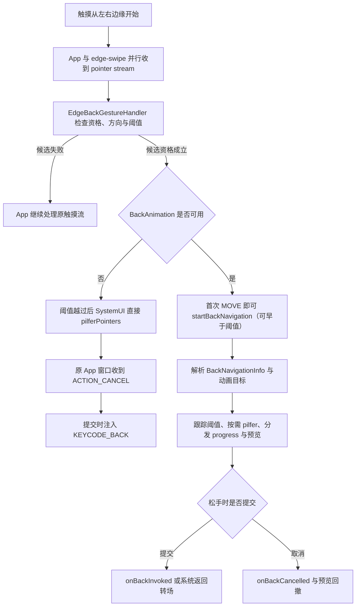
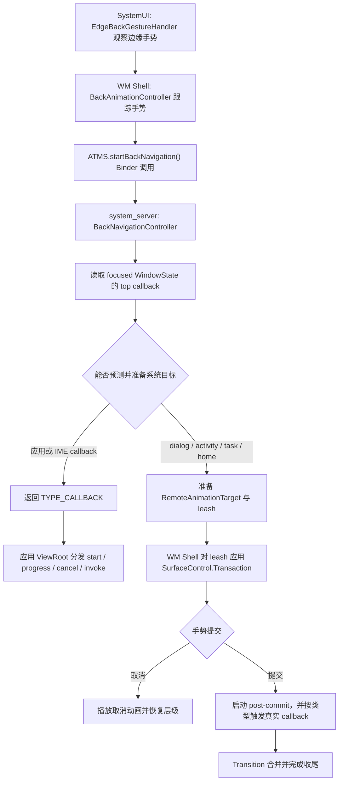
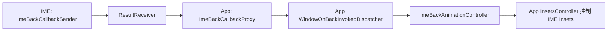

# 系统手势导航与 Predictive Back

一个返回手势从边缘滑入开始，要经过边缘区域识别、导航策略判断，才转成窗口或应用回调；Predictive Back 再把返回提交拆成开始、进度、取消和完成四个阶段，让系统动画与应用状态变化同步。

> 源码基线：AOSP `android-17.0.0_r1`。

## 系统手势识别与窗口路由

### 为什么要了解手势导航

在 Perfetto 里看到应用的触摸事件流以 `ACTION_CANCEL` 结束，或者从某个时刻起不再有后续 `MOVE`，我们先别急着把原因归到应用：左右边缘的返回手势开始时，SystemUI（系统界面进程） 的手势监视通道（gesture monitor）和应用可以同时收到同一条指针事件流（pointer stream）。系统确认这是返回手势后，通过 `pilferPointers()` 抢占后续指针，把事件交给手势处理方，同时取消原窗口的触摸目标。下文把这一步简称为“指针抢占”。

Android 10 / API 29 引入全手势导航：从左右边缘向内滑动是返回，底部上滑和横向滑动负责回到主屏（Home）、进入最近任务或快速切换。边缘返回采用“并行观察、达到条件后接管”的方式，在 `ACTION_DOWN` 到达前，系统不会无条件把触摸挡在应用外面。手势冲突和输入延迟的分析，都以这个时序为起点。

Android 13 / API 33 开始提供预测性返回（Predictive Back） API，返回处理多出一个预提交阶段：手指移动时，系统解析返回目标、生成进度并准备预览，松手后才提交或取消。Android 15 把返回主屏（back-to-home）、跨任务（cross-task）、跨 Activity（cross-activity）三类系统动画移出开发者选项；Android 16 进一步把它们设为 `targetSdkVersion >= 36` 应用的默认行为。

文中结论会区分哪些能由 Perfetto 直接确认，哪些还需要 `dumpsys` 或 Winscope 补充。

### Android 10+ 手势导航的系统实现

#### 组件分工

入口仍然是 SystemUI 中的 `EdgeBackGestureHandler`，只是职责拆到了几个协作组件上：

- `EdgeBackGestureHandler` 维护导航模式、主屏排除区域、边缘宽度、方向与阈值状态，并把事件送往反馈插件和 WM Shell。WM Shell 是窗口管理组件中承载系统级任务动画和窗口转场（Transition）的部分。
- `DisplayBackGestureHandlerImpl` 为每块显示屏持有输入监视器、`InputEventReceiver`、排除区域监听器和一个 `BackPanelController`。
- `InputMonitorCompat("edge-swipe", displayId)` 调用 `InputManagerGlobal.monitorGestureInput()`，取得手势监视器使用的 `InputChannel`。
- `BackPanelController` 和 `BackPanel.kt` 负责边缘箭头和面板动画；它们使用不可触摸的 `TYPE_NAVIGATION_BAR_PANEL` 受信任叠加层（trusted overlay），不靠这个窗口接收触摸。
- `BackAnimationController` 位于 WM Shell，负责 `startBackNavigation()`、目标解析、指针抢占、进度回调以及提交后的系统动画。

`updateIsEnabledInner()` 会注册主屏的 `ISystemGestureExclusionListener`，然后遍历当前显示屏创建 `DisplayBackGestureHandlerImpl`。Android 17 仍把边缘返回识别限定在主显示屏：`isWithinTouchRegion()` 对 `ev.getDisplayId() != mMainDisplayId` 返回 `false`，源码旁保留了 `TODO(b/382130680)`。所以排查外接显示屏时，别拿监视器的生命周期判断返回手势是否可用，要看上面这条判定条件。

旧版的 `InputMonitorResource`、`resetEdgeBackPlugin()` 和 `NavigationBarEdgePanel` 都已退出主路径。

#### 从并行观察到指针抢占

`InputMonitorCompat` 负责建立监视通道，`DisplayBackGestureHandlerImpl` 再用指定的 `Looper` 和 `Choreographer` 创建 `InputEventReceiver`。这两个组件只把事件接进来；返回手势能否成立、何时接管，由上层状态机决定。

我们按事件到达的顺序过一遍触摸判定：

1. `ACTION_DOWN` 到来时，检查导航模式、SystemUI 状态、底部手势区、画中画（PiP）和桌面模式排除区、应用排除区、左右边缘宽度及设备类型。
2. 资格成立后，事件才会送入 `BackPanelController`；如果启用了提前返回分发（ahead-of-time back dispatch），还会送入 WM Shell 的 `BackAnimation.onBackMotion()`。这里的“提前”是指在松手提交前就开始解析返回目标并产生手势进度。
3. 阈值之前，以下任一情况都会取消候选返回手势：纵向位移先超过 `mTouchSlop`、停留超时或出现第二根触点。
4. 横向位移大于纵向位移并超过 `mTouchSlop` 后，`mThresholdCrossed` 变为 `true`。
5. 旧式分支此时由 `EdgeBackGestureHandler` 直接调用 `pilferPointers()`；提前分发分支调用 `BackAnimation.onThresholdCrossed()`，由 `BackAnimationController` 决定何时抢占指针，判断依据包括描述返回目标和动画能力的 `BackNavigationInfo`、系统动画是否可用以及应用如何生成进度。

`pilferPointers()` 最终进入 `InputDispatcher`（输入分发器）。原目标窗口收到的是分发器合成的 `ACTION_CANCEL`，手势监视器则继续接收后续事件。所以“监视器收到事件副本”推不出“应用始终能收到完整手势”，两者中间隔着一次抢占。

#### 旧式与提前分发两条提交路径

下面的流程图标出两条提交路径的分叉点：



左侧旧式（legacy）分支到 Android 17 源码里仍是明确的回退路径，别把它当成只存在于 Android 10–12 的老代码。当 `mBackAnimation == null` 时，越过阈值后由 SystemUI 抢占指针，`BackPanelController` 判断提交后，`triggerBack()` 注入 `KEYCODE_BACK` 的按下和抬起事件。

右侧走的是提前分发：`ACTION_DOWN` 和 `MOVE` 经 `dispatchToBackAnimation()` 切到 Shell 执行器，`BackAnimationController` 调用 `IActivityTaskManager.startBackNavigation()` 获取 `BackNavigationInfo`，再决定使用系统动画控制器还是应用回调。`setTriggerBack(true)` 只是记录“松手后提交”的状态；收到 `ACTION_UP` 后，Shell 才执行 `onBackInvoked()` 或启动提交后动画。取消路径则执行 `onBackCancelled()`。如果没有取得 `BackNavigationInfo`，源码仍保留注入返回键的兜底。

预测性返回（Predictive Back）也可能抢占指针。接管时机交给 `BackAnimationController.tryPilferPointers()`：使用系统动画控制器、应用侧生成不了进度、焦点变化或导航信息为空，都可能触发抢占。所以排查性能跟踪时，想分清旧式返回与预测性返回，光有 `ACTION_CANCEL` 还不够，还要结合 Shell 返回动画和回调轨道。

<!-- gracker-diagram: ch03-03-legacy-and-ahead-routing -->


图：SystemUI 与应用先并行观察指针流，候选成立后按是否连接 BackAnimation 分流。legacy 越过阈值后直接 pilfer，提交时注入 BACK；提前分发可在首次 MOVE 就解析 BackNavigationInfo，之后根据阈值、目标和进度生成能力决定抢占与预览。两条路径都可能让原应用收到 CANCEL。

### 手势冲突处理：系统手势优先区域与应用的 WindowInsets

应用一旦把交互放到屏幕边缘，就要和系统手势争这块触摸区域。冲突主要集中在左右返回边缘，以及底部主屏和快速切换区域。应用可以用 `View.setSystemGestureExclusionRects()` 声明需要优先处理的区域，但可排除的范围有限，强制系统手势区域（mandatory system gesture）始终保留给系统。

#### 系统手势排除区域

应用在边缘放置抽屉、滑块或画布手势时，可以通过 `View.setSystemGestureExclusionRects()` 上报局部矩形。坐标以该 View 布局后的局部坐标为准，View 移动或尺寸变化后需要重新计算。

下面的示例只排除抽屉把手实际占用的左侧区域：

```kotlin
override fun onLayout(changed: Boolean, l: Int, t: Int, r: Int, b: Int) {
    super.onLayout(changed, l, t, r, b)
    val exclusionRect = Rect(0, drawerHandleTop, drawerHandleWidth, drawerHandleBottom)
    setSystemGestureExclusionRects(listOf(exclusionRect))
}
```

这些矩形随后进入系统侧的裁剪链：`ViewRootImpl` 的 `ViewRootRectTracker` 收集各 `View` 的矩形，转换到窗口坐标后通过 `WindowSession.reportSystemGestureExclusionChanged()` 上报。WindowManagerService（WMS，窗口管理服务） 的 `DisplayContent.calculateSystemGestureExclusion()` 按窗口 Z 序、可触摸区域和显示坐标汇总，再通过 `ISystemGestureExclusionListener` 把限制后的 `Region` 通知 SystemUI。上报成功只说明 WMS 收到了请求，生效范围还要经过可触摸区域相交和配额计算。

#### 系统手势区域限制

配额的大小由 `mSystemGestureExclusionLimit` 决定：它限制左右边缘各自可排除的**纵向总高度**，矩形的横向宽度不受影响。`WindowManagerConstants` 保证该值至少为 200 dp，设备可以通过 `system_gesture_exclusion_limit_dp` 配置更大的值。`addToGlobalAndConsumeLimit()` 对边缘相交区域逐个消耗高度预算，超出部分会被裁掉。

WMS 同时保留受限区域（restricted `Region`）与原始未受限区域（unrestricted `Region`）。SystemUI 用受限区域决定系统是否让开；触点只命中未受限区域时，表示应用申请过排除，但该片段没有获得配额，系统仍可识别返回，并把它记为被拒绝的排除请求（rejected exclusion）。我们遇到“同一条边有些位置有效、有些位置仍触发返回”时，要检查纵向预算、窗口遮挡与最终获批区域。

<!-- gracker-diagram: ch03-03-exclusion-request-to-grant -->


图：应用提供 View 局部矩形，ViewRootImpl 收集并转换到窗口坐标，上报 WMS。DisplayContent 再按窗口 Z 序、可触摸区域和显示坐标汇总，消耗左右边缘各自的纵向总高度配额。SystemUI 使用最终受限 Region；仅申请过但未批准的片段仍可触发系统返回。

部分系统窗口可以跳过排除区域的高度配额，第三方应用的窗口也可能满足豁免条件：`DisplayContent.needsGestureExclusionRestrictions()` 对请求隐藏导航栏、且使用 `BEHAVIOR_SHOW_TRANSIENT_BARS_BY_SWIPE` 的窗口不施加高度限制。应用仍需上报排除矩形，获批范围仍要经过可触摸区域和窗口遮挡裁剪。这个条件对应粘性沉浸模式（sticky immersive），系统栏短暂出现后会自动再次隐藏。

`WindowState.isImplicitlyExcludingAllSystemGestures()` 另有隐式排除兼容分支：窗口满足上述粘性沉浸条件、应用的 `targetSdkVersion < 29`，并且 `mSystemGestureExcludedByPreQStickyImmersive` 配置开启时，WMS 会把窗口可触摸区域作为排除区域。导航栏临时显示时，`EdgeBackGestureHandler` 会优先允许返回边缘内的候选手势，不受应用排除区阻挡。

#### WindowInsets 与手势区域

Android 把常规系统手势区域和强制系统手势区域分成两层：

- `WindowInsets.Type.systemGestures()` 描述系统手势具有优先级的区域，通常包含左右返回边缘和底部手势区。应用可以在非强制部分申请有限排除。
- `WindowInsets.Type.mandatorySystemGestures()` 标出的是其中系统必须保留的子集，`setSystemGestureExclusionRects()` 覆盖不到。旧方法 `getMandatorySystemGestureInsets()` 自 API 30 起由 `getInsets(Type.mandatorySystemGestures())` 取代。

底部主屏和快速切换手势没有申请退出这一说，处理方式和侧边返回不同。游戏确有全屏交互需求时，可以在交互期间进入沉浸模式（immersive mode），用户仍能通过系统规定的边缘操作重新显示系统栏。普通页面则更适合把滑动控件挪出 `systemGestures()`，把排除区域留给挪不走的关键交互。

### 从返回手势到预测性返回动画

#### 传统返回手势的问题

我们先看旧模型缺什么：早期返回手势在松手前主要显示边缘箭头，用户看不到返回目标；系统通常到提交点才触发返回，应用也就容易把返回处理集中在 `onBackPressed()` 或 `KEYCODE_BACK`。

预测性返回补上的正是这个预提交阶段：WM Shell 在手势进行中就调用 `startBackNavigation()` 拿到目标类型与回调，按进度驱动当前窗口、目标窗口或应用自定义动画。对应用来说，这要求把“跟随手势的视觉更新”和“提交后改变导航状态”分成两件事。

#### 预测性返回的回调模型

回调接口分为平台 API 和 AndroidX 兼容层：

| 层级 | 接口 | 引入版本 | 可直接确认的方法 | 作用 |
| --- | --- | --- | --- | --- |
| 平台提交回调 | `OnBackInvokedCallback` | API 33 | `onBackInvoked()` | 返回提交后收到通知，没有进度方法。 |
| 平台进度回调 | `OnBackAnimationCallback` | API 34 | `onBackStarted()`、`onBackProgressed()`、`onBackCancelled()`、`onBackInvoked()` | 可接收开始、进度、取消和提交事件。 |
| AndroidX 兼容层 | `OnBackPressedCallback` | `androidx.activity:activity` 1.0.0；进度方法在 1.8.0 增加 | `handleOnBackPressed()`；`handleOnBackStarted()`、`handleOnBackProgressed()`、`handleOnBackCancelled()` | 提供向下兼容入口。只有框架 API 34+ 才会由系统驱动后三个进度相关方法。 |

平台回调通过 `OnBackInvokedDispatcher` 注册，AndroidX 回调通过 `OnBackPressedDispatcher` 管理。`OnBackInvokedCallback` 只有提交通知；需要开始、进度和取消事件时，应使用 `OnBackAnimationCallback`，或交给 AndroidX、Navigation、Compose 的对应 API。

`android:enableOnBackInvokedCallback` 的语义还受目标 SDK 版本影响。Android 15 及更早版本用它选择是否加入提前分发模型；Android 16 起，运行在 Android 16+ 且目标版本为 36+ 的应用默认启用，仍可暂时设为 `false` 退出。它和 AndroidX `OnBackPressedCallback.enabled` 是两回事，回调生命周期管理也要单独安排。

#### 版本演进的时间线

| Android 版本 | API | 系统动画状态 | 清单与 Activity 条件 | `targetSdkVersion` 与兼容边界 | 回调与预览范围 |
| --- | --- | --- | --- | --- | --- |
| Android 13 | 33 | 通过开发者选项测试预测性返回动画。 | 应用或 Activity 通过 `android:enableOnBackInvokedCallback` 显式加入。 | `OnBackInvokedCallback` 从 API 33 可用。 | 返回主屏是主要测试入口；提交回调没有进度信息。 |
| Android 14 | 34 | 系统动画测试仍依赖开发者选项。 | 延续显式加入模型。 | `OnBackAnimationCallback` 从 API 34 可用；AndroidX 1.8.0 可转发进度。 | 应用能收到开始、进度和取消事件。 |
| Android 15 | 35 | 开发者选项移除；已加入的应用或 Activity 可以显示返回主屏、跨任务和跨 Activity 动画。 | 仍需迁移到受支持的返回 API；根 Activity 的消费型回调会阻止返回主屏预览。 | 目标 SDK 版本不是唯一条件。 | 系统预览范围扩展到三类系统转场。 |
| Android 16 | 36 | 在 Android 16+ 设备上，目标版本为 36+ 的应用默认启用三类系统动画。 | 可暂时用 `android:enableOnBackInvokedCallback="false"` 退出。 | 目标版本为 36+ 时，旧 `onBackPressed()` 不再调用，`KEYCODE_BACK` 不再分发给应用；三键导航也可接入预测性返回。 | 新增 `PRIORITY_SYSTEM_NAVIGATION_OBSERVER`；API 36 只允许注册一个观察者回调。 |
| Android 17 | 37 | 延续目标版本为 36+ 时的默认模型与三类系统动画。 | 退出开关仍应只作迁移缓冲，业务返回使用 AndroidX 或平台返回 API。 | `PRIORITY_SYSTEM_NAVIGATION_OBSERVER` 已是没有 `@FlaggedApi` 标记的公共常量。 | 观察者回调数量不再受 API 36 的单实例限制，多个回调的调用顺序未定义。 |

API 37 的观察者优先级值为 `-2`。普通注册参数声明了非负范围，`WindowOnBackInvokedDispatcher.Checker` 对这个常量有专门放行。观察者只在系统将执行默认导航时收到通知，不消费返回事件，适合记录日志和统计；多个观察者之间的调用顺序未定义，业务代码要避开对顺序的依赖。

#### 预测性返回对性能的影响

1. 进度回调每帧都可能执行。优先更新 `translationX`、`alpha`、缩放比例或已准备好的动画状态，避免在 `onBackProgressed()` 中做 I/O、Binder 同步调用、复杂布局或创建大量对象。
2. 跨 Activity、跨任务和返回主屏（back-to-home）会同时涉及当前层、目标层和 Shell 动画。掉帧时要检查当前应用、目标 Activity 或 Launcher、WM Shell、SurfaceFlinger，单看当前 Activity 的 RenderThread 是不够的。
3. 只在提交时改变导航状态。若在进度阶段就执行 `popBackStack()` 或 `finish()`，取消手势时很难恢复一致状态。
4. 观察者回调适合记录轻量日志。它不消费返回事件，但仍运行在应用回调环境中，耗时工作应异步化。

### 边缘滑动检测的性能敏感点

#### 先找对 SystemUI 线程

分析边缘手势的耗时，第一步是找对手势判定所在的线程。`DisplayBackGestureHandlerImpl` 和 `EdgeBackGestureHandler` 使用带 `@BackPanelUiThread`（采用 `THREAD_PRIORITY_DISPLAY` 对应的显示相关线程优先级） 的 `UiThreadContext`，`SysUIConcurrencyModule` 再根据 `Flags.edgeBackGestureHandlerThread()` 把它映射到独立的 `BackPanelUiThread` 或 SystemUI 主线程。所以下结论前，先确认手势判定落在 `BackPanelUiThread` 还是 SystemUI 主线程，笼统的“所有判定都在 SystemUI 主线程”在这套配置下站不住。

性能跟踪中，我们先根据线程名和 `InputConsumer processing on...` 等接收器轨迹区段确认事件落在哪条线程，再检查该线程在 `ACTION_DOWN` 到阈值越过之间是否被长任务、锁等待或 Binder 调用占用。`EdgeBackGestureHandler` 没有为每个事件提供稳定的同名区段，必要时应在可控构建中增加自定义跟踪点。

阈值前还要过排除区、SystemUI 状态标志、PiP、桌面模式角区、手势阻塞 Activity 和可选的机器学习（ML）分类等判断，这些判断都要求保持轻量，别把同步 I/O 放进这条路径。

#### 长按超时的影响

手势判定里还有一个长按超时：`mLongPressTimeout` 取 `min(gestures.back_timeout, ViewConfiguration long-press timeout)`。只有在阈值尚未越过时，某个 `ACTION_MOVE` 的 `eventTime - downTime` 超过该值，候选返回才会取消。`gestures.back_timeout` 的 AOSP 默认值为 250 ms，“通常 400–500 ms”的说法在这里对不上号；设备厂商可以通过系统属性改变上限，现场以 `dumpsys` 与设备配置为准。

#### 多指触控的取消

`ACTION_POINTER_DOWN` 只在 `mThresholdCrossed == false` 且输入不是三指触控板返回时取消候选手势。阈值已经越过后，这个分支不再执行。复现“第二根手指取消返回”时，我们要记录第二指落下与阈值越过的先后顺序。

#### 方向、阈值与 ML 分类

方向识别阈值是 `scaledTouchSlop * back_gesture_slop_multiplier`，`back_gesture_slop_multiplier` 的 AOSP 默认值为 `0.75f`。阈值前若 `dy > dx` 且 `dy > mTouchSlop`，手势按纵向移动取消；若 `dx > dy` 且 `dx > mTouchSlop`，才进入返回阶段。

边缘命中还可以启用 `BackGestureTfClassifierProvider`。模型只在配置和 DeviceConfig 共同允许时加载，推理特征包括屏宽、距边缘距离、左右侧、前台包词表索引和 y 坐标。分析边缘“同一点偶发不响应”时，我们要同时记录灵敏度、内边距、排除区、前台包与 ML 开关，光比较手指位移是不够的。

#### 动画渲染的开销

边缘反馈由 `BackPanelController` 和 `BackPanel.kt` 绘制，窗口类型是 `TYPE_NAVIGATION_BAR_PANEL`。它与 WM Shell 的目标预览是两层不同的动画：前者是手指旁的返回提示，后者是当前任务与返回目标的窗口转场。边缘箭头流畅说明的只是第一层，预测性返回的目标预览要单独确认。

### 在 Perfetto 中的表现

我们先明确 Perfetto 在这条链路上能回答什么：事件何时被读入、发给哪些窗口、由哪条线程处理，以及哪些帧错过了截止时间。至于手势排除矩形最终覆盖的几何范围，单靠一类通用 atrace 轨迹看不出来，这部分还要结合 `dumpsys window` 或 Winscope 状态。

#### 最小抓取配置

在量产版 `user` 构建上，可用官方快速入门文档支持的 atrace 类别抓取线程调度、输入、窗口和图形基线：

```bash
adb shell perfetto -o /data/misc/perfetto-traces/back-gesture.perfetto-trace -t 15s \
  sched freq idle am wm gfx view binder_driver input
adb pull /data/misc/perfetto-traces/back-gesture.perfetto-trace
```

这套简写适合确认线程是否繁忙和动画是否掉帧，但不会自动给出完整的指针分发明细。

在 `userdebug` 或 `eng` 设备上，需要逐事件确认应用与 `edge-swipe` 监视器的分发关系时，可使用结构化输入数据源，并同时开启 FrameTimeline：

```protobuf
buffers {
  size_kb: 32768
  fill_policy: RING_BUFFER
}
duration_ms: 15000

data_sources {
  config {
    name: "linux.ftrace"
    ftrace_config {
      ftrace_events: "sched/sched_switch"
      ftrace_events: "sched/sched_waking"
      atrace_categories: "input"
      atrace_categories: "wm"
      atrace_categories: "gfx"
      atrace_categories: "view"
      atrace_apps: "com.android.systemui"
      atrace_apps: "your.package.name"
    }
  }
}
data_sources {
  config {
    name: "android.surfaceflinger.frametimeline"
  }
}
data_sources {
  config {
    name: "android.input.inputevent"
    android_input_event_config {
      mode: TRACE_MODE_TRACE_ALL
    }
  }
}
```

把配置保存为 `back-gesture.pbtxt` 后，通过 `adb shell perfetto --txt -c - -o ... < back-gesture.pbtxt` 录制。`TRACE_MODE_TRACE_ALL` 会绕过调试构建上的隐私裁剪，记录完整坐标和按键内容，只适合本地受控复现；现场或用户数据采集要用 `TRACE_MODE_USE_RULES` 配置脱敏级别。

Perfetto 的查询引擎 Trace Processor 在 `android.input` 模块中提供 `android_motion_events` 和 `android_input_event_dispatch` 视图，可以用同一个 `event_id` 关联 MotionEvent 与窗口分发目标。`InputMonitorCompat` 自身还会写入 `InputMonitorCompat-edge-swipe-dispN created/receiver created/disposed` 瞬时事件；它们对应的是监视器的生命周期，每次手势未必都有同名的持续区段。

#### 1. 旧式返回手势：检查取消事件和按键注入链

1. 用结构化输入事件的 `event_id` 确认初始触摸同时分发到前台窗口和手势监视器。
2. 在阈值附近寻找原窗口的 `ACTION_CANCEL`，并检查 SystemUI 对应线程是否正在处理该手势。
3. 提交后查找注入的 `KEYCODE_BACK` 及其后续窗口分发。
4. 若原窗口收到完整指针事件流且没有 `ACTION_CANCEL`，检查是否未命中返回边缘、命中了最终获批的排除区域，或未达到方向阈值。仅命中未获批的排除申请不会阻止系统返回。

#### 2. 预测性返回：检查进度回调和目标层预览

1. 我们先找 `ACTION_DOWN`、`MOVE` 到 Shell `startBackNavigation()` 的时序，再确认阈值越过。
2. 通过 FrameTimeline 和 SurfaceFlinger 轨迹区分当前 Activity、目标 Activity 或 Launcher。不同返回类型不保证出现相同数量的 Surface。
3. 应用自定义进度回调没有系统统一的轨迹区段名。应给 `onBackStarted()`、`onBackProgressed()`、`onBackCancelled()` 加应用自己的 `Trace.beginSection()`，再与 Shell 和帧时间线对齐。
4. `ACTION_CANCEL` 单独说明不了走的是旧式路径，Shell 也可能抢占指针。
5. 提交后通常走 `onBackInvoked()` 和系统转场；只有导航信息为空等兜底条件才可能再次看到注入的返回键。

#### 3. 排除区冲突的三组对照

排除区问题，我们要把下面三组信息放进同一次复现里：

- 应用记录的矩形与 `WindowInsets.Type.systemGestures()`、`mandatorySystemGestures()`；
- 应用日志中的请求矩形、`dumpsys window` 的 `mSystemGestureExclusion` 最终显示区域，以及 SystemUI 转储中的受限与未受限区域；
- Perfetto 中该指针事件流是否被抢占，以及 SystemUI 判定线程是否及时运行。

应用传给 `setSystemGestureExclusionRects()` 的列表只是申请，WMS 批准的区域大小要另行确认；Perfetto 这边也还原不出所有矩形的布局坐标。所以这两组信息要放在一起互相校验。

### 与其他章节的关系

- **3.1 Input 事件分发全流程**：这里的手势监视器、监视窗口（spy window）、指针抢占和取消事件，都建立在 InputDispatcher 的窗口目标模型上。
- **3.2 触摸响应的性能分析**：结构化输入事件可把 `InputReader` 读取、`InputDispatcher` 分发、窗口投递与应用消费时刻放在同一条链上。
- **2.3 VSync 机制**、**2.3 Choreographer 与渲染流水线**：边缘反馈和预测性预览都受帧节拍约束，FrameTimeline 用来确认帧是否错过截止时间。
- **1.1 线程模型**：Android 17 的边缘判定线程可能是 `BackPanelUiThread`，也可能回退到 SystemUI 主线程；WM Shell 和应用回调还有各自的执行上下文。


## Predictive Back 生命周期与动画同步

预测性返回把返回操作分成“手势预览”和“提交导航”两个阶段，后面所有生命周期与动画问题都从这个拆分出发。手指移动时，系统或应用只更新可撤销的视觉状态；手势提交后，返回回调才执行 `finish()`、弹出返回栈（pop back stack）、隐藏 IME 这些动作。普通手势识别只给出最终动作，预测性返回还要连续传递进度并允许取消，所以应用导航栈和系统窗口动画必须共用同一个提交时点。

这个模型让系统可以提前知道返回目的地，但也引入了三条容易混淆的路径：

- 应用回调处理页面内部返回；
- WM Shell 在系统目标可预测且产品提供对应动画执行器时，对关闭对话框（dialog）、跨 Activity、跨任务和返回主屏执行系统动画；
- 条件不足时回退到应用回调，极端情况下再回退到 `KEYCODE_BACK`。

应用侧的接入方法见 22.11，边缘手势识别见本节前文。

### 1. 先建立正确的阶段模型

#### 1.1 预提交与提交后

`OnBackAnimationCallback` 的四个回调对应两类工作：

| 回调 | 所属阶段 | 合适的工作 |
|---|---|---|
| `onBackStarted()` | 预提交 | 保存起始状态，准备轻量动画对象 |
| `onBackProgressed()` | 预提交 | 根据手势进度更新可撤销的属性 |
| `onBackCancelled()` | 取消 | 把视觉状态恢复到起点 |
| `onBackInvoked()` | 已提交 | 执行导航、关闭容器或提交业务状态 |

我们把界线划在这里：在 `onBackProgressed()` 中结束 Activity、弹出 Fragment 或写数据库，会破坏取消语义。系统动画同样遵守这条线：手势阶段只变换 SurfaceControl 动画控制柄（leash），提交后才调用真实回调，并把预览接入正式的窗口转场。leash 让动画执行者变换窗口图层，但不会把窗口 Surface 本身的所有权交出去。

<!-- gracker-diagram: ch03-03-preview-commit-cancel -->


图：onBackStarted 保存起点，onBackProgressed 随进度更新可恢复的属性。手势取消时 onBackCancelled 恢复视觉状态；确认提交后 onBackInvoked 才执行 finish、pop 或其他导航操作。进度和取消由 OnBackAnimationCallback 提供，OnBackInvokedCallback 本身只有提交方法。

#### 1.2 返回目的地与动画执行者

`BackNavigationInfo` 是 `system_server` 返回给 WM Shell 的返回目标与动画能力描述，定义了以下主要类型：

| 类型 | 含义 | 常见动画执行者 |
|---|---|---|
| `TYPE_CALLBACK` | 应用或输入法回调接管 | 应用进程的回调 |
| `TYPE_DIALOG_CLOSE` | 关闭当前 Activity 上方的窗口 | 取决于产品是否注册动画执行器（runner） |
| `TYPE_CROSS_ACTIVITY` | 返回同一 Task 中的前一个 Activity | WM Shell |
| `TYPE_CROSS_TASK` | 返回前一个 Task | WM Shell |
| `TYPE_RETURN_TO_HOME` | 返回主屏 | Launcher 或产品注册的动画执行器 |
| `TYPE_IN_TRANSITION` | 当前已有窗口转场，暂不能准备 | 等转场空闲后重试 |
| `TYPE_TASK_ROOT_INTERCEPTION` | 根任务（Root Task）拦截返回 | 按系统覆盖规则处理 |

“谁处理进度”由这个类型和 `isPrepareRemoteAnimation()` 共同决定。应用回调获胜时，系统不会同时再跑跨 Activity 系统动画；系统转场获胜时，逐帧 Surface 变换主要发生在 WM Shell。

### 2. 端到端架构

下面的流程图标出 SystemUI、WM Shell、`system_server` 和应用之间谁做决策、谁做动画。下文把 ActivityTaskManagerService 简称为 ATMS，把 InputMethodManagerService 简称为 IMMS。



图中的 `RemoteAnimationTarget` 是交给 Shell 的窗口图层描述，包含几何信息和用于变换图层的 leash。其中两个类负责核心协调职责：

- `BackNavigationController` 位于 `system_server`，负责确定焦点窗口、最高优先级回调、返回目标和可动画性，并准备 WindowContainer 与 Transition 侧资源；
- `BackAnimationController` 位于 WM Shell，负责手势状态、指针抢占、远程动画就绪状态、进度分发以及提交后的收尾。

Android 17 的 WMS 里查不到 `TaskAnimationCoordinator` 这个类，解释跨 Activity、跨任务或任务快照路径时也用不上它。

<!-- gracker-diagram: ch03-03-navigation-target-and-executor -->


图：SystemUI 把手势交给 Shell，Shell 经 ATMS 请求 WMS 的 BackNavigationController。WMS 读取焦点窗口 top callback，判断应用回调或系统目标；满足准备条件且产品有动画执行者时交付 RemoteAnimationTarget 与 leash。应用回调、系统 leash 动画和无有效信息时的按键兜底应分别取证。

### 3. 输入事件怎样到达返回动画

#### 3.1 InputDispatcher 与分流决策

`EdgeBackGestureHandler` 通过系统输入监视通道观察边缘指针事件流，判断手势是否满足起点、方向、排除区域和阈值条件。InputDispatcher 在这里提供的是事件路由与输入监视能力，“这是旧式返回还是预测性返回进度”要由下游的返回处理逻辑来回答。

当 SystemUI 已连接 WM Shell 的 `BackAnimation`：

1. `ACTION_DOWN`、`ACTION_MOVE`、`ACTION_UP` 或 `ACTION_CANCEL` 被转给 `BackAnimationController.onBackMotion()`；
2. Shell 在第一次 `ACTION_MOVE` 时启动返回导航，让按下指针导致的焦点变化有机会先完成；
3. 手势越过阈值后，Shell 按配置调用 `pilferPointers()`，从原接收者接管后续指针；
4. 松手时根据 `triggerBack` 进入提交或取消。

顺带澄清一个容易混淆的信号：`EdgeBackGestureHandler.mBackAnimation` 是否为空，反映的是 SystemUI 与 WM Shell 的功能连接状态，和当前应用是否在清单中显式加入是两回事；应用是否启用新返回模型，主要看窗口有没有注册可供 WMS 使用的回调。

#### 3.2 仍然存在 KEYCODE_BACK 回退

提前返回分发（ahead-of-time）路径也保留了异常回退。例如，`startBackNavigation()` 因找不到有效焦点窗口、当前状态建立不了 `BackNavigationInfo`，或系统正在处理不兼容状态而返回 `null`，Shell 可在手势提交后异步注入 `KEYCODE_BACK`。

这是兜底分支。对目标 SDK 36 及以上且未显式退出新模型的应用，常规路径通过回调分发；官方文档明确指出，`Activity.onBackPressed()` 与返回 `KEYCODE_BACK` 不再作为正常分发入口。

### 4. 窗口回调如何进入 WMS

#### 4.1 每个窗口只向 WMS 暴露最高优先级回调

`WindowOnBackInvokedDispatcher` 在应用进程维护回调集合。最高优先级回调改变时，它把 `OnBackInvokedCallbackInfo` 经 `IWindowSession.setOnBackInvokedCallbackInfo()` 写入对应 `WindowState`。这个对象包含：

- 回调的 Binder 接口；
- 优先级；
- 是否实现 `OnBackAnimationCallback`；
- 是否请求系统覆盖行为。

WMS 无需遍历应用的全部回调，只读取当前窗口已经选出的最高优先级回调。

#### 4.2 优先级与同级顺序

关键优先级常量有四个：

| 常量 | 值 | 用途 |
|---|---:|---|
| `PRIORITY_OVERLAY` | `1_000_000` | 菜单、抽屉等应先关闭的覆盖层 |
| `PRIORITY_DEFAULT` | `0` | 普通应用回调 |
| `PRIORITY_SYSTEM` | `-1` | 框架内部默认导航回调 |
| `PRIORITY_SYSTEM_NAVIGATION_OBSERVER` | `-2` | 只观察系统导航，不消费 |

高优先级先执行；同一优先级按注册顺序逆序选择。应用注册不了普通负优先级回调，`PRIORITY_SYSTEM_NAVIGATION_OBSERVER` 是专门允许的例外。API 36 对观察者数量有限制，API 37 起可注册多个；它们不会改变系统返回结果。

`Activity` 在新模型启用时会以 `PRIORITY_SYSTEM` 注册默认回调。应用注册 `PRIORITY_DEFAULT` 或 `PRIORITY_OVERLAY` 回调后，会覆盖 Activity 的内部系统默认回调；若还存在其他普通回调，仍按优先级和同级注册顺序选择 top。当前 top 为应用回调时，`BackNavigationController` 才将本次导航归类为 `TYPE_CALLBACK`。

<!-- gracker-diagram: ch03-03-callback-priority-selection -->


图：窗口分发器在应用进程维护普通回调，按优先级从高到低、同级后注册优先选出 top callback，再把 CallbackInfo 上报对应 WindowState。OVERLAY / DEFAULT 可以覆盖 Activity 的内部 SYSTEM 默认导航。SYSTEM_NAVIGATION_OBSERVER 不消费返回，API37 可有多个，观察者之间没有固定顺序。

#### 4.3 应用进程内的进度生成

系统还提供了一条减少逐帧跨进程调用的优化路径。满足以下条件时，`BackNavigationInfo.isAppProgressGenerationAllowed()` 可为 `true`：

- 当前回调实现了动画回调接口；
- 窗口允许应用在本进程生成进度；
- 手势可触摸区域与窗口区域匹配；
- 没有需要转交手势的嵌入窗口。

此时应用 `ViewRootImpl` 根据本地 `MotionEvent` 更新 `BackTouchTracker` 与 `BackProgressAnimator`，Shell 跳过对应的 Binder 进度分发。条件不满足时，Shell 仍通过 `IOnBackInvokedCallback.onBackProgressed()` 发送进度。

所以当我们看到应用回调每帧都在运行，先别急着断定每帧都走了一遍 SystemUI → `system_server` → 应用的完整 IPC。

<!-- gracker-diagram: ch03-03-local-versus-binder-progress -->


图：符合应用动画回调、窗口许可、触摸区域匹配且无需转交嵌入窗口等条件时，应用可根据本地 MotionEvent 生成进度，Shell 跳过对应 Binder 进度分发。其他条件下 Shell 经 IOnBackInvokedCallback 发送进度，应用 Handler 与 BackProgressAnimator 再驱动回调。

### 5. system_server 如何预测返回目标

我们跟着 `BackNavigationController.startBackNavigation()` 在 WMS 全局锁下走一轮快照式判断：

1. 找到目标显示屏的焦点窗口；必要时退到焦点任务的窗口；
2. 要求窗口已有有效绘制 Surface；
3. 检查当前是否处于不允许插入预测返回的窗口转场；
4. 读取窗口的 `OnBackInvokedCallbackInfo`；
5. 若应用回调获胜，直接返回 `TYPE_CALLBACK`；
6. 若框架系统回调获胜，再计算对话框、前一 Activity、前一 Task 或主屏；
7. 确认 Shell 声明支持该类型后，准备远程动画。

#### 5.1 放弃预览的回退条件

以下情况会让系统放弃某类预览，改走回调：

- 前一个 Activity 没有进程或窗口；
- Activity 尚未创建，作为跨 Activity 目标还不够安全；
- 参与者包含不适合该路径的透明 Activity；
- 锁屏（keyguard）、应用锁定、任务锁定或浮动任务条件不满足；
- 当前 Activity 使用场景转场（scene transition）；
- 多窗口模式下前后 Task 不在兼容的父层级。

这也解释了一条对性能排查很重要的规律：跨 Activity 和跨任务预测动画通常要求目标已经有进程和窗口，系统不会为了预览去强行冷启动一个已死亡的目标进程。这时用户看到的是普通回调或窗口转场，属于安全回退；先归因到“任务快照丢失”就找错了方向。

#### 5.2 预览阶段的生命周期顺序

对于可动画目标，WMS 核心可以创建 `TRANSIT_PREPARE_BACK_NAVIGATION`，收集打开与关闭两侧的 WindowContainer，并把前一 Activity 设置为后置启动（launch-behind）——先在当前页面后方把目标窗口准备好——或准备启动占位图层（starting surface）。手势取消时这些临时状态需要恢复；手势提交后才由真实回调和正式窗口转场完成导航。

生命周期顺序上要留有余地：`onPause()` 未必发生在首个进度回调前，输入焦点切换也未必落在 `onPause()` 与目标 `onResume()` 之间，实际顺序受返回类型、目标可见状态、窗口转场合并和窗口绘制情况影响。应用能依赖的只有公开生命周期契约。

### 6. WM Shell 如何执行系统动画

#### 6.1 动画注册表与 `RemoteAnimationTarget`

`ShellBackAnimationRegistry` 按 `BackNavigationInfo` 类型保存动画执行器。AOSP Android 17 的默认依赖注入（Dagger）模块装配跨 Activity、跨任务和定制跨 Activity 动画执行器；返回主屏动画可由 Launcher 在运行时注册，关闭对话框的槽位默认为 `null`。

`BackNavigationInfo` 有某个类型，只说明 WMS 核心能表达该目的地；产品侧到底有没有动画执行器，还要 `BackAnimationAdapter.isAnimatable(type)` 来确认。

WMS 核心准备完成后，会把描述打开和关闭窗口图层的 `RemoteAnimationTarget` 及其 leash 交给 Shell。手势阶段的典型每帧工作是：

- 把触摸位移映射为手势进度；
- 计算打开和关闭图层的边界、缩放、位移、裁剪、圆角半径与透明度；
- 在同一个 `SurfaceControl.Transaction` 中写入目标 leash；
- 用当前 `Choreographer` 的 VSync ID 标记事务；
- 提交给 SurfaceFlinger 合成。

这一阶段无需让目标 Activity 每帧重新测量和布局。目标页面自身若仍在绘制，其缓冲区更新与 Shell 对 leash 的图层变换属于两条不同工作流。

#### 6.2 提交后的顺序

手势松开后有三种主要结果：

- 取消：当前动画执行器收到 `onBackCancelled()`，播放回弹并恢复目标；
- 回调路径：Shell 直接调用应用回调的取消或提交方法；
- 系统动画路径：Shell 启动提交后动画；跨 Activity、跨任务和返回主屏会在这一阶段开始时触发真实回调，让关闭转场与动画衔接，其他类型可在动画结束时再触发。

`invokeOrCancelBack()` 收尾时，若持有 `IBackAnimationFinishedCallback`，会先通过 `onAnimationFinished()` 同步通知 WMS，再调用尚未执行的真实回调。跨 Activity、跨任务和返回主屏路径会在 `startPostCommitAnimation()` 中提前执行真实回调，并用 `mRealCallbackInvoked` 防止收尾时重复调用；不能用收尾方法里的顺序推断这几类返回的提交时序。看门狗（watchdog）是防止动画执行器一直不回调的超时保护；动画执行器完成或看门狗超时后，Shell 释放动画目标、结束本次导航，并由 `BackTransitionHandler` 完成后续转场协调。

源码里的 2 秒 `MAX_ANIMATION_DURATION` 是等待远程动画完成的看门狗阈值，兜住的是动画执行器未回调、动画迟到这类异常；产品动画时长和性能目标另有尺度，别拿它当参考。

<!-- gracker-diagram: ch03-03-leash-content-and-postcommit -->


图：系统动画 runner 根据进度更新打开 / 关闭目标的 leash 几何，应用若继续生产内容则走独立 buffer 路径。松手取消要恢复预览；提交时 Shell 进入 post-commit、按类型触发真实回调并与 Transition 衔接。2 秒常量用于异常看门狗，不能当作动画时长。

### 7. 任务快照在预测返回中的角色

系统可以在以下组合条件下为打开侧目标创建无窗口启动占位图层（windowless starting surface）：

- TaskOrganizer 支持无窗口启动占位图层；
- `config_predictShowStartingSurface` 开启；
- 当前策略没有直接采用 `launch-behind`；
- 存在与目标屏幕方向、夜间模式和组件兼容的 Task 或 Activity 快照。

任务快照用于在打开侧窗口尚未绘制时提供临时内容。“实时窗口图层掉帧后动态切换快照”的通用降级，Android 17 并没有实现，按帧选择预览层的 `TaskAnimationCoordinator` 也不存在；目标与预览策略在动画开始前就已经定好。

任务快照的尺寸、格式、是否包含输入法 Surface、是否采用降采样以及缓存寿命都受实现和设备配置影响。仅用屏幕分辨率乘四估算全部快照内存，会忽略实际缓冲区、缓存策略和安全窗口限制；要下内存结论，我们应在目标设备读取图形内存和 TaskSnapshot 现场数据。

### 8. 应用回调路径的性能

应用回调获胜时，`WindowOnBackInvokedDispatcher.OnBackInvokedCallbackWrapper` 会把 Binder 回调投递到创建 `ViewRootImpl` 的 Handler，通常也就是应用主线程。`BackProgressAnimator` 对进度做平滑处理后，再调用应用的 `onBackProgressed()`。

应用侧每帧应限制在可预测的属性更新：

- 预先保存起止位置；
- 更新位移、缩放、透明度或已创建动画的进度比例；
- 避免同步 I/O、Bitmap 解码、导航提交和大对象分配；
- 不在每帧反复修改复杂 `LayoutParams`；
- 取消后完整恢复界面状态。

以下代码标记应用回调的墙钟区间；其中实际占用 CPU 的时间，还需结合线程调度状态计算：

```kotlin
override fun onBackProgressed(backEvent: BackEvent) {
    Trace.beginSection("AppBackProgress")
    try {
        content.translationX = maxTranslation * backEvent.progress
    } finally {
        Trace.endSection()
    }
}
```

如果 `AppBackProgress` 很短而画面仍不连续，还要检查应用 RenderThread、WM Shell、SurfaceFlinger 和显示刷新率；主线程轨迹区段只覆盖其中一段。

AndroidX `OnBackPressedDispatcher`、Navigation、Fragment 与 Compose `PredictiveBackHandler` 会把平台事件桥接到库回调。具体分发与对象分配取决于 AndroidX 版本；分析前先记录 Activity、Navigation、Compose 的依赖版本，再判断问题归属在库版本还是 `frameworks/base` 的 Android 17 实现。

### 9. Predictive Back 与 IME

输入法返回路径跨越输入法和应用两个进程。下面的流程图标出回调转发与 Insets 动画控制之间的分工：



输入法进程通过 `ImeBackCallbackSender` 把回调注册转发给当前应用。应用侧 `ImeBackCallbackProxy` 收到默认系统回调后，会把它映射到 `PRIORITY_DEFAULT`；若 ViewRoot 已提供 `ImeBackAnimationController`，分发器就用该控制器处理预测动画。

默认情况下，输入法回调的优先级高于 Activity 的框架系统回调，所以一次返回先隐藏输入法（IME）。这个行为仍有明确例外：

- 输入法可通过返回处置策略（back disposition）选择跳过默认回调；
- 应用更高优先级的覆盖层回调可以先处理；
- 多窗口与输入法全屏模式会禁用预测性输入法动画；
- 使用 `adjustResize`、没有应用 Insets 动画回调且页面也未采用 edge-to-edge 时，会回退到普通隐藏动画；
- `onKeyPreIme()` 的兼容分支仍可能消费事件并取消 IME 动画。

`ImeBackAnimationController` 在预提交阶段只移动输入法高度的一小部分作为预探效果（peek），提交后再完成隐藏；取消则回到已显示状态。它直接控制 `WindowInsetsAnimationController`，不会让 IMMS 与页面的跨 Activity 动画并行运行。

输入法隐藏提交后，控制器会暂时清除输入法回调，让下一次返回交到后续回调手里，即使隐藏动画还在收尾。常见“两次返回”的现象有这个状态基础，但把它写成所有输入法、窗口模式和回调组合下的硬性规则，会在例外场景翻车。

<!-- gracker-diagram: ch03-03-ime-back-callback-control -->


图：IME 通过 Sender / ResultReceiver 把回调注册传给当前应用 Proxy；默认系统回调在应用窗口映射到 DEFAULT，通常高于 Activity 的内部 SYSTEM 回调。可用时 ImeBackAnimationController 在预提交阶段做 peek，取消恢复，提交后完成隐藏并临时清除回调，让后续返回可以继续导航。

### 10. 如何建立性能结论

#### 10.1 先判定卡在哪个阶段

| 现象 | 优先证据 | 可能范围 |
|---|---|---|
| 手势开始后预览迟迟不出现 | `ACTION_BACK_SYSTEM_ANIMATION`、Shell 就绪日志 | WMS 目标计算、远程动画目标、目标窗口 |
| 手指移动时持续掉帧 | FrameTimeline、Shell 与应用主线程、RenderThread、SurfaceFlinger | 进度回调或 Surface 事务 |
| 松手后停顿 | 提交后动画执行器、Transition、真实回调 | 应用导航、动画执行器、转场合并 |
| 取消后界面没恢复 | 应用取消轨迹或 Shell 动画执行器 | 回调状态机错误 |
| 偶发退回旧动画 | `BackNavigationInfo` 类型、目标进程与窗口 | 预测条件不足 |
| 键盘先闪再隐藏 | `ImeBackAnimationController`、Insets 控制对象 | 输入法控制对象是否就绪、回退模式 |

#### 10.2 分段毫秒预算的局限

60 Hz 一帧约 16.7 ms，120 Hz 一帧约 8.3 ms，但 SystemUI、Shell、应用、RenderThread 和 SurfaceFlinger 的工作是流水执行的，并不共享一张可以简单相加的“2 + 4 + 4 ms”表。评估时，我们要把每一帧 FrameTimeline 的预期与实际时间、CPU 可运行态等待时间和 Surface 事务对齐看。

这条源码路径没有实现“持续掉帧就自动缩短 AppTransition”或“实时窗口图层跟不上就改用任务快照”的通用策略。跳帧、动态刷新率和 HWC 或 GPU 合成都可能出现，判断时要回到 SurfaceFlinger 与调度侧的记录上；从卡顿现象反推不出某个固定降级算法。

### 11. Perfetto 与系统状态观测

#### 11.1 平台已有的指标

WM Shell 中有两类内建观测：

- `LatencyTracker.ACTION_BACK_SYSTEM_ANIMATION`：从 Shell 发起 `startBackNavigation()` 到收到有效远程动画目标；
- InteractionJankMonitor 的关键用户旅程（CUJ）指标：覆盖返回主屏、跨任务和跨 Activity 预测性返回，对相应 leash 的动画帧统计卡顿。

WMS 的协议缓冲转储（proto dump）与窗口跟踪中还包含 `BackNavigationController` 的 `ANIMATION_IN_PROGRESS`、`LAST_BACK_TYPE`。WM Shell 转储会输出 `BackAnimationController` 的手势、提交后动画、指针抢占，以及当前和排队中的跟踪器状态。

#### 11.2 Perfetto 需要覆盖的线程

录制系统跟踪（System Trace）时至少保留：

- SystemUI 与 WM Shell 主线程；
- `system_server` 中 WindowManager 与 ActivityTaskManager 相关线程和 Binder；
- 应用主线程与 RenderThread；
- SurfaceFlinger、GPU、HWC 及 FrameTimeline；
- `input`、`sched`、`freq`、`view`、`wm`、`gfx` 等相关数据源。

我们按下面的顺序分析：

1. 以边缘手势开始为时间原点；
2. 确认本次 `BackNavigationInfo` 类型；
3. 检查远程动画目标到达时间；
4. 区分进度在 Shell 还是应用生成；
5. 对齐每帧事务、应用缓冲区与 SurfaceFlinger 呈现时间；
6. 松手后继续观察，直至真实回调和窗口转场完成。

FrameTimeline 的帧异常类型只描述帧结果。开销到底来自布局、回调、Binder、GPU 还是合成，要展开同一时间范围的线程轨迹区段才能定位。

#### 11.3 建议的覆盖组合

至少覆盖以下状态，并分别记录 P50、P90、P95 分位数：

- 应用回调、系统跨 Activity、跨任务和返回主屏；
- 目标 Activity 已有窗口、条件不足回退；
- 手势提交、中途取消、快速连续两次返回；
- 输入法已显示或隐藏，`adjustResize` 或内容延伸到系统栏边缘（edge-to-edge）；
- 60 Hz 与高刷新率；
- 分屏、自由窗口（freeform）和折叠状态变化；
- AndroidX 回调启用与禁用；
- 目标 SDK 35 与 36+ 的行为差异。

### 12. 源码索引

- [`EdgeBackGestureHandler.java`](https://android.googlesource.com/platform/frameworks/base/+/refs/tags/android-17.0.0_r1/packages/SystemUI/src/com/android/systemui/navigationbar/gestural/EdgeBackGestureHandler.java)
- [`DisplayBackGestureHandler.kt`](https://android.googlesource.com/platform/frameworks/base/+/refs/tags/android-17.0.0_r1/packages/SystemUI/src/com/android/systemui/navigationbar/gestural/DisplayBackGestureHandler.kt)
- [`BackAnimationController.java`](https://android.googlesource.com/platform/frameworks/base/+/refs/tags/android-17.0.0_r1/libs/WindowManager/Shell/src/com/android/wm/shell/back/BackAnimationController.java)
- [`ShellBackAnimationRegistry.java`](https://android.googlesource.com/platform/frameworks/base/+/refs/tags/android-17.0.0_r1/libs/WindowManager/Shell/src/com/android/wm/shell/back/ShellBackAnimationRegistry.java)
- [`BackAnimationRunner.java`](https://android.googlesource.com/platform/frameworks/base/+/refs/tags/android-17.0.0_r1/libs/WindowManager/Shell/src/com/android/wm/shell/back/BackAnimationRunner.java)
- [`ShellBackAnimationModule.java`](https://android.googlesource.com/platform/frameworks/base/+/refs/tags/android-17.0.0_r1/libs/WindowManager/Shell/src/com/android/wm/shell/dagger/back/ShellBackAnimationModule.java)
- [`CrossActivityBackAnimation.kt`](https://android.googlesource.com/platform/frameworks/base/+/refs/tags/android-17.0.0_r1/libs/WindowManager/Shell/src/com/android/wm/shell/back/CrossActivityBackAnimation.kt)
- [`CrossTaskBackAnimation.java`](https://android.googlesource.com/platform/frameworks/base/+/refs/tags/android-17.0.0_r1/libs/WindowManager/Shell/src/com/android/wm/shell/back/CrossTaskBackAnimation.java)
- [`BackNavigationController.java`](https://android.googlesource.com/platform/frameworks/base/+/refs/tags/android-17.0.0_r1/services/core/java/com/android/server/wm/BackNavigationController.java)
- [`BackNavigationInfo.java`](https://android.googlesource.com/platform/frameworks/base/+/refs/tags/android-17.0.0_r1/core/java/android/window/BackNavigationInfo.java)
- [`OnBackInvokedDispatcher.java`](https://android.googlesource.com/platform/frameworks/base/+/refs/tags/android-17.0.0_r1/core/java/android/window/OnBackInvokedDispatcher.java)
- [`WindowOnBackInvokedDispatcher.java`](https://android.googlesource.com/platform/frameworks/base/+/refs/tags/android-17.0.0_r1/core/java/android/window/WindowOnBackInvokedDispatcher.java)
- [`Activity.java`](https://android.googlesource.com/platform/frameworks/base/+/refs/tags/android-17.0.0_r1/core/java/android/app/Activity.java)
- [`ViewRootImpl.java`](https://android.googlesource.com/platform/frameworks/base/+/refs/tags/android-17.0.0_r1/core/java/android/view/ViewRootImpl.java)
- [`ImeBackAnimationController.java`](https://android.googlesource.com/platform/frameworks/base/+/refs/tags/android-17.0.0_r1/core/java/android/view/ImeBackAnimationController.java)
- [`ImeBackCallbackSender.java`](https://android.googlesource.com/platform/frameworks/base/+/refs/tags/android-17.0.0_r1/core/java/android/window/ImeBackCallbackSender.java)
- [`ImeBackCallbackProxy.java`](https://android.googlesource.com/platform/frameworks/base/+/refs/tags/android-17.0.0_r1/core/java/android/window/ImeBackCallbackProxy.java)
- [Add support for the predictive back gesture](https://developer.android.com/guide/navigation/custom-back/predictive-back-gesture)
- [Android 16 behavior changes for target SDK 36+](https://developer.android.com/about/versions/16/behavior-changes-16)


## 版本与实现边界

- Android 13、API 33 引入 `OnBackInvokedCallback` 和提前返回分发模型；
- Android 14、API 34 向应用开放 `OnBackAnimationCallback` 的进度能力；
- Android 15、API 35 移除预测性返回动画的开发者开关，已显式加入的应用会显示返回主屏、跨任务和跨 Activity 系统动画；
- Android 16、API 36 对目标 SDK 36+ 应用默认启用新模型，仍可通过 `android:enableOnBackInvokedCallback="false"` 临时退出；启用时不再走 `onBackPressed()` 和返回 `KEYCODE_BACK` 的常规分发；
- Android 17、API 37 延续该默认行为，并允许同一分发器注册多个 `PRIORITY_SYSTEM_NAVIGATION_OBSERVER`。

Android 17 后续小版本或 AndroidX 新版本的行为，解释不了 `android-17.0.0_r1`。设备厂商对 SystemUI 手势、Launcher 动画执行器、动画资源和窗口策略的修改，需要在对应构建上复核。


## 常见误区

### 所有返回手势都会注入 `KEYCODE_BACK` 吗

不会。`EdgeBackGestureHandler.triggerBack()` 只在 `mBackAnimation == null` 时直接注入按键。提前分发分支先用 `setTriggerBack(true)` 标记提交，再在 `ACTION_UP` 后执行回调或转场；Shell 仅在没有有效 `BackNavigationInfo` 等兜底条件下注入返回键。

### 设置手势排除矩形后，整块区域都会生效吗

不保证。WMS 还会与窗口可触摸区域相交，并按左右侧各自的纵向高度预算裁剪，最终获批区域要单独检查，光看应用的请求列表是不够的。

### `systemGestures()` 能代表所有可排除区域吗

代表不了。`mandatorySystemGestures()` 标出的是系统必须保留的子集，`setSystemGestureExclusionRects()` 覆盖不到；底部主屏和快速切换冲突与左右返回边缘的有限排除要分开处理。

### Android 13 到 Android 17 的开关行为相同吗

不同。API 33 提供提交回调，API 34 增加进度回调，Android 15 移除系统动画的开发者开关，Android 16 对目标版本为 36+ 的应用默认启用并改变旧返回事件分发，API 37 再放开观察者回调数量。调试时必须同时记录系统版本、目标 SDK 版本、清单属性和回调注册情况。

### 手势监视器收到事件后，应用还能收到完整指针事件流吗

阈值前通常可以并行接收；发生 `pilferPointers()` 后，原目标收到 `ACTION_CANCEL`，后续事件流由抢占方处理。旧式与提前分发分支都可能抢占指针，时机由各自状态机决定。


## 参考资料

- AOSP 源码路径：
  - `frameworks/base/packages/SystemUI/src/com/android/systemui/navigationbar/gestural/EdgeBackGestureHandler.java` — 资格判定、阈值、旧式提交与 Shell 入口
  - `frameworks/base/packages/SystemUI/src/com/android/systemui/navigationbar/gestural/DisplayBackGestureHandler.kt` — Android 17 每块显示屏的监视器、接收器、排除区监听和面板
  - `frameworks/base/packages/SystemUI/src/com/android/systemui/navigationbar/gestural/BackPanelController.kt` — 当前默认的边缘返回反馈插件
  - `frameworks/base/packages/SystemUI/src/com/android/systemui/navigationbar/gestural/BackPanel.kt` — 边缘面板的绘制与动画实现
  - `frameworks/base/packages/SystemUI/shared/src/com/android/systemui/shared/system/InputMonitorCompat.java` — `monitorGestureInput()` 的 SystemUI 包装层
  - `frameworks/base/packages/SystemUI/src/com/android/systemui/util/concurrency/SysUIConcurrencyModule.kt` — `BackPanelUiThread` 与主线程的选择
  - `frameworks/base/libs/WindowManager/Shell/src/com/android/wm/shell/back/BackAnimationController.java` — 提前返回分发、目标解析、进度、指针抢占与提交动画
  - `frameworks/native/services/inputflinger/dispatcher/InputDispatcher.cpp` — `pilferPointersLocked()` 与 `CANCEL_POINTER_EVENTS` 合成
  - `frameworks/base/core/java/android/view/ViewRootImpl.java` — View 排除矩形收集与 WMS 上报
  - `frameworks/base/services/core/java/com/android/server/wm/DisplayContent.java` — 最终排除区域、每侧高度预算与粘性沉浸窗口的配额例外
  - [`WindowState.java`](https://android.googlesource.com/platform/frameworks/base/+/refs/tags/android-17.0.0_r1/services/core/java/com/android/server/wm/WindowState.java) — 旧目标 SDK 应用在粘性沉浸模式下的隐式排除兼容条件
  - `frameworks/base/core/java/android/window/OnBackInvokedCallback.java` — API 33 的提交回调
  - `frameworks/base/core/java/android/window/OnBackAnimationCallback.java` — API 34 的进度回调
  - `frameworks/base/core/java/android/window/OnBackInvokedDispatcher.java` — 观察者优先级与回调注册入口
  - `frameworks/base/core/java/android/window/WindowOnBackInvokedDispatcher.java` — 回调排序、观察者与应用进度分发
  - `frameworks/native/services/inputflinger/include/InputTracingPerfettoBackend.h` — 结构化输入 Perfetto 数据源
- 官方文档：
  - [Ensure compatibility with gesture navigation | Android Developers](https://developer.android.com/develop/ui/views/touch-and-input/gestures/gesturenav)
  - [Add support for the predictive back gesture | Android Developers](https://developer.android.com/guide/navigation/custom-back/predictive-back-gesture)
  - [Android 16 behavior changes for target 36+ | Android Developers](https://developer.android.com/about/versions/16/behavior-changes-16)
  - [OnBackInvokedCallback | Android Developers](https://developer.android.com/reference/android/window/OnBackInvokedCallback)
  - [OnBackAnimationCallback | Android Developers](https://developer.android.com/reference/android/window/OnBackAnimationCallback)
  - [OnBackInvokedDispatcher | Android Developers](https://developer.android.com/reference/android/window/OnBackInvokedDispatcher)
  - [WindowInsets | Android Developers](https://developer.android.com/reference/android/view/WindowInsets)
  - [OnBackPressedCallback | Android Developers](https://developer.android.com/reference/androidx/activity/OnBackPressedCallback)
  - [Recording system traces with Perfetto](https://perfetto.dev/docs/getting-started/system-tracing)
  - [FrameTimeline data source | Perfetto](https://perfetto.dev/docs/data-sources/frametimeline)
- 外部参考：
  - TechMerger《深入理解 Android 系统 Back Gesture 的实现》
  - 郭霖《Android 15 新特性：预测性返回手势》
