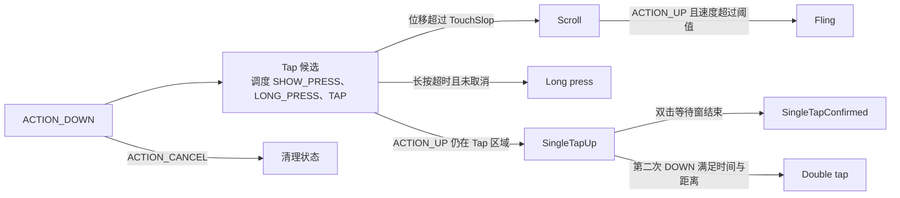

# 手势识别算法与性能优化

手势识别既是状态机问题，也是事件所有权问题。动手优化之前，我们先确认事件序列是否完整、由哪个 View 或识别器持有，再去分析速度估计、阈值判断和自定义算法的 CPU 成本。

> 源码基线：AOSP `android-17.0.0_r1`（Android 17，API 37）；内核 `android17-6.18-2026-06_r6`。

## 为什么要了解手势识别算法

“滑动不跟手”、“松手后没有惯性滚动”这类问题未必伴随掉帧：触摸序列可能已经按时到达主线程，只是在手势判定阶段被解释错了——

- 位移还没超过触摸抖动容差 TouchSlop，控件一直把它当作点击候选；
- 父容器过早拦截，子控件收到的是 `ACTION_CANCEL`；
- 速度样本或指针 ID 用错，惯性滑动（Fling）的速度偏小；
- `ACTION_MOVE` 回调里有分配、日志或业务计算，主线程来不及处理下一批输入。

所以排查这类问题时，我们要分开回答四个问题：事件何时到达、谁拿到事件、事件被识别成什么、识别之后如何驱动滚动。

## VelocityTracker：从采样点得到速度

排查惯性滚动问题，我们迟早要回答“松手那一刻手指有多快”。`VelocityTracker` 收集 `MotionEvent` 的时间、坐标和指针 ID，按需算出各指针在指定轴上的速度；`GestureDetector`、`RecyclerView` 以及许多自定义拖拽控件，都靠它判断是否启动 Fling。

### 生命周期与多指语义

下面是单指生命周期的代码节选：从 `ACTION_DOWN` 开始收样，需要速度时才算一次，手势结束后回收。`updateDrag()` 和 `finishGesture()` 是应用自行实现的回调；多指扩展还应将 `ACTION_POINTER_DOWN`、`ACTION_POINTER_UP` 交给同一个 `VelocityTracker`，并维护当前拖动指针：

```java
private VelocityTracker velocityTracker;

@Override
public boolean onTouchEvent(MotionEvent event) {
    switch (event.getActionMasked()) {
        case MotionEvent.ACTION_DOWN:
            velocityTracker = VelocityTracker.obtain();
            velocityTracker.addMovement(event);
            return true;

        case MotionEvent.ACTION_MOVE:
            velocityTracker.addMovement(event);
            updateDrag(event);
            return true;

        case MotionEvent.ACTION_UP:
            velocityTracker.addMovement(event);
            velocityTracker.computeCurrentVelocity(
                    1000,
                    ViewConfiguration.get(getContext()).getScaledMaximumFlingVelocity());
            int pointerId = event.getPointerId(event.getActionIndex());
            float velocityX = velocityTracker.getXVelocity(pointerId);
            float velocityY = velocityTracker.getYVelocity(pointerId);
            finishGesture(velocityX, velocityY);
            velocityTracker.recycle();
            velocityTracker = null;
            return true;

        case MotionEvent.ACTION_CANCEL:
            velocityTracker.recycle();
            velocityTracker = null;
            return true;
    }
    return false;
}
```

这段代码里有三处容易用错：

1. `addMovement()` 只负责加入样本，供查询方法读取的速度要由 `computeCurrentVelocity()` 生成；`ACTION_MOVE` 到来时记下样本就好，速度留到要读的时候再算。
2. `getXVelocity(id)`、`getYVelocity(id)` 传的是指针 ID，同一指针从按下到抬起或取消期间，ID 保持不变；`MotionEvent` 中的指针位置索引（index）可能随事件变化，两者别混用。
3. 一个 `VelocityTracker` 本来就能同时记录多个指针 ID。源码里的对象池容量为 2，含义只是最多缓存两个按默认策略（框架内置的轴级策略表）创建的实例，多指场景用同一个实例就够了。

Java 封装层把默认策略实例放进 `Pools.SynchronizedPool<VelocityTracker>(2)`：用默认策略创建的实例在 `recycle()` 时清空并回到池中，显式策略实例则留在池外。我们要做的只是成对调用 `obtain()` 和 `recycle()`；池有没有命中由框架处理，设计手势算法时可以把它放在一边。

### Java、JNI 与原生策略

拟合计算本身位于 `frameworks/native/libs/input/VelocityTracker.cpp`，默认的轴级策略如下：

```cpp
static const std::map<int32_t, VelocityTracker::Strategy>
        DEFAULT_STRATEGY_BY_AXIS = {
            {AMOTION_EVENT_AXIS_X, VelocityTracker::Strategy::LSQ2},
            {AMOTION_EVENT_AXIS_Y, VelocityTracker::Strategy::LSQ2},
            {AMOTION_EVENT_AXIS_SCROLL, VelocityTracker::Strategy::IMPULSE},
        };
```

触摸屏的 X、Y 是位置轴，默认走 `LSQ2` 二阶最小二乘拟合（`LSQ2`）：用近期的位置与时间样本拟合出二次曲线，再求速度；`AXIS_SCROLL` 是只报告变化量的差分轴，默认走 `IMPULSE`，按冲量模型从连续差分样本估算速度。`configureStrategy()` 还明确禁止差分轴改用调用方覆盖的策略。

Java 层还保留着 `obtain(int)`、`obtain(String)` 这些隐藏入口，用于系统调试、测试和算法比较。其中 `obtain(String)` 已标记为弃用，源码要求隐藏接口调用方改用 `obtain(int)`；这两种重载都不属于公开 SDK，普通应用使用公开的 `obtain()`。

原生层的收样逻辑里，还有几处会影响诊断的细节：

- `ACTION_DOWN` 会先清空旧状态，再加入 X、Y 样本；
- `ACTION_MOVE` 会遍历历史批次和当前批次，并为每个指针 ID 加入 X、Y；
- 标记为重采样（resampled）的样本会被跳过，避免根据预测坐标再拟合一次速度；
- `ACTION_UP` 和普通 `ACTION_POINTER_UP` 不重复加入抬手位置，以保留末次有效移动的速度；
- 原生层用共享的 `mLastEventTime` 判断停顿：对已有 pointer ID，新移动样本距最近一次移动超过 40 ms 时会清空已配置策略；抬手时也有对应的停顿检查；
- `getComputedVelocity()` 最终按 `units / 1000` 缩放，并限制在 `[-maxVelocity, maxVelocity]`。

Android 14（API 34）起，公开 API 增加了 `isAxisSupported()` 与 `getAxisVelocity()`，`AXIS_SCROLL` 也进入公开可跟踪范围。读取轴速度前先用 `isAxisSupported(axis)` 确认支持情况；不支持的轴返回 0，不能据此判断设备停止运动。各版本的默认策略演进如下：

| 平台版本 | 默认策略模型 |
|---|---|
| Android 10–11 | 全局默认策略为 `lsq2` |
| Android 12–13 | `Strategy::DEFAULT` 仍映射到全局 `LSQ2` |
| Android 14–17 | 轴级策略表：X、Y 使用 `LSQ2`，`SCROLL` 使用 `IMPULSE` |

这张表解释的是版本差异。套用之前先确认输入源和轴：鼠标滚轮、旋钮的 `AXIS_SCROLL` 要单独分析，触摸屏 X、Y 的结论直接搬过去会出错。

<!-- gracker-diagram: ch03-04-velocity-sample-compute-query -->


图：obtain 后 addMovement 收集时间、坐标、pointer ID 与历史样本，原生实现跳过 resampled 点。AOSP17 的 X / Y 默认 LSQ2，SCROLL 差分轴默认 IMPULSE；需要查询时 computeCurrentVelocity 生成结果，再按 pointer ID 读取并在结束时 recycle。数组 index 会变，不能替代 ID。

### 怎样测量 VelocityTracker 的开销

`addMovement()`、`computeCurrentVelocity()` 的耗时，AOSP 没有承诺过固定值，对象池也撑不起“整条路径零分配”的结论。处理器、编译状态、样本数、策略和调试代码都会改变结果，开销要靠测量说话。

在 Perfetto 里，这两个调用通常只出现在包含它的上层主线程调用里。想知道自定义识别器是否算得过勤，我们可以在受控构建中给待测代码包上 `Trace.beginSection()`、`Trace.endSection()`，同时采集：

- 主线程调度与 `android.view` 轨迹；
- `FrameTimeline` 和应用帧；
- ART 对象分配分析与运行时、GC 轨道，用于确认 Java、Kotlin 分配路径和停顿；若怀疑 JNI 一侧，再单独采集原生内存分配数据；
- 输入事件或自定义埋点中的 `eventTime`、处理开始时间。

`computeCurrentVelocity()` 的源码注释明确说它相对昂贵，应在需要读取速度时再调。简单 Fling 只在 `ACTION_UP` 算一次就够；产品需要在拖动过程中按速度切换状态时，也可以在 `ACTION_MOVE` 里算，但要限定触发条件，并用轨迹确认它有没有变成高频耗时点。

## GestureDetector：由事件序列驱动的状态机

`GestureDetector` 内部持有 `VelocityTracker`、Handler 消息和一组状态位。单个事件进来只是把状态往前推一步，识别器再持续判断当前触摸序列还符合哪些候选条件。我们用下面这张状态图定位点击、滚动、长按、双击和 Fling 的主要分支：



这张图只是阅读源码的索引，回调之间可以先后发生：例如双击监听器启用后，第一次抬手仍可能先触发 `onSingleTapUp()`，之后才轮到 `onDoubleTap()` 或 `onSingleTapConfirmed()`。

<!-- gracker-diagram: ch03-04-gesture-detector-candidates -->


图：DOWN 建立 Tap 候选并安排 Handler 消息；MOVE 超过阈值可转 Scroll，UP 且速度足够可触发 Fling。Tap 区域内 UP 可立即 onSingleTapUp；双击监听器按时间和距离继续判断 DoubleTap 或 SingleTapConfirmed。长按需定时条件仍有效，CANCEL 会清理所有候选与消息。

### 从 `ACTION_DOWN` 到 `ACTION_CANCEL`：各阶段分别做什么

`GestureDetector.onTouchEvent()` 在进入 `switch` 之前，就把事件交给了内部 `VelocityTracker`。各阶段的关键行为：

- `ACTION_DOWN`：保存按下事件和焦点坐标，进入点击候选区域，安排 `SHOW_PRESS`、`LONG_PRESS` 和双击确认相关消息，并调用 `onDown()`。
- `ACTION_MOVE`：以多指焦点的位移与 TouchSlop 比较。越界后取消点击和长按候选并调用 `onScroll()`；后续移动只要焦点变化至少 1 像素即可继续产生 `onScroll()` 回调。
- `ACTION_POINTER_UP`：计算各指针的速度。如果离开的指针与剩余指针速度向量点积为负，会清空 `VelocityTracker`，避免相反方向的多指运动生成错误 Fling。
- `ACTION_UP`：按双击、长按、单击候选、Fling 的优先顺序收尾；Fling 分支会计算速度并与最小速度阈值比较。
- `ACTION_CANCEL`：取消消息、回收 `VelocityTracker`，并清理识别状态。`cancel()` 保留已保存的 `MotionEvent` 副本，这些副本在后续事件替换时回收。

`onDown()` 的返回值很重要：控件要从 `ACTION_DOWN` 起就接受整个触摸序列。等到 `ACTION_MOVE` 才开始返回 `true`，后续事件常常就交不到识别器手里了。

### 双击：立即抬手与延迟确认

启用 `OnDoubleTapListener` 后，需要区分三组回调：

- `onSingleTapUp()`：第一次点击在点击候选区域内抬手时立即调用，适合即时视觉反馈；
- `onSingleTapConfirmed()`：首次 `ACTION_DOWN` 安排的 `TAP` 确认消息到期、没有形成双击且手指已抬起时调用；消息到期时仍按下，则延至后续合格的 `ACTION_UP` 再确认；
- `onDoubleTap()`、`onDoubleTapEvent()`：第二次 `ACTION_DOWN` 被识别为双击后调用，后者还会收到这次点击的后续事件。

`isConsideredDoubleTap()` 同时检查：

1. 第一次点击是否一直处于 `doubleTapTouchSlop` 容差区；Android 17 中这个阈值与 TouchSlop 相同，区别于两次按下位置之间的 `doubleTapSlop`；
2. 第二次 `ACTION_DOWN` 与第一次 `ACTION_UP` 的间隔是否落在 `doubleTapMinTime` 到 `doubleTapTimeout` 之间；
3. 两次 `ACTION_DOWN` 的距离平方是否小于 `doubleTapSlopSquare`。

框架后备的 `doubleTapMinTime` 是 40 ms，`doubleTapTimeout` 是 300 ms。Android 17 的 `GestureDetector` 在持有带 `Context` 构造的配置实例且 `viewconfigurationApis` 开启时读取实例的资源值，否则沿用静态配置方法。业务代码应交给 `GestureDetector` 判断双击，避免硬编码这些默认数字。

### 长按：默认 400 ms，运行时可调整

`ViewConfiguration.DEFAULT_LONG_PRESS_TIMEOUT` 是 400 ms。下面的调用把长按消息调度在“本次按下时间加运行时长按阈值”处：

```java
mHandler.sendMessageAtTime(
        longPressMessage,
        mCurrentDownEvent.getDownTime() + getLongPressTimeoutMillis());
```

`ViewConfiguration.getLongPressTimeout()` 读取的是 `Settings.Secure.LONG_PRESS_TIMEOUT`。Android 17 源码中的实例方法 `getLongPressTimeoutMillis()` 带有 `@FlaggedApi` 标记；`GestureDetector` 仅在持有带 `Context` 构造的 `ViewConfiguration` 且 `viewconfigurationApis` 标志开启时使用它，否则仍调用静态方法。400 ms 是平台默认值，运行时设置可以改变长按阈值。

移动越过 TouchSlop、进入滚动、收到额外的 `ACTION_POINTER_DOWN` 或 `ACTION_CANCEL` 都可能取消长按。

平台还会处理 `MotionEvent.CLASSIFICATION_AMBIGUOUS_GESTURE`：仍有长按候选时，按配置倍率放大 TouchSlop 并延后长按；`CLASSIFICATION_DEEP_PRESS` 则可立即触发长按。这些分类来自输入路径，应用按压力值再造一套规则，容易和系统判断互相冲突。

长按等待本身并不占用主线程，性能问题通常出在 `onLongPress()` 回调里——同步解码资源、访问磁盘、构建复杂弹窗都是常见来源。给回调加上应用侧轨迹区段，我们就能直接看到它的执行时间。

## View 手势冲突：先确认事件流属于谁

同一串触摸事件，可能被子控件消费，也可能中途被父容器接走。这一节我们沿着分发路径确认事件流属于谁，再决定冲突该在哪一层解决。

### `ACTION_DOWN` 命中目标，后续事件沿目标链分发

`ViewGroup.dispatchTouchEvent()` 在 `ACTION_DOWN` 时清理上一个手势的状态，并为本次触摸寻找子 View，命中的子 View 保存为 `TouchTarget`。后续的 `ACTION_MOVE`、`ACTION_UP` 通常沿这条已建立的目标链分发，整棵 View 树的命中测试不需要每次重来。

父 `ViewGroup` 在后续事件里仍有机会调用 `onInterceptTouchEvent()`：一旦从“不拦截”翻成“拦截”，原先命中的子 View 会收到 `ACTION_CANCEL`，之后的事件改交父容器。所以诊断冲突时，我们要把同一序列的 `ACTION_DOWN → ACTION_MOVE → ACTION_CANCEL/ACTION_UP` 连起来看，单看其中一个 `ACTION_MOVE` 很容易误判。

<!-- gracker-diagram: ch03-04-view-touch-ownership -->


图：DOWN 时父容器检查候选并建立接受事件的子 TouchTarget。后续 MOVE / UP 通常沿已有目标链走；父级若决定拦截，原子目标收到 CANCEL，后续流转给父容器。requestDisallowInterceptTouchEvent 约束祖先 View 的拦截，不能阻止系统导航或窗口级取消。

### 横向父容器与纵向子容器

横向父容器和纵向子容器谁赢，平台没有给出通用规则，胜负取决于父容器的 `onInterceptTouchEvent()`、子控件是否消费，以及嵌套滑动协议。横向父容器的一个典型做法，是从 `ACTION_DOWN` 保存初始坐标，等位移超过阈值、水平方向占优时再拦截：

```java
private float initialX;
private float initialY;
private boolean draggingHorizontally;
private final int touchSlop =
        ViewConfiguration.get(getContext()).getScaledTouchSlop();

@Override
public boolean onInterceptTouchEvent(MotionEvent event) {
    switch (event.getActionMasked()) {
        case MotionEvent.ACTION_DOWN:
            initialX = event.getX();
            initialY = event.getY();
            draggingHorizontally = false;
            return false;

        case MotionEvent.ACTION_MOVE:
            float dx = Math.abs(event.getX() - initialX);
            float dy = Math.abs(event.getY() - initialY);
            if (dx > touchSlop && dx > dy) {
                draggingHorizontally = true;
                return true;
            }
            return false;

        case MotionEvent.ACTION_UP:
        case MotionEvent.ACTION_CANCEL:
            draggingHorizontally = false;
            return false;
    }
    return draggingHorizontally;
}
```

这段代码只是仲裁骨架：多指切换、从右到左布局（RTL）、角度滞回（避免在临界角度来回切换），以及子控件能否继续沿该方向滚动，都要按产品语义补上。父容器决定拦截之后，必须接得住随后到来的事件；子控件也要正确清理 `ACTION_CANCEL`。

### requestDisallowInterceptTouchEvent 的用法与限制

子 View 可以调用：

```java
parent.requestDisallowInterceptTouchEvent(true);
```

`ViewGroup` 会设置 `FLAG_DISALLOW_INTERCEPT`，并把请求逐级传给祖先；标志有效期间，祖先跳过 `onInterceptTouchEvent()`，新的 `ACTION_DOWN`、手势结束或取消则在 `resetTouchState()` 中清除标志。

用它时要记住三件事：

- 它只约束祖先 View 的拦截，系统导航手势、窗口级输入策略和应用外的输入消费者都不受它影响；
- 事件分发路径照旧要走完，横纵方向的判断也要自己解决；
- 调用时机上，只在手势所有权变化时调用一次最清楚：状态没有变化时 `ViewGroup` 会提前返回，每个 `ACTION_MOVE` 都无条件调一遍只是白做；需要交还父容器时传 `false`。

### Nested Scrolling：按消费距离协作

嵌套滑动让子容器与祖先围绕滚动距离协作，一轮典型顺序是：

1. 手势开始时，子 View 通过 `startNestedScroll(axes, type)` 寻找愿意参与的父级；
2. 子 View 消费前调用 `dispatchNestedPreScroll()`，父级先取走一部分距离；
3. 子 View 消费剩余距离；
4. 子 View 用 `dispatchNestedScroll()` 报告已消费和未消费距离，父级还可以处理余量；
5. 手势或惯性滚动结束时调用 `stopNestedScroll(type)`。

下面的代码接着展示：父容器预消费之后，子容器如何消费余量、继续上报未消费距离。

```java
int[] parentConsumed = new int[2];
if (dispatchNestedPreScroll(dx, dy, parentConsumed, null, type)) {
    dx -= parentConsumed[0];
    dy -= parentConsumed[1];
}

int consumedY = scrollSelfBy(dy);
int unconsumedY = dy - consumedY;
dispatchNestedScroll(
        0, consumedY,
        0, unconsumedY,
        null, type);
```

示例只说明距离如何分配；生产代码通常复用数组，还要处理窗口偏移量、轴、触摸与非触摸类型，以及对应的父级接口。

嵌套回调要被当成性能问题，前提是性能跟踪里确实看到某个父级回调或反复布局、绘制占了主线程。

<!-- gracker-diagram: ch03-04-nested-scroll-distance -->


图：先 startNestedScroll 找到参与父级；每轮子级消费前，父级通过 pre-scroll 消费一部分 Δy。子级滚动剩余距离，再把自身已消费和未消费余量交给 post-scroll；结束时 stopNestedScroll。示意中的距离是同一坐标和单位下的分配，实际实现还需处理窗口偏移与 TOUCH / NON_TOUCH 类型。

## TouchSlop 与 Fling 阈值

TouchSlop 决定拖动什么时候才算开始，Fling 速度阈值决定松手后惯性滚动什么时候生效。我们先看这两个阈值从哪里来，再看取值时要小心的单位问题。

### TouchSlop 从哪里来

`ViewConfiguration` 保留着 `TOUCH_SLOP = 8`，注释明确说它只为没有合适 `Context` 的旧代码兜底；正常应用通过下面的调用拿运行时阈值：

```java
int touchSlop =
        ViewConfiguration.get(context).getScaledTouchSlop();
```

这个调用返回像素值：构造 `ViewConfiguration` 时，框架从 `config_viewConfigurationTouchSlop` 资源读取像素尺寸，设备可以用资源覆盖 overlay 校准它。

| 层次 | Android 17 中的含义 |
|---|---|
| `TOUCH_SLOP = 8` | 已弃用静态 API 使用的 dp 后备值 |
| `config_viewConfigurationTouchSlop` | 框架默认资源，可被设备资源覆盖 |
| `getScaledTouchSlop()` | 按当前 `Context` 和配置得到的像素值 |

TouchSlop 过大，拖动启动会显得迟钝；过小，手指的抖动就会被误识别为拖动。写自定义控件时还要分清“从 `ACTION_DOWN` 起的总位移”和“相邻两个 `ACTION_MOVE` 的增量”：判定是否开始拖动通常看前者，靠后者的话，单个增量太小，始终越不过阈值。

### Fling 的最小与最大速度阈值

速度阈值是同一套结构：后备常量仍是 50 dp/s 和 8000 dp/s，带 `Context` 的运行时阈值来自 `config_viewMinFlingVelocity` 与 `config_viewMaxFlingVelocity`，`getScaledMinimumFlingVelocity()`、`getScaledMaximumFlingVelocity()` 返回的是像素每秒。

调用时保持单位一致：

```java
ViewConfiguration configuration = ViewConfiguration.get(context);
velocityTracker.computeCurrentVelocity(
        1000,
        configuration.getScaledMaximumFlingVelocity());

float velocityY = velocityTracker.getYVelocity(pointerId);
if (Math.abs(velocityY)
        >= configuration.getScaledMinimumFlingVelocity()) {
    startFling(velocityY);
}
```

Android 14 又增加了带 `inputDeviceId`、`axis`、`source` 的最小和最大 Fling 速度 API；输入设备或轴的组合无效时，最小值返回 `Integer.MAX_VALUE`、最大值返回 `Integer.MIN_VALUE`，表示该组合不支持 Fling。

跟踪旋钮的 `AXIS_SCROLL` 时，还要先把轴值换算成像素每秒，再与对应阈值比较；触摸屏 X、Y 的代码不要原样复用到滚轮和旋钮上。

<!-- gracker-diagram: ch03-04-runtime-thresholds-and-units -->


图：TouchSlop 用带 Context 的 ViewConfiguration 读取像素阈值，通常比较从 DOWN 起的累计位移。Fling 用 computeCurrentVelocity(1000, max) 得到每秒速度，再与运行时最小速度比较。SCROLL 差分轴还要经过设备滚动因子换算，并用设备、轴、source 对应的能力与阈值。

## 自定义识别器的性能与正确性陷阱

自定义手势识别器把判定逻辑收回自己手里，也把常见的几个性能坑一并接了过来。我们按对象分配、每步计算量、View 层级三个角度过一遍。

### 在 `ACTION_MOVE` 中制造短命对象

下面的写法在每个 `ACTION_MOVE` 都创建 `PointF`：

```java
case MotionEvent.ACTION_MOVE:
    PointF delta = new PointF(
            event.getX() - lastX,
            event.getY() - lastY);
    updateDrag(delta);
    break;
```

高频路径可以直接使用局部 `float`，或复用确有必要的容器：

```java
case MotionEvent.ACTION_MOVE:
    float dx = event.getX() - lastX;
    float dy = event.getY() - lastY;
    updateDrag(dx, dy);
    lastX = event.getX();
    lastY = event.getY();
    break;
```

先拿证据再动手：用对象分配分析或运行时轨迹确认对象数量和停顿，再决定要不要改；只凭代码形态断言它一定触发 GC，并不可靠。

### 把识别工作塞进每个 `ACTION_MOVE`

常见热点有同步日志、复杂几何计算、遍历业务列表、频繁 `computeCurrentVelocity()`，以及在回调里触发布局。处理的思路是先砍掉无效工作：

- 未超过 TouchSlop 前，只维护识别所需的少量状态；
- 手势方向确定后，避免每帧重新执行同一套昂贵判定；
- 速度只在决策需要时计算；
- 可合并的视觉状态交给下一帧更新，不在输入回调里反复请求布局；
- 慢操作移出主线程，但触摸状态本身仍要按顺序在 UI 线程更新。

设备可能把多个采样点批量放进一个 `MotionEvent` 的历史记录（history）。需要高保真轨迹时就读历史样本，只读当前坐标会丢掉中间点；想要“补点”也不要自行插值后送进 `VelocityTracker`。

### View 层级到底影响什么

层级和节点数量影响的是 `ACTION_DOWN` 的命中测试，以及父子分发、拦截和回调的机会；后续事件通常复用 `TouchTarget`。所以“超过几层输入就一定慢”和“每个 `ACTION_MOVE` 都重新遍历整棵树”这两种判断都靠不住。

优化前应在性能跟踪中找到具体的慢函数：

- `onInterceptTouchEvent()` 或 `onTouchEvent()` 中的业务代码；
- 手势回调触发的 `requestLayout()`、同步加载布局（inflate）或数据绑定；
- 嵌套滑动父级的预消费和余量处理；
- `ACTION_CANCEL` 后双方重复启动、停止动画。

减少无意义的容器仍有价值，只是这属于 UI 结构优化；手势卡顿还是要按上面找到的具体慢函数来处理。

## 厂商触控增强：先定位发生在哪一层

边缘抑制、手掌识别、湿手处理、游戏触控参数这些能力，可能落在触控 IC 固件、内核驱动、InputReader 配置、系统服务或应用内。AOSP 对边缘宽度、游戏 TouchSlop、报点频率都没有统一规定，某个设备上量到的结果也就写不成 Android 平台行为。

我们可以按下面的证据逐层缩小范围：

1. 同一设备上，所有应用都出现相同的原始坐标缺口，优先检查固件、驱动和设备配置；
2. `getevent` 已出现样本，但框架或应用没有收到，检查 InputReader、窗口路由和输入消费者；
3. 应用收到连续 `MotionEvent`，只有某个控件改变了轨迹或阈值，检查控件识别器；
4. 只在系统导航边缘发生冲突，结合第 3.3、3.4 节检查系统手势与监控通道。

内核基线只圈出通用输入子系统的版本范围；手里没有具体设备的驱动、固件和资源覆盖源码时，我们就不对厂商算法细节下结论。

## Compose：命中链、三阶段传播与消费

Compose 在 Android 上仍从 `MotionEvent` 接收平台输入，只是手势 API 换成了 `PointerEvent`、`PointerInputChange`，识别过程用 `Modifier.pointerInput()` 里的挂起函数组织：

```kotlin
Modifier.pointerInput(Unit) {
    detectDragGestures { change, dragAmount ->
        change.consume()
        updateOffset(dragAmount)
    }
}
```

选 API 时从高层往低层走：优先使用 `clickable`、`scrollable`、`draggable`、`transformable` 等现成修饰符（modifier），具体附加能力要按组件区分。例如 `clickable` 除点击检测外，还提供语义、视觉反馈、悬停、焦点和键盘支持；不能据此认定每种手势修饰符都具备这些能力。现有识别器无法表达所需交互时，再下沉到 `awaitEachGesture`、`awaitFirstDown`、`awaitTouchSlopOrCancellation` 这些原始 API。

对按下后的指针序列，Compose 为新指针的第一个事件做命中测试，形成可接收指针输入的节点链，同一指针的后续事件沿这条链传播。鼠标或触控笔的悬停事件例外，它们按当前位置命中节点，越过边界后接收事件的节点也会改变。沿命中链分发时，事件经过三个传播阶段（pass）：

| 传播阶段 | 方向 | 常见用途 |
|---|---|---|
| `Initial` | 父到子 | 父级预先观察或拦截式处理 |
| `Main` | 子到父 | 默认阶段，子节点通常先消费 |
| `Final` | 父到子 | 根据前面阶段的消费结果收尾 |

`consume()` 把当前 `PointerInputChange` 标记为已消费，事件仍会继续传播，其他处理器要自己检查 `isConsumed` 再决定退不退出。这和 View 里“父容器拦截后给子 View 发 `ACTION_CANCEL`”是两套语义，迁移手势代码时照搬会出问题。

<!-- gracker-diagram: ch03-04-compose-three-passes -->


图：按下序列的首个指针事件建立命中链，同一指针后续事件通常复用它；悬停事件按当前位置命中。每个事件按 Initial 父到子、Main 子到父、Final 父到子传播；consume 不会自动阻断传播，其他处理器要检查 isConsumed。clickable 等高层 API 按各自职责提供焦点、语义、无障碍或视觉反馈，所需交互无法由现成 API 表达时再自行写 pointerInput。

平台事件会被适配成 Compose 内部结构，这项转换未必是性能瓶颈；我们判断 Compose 手势卡顿，看的还是指针处理器的执行时间、状态写入引起的重组、布局与绘制，以及帧时间线。

## 排查清单

遇到滑动、双击或 Fling 异常时，我们按下面的顺序收集证据：

1. 记录完整的动作类型、指针 ID 与索引、`downTime`、`eventTime`、坐标、事件来源和轴；
2. 确认序列最终是 `ACTION_UP` 还是 `ACTION_CANCEL`，以及哪个父容器改变了拦截决定；
3. 打印运行时 `scaledTouchSlop`、最小和最大 Fling 速度，不用源码后备值替代设备值；
4. 核对 `VelocityTracker` 是否从 `ACTION_DOWN` 开始收样、是否在查询速度前调用 `computeCurrentVelocity()`、是否按指针 ID 取值；
5. 用自定义轨迹区段标出回调，确认耗时来自识别、业务处理还是识别后的布局与绘制；
6. 跨设备差异要同时保存设备资源覆盖、输入设备信息和复现轨迹，再讨论厂商调校。

## 源码与文档

- AOSP `android-17.0.0_r1`：[VelocityTracker.java](https://cs.android.com/android/platform/superproject/+/android-17.0.0_r1:frameworks/base/core/java/android/view/VelocityTracker.java)
- AOSP `android-17.0.0_r1`：[MotionEvent.java](https://cs.android.com/android/platform/superproject/+/android-17.0.0_r1:frameworks/base/core/java/android/view/MotionEvent.java)
- AOSP `android-17.0.0_r1`：[VelocityTracker.cpp](https://cs.android.com/android/platform/superproject/+/android-17.0.0_r1:frameworks/native/libs/input/VelocityTracker.cpp)
- AOSP `android-17.0.0_r1`：[GestureDetector.java](https://cs.android.com/android/platform/superproject/+/android-17.0.0_r1:frameworks/base/core/java/android/view/GestureDetector.java)
- AOSP `android-17.0.0_r1`：[ViewConfiguration.java](https://cs.android.com/android/platform/superproject/+/android-17.0.0_r1:frameworks/base/core/java/android/view/ViewConfiguration.java)
- AOSP `android-17.0.0_r1`：[ViewGroup.java](https://cs.android.com/android/platform/superproject/+/android-17.0.0_r1:frameworks/base/core/java/android/view/ViewGroup.java)
- Android common kernel `android17-6.18-2026-06_r6`：[tag tree](https://android.googlesource.com/kernel/common/+/refs/tags/android17-6.18-2026-06_r6/)
- Android Developers：[ViewConfiguration API reference](https://developer.android.com/reference/android/view/ViewConfiguration)
- Android Developers：[Understand gestures in Compose](https://developer.android.com/develop/ui/compose/touch-input/pointer-input/understand-gestures)
- Perfetto：[Profiling memory usage and allocations](https://perfetto.dev/docs/quickstart/heap-profiling)
