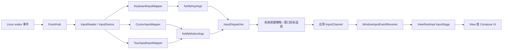
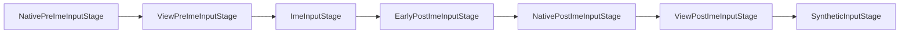
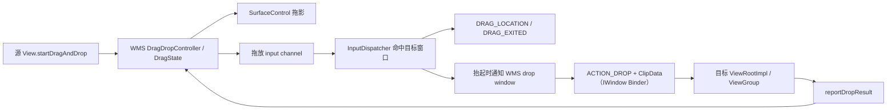

# 键盘、鼠标与指针输入性能 — 桌面模式交互管线

手机上的输入优化常以触摸为中心。到了大屏、多窗口和桌面窗口场景，键盘、鼠标、触控板、悬停和拖放都比触摸多出一层或几层处理：

- 键盘按键先经过系统策略和输入法（IME），目标由窗口焦点决定；
- 鼠标移动需要维护屏幕光标，窗口目标来自坐标命中；
- 触控板先识别移动、滚动、捏合和多指手势，应用平时收到的未必是原始触点；
- 悬停（hover）没有按下状态，却持续触发窗口命中、View 命中、指针图标解析和应用回调；
- 跨窗口拖放同时涉及 InputDispatcher、WindowManager、SurfaceControl 和应用主线程。

普通键盘和指针事件通过输入通道（input channel）进入应用。应用未及时完成已分发事件时，`InputDispatcher` 连接的等待队列可能积压，随后可能触发输入分发超时（input dispatching timeout）。跨窗口拖放的位置消息可走输入通道，最终的 `ACTION_DROP` 与数据则由 WindowManager 通过 Binder 回调发送。焦点窗口等待、辅助功能过滤和拖放结果等待也会影响响应，需要与连接队列积压分开检查。

> 源码基线：AOSP `android-17.0.0_r1`，API 37；历史版本只用于解释兼容范围。

## 1. 先建立一张完整的路径图

我们先把整条路径画出来。下图区分各类设备事件的转换路径，以及它们汇入 `InputDispatcher` 之后进入应用的共同路径；图中的 evdev 是 Linux 输入子系统向用户空间提供的事件设备接口。



三个映射器（mapper）共享 `EventHub → InputReader → InputDispatcher` 主干，但三者的设备语义互不通用：

| 输入 | 原始内核事件 | Android 17 的主要转换者 | 常见应用事件 |
| --- | --- | --- | --- |
| 物理键盘 | `EV_KEY` | `KeyboardInputMapper` | `KeyEvent` |
| 鼠标 | `EV_REL`、按键、滚轮 | `CursorInputMapper` | `MotionEvent`，通常为 `SOURCE_MOUSE` |
| 触控板 | `EV_ABS` 多点槽位、按键 | `TouchpadInputMapper` + 手势识别库 | 普通模式通常表现为鼠标或已分类手势 |
| 触摸屏 | `EV_ABS` 多点槽位 | `MultiTouchInputMapper` | `SOURCE_TOUCHSCREEN` 的 `MotionEvent` |

一个物理设备可以支持多个事件来源（source）。例如 `TouchpadInputMapper::getSources()` 返回 `SOURCE_MOUSE | SOURCE_TOUCHPAD`，这说的是设备具备的能力；具体到某条事件，`MotionEvent.getSource()` 未必同时包含两个值——普通未捕获的触控板移动由 `UncapturedGestureConverter` 生成，事件来源是 `SOURCE_MOUSE`。

### 事件来源与设备能力

应用应同时查看 `InputDevice` 能力、事件来源、动作类型（action）、轴值（axis）和工具类型（tool type）；单凭设备名称猜输入类型，很容易猜错。

- `SOURCE_MOUSE` 属于 `SOURCE_CLASS_POINTER`，坐标对应显示空间中的指针位置；
- `SOURCE_MOUSE_RELATIVE` 属于 `SOURCE_CLASS_TRACKBALL`，用于指针捕获（pointer capture）期间的相对移动；
- `SOURCE_TOUCHPAD` 属于 `SOURCE_CLASS_POSITION`，API 37 的绝对捕获模式用它报告触控板原始触点；
- `SOURCE_GAMEPAD` 描述按钮能力，摇杆轴通常来自 `JoystickInputMapper`，没有独立的 `GamepadInputMapper`。

这组来源属性直接决定 `ViewRootImpl` 选择 `dispatchPointerEvent()`、`dispatchCapturedPointerEvent()` 还是 `dispatchGenericMotionEvent()`。

## 2. InputReader 如何把设备转换成 Android 事件

这一节我们沿着数据流走：内核报上来的原始事件，怎么一步步变成 Android 的事件。

### 2.1 映射器由设备类别（device class）决定

`InputDevice::createMappers()` 根据 `EventHub` 识别出的设备类别创建映射器，相关分支为：

- `KEYBOARD`、`DPAD`、`GAMEPAD` 组合出键盘事件来源，再创建 `KeyboardInputMapper`；
- `CURSOR` 创建 `CursorInputMapper`；
- 同时具有 `TOUCHPAD` 与 `TOUCH_MT` 时创建 `TouchpadInputMapper`；
- 其余 `TOUCH_MT` 设备才进入 `MultiTouchInputMapper`；
- `JOYSTICK` 创建 `JoystickInputMapper`。

即使多点数据都来自 `EV_ABS`，触控板与触摸屏也可能在映射器创建阶段走向不同路径。

### 2.2 键盘：扫描码、键码与字符是三层概念

`KeyboardInputMapper` 收到 `EV_KEY` 后，拿扫描码和可选的 HID 用法码（usage）去查表。`EventHub::mapKey()` 会先检查按键字符映射文件（KCM），再检查按键布局（key layout），之后应用用户按键重映射和 KCM 里的按键行为（key behavior）。查表输出包含：

- `scanCode`：接近 Linux 输入设备报告的物理按键编号；
- `keyCode`：Android 的 `KEYCODE_*` 语义键码；
- `metaState`：Shift、Ctrl、Alt、Meta 等组合状态；
- 策略标志（policy flags）：是否唤醒、是否为虚拟键等策略信息。

字符生成还要结合布局、修饰键和输入法；“死键”会先记录重音，等下一个按键到来再组合成字符。写业务代码时要记住：`scanCode` 拿来当稳定快捷键靠不住，同一个 `keyCode` 换一种键盘布局也可能得到不同字符。

### 2.3 鼠标：相对位移先更新系统光标

普通鼠标由 `CursorInputMapper` 处理 `REL_X`、`REL_Y`、滚轮和按钮。未捕获时：

1. 相对位移先经过指针速度调节（pointer velocity control）；
2. 映射器先生成携带相对位移的 `NotifyMotionArgs`；普通未捕获鼠标的 cursor position 此时仍可为无效值；
3. 下游 `PointerChoreographer` 通过 `PointerController` 移动光标，补全屏幕 X/Y、cursor position 与目标 display ID，再继续转发 `SOURCE_MOUSE` 事件；
4. 未按按钮时通常是 `ACTION_HOVER_MOVE`，按下期间是 `ACTION_MOVE`；
5. 滚轮生成 `ACTION_SCROLL`，数值位于 `AXIS_VSCROLL` 和 `AXIS_HSCROLL`；
6. 按钮状态还会产生 `ACTION_BUTTON_PRESS`、`ACTION_BUTTON_RELEASE`，主按钮状态变化伴随 `ACTION_DOWN`、`ACTION_UP`。

应用看到的指针坐标已经经过显示映射和速度曲线。鼠标 DPI、USB 或 Bluetooth 报告间隔、用户指针速度、显示刷新率都会改变观测结果，所以事件频率和精度要按具体设备确认，先别预设固定值。

<!-- gracker-diagram: ch03-06-device-conversion-and-cursor -->


图：键盘由 mapper 生成 KeyArgs；普通鼠标由 CursorInputMapper 处理相对移动与速度曲线；触控板先把多点硬件状态解释成光标或手势。PointerChoreographer 更新 PointerController 并补全普通指针的屏幕坐标、光标位置与 Display，再由下游分发器选择窗口。图省略其他透传或条件监听阶段。

### 2.4 触控板：普通模式先解释手势

触控板路径比“相对坐标转光标”多一层手势解释，原始触点要经过下面这些组件才变成平台事件：

```text
多点槽位
  → HardwareStateConverter
  → gestures library
  → UncapturedGestureConverter / 捕获模式 converter
  → NotifyMotionArgs
```

普通模式下，单指移动会更新光标并报告 `SOURCE_MOUSE` 的悬停或移动事件；双指滚动可转成 `ACTION_SCROLL`；捏合和多指滑动带有相应的手势分类（classification），部分系统手势还会被系统消费。掌压过滤、轻触点击（tap-to-click）、自然滚动、右键区域和加速曲线，都在进入应用前参与了这层解释。

所以应用收到一条触控板事件时，反推不出“硬件只报告了一个相对坐标”：底层可能有多个绝对触点，平台已经把它们解释成鼠标或手势语义。

## 3. 指针捕获的适用场景与前提

指针捕获适用于第一人称视角、远程桌面、三维编辑器这类需要持续相对移动的场景；普通表单、列表和桌面窗口不应主动捕获指针。

捕获有三个前提：

- 所属 View 层级必须具有窗口焦点；
- 获取和失去捕获会触发设备重新配置，事件来源和运动范围（motion range）可能改变；
- 窗口失去焦点时捕获会被释放；焦点显示设备（focused display）改变时，`InputDispatcher` 也会强制关闭现有捕获。

### 3.1 鼠标捕获

鼠标被捕获后，`CursorInputMapper` 切换到 `SOURCE_MOUSE_RELATIVE`，关闭指针加速与缩放，应用通过捕获指针回调读取相对移动。此时系统光标隐藏，位置也不再移动。

### 3.2 API 37 的两种触控板捕获模式

Android 17 为触控板明确了两种模式：

| 模式 | 事件来源 | 平台处理 | 适合场景 |
| --- | --- | --- | --- |
| `POINTER_CAPTURE_MODE_RELATIVE` | `SOURCE_MOUSE_RELATIVE` | 继续识别移动、按钮和滚动，再按相对量报告 | 游戏视角、远程桌面 |
| `POINTER_CAPTURE_MODE_ABSOLUTE` | `SOURCE_TOUCHPAD` | 跳过手势识别库，报告触控板坐标空间中的多点数据 | 自定义触控板手势、原始触点分析 |

这组捕获模式由平台功能标志控制：无参数 `requestPointerCapture()` 只在 `pointerCaptureModes()` 与 `relativeCaptureModeByDefault()` 同时为真时才等价于相对模式，否则请求的是绝对模式。所以我们需要相对移动或原始多点触控板数据时，应显式传入对应模式，而不是依赖无参数默认值。

绝对模式还会提供 `AXIS_RELATIVE_X/Y`，不过 `getX(index)`、`getY(index)` 的坐标空间属于触控板表面，直接当屏幕坐标用会出错。

<!-- gracker-diagram: ch03-06-pointer-capture-coordinate-spaces -->


图：普通模式以显示光标坐标进行窗口命中；相对捕获把移动交给有焦点窗口，鼠标隐藏光标并关闭加速，触控板仍可解释移动和滚动；触控板绝对模式跳过 gestures，报告表面空间的多点数据。API37 模式受平台 flag 控制，无参数默认也依赖 flag，具体需求应显式表达并处理捕获变化回调。

以下代码在可以使用 API 37 指针捕获模式常量的项目中，用显式参数表达捕获意图：

```kotlin
fun View.captureForCameraControl() {
    if (hasWindowFocus()) {
        requestPointerCapture(View.POINTER_CAPTURE_MODE_RELATIVE)
    }
}

override fun onCapturedPointerEvent(event: MotionEvent): Boolean {
    if (!event.isFromSource(InputDevice.SOURCE_MOUSE_RELATIVE)) return false
    cameraController.rotateBy(event.x, event.y)
    return true
}
```

`event.x/y` 在相对模式中表示本次移动量。回调执行期间只更新输入状态；渲染工作交给帧循环，避免每个硬件采样都触发一套重计算。

## 4. 键盘从系统策略到应用的路径

### 4.1 系统策略与目标选择

按键事件这一路，我们要盯住系统策略的介入点。`KeyboardInputMapper` 创建 `NotifyKeyArgs` 之后，`InputDispatcher::notifyKey()` 先调用系统输入策略（policy）的 `interceptKeyBeforeQueueing()`，`InputManagerService` 还会让 `KeyGestureController` 检查组合键；进入目标选择前，系统策略还可以通过 `interceptKeyBeforeDispatching()` 延迟或消费按键。

电源、音量、系统导航和系统快捷键可能在这里结束，应用没有“所有物理按键都能收到”的保证。

未被系统消费的按键，接下来按这套规则选择目标：

1. 事件带有效显示设备 ID（display ID）时使用该显示设备；
2. 显示设备 ID 无效时使用 `mFocusedDisplayId`；
3. 在目标显示设备上查找焦点窗口（focused window）；
4. 若焦点应用（focused application）已存在，但窗口尚未获得焦点，则进入“无焦点窗口”（no-focused-window）的等待与超时逻辑；
5. 对按键事件，分发器可按策略超时短暂等待先前未完成的输入，因为前一条点击可能打开新窗口并改变焦点；等待到期后，即使仍有未完成项，也会继续向当前焦点窗口发送按键。

第 5 点解释了一个常见现象：主线程积压的鼠标事件拖慢悬停响应，也可能让紧随其后的键盘输入一起等待。这段等待是在保焦点顺序，跟键盘硬件没有关系。

### 4.2 按键重复在 InputDispatcher

按键重复分布在这条路径的多个位置：

- `EventHub` 打开设备时尝试用 `EVIOCSREP` 关闭内核重复；
- `KeyboardInputMapper` 忽略 Linux `EV_KEY value == 2`；
- `InputDispatcher` 保存最近按下的可重复按键，等入站队列（inbound queue）为空时合成重复事件；
- 第一条重复事件的 `repeatCount` 为 1，并带 `FLAG_LONG_PRESS`；
- 后续重复按 `keyRepeatDelay` 继续产生；
- 按键抬起（key-up）、设备重置、分发关闭等状态会清理重复状态。

`InputDispatcherConfiguration` 的默认值是首次等待 500 ms、后续间隔 50 ms。这两个值系统可以重配，应用侧要读 `repeatCount` 和事件时间，把默认值当成业务定时器的协议是靠不住的。

长按操作应把一次性初始化和允许重复的动作分开，避免每次重复都产生额外副作用，并区分初次按下与重复：

```kotlin
override fun onKeyDown(keyCode: Int, event: KeyEvent): Boolean {
    if (keyCode != KeyEvent.KEYCODE_DPAD_RIGHT) {
        return super.onKeyDown(keyCode, event)
    }

    if (event.repeatCount == 0) {
        selection.beginKeyboardMove()
    }
    selection.moveRightOneStep()
    return true
}
```

重复事件由系统驱动连续移动，这段代码把一次性初始化限定在首次按下。若每次重复都启动动画、I/O 或对象图重建，50 ms 的默认间隔很快就会造成主线程积压。

### 4.3 IME 位于 View 的 pre-IME 与 post-IME 之间

应用窗口中的按键事件会依次经过以下阶段。这里的 pre-IME 和 post-IME 分别表示输入法处理之前和之后：



- `dispatchKeyEventPreIme()` 发生在 IME 之前；
- `ImeInputStage` 可以异步处理，IME 返回未处理后才进入 post-IME；
- `ViewPostImeInputStage` 先调用 `dispatchKeyEvent()`，再检查修饰键快捷键、后备策略（fallback policy）和自动焦点导航。

把 IME 描述成 View 未消费后的 Binder 兜底会颠倒执行顺序。Binder 是 Android 的跨进程调用机制；硬件键盘事件可以先交给 IME，软键盘输入又常通过 `InputConnection.commitText()`、`setComposingText()` 等编辑协议送入文本控件，不保证对应一串 `KeyEvent`。

<!-- gracker-diagram: ch03-06-key-target-wait-and-ime -->


图：系统策略可消费或延迟按键；未消费的按键按显式 Display ID 或 focused display 查找焦点窗口。为等待可能改变焦点的前序输入，分发器可按策略有限等待；超时后仍可继续发送。应用内通常先经过 pre-IME / IME，再到 post-IME View。软键盘编辑协议不必生成相同 KeyEvent 序列。

应用快捷键应按语义消费并返回 `true`，只在 `ACTION_DOWN && repeatCount == 0` 执行一次性命令。系统快捷键、IME 组合和辅助功能仍有更高优先级。

### 4.4 Rust 键盘过滤器位于 InputFlinger 主链中

原生监听器链（native listener chain）依次包含以下组件：

```text
InputReader
  → UnwantedInteractionBlocker
  → PointerChoreographer
  → InputProcessor
  → InputDeviceMetricsCollector（构建条件）
  → InputFilter
  → InteractionReporter（服务条件）
  → InputDispatcher
```

`InputFilter` 是 C++ 包装层，内部的 Rust 链只处理键盘辅助功能；`notifyMotion()`、传感器、开关、振动器状态、设备重置和指针捕获变化都从包装层直接通知下一层，InputReader、PointerChoreographer、InputProcessor 和 InputDispatcher 仍由 C++ 实现。所以这只是键盘路径上的局部组件，称不上“InputFlinger 已用 Rust 重写”。

C++ 与 Rust 之间是进程内的 AIDL 接口，外加负责建立 C++/Rust 调用入口的 `cxxbridge` 启动桥接代码。按键进入 `IInputFilter.notifyKey()`，过滤后经 `IInputFilterCallbacks.sendKeyEvent()` 回到 C++ 监听器。这些接口在同一个 InputFlinger 进程内调用，不会产生 Binder 跨进程事务；Slow Keys 延后接受的按键可由过滤线程的超时回调继续送入下游，不能据此推断全程同步或同线程执行。

三种辅助功能分别是：粘滞键（Sticky Keys）让修饰键保持生效，慢速键（Slow Keys）要求按住达到阈值，防抖键（Bounce Keys）会忽略阈值内的重复按键。配置变化时，Rust 从 `BaseFilter` 开始依次包上 Sticky、Slow 和 Bounce，因此三者同时开启时的执行顺序为：

```text
BounceKeysFilter
  → SlowKeysFilter
  → StickyKeysFilter
  → BaseFilter
  → C++ callback
```

| 过滤器 | 设备与事件边界 | 语义 | 性能表现 |
|---|---|---|---|
| Bounce Keys | 非虚拟、受支持键盘；事件带 `SOURCE_KEYBOARD` | 同设备同 `keyCode` 的下一次 `DOWN` 落在阈值内时，丢弃该 `DOWN` 及配对 `UP` | 不设定时等待；快速重复按键消失 |
| Slow Keys | 与 Bounce 相同的受支持设备集 | 首个 `DOWN` 进入待定状态（pending），按住到阈值后才向后发送；提前 `UP` 则整次短按不再传递 | 接受的 `DOWN` 会有意延后一个阈值 |
| Sticky Keys | 受支持的非虚拟字母键盘 | 在修饰键 `UP` 时切换关闭、锁存或锁定（off / latched / locked）状态，并合并 `metaState` | 没有阈值等待，但会改变修饰键的传递方式与状态 |

Bounce 和 Slow 的受支持设备必须是非虚拟键盘，且为外接设备或内置 `Alphabetic`（字母键盘类型）键盘，外接的非字母键盘也可能生效；Sticky 的设备集更窄，仅包括非虚拟 `Alphabetic` 键盘。一台外设到底落在哪个集合里，要看 InputReader/InputFilter 的 dump 输出，单从外设名称是推断不出来的。

Slow Keys 会把延后后的 `DOWN` 改写为新的 `downTime/eventTime`，并添加禁止按键重复的策略标志。等待由名为 `InputFilter` 的线程和超时回调完成。遇到“短按稳定消失”或“延迟接近配置阈值”，我们先检查 Slow Keys；如果是 InputDispatcher 反压，也就是下游处理不过来迫使分发端等待，通常还能同时看到目标选择、连接队列或应用线程异常。

Rust 状态初始为关闭（disabled），安装任一过滤器后转为启用（enabled）。“曾开启、随后全部关闭”时，Android 17 可能仍显示 `enabled`，但重建后的链里只剩负责原样转发的 `BaseFilter`，功能上不再有 Bounce、Slow 或 Sticky 语义，只可能多一次本地调用往返。这是 `android-17.0.0_r1` 的实现细节，API 层面并没有相应承诺。

<!-- gracker-diagram: ch03-06-rust-filter-local-chain -->


图：实际原生主链中，Rust InputFilter 位于 PointerChoreographer、InputProcessor 和条件 Metrics 之后，InteractionReporter 与 Dispatcher 之前。C++ 包装层只把启用的键盘事件交给 Rust；三过滤器同时开启时按 Bounce → Slow → Sticky → Base 执行，再回 C++ 下游。motion 等其他通知由包装层直接转发。

## 5. 鼠标悬停、滚轮与窗口命中

### 5.1 指针目标来自位置

键盘沿焦点路由，鼠标与触摸等指针事件通常按显示坐标命中输入窗口。`InputDispatcher` 维护每个显示设备的窗口信息，以及触摸和悬停状态：

- 悬停进入新窗口时生成 `HOVER_ENTER`；
- 离开旧窗口时生成 `HOVER_EXIT`；
- `ACTION_SCROLL` 不改变当前悬停窗口；
- 按下后的手势通常保持既有触摸目标，直到抬起或取消；
- 普通悬停不会自动改变窗口焦点。

窗口焦点由 WindowManager 的焦点规则决定：鼠标点击可能促成焦点切换，多指触控板系统手势还可带 `NO_FOCUS_CHANGE` 标志。应用这边不要在每条悬停事件里自己调 `requestFocus()`。

### 5.2 View 树的第二次命中

事件进入窗口后，`ViewRootImpl` 对 `SOURCE_CLASS_POINTER` 调用根 View 的 `dispatchPointerEvent()`。鼠标悬停和滚动会进入通用运动事件（generic motion）分发路径，`ViewGroup` 再根据坐标寻找子 View，并维护 View 级的悬停进入与离开状态。

窗口命中和 View 命中是两层工作：

```text
InputDispatcher：显示坐标 → input window
ViewGroup：窗口局部坐标 → child View
```

层级很深的 View 树、频繁变化的变换属性，以及每次悬停都触发布局，都会提高第二层的成本。框架不会因为悬停事件到达就无条件让所有 View 重绘；重绘通常来自组件状态变化或应用自己的 `invalidate()`、`requestLayout()`。

<!-- gracker-diagram: ch03-06-hover-two-hit-tests -->


图：InputDispatcher 根据显示位置和窗口拓扑选择输入窗口，并维护窗口级 HOVER_ENTER / EXIT。应用 ViewRootImpl 处理窗口局部坐标后，ViewGroup 再命中子 View、维护 View 级悬停与指针图标。移动光标不等于应用已及时响应，也不会自动改变键盘焦点。

### 5.3 滚动的轴值

鼠标滚轮和相对捕获触控板的滚动以 `ACTION_SCROLL` 报告，读取：

- `AXIS_VSCROLL`；
- `AXIS_HSCROLL`；
- 必要时结合 `ViewConfiguration` 的水平、垂直滚动系数（scroll factor）转成 UI 距离。

不同设备可能报告离散刻度或高分辨率连续量。业务逻辑宜累计浮点增量，在帧边界统一更新画面，避免先取整导致小量滚动丢失。

## 6. 事件批处理、主线程积压与 ANR

### 6.1 事件批处理保留采样历史

应用侧 `BatchedInputEventReceiver` 会尽量在 vsync 输入回调中消费可批处理的运动事件。原生层的 `InputConsumer` 只把兼容样本放进同一批次，设备、事件来源、动作类型、显示设备、指针数量和指针属性都要匹配。

合批后，一个 `MotionEvent` 除当前样本外还包含历史样本（history）。合批减少的是 Java 回调数量，并没有按固定比例丢弃硬件采样，需要轨迹细节的组件应遍历历史样本：

```kotlin
fun consumeMotion(event: MotionEvent, sink: (Long, Float, Float) -> Unit) {
    for (index in 0 until event.historySize) {
        sink(
            event.getHistoricalEventTime(index),
            event.getHistoricalX(index),
            event.getHistoricalY(index),
        )
    }
    sink(event.eventTime, event.x, event.y)
}
```

循环按时间顺序消费历史样本和当前样本。若 UI 只需要最新光标位置，可以只保存末尾状态；绘图、手写或速度估算才需要完整历史。

`ViewRootImpl` 还有一个类似的取舍：尚未处理的 `ACTION_DRAG_LOCATION` Handler 消息只保留最新一条。这个优化只针对拖放位置消息，不能推广到所有悬停或移动事件。

### 6.2 输入超时与连接等待队列

事件写入应用输入通道后，`InputDispatcher` 将对应 `DispatchEntry` 放入该连接的 `waitQueue`。应用通过 `finishInputEvent()` 回报处理完成后，条目才会移除。

默认的输入分发超时为 5 秒，还会乘以硬件超时倍率；具体窗口可以提供自己的超时时间。对已经分发到连接的事件，分发器检查等待队列中是否有超时的未完成条目；这条连接超时规则没有给悬停事件单独豁免，“键盘固定 5 秒、悬停永不触发 ANR”这类规则并不存在。

无焦点窗口还有独立的超时分支：有焦点应用、无焦点窗口，且有焦点型事件等待分发时开始计时。到期时若仍是同一焦点应用、窗口仍未获得焦点，也可能报告 ANR，即使事件尚未进入任何连接的等待队列。排查时先区分这两条路径，再检查窗口焦点、配置的超时和事件完成回报。

连续悬停、滚轮或按键重复的风险在于放大积压：

1. 一条事件在主线程执行了昂贵工作；
2. 后续事件继续进入出站队列、等待队列或输入通道；
3. 输入管道填满后，事件发布端返回 `WOULD_BLOCK`，分发器等待应用完成积压事件；
4. 最旧条目超时后，连接被标为无响应（unresponsive）；
5. 后续键盘还可能因“等待先前输入完成”而暂缓目标选择。

重复事件本身不会重置最旧条目的超时。

### 6.3 输入回调的工作量

输入回调适合做：

- 更新少量输入状态；
- 执行有上限的命中或快捷键判断；
- 把渲染所需状态提交给下一帧；
- 对需要异步处理的数据做最小复制。

输入回调应避开：

- 同步文件、数据库或网络访问；
- 对整棵 UI 树调用 `requestLayout()`；
- 为每条悬停事件创建大量临时对象；
- 在锁内调用不可控的业务回调；
- 保存框架传入的 `MotionEvent` 供回调结束后继续使用。确需保存时使用 `MotionEvent.obtain()`，完成后 `recycle()`。

## 7. 多窗口、多显示与焦点

输入焦点在这里要拆成两个概念：

- `FocusResolver` 记录各显示设备的焦点窗口令牌（focused window token）；
- `mFocusedDisplayId` 为没有指定显示设备的焦点型事件提供目标显示设备。

键盘事件带显示设备 ID 时，可以投向该显示设备的焦点窗口；未指定时落到焦点显示设备。鼠标事件通常已经绑定显示设备，并按坐标命中窗口。

焦点显示设备改变时，`InputDispatcher` 会：

- 取消旧焦点显示设备上尚未释放、且未指定显示设备的非指针事件；
- 通知系统策略焦点显示设备已经改变；
- 强制关闭现有指针捕获；
- 将旧、新焦点窗口令牌通过 `notifyFocusChanged()` 通知系统策略。

应用窗口的焦点事件由 `onFocusChangedLocked()` 创建 `FocusEntry` 后分发，应与焦点显示设备切换时的策略通知分开观察。

桌面模式的测试只覆盖“单显示器中两个 Activity”是远远不够的，至少还要加入：

- 内屏与外屏之间移动鼠标；
- 外屏窗口持有键盘焦点；
- 点击后立即输入；
- 弹窗创建或销毁期间连续输入；
- 指针捕获期间拔掉设备、切换窗口或切换显示设备；
- IME 显示时使用硬件快捷键和 Tab 导航。

## 8. 跨窗口拖放的控制面与数据面

跨应用拖放会脱离普通 `MotionEvent` 的窗口分发路径。我们把它拆成两面来看：“控制面”维护拖放状态、选择目标窗口；“数据面”把封装拖放内容的 `ClipData` 和 URI 权限交给目标。下图展示各组件的职责，WMS 即 WindowManagerService：



拖放输入通道接收拖动指针；目标窗口可经普通 InputChannel 收到位置与离开消息，再由 ViewRootImpl 转成 `ACTION_DRAG_LOCATION` / `ACTION_DRAG_EXITED`。最终携带 `ClipData` 的 `ACTION_DROP` 则由 WMS 经 `IWindow.dispatchDragEvent()` Binder 回调发送，不能把它也归入输入套接字的数据面。

### 8.1 移动阶段

WMS 创建 `DragState`，将拖影的 SurfaceControl 图层放到显示设备的覆盖层（display overlay），并把正在拖动的指针转交给拖放输入通道。`InputDispatcher` 根据指针位置寻找目标窗口：

- 目标改变时向旧窗口发送拖放离开事件；
- 对当前目标发送拖放位置事件；
- `ViewRootImpl` 把坐标转换到应用窗口空间；
- `ViewGroup` 在窗口内部维护具体 View 的拖放进入、离开和位置状态。

拖影由 SurfaceControl 更新，不需要目标应用每次重绘拖影。目标应用仍可能因为高亮、自动滚动或预览而产生布局和绘制开销。

### 8.2 放下阶段

指针抬起后，`InputDispatcher` 把目标窗口、窗口局部坐标和原始坐标通知 WMS，`DragState` 再向合法目标发送 `ACTION_DROP`；普通应用目标到这个阶段才拿到放下所需的 `ClipData`。能够拦截全局拖放的特权窗口有单独的数据传递规则。

URI 访问权有额外条件：源端须设置 `DRAG_FLAG_GLOBAL`，并设置 `DRAG_FLAG_GLOBAL_URI_READ` 或 `DRAG_FLAG_GLOBAL_URI_WRITE`；有拖放数据时，WMS 才附带权限处理对象，目标再调用 `requestDragAndDropPermissions()` 申请授权。目标窗口报告是否消费后，WMS 结束拖放并广播 `ACTION_DRAG_ENDED`。

WMS 对放下结果另有 5 秒等待。这个计时属于拖放状态机，与输入通道的连接超时是两个不同的观察点。

<!-- gracker-diagram: ch03-06-drag-position-versus-drop-data -->


图：WMS 建立 DragState、拖影与专用拖放通道；InputDispatcher 在拖动时按坐标找目标。普通目标窗口的 DRAG 位置 / 离开消息可经 InputChannel 到 ViewRootImpl；抬起时则先报告 WMS，再由 IWindow Binder 发送携带 ClipData 的 ACTION_DROP。目标 reportDropResult 后结束，URI 大数据应按权限异步读取。

### 8.3 ClipData 与大数据

跨进程拖放适合传 URI、MIME 媒体类型描述和少量文本。图片、视频或大文档应由 `content://` URI 指向 ContentProvider，目标通过 `requestDragAndDropPermissions()` 获得临时访问权，再按需读取。

把拖放的性能问题概括成“Binder 只有 1 MB”，会漏掉权限、序列化、ContentProvider I/O 和目标解码这些成本。设计时可以遵循以下规则：

- `ClipDescription` 尽早、准确地表达 MIME；
- `ACTION_DRAG_STARTED` 只做轻量可接收判断；
- `ACTION_DRAG_LOCATION` 只更新必要的悬停状态；
- `ACTION_DROP` 校验 URI、MIME 和来源，再把耗时读取移出主线程；
- 使用完 URI 权限后及时释放。

## 9. View 与 Compose 的优化边界

平台源码覆盖的是事件到应用窗口这一段路径。Jetpack Compose 属于 AndroidX，版本节奏独立于 `android-17.0.0_r1`；分析其指针输入节点、协程或 `Modifier` 行为时，应同时固定 Compose 版本。

### View 系统

- 快捷键优先在靠近窗口或页面入口的位置处理，避免多个子 View 重复匹配；
- 悬停只在“进入、离开、命中对象改变”时更新视觉状态；
- 滚动保留浮点累计量，在帧回调中统一提交；
- 自定义 View 的 `onResolvePointerIcon()` 避免创建重复资源；
- 方向键焦点顺序不稳定时，显式设置 `nextFocus*` 或验证 `FocusFinder` 结果。

### Compose

- 使用 `onPreviewKeyEvent`、`onKeyEvent` 或明确的快捷键层级表达消费顺序；
- `pointerInput` 的参数键（key）改变会重启其处理协程，应避免把每次重组都变化的对象作为键；
- 高频指针处理器只更新轻量状态，重计算放到可控的状态或帧边界；
- `Modifier` 顺序会影响命中、消费和语义，性能测试时保留可复现的 `Modifier` 链；
- 遇到指针性能问题时，同时记录 Compose 版本、编译器版本和平台版本，避免把 AndroidX 行为误归因于 Android Framework。

View 与 Compose 最终共享同一个应用主线程和输入通道。更换 UI 工具包不会消除主线程阻塞、焦点错误或跨窗口命中问题。

## 10. 诊断：先定位慢在哪一段

### 10.1 原始设备层

我们先用 `getevent` 判断延迟是否已经出现在内核设备层：

```bash
adb shell getevent -lt
```

用它确认设备节点、`EV_KEY`、`EV_REL`、`EV_ABS` 和 `SYN_REPORT` 的到达顺序。量产设备上可能受权限限制。如果这里已经看到间隔异常，应优先检查硬件、蓝牙链路、USB 集线器和内核驱动。

### 10.2 InputReader 与 InputDispatcher

再用输入服务的诊断输出（dump）检查平台识别、目标选择和连接队列：

```bash
adb shell dumpsys input
```

重点看：

- 设备类别、事件来源、映射器与运动范围；
- 焦点显示设备，以及各显示设备的焦点窗口；
- 指针捕获模式；
- Rust InputFilter 的启用状态和过滤器链，以及 Slow Keys 的待定/进行中 `DOWN` 与阈值；
- 触摸、悬停和拖放状态；
- 连接的出站队列、等待队列与响应状态；
- 按键重复的首次等待时间和后续间隔。

再用下面的命令核对窗口层的焦点与拖放状态：

```bash
adb shell dumpsys window
```

核对 WindowManager 看到的焦点应用、焦点窗口、显示设备和拖放状态。如果两份诊断输出中的焦点不一致，先检查窗口生命周期、Surface 图层和输入窗口的更新，再考虑修改 View 的按键监听器。

### 10.3 Perfetto / 系统跟踪

Perfetto 和系统跟踪（System Trace）用于把输入、线程调度与画面显示对齐。采集时至少包含 `input`、WindowManager、View、调度和帧时间线（FrameTimeline），再按同一事件 ID 或相邻时间线观察：

1. EventHub/InputReader 收到时间；
2. InputDispatcher 的入站、目标选择与分发；
3. 应用 `deliverInputEvent`；
4. 对应的主线程回调；
5. 帧开始、提交与显示。

常见判读：

| 现象 | 优先检查 |
| --- | --- |
| `getevent` 已晚 | 设备、传输、驱动 |
| InputReader 到 InputDispatcher 间隔大 | 映射器、手势识别、输入线程调度 |
| InputDispatcher 等待目标 | 焦点、窗口创建、前序事件未完成 |
| 等待队列增长 | 应用未及时调用 `finishInputEvent`，通常是主线程阻塞 |
| 回调快，下一帧仍晚 | Choreographer、布局/绘制、RenderThread 或 SurfaceFlinger |
| 只有触控板异常 | 手势配置、捕获模式、事件来源分支 |
| 只有跨应用放下操作异常 | URI 权限、内容提供器 I/O、放下结果超时 |

### 10.4 应用内轻量测量

以下代码只用于抽样记录“事件时间到回调开始”的应用可见延迟：

```kotlin
private fun inputAgeMs(event: InputEvent): Long {
    return SystemClock.uptimeMillis() - event.eventTime
}
```

`eventTime` 与 `uptimeMillis()` 使用同一时间基准。这个值里混着回调前的等待，单靠它分不出驱动、InputReader、InputDispatcher 和主线程队列各占多少；要下分段结论，还得结合 Perfetto。

## 11. 审查清单

### 语义正确性

- 是否用 `event.isFromSource()` 判断事件来源，而非设备名称？
- 是否区分 `SOURCE_MOUSE`、`SOURCE_MOUSE_RELATIVE` 与 `SOURCE_TOUCHPAD`？
- 是否读取滚动轴、按钮状态、重复次数和修饰键状态？
- 是否把软键盘文本输入误当成硬件 `KeyEvent`？
- 是否只在拥有窗口焦点时请求指针捕获？
- API 37 上是否明确选择触控板的相对或绝对捕获模式？

### 主线程成本

- 悬停/移动回调是否包含 I/O、全树布局或大对象分配？
- 是否按需要读取 `MotionEvent` 历史样本？
- 滚动和视角更新是否可以在一帧内合并？
- 按键重复是否反复启动一次性任务？
- `ACTION_DRAG_LOCATION` 是否只更新目标状态？
- `ACTION_DROP` 的内容提供器（ContentProvider）读取和解码是否移出主线程？

### 桌面场景覆盖

- USB 与 Bluetooth 键盘、鼠标；
- 传统滚轮与高分辨率滚轮；
- 单指、双指、多指触控板手势；
- 单窗口、多窗口、弹窗、外接显示器；
- 捕获期间切换焦点、切换显示设备或拔掉设备；
- 不同键盘布局、修饰键、长按重复；
- View 与当前项目固定版本的 Compose；
- URI 拖放、拒绝放下操作、目标进程退出。

## 12. 版本与源码边界

平台结论核对到以下范围：

- Android platform：`android-17.0.0_r1`
- API：37
- 核心原生层路径：`frameworks/native/services/inputflinger`
- 核心 Java 路径：`frameworks/base/core/java/android/view`
- 窗口拖放路径：`frameworks/base/services/core/java/com/android/server/wm`

Android 17 需要特别记住的变化是触控板指针捕获模式：源码提供相对与绝对两种模式；在平台启用相对默认时，无参数捕获会继续识别移动与滚动，显式请求绝对模式才会把原始多点触控板数据作为 `SOURCE_TOUCHPAD` 交给应用。设备厂商仍可调整输入配置、手势属性、超时倍率和窗口策略，所有固定数值都应在目标设备上通过诊断输出与跟踪结果复核。

## 参考资料

- [AOSP `InputDevice.cpp`](https://cs.android.com/android/platform/superproject/+/android-17.0.0_r1:frameworks/native/services/inputflinger/reader/InputDevice.cpp)
- [AOSP `KeyboardInputMapper.cpp`](https://cs.android.com/android/platform/superproject/+/android-17.0.0_r1:frameworks/native/services/inputflinger/reader/mapper/KeyboardInputMapper.cpp)
- [AOSP `CursorInputMapper.cpp`](https://cs.android.com/android/platform/superproject/+/android-17.0.0_r1:frameworks/native/services/inputflinger/reader/mapper/CursorInputMapper.cpp)
- [AOSP `TouchpadInputMapper.cpp`](https://cs.android.com/android/platform/superproject/+/android-17.0.0_r1:frameworks/native/services/inputflinger/reader/mapper/TouchpadInputMapper.cpp)
- [AOSP `InputDispatcher.cpp`](https://cs.android.com/android/platform/superproject/+/android-17.0.0_r1:frameworks/native/services/inputflinger/dispatcher/InputDispatcher.cpp)
- [AOSP `InputFilter.cpp`](https://cs.android.com/android/platform/superproject/+/android-17.0.0_r1:frameworks/native/services/inputflinger/InputFilter.cpp)
- [AOSP Rust `input_filter.rs`](https://cs.android.com/android/platform/superproject/+/android-17.0.0_r1:frameworks/native/services/inputflinger/rust/input_filter.rs)
- [AOSP Rust keyboard filters](https://cs.android.com/android/platform/superproject/+/android-17.0.0_r1:frameworks/native/services/inputflinger/rust/)
- [AOSP `ViewRootImpl.java`](https://cs.android.com/android/platform/superproject/+/android-17.0.0_r1:frameworks/base/core/java/android/view/ViewRootImpl.java)
- [AOSP `View.java`](https://cs.android.com/android/platform/superproject/+/android-17.0.0_r1:frameworks/base/core/java/android/view/View.java)
- [AOSP `input_framework.aconfig`](https://cs.android.com/android/platform/superproject/+/android-17.0.0_r1:frameworks/base/core/java/android/hardware/input/input_framework.aconfig)
- [AOSP `DragDropController.java`](https://cs.android.com/android/platform/superproject/+/android-17.0.0_r1:frameworks/base/services/core/java/com/android/server/wm/DragDropController.java)
- [AOSP `DragState.java`](https://cs.android.com/android/platform/superproject/+/android-17.0.0_r1:frameworks/base/services/core/java/com/android/server/wm/DragState.java)
- [Android Developers：Android 17 行为变更](https://developer.android.com/about/versions/17/behavior-changes-all)
- [Android Developers：跟踪触摸和指针移动](https://developer.android.com/develop/ui/views/touch-and-input/gestures/movement)
- [Android Developers：处理键盘操作](https://developer.android.com/develop/ui/views/touch-and-input/keyboard-input/commands)
- [Android Developers：键盘焦点导航](https://developer.android.com/develop/ui/views/touch-and-input/keyboard-input/navigation)
- [Android Developers：拖放](https://developer.android.com/develop/ui/views/touch-and-input/drag-drop)
- [Android Developers：Compose pointer input](https://developer.android.com/develop/ui/compose/touch-input/pointer-input)
