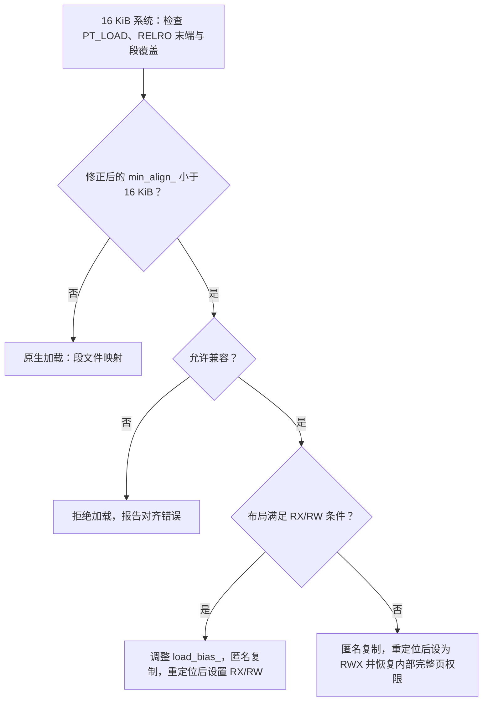

# 16 KB Page Size 与 Android 性能

Android 的 16 KiB 页适配，我们把它拆成两个问题来看：

1. 应用能否在使用 16 KiB 基础页的内核上正确安装、加载和运行。
2. 更大的基础页能否改善目标应用的性能。

第一个问题有明确的工程检查项：ELF（Executable and Linkable Format，可执行与可链接格式）和 APK 都通过对齐检查判定。第二个问题必须测量：对齐检查通过只覆盖产物布局这一层，运行时页大小假设和完整业务路径仍需测试；启动能快多少，要靠后面的测量回答。

推动适配的主要是 Google Play 的要求：目标版本为 Android 15（API 35）或更高的应用，要在 64 位设备上支持 16 KB 页；从 2027 年 2 月 1 日起，不支持 16 KB 页的应用更新将失去发布资格。这项要求看的是 `targetSdkVersion` 与最终分发产物，和测试设备的系统版本是两回事。

Play 的两套门槛针对的对象也不同：16 KB 页大小要求面向含原生代码产物的安装/加载兼容性；Play 在 2026-08 公布的内存与 DEX 优化技术质量门槛中，`Anonymous RSS + Swap` 与 bitmap memory 按 Android vitals 近 28 天数据的 P90 评估；DEX 优化要求则按上传产物检查优化、压缩与混淆覆盖，并非内存采样的 P90。未达标会触发 Console 告警，并可能影响可见度与发布能力。后者回答的是内存质量问题，所以 ELF/ZIP 对齐检查要单独做，16 KiB 页是否引发内存回归也要另行测量。[来源: DeepResearch/2026-08-28-evening-Android-App-memory-thresholds-2027-02/01-dump-play-thresholds.md]

> 源码基线：AOSP `android-17.0.0_r1`，Android 17 / API 37；内核 `android17-6.18-2026-06_r6`。

## 1. 页大小的正确模型

### 1.1 基础页是内核管理内存的基本粒度

进程看到的是一段连续的虚拟地址；CPU 的内存管理单元（MMU）按页表把虚拟页翻译成物理页，地址转换后备缓冲区（TLB）缓存近期用过的转换结果。讨论页大小的影响，我们就从这条翻译路径看起：TLB 命中时不用重新遍历页表；未命中时，硬件页表遍历器会读取各级页表并填充 TLB。

TLB 表项数量不变时，16 KiB 叶子页映射的理论覆盖范围是 4 KiB 页的四倍。同样覆盖 64 MiB，两种页大小需要的叶子页数量如下：

| 基础页大小 | 需要的叶子页数量 |
|---|---:|
| 4 KiB | 16,384 |
| 16 KiB | 4,096 |

这个对比给出的只是 TLB 覆盖范围（TLB reach）的变化；要换算成性能增幅，还得把 CPU 的 TLB 层级、页表缓存、访存局部性、工作集大小和大页映射都算进来。

<!-- gracker-diagram: ch04-05-page-count-and-tlb-reach -->


图：仅用基础页覆盖同一 64 MiB 地址范围时，4 KiB 需要 16,384 页，16 KiB 需要 4,096 页。若 TLB 条目数相同，叶子页理论覆盖量可变为四倍；真实命中和启动收益仍看 TLB 结构、页表缓存、局部性、工作集与大页。TLB miss 先遍历页表，不自动等于进入内核缺页处理。

另外，TLB 未命中和缺页（page fault）是两类事件，要分开看：

- **TLB 未命中**：当前虚拟页的转换结果不在 TLB 中，通常由硬件遍历页表处理。
- **次缺页（minor page fault）**：页表映射尚未建立，但数据无需从块设备读入，例如匿名页首次访问，或者文件页已经在页缓存中。
- **主缺页（major page fault）**：内核把本次处理标记为 `VM_FAULT_MAJOR`，常见于文件或交换数据需要恢复；交换后端可以是 ZRAM，不能把每次主缺页都解释为等待磁盘文件读取。

TLB 未命中不会自然表现为 Perfetto 调度轨道里的一个内核持续区间，缺页则会进入内核异常处理路径，所以这两类事件要用不同的工具和指标来看。

### 1.2 16 KiB 页为什么可能减少缺页

我们先看收益从哪来：对于连续访问的代码或数据，内核每次建立 16 KiB 映射，能覆盖比 4 KiB 页更多的相邻字节；顺序访问且局部性良好的工作负载因此可能产生更少的缺页和页表项。

代价是映射、保护和回收的粒度一起变大，下面几类区域因此更容易增加内存：

- 很多彼此独立的小型 `mmap()`；
- ELF 段尾部装不下其他内容的空隙；
- 带保护页（guard page）的线程栈，或专用的原生内存分配区（arena）；
- 保护属性不同、放不进同一页的相邻区域。

“一个 1 KiB 对象在 16 KiB 设备上浪费 15 KiB”的说法只在特定条件下成立：ART 堆和常见原生内存分配器会在一页内放置多个小对象；只有单独向内核申请映射，或者保护属性迫使内容分开时，页尾空间才会按基础页粒度损失。

页表内存则可能减少，因为覆盖相同虚拟地址范围所需的叶子页表项更少。

内存指标怎么读，我们也先说清楚：PSS 会按比例分摊共享页，RSS 则统计进程当前驻留的全部页面。最终 PSS/RSS 如何变化，要看应用的映射结构、线程数、分配器行为、文件共享，以及系统服务共同产生的内存压力。Android 官方文档只给出“内存使用略有增加”的定性结论；把它扩展成固定百分比，或按设备总内存推导固定增量，都超出了这份数据的支持范围，具体变化仍以应用自身的测量为准。

## 2. 官方性能数据应该怎样解读

要估计收益，我们先看 Google 公布的初期 Pixel 测试结果：

| 场景 | 16 KiB 相对 4 KiB 的结果 |
|---|---:|
| 内存压力下的应用启动时间，平均 | 缩短 3.16% |
| 内存压力下的应用启动时间，个别样本 | 最多缩短约 30% |
| 应用启动功耗 | 降低 4.56% |
| 相机热启动 | 加快 4.48% |
| 相机冷启动 | 加快 6.60% |
| 系统启动 | 加快约 8%，约 950ms |

“3.16%”是内存压力下应用启动测试的平均值，只对应这一个场景；“最多 30%”来自个别样本，是上界，业务目标要另立基准。官方资料没有公开完整样本、每个构建指纹（build fingerprint）和统计分布，所以这些数据指明的是可能的优化方向，最终数字要靠应用自身的 A/B 测试。

## 3. 应用兼容性的 ELF 与 ZIP 对齐检查

兼容性检查的对象是分发产物：只要 APK 或 AAB 中含有原生代码，就要分别检查 ELF 和 ZIP。我们先看二者各自解决什么问题：

1. **ELF 可加载段对齐**：每个 `.so` 的 `PT_LOAD` 段都要按 16 KiB 页对齐，才能整段映射进地址空间。
2. **APK 内未压缩 `.so` 的 ZIP 对齐**：文件在 APK 中的起始偏移要满足 16 KiB 对齐，包管理器才能直接从 APK 映射该文件。

这两项各自独立：修好其中一个，另一个仍可能使安装或加载失败。

<!-- gracker-diagram: ch04-05-elf-and-zip-independent-alignment -->


图：ELF 检查库内部 PT_LOAD 的对齐与布局，官方要求相关 64 位库的 LOAD align 至少 2**14；ZIP 检查未压缩 .so 数据在 APK 内的偏移，直接 mmap 需要 16 KiB 对齐。两者由不同环节决定。AAB 还要确认 PAGE_ALIGNMENT_16K，并复查 Play 实际生成的 split、重签名和加固后产物。

### 3.1 纯 Java/Kotlin 应用

我们先判断应用有没有原生代码。如果应用及其全部依赖都没有原生代码，Android 官方将其视为已支持 16 KiB 页；不过仍要在 16 KiB 设备上运行测试，因为很多 SDK 会通过 AAR 带入 `.so`。看到 JNI、Rust、游戏引擎、媒体编解码库或加固壳，就直接进入原生库检查流程。

可以先用下面的命令列出 APK 中的共享库：

```bash
unzip -Z1 app-release.apk | grep -E '^lib/[^/]+/[^/]+[.]so$'
```

输出为空只说明这个 APK 本身没有携带 `.so`；动态下载的模块或运行时加载路径里有没有原生代码，要单独确认。

### 3.2 推荐的工具链基线

截至 Android 17，官方迁移指南给出的稳妥基线是：

- Android Gradle Plugin 8.5.1 或更高；
- Android SDK Build Tools 35.0.0 或更高；
- NDK r28 或更高；
- 所有预编译 `.so` 都来自明确声明支持 16 KiB 的版本。

NDK r28+ 默认生成兼容 16 KiB 页的 ELF；仍在使用 NDK r27 或更低版本时，官方指南要求链接器同时设置最大页大小和通用页大小（common page size）：

```cmake
target_link_options(
    your_native_target
    PRIVATE
    "-Wl,-z,max-page-size=16384"
    "-Wl,-z,common-page-size=16384"
)
```

这两个参数能管的只是链接布局：源码里写死的 `4096` 要回到代码里改，已经编译好的第三方 `.so` 也不在它们的处理范围内。

链接参数之外，打包环节还有自己的对齐要求：AGP 8.3 到 8.5 可能已经生成满足要求的 ELF，但 bundletool 默认生成的 Play APK 仍可能缺少正确的 ZIP 对齐，所以本地 `.so` 检查通过之后，还要单独验证 Play 分发产物是否可安装。

工具链暂时升不到 AGP 8.5.1+ 时，可按官方迁移方案启用 `useLegacyPackaging`，把共享库压缩进 APK 并在安装时解压。若使用 AGP 8.0 或更低版本，还要在 `gradle.properties` 中关闭 AAB 的未压缩原生库选项：

```properties
android.bundle.enableUncompressedNativeLibs=false
```

这项额外配置适用于 AGP 8.0 及以下版本，不能只设置 `useLegacyPackaging` 就省略。压缩打包会增加安装后占用，也可能在存储紧张时提高安装失败风险，工具链升级仍要按计划推进。

若 NDK r27 项目出现与 `WriteProtected` 相关的报告，应保存完整错误、构建参数和库 Build ID，再与 NDK r28+ 全量重编结果对照。单个 issue 样本说明的是个例，所有 r27 静态库是否兼容，要靠这次全量重编的对照结果来回答。

### 3.3 检查 ELF 程序头

Android 官方提供 `check_elf_alignment.sh` 扫描 APK 内的共享库，并用 `ALIGNED` / `UNALIGNED` 标出结果。发布检查至少覆盖 `arm64-v8a` 与 `x86_64`，两个 ABI 全部标成 `ALIGNED` 才算过关；CI 应固定一份已经审核的官方脚本版本。

需要手工复核时，以下命令用于查看每个可加载段的对齐值：

```bash
llvm-objdump -p libyour.so | grep -A 1 LOAD
```

官方检查标准要求可加载段的 `align` 至少为 `2**14`。这个结果只覆盖 `PT_LOAD` 的声明对齐，还要检查 `GNU_RELRO`（Relocation Read-Only，重定位后只读区域）与相邻可写数据的边界。以下命令同时列出可加载段和 RELRO，便于对照它们的虚拟地址与内存大小：

```bash
llvm-readelf -Wl libyour.so | grep -E 'Type|LOAD|GNU_RELRO'
```

当 RELRO 是可写 `LOAD` 段的前缀，后面还接着 `.data` 或 `.bss` 时，其末端应满足 `(VirtAddr + MemSiz) % 0x4000 == 0`。否则，按 16 KiB 页扩大只读范围会覆盖后续可写数据，可能导致运行时崩溃。若 RELRO 独占整个 `LOAD` 段，且后续可写段从独立的 16 KiB 页开始，则不能仅凭这个余数非零判为不兼容。应结合完整段布局判断，并用支持 16 KiB 的链接参数重新构建有问题的库。[官方检查说明](https://developer.android.com/guide/practices/page-sizes#relro-flag)

用 `llvm-objcopy` 修改现成二进制来“补齐”对齐，这条路走不通：`p_align` 只是程序头中的一个字段，文件偏移、虚拟地址、各段的起止位置、重定位和源码中的页大小假设必须彼此一致。

### 3.4 检查 APK 与 AAB

ZIP 对齐用 `zipalign` 检查，下面的命令同时覆盖 4 字节资源对齐和未压缩原生库的 16 KiB 页对齐：

```bash
zipalign -v -c -P 16 4 app-release.apk
```

如果交付物是 AAB，还要检查 bundle 配置：

```bash
bundletool dump config --bundle app-release.aab | grep alignment
```

期望看到 `PAGE_ALIGNMENT_16K`；最终仍应在 Play Console 的 App Bundle Explorer 中检查平台生成的 APK，因为用户安装的是 Play 拆分后的产物。

发布记录应保存主 APK、各设备 split、其他渠道包、加固或重签名后产物的哈希，以及逐 ABI 的 ELF、ZIP 和 AAB 检查结果——构建目录中的 `.so` 通过只是中间结果，验收要对最终交付物做。

## 4. 源码中最常见的 4 KiB 假设

源码里写死的 4 KiB 假设是另一类兼容性问题，我们把最常见的几处过一遍。

### 4.1 运行时查询页大小

页大小要在运行时读取：应用代码里自定义 `PAGE_SIZE 4096`、写死 `16384` 的地方都要改掉，原生代码这样取值：

```c
#include <unistd.h>

long page_size = sysconf(_SC_PAGESIZE);
int page_size_from_bionic = getpagesize();
```

Java 系统接口中对应的是 `Os.sysconf(OsConstants._SC_PAGE_SIZE)`。查询值适合做地址和长度计算；调用频繁的话，可以在进程启动时读取一次并缓存。

### 4.2 `mmap()`、`mprotect()` 与文件偏移

我们要搜的 4 KiB 假设有：

- 用位掩码 `& ~4095` 向下对齐；
- 用 `(size + 4095) / 4096` 计算页数；
- 认为 `mmap()` 的文件偏移只需 4 KiB 对齐；
- 把 `mprotect()` 的起始地址对齐到 4 KiB；
- 自建内存分配器每次固定提交 4 KiB；
- `/proc`、ELF 或崩溃墓碑（tombstone）解析器把页数直接乘以 4096。

下面的辅助函数展示了按运行时页大小做向上、向下取整的意图：

```c
static uintptr_t align_down(uintptr_t value, size_t alignment) {
    return value & ~(alignment - 1);
}

static uintptr_t align_up(uintptr_t value, size_t alignment) {
    return (value + alignment - 1) & ~(alignment - 1);
}
```

这个写法要求 `alignment` 是 2 的幂，Android 支持的 4 KiB 和 16 KiB 基础页都满足该条件。落到 `mprotect()` 上，起始地址必须按运行时页大小对齐，长度还要覆盖取整后的完整范围。

<!-- gracker-diagram: ch04-05-runtime-page-alignment -->


图：示例需要保护 [0x5100,0x6100)。4 KiB 页下应覆盖 [0x5000,0x7000)，16 KiB 页下则覆盖 [0x4000,0x8000)。应从 sysconf 获取 PAGE_SIZE，对起点向下、对原始终点向上取整，再计算覆盖长度；扩大的保护域可能包含相邻数据，必须先确认这些数据允许相同权限。

### 4.3 小型映射要合并

如果原生组件连续建立多个 1 KiB～4 KiB、权限相同的匿名映射，16 KiB 内核会为每个独立映射保留至少一个基础页；把同类数据放进一个内存分配区（arena），再在其中做更小粒度的分配，通常比逐对象调用 `mmap()` 更节省内存。

合并之前先检查生命周期和权限。代码、只读数据、可写数据以及 guard page 能否共用保护域，取决于各自的保护需求，省空间说了不算。

## 5. bionic 动态链接器如何处理旧 ELF

排查旧库加载失败，多数路径都会走到 bionic 动态链接器这一层；我们先看它从哪里拿到页大小。

### 5.1 页大小从哪里来

bionic 自己的页大小接口统一放在 `libc/platform/bionic/page.h`：固定页大小构建直接使用编译期值，页大小迁移构建改从运行时取值。运行时值的来源是辅助向量——内核启动进程时传给用户空间的一组键值信息，其中的 `AT_PAGESZ` 就是运行时页大小。平台构建还可用 `PRODUCT_NO_BIONIC_PAGE_SIZE_MACRO := true` 移除 `PAGE_SIZE` 宏，迫使相关组件使用运行时接口。

这些机制管不到应用自己定义的 `PAGE_SIZE`，源码扫描仍然要做。

### 5.2 `ElfReader::Read()` 的兼容模式入口

页大小确认之后，加载决策从 `ElfReader::Read()` 开始。`CheckProgramHeaderAlignment()` 先按 `PT_LOAD` 的 `p_align` 计算 `min_align_`，在 16 KiB 系统上再调用 `FixMinAlignFor16KiB()` 修正：RELRO 前缀末端未按 16 KiB 对齐，或相邻 `LOAD` 段按系统页取整后发生内容覆盖，都可能让有效的 `min_align_` 降低。因此，即使所有 `LOAD align` 都达到 `2**14`，也可能需要兼容加载。

只有当前系统页为 16 KiB 且修正后的 `min_align_ < 16 KiB` 时，动态链接器才会读取兼容模式开关。下面是保留控制关系后的精简代码：

```cpp
if (kPageSize == 16 * 1024 && min_align_ < kPageSize) {
    auto value = android::base::GetProperty(
        "bionic.linker.16kb.app_compat.enabled", "false");

    should_use_16kib_app_compat_ =
        android::base::ParseBool(value) ==
            android::base::ParseBoolResult::kTrue ||
        get_16kb_appcompat_mode();

    if (value == "fatal") {
        dlopen_16kib_err_is_fatal_ = true;
    }
}
```

未启用兼容模式时，旧 ELF 会被拒绝，典型错误为：

```text
program alignment (4096) cannot be smaller than system page size (16384)
```

看到这类错误，我们就可以把范围收窄到 ELF 链接布局；它和应用源码中的 `mprotect()` 地址错误是两条独立的故障路径，排查时先分清走的是哪一条。

### 5.3 `CompatMapSegment()` 做了什么

正常路径中的 `MapSegment()` 可以把 ELF 文件段直接映射到进程地址空间；兼容路径要处理旧的 4 KiB 段边界与 16 KiB 基础页不一致的布局。`android-17.0.0_r1` 的主要步骤是：

1. 为加载范围（load range）预留额外地址空间；
2. `Setup16KiBAppCompat()` 检查能否形成单一的 RX/RW 权限边界；满足条件时调整加载偏移 `load_bias_`，让这个边界对齐到 16 KiB 页，否则转入 RWX 兼容路径；
3. `CompatMapSegment()` 按旧的 4 KiB 段边界，通过 `pread64()` 把文件内容读入匿名映射；
4. 完成重定位后，`protect_16kib_app_compat_code()` 设置兼容代码区域的权限；
5. 若使用 RWX 路径，再对段内部的完整 16 KiB 页恢复权限，先处理 `PT_LOAD`，后处理 `PT_GNU_RELRO`。

两条兼容路径的保护范围不同。RX/RW 路径把原来的只读段、代码段和 RELRO 前缀合并到 RX 区域，后面的可写数据位于 RW 区域。

RWX 路径先将兼容区域设为可读、可写、可执行，再由 `protect_segment_middle_pages()` 对起点向上、终点向下取整后的完整页恢复权限；遇到 `PT_GNU_RELRO` 时，这些内部完整页会设为 `PROT_READ`。跨越权限边界的页可能仍为 RWX，因此兼容加载不能保证完整保留原来的 RELRO 与写入/执行隔离。排查时可核对链接器的 `falling back to RWX compat` 警告，并在有权限时检查 `/proc/<pid>/maps` 的映射权限。[r1 兼容加载实现](https://android.googlesource.com/platform/bionic/+/refs/tags/android-17.0.0_r1/linker/linker_phdr_16kib_compat.cpp)

兼容模式让旧库有机会运行，但可能带来匿名拷贝、更多私有内存、额外读入和启动开销，具体增量取决于 ELF 布局和共享方式。系统依旧使用 16 KiB 基础页；TLB 事件、`Shared_Clean` 和 PSS 的变化仍需按实际映射测量。

加载决策与两条兼容路径可以按以下流程核对：



图：r1 在 16 KiB 系统且修正后的 min_align 小于页大小时检查兼容开关。允许兼容时，按旧 4 KiB 段边界 pread 到匿名映射，再根据布局采用 RX/RW 或 RWX 权限处理；RWX 路径只恢复段内部完整页的权限。未允许兼容则报对齐错误，满足原生 16 KiB 布局要求的 ELF 可直接按文件映射。兼容路径不会把内核页大小变回 4 KiB。

### 5.4 兼容模式的验证开关

验证开关分全局和单应用两层。官方文档给出的全局开关需要成对设置，强制开启：

```bash
adb shell setprop bionic.linker.16kb.app_compat.enabled true
adb shell setprop pm.16kb.app_compat.disabled false
```

强制关闭：

```bash
adb shell setprop bionic.linker.16kb.app_compat.enabled false
adb shell setprop pm.16kb.app_compat.disabled true
```

同一开关还接受 `fatal` 属性值，用来尽早找出仍依赖兼容路径的 ELF：

```bash
adb shell setprop bionic.linker.16kb.app_compat.enabled fatal
adb shell setprop pm.16kb.app_compat.disabled true
```

用 Android 16 SDK 或更高版本编译时，也可以通过 `<application>` 上的 `android:pageSizeCompat` 按应用控制兼容模式：

```xml
<application
    android:pageSizeCompat="disabled"
    ... />
```

AOSP `attrs_manifest.xml` 将该属性定义为 `enabled` / `disabled` 枚举。它只影响 16 KiB 系统上仍按旧 4 KiB 方式构建的应用；在 4 KiB 系统上，或应用已原生适配 16 KiB 时，系统会忽略该属性。`enabled` 可启用兼容路径并隐藏首次提示，适合迁移诊断；`disabled` 适合让未适配 ELF 在测试阶段直接失败。这个属性只控制兼容模式，不是合格证明；发布前要让所有原生产物直接满足 16 KiB 要求。

## 6. 迁移流程

到这里，检查方法和源码改造都齐了；我们把整个迁移串成六步。

### 第一步：盘点全部原生产物

检查主 APK、动态功能模块（dynamic feature）、AAR、Prefab、Rust/C++ 产物、游戏引擎插件、加固产物和运行时下载模块。对没有源码的预编译库，记录提供方、版本和 16 KiB 支持声明。

### 第二步：升级工具链并全量重建

优先升级到 AGP 8.5.1+、Build Tools 35+、NDK r28+；清理构建缓存后重新生成所有 ABI 产物，避免旧 `.so` 混进新 APK。升级工具链替换不了闭源 SDK，闭源库必须从提供方取得兼容版本。

### 第三步：分别验证 ELF、APK 和 AAB

逐个运行 `llvm-objdump`，再检查 APK 的 ZIP 对齐和 AAB 的 bundle 配置。抽查范围要覆盖全部依赖，一个未对齐的间接依赖就足以触发兼容模式或加载失败。

### 第四步：在 16 KiB 环境运行

启动设备后先确认基础页：

```bash
adb shell getconf PAGE_SIZE
adb shell getprop ro.build.fingerprint
```

期望 `PAGE_SIZE` 输出 `16384`。Android 16 起还可以检查 `ro.product.page_size`、`ro.product.cpu.pagesize.max` 和 `ro.product.build.16k_page.enabled`，但运行时页大小最终仍以 `getconf`、`AT_PAGESZ` 或进程接口为准。

可用的测试环境包括 16 KiB 模拟器和 Cuttlefish。真机的“Boot with 16KB page size”开发者选项有系统版本限制：Pixel 8/8 Pro、Pixel 8a 需要 Android 15 QPR1 或更高版本；Pixel 9、9 Pro、9 Pro XL 需要 Android 15 QPR2 或更高版本；Pixel 9a 需要 Android 16 或更高版本。使用前应安装可用的系统更新，重启后再用 `getconf PAGE_SIZE` 确认。设备能切换页大小时，4 KiB/16 KiB 对比更容易控制硬件差异。

### 第五步：关闭兼容模式再跑完整用例

启用 fatal 模式，并覆盖以下路径：

- 冷启动和二次启动；
- 按需加载的 JNI 库；
- 动态功能模块；
- WebView、媒体、相机和图形插件；
- 原生崩溃采集、函数拦截（hook）、热修复与性能 SDK；
- 后台服务、隔离进程（isolated process）和多进程组件。

启动成功只覆盖了首批依赖，很多 `.so` 要到特定页面或特定 ABI 路径才会调用 `dlopen()` 动态加载。

### 第六步：观察内存与性能回归

至少记录启动耗时、PSS/RSS、次缺页与主缺页数量、线程数和原生内存映射。若应用自建小型映射较多，还要比较 `/proc/<pid>/maps` 与 `smaps` 中的虚拟内存区域（VMA）数量和页尾损失。

<!-- gracker-diagram: ch04-05-migration-artifact-runtime-workflow -->


图：盘点主包、AAR、动态模块、闭源 SDK、加固与下载库，再用支持工具链全量重建。逐 ABI 检查 ELF、APK ZIP 与 AAB 配置后，在确认 PAGE_SIZE=16384 的环境里测试，核对兼容模式和 fatal 设置，覆盖按需 dlopen、多进程及完整场景。最后比较内存、缺页、启动与长尾，兼容通过不等于性能已改善。

## 7. 常见故障如何定位

迁移过程中的故障多数能归到下面五类，我们按现象对号入座。

### 7.1 安装失败

优先检查 APK 中未压缩 `.so` 的 ZIP 起始偏移——ELF 已经按 16 KiB 链接，APK 里的打包位置仍要单独看；AGP 8.3～8.5 和旧 bundletool 的组合，尤其要检查 Play 生成的 APK。

### 7.2 动态链接器拒绝加载

看到 `program alignment ... smaller than system page size` 时，用 `llvm-objdump -p` 找出具体 `.so` 的可加载段对齐。应重新链接或升级预编译依赖；只改一个程序头字段就继续发布，是行不通的。

### 7.3 `mprotect()` 返回 `EINVAL`

先检查起始地址是否按运行时页大小对齐，并重新计算保护范围。bionic 的 `WriteProtected<T>` 用 `max_android_page_size()` 对齐存储区和 `mprotect()` 长度；在页大小可变的构建中，这个函数返回支持的最大页大小 16 KiB，当前基础页大小则由 `page_size()` 查询。旧工具或静态组件中的相似代码要按各自的源码和版本单独确认，NDK r27 产物之间未必是同一个实现。

### 7.4 只在某个业务页面崩溃

这通常说明有延迟加载的 `.so`、动态模块或某段页大小计算直到该路径才执行。应把 `dlopen()` 失败信息、信号（signal）、出错地址（fault address）、目标 ABI 和库构建 ID 一起记录，再回到第一步的产物盘点记录定位来源。

### 7.5 内存明显增长

先区分三类变化：

- 基础页和 VMA 尾部取整造成的增长；
- 兼容模式匿名映射改变了文件共享；
- 应用行为或内存分配器配置随构建版本改变。

然后用 `smaps` 比较同名映射的 `Size`、`Rss`、`Pss`、`Shared_Clean`、`Private_Clean` 和 `Private_Dirty`，字段要前后配对分析——单个字段只反映兼容模式成本的一部分。

## 8. 性能测量：Perfetto 与 PMU 各自提供一类证据

### 8.1 先控制实验变量

做 4 KiB/16 KiB 对比，我们先把实验变量控制住：应使用同一台可切换 4 KiB/16 KiB 的设备、同一 Android 构建、同一应用构建和相同温控条件。每组至少记录：

- `getconf PAGE_SIZE`；
- 构建指纹；
- 应用版本号（version code）与原生库构建 ID；
- 启动前的内存压力；
- 每轮启动耗时；
- 次缺页与主缺页数量；
- PSS/RSS；
- 设备温度和 CPU 频率限制。

如果同一份报告还要解释 Play Console 的内存告警，先按 Play 口径拆开：`Anonymous RSS + Swap` 统计动态内存，swap 包含 zRAM，且不包含以落盘文件映射为主的 code/assets；bitmap 是单独维度，optimized DEX 又是包体优化维度。它们适合定位 Play 质量风险；本节的 `smaps` 配对、缺页计数和端到端启动耗时，仍然要自己测。[来源: DeepResearch/2026-08-28-evening-Android-App-memory-thresholds-2027-02/01-dump-play-thresholds.md]

另外，`am force-stop` 后启动和清空页缓存后的存储冷启动是两种状态。报告中要写清采用的是哪种进程启动状态、文件缓存状态和重复次数，并优先比较中位数和长尾分位数。

### 8.2 Perfetto 适合观察时序

Perfetto 可以对齐应用启动、主线程调度、Binder、文件 I/O、`mmap()`/`munmap()` 系统调用，以及设备支持的内存计数器，适合回答“时间花在哪个阶段”；但“16 KiB 收益”没有这样一条通用轨道。

某些设备会暴露进程缺页计数器，另一些设备不会。即使计数器存在，它的值也常是累计值，正确的算法是取测量窗口起止值之差；对累计值求和会得到错误结果，在 SQL 里对 `counter.value` 直接用 `SUM()` 正是这种错误。

### 8.3 simpleperf 适合观察缺页与 TLB 事件

先用 `simpleperf list` 查看芯片和内核导出的事件。`minor-faults`、`major-faults` 等软件事件通常可用；指令或数据 TLB 重新填充、页表遍历等性能监控单元（PMU）事件的名称和权限因芯片而异，要在这台设备上逐个确认后再使用。

TLB 指标降低而启动时间不变，说明 TLB 可能不在关键路径。启动更快而 TLB 事件不可用时，我们只知道端到端结果变了，把原因归给 TLB 还缺一环。

<!-- gracker-diagram: ch04-05-measure-endpoint-and-mechanism -->


图：同一设备、系统与应用构建下固定工作量、缓存状态、温度和压力，再重复测启动与长尾。Perfetto 用来对齐阶段、调度、I/O 和回收；累计缺页计数用窗口终值减初值。PMU / simpleperf 的 TLB 事件先核对设备支持和含义。端到端变快只证明结果，归因给 TLB 或缺页还需关键路径证据。

## 9. 与 THP、mTHP、contpte 的关系

16 KiB 基础页之外，内核还有几套放大映射粒度的机制，不分开看就没法归因。我们逐个来看：基础页、透明大页（Transparent Huge Pages，THP）和连续页表项（contpte）都能改变 TLB 覆盖范围与缺页行为，但生效粒度和条件不同。

### 9.1 PMD 级 THP

PMD 级 THP 用的是更高层级的页表项：PMD（Page Middle Directory）是多级页表中的中间层，PMD 级 THP 就用一个该层级的页表项映射一大片连续内存。在 ARM64 上，其映射大小会随基础页配置变化：

| ARM64 基础页 | PMD_SIZE |
|---|---:|
| 4 KiB | 2 MiB |
| 16 KiB | 32 MiB |

`android17-6.18-2026-06_r6` 的通用内核镜像默认配置（GKI defconfig）开启了 `CONFIG_TRANSPARENT_HUGEPAGE=y`，并选择 `CONFIG_TRANSPARENT_HUGEPAGE_MADVISE=y` 作为编译期默认策略。具体产品还可以通过启动参数和 sysfs 修改运行时状态，所以分析设备时要读取：

```bash
adb shell cat /sys/kernel/mm/transparent_hugepage/enabled
adb shell cat /sys/kernel/mm/transparent_hugepage/hpage_pmd_size
adb shell zcat /proc/config.gz | grep CONFIG_TRANSPARENT_HUGEPAGE
```

在 16 KiB 内核上，`hpage_pmd_size` 通常会显示 32 MiB。PMD THP 的收益是显著扩大单个映射的覆盖范围，代价是需要更大的连续 folio——folio 是内核统一管理一页或一组连续物理页的数据结构；缺页分配、清零、内存规整和拆分大页的成本都要纳入评估。

### 9.2 mTHP

Linux 6.18 支持多尺寸透明大页（multi-size THP，mTHP）：mTHP 使用大于基础页、又小于传统 PMD THP 的 2 的幂次 folio，例如由多个 16 KiB 页组成 64 KiB、128 KiB 或更大的 folio。这些 folio 继续由页表项（PTE）逐页映射，但内核可以在一次缺页处理中分配并映射多页，从而减少缺页次数，同时避免每次都申请 32 MiB。

可用粒度由设备内核决定，应枚举目录：

```bash
adb shell 'ls -d /sys/kernel/mm/transparent_hugepage/hugepages-* 2>/dev/null'
adb shell 'cat /sys/kernel/mm/transparent_hugepage/hugepages-*/enabled 2>/dev/null'
```

Linux 6.18 文档中的默认规则是：PMD 尺寸 THP 继承顶层 `enabled`，其他粒度默认为 `never`，产品配置可以修改这些值。后台线程 `khugepaged` 当前只扫描并合并 PMD 尺寸 THP；较小的 mTHP 主要在发生缺页时直接分配。

这里按匿名 mTHP 讨论尺寸。r6 的 `include/linux/huge_mm.h` 中，`THP_ORDERS_ALL_ANON` 排除了 order-0 和 order-1；因此 16 KiB 基础页下，匿名 mTHP 最小候选是 order-2，即 64 KiB。文件或 shmem 路径的 folio 尺寸与策略要另外核对，不能直接套用这个匿名页下限。 [已验证: android17-6.18-2026-06_r6 `THP_ORDERS_ALL_ANON`、`THP_ORDERS_ALL_FILE_DEFAULT`]

### 9.3 ARM64 contpte

`CONFIG_ARM64_CONTPTE` 使用 Arm 的连续映射提示（contiguous hint），在满足条件时把一组 PTE 标为连续映射，让硬件更高效地缓存地址转换结果。6.18 内核源码给出：

```text
ARM64_CONT_PTE_SHIFT = 7          # 16 KiB base page
CONT_PTES = 1 << 7 = 128
CONT_PTE_SIZE = 128 × 16 KiB = 2 MiB
```

这个结果直接来自 `arch/arm64/Kconfig` 和 `pgtable-hwdef.h`，可以对着源码逐字核对。内核只有在以下条件同时满足时，才尝试把一组页表项标记为连续映射：

- 虚拟地址与物理地址满足 2MB 对齐；
- 128 个 PTE 指向连续的物理页框号（PFN）；
- PTE 有效且保护属性相容；
- 整个 2 MiB 范围落在同一个 folio 内；
- 映射属于可处理的用户空间普通内存。

“启用 `CONFIG_ARM64_CONTPTE` 后每 2 MiB 都只占一个 TLB 表项”这句话说过头了。我们拆开看：mTHP 提供较大的 folio，contpte 处理的是符合条件的 2 MiB PTE 组；较小的 mTHP 即使减少了缺页，也不会自动满足 2 MiB 连续页表项条件。CPU 还可能有硬件页聚合能力，那属于另一个实现层级。

### 9.4 四种机制的边界

| 机制 | 16 KiB 内核上的典型粒度 | 主要作用 | 关键条件 |
|---|---:|---|---|
| 基础页 | 16 KiB | 所有普通映射的基本粒度 | 内核以 16 KiB 页粒度构建 |
| 匿名 mTHP | 64 KiB～小于 32 MiB 的可用粒度 | 一次缺页处理多个基础页 | 对应尺寸的策略、连续 folio；r6 匿名 THP 排除 order-1 |
| contpte | 2 MiB PTE 组 | 利用连续映射提示降低 TLB 压力 | 对齐、连续 PFN、同一 folio、相容权限 |
| PMD THP | 32 MiB | PMD 块映射 | THP 策略、连续大 folio |

四者可以共存，但各自的生效条件有限，并不会对每个应用、每段内存同时生效；性能报告要同时记录基础页大小、THP 的 sysfs 状态、`smaps` 和相关 `vmstat`，避免把 THP 或 contpte 的变化误算成基础页带来的收益。

<!-- gracker-diagram: ch04-05-base-mthp-contpte-pmd -->


图：16 KiB 基础页是内核粒度。r6 匿名 THP 排除 order-1，所以匿名 mTHP 最小候选为 64 KiB，可用尺寸与 enabled 策略另查；PMD THP 在该 ARM64 页表几何中为 32 MiB。contpte 则是 128 个 16 KiB PTE 构成 2 MiB 连续提示组，要求对齐、连续 PFN、相容权限及同一 folio。较小 mTHP 不会自动满足 contpte 条件。

## 10. Android 15 到 Android 17 的里程碑

把版本线索排成一条时间线，迁移计划就有了参照：

- **Android 15 / API 35**：AOSP 开始支持 16 KiB 页设备；16 KiB ELF 对齐的用户空间产物可同时运行在 4 KiB 和 16 KiB 内核上。
- **Android 16 / API 36**：平台构建可用 `PRODUCT_CHECK_PREBUILT_MAX_PAGE_SIZE := true` 检查预编译 ELF；`ignore_max_page_size: true` 和 `LOCAL_IGNORE_MAX_PAGE_SIZE := true` 只应用于临时豁免；`atest elf_alignment_test` 可检查设备上的 ELF。
- **2027 年 2 月 1 日**：Google Play 将阻止不支持 64 位设备 16 KB 页、且目标版本为 Android 15 / API 35 或更高的应用更新继续发布。
- **Android 17 / API 37**：bionic 动态链接器源码支持 `bionic.linker.16kb.app_compat.enabled=fatal`，可让仍不兼容的二进制立即终止，便于在测试阶段找齐遗留库。

上述时间线描述的是 AOSP、开发工具和 Play 提交要求的节奏；具体某台 Android 15～17 设备是否默认使用 16 KiB 页，要以目标设备的运行时结果为准。

## 11. 常见问题

最后我们集中回答几个最常被问到的问题。

### 只升级 NDK 就够了吗

不够。NDK r28+ 解决新编译 ELF 的默认对齐，应用仍可能包含旧预编译库、错误的 APK ZIP 对齐和写死 4096 的源码。

### 纯 Java/Kotlin 应用需要改代码吗

通常不用。前提是主工程和所有 SDK 都没有携带原生库。测试仍有必要，因为依赖树和打包产物可能与源码目录不同。

### 可以依赖 Android 17 兼容模式发布吗

不建议。兼容模式用于给旧 ELF 争取迁移时间，也可能改变映射和内存成本。发布产物应在 fatal 模式下完整运行，确认没有继续走兼容路径。

### 16 KiB 页一定能让应用更快吗

没有这种保证。工作集较大、局部性较好、缺页或 TLB 压力明显的场景更有机会受益；存在大量小型映射、对内存敏感，或瓶颈位于 Binder、锁、I/O、GC、GPU 的应用，收益可能有限，甚至出现内存回归。

### 能否在代码里统一写死 16384

不行。一个同时支持 4 KiB 和 16 KiB 设备的 APK 必须查询运行时页大小。平台产物采用 16 KiB ELF 对齐，是为了让同一二进制兼容两种内核；某台设备运行时到底用哪种页大小，以查询结果为准。

## 参考资料

- [Android Developers：Support 16 KB page sizes](https://developer.android.com/guide/practices/page-sizes)
- [AOSP：16 KB page size](https://source.android.com/docs/core/architecture/16kb-page-size/16kb)
- [Android Developers：`android:pageSizeCompat`](https://developer.android.com/guide/topics/manifest/application-element#pageSizeCompat)
- [AOSP：Enable 16 KB backcompat option](https://source.android.com/docs/core/architecture/16kb-page-size/16kb-backcompat-option)
- [AOSP：Get the page size](https://source.android.com/docs/core/architecture/16kb-page-size/getting-page-size)
- [Android Developers Blog：App quality memory optimization and secure onboarding](https://android-developers.googleblog.com/2026/08/app-quality-memory-optimization-secure-onboarding.html)
- [Google Play Help：Play 技术质量门槛（内存与 DEX）](https://support.google.com/googleplay/android-developer/answer/17492799)
- [AOSP `android-17.0.0_r1`：`linker_phdr.cpp`](https://android.googlesource.com/platform/bionic/+/refs/tags/android-17.0.0_r1/linker/linker_phdr.cpp)
- [AOSP `android-17.0.0_r1`：`linker_phdr_16kib_compat.cpp`](https://android.googlesource.com/platform/bionic/+/refs/tags/android-17.0.0_r1/linker/linker_phdr_16kib_compat.cpp)
- [AOSP `android-17.0.0_r1`：`WriteProtected.h`](https://android.googlesource.com/platform/bionic/+/refs/tags/android-17.0.0_r1/libc/private/WriteProtected.h)
- [Android Common Kernel `android17-6.18-2026-06_r6`：ARM64 Kconfig](https://android.googlesource.com/kernel/common/+/refs/tags/android17-6.18-2026-06_r6/arch/arm64/Kconfig)
- [Android Common Kernel `android17-6.18-2026-06_r6`：Transparent Hugepage 文档](https://android.googlesource.com/kernel/common/+/refs/tags/android17-6.18-2026-06_r6/Documentation/admin-guide/mm/transhuge.rst)
