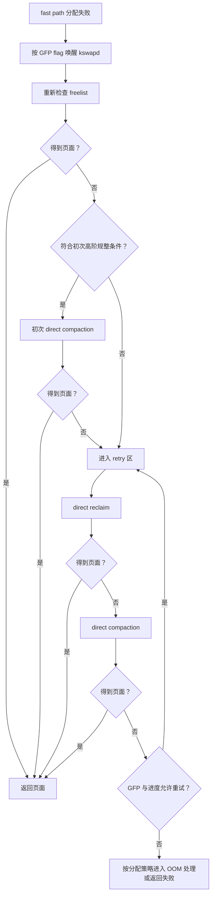

# 内存规整与直接回收性能边界

一次应用卡顿的 trace 里，可能同时出现内核回收线程 `kswapd` 活跃、内存 PSI 上升、ZRAM 写入和 `lmkd` 终止进程。它们在时间上相邻，却未必出自同一段代码，也未必在处理同一个问题。

> 源码基线：Android Common Kernel `android17-6.18-2026-06_r6`（提交 `bcbd6575c301ef871ea15e7ac0fc83909e17ef56`）；AOSP `android-17.0.0_r1` 的 `lmkd`、`libpsi`、`CachedAppOptimizer.java` 与 JNI 实现；另参考 Android Source 的 `lmkd`、`mmd` 文档，以及 Android Developers 的应用内存与 `ComponentCallbacks2` API 文档。

Linux 物理页规整、页面回收、ZRAM 压缩、Android 缓存应用回收（cached app compaction）是四种不同的操作。我们排查卡顿时，要先确认眼前的事件属于哪一层，再讨论它对性能的影响。

## 1. 四个容易混淆的机制

| 机制 | 解决的问题 | 核心动作 | 典型执行者 |
|---|---|---|---|
| Linux 物理页规整 | 空闲页总量可能够，但缺少指定阶数（order）的连续物理页 | 迁移可移动页，形成更大的伙伴系统空闲块 | 分配线程或 `kcompactd` |
| 页面回收 | 可分配页数量不足 | 丢弃文件页、回写脏页、换出匿名页 | 分配线程、`kswapd` 等 |
| ZRAM 压缩 | 匿名页换出后需要保存内容 | 压缩页面并存入位于 RAM 的块设备 | 交换空间/ZRAM 路径 |
| Android 缓存应用回收 | 降低缓存进程的驻留内存 | 对目标进程执行 `MADV_COLD`、`MADV_PAGEOUT` 或内存控制组回收 | `CachedAppOptimizer` |

### 1.1 物理页规整的目标与代价

物理页规整把已占用且可迁移的页搬到别处，再让分散的空闲页按伙伴系统规则合并成连续块。迁移前后，进程看到的虚拟地址与数据内容保持不变。规整要消耗 CPU、内存带宽，还要更新页表等映射状态。我们看这套机制时，关注点应放在“空闲页是否变得更连续”上；它整理的是物理布局，主要目标并不是减少进程常驻内存集（RSS）。

### 1.2 页面回收关注“有多少页可用”

页面回收优先处理能够丢弃或写回的页：干净文件页可以丢弃，后续访问时再从文件读取；匿名脏页没有文件作为后备存储，启用交换空间（swap）时可以换出到 ZRAM 或其他后端。回收解决的是可用页数量；这些页在物理上是否连续，回收本身顾不上。

所以回收得到多个 order-0 页后，高阶分配仍可能失败——这些页的物理位置未必连续。分配器接下来可能再尝试物理页规整，把可用但不连续的页整理成连续空闲块。

### 1.3 ZRAM 保存换出的匿名内容

ZRAM 把换出页保存在 RAM 中；可压缩数据通常能减少占用，但不可压缩页可能按原大小保存，内存池碎片和管理开销也要计入。压缩、解压还会消耗 CPU 时间和内存带宽。它回答的是“换出的匿名页放在哪”这个问题。

至于释放出的基础页能否形成连续块，还要取决于物理位置、迁移类型和后续规整——ZRAM 只提供匿名页换出的存放位置，伙伴系统里的离散空闲页要靠规整去合并。

### 1.4 Android 的“应用规整”是进程页面回收

Framework 的 `CachedAppOptimizer` 也使用 compaction 这个名称，其 JNI 实现在 `com_android_server_am_CachedAppOptimizer.cpp` 中：

- 私有文件映射使用 `MADV_COLD`；
- 匿名私有映射使用 `MADV_PAGEOUT`；
- 部分配置可以通过控制组（cgroup）的 `memory.reclaim` 执行进程级回收。

这套机制针对缓存进程的 RSS，与 `mm/compaction.c` 中的伙伴系统物理页规整同名而含义不同。所以我们在 Perfetto 中看到 `Compaction` 轨道时，第一步是确认它来自 Framework 的 ATrace，还是 `compaction/mm_compaction_*` 内核跟踪点（tracepoint）——两个名字相同的事件，讲的并不是同一件事。


## 2. order 描述连续物理页数量

伙伴系统分配器（buddy allocator）用 order 表示连续基础页数量的指数：

```text
连续页数 = 2^order
连续字节数 = 2^order × PAGE_SIZE
```

order-0 是一个基础页，order-1 是两个相邻基础页。要把高阶分配做成功，下面这些约束要同时满足：

- 页数达到要求；
- 物理地址连续；
- 内存区域（zone）、非统一内存访问策略（NUMA policy）、CPU 集合和内存水位允许；
- 页面迁移类型（migratetype）与分配标志能够满足；
- 页面没有被无法迁移的使用方式长期占住。

这里有个容易先入为主的判断：大块 `malloc()` 或 Java 大对象申请的是连续虚拟地址，与直接申请同样大小的连续物理页是两回事，应用可能在发生缺页时逐个获得 order-0 页。所以判断一次申请会不会进入高阶分配，我们先看它要的是虚拟地址连续还是物理地址连续。

需要高阶物理页的，更多是内核对象、透明大页（THP）或大型 folio、连续内存分配器（CMA）以及特定驱动路径。图形和多媒体缓冲区是否要求物理连续，还要看 IOMMU 是否支持地址重映射、使用的 DMA 堆和驱动实现。

举例说明 order 与页大小的数学关系：

| 目标 | 4 KiB 基础页 | 16 KiB 基础页 |
|---|---:|---:|
| order-3 覆盖字节数 | 32 KiB | 128 KiB |
| 2 MiB 连续区域所需 order | order-9 | order-7 |

注意这个表只做页数换算：设备是否使用 2 MiB THP、某次 2 MiB 虚拟内存申请是否会进入对应 order 的伙伴系统分配，都要另行确认。


## 3. 规整如何形成连续空闲区

规整从两个方向扫描内存区域：

- 迁移扫描器寻找可以搬走的已占用页；
- 空闲页扫描器寻找可作为迁移目标的空闲页。

页迁移成功后，低地址或目标区域中的占用页被移走，分散空闲页便有机会按伙伴系统规则合并。哪些页搬得动，直接决定这一轮规整的收获：长期固定（pinned）或无法迁移的页、不可移动的内核分配、受约束的页块，都会降低迁移成功率。

<!-- gracker-diagram: ch04-07-two-scanners-and-migration -->


图：八个基础页的简化示例中，M 表示可移动占用页，F 表示空闲页。把第 0、2 页迁往第 4、6 页后，前四页都空闲，若满足伙伴系统对齐与类型条件即可合并为 order-2。空闲页数仍为四页；变化的是物理分布。实际规整还有隔离、映射更新、迁移失败与跳过页块等成本。

### 3.1 迁移类型降低长期碎片

页块会按用途区分 `MIGRATE_MOVABLE`、`MIGRATE_RECLAIMABLE`、`MIGRATE_UNMOVABLE`、`MIGRATE_CMA` 等迁移类型。这样分组可以减少可移动页与不可移动页交错，降低长期外部碎片。

分组挡不住所有场景：紧急情况下，分配器仍可能退而使用其他迁移类型的空闲块。设备运行越久，这种回退越多，一个页块（pageblock）中就可能混入迁移能力不同的页面，后续高阶规整也更难成功。

### 3.2 CMA 也可能需要迁移，但入口不同

CMA 为连续内存分配保留适合迁移的区域。CMA 分配或 `alloc_contig_range()` 同样可以触发页面隔离和迁移，只是入口与普通伙伴系统高阶分配中的直接规整分支不同。

我们分析相机、显示或编解码问题时，应同时确认：

- 使用的是哪种 DMA heap 或分配器；
- IOMMU 是否允许把分散物理页组织成设备可访问的散布-聚集（scatter-gather）列表；
- 内核日志是否来自 CMA；
- `/proc/meminfo` 是否提供 `CmaTotal`、`CmaFree`；
- 性能轨迹中运行的是目标线程、`kcompactd`，还是驱动自己的回收线程。

## 4. Android 17 分配慢路径的真实顺序

把慢路径概括成“先回收，再规整”会漏掉 `__alloc_pages_slowpath()` 中的一个分支：部分高阶分配会在直接回收（direct reclaim）之前，先尝试直接规整（direct compaction）。两者都在当前请求分配的线程中同步执行，我们按执行顺序把这条路径拆开看。

### 4.1 第一次规整发生在什么条件下

进入慢路径后，内核先按分配标志唤醒 `kswapd`，更新标志并再次检查空闲链表（freelist）。仍失败时，满足下列条件的请求会先做一轮规整：

- 调用方允许直接回收；
- GFP 分配标志允许规整；
- 请求属于内核认定成本较高的阶数（costly order），或者是非 `MIGRATE_MOVABLE` 的高阶分配；
- 请求不处于允许绕过内存水位的特殊上下文。

这轮初始尝试使用 `INIT_COMPACT_PRIORITY`。某些带 `__GFP_NORETRY` 的高成本分配，在规整被跳过或延后后会直接失败，内核以此避免继续投入代价很高、成功率又不确定的回收。

### 4.2 常规重试先回收，再规整

如果初始尝试没有返回页面，慢路径进入重试区：

1. 再查空闲链表；
2. 检查调用方是否允许直接回收；
3. 执行 `__alloc_pages_direct_reclaim()`；
4. 回收后再次分配；
5. 仍失败则执行 `__alloc_pages_direct_compact()`；
6. 根据 GFP 重试策略、回收进度、规整结果和优先级，决定重试、进入内核 OOM 处理或返回失败。

下面的图只保留和性能诊断相关的控制流：



图里没有 `lmkd`，因为它是独立的用户空间守护进程：内核慢路径可以走进内核 OOM Killer，`lmkd` 则根据另一组压力证据，异步选择要终止的 Android 进程。


### 4.3 order-0 分配与直接规整

直接规整的入口先做一项检查：

```c
// kernel/common, android17-6.18-2026-06_r6
static struct page *
__alloc_pages_direct_compact(gfp_t gfp_mask, unsigned int order, ...)
{
    if (!order)
        return NULL;

    psi_memstall_enter(&pflags);
    delayacct_compact_start();
    *compact_result = try_to_compact_pages(...);
    psi_memstall_leave(&pflags);
    delayacct_compact_end();
    ...
}
```

order 为 0 就直接返回。所以 order-0 缺页可以触发直接回收，却轮不到这个入口来执行直接规整；应用主线程因普通缺页卡住时，通常更值得先检查直接回收；要把责任归到物理页规整，需要先看到 order、GFP 和规整性能轨迹的证据。

### 4.4 直接回收和直接规整都计入 PSI

`__alloc_pages_direct_reclaim()` 与 `__alloc_pages_direct_compact()` 都会调用 `psi_memstall_enter()` / `psi_memstall_leave()`，分配线程在两类同步处理中的停顿时间也因此都计入内存压力停顿信息（memory PSI）。

PSI 直接告诉我们的，是任务因内存资源短缺而停顿这一层信息：

- `some` 表示至少有部分非空闲任务因该资源停顿；
- `full` 表示所有非空闲任务同时停顿。

至于停顿具体来自页面回收、物理页规整、交换空间 I/O 还是其他内存压力原因，PSI 本身区分不出，还要结合内核跟踪点、线程调用栈和 `vmstat` 继续分类。

## 5. 外部碎片指数的适用范围

要判断“空闲页总量够、却合不出高阶块”是不是碎片问题，我们可以看 `/sys/kernel/debug/extfrag/extfrag_index`：按内存节点（node）、内存区域和 order 展示外部碎片指数（external fragmentation index）。该 debugfs 文件把内部整数指数除以 1000，以三位小数显示，读法是：

- `-1.000`：已有满足 order 的空闲块，是否可分配仍取决于 watermark 等约束；
- 趋近 `0.000`：失败更偏向可用内存不足；
- 趋近 `1.000`：失败更偏向外部碎片。

源码 `fragmentation_index()` 的内部表示则是 `-1000` 或 `0—1000`；`vm.extfrag_threshold` 与内部整数比较，不能把 debugfs 的显示值直接当作 sysctl 的数值尺度。

在 `android17-6.18-2026-06_r6` 的 `compaction_suitable()` 中，内存水位检查先决定该区域是否具备迁移所需的空闲页。只有 `order > PAGE_ALLOC_COSTLY_ORDER` 时，代码才进一步使用外部碎片指数和 `vm.extfrag_threshold`，跳过预期收益偏低的规整：

```c
if (suitable) {
    compact_result = COMPACT_CONTINUE;
    if (order > PAGE_ALLOC_COSTLY_ORDER) {
        int fragindex = fragmentation_index(zone, order);

        if (fragindex >= 0 &&
            fragindex <= sysctl_extfrag_threshold) {
            suitable = false;
            compact_result = COMPACT_NOT_SUITABLE_ZONE;
        }
    }
}
```

当前内核源码标签的 sysctl 文档写明 `extfrag_threshold` 默认值为 500；设备的实际值仍应现场读取。该阈值参与高成本阶数的规整适用性判断，即使超过阈值也不保证规整成功。


读取 `extfrag_index` 需要 `CONFIG_DEBUG_FS`、`CONFIG_COMPACTION` 和相应权限，量产设备上往往读不到。这时可以退而求其次，用伙伴系统空闲块分布、迁移类型、规整结果和分配 order 建立间接证据；仅凭 `MemAvailable` 就宣布存在物理碎片，依据是不足的。

## 6. `kswapd`、`kcompactd` 与分配线程

| 路径 | 执行上下文 | 主要工作 | 对应用的影响 |
|---|---|---|---|
| `kswapd` | 每个内存节点的内核线程 | 后台扫描和回收，尝试恢复内存水位 | 消耗 CPU、内存带宽，可能带来交换或 I/O |
| 直接回收 | 当前分配线程 | 同步调用 `try_to_free_pages()` | 增加当前请求的墙钟时间 |
| `kcompactd` | 每个内存节点的内核线程 | 响应高阶请求或主动规整 | 后台消耗资源，降低部分后续高阶分配失败概率 |
| 直接规整 | 当前高阶分配线程 | 同步扫描、隔离、迁移页面 | 增加当前请求的墙钟时间 |

### 6.1 `kcompactd` 的主动规整

内核仍支持 `vm.compaction_proactiveness`。该值范围为 0 到 100，当前通用内核源码默认 20。主动规整使用相对于 `COMPACTION_HPAGE_ORDER` 的外部碎片分数，并按各内存区域占节点的页数加权，阈值由参数换算：

```text
low  = 100 - compaction_proactiveness
high = min(low + min(10, low / 2), 100)
```

默认值 20 对应 `low=80`、`high=90`。节点分数高于 high 时，`kcompactd` 可以启动主动规整；工作持续到各内存区域的分数接近 low，或遇到锁竞争、没有进展等需要退避的条件。`kswapd` 正在运行时主动规整会跳过，让两类后台内存工作错开资源。

参数行为还包括：

- 0 关闭主动规整；
- 写入非零值会立即触发一次主动规整；
- 更高值会降低触发门槛，提高后台规整积极程度；
- 极端值可能产生过量后台规整和延迟尖峰。

设备厂商可以改变配置和运行值。我们分析具体设备时应读取实际 sysctl；通用内核默认值只是上游基线，各 Android 17 产品的实际参数以现场读取为准。

<!-- gracker-diagram: ch04-07-proactive-compaction-hysteresis -->


图：proactiveness 默认 20 时，low=80、high=90。kcompactd 用按 zone 大小加权的节点分数判断是否超过 high；规整具体 zone 时，其分数降到 low 或满足退避条件即可停止。kswapd 正运行会跳过或退出主动规整。写非零值会立即唤醒一次，0 只关闭主动模式；产品运行值必须实测。

### 6.2 三个参数服务不同决策

| 参数 | 取值与默认值 | 作用范围 | 不能推导的结论 |
|---|---|---|---|
| `vm.compaction_proactiveness` | 0—100，通用内核默认 20 | 控制主动规整；0 不会关闭直接规整或分配请求驱动的 `kcompactd` | 不能按总内存容量直接套固定值 |
| `vm.extfrag_threshold` | 0—1000，默认 500 | 帮助高成本阶数分配判断更适合规整还是回收 | 与主动规整的 0—100 分数不是同一个量 |
| `vm.compact_unevictable_allowed` | 普通内核默认 1，实时抢占（PREEMPT_RT）内核默认 0 | 决定规整是否检查不可回收 LRU 上的页 | 允许迁移不表示锁定在内存中的页访问不会停顿 |

向 `vm.compact_memory` 写 1 会手工规整所有内存节点，这个接口适合受控实验，日常清理内存并不适合走它。`/sys/devices/system/node/node*/compact` 还依赖 NUMA、sysfs、权限和产品配置，量产设备未必提供。

### 6.3 线程状态与调用栈

执行直接回收或直接规整的线程可能：

- 在 CPU 上运行内核代码；
- 因调度暂时处于可运行（Runnable）状态；
- 等待 I/O、锁或其他不可中断条件而处于 `D` 状态；
- 在可中断等待中显示为休眠（Sleeping）。

因此，单看线程状态容易误判：直接回收进行中，线程未必处于 `D` 状态；运行（Running）状态，也未必意味着线程在执行耗时的业务 Java 代码。我们把调度状态与内核栈、ftrace 事件和 PSI 时间窗口对齐之后再下结论。

## 7. Android 17：PSI、lmkd 与 mmd 的责任边界

这一节把三个角色放到一起看：内核负责分配与回收，`lmkd` 负责在压力下选择要终止的进程，`mmd` 负责 ZRAM 的维护。它们感知的是同一台设备的内存压力，决策却各自独立。我们先看 `lmkd`。

### 7.1 `lmkd` 消费压力信号并选择进程

Android 10 起，PSI 成为 `lmkd` 的默认压力监控方式。Android 17 的 `init_psi_monitors()` 在新策略下把 LOW 级阈值设为 0，MEDIUM 级使用 `PSI_SOME` 的部分停顿阈值，CRITICAL 级使用 `PSI_FULL` 的完全停顿阈值；AOSP 默认窗口是 1000 ms，非 low-ram 设备的部分停顿默认值是 70 ms，完全停顿默认值是 700 ms，产品属性仍可覆盖。[已验证: AOSP android-17.0.0_r1 system/memory/lmkd/lmkd.cpp; 来源: 技术文章/source/juejin-android/2026-08-26-76772546-AndroidPSI详解libpsi源码解析116行架起lmkd与内核的桥.md]

PSI trigger 的语义容易被高估：`lmkd.cpp` 明确把默认 PSI 窗口设为 1000 ms，并说明 monitor 每个窗口最多产生一次事件；事件到达后，`lmkd` 会在同一窗口内继续轮询内存状态。一次决策刚执行 kill 或 swap 低时，轮询周期使用 10 ms；其他轮询使用 100 ms；如果正在等待进程死亡通知，则暂停轮询。排查时要把 `lmkd` 日志、`/proc/pressure/memory` 的 `total/avg10` 和采样时间对齐——窗口里没有新的 PSI trigger，决策也可能一直在继续。[已验证: AOSP android-17.0.0_r1 system/memory/lmkd/lmkd.cpp; 来源: 技术文章/source/juejin-android/2026-08-26-76772546-Android高版本LMKD源码解析PSI内存压力监控与查杀全流程.md]

属性与守护进程自身优先级也会影响复现。`GET_LMK_PROPERTY` 让 `persist.device_config.lmkd_native.<name>` 覆盖 `ro.lmk.<name>`；`update_props()` 读取 PSI 窗口、部分/完全停顿阈值、缓存抖动和交换空间等参数。现代 userspace 路径初始化后，`lmkd` 还会尝试 `mlockall(MCL_CURRENT | MCL_FUTURE | MCL_ONFAULT)` 并设置 `SCHED_FIFO` 优先级 1；失败只记录 warning。这些措施是为了降低 `lmkd` 自身在内存高压下受回收或调度影响的概率；某个分配线程正在进行的直接回收或物理页规整，并不在其保护范围内，仍会按内核路径执行。[已验证: AOSP android-17.0.0_r1 system/memory/lmkd/lmkd.cpp; 来源: 技术文章/source/juejin-android/2026-08-26-76772546-Android高版本LMKD源码解析PSI内存压力监控与查杀全流程.md]

收到事件后，决策代码还会读取或计算：

- 内存区域水位；
- 剩余交换空间与交换空间使用率；
- 文件页缓存的工作集重新缺页（workingset refault）与缓存抖动（thrashing）；
- 直接回收与 `kswapd` 回收状态；
- PSI memory `some/full` 统计；
- 候选进程的 `oom_score_adj` 和 RSS；
- 设备属性与厂商事件。

Android 17 源码可以通过内存事件监听器识别直接回收和 `kswapd` 活动；该能力不可用时，再根据 `/proc/vmstat` 中 `pgscan_direct`、`pgscan_kswapd` 等计数的变化判断。

终止原因包括 `DIRECT_RECL_AND_THRASHING`、`DIRECT_RECL_STUCK`、`LOW_MEM_AND_SWAP`、`LOW_MEM_AND_THRASHING` 等条件；`/proc/vmstat` 的 `compact_fail`（内核枚举 `COMPACTFAIL`）并不在直接触发终止的条件之列。

读 bugreport 时还要注意，`lmkd` 说的“低内存”与 `/proc/meminfo` 里的 `MemAvailable` 是两套算法：`meminfo_parse()` 解析 `MemFree`、文件页/匿名页、`SwapTotal/SwapFree`、`CmaFree` 等字段；`get_lowest_watermark()` 用 `MemFree - CmaFree` 与 `calc_zone_watermarks()` 汇总出的 `max_protection + min/low/high` 水位比较，得出 `WMARK_HIGH/LOW/MIN`。

因此，`MemAvailable` 看起来仍高时，`lmkd` 仍可能因为马上可分配页贴近水位而把“低内存 + swap/thrashing”等条件纳入候选；反过来，水位没破、swap 充足且 refault 不增长时，PSI 唤醒也可能被判为无需 kill。[已验证: AOSP android-17.0.0_r1 system/memory/lmkd/lmkd.cpp; 来源: 技术文章/source/juejin-android/2026-08-26-76772546-Android高版本LMKD源码解析PSI内存压力监控与查杀全流程.md]

文件页抖动的分子是 `workingset_refault_file` 的区间增量，分母是上一窗口记录的 `nr_inactive_file + nr_active_file` 再加 1（避免除零）；ZRAM 场景下，可用 swap 还会经过 `easy_available` 和 `swap_compression_ratio` 约束，而不是直接相信 `SwapFree` 的名义容量。排查 LMK 与直接回收相邻发生的问题时，应保存同一时间窗口内的 `/proc/vmstat`、`/proc/meminfo`、`/proc/zoneinfo` 和 `/proc/pressure/memory`，再用增量解释 thrashing、水位和 PSI 是否共同满足同一次查杀条件。[已验证: AOSP android-17.0.0_r1 system/memory/lmkd/lmkd.cpp; 来源: 技术文章/source/juejin-android/2026-08-26-76772546-Android高版本LMKD源码解析PSI内存压力监控与查杀全流程.md]

把这些增量放在一起，可以得到四条判断：

- 规整失败可能增加分配延迟或让高阶请求失败；
- 同一压力期也可能让 PSI、内存水位、交换空间和缓存抖动条件恶化；
- `lmkd` 根据这些压力状态和进程优先级决定是否终止进程；
- 规整失败与某次 LMK 之间是否因果相关，要靠时间和指标证明，相邻发生本身说明不了什么。

`oom_score_adj` 决定哪些进程更适合作为候选，但终止原因、最低候选分值、严重停顿和设备厂商策略都会改变选择范围；把它概括成“永远只终止 RSS 最大的缓存应用”，并不准确。

### 7.2 `libpsi` 与 PSI 触发协议

`libpsi` 的职责很窄，只负责 trigger 的注册与销毁；何时杀进程、内存压力为什么高，都在它的职责之外。`init_psi_monitor()` 以 `O_WRONLY | O_CLOEXEC` 打开 `/proc/pressure/memory`、`/proc/pressure/io` 或 `/proc/pressure/cpu`，写入 `"some|full threshold_us window_us"` 后返回同一个 fd；`register_psi_monitor()` 把这个 fd 以 `EPOLLPRI` 加入 `lmkd` 的 epoll，`destroy_psi_monitor()` 关闭 fd 并让内核销毁对应 trigger。[已验证: AOSP android-17.0.0_r1 system/memory/lmkd/libpsi/psi.cpp; system/memory/lmkd/libpsi/include/psi/psi.h; 来源: 技术文章/source/juejin-android/2026-08-26-76772546-AndroidPSI详解libpsi源码解析116行架起lmkd与内核的桥.md]

因此，PSI 在 `lmkd` 中有两条通道：trigger fd 只负责“何时唤醒”，统计读取由 `lmkd.cpp` 的 `reread_file()` 缓存另一个只读 fd 后解析 `some/full avg10/avg60/avg300/total`。`psi_parse_mem()` 解析 memory 的 `some` 与 `full` 两行，`psi_parse_cpu()` 只按 `some` 解析 CPU 压力；把 `/proc/pressure/memory` 的读数和 trigger 唤醒混成同一个 fd，会误判采集链路。[已验证: AOSP android-17.0.0_r1 system/memory/lmkd/lmkd.cpp; system/memory/lmkd/libpsi/psi.cpp; 来源: 技术文章/source/juejin-android/2026-08-26-76772546-AndroidPSI详解libpsi源码解析116行架起lmkd与内核的桥.md]

<!-- gracker-diagram: ch04-07-psi-two-fds-and-lmkd -->


图：libpsi 用写 fd 注册 some/full 阈值与窗口，并让 lmkd 监听 EPOLLPRI；lmkd 另缓存只读 fd 读取 avg 与 total。事件后还会轮询，默认 10 或 100 ms，等待进程退出时暂停。最终决策结合水位、swap、refault、回收与候选优先级；compact_fail 既不是 PSI 事件，也不是直接 kill 条件。

排查“PSI 明明升高但 `lmkd` 没动作”时，我们要同时检查三件事：内核是否支持 PSI trigger、写入的 stall 类型与阈值是否满足、事件监听是否等待 `EPOLLPRI` 而非普通可读事件。即使 `avg10` 抬高，也只说明统计窗口内发生过压力停顿；是否触发 `lmkd` 决策，还取决于上述 trigger 条件、窗口限速、轮询补盲和后续决策树。[已验证: AOSP android-17.0.0_r1 system/memory/lmkd/lmkd.cpp; system/memory/lmkd/libpsi/psi.cpp; 来源: 技术文章/source/juejin-android/2026-08-26-76772546-AndroidPSI详解libpsi源码解析116行架起lmkd与内核的桥.md]

### 7.3 Android 17 的 `mmd` 管理 ZRAM 维护

Android 17 新增内存管理守护进程（memory management daemon，`mmd`）。官方架构文档把它定位为 ZRAM 配置与持续维护服务，可执行：

- ZRAM 重新压缩；
- ZRAM 写回；
- 按进程写回 ZRAM 页面；
- 按进程预取页面。

这些动作处理的是已经进入交换空间/ZRAM 的页面及其后续存放方式；伙伴系统物理页规整与 `lmkd` 的进程选择，仍归各自原来的模块负责。

按进程写回还会与 `CachedAppOptimizer` 协作：缓存进程先经过 Framework 所称的应用规整，等待一段时间后，再由 `system_server` 通过进程文件描述符 pidfd 请求 `mmd` 写回该进程的 ZRAM 页面。这里的应用规整仍指 `madvise` 或内存控制组页面回收。

### 7.4 三层关系

| 层 | 主要问题 | Android 17 组件 |
|---|---|---|
| 物理页分配 | 数量、连续性、内存水位 | 伙伴系统、页面回收、`mm/compaction.c` |
| 系统压力响应 | 何时终止哪个进程 | PSI + 用户空间 `lmkd` |
| 交换空间后处理 | 如何维护 ZRAM 中的冷页 | `mmd` |

它们共享同一台设备的 CPU、物理内存、交换空间和 I/O，所以可能互相影响，但实现职责仍然分开。


## 8. Perfetto：先确认事件，再解释影响

### 8.1 推荐的内核事件

下面的 TraceConfig 片段观察的是基线内核里已经定义的这些事件。量产设备是否开放，取决于内核配置、tracefs 权限和 Perfetto 事件白名单。

```protobuf
data_sources {
  config {
    name: "linux.ftrace"
    ftrace_config {
      ftrace_events: "sched/sched_switch"
      ftrace_events: "vmscan/mm_vmscan_kswapd_wake"
      ftrace_events: "vmscan/mm_vmscan_kswapd_sleep"
      ftrace_events: "vmscan/mm_vmscan_direct_reclaim_begin"
      ftrace_events: "vmscan/mm_vmscan_direct_reclaim_end"
      ftrace_events: "compaction/mm_compaction_try_to_compact_pages"
      ftrace_events: "compaction/mm_compaction_begin"
      ftrace_events: "compaction/mm_compaction_end"
      ftrace_events: "compaction/mm_compaction_migratepages"
      ftrace_events: "compaction/mm_compaction_kcompactd_wake"
      ftrace_events: "compaction/mm_compaction_kcompactd_sleep"
    }
  }
}
```

| 事件 | 关键字段或配对 | 用途 |
|---|---|---|
| `mm_vmscan_direct_reclaim_begin/end` | 当前线程、GFP、order、回收页数 | 量化分配线程中的同步回收 |
| `mm_compaction_try_to_compact_pages` | order、GFP、优先级 | 确认直接规整请求 |
| `mm_compaction_begin/end` | 内存区域页框号、同步/异步模式、结果状态 | 量化一次规整及其结果 |
| `mm_compaction_migratepages` | 成功迁移数、失败数 | 观察页面迁移效果 |
| `mm_compaction_kcompactd_wake/sleep` | 内存节点、order | 识别后台规整窗口 |
| `sched_switch` | 切出与切入线程的状态 | 还原线程运行、等待与唤醒 |

`mm_compaction_begin/end` 也可能由后台规整产生，我们要结合事件所在 CPU、当前线程和 `kcompactd` 事件判断执行上下文。

### 8.2 一次可信的卡顿归因

要把主线程卡顿归因给直接回收，至少应满足：

1. 卡顿起止与该线程的 `mm_vmscan_direct_reclaim_begin/end` 重叠；
2. 事件字段与调用栈指向同一次分配；
3. PSI 或 vmstat 在相同窗口给出压力证据；
4. 区分回收内部的 I/O、锁等待与操作本身的其他等待，核对 Binder 对端、外部锁竞争等是否另有延迟贡献。

若归因给直接规整，还应补充：

- `mm_compaction_try_to_compact_pages` 的 order 与 GFP 标志；
- 开始和结束事件之间的持续时间与结果状态；
- 迁移成功/失败数量；
- 分配最终成功、重试还是失败；
- 该请求是否来自应用线程，或来自内核/驱动的其他线程。

“`kcompactd0` 同时处于运行状态”只说明后台规整活跃；目标线程是否正在等待它，还要靠上面这些字段确认。

### 8.3 Framework 应用规整的性能轨迹

`CachedAppOptimizer` 使用 `ATRACE_COMPACTION_TRACK = "Compaction"`，其 JNI 还能产生 `CollectVmas`、`Madvise ...` 等持续区间。看到这些区间时，我们的分析目标是：

- 哪个缓存进程被 `madvise` 建议回收或冷却页面；
- 匿名页、文件页 RSS 与交换空间占用怎样变化；
- 是否影响 ZRAM、CPU 和后续启动；
- 是否随后触发 Android 17 的按进程 ZRAM 写回。

统计内核的 `compact_stall` 时，要把 Framework 的 `Compaction` 持续区间单独归类，两者来自不同机制。

<!-- gracker-diagram: ch04-07-trace-thread-context-and-latency -->


图：示意轨道显示目标线程内部的同步回收或规整，与 kswapd、kcompactd 和 Framework 应用回收可在时间上重叠。归因需要目标 TID、同次分配 order/GFP、成对事件、调用栈及调度状态。后台线程活跃或全局累计计数增长，都不能单独给出目标线程等待了多久。

## 9. bugreport 与 adb：用增量，不用单点

### 9.1 `/proc/vmstat`

内核暴露的相关累计计数包括：

- `pgscan_direct`、`pgsteal_direct`；
- `pgscan_kswapd`、`pgsteal_kswapd`；
- `compact_stall`、`compact_success`、`compact_fail`；
- `compact_migrate_scanned`、`compact_free_scanned`；
- `compact_daemon_wake`；
- `compact_daemon_migrate_scanned`、`compact_daemon_free_scanned`；
- `pswpin`、`pswpout`。

我们可以先在受控设备上检查字段是否存在：

```bash
adb shell 'grep -E "^(pgscan_direct|pgsteal_direct|pgscan_kswapd|compact_|pswpin|pswpout)" /proc/vmstat'
```

这些值从开机开始累计，只有问题窗口前后的差值才有意义。`compact_success` 在增长，也只说明直接规整后取得了目标页面；这次规整花了多长时间、有没有造成延迟，要从其他字段看。

### 9.2 伙伴系统与迁移类型

```bash
adb shell cat /proc/buddyinfo
adb shell cat /proc/pagetypeinfo
adb shell cat /proc/zoneinfo
```

- `buddyinfo` 按内存区域和 order 给出空闲块数量；
- `pagetypeinfo` 进一步按迁移类型展示空闲块和页块分布；
- `zoneinfo` 提供内存水位、受管理页和空闲页等背景。

内核将 `/proc/pagetypeinfo` 权限设为 `0400`，而且源码明确提示采集开销较高，不适合高频轮询，量产设备上的 SELinux 还可能限制访问。

某个高 order 的空闲块数量为 0，是连续块不足的信号，但仍需结合目标内存区域、order、迁移类型和水位判断；一个内存区域缺块，另一个区域可能仍然接得住请求。

### 9.3 PSI、ZRAM 与 CMA

```bash
adb shell cat /proc/pressure/memory
adb shell cat /proc/swaps
adb shell cat /sys/block/zram0/mm_stat
adb shell cat /proc/meminfo
```

这几个文件各自覆盖整条链路的一部分：

- PSI `avg10/60/300` 适合看趋势，`total` 的区间增量适合补充短时停顿证据；
- `/proc/pressure/memory` 的读数是统计视角，`lmkd` 的 PSI 唤醒是 `libpsi` 写入 trigger 条件后等待 `EPOLLPRI` 的事件视角；没有 `lmkd` 日志或 trace 时，不能只凭一次 `avg10` 抬高还原每次唤醒。[已验证: AOSP android-17.0.0_r1 system/memory/lmkd/libpsi/psi.cpp; system/memory/lmkd/lmkd.cpp; 来源: 技术文章/source/juejin-android/2026-08-26-76772546-AndroidPSI详解libpsi源码解析116行架起lmkd与内核的桥.md]
- `/proc/swaps` 给出交换设备和使用量；
- ZRAM `mm_stat` 字段含义应按设备内核文档解释；
- `SwapTotal/SwapFree`、`CmaTotal/CmaFree` 是否存在取决于配置；
- ZRAM 上涨要先明确字段：`orig_data_size` 表示逻辑未压缩数据量，`compr_data_size` 表示压缩数据量，`mem_used_total` 还含内存池开销与碎片。匿名页和可交换的 shmem 都可能进入 ZRAM，重压缩、写回也会改变占用；目标线程是否执行了直接回收，要另行证明。

debugfs 可用时再读取：

```bash
adb shell cat /sys/kernel/debug/extfrag/extfrag_index
```

该命令通常需要 root 权限、userdebug 或 eng 构建。采集失败只说明权限或配置不满足；碎片程度要从其他途径估计。

### 9.4 可回滚的单变量实验

一次可复核的实验至少包含以下步骤：

1. 用业务指标定义目标，例如相机首帧 P99、游戏最大帧耗时或连续运行后的高阶分配长尾。
2. 固定设备、构建、温度、前后台应用集合和工作负载，采集默认配置下的延迟、`vmstat` 增量、伙伴系统与外部碎片快照以及性能轨迹。
3. 找到目标 order、内存区域、迁移类型和分配者，再决定是否调整规整参数。
4. 每轮只改一个参数，记录原值并在测试后明确恢复。写入非零 `compaction_proactiveness` 本身会立即唤醒 `kcompactd`，因此刚写入那一刻的读数算不上稳态样本。
5. 同时比较前台 P95/P99、`kcompactd` CPU 时间、扫描量、直接规整、分配失败、PSI、LMK/OOM 和功耗。
6. 恢复默认值后复测，排除温度、缓存与执行顺序造成的假收益。

`drop_caches` 不执行物理页规整，还会制造额外缓存未命中和 I/O。除非实验目标就是冷缓存，否则不要用它重置规整测试。

## 10. 应用侧如何降低触发概率

设备的内存水位、`compaction_proactiveness`、ZRAM 算法和 `lmkd` 策略都由系统侧掌控，应用碰不到这些开关；应用能控制的是自身的分配峰值、驻留页和释放时机。

### 10.1 优先治理峰值

- 避免首屏同时解码多张大图、构建大列表和初始化原生模块；
- 限制预加载并发，并确保取消路径会释放中间缓冲区；
- 图片、相机、编解码、WebView 和机器学习运行时要分别记录 Java、原生、图形内存和 DMA-BUF；
- 为缓存设容量和淘汰规则，不用“有空闲内存”作为无限增长条件；
- 把可推迟的大分配移出输入响应和 `doFrame` 时间窗。

ART 大对象、原生分配与内核高阶页之间没有一一对应关系。优化前我们要先证明哪类分配触发了内存压力，避免为了一个驱动或 CMA 问题重写 Java 对象模型。

### 10.2 正确使用 `onTrimMemory()`

Android 官方文档的当前说法要求重点处理：

- `TRIM_MEMORY_UI_HIDDEN`：UI 不再可见，可以释放只服务于界面的 Bitmap、播放缓冲区和动画资源；
- `TRIM_MEMORY_BACKGROUND`：进程进入后台并可能成为终止候选，应释放可重建的后台资源。

Android 14 起不再投递其他旧版 `onTrimMemory` 级别，相关常量在 Android 15 正式弃用。不要为 Android 17 设计依赖 `TRIM_MEMORY_RUNNING_LOW` 等旧回调的核心策略。[已验证: AOSP android-17.0.0_r1 frameworks/base/core/java/android/content/ComponentCallbacks2.java; 来源: Android Developers ComponentCallbacks2 API reference]

释放缓存可以降低未来压力和 LMK 风险；只是这类回调既非内核直接回收的同步通知，也不能保证在每次压力出现前到达。

### 10.3 无效或高风险做法

- 在应用中写 `/proc/sys/vm/compact_memory`；
- 用 `System.gc()` 代替物理页回收或规整；
- 把 `largeHeap` 当作所有内存问题的修复；
- 只看 Java 堆，忽略原生内存、图形内存、DMA-BUF 和交换空间；
- 根据一台旗舰机的绝对阈值给所有设备分类；
- 在没有前后增量的情况下解读 `/proc/vmstat` 累计值。

## 11. 16 KB 页大小如何改变分析

16 KiB 基础页会改变 order 对应的字节数，也会改变页表、TLB、内部碎片和一次缺页覆盖的数据量。对同一字节数，高阶 order 可能下降；单页内部浪费和一次回收或迁移的数据量也可能增加。

这两组效应方向不同，“16 KiB 一定更少碎片”“一定更容易规整”这类预设都立不住。验证时至少要保持工作负载可比，并记录：

- 页大小和内核源码标签；
- 目标分配的 order、GFP、内存区域；
- `buddyinfo` 中各 order 的区间变化；
- 直接回收与直接规整的次数和耗时；
- 迁移成功率和 `compact_fail` 增量；
- RSS、ZRAM、缺页、LMK 与用户可感知延迟。

16 KiB 设备上的原生 `mmap()` 和 ELF 对齐兼容属于另一个问题，应结合 4.5 阅读。

### 11.1 mTHP 要按实际字节大小分析

多尺寸透明大页（multi-size THP，mTHP）允许匿名内存使用大于基础页、又小于传统 PMD 尺寸 THP 的 2 的幂倍页面。它仍由页表项（PTE）映射，可以减少部分缺页和 TLB 压力，也会引入更高阶的物理页需求。

Android 17 通用内核的 arm64 GKI 配置（`arch/arm64/configs/gki_defconfig`）启用了 `CONFIG_TRANSPARENT_HUGEPAGE=y` 与 `CONFIG_TRANSPARENT_HUGEPAGE_MADVISE=y`；具体产品是否启用所有 mTHP 尺寸，要看设备本身。设备会按实际字节数暴露 `hugepages-*kB` 目录；4 KiB 基础页上的 order-2 是 16 KiB，16 KiB 基础页上则是 64 KiB。报告应同时记录基础页、实际大页尺寸、分配与回退计数和规整事件，只写 order 是不够的。

## 12. 低内存设备与厂商差异

低内存设备的匿名页、文件缓存和交换空间余量更容易同时吃紧。可能出现下面的事件序列：

1. 前台或系统组件产生分配峰值；
2. `kswapd` 扫描，匿名页进入 ZRAM；
3. 工作集页面被回收后又重新读入的次数上升，出现缓存抖动；
4. 分配线程进入直接回收，必要时尝试物理页规整；
5. PSI 达到监控阈值；
6. `lmkd` 按内存水位、交换空间、缓存抖动、`oom_score_adj` 等条件终止进程；
7. 用户随后重新打开被终止的后台应用，发生冷启动和页面换入。

这是一种可能序列，设备也可能在任意一步恢复，所以每一步都要有对应证据再确认。

跨设备对比至少记录：

- Android 版本、内核版本/GKI 源码标签、基础页大小；
- 物理内存容量与 `ro.config.low_ram`；
- ZRAM 大小、算法、写回配置和 `/proc/swaps`；
- `ro.lmk.*` 与相关 DeviceConfig；
- 内存水位、伙伴系统空闲块、迁移类型和 PSI；
- `CONFIG_COMPACTION`、tracepoint 可用性；
- 芯片的 IOMMU、DMA 堆和 CMA 配置。

设备厂商对通用内核和 `lmkd` 的钩子、属性、阈值修改会改变结果。报告中应区分 AOSP 默认值、产品运行值和现场测量值。

## 13. 实战判读模板

我们假设某设备相机首帧偶发 200 ms 延迟，同时 memory PSI 抬高。

先按时间顺序回答：

1. 延迟发生在哪个线程？它处于 Running、Runnable、Sleeping 还是 `D`？
2. 该线程是否出现 `mm_vmscan_direct_reclaim_begin/end`？
3. 是否出现 `mm_compaction_try_to_compact_pages`？order 和 GFP 标志是什么？
4. `mm_compaction_end.status` 表示成功、跳过、延后还是失败？
5. 同窗口是否有 CMA、DMA heap、gralloc 或 IOMMU 日志？
6. `pgscan_direct`、`compact_stall/fail/success` 的区间增量是多少？
7. `buddyinfo` 中目标内存区域和 order 是否缺少空闲块？
8. `lmkd` 若终止进程，终止原因、候选 `oom_score_adj` 和释放的 RSS 是多少？
9. 相机请求前是否存在可消除的 Bitmap 或原生缓冲区峰值？

可能出现三种不同结论：

| 证据 | 结论方向 | 修复位置 |
|---|---|---|
| 目标线程直接回收明显，未出现物理页规整 | 可用页数量压力，或交换空间/页缓存代价 | 降低峰值、减少驻留页、检查 I/O |
| 目标高阶分配反复规整失败，CMA/驱动证据一致 | 连续页供应或不可迁移页问题 | 驱动、DMA 堆、CMA 与系统配置 |
| 只有 Framework 的 `Compaction` 持续区间 | CachedAppOptimizer 正在回收缓存进程页面 | 分析冻结/回收策略与前台资源竞争 |


## 14. 复核清单

- [ ] 已区分 Linux 物理页规整和 Android 缓存应用页面回收。
- [ ] 已确认分配 order、GFP、内存区域和执行线程。
- [ ] 已按 Android 17 慢路径顺序解释初次规整、页面回收和再次规整。
- [ ] 没有用线程 `D` 状态单独证明直接回收。
- [ ] PSI 只用于确认内存停顿，没有越界解释成队列或碎片指标。
- [ ] `lmkd` 终止原因与 `oom_score_adj` 来自同一事件。
- [ ] `/proc/vmstat` 使用区间增量。
- [ ] `buddyinfo` 与 `pagetypeinfo` 按目标内存区域、order 和迁移类型解读。
- [ ] 已记录 Android 17 `mmd` 与 ZRAM 后处理是否启用。
- [ ] 应用修复聚焦峰值和生命周期，没有尝试修改系统 sysctl。

## 15. 小结

物理页分配慢路径会在特定高阶条件下先尝试直接规整，常规重试再执行直接回收和直接规整；两类同步操作都计入内存 PSI，都会增加当前分配线程的墙钟时间。

规整解决物理页连续性，回收解决可用页数量，ZRAM 保存换出的匿名页，CachedAppOptimizer 回收缓存进程页面，`lmkd` 选择压力下要终止的进程，`mmd` 维护 ZRAM 冷页。把这些职责分开之后，Perfetto、`vmstat`、`buddyinfo` 和 `lmkd` 日志才能拼出可验证的结论。

## 参考源码与文档

- Android Common Kernel `android17-6.18-2026-06_r6`
  - `mm/page_alloc.c`
  - `mm/compaction.c`
  - `mm/vmscan.c`
  - `mm/vmstat.c`
  - `include/trace/events/compaction.h`
  - `include/trace/events/vmscan.h`
  - `arch/arm64/configs/gki_defconfig`
  - `Documentation/admin-guide/sysctl/vm.rst`
  - `Documentation/accounting/psi.rst`
- AOSP `android-17.0.0_r1`
  - `platform/system/memory/lmkd/lmkd.cpp`
  - `platform/system/memory/lmkd/libpsi/psi.cpp`
  - `platform/system/memory/lmkd/libpsi/include/psi/psi.h`
  - `platform/frameworks/base/services/core/java/com/android/server/am/CachedAppOptimizer.java`
  - `platform/frameworks/base/services/core/jni/com_android_server_am_CachedAppOptimizer.cpp`
  - `platform/frameworks/base/core/java/android/content/ComponentCallbacks2.java`
- Android Source：Low memory killer daemon
  - <https://source.android.com/docs/core/perf/lmkd>
- Android Source：Memory management daemon
  - <https://source.android.com/docs/core/perf/mmd>
- Android Developers：Manage your app's memory
  - <https://developer.android.com/topic/performance/memory>
- Android Developers：ComponentCallbacks2
  - <https://developer.android.com/reference/android/content/ComponentCallbacks2>
- 技术文章：Android-PSI 详解：libpsi 源码解析——116 行代码架起 lmkd 与内核之间的桥
  - `技术文章/source/juejin-android/2026-08-26-76772546-AndroidPSI详解libpsi源码解析116行架起lmkd与内核的桥.md`
- 技术文章：Android-高版本 LMKD 源码解析：基于 PSI 的内存压力监控与查杀全流程
  - `技术文章/source/juejin-android/2026-08-26-76772546-Android高版本LMKD源码解析PSI内存压力监控与查杀全流程.md`
