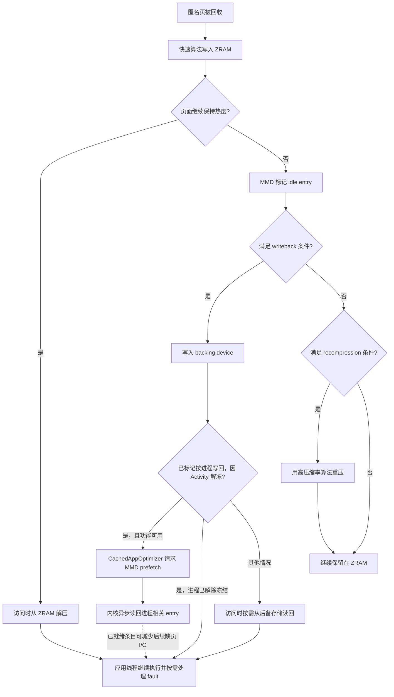

# ZRAM 压缩交换与应用重启延迟

ZRAM 用 CPU 换取匿名页的压缩驻留空间，为系统争取时间和容量；至于进程是否存活、恢复时要付出多少重新调页和解压的成本，要看后面的机制怎么配合。我们分析重启或恢复变慢，第一步是区分进程被杀后的冷路径与存活进程的换入路径。

> 源码基线：Android 17 / API 37（AOSP `android-17.0.0_r1`）；内核 `android17-6.18-2026-06_r6`。

## 先判断进程还在不在

排查“应用恢复变慢”这类反馈，我们要先确认一个事实：原进程是否仍然存在，然后才轮到 `VmSwap`。两种场景的执行成本完全不同：

| 场景 | PID | 主要成本 | ZRAM 与本次恢复的关系 |
| --- | --- | --- | --- |
| 进程存活，部分匿名页在 ZRAM | 不变 | 换入缺页（swap fault）、解压、可能的后备设备读取，以及恢复后的业务工作 | 直接相关 |
| 进程已被 LMKD 或其他机制终止 | 改变 | 创建进程、初始化运行时、加载代码和资源、重建组件 | 新进程不会沿旧进程的 swap PTE 自动恢复状态；旧进程退出会解除其交换条目引用，共享条目仍可能因其他引用保留 |

术语先约定清楚：Android 的冷启动、温启动和热启动是 Activity 启动分类；论文和系统优化语境中的“重新拉起”（relaunch）范围更宽，可能包含从后台任务恢复、Activity 重建或进程重建。本文用“换入恢复”表示 PID 不变、但需要重新访问已换出页面；用“冷启动”表示原进程已经终止。

用户说“感觉像冷启动”，描述的只是体验；判断进程是否真的重建过，要靠现场记录。先记下 PID、进程启动时间与 Activity 启动类型，避免 PID 复用造成误判；在 Android 11（API 30）及以上再结合 `ApplicationExitInfo`，低版本则需要日志、`dumpsys activity` 或自有启动埋点。


## ZRAM 位于匿名页回收与进程淘汰之间

页面为什么会进 ZRAM、进去之后又到了哪里？我们从匿名页离开物理内存的路径看起。

### 文件页与匿名页的后备来源不同

干净的文件页（file-backed page）自带后备来源：内存不足时，内核可以丢弃这些物理页，再次访问时再从 APK、DEX、`.so` 或其他文件读取。修改过的文件页则需要先写回，或按具体映射语义处理。

匿名页（anonymous page）没有可直接重读的原始文件：Java 堆、原生堆和匿名 `mmap()` 中的大量数据都属于这一类。要在保留进程状态的同时释放原始物理页，内核可以把页面写入交换空间。Android 通常把 ZRAM 块设备用作交换设备：

1. 回收器选中可换出的匿名页。
2. 交换层为页面分配交换条目（swap entry），用于记录页面被换出后的存放位置。
3. ZRAM 驱动按基础页大小接收内容并尝试压缩。
4. 压缩对象存入 zsmalloc 内存池；压缩效果很差的页面按不可压缩或大对象页面处理。
5. 进程页表保存交换条目，原物理页可以释放。
6. 进程再次访问该虚拟地址时发生换入缺页，页面从 ZRAM 解压并恢复。

这个过程以 CPU 时间换取容量。压缩率越高，同一段物理内存可以保存更多匿名数据；算法越复杂，压缩与解压占用的 CPU 通常越多。同时 ZRAM 自身也要占内存，分配器碎片、元数据和压缩上下文都算在内，所以 `SwapTotal - SwapFree` 只是换出数据的原始规模，实际节省的物理内存要比这个数字小。

### ZRAM、写回与磁盘交换的成本等级不同

系统还可以为 ZRAM 配置后备设备（backing device）。冷的 ZRAM 条目被写回后，压缩数据或页面内容离开内存，进入 `/data` 上的后备存储。这时页面在哪儿，恢复成本就跟着变：

| 页面位置 | 恢复时的主要工作 | 常见瓶颈 |
| --- | --- | --- |
| ZRAM 内存中 | 读取压缩对象并解压 | CPU、内存带宽、锁竞争 |
| 后备设备 | 发起块 I/O，再把内容恢复到 ZRAM 或进程页面 | 存储延迟、队列竞争、解压 |
| 交换缓存 | 可能复用已在内存中的页面 | 页表更新与普通缺页处理 |

所以 `VmSwap` 相同的两个进程，恢复耗时也可能不同。排查时我们要逐一确认：对应页面是否已经写回、访问是否集中在首帧之前、设备当时的 CPU 与存储负载。

<!-- gracker-diagram: ch04-08-page-backing-and-restore -->


图：干净文件页丢弃后可从原文件重读；匿名页需要 swap 保存内容。ZRAM 存于内存池，配置写回后条目可能转移到后备设备；恢复时也可能命中交换缓存。相同 VmSwap 只说明归属规模相近，不等于存放位置、首帧前触碰量或恢复成本相同。

## Android 17 的管理者是 MMD

换出之后的维护动作由谁驱动？Android 17 引入内存管理守护进程（memory management daemon，`mmd`），负责 ZRAM 配置、重新压缩、写回与按进程维护。`system_server` 决定何时发起任务，MMD 通过 `IMmd` 接口接收请求并执行内核操作。这种分工把 Java 系统服务的调度决策与原生守护进程的内存操作分开。

主要数据流如下，我们重点看页面被标记为 idle 后，写回与重新压缩之间的分支：



图中的重新压缩、写回和按进程预取都依赖内核能力、系统属性、后备存储与产品配置：基线代码里这些实现都在，具体设备未必全部打开。

### 启动配置

开机完成后，`mmd_setup` 可以按属性配置 ZRAM，随后启动 `mmd` 处理持续维护。常用配置项包括：

- `mmd.zram.enabled`：是否由 MMD 配置 ZRAM，默认关闭；
- `mmd.zram.num_devices`：ZRAM 设备数量，默认一个；
- `mmd.zram.size`：设备容量，默认可按物理内存比例设置；
- `mmd.zram.comp_algorithm`：首轮压缩算法；
- `mmd.zram.recompression.enabled`：是否启用重压；
- `mmd.zram.recompression.algorithm`：次级算法，AOSP MMD 默认值为 `zstd`；
- `mmd.zram.writeback.enabled`：是否配置并使用后备存储。

启用 `mmd.zram.enabled` 后，`swapon_all` 中的 ZRAM 设置变为空操作，旧资源覆盖项 `config_zramWriteback` 和 `ro.zram.*` 写回属性也会被忽略。因此排障时，我们先确认设备使用的是 MMD 还是旧方案，再决定历史 `ZramWriteback` 属性有没有参考价值。

### 全局维护

`com.android.server.memory.ZramMaintenance` 通过 JobScheduler 周期性发起维护。AOSP 默认要求设备处于空闲状态且电量不低，以减少维护工作与前台交互争用。任务触发后：

1. `system_server` 异步调用 `mmd.doZramMaintenanceAsync()`。
2. 启用按进程写回工作队列时，MMD 把维护任务放入低优先级队列；未启用该队列时，服务直接调用维护实现。
3. MMD 在同一个全局维护任务中先尝试写回，再尝试重新压缩。这里以执行代码为准：`service.rs` 的解释注释仍按未压缩写回描述，但 r6 驱动已有 `compressed_writeback` 分支，可直接读取压缩对象写回；`mmd_setup` 在相应功能启用且接口存在时会尝试打开它，服务也要求所有 ZRAM 设备开启压缩写回后，才对外宣告支持按进程操作。
4. 队列取任务时，按进程预取优先；已在执行的整段全局维护不会被该队列中途抢占。按进程写回则可以分段让出工作线程，让待处理预取先执行。

维护按周期调度，而非持续扫描：官方默认的首次调度和后续周期均为一小时；重新压缩与写回还有各自的退避时间、空闲时长、容量门槛和每日写入预算。产品可以调整这些值。

<!-- gracker-diagram: ch04-08-mmd-scheduling-and-queues -->


图：mmd_setup 按属性设置设备；ZramMaintenance 默认以空闲且电量不低为条件发起周期任务。启用工作队列时，预取优先于其他待处理任务；一项全局维护内部先写回、后重压。优先出队不等于中途抢占整段维护，按进程写回才有分段让出机制；未启用该队列时服务直接调用维护实现。

### 按进程写回与预取

`CachedAppOptimizer` 把进程冻结器（freezer）与 MMD 接到一起：

1. 缓存进程冻结成功后，可以先执行 `FULL` 级应用页面回收；`FULL` 是系统为该流程定义的完整回收档位名称。
2. 页面回收完成后，延迟投递 `ZRAM_WRITEBACK_MSG`。消息处理阶段要求进程承载 Activity、交换空间占用量低于配置阈值，并且 GPU 内存和 DMA-BUF 共享缓冲区内存没有超过各自阈值。
3. `system_server` 用 pidfd 标识目标进程，调用 `mmd.asyncWritebackProcessZramMemory()`。
4. MMD 通过 Android ZRAM 的 ioctl 控制接口扫描该进程页表，选出指向目标 ZRAM 的交换条目。
5. 回调成功后，ActivityManager 标记 `isZramWrittenBack`。下一轮 OOM 调整会用 `min(adj, zramWritebackAdj)` 计算进程优先级分值（`adj`），这个值只发送给 LMKD；AOSP 默认 `zramWritebackAdj` 为 `249`，因此该进程在已写回状态下得到更强的 LMKD 保护。解冻时此标记会被清除。
6. 进程解除冻结后，只有此前带有 `isZramWrittenBack` 标记、解冻原因是 `UNFREEZE_REASON_ACTIVITY`，且写回功能与 MMD 按进程操作可用时，`CachedAppOptimizer.prefetchZram()` 才调用 `mmd.asyncPrefetchProcessZramMemory()`。应用线程此时已可继续执行，无需等待预取完成。

pidfd 是内核提供的进程文件描述符，可以避免只用整数 PID 时遇到编号复用问题。写回和预取都是异步请求，目标进程可能在执行前退出，后备设备也可能空间不足；这些都属于预期失败分支。

<!-- gracker-diagram: ch04-08-per-process-writeback-and-unfreeze -->


图：缓存进程冻结并回收页面后，系统延迟检查 Activity、swap 与图形资源等条件，再用 pidfd 请求 MMD。写回成功回调设置 isZramWrittenBack；OOM 调整向 lmkd 发送 min(adj,249) 的基线保护值。解冻清标记，只有此前已标记且因 Activity 解冻、功能和能力都可用时才请求预取；进程退出或空间不足会走失败分支。

## 恢复耗时为什么容易出现长尾

前面已经出现过 `VmSwap` 相同、恢复耗时不同的情形。长尾的来源可以拆成三类：页面触碰顺序、命中位置，以及 CPU 与 I/O 的竞争。

### 页面触碰顺序比总量更重要

应用恢复时并不会一次读回全部已换出页面：只有 CPU 执行到某条指令、访问到尚未驻留的虚拟页，内核才会处理缺页。下面这些页面若集中在首帧前被访问，延迟会更明显：

- Activity 与 View 层级的状态对象；
- 首屏 Bitmap、字体、Skia 或 GPU 资源相关的匿名数据；
- Java/原生内存分配器的热点元数据；
- 数据库连接、序列化缓存和业务索引；
- Binder 恢复后立刻消费的大批回调数据。

同样是 100 MiB `SwapPss`，首帧前访问 5 MiB 热页与访问 40 MiB 热页，体验完全不同。`SwapPss` 告诉我们页面当前记在谁头上；要预测恢复成本，得看首帧前会碰到多少热页。

### ZRAM 命中和后备设备命中的成本不同

页面还在 ZRAM 里时，缺页处理的成本主要是线程调度、查找、分配目标页和解压；页面已经写回时，还要再加一段后备设备 I/O 等待。MMD 的按进程预取会在 Activity 主线程初始化期间尝试异步读回相关条目，减少后续同步缺页等待；至于有多少页面能赶在应用访问前就绪，就要看预取 I/O 与应用执行的重叠程度了。

分析时可以把恢复窗口分为：

```text
因 Activity 激活而解除进程冻结
  ├─ 应用线程恢复执行
  │    -> 按页面触碰顺序处理 swap fault
  │    -> 首帧 / 完整显示
  └─ 已有按进程写回标记，且功能可用
       -> CachedAppOptimizer 请求 MMD prefetch
       -> 内核扫描目标进程 swap PTE
       -> 后备设备 bio 与高优先级延后工作
       -> 把条目读回 ZRAM，供后续换入使用
```

这段并行时序可以用来安排性能轨迹标记：进程解除冻结后，应用执行与预取可以重叠；预取就绪的条目，应用仍要通过缺页把它们恢复到自己的页面；预取与应用初始化也可以重叠，两段耗时简单相加，会把重叠的部分算两遍。

<!-- gracker-diagram: ch04-08-prefetch-overlaps-app-execution -->


图：Activity 解冻后，应用立即按业务顺序执行；MMD 预取同时从 backing 异步读回条目到 ZRAM。赶在访问前就绪的条目可减少同步存储等待，但应用仍需缺页恢复到进程页；访问早于预取就绪时仍可能等待 I/O。总恢复时间取关键依赖路径，不能把两条轨道耗时简单相加。

### CPU 与 I/O 竞争会放大延迟

ZRAM 解压消耗 CPU。低端设备或持续高负载下，解压可能与主线程、渲染线程（RenderThread）、编译线程争用核心。写回和预取又会访问 `/data` 后备设备，可能与 APK、DEX、数据库和图片读取共享队列。即使单次缺页很短，数百次分散缺页仍可能形成明显长尾。

## Linux 6.18 的 ZRAM 实现

系统侧的配置和维护最终都落在驱动上；这一节我们看驱动内部：条目怎么存、压缩器怎么排、接口怎么设计。

### 驱动拆分与压缩后端

在 `android17-6.18-2026-06_r6` 中，ZRAM 已位于 `drivers/block/zram/`，核心文件按职责拆分：

```text
drivers/block/zram/
├── zram_drv.c
├── zram_drv.h
├── zram_ioctl.c
├── zcomp.c
├── backend_lzo.c
├── backend_lzorle.c
├── backend_lz4.c
├── backend_lz4hc.c
├── backend_zstd.c
├── backend_deflate.c
└── backend_842.c
```

排查时对着这份目录找实现即可：`zcomp.c` 通过 `backends[]` 注册编译时启用的实现，每个后端提供统一的 `zcomp_ops`。Kconfig 默认压缩器是 `lzo-rle`，设备也可以在构建和初始化阶段选择其他算法；`ZRAM_BACKEND_FORCE_LZO` 则在其他后端均关闭时提供 LZO 兼容兜底。

### 一个条目对应一个基础页

条目的粒度由基础页决定：`zcomp_compress()` 的输入长度是 `PAGE_SIZE`，ZRAM 设备的槽位数也由 `disksize >> PAGE_SHIFT` 计算。压缩结果达到或超过 `zs_huge_class_size()` 时，`write_incompressible_page()` 会把它标记为 `ZRAM_HUGE`，按未压缩页面保存；若配置写回，后续维护可以把这类条目写到后备设备。

我们顺着这条路径看 `mm_stat`，几个字段的关系就清楚了：

- `orig_data_size`：ZRAM 中内容未压缩时的总大小；
- `compr_data_size`：压缩数据载荷的大小；
- `mem_used_total`：zsmalloc 内存池占用的物理页总字节数，包含池内碎片与相应分配开销；另行分配的 ZRAM 条目表、压缩上下文等不计入这个字段；
- `same_pages`：单个页面内所有 `unsigned long` 元素均为同一值的页面数，例如全零页；驱动只保存这个值，无需分配普通压缩对象，也不进行跨页去重；
- `huge_pages`：压缩收益不足的页面；
- `pages_compacted`：ZRAM 内部分配器经过压缩整理后释放的页面数。

评估压缩效率时，我们看 `orig_data_size / mem_used_total` 和 `compr_data_size / mem_used_total` 这两个比值；单看 `compr_data_size` 会漏掉 zsmalloc 的池开销。

<!-- gracker-diagram: ch04-08-slot-storage-and-accounting -->


图：PAGE_SIZE 决定条目原始粒度。全同值页只保存一个值；普通压缩对象放入 zsmalloc；压缩收益不足时以 ZRAM_HUGE 保存原页。orig_data_size 是逻辑未压缩规模，compr_data_size 是池中载荷，mem_used_total 是池物理页占用；另行分配的条目表、压缩上下文等仍在总成本之外。

### 最多四个压缩器槽位

启用 `CONFIG_ZRAM_MULTI_COMP` 时，内核定义：

```c
#define ZRAM_PRIMARY_COMP   0U
#define ZRAM_SECONDARY_COMP 1U
#define ZRAM_MAX_COMPS      4U
```

四个槽位意味着单个 ZRAM 设备最多登记四个压缩器优先级，每个条目用两个优先级位记录当前算法。`recompress_store()` 根据 `type` 参数筛选空闲、大页面或同时满足两者的条目，并跳过以下情况：

- 已经写回；
- 内容为全同值页面；
- 已被标记 incompressible；
- 已使用同级或更高优先级算法；
- 已在按进程预取缓存中。

`recompress_slot()` 依次尝试更高优先级的算法，只有新结果进入更小的 zsmalloc 尺寸类别、并满足阈值条件时，才会替换旧对象。重新压缩失败时旧对象原样保留；所有高优先级算法都带不来收益时，可以标记 `ZRAM_INCOMPRESSIBLE`。

所以“冷页统一改用 zstd”只是粗略的说法：MMD 的默认次级算法可以是 zstd，驱动本身支持多个后端和优先级，最终可用的组合取决于内核配置与设备属性。

<!-- gracker-diagram: ch04-08-recompression-admission-and-gain -->


图：多压缩器最多四个优先级槽位，不意味着每台设备都启用四种算法。候选筛选跳过写回、全同值、INCOMPRESSIBLE 等条目，再尝试更高优先级算法。只有跨入更小 zsmalloc class 且满足 threshold 才替换；无收益或分配失败保留旧对象，穷尽有效算法后可标记 INCOMPRESSIBLE。

### 后处理串行化

重新压缩、写回与预取都属于后处理。驱动使用 `pp_in_progress` 互斥后处理入口中的扫描与提交阶段，按进程预取遇到另一个后处理入口占用时返回 `EAGAIN`。这个标记并不覆盖预取 I/O 的全部生命周期：`zram_prefetch_slots()` 提交异步读取后即可返回，ioctl 随后清除标记，I/O 完成与延后回填仍可继续。回填依赖槽位锁及 `ZRAM_WB` 再检查处理并发变化，不能把入口互斥理解为所有后续工作都已完成。

槽位的选择靠 `ZRAM_PP_SLOT` 保护标记：按进程写回扫描页表时，即使页表项（PTE）快照在解锁后变旧，后续写回前仍会检查该标记；槽位被访问、释放或覆盖时会清掉标记，过期候选也就用不上了。

### 按进程 ioctl 接口

`include/uapi/linux/zram_ioctl.h` 里定义了：

- `ZRAM_ANDROID_IOC_PROCESS_RANGE_WRITEBACK`；
- `ZRAM_ANDROID_IOC_PROCESS_PREFETCH`；
- 兼容旧调用的 `ZRAM_ANDROID_IOC_PROCESS_WRITEBACK`；
- `ZRAM_ANDROID_IOC_GET_VERSION`。

`zram_ioctl.c` 要求调用方具备 `CAP_SYS_NICE` 权限，再通过 pidfd 获取目标任务和描述进程地址空间的 `mm_struct`。页表遍历器只选取属于当前 ZRAM 设备的交换页表项。范围写回支持 `start_addr`、候选未压缩字节数上限 `size` 和续扫位置 `next_addr`，便于分段处理较大的地址空间；`size` 统计合格的目标 ZRAM 交换页，不是地址范围长度，也不是压缩后的实际 I/O 字节数。

预取的内核执行分为三段：

1. `zram_prefetch_slots()` 选中已经写回的槽位，释放槽位锁后发起 `REQ_OP_READ` 块 I/O 请求（bio）。
2. `zram_prefetch_read_endio()` 在 I/O 完成时把后续工作投递到高优先级系统工作队列 `system_highpri_wq`，因为恢复到 zsmalloc 内存池的操作可能进入睡眠等待。
3. `zram_deferred_prefetch()` 调用 `zram_populate_table()`；后者重新取得槽位锁，再次确认 `ZRAM_WB`，防止 I/O 期间槽位已经被释放或替换。

这个时序允许驱动在等待后备存储 I/O 时释放槽位锁，再通过 I/O 完成后的二次检查处理并发变化。

<!-- gracker-diagram: ch04-08-prefetch-ioctl-and-async-refill -->


图：CAP_SYS_NICE、pidfd 和目标 mm 校验通过后，只扫描属于当前 ZRAM 设备的 swap PTE。pp_in_progress 互斥扫描与提交入口；预取提交 bio 后即可清除入口标记并返回。I/O 完成再把可睡眠回填交给 system_highpri_wq，取得槽位锁并重新检查 ZRAM_WB；期间若槽位已释放或替换，则放弃过期结果。

## `kswapd`、直接回收与 LMKD

内存压力之下，内核回收与 Android 的进程终止策略可能交错运行；`lmkd` 根据压力证据独立决策，不必等待某个分配线程的直接回收结束。我们把相关机制放在一起看。

### kswapd

空闲页低于水位线后，`kswapd` 会在后台扫描可回收页面，尝试让内存区域（zone）恢复到目标水位。它不在应用主线程的调用栈上，但会消耗 CPU 和内存带宽，并与应用竞争最近最少使用链表（LRU）、内存控制组（memcg）、交换空间及文件系统资源。

### 直接回收

分配线程拿不到空闲页时，可能在分配路径进入直接回收（direct reclaim）：发起分配的线程亲自执行页面扫描、回写或换出（swap-out），并等待这些操作完成。若主线程或 RenderThread 进入直接回收，用户更容易感知卡顿。

直接回收容易和物理内存规整（compaction）混淆：高阶页分配失败可能触发内存规整，它解决的是物理页连续性问题；ZRAM 重新压缩（recompression）作用的则是已经换出的条目，两者目标不同。

### LMKD

`lmkd` 默认通过 PSI（Pressure Stall Information，压力停顿信息）事件感知任务因内存争用而停顿，再结合内存水位、交换空间、文件缓存重新缺页（refault）、反复换入换出（thrashing）和进程优先级 `adj` 选择终止目标。ZRAM 为系统争取时间和容量，LMKD 则在内存压力不可接受时终止低优先级进程。

`lmkd.cpp` 的 `get_free_swap()` 还有一个 Android 特有修正：

```cpp
return std::min(
        free_swap,
        easy_available * swap_compression_ratio / swap_compression_ratio_div);
```

这段简化代码说明了计算意图：ZRAM 的可用交换空间同时受可用内存与压缩率约束，设备声明的空闲交换空间要按这两项折算后才算数。LMKD 还会组合以下参数：

- `ro.lmk.swap_free_low_percentage`；
- `ro.lmk.swap_compression_ratio`；
- `ro.lmk.swap_util_max`；
- `ro.lmk.thrashing_limit` 与 `critical`/`decay`（临界值/衰减）参数；
- `ro.lmk.psi_partial_stall_ms`；
- `ro.lmk.psi_complete_stall_ms`；
- `ro.lmk.direct_reclaim_threshold_ms`。

这些值影响设备何时认为交换空间过低，以及何时因反复换入换出或直接回收而终止进程。排查具体设备时，我们以设备上的实际属性为准，AOSP 默认值只作为对照。

### PSI 事件如何进入 LMKD

PSI 的工作机制比读取 `/proc/pressure/memory` 的 `avg10`/`avg60` 摘要值更细：Android common kernel 6.18 的 `kernel/sched/psi.c` 用每 CPU `psi_group_cpu` 中的 `state_start` 与 `state_mask` 记录任务处于 MEM SOME/FULL 等停顿状态的时间，再把结果聚合到 PSI group；Android 17 的 `libpsi` 会向 `/proc/pressure/memory` 写入 `some/full <threshold_us> <window_us>` 监视器，并让 `lmkd` 通过 `EPOLLPRI` 接收阈值事件。[来源: DeepResearch/2026-07-14-android17-zram-psi-pressure-management.md；已验证: android17-6.18-2026-06_r6 kernel/sched/psi.c；android-17.0.0_r1 system/memory/lmkd/libpsi/psi.cpp]

`lmkd.cpp` 的默认 PSI 阈值表包含 low=`some 70ms/1s`、medium=`some 100ms/1s`、critical=`full 70ms/1s`；启用新策略时，low 阈值会被置为 0，medium 与 critical 改用 `ro.lmk.psi_partial_stall_ms` 和 `ro.lmk.psi_complete_stall_ms`。因此排查设备时，我们要同时记录 `/proc/pressure/memory` 的 `some/full` 增量、`ro.lmk.*` 实际属性和设备是否使用新策略；杀进程的时机要从这些现场数据判断，AOSP 默认阈值表只是起点。[来源: DeepResearch/2026-07-14-android17-zram-psi-pressure-management.md；已验证: android-17.0.0_r1 system/memory/lmkd/lmkd.cpp]

PSI 事件触发的是一次评估，而非一次杀动作：`__mp_event_psi()` 会把 PSI 唤醒与内存水位、ZRAM-aware free swap、反复换入换出、进程 `oom_score_adj` 等状态合并后再选候选进程。`find_and_kill_process()` 从较大的 `adj` 开始向下遍历；启用 `kill_heaviest_task` 时，`proc_get_heaviest()` 在同一个 `adj` 内比较 `/proc/<pid>/statm` 的 RSS，并在可以读取 `dmabuf_pss` 时加上 DMA-BUF PSS。该比较不包含 swap 用量。即使 `kill_heaviest_task` 为 false，当遍历到当前 `adj <= 200`（`PERCEPTIBLE_APP_ADJ`）时，r1 也会切换为同分值内选择最重进程；它不会因此跳过从较大 `adj` 向下遍历的顺序。[来源: AOSP android-17.0.0_r1 system/memory/lmkd/lmkd.cpp，`proc_get_size()`、`proc_get_heaviest()`、`find_and_kill_process()`]

## 16 KB 页大小的准确影响

Android 17 同时支持 4 KB 与 16 KB 基础页设备。ZRAM 驱动每次按 `PAGE_SIZE` 压缩一个条目，因此 16 KB 设备有几个可直接从源码推出的差异：

- 单个 ZRAM 交换槽位对应 16 KB 未压缩内容；
- 一次换入缺页的基础恢复粒度变大；
- `huge_class_size`、zsmalloc 大小类别（size class）与压缩结果都按新的页大小计算；
- 同样的虚拟地址范围需要的页表项和交换槽位更少；
- 页面内部只使用一小部分数据时，换入的额外字节可能增加。

不过恢复延迟并不会固定变成 4 KB 设备的四倍：页数减少、TLB（译址后备缓冲器）覆盖范围增加、算法吞吐、压缩率、访问局部性和存储队列都会影响结果。对比设备时我们至少记录：

```bash
adb shell getconf PAGE_SIZE
adb shell cat /sys/block/zram0/disksize
adb shell cat /sys/block/zram0/comp_algorithm
adb shell cat /sys/block/zram0/mm_stat
```

第一条命令确认基础页大小，后三条确认 ZRAM 容量、算法和当前内存效率。比较不同页大小的设备时，槽位数量直接对比容易得出错误结论，我们优先换算成字节。

## MGLRU 影响“回收哪些页面”，不负责解压

多代最近最少使用算法（Multi-Gen LRU，MGLRU）用“代”（generation）表示页面距上次访问的时间，以改进回收器对冷热页的选择。它可能影响哪些匿名页先进入交换空间、哪些文件页先被丢弃，进而改变应用恢复时需要重新访问的已换出工作集。

MGLRU 影响的是“回收哪些页面”这一步；ZRAM 解压和 LMKD 最终终止哪个进程，由其他模块负责。设备是否启用 MGLRU 取决于内核配置和运行时设置，从 Android API 级别上看不出来。所以我们在诊断记录里写清内核源码标签（kernel tag）、`CONFIG_LRU_GEN` 和运行时状态，避免只写“Android 17 默认使用某种 LRU”。

## Ariadne：研究结果与 AOSP 边界

Ariadne 是 HPCA 2025 论文提出的研究系统。针对普通 ZRAM 不区分数据热度、压缩粒度固定，以及按需解压带来的恢复成本，它提出了三项设计：

1. **按热度组织数据（hotness-aware organization）**：根据恢复时的访问历史，把匿名数据分为热、温、冷三类；
2. **自适应压缩粒度（size-adaptive compression）**：热数据使用较小的压缩块，以缩短解压时间；冷数据使用较大的压缩块，以提高压缩率；
3. **主动解压（proactive decompression）**：根据访问局部性预测下一批页面，并提前解压。

论文报告称，在 Pixel 7 上，相比其实验基线 ZRAM，应用重新恢复的平均延迟降低了 50%，压缩和解压的 CPU 使用量降低了 15%。这些数字绑定在论文采用的设备、Android 14 软件栈、应用集合和实验配置上；换到 Android 17 产品，要重新验证。

Android 17 的按进程写回和预取与 Ariadne 的“提前准备热数据”方向相近，但实现机制不同：

| 对比项 | Android 17 MMD + ZRAM | Ariadne |
| --- | --- | --- |
| AOSP 状态 | 已有公开文档与源码 | 研究原型 |
| 目标选择 | 进程、空闲时长、条目类型与配置阈值 | 数据热度与恢复访问历史 |
| 压缩粒度 | 以基础页为一个条目，支持多个压缩器优先级 | 按热度使用自适应块大小（chunk size） |
| 提前恢复 | 进程因 Activity 激活而解冻后，按进程预取已写回的条目 | 预测下一批将访问的数据并主动解压 |

截至 Android 17 基线，没有证据表明 Ariadne 的完整论文设计已经合入 AOSP。它适合用来说明相关研究方向；性能数字方面，Android 系统并没有给出对应的承诺。


## 观测：把交换、压力和启动放到同一时间窗

定位恢复慢的问题，要把交换、压力和启动放进同一个时间窗对照；我们先从设备快照开始。

### 设备快照

下面的命令分别收集系统压力、交换空间总量、目标进程内存归属和 ZRAM 设备效率：

```bash
adb shell cat /proc/pressure/memory
adb shell cat /proc/meminfo
adb shell cat /proc/vmstat
adb shell cat /proc/<PID>/status
adb shell cat /proc/<PID>/smaps_rollup
adb shell cat /sys/block/zram0/mm_stat
adb shell cat /sys/block/zram0/bd_stat
adb shell getprop | grep -E 'mmd\.zram|mm\.zram|ro\.lmk'
adb shell dumpsys -l | grep mmd
```

这些命令要同时记录采样时刻。单次快照只能描述当时的状态；我们判断恢复成本时，需要在后台稳定期、点击恢复前和首帧后分别采样，或采集一段完整跟踪（trace）。

重点字段包括：

| 入口 | 字段 | 用途 |
| --- | --- | --- |
| `/proc/<pid>/status` | `VmRSS`、`VmSwap` | 进程驻留内存与交换空间用量 |
| `smaps_rollup` / meminfo | `Pss`、`SwapPss`、`Private Dirty` | 内存归属、交换占比与私有脏页情况 |
| `/proc/vmstat` | `pswpin`、`pswpout`、`pgmajfault`、`pgscan_*`、`workingset_refault*` | 换入换出、缺页、扫描与重新缺页的累计变化 |
| `/proc/pressure/memory` | `some`、`full` | 任务因内存压力停顿的时间 |
| ZRAM `mm_stat` | 原始量、压缩量、总占用、超大页 | 压缩效率与内存分配器开销 |
| ZRAM `bd_stat` | 后备块数量、读取量、写入量 | 写回量与后备设备读取量 |

判断 ZRAM 换入要交叉几个来源：交换缓存命中、纯内存 ZRAM 和后备设备 I/O 的缺页记账方式可能不同，所以我们同时查看 `pswpin`、ZRAM 统计、线程调度和 I/O，`pgmajfault` 只作为其中一项。

### Perfetto

Perfetto 跟踪应覆盖以下类别：

- `linux.process_stats`：目标进程的内存计数；
- `linux.sys_stats`：`meminfo` 与 `vmstat` 系统统计；
- `sched/sched_switch`：主线程、RenderThread、`kswapd` 和 MMD 的调度；
- 设备可用的页面回收、内存规整、块设备 I/O 与缺页跟踪点（tracepoint）；
- Activity 启动、FrameTimeline 帧时间线与自定义恢复标记；
- LMKD 和进程冻结器相关事件。

ftrace 事件会随内核版本和产品配置变化。采集前先列出设备实际可用的事件，再生成跟踪配置：

```bash
adb shell cat /sys/kernel/tracing/available_events \
  | grep -E 'vmscan|compaction|swap|block|mm_event|rss_stat'
```

命令输出决定这台设备能够采集哪些事件。面向调试的 userdebug 版本提供 `mm_event/mm_event_record`，别的 Android 17 设备未必有，跟踪配置要以实际输出为准。

分析时间轴时，我们建议按以下顺序：

1. 找到用户点击、进程因 Activity 激活而解冻、首帧和完整显示的时间点。
2. 确认 PID 是否改变，以及是否发生冻结器解冻（freezer unfreeze）。
3. 比较恢复窗口内 `pswpin`、主缺页（major fault）、ZRAM 后备设备读取量与块设备 I/O 增量。
4. 检查主线程处于可运行（runnable）还是阻塞（blocked）状态，以及它是否与 `kswapd`、MMD 或解压任务争用 CPU。
5. 再关联 LMKD、PSI 和文件缓存重新缺页，判断系统是否在持续反复换入换出。


### 退出原因

Android 11（API 30）及以上，`ActivityManager.getHistoricalProcessExitReasons()` 可以读取 `ApplicationExitInfo`。Android 13（API 33）及以上可以把冻结器导致的退出单独上报为 `REASON_FREEZER`；Android 11 和 Android 12 不提供这个 reason 常量。常见字段包括：

- `REASON_LOW_MEMORY`：系统因低内存终止进程；
- `REASON_FREEZER`（API 33+）：冻结期间的 Binder 等异常导致退出；
- `REASON_SIGNALED` 与 `SIGKILL`：部分设备报告不了低内存终止原因，这时可能只记录这两个值。

Android 11 及以上，应用可以用 `ActivityManager.isLowMemoryKillReportSupported()` 判断设备能否可靠报告低内存终止原因。`ApplicationExitInfo.getPss()` 与 `getRss()` 返回系统最后一次采样的 PSS 与 RSS，单位为 kB；采样时刻可能早于进程退出，数值描述的是最后一次采样，而非退出瞬间或峰值。进程在系统尚未采样时就退出，这两个值会返回 0；至于哪些页面曾存放在 ZRAM 中，从这两个值里看不出来。[来源: `ApplicationExitInfo` API reference，`getPss()`、`getRss()`；均自 API 30 提供]

## 应用能做什么

ZRAM 压缩器和 MMD 写回都由系统侧控制，应用没有直接选择的入口；修改系统属性这条路，应用也不该去依赖。应用侧更有效的做法，是缩小后台匿名页工作集和首屏恢复工作集；这里的工作集是进程近期实际需要访问的那部分内存：

- 分开统计 Java 堆、Native 堆、图形内存、匿名 `mmap` 和文件映射。
- 收到 `TRIM_MEMORY_UI_HIDDEN` 后释放可重建的 UI 缓存。
- 把首帧必需状态控制在较小范围，延后图片预热、大列表恢复和非必要索引加载。
- 固定大小并发队列，避免解冻后集中处理冻结期间积压的任务。
- 及时持久化关键状态，因为冻结的进程可能在没有恢复执行的情况下直接被 LMKD 终止。
- 多进程拆分前评估总 PSS、匿名页、Binder 成本和各进程重建成本。
- 线上同时记录 PID、启动类型、后台时长、设备内存档位、页大小和最近退出原因。

使用 `onTrimMemory()` 时也要考虑版本差异。缓存进程可能被冻结，内存压力到来时这个回调未必每次都能收到并及时处理。所以应用的内存预算要在常态运行中就成立，内存整理回调只算补充手段。

## 系统调优检查表

- 确认当前使用 MMD 还是旧版 `ZramWriteback` 配置。
- 检查 ZRAM 大小、主/次压缩算法、重新压缩和后备设备。
- 读取 `mm_stat`，区分数据本身的压缩率与 zsmalloc 的实际内存占用。
- 读取 `bd_stat` 和 MMD 日志，确认是否发生写回或预取，并检查失败原因。
- 对按进程写回检查 pidfd、目标进程状态、等待时间和阈值。
- 将 PSI、内存水位、反复换入换出、交换空间利用率与 LMKD 终止原因对齐。
- 比较 4 KB 和 16 KB 设备时按字节归一化统计，不直接比较交换槽位数量。
- 同时评估存储磨损预算、空闲空间和前台延迟，避免只追求更大的写回量。

## 小结

Android 17 的 ZRAM 已经从单一的压缩交换设备，扩展为由 MMD、`system_server` 和 Linux 6.18 内核共同工作的分层机制：

1. 内核回收器把匿名页写入 ZRAM，用快速压缩换取更多可用内存。
2. MMD 在合适的空闲窗口重新压缩冷条目，或把它们写入后备存储。
3. `CachedAppOptimizer` 可以为缓存或冻结进程安排写回，并在 Activity 激活时请求预取。
4. 进程存活时，恢复成本来自解压、后备 I/O、页面触碰顺序和资源争用。
5. 进程已经被 LMKD 终止时，应按冷启动分析；旧进程的页面换入已不再构成本次启动的直接成本。

诊断时我们先确认 PID 和退出原因，再把页面换入换出、ZRAM、MMD、PSI、LMKD 与首帧时间放到同一时间窗里看，才能判断问题来自应用工作集、内核回收、ZRAM 后处理，还是进程已经被系统终止。

## 参考资料

- Android MMD：<https://source.android.com/docs/core/perf/mmd>
- Android LMKD：<https://source.android.com/docs/core/perf/lmkd>
- Linux ZRAM 文档：<https://docs.kernel.org/admin-guide/blockdev/zram.html>
- Perfetto 内存分析：<https://perfetto.dev/docs/case-studies/memory>
- Perfetto 内存计数器：<https://perfetto.dev/docs/data-sources/memory-counters>
- `ApplicationExitInfo`：<https://developer.android.com/reference/android/app/ApplicationExitInfo>
- Ariadne / HPCA 2025 extended version：<https://arxiv.org/abs/2502.12826>
- AOSP `android-17.0.0_r1`：
  - `system/memory/mmd/src/mmd_setup.rs`
  - `system/memory/mmd/src/service.rs`
  - `system/memory/mmd/src/properties.rs`
  - `frameworks/base/services/core/java/com/android/server/memory/ZramMaintenance.java`
  - `frameworks/base/services/core/java/com/android/server/am/CachedAppOptimizer.java`
  - `system/memory/lmkd/lmkd.cpp`
- Android common kernel `android17-6.18-2026-06_r6`：
  - `drivers/block/zram/zram_drv.c`
  - `drivers/block/zram/zram_drv.h`
  - `drivers/block/zram/zram_ioctl.c`
  - `drivers/block/zram/zcomp.c`
  - `include/uapi/linux/zram_ioctl.h`
