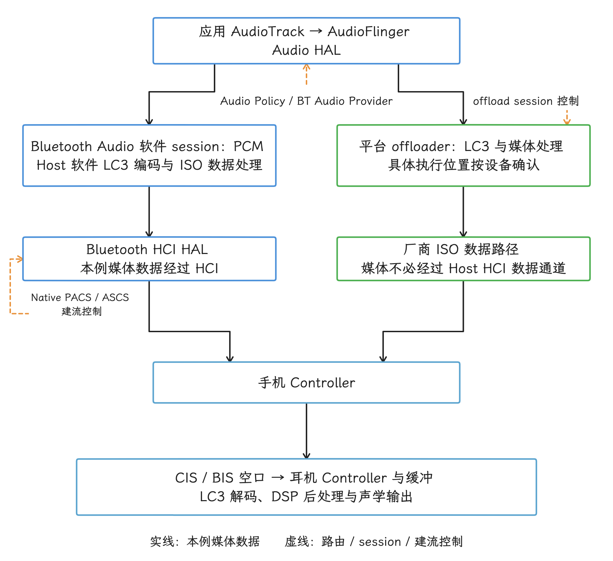

# Bluetooth LE Audio 延迟与功耗性能

Android 13（API 33）加入了系统级 LE Audio 支持。到 Android 17（API 37），AOSP 仍同时支持 Classic Audio（蓝牙经典音频）与 LE Audio：用于媒体播放的 A2DP、用于通话的 HFP、LE Audio 单播和 LE Audio 广播，会根据设备能力、音频场景及系统策略共存。过渡期内双模耳机仍很常见，两种传输会长期并存。这篇文章讨论的就是这套共存体系里的延迟与功耗：它们从哪里来，怎么拆开看、怎么测。

> 源码基线：AOSP `android-17.0.0_r1`；内核 `android17-6.18-2026-06_r6`。

LE Audio 的延迟和功耗由整条音频路径共同决定：从 LC3 编解码（LE Audio 的标准 Codec）、AudioFlinger 缓冲，到 Bluetooth Audio HAL（硬件抽象层） 的数据路径，再到 ISO（等时传输）调度、射频环境和耳机端渲染，每一段都贡献自己的延迟与功耗。我们看到“BLE”“7.5 ms 帧”或“硬件 offload（把部分处理移出 Host 主路径）”这些字眼时，先想清楚它们各自对应路径上的哪一段；一台设备是否低延迟、是否省电，要靠对具体路径的分段测量来回答。

LE Audio 的 Controller（蓝牙控制器） 与 vendor（芯片或设备厂商） 实现高度依赖芯片和固件，内核标签对 LC3、ISO 与功耗实现留有很大自由度，同一标签下各设备的做法可以差别很大。所以下任何结论之前，我们先分清两类东西：AOSP 源码能证明的系统行为，和只能在具体设备上实测的行为。

## 先建立协议模型

谈 LE Audio 的延迟和功耗之前，我们先把协议模型搭起来：控制面有哪些服务、等时数据怎么组网、Codec 能力怎么协商。模型清楚了，后面拆延迟、功耗和系统路径时才不会张冠李戴。

### GAF、BAP 与控制服务

LE Audio 的控制面位于 Generic Audio Framework（GAF，通用音频框架）。下面这些组件管的是能力发现、状态迁移和参数协商，音频数据本身走的是等时通道；表中第三列写明各自对性能分析的意义。

| 组件 | 职责 | 对性能分析的意义 |
|---|---|---|
| BAP（Basic Audio Profile） | 定义单播、广播的音频流配置和过程 | 决定能力发现、Codec 与 QoS（服务质量）配置的基本规则 |
| PACS（Published Audio Capabilities Service） | 发布设备支持的 Codec 能力和可用音频上下文 | 配置只能从双方兼容的能力集合中选择 |
| ASCS（Audio Stream Control Service） | 管理单播 ASE 状态 | 流启动、停止和重配置需要经过状态迁移 |
| CAP（Common Audio Profile） | 协调一个或多个设备上的音频过程 | 左右耳、多设备同步不能只看单条链路 |
| VCS / VOCS | 音量和通道偏移控制 | 属于控制面，不应和媒体数据路径混在一起计时 |
| MCS / TBS | 媒体与电话控制 | 播放控制和音频承载可以走不同协议过程 |

<!-- gracker-diagram: ch05-09-gaf-control-and-audio-plane -->


图：图表示职责依赖，不是所有服务依次转发音频。PACS/ASCS 等通过 GATT 管理能力与状态；媒体数据另走等时路径，控制面操作时间与声学延迟属于两条时间线，分析时要分开计时。

ASCS 管理的 ASE（音频流端点）在首次启动时通常经过 Idle → Codec Configured → QoS Configured → Enabling → Streaming。

<!-- gracker-diagram: ch05-09-ase-initial-start -->


图：这是典型首次启动链；后续恢复可以复用已有状态，实际起点须按当次 ASE 状态确认。Source ASE 的 Receiver Start Ready 由客户端 Audio Sink 发起；Sink ASE 的就绪由服务端 Audio Sink 自主完成，画图时两个方向要分别标注发起方。

停止过程按音频方向分支：Sink ASE（Audio Stream Endpoint，音频流端点） 接受 Disable 后回到 QoS Configured；Source ASE 进入 Disabling，接受 Receiver Stop Ready 后再回到 QoS Configured。

<!-- gracker-diagram: ch05-09-ase-disable-direction-branches -->


图：ASE 的 Sink/Source 是服务端端点的音频方向。Disable 与 Receiver Stop Ready 完成后不强制终止 CIS；是否保留链路要看其他 ASE 和当前过程。

Release 会进入 Releasing，释放完成后可回到 Idle，或保留 Codec 配置并回到 Codec Configured。至于 Disabling 和 Releasing，只有走停止、释放流程时才会经过。

<!-- gracker-diagram: ch05-09-ase-release-and-codec-cache -->


图：图画成功释放的主要资源关系。BAP 对共用同一 CIS/CIG 且仍 Enabling/Streaming 的其他 ASE 有限制，仍有活动方向时的释放要按这些限制执行；释放完成后的去向由剩余配置决定，Idle 与 Codec Configured 都有可能。

首次建流、复用已有配置、切换音频上下文或改变 Codec/QoS，经过的步骤可能各不相同。所以分析启动耗时前，我们先确认测的是哪一种：首次连接、已连接后的建流，还是已有 CIG（Connected Isochronous Group）/CIS（连接等时组与流） 的恢复，再到 ASCS 通知里核对 ASE 的方向和实际状态迁移。

### CIS/CIG 与 BIS/BIG（Broadcast Isochronous Group）

LE Audio 用等时传输承载必须按时送达的音频数据：

- **CIS（Connected Isochronous Stream）** 用于单播，一个或多个 CIS 组成 CIG。CIS 与 ACL（设备之间的基础数据连接） 关联，由 ACL 承载建立和控制过程；ACL 丢失时，关联的 CIS 也会终止。
- **BIS（Broadcast Isochronous Stream）** 用于广播，一个或多个 BIS 组成 BIG。广播源通过扩展广播和周期广播公布同步信息与 BASE（描述广播音频配置的数据），接收端随后同步 BIG。

<!-- gracker-diagram: ch05-09-cig-cis-and-acl -->


图：虚线框中的两个 CIS 构成本例 CIG；ACL 承担建立与控制关联，CIS 音频的发送与普通 GATT 数据是两回事。ACL 断开会终止关联 CIS，单个 CIS 丢失后 ACL 仍可保留。

单播的接收端可以确认链路层传输，Controller 可以在已分配的子事件时隙里安排重传。广播链路面向全体收听者，缺少面向单个接收端的确认与单独补发；广播源配置重复、交织或预传输来提高抗干扰能力。丢包之后的听感，还取决于 LC3 的丢包隐藏、耳机缓冲和连续丢包长度，把结果写成“丢一包就必然一次可闻断音”是把问题说简单了。

两个模式的扩展性也不同：

- 广播发送端的空口计划不会随着收听人数线性增加；
- 单播增加设备或音频方向时，通常会增加 CIS、子事件或控制开销；
- 广播接收端还要执行扫描、周期广播同步和 BIG 同步，这些阶段也会产生成本，所以“广播接收一定比单播省电”这一条要按具体配置和场景分别测。

<!-- gracker-diagram: ch05-09-big-bis-one-to-many -->


图：媒体广播为全体听众共用一份空口发送计划，面向单个接收端的 ACK 与专属补发留给单播。相同空口配置下发送计划与收听人数解耦，但手机整机功耗、扫描和 UI 仍可能变化。

### LC3 的能力需要协商

LC3（Low Complexity Communication Codec）是 LE Audio 基础音频配置要求支持的标准 Codec。设备还可以支持其他 Codec，但通信双方至少要围绕标准能力完成互操作。LE Audio 的类型定义包含以下独立字段：

- sampling frequency（采样率）；
- frame duration（帧时长）；
- audio channel allocation（声道分配）；
- octets per codec frame（每帧字节数）；
- codec frame blocks per SDU（每个 SDU 的帧块数）。SDU（Service Data Unit）指每次交给等时链路传输的数据单元。

LC3 常见帧时长为 7.5 ms 和 10 ms。帧时长只是预算中的一项 Codec 参数，算法总延迟和端到端延迟都要另算。讨论码率时，要把采样率、每帧字节数、每个 SDU 的帧块数和声道数一起给出，只列一个“LC3 固定范围”，读者还原对应的码率配置就难了。

LC3 与 SBC 的 CPU 占用、主观音质 MOS（Mean Opinion Score，主观音质评分） 或耗电量对比，同样依赖实现、配置和测试方法：在 Host（主机侧软件栈） 软件栈上用软件运行、交给音频 DSP、Controller 或 vendor offloader（厂商卸载模块），可能得到不同结果。跨设备对比表里那些看似精确的数字，背后要有目标芯片、编译选项、音频配置和功耗仪器来支撑。


## 延迟要按测量对象拆开

谈“蓝牙延迟”之前，我们先选定下面至少一种指标：

| 指标 | 起点与终点 | 适用问题 |
|---|---|---|
| 冷启动延迟 | 用户操作或播放请求，到耳机首次出声 | 首次连接、服务发现、建流是否过慢 |
| 已连接启动延迟 | 已完成 ACL/GATT（Generic Attribute Profile，通用属性配置文件）连接后开始播放，到首次出声 | ASCS、CIG/CIS 与音频路由开销 |
| 稳态单向延迟 | 手机音频时间点，到耳机声学输出 | 视频同步、乐器监听、游戏反馈 |
| 双向往返延迟 | 手机发声，经远端采集后返回手机 | VoIP、游戏语音、交互式音频 |
| 路由切换间隙 | 旧路由最末帧，到新路由第一帧 | A2DP/LE Audio 或扬声器/耳机切换 |
| 抖动与 glitch（爆音或短暂中断） | 稳态延迟分布、缓冲欠载和丢帧 | 射频干扰、调度和缓冲稳定性 |


手机向耳机播放时，我们按 BAP 的定义把稳态单向延迟拆成三部分：

`手机端音频处理（应用/AudioTrack、AudioFlinger/HAL、编码与组帧）+ Transport_Latency + Presentation_Delay`

BAP 第 7 节规定，Transport_Latency 是设备间传输音频负载的延迟；接收端的 Presentation_Delay 从 SDU Synchronization Reference 计算到音频开始呈现，耳机内部传输、Codec 处理、DAC 和音频后处理都已经算在里面。拆解设备实测结果时，先对齐各项的起止时刻，避免把耳机解码与渲染在 Presentation_Delay 之外再算一遍。

<!-- gracker-diagram: ch05-09-bap-total-delay-boundaries -->


图：本图以手机发送、耳机接收为例。三段的起止点须与测量参考对齐；Presentation Delay 可为多设备同步和缓冲留余量，总延迟须按三段各自的测量参考核算；LC3 帧长只是 Codec 参数，HCI 建流通知属于控制事件，不能代替声学端点或三段中的某段实测。 底部是无刻度概念分段，宽度仅作示意。

这些部分都可能跨越多个音频周期，Presentation Delay（规定接收端播放时刻的呈现延迟） 还可能为了多设备同步和接收端缓冲而加大。用 7.5 ms 或 10 ms 的 LC3 帧长直接推导“总延迟 20–40 ms”，会漏掉手机和耳机两端的缓冲，也会忽略 QoS 与射频重传。

以下以手机向耳机播放为例，区分软件与 offload 的媒体数据路径。实线表示媒体数据，虚线表示路由、session 或建流控制：

<!-- gracker-diagram: ed05-09-software-offload-media-paths -->


图：手机向耳机播放时，共同的音频入口分为Host软件编码和平台offload两路，再到Controller及耳机。实线表示本例媒体，虚线表示路由、session和建流控制；offload媒体可走厂商ISO通道，不必经过Host HCI数据接口，内部连接与执行位置以设备为准。上行软件解码方向相反，编码/解码session分别跟踪；HARDWARE_OFFLOAD名称不保证全部处理都在硬件。


对照上图，ASCS/PACS 负责能力协商与状态管理；软件 session 的 PCM（未压缩音频采样） 交给 Host 编解码，offload session 主要承载控制，媒体数据走平台实现的数据路径，厂商内部连接要按设备实现确认。排障时我们先区分建流控制耗时与 Streaming 之后的数据传输，再根据当前 session 判断能在哪一层看到媒体数据。


### Codec 与 QoS 参数怎样改变结果

| 参数 | 主要影响 | 常见代价 |
|---|---|---|
| frame duration | Codec 帧积累周期、调用频率 | 更短周期可能增加调度与包头开销 |
| octets per codec frame | 音质、码率和单帧负载 | 更大负载增加空口占用 |
| blocks per SDU / SDU interval | 组帧和发送节奏 | 聚合可减少调用次数，也会增加等待 |
| PHY（物理层模式） | 每次发送的空口时间和链路预算 | 2M PHY 传输更快，覆盖和干扰条件仍需实测 |
| BN / NSE（突发载荷数 / 子事件预算） | BN 规定每个 burst 关联的载荷数；NSE 是每个 CIS 事件的最大子事件数，或每个 BIG 事件中每个 BIS 的子事件数 | 资源增加会占用更多射频时间 |
| RTN / FT（推荐重传参数 / Flush Timeout） | RTN 是推荐值；FT 限制一个 CIS 载荷可用的事件窗口，以 CIS 事件数计，不是毫秒 | 可靠性、延迟、共存和功耗互相制约 |
| Presentation Delay | 接收端何时播放 | 增大可换取同步与抗抖动余量 |
| CIS/BIS 数量与方向 | 多声道、左右耳和双向语音 | 增加调度、编码和空口资源 |

RTN 是提交给 Controller 的推荐重传参数，Controller 可按目标可靠性和带宽选取不同值。`RTN=2` 常被读成“任何包最多重传两次，延迟固定增加多少”，实际的重传安排还受 BN、NSE、FT、PHY、PDU（协议数据单元）分段和 Controller 调度约束。所以调参时我们以最终 HCI（Host Controller Interface，主机控制器接口） 配置与抓包结果为准，上层期望值只作参考。


### `SetLatencyMode()` 与延迟模式

LE Audio transport 提供了 `SetLatencyMode()`：它接收 `FREE`、`LOW_LATENCY`、动态空间音频软件和硬件等枚举，并映射到内部 `DsaMode`。源码里可确认的只有这层映射；枚举与 7.5 ms LC3 配置之间没有直接对应，端到端延迟低于某个固定值的承诺也无从谈起。

<!-- gracker-diagram: ch05-09-latency-mode-to-dsa -->


图：r1 的 LeAudioTransport::SetLatencyMode 按以上关系设置 DsaMode；模式变化且存在缓存源元数据时，会触发元数据更新。这里谈的是模式映射，LC3 帧长与端到端毫秒数要另行核对。

普通应用设置 `AudioAttributes` 或游戏 `usage` 后，Audio Policy、Bluetooth 栈和设备能力仍会共同决定路由与配置；耳机厂商提供的 Gaming Mode 也可能改变私有缓冲、Codec 配置或射频策略。测试报告里我们记录最终协商参数；产品模式名称留作背景说明，协议参数以协商结果为准。

## AOSP 系统路径

协议模型落到 AOSP 里，就是几条具体路径：控制路径走哪条调用链、音频数据走软件还是 offload、设备类型怎么标、普通应用能控制到哪一层。我们逐段看。

### 控制路径

我们把 AOSP 的通用调用链从 Framework 走到 Controller：

1. Framework API 通过 Binder 进程间通信调用 Bluetooth 进程；
2. `packages/modules/Bluetooth/android/app` 实现 Profile Service；
3. Java 层通过 JNI（Java Native Interface）进入 `packages/modules/Bluetooth/system`；
4. Native BTA LE Audio 代码完成 PACS、ASCS、CAP、单播和广播状态处理；
5. Bluetooth HAL 与 vendor Controller 交换 HCI 命令、事件及数据。

在 `android-17.0.0_r1` 中，关键位置包括：

- `android/app/src/com/android/bluetooth/le_audio/LeAudioService.java`：Framework 侧的组、活跃输入/输出设备和广播/单播切换状态；
- `android/app/jni/com_android_bluetooth_le_audio.cpp`：Java 层进入 Native 栈的 JNI 边界；
- `system/bta/le_audio/`：PACS、ASCS、CAP 和单播/广播状态处理；
- `system/audio_hal_interface/aidl/le_audio_software_aidl.cc`：软件编码路径与 Bluetooth Audio HAL 的接口；
- `hardware/interfaces/bluetooth/audio/aidl/`：SessionType 等 HAL 接口定义，含 offload 路径。

`LeAudioService` 管理组、活跃输入/输出设备、广播与单播切换这些 Framework 状态；Codec 能力选择、CIG/CIS 和 ASE 状态由 Native LE Audio 代码接手。审阅文档或报告时，看到 `LeAudioService` “注册 Audio Provider 并独自决定所有 LC3 参数”这类描述，可以对照上面的分工判定为错：Audio Framework、Bluetooth Audio HAL 与 Native 栈各管一段。


### 音频数据路径

`SessionType.aidl` 明确区分了以下几类路径：

- LE Audio 单播软件编码与软件解码；
- LE Audio 单播硬件 offload 编码与解码；
- LE Audio 广播软件编码与硬件 offload 编码；
- 广播解码和 peripheral offload（把部分数据处理放到外设侧） 等路径。

软件路径中，Bluetooth 栈负责相应的编解码和媒体数据处理；硬件 offload session 主要承载控制，数据和 Codec 工作由平台卸载实现负责；部分名为 HARDWARE_OFFLOAD 的编码 session，接口注释也允许软件卸载。AOSP `codec_manager.cc` 还区分 `CodecLocation::HOST` 与 `CodecLocation::ADSP`（音频 DSP），检查设备属性和 HAL 能力之后才启用 offload。源码里还留着“offload 不支持某项配置时如何切换”的待完善点，“设备有 DSP”本身说明不了当前音频流已经 offload，还要看 session 类型与数据路径。

<!-- gracker-diagram: ch05-09-codec-location-offload-preconditions -->


图：r1 先检查 ro.bluetooth.leaudio_offload.supported、persist.bluetooth.leaudio_offload.disabled 和 HAL 能力，再设置平台路径及 ADSP 位置。某项配置不受支持时，源码仍有切软件 session 的 TODO，自动回退还停留在待完善状态。

### 音频设备类型

`system/media/audio/include/system/audio-base-utils.h` 中，与本章媒体播放、耳机和广播路由直接相关的输出设备类型包括：

- `AUDIO_DEVICE_OUT_BLE_HEADSET`：LE Audio 耳机输出；
- `AUDIO_DEVICE_OUT_BLE_SPEAKER`：LE Audio 音箱输出；
- `AUDIO_DEVICE_OUT_BLE_BROADCAST`：广播音频输出。

同一枚举还包含 `AUDIO_DEVICE_OUT_BLE_HEARING_AID` 与 `AUDIO_DEVICE_OUT_BLE_CENTRAL` 等 BLE 相关类型；排查时我们按具体路由类型和 Profile 状态逐个归类，headset、speaker、broadcast 各用各的枚举。广播设备落在 `AUDIO_DEVICE_OUT_BLE_BROADCAST`，与 `AUDIO_DEVICE_OUT_DEFAULT` 是两个不同的值。应用公开 API 侧可用 `AudioDeviceInfo.TYPE_BLE_HEADSET` 等类型识别设备，实际路由仍由 Audio Policy 和用户选择决定。

### 普通应用能控制到哪一层

媒体应用通常继续使用 `AudioTrack`、Media3 或其他媒体 API 播放；通信应用使用 `AudioManager.setCommunicationDevice()` 选择系统已提供的通信设备，结束后调用 `clearCommunicationDevice()`。LE Audio 路由与已弃用的 SCO（Classic 语音所用的同步链路） 开关分属两套机制——SCO 属于 HFP/Classic 语音路径。

`BluetoothLeAudio` 是 Bluetooth Profile 的代理对象，应用通过它访问系统 Profile 服务。SDK 暴露给普通应用的接口，包括查询已连接设备、连接状态、组 ID 和已连接组的 lead device（组内代表设备）；`getActiveDevices()`、`connect()`、`disconnect()`、Codec 偏好和许多组控制接口则带有 `@Hide`、`@SystemApi` 或 `BLUETOOTH_PRIVILEGED` 限制。

部分旧资料里出现的 `setConnectionState()` 与 `getAudioGroupOutType()` 并不是 Android 17 的公开方法。

下面的示例用于在应用侧判断手机是否声明 LE Audio 与广播源能力：

```kotlin
val adapter = getSystemService(BluetoothManager::class.java).adapter

val unicastSupported =
    adapter.isLeAudioSupported == BluetoothStatusCodes.FEATURE_SUPPORTED
val broadcastSourceSupported =
    adapter.isLeAudioBroadcastSourceSupported == BluetoothStatusCodes.FEATURE_SUPPORTED
```

这两个方法返回状态码而非布尔值，蓝牙关闭时还可能返回错误码。手机报告支持只是第一步：当前耳机、通信双方的 Profile、区域配置和产品 UI 是否满足目标场景，还要单独确认，应用仍要处理功能不可用与路由变化。

<!-- gracker-diagram: ch05-09-app-capability-and-communication-route -->


图：图的路由分支限于通信场景，媒体播放仍走对应媒体 API。setCommunicationDevice 只接受系统可用列表中的输出设备，匹配输入由平台选择；LE Audio 和 Auracast 的控制在 SCO 开关之外。

### 路由与切换延迟

A2DP 与 LE Audio 都可用时，Android 会结合设备能力、用户选择、音频策略和 Profile 状态决定活跃路由；“Android 14 起总是优先 LE Audio”这类概括，以及“当前内容格式不兼容就固定回退 A2DP”这类规则，公开资料里都找不到出处，路由判断还是回到上面四个输入。应用提交给 AudioFlinger 的 PCM 或媒体解码结果，与蓝牙空口使用的 Codec 属于两个层次。

一次切换间隙可能包含：

- 旧输出暂停、drain（播放完缓冲数据） 或 flush（丢弃缓冲数据）；
- 新设备变为 active route（当前输出路由）；
- Audio Policy 重新打开输出；
- ASCS/CIG/CIS 建立或恢复；
- 新路径预填缓冲；
- 耳机按 Presentation Delay 对应的时刻输出音频。

这些步骤是否发生、是否并行、是否复用已有连接，都由当次状态决定。300–800 ms 之类的固定范围属于某组设备的测试结果，平台层面尚未给出这样的承诺。

<!-- gracker-diagram: ch05-09-route-switch-state-dependent-gap -->


图：箭头表示可能贡献间隙的工作关系，实际执行序列由当次状态决定。首次建流、已有 CIG/CIS 恢复、保持旧路由到新路由就绪，可能走不同路径；优先级判断要回到设备能力、用户选择和 Profile 状态上。

## 功耗：看执行位置和射频计划

延迟拆完，我们换到功耗这一侧。LE Audio 的手机端功耗可以粗略拆成：

`音频前后处理 + Codec + 内存搬运 + AP/DSP 唤醒 + Controller 基础功耗 + ISO 空口时间 + Wi-Fi/蓝牙共存代价`

其中 AP 指应用处理器，DSP 指数字信号处理器。耳机端还要计入：

`接收/发送射频 + LC3 + 抖动缓冲 + ANC（主动降噪）/通透/空间音频 DSP + 功放与传感器`

“LE”这个名字说的是空口机制，整机功耗要靠测量回答。我们把影响结果的主要问题列出来：

1. **Codec 在哪里运行**：Host 软件编码可能周期性唤醒 AP；ADSP 或其他 offloader 可以减少 AP 工作，但控制、缓冲和数据搬运成本仍然存在。
2. **发送了多少流**：左右耳独立流能改善同步与拓扑，也可能增加并行 Codec 实例和空口资源。
3. **可靠性配置怎样取舍**：更高重复或重传预算可改善恶劣链路，却会增加射频活动。
4. **是否双向**：通话和游戏语音同时包含下行播放与上行麦克风，和单向音乐没有直接可比性。
5. **是否命中共存问题**：2.4 GHz Wi-Fi、人体遮挡、手机握持和左右耳位置都可能改变丢包与功耗。
6. **耳机功能是否相同**：ANC、头部跟踪、麦克风和后处理常比协议差异更显著。


Classic TWS（真无线立体声） 常采用主副耳中继，LE Audio 多流则允许手机分别向左右设备发送音频。多流消除了某些中继拓扑的限制，代价是手机要调度多条 CIS。整机省不省电，取决于手机与耳机两端的实现，拓扑本身给不出答案。

### ISO 与系统 idle（空闲）

Controller 具备独立的定时与射频调度能力，CIS/BIS event 的执行主要落在 Controller 侧，AP 按 Host 路径的节奏参与。Host 软件路径可能按音频批次唤醒，offload 路径可以让 AP idle 更久；但唤醒频率取决于缓冲和具体实现，10 ms 帧长推不出“AP 固定以 100 Hz 唤醒”。

Android 设备能否进入某个名为“Deep Doze”的状态，由活跃音频、音频 wakelock（唤醒锁）、应用前后台状态和系统电源策略共同决定，维持 Bluetooth 连接只是其中一个输入。要判断 LE Audio 是否让 AP 退出了深 idle，我们看 trace 中的调度、wakeup source（唤醒来源）、AudioFlinger 周期和电源轨数据。

<!-- gracker-diagram: ch05-09-iso-timing-versus-ap-idle -->


图：设备 Doze 与系统 suspend 由活跃音频、wakelock、应用状态和电源策略共同决定，维持蓝牙连接只是其中一个输入。Controller 重传还可能间接改变 Host 负载；CPU 频率只反映其中一部分成本，整机成本要把 Controller 与射频一起算。

Controller 重传主要消耗 Controller 和射频资源，也可能通过数据短缺、状态事件或 Host 路径间接改变 AP 负载；“与 CPU DVFS 完全无关”的写法过于笼统，CPU 频率只反映其中一部分成本。

Bluetooth 栈还会在 suspend 场景管理 LE background scan（后台扫描），并根据 Controller/offload 能力决定哪些扫描任务可以留在硬件执行。把灭屏后扫描变少归因到 LE Audio Codec 之前，还要核对扫描由哪个 scan client 发起、硬件 offload filter（卸载过滤器）、设备 idle 状态与 active audio group。

HFP active-device handover 属于 Classic 通话路径，统计时延时应与 LE Audio route 切换分开记录。

### 如何做可比较的功耗实验

至少固定以下条件：

- 同一手机构建、耳机固件、音量、曲目和播放时长；
- 相同采样率、声道、音频上下文与上/下行方向；
- 相同屏幕、网络、Wi-Fi 频段、信号强度和环境温度；
- 相同 ANC、空间音频、头部跟踪与佩戴传感器状态；
- 先确认当前采用 Host 还是 offload 路径，再比较 A2DP 与 LE Audio；
- 同时记录丢包、重传和 glitch，避免把牺牲可靠性换来的低功耗当成优化收益。

手机侧优先使用外部电源监测或设备电源轨；耳机侧需要夹具、电池电量计或厂商遥测。`batterystats` 适合观察系统归因和长期趋势，很难单独分离几十毫秒周期内的 Codec 与射频成本。Pixel 电流数据要同时说明设备、固件、测量仪器和置信区间，才谈得上通用参考。


## 广播音频与 Auracast

Auracast 是 Bluetooth Broadcast Audio 的品牌名称。要看它的性能，我们先看接收端怎么加入：广播源创建 BIG/BIS，并通过广播公告和周期广播发布同步信息；接收端自己扫描，或由 Broadcast Assistant（广播助手）代为发现来源，再帮助 Broadcast Sink（广播接收设备） 加入。

性能分析需要关注：

- 扫描到公告的时间；
- 周期广播同步和 BIG 同步时间；
- BASE 解析及 Codec 配置；
- BIS 数量、BN、NSE、IRC（立即重复次数）、PTO（预传输偏移）与 Presentation Delay；
- 加密广播的 Broadcast Code 处理；
- 丢包隐藏和多接收端同步误差。

BIS 缺少面向每个接收端的 ACK（确认响应），靠重复和预传输增加时间/频率分集，PTO 等配置则可能拉高延迟。发送端的媒体链路开销与接收人数解耦，但“有 0 个或 100 个接收端时手机整机功耗完全相同”这类说法仍然过头：扫描、UI、控制过程和产品实现都可能变化。

AOSP 源码中的 `BluetoothLeBroadcast` 与 `BluetoothLeBroadcastAssistant` 是 `@SystemApi`，同时带有 `@Hide`；普通第三方应用的广播控制走平台系统 UI、受支持角色和相应的 Bluetooth Profile 接口。`AudioManager.setBluetoothScoOn()` 控制的是 SCO/HFP，与 Auracast 无关；该方法在 API 37 弃用，官方文档还明确指出，它对普通应用已在多个版本中不执行实际操作。通信应用应使用 API 31 起提供的 `setCommunicationDevice()` 选择可用通信输出设备。

<!-- gracker-diagram: ch05-09-broadcast-discovery-to-render -->


图：Assistant 可帮助发现并通过扫描卸载/同步信息转移协助 Sink，不要求每台 Sink 都完整重复手机的扫描过程。Android r1 的 Broadcast 与 Assistant 代理为隐藏 SystemApi，普通应用需依赖受支持的系统能力。

## 助听场景的 ASHA 与 HAP

我们先把 ASHA 的来历说清楚：ASHA（Audio Streaming for Hearing Aids）早于标准 LE Audio，本身就运行在 BLE 上。Android 的 ASHA 设计使用 GATT 控制，并通过 LE L2CAP CoC（面向连接的逻辑信道）传输音频；CoC 的弹性缓冲能抵抗部分丢包，也会增加延迟。ASHA 没有从助听器返回手机的音频 backlink，通话上行使用手机麦克风。

HAP（Hearing Access Profile）属于标准 LE Audio/GAF，使用 LE Audio 的能力、控制和 ISO 音频机制，可以支持更完整的通话与 VoIP 场景。“HAP 是用 BLE 替代 Classic ASHA”的说法不成立——ASHA 本身就运行在 BLE 上。Android 需要同时兼容旧有 ASHA 设备和基于 LE Audio 的 HAP 设备。

Android 13 提供的是 LE Audio 基础支持；具体某台 Android 13 设备是否具备 HAP、广播或双向高采样率能力，要以设备查询结果为准。助听场景对声学延迟、左右同步、丢包、麦克风路径和电池寿命都更敏感，20–40 ms 或固定省电比例仍需在目标产品上验证。

<!-- gracker-diagram: ch05-09-asha-versus-hap-audio-and-mic -->


图：两条路径都基于 BLE；ASHA 早于标准 LE Audio，使用 CoC 而非 CIS/BIS。HAP 通话、麦克风与产品能力需实际查询，Android 13 提供的是基础 LE Audio 支持，HAP 与广播角色要以实际查询结果为准。

## Android 13 到 Android 17 的能力对照

| 版本 | 可确认的变化 |
|---|---|
| Android 13 / API 33 | Android 加入内建 LE Audio 支持；硬件与产品仍需声明相应能力 |
| Android 14 / API 34 | Telecom/VoIP（网络语音通话）路由 API 继续演进；不能由此推出固定的 LE Audio 7.5 ms 模式 |
| Android 15–16 | 中间版本不能单凭系统版本推断广播角色、低延迟配置或 HAP 能力，仍须查询设备能力和对应版本 API |
| Android 17 / API 37 | AOSP 同时存在单播/广播的软件、硬件 offload 与 peripheral 数据路径 |

Android 17 提供了 Audio Managed SCO 重构，将新路径中的 SCO 启停交给 Audio Framework 管理。启用新路径需要相应系统属性和兼容的 Audio HAL/Bluetooth Audio HAL；属性关闭或 HAL 版本过旧时，设备可以保留旧路径，单凭 Android 17 版本号确认不了是否采用重构。这项变化面向 HFP/SCO，不改变本章对 LE Audio 数据路径的分工。

<!-- gracker-diagram: ch05-09-android17-sco-integration-gate -->


图：新 SCO 管理要求属性与兼容 HAL；设备可因旧 HAL 或属性关闭继续走旧路径。setCommunicationDevice 面向通信路由请求，当前采用哪套内部 SCO 管理，以系统属性与 HAL 版本为准。

## 诊断与测量

排查 LE Audio 的延迟或功耗问题，我们按四步走：确认能力与路由、用 HCI snoop 还原控制过程、用 Perfetto 看 Host 侧、用声学标记测端到端。

### 第一步：确认能力、路由与 Profile 状态

下面的命令用于采集系统可见的 Bluetooth 和音频状态：

```bash
adb shell dumpsys bluetooth_manager
adb shell dumpsys audio
adb shell dumpsys media.audio_flinger
adb bugreport bugreport-leaudio
```

不同产品的 dumpsys 分段和字段会发生变化。AOSP 的 `LeAudioService.dump()` 会输出 active group、活跃输入/输出设备、组和设备状态，以及内部事件记录；我们先在完整输出或 bugreport 中搜索 `LeAudioService`、`Active Groups`、`BLE_HEADSET`、`BLE_SPEAKER` 和 `BLE_BROADCAST` 这些关键词，字段格式按当次输出辨认。

建议同时记录：

- build fingerprint（系统构建的唯一标识）、Android API、Bluetooth Mainline（可独立更新的蓝牙系统模块） 版本；
- 手机与耳机固件；
- 当前 active 设备与音频模式；
- group ID、左右设备、输入/输出方向；
- Codec、frame duration、octets/frame、Presentation Delay；
- software/offload session；
- 流启动前后的 monotonic clock（不受系统时间校准影响的单调时钟） 时间点。

### 第二步：用 HCI snoop 还原控制过程

我们通过开发者选项启用 Bluetooth HCI snoop log（HCI 数据包记录） 后，重启蓝牙使设置生效，再复现问题并采集 bugreport。始终开启的内存摘要日志会限制个人数据记录，只能当作概要来看，完整抓包要专门采集。日志文件位置和直接读取权限会随构建变化，优先从 bugreport 提取，脚本里不要硬编码 `/data/misc/...` 私有路径；分享完整日志前应检查并脱敏。

HCI snoop 记录 Host 与 Controller 之间的命令、事件和数据包。软件路径的 ISO 包可以经过 HCI；offload 使用厂商数据路径时，snoop 中可能没有媒体负载。HCI 包序号或缺失状态与空口重传次数是两回事，射频丢包与重传还需要 Controller 遥测或空口分析器验证。

在 Wireshark 或厂商分析器中按事件顺序检查：

- PACS/ASCS 的 GATT 读写与通知；
- `LE Set CIG Parameters`；
- `LE Create CIS` / `LE CIS Request` / CIS established；
- ISO data path 配置；
- 日志中可见的 ISO 数据包 handle（连接标识）、方向、序号和包状态，并确认当前数据路径是否经过 HCI；
- CIG/BIG 释放；
- 广播公告、周期广播同步与 BIG 同步。

Wireshark 字段名会随 dissector（协议解析器）版本变化。`btatt` 常用于 ATT/GATT，ISO 过滤字段以当前版本能够识别的协议树为准，固定过滤字符串不适合写进自动化判据。


### 第三步：用 Perfetto 看 Host 侧

Perfetto 适合检查 AudioFlinger 线程、Binder、调度、CPU idle/frequency 和 wakeup；HCI snoop 用于还原 Host/Controller 接口上的建流控制过程，以及经过该接口的 ISO 数据。两者都替代不了空口抓包。`android.bluetooth` 这个专用 Perfetto data source（数据源）在 AOSP 里没有固定保证，`btif_le_audio_thread` 这条固定轨道同样要看具体产品。

我们采集前先查询目标系统构建支持的数据源与 atrace categories（可跟踪类别），再选择：

- `audio` / AudioFlinger；
- `sched`、线程状态和 wakeup；
- Binder driver；
- CPU frequency/idle 和电源轨；
- vendor 提供且已确认存在的 Bluetooth trace。

把 trace 中的 Host 时间点与 btsnoop 中的 HCI 时间点对齐，可以定位应用供数、Audio HAL 缓冲和 Bluetooth 建流耗时；判断射频异常还要结合 Controller 或空口证据。

<!-- gracker-diagram: ch05-09-diagnostic-evidence-scopes -->


图：先查询目标构建的数据源与 atrace 类别，再对齐事件和时钟。android.bluetooth 数据源与 btif_le_audio_thread 轨道都要按目标构建确认；跨次采集应分别注明时间线。

### 第四步：用声学标记测端到端

稳态单向延迟，我们最好用已知波形来测：

1. 在源端生成脉冲、MLS（最大长度序列）或带时间标记的音频；
2. 用外部声卡或同步采集设备，以共同采样时基记录源参考与耳机声学输出；报告参考信号的注入位置，并校准测量链路与声传播差。普通 loopback 测得的是输入加输出的往返延迟，单向延迟要用上面的同步采集设计来测；
3. 对多次事件做互相关，用波形相似度估算时间偏移，并报告中位数、P95/P99（第 95/99 百分位）和离群值；
4. 另行统计冷启动、已连接启动和路由切换间隙；
5. 同步保存 Codec/QoS、HCI snoop、Perfetto 和射频条件。

logcat 里的“stream started”给不出声学端到端延迟：这个时间点通常还在控制面，离耳机按协商的 Presentation Delay 完成缓冲、解码与声学输出还有一段距离。


## 常见误判

| 误判 | Android 17 下更准确的结论 |
|---|---|
| LE Audio 会取代所有 Classic Audio | 两种传输长期共存，双模设备仍常见 |
| 7.5 ms LC3 帧意味着 7.5 ms 算法或端到端延迟 | 帧时长只是预算中的一项 |
| LE Audio 单向延迟固定为 20–40 ms | 延迟由两端缓冲、QoS、Presentation Delay 和实现共同决定 |
| LC3 CPU 占用一定低于 SBC | 执行位置、实现与配置不明确时无法比较 |
| 有 DSP 就不会唤醒 AP | 要确认当前 session 和数据路径已经 offload |
| 多流天然更省手机电量 | 多流减少某些耳间中继，也增加手机侧流和空口调度 |
| 广播丢包会立即形成一次可闻断音 | 还受重复、交织、丢包隐藏和缓冲影响 |
| `AUDIO_DEVICE_OUT_DEFAULT` 表示 LE 广播 | Android 17 定义了独立的 `AUDIO_DEVICE_OUT_BLE_BROADCAST` |
| `setBluetoothScoOn()` 可切换 Auracast | SCO 属于 HFP/Classic，且该 API 已弃用 |
| ASHA 是 Classic 助听协议 | ASHA 使用 BLE L2CAP CoC；HAP 才是标准 LE Audio/GAF 路径 |
| LE Audio 连接会阻止设备进入 Deep Doze | 是否 suspend/idle 要看活跃音频、wakeup 和系统电源状态 |
| 10 ms 帧会让 AP 固定每秒唤醒 100 次 | Controller、批处理与 offload 可以改变 Host 唤醒节奏 |
| Perfetto 固定提供 `android.bluetooth` 数据源 | 先查询目标构建；AOSP 不保证该专用数据源 |

## 代码审阅清单

面向应用：

- 能力检查按 `BluetoothStatusCodes` 处理错误码；
- 通信路由使用 `setCommunicationDevice()`，结束时清理偏好；
- 不通过 SCO API 控制 LE Audio；
- 监听设备与路由变化，避免缓存设备类型；
- 把冷启动、稳态延迟和切换间隙分开统计；
- 不把耳机品牌的 Gaming Mode 当成 7.5 ms 或某个延迟承诺。

面向系统与设备实现：

- PACS 声明与 Codec/QoS 选择一致；
- ASCS 状态、CIG/CIS 生命周期和 Audio HAL session 对得上；
- software/offload 路径可以通过 dump、trace 或 vendor telemetry（厂商遥测数据） 确认；
- Presentation Delay 与左右同步满足产品目标；
- 干扰条件下同时评估丢包、glitch、功耗和延迟；
- 广播测试覆盖扫描、PA（周期广播）/BIG 同步、加密与多 BIS；
- HAP 和 ASHA 使用各自正确的数据路径与麦克风假设。

## 参考资料

- [Android Bluetooth Low Energy Audio overview](https://developer.android.com/develop/connectivity/bluetooth/ble-audio/overview)：Android 13 支持、双模设备、使用场景、能力检查和应用路由 API。
- [AOSP Bluetooth architecture](https://source.android.com/docs/core/connect/bluetooth)：Framework、Binder、Bluetooth 进程、JNI、Native stack 与 vendor 实现的分工。
- [Bluetooth SIG: Introducing Bluetooth LE Audio](https://www.bluetooth.com/wp-content/uploads/2022/01/Introducing-Bluetooth-LE-Audio-book.pdf)：GAF、BAP、CIS/BIS、ASCS、LC3 与广播过程。
- [Basic Audio Profile 1.0，第 7 节](https://www.bluetooth.com/wp-content/uploads/Files/Specification/HTML/BAP_v1.0/out/en/index-en.html)：Presentation_Delay 的接收端处理范围，以及源端处理、Transport_Latency 和 Presentation_Delay 的总延迟分工。
- [Audio Stream Control Service 1.0.1，第 5.5、5.6、5.9 节](https://www.bluetooth.com/wp-content/uploads/Files/Specification/HTML/ASCS_v1.0.1/out/en/index-en.html)：Sink/Source ASE 的停止分支和释放后配置缓存。
- [AOSP ASHA](https://source.android.com/docs/core/connect/bluetooth/asha)：BLE L2CAP CoC、弹性缓冲、左右助听器拓扑和无 backlink 约束。
- [BluetoothAdapter.java（android-17.0.0_r1）](https://cs.android.com/android/platform/superproject/+/android-17.0.0_r1:packages/modules/Bluetooth/framework/java/android/bluetooth/BluetoothAdapter.java)：LE Audio 与广播源能力状态码。
- [BluetoothLeAudio.java（android-17.0.0_r1）](https://cs.android.com/android/platform/superproject/+/android-17.0.0_r1:packages/modules/Bluetooth/framework/java/android/bluetooth/BluetoothLeAudio.java)：Profile proxy、公开查询接口和受限控制接口。
- [LeAudioService.java（android-17.0.0_r1）](https://cs.android.com/android/platform/superproject/+/android-17.0.0_r1:packages/modules/Bluetooth/android/app/src/com/android/bluetooth/le_audio/LeAudioService.java)：组、活跃设备、广播/单播状态与 dump。
- [LE Audio Native stack（android-17.0.0_r1）](https://cs.android.com/android/platform/superproject/+/android-17.0.0_r1:packages/modules/Bluetooth/system/bta/le_audio/)：Codec、ASE、CIG/CIS、广播与状态机实现。
- [SessionType.aidl（android-17.0.0_r1）](https://cs.android.com/android/platform/superproject/+/android-17.0.0_r1:hardware/interfaces/bluetooth/audio/aidl/android/hardware/bluetooth/audio/SessionType.aidl)：单播、广播、软件与 offload 数据路径。
- [codec_manager.cc（android-17.0.0_r1）](https://android.googlesource.com/platform/packages/modules/Bluetooth/+/refs/tags/android-17.0.0_r1/system/bta/le_audio/codec_manager.cc)：Host/ADSP 选择、平台 ISO 数据路径与 offload 能力检查。
- [audio-base-utils.h（android-17.0.0_r1）](https://cs.android.com/android/platform/superproject/+/android-17.0.0_r1:system/media/audio/include/system/audio-base-utils.h)：BLE headset、speaker、broadcast、hearing aid 与 central 设备类型。
- [AOSP Bluetooth 验证与调试](https://source.android.com/docs/core/connect/bluetooth/verifying_debugging)：HCI snoop 的接口范围、内存摘要日志限制和启用后的蓝牙重启要求。
- [AOSP 音频延迟测量](https://source.android.com/docs/core/audio/latency/measure)：同步采集、相关性定位，以及 loopback 往返延迟的边界。
- [AudioManager API reference](https://developer.android.com/reference/android/media/AudioManager)：`setCommunicationDevice()` 的可用设备选择、清理要求，以及 SCO API 的弃用与无操作边界。
- [Audio Managed SCO rearchitecture](https://source.android.com/docs/core/audio/sco-audio-mgmt)：Android 17 的 SCO/HFP 管理变化，以及系统属性和兼容 HAL 的启用条件。
