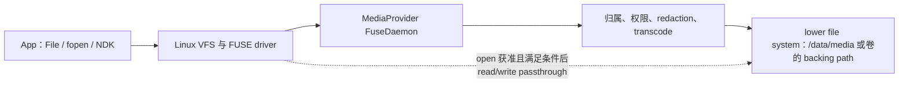

# vold、MediaProvider 与 FUSE（Filesystem in Userspace）：共享存储 I/O 路径

共享存储把三件事叠在一起：挂载与权限的控制面、文件数据面、MediaProvider 的元数据管理。我们定位 I/O 问题时，第一步是确认调用入口是文件路径还是 ContentResolver URI，再核对返回的 fd 或文件操作是否经过 FUSE；这些不是互斥分类，之后再分别算跨进程调用和逐项访问的开销。

> 源码基线：Android 17 / API 37，AOSP `android-17.0.0_r1`；内核 `android17-6.18-2026-06_r6`。设备可能使用其他内核分支，以实机配置为准。

## 排障范围

看到 `/storage/emulated/0/DCIM/Camera/a.jpg` 这样一条普通路径时，我们要意识到它背后叠着一整串环节：挂载会话、调用方身份、媒体归属、权限、元数据脱敏、兼容转码，最后才轮到底层文件系统访问。把所有耗时归结成一句“FUSE 慢”或“UFS（Universal Flash Storage） 慢”，结论很难复现——FUSE（Filesystem in Userspace，用户空间文件系统）是用户态的文件系统机制，UFS（Universal Flash Storage，通用闪存存储）是 Android 设备常用的闪存接口标准，两者本来就位于不同的层。

这篇文章回答三个排障问题：

1. `vold`（volume daemon，卷管理守护进程）、MediaProvider 和 FUSE 各自在什么时候参与。
2. 直接路径、MediaStore URI、SAF（Storage Access Framework，存储访问框架）URI 和 App 私有路径的成本为何不同。
3. 在实机上怎样确认 passthrough、FUSE BPF、文件系统与块 I/O 的实际状态。

## 先分清控制面与数据面

这里的控制面负责建立挂载、配置策略、判断权限；数据面负责实际搬运文件内容。分开看，我们才能判断一次慢读取慢在会话准备、访问检查，还是数据搬运。


### `vold` 管卷和挂载会话

`vold` 负责发现存储卷、准备挂载点、处理用户切换、挂载/卸载卷和响应设备插拔；卷挂好之后，需要经 daemon 处理的 lookup、open 等策略判断由会话另一端的 MediaProvider 负责；缓存命中、passthrough 或 BPF/backing 已处理的操作不一定逐次进入用户态。

我们用下面这段源码定位 `vold` 把 FUSE 会话交给上层的位置：

```cpp
res = MountUserFuse(user_id, getInternalPath(), label, &fd);
if (res != 0) {
    return res;
}

mFuseMounted = true;
auto callback = getMountCallback();
if (callback) {
    callback->onVolumeChecking(
            std::move(fd), getPath(), getInternalPath(), &is_ready);
}
```

AOSP r1 的回调由 system_server 的 StorageManagerService 接收，再经 StorageSessionController → StorageUserConnection 把 fd、session id 与 upper/lower path 送给 ExternalStorageService。这个过程建立会话，不代表每次 read/write 都重新调用 vold。

<!-- gracker-diagram: ch06-04-mount-session -->


图：箭头表示会话 fd 和配置的交接顺序；会话就绪后，普通文件请求通过已有 FUSE connection 进入 daemon。

代码位于 `system/vold/model/EmulatedVolume.cpp` 的 `EmulatedVolume::doMount()`：`MountUserFuse()` 建立挂载并返回 FUSE 设备 fd（file descriptor，文件描述符），随后由 mount callback（挂载回调）接管会话准备。所以排查普通文件打开变慢时，除非同时出现卷状态变化、用户切换或挂载错误，我们把 `vold` 的 CPU 使用放到后面再查。

同一份源码文件还会为 FUSE 会话配置 read-ahead（预读）、dirty ratio（脏页比例）这类参数，并按 `IsFuseBpfEnabled()` 决定走 bind mount（绑定挂载）还是 FUSE BPF 相关路径。BPF 允许内核运行受限程序，在这里处理部分 FUSE 操作。这些开关属于产品与会话配置，光看 Android 版本号定不下来，要以具体设备为准。

### MediaProvider 模块启动 FUSE 守护进程

会话的另一端在 MediaProvider 里：`ExternalStorageServiceImpl.onStartSession()` 接收 session id（会话标识）、FUSE 设备 fd、上层路径和底层路径，创建 `FuseDaemon` 并调用 `start()`；`FuseDaemon.run()` 最终进入阻塞式的 `native_start()`，持续读取内核提交的 FUSE 请求。

MediaProvider 同时扮演两种角色：

- 作为 ContentProvider（跨进程数据提供组件），维护媒体索引，处理 MediaStore 的查询、插入、更新、删除和打开 URI；
- 作为共享存储的 FUSE handler（请求处理器），根据 UID（Linux 用户标识）、包归属、权限、脱敏与转码状态处理文件系统请求。

两种角色最后访问的可能是同一份底层文件，但前半段不同：ContentProvider 这一侧通过 Binder（Android 进程间通信机制）进入查询或打开等操作，已知 URI 可以直接请求打开，不要求调用方先发一次 query；FUSE handler 这一侧直接从文件系统请求进来。`content://` URI 标识的是 ContentProvider 里的数据地址，把它当成“换一种字符串写法的 `/storage` 路径”来排障，就会找错层。

<!-- gracker-diagram: ch06-04-provider-two-roles -->


图：query 与 open 是独立操作，已知 URI 可以直接 open；FUSE 入口来自文件系统请求。二者都可能访问同一底层媒体。

## 两类常见 I/O 路径

### 直接文件路径

下图把直接文件访问拆成路径检查与后续数据分流；BPF/backing 另在后文展开。下方折叠区保留简化路径的 Mermaid 源码。图中几个术语先说清楚：VFS 是 Linux 虚拟文件系统抽象层，FUSE driver 是对应的内核驱动；redaction（元数据脱敏） 是敏感元数据脱敏，transcode 是兼容格式转码；lower file system 实际保存数据，backing path 是它对应的真实路径。

<!-- gracker-diagram: ch06-04-direct-path -->


图：路径查找与打开获准后，数据请求才按缓存、普通 FUSE 或 passthrough 分流；图中省略独立的 BPF/backing 分支，后文另图展开。

<details>
<summary>简化路径的 Mermaid 源码</summary>



</details>

目录 lookup（名称查找）、`getattr()（读取属性）`、`readdir()（枚举目录项）`、打开文件和数据读写是不同类型的请求。passthrough 缩短的只是打开获准、条件满足之后该文件的数据传输；路径是否可见、能否打开、要不要脱敏或转码，仍由 MediaProvider 决定。

### MediaStore 与其他 Provider URI

MediaStore 查询先经 Binder 进入 MediaProvider 数据库。打开某个媒体 URI 时，Provider 可以根据访问模式、缓存一致性、脱敏和转码要求返回合适的 fd；`FuseDaemon.shouldOpenWithFuse()` 的存在也提醒我们，Provider 打开的 fd 是否还要回到 FUSE 路径，要看文件和锁状态。

<!-- gracker-diagram: ch06-04-uri-open-fd -->


图：省略授权失败等错误分支。r1 中需脱敏/转码时走 FUSE；其他文件还要检查 daemon 的缓存与锁策略，再决定返回 upper 或 lower fd。

官方文档因此建议大批量操作走 ContentProvider 的批处理，减少逐条路径进入 FUSE 的元数据操作。这类做法优化的是访问入口和批处理方式；媒体内容本身仍在底层文件系统和块设备上。

SAF URI 走 `DocumentsProvider`，提供者可能是本地文件系统、USB 盘或云端服务，延迟高低、能否换成普通路径，都取决于背后接的是哪一个 Provider。App 按 `ContentResolver` 接口约定使用流或 fd，并处理好 Provider 进程被终止、授权撤销和远端读取失败这几种情况。

App 内部目录 `/data/user/<userId>/<package>/` 位于共享存储的 FUSE 挂载之外。App-specific external（App 专属外部存储）目录位于外部存储命名空间，但 AOSP 为 `Android/data` 与 `Android/obb` 准备了专门的绕过或加速路径，具体实现随 FUSE BPF 和 bind mount 配置变化。所以这两类目录的安全与性能模型是两套，排障时要分别确认。


## FUSE 的成本出现在哪些操作

要看 FUSE 的成本落在哪些操作上，我们不妨回到 Android 11 的那次 FUSE 调优：调优涵盖 read-ahead、writeback cache（回写缓存）、权限缓存、App 专属目录绕过和 all-files（所有文件访问）批量操作优化；官方曾在调优后的 Pixel 2 上对比直接路径与 MediaStore，结果顺序读取接近，FUSE 顺序写略差，随机读写在该测试中最高慢了约两倍。这个数字说明的是随机小 I/O 更容易暴露用户态转发的成本；要把它外推成 Android 17 或任意设备的固定倍率，还需要在目标设备上重新测。

| 访问模式 | 可能放大的环节 | 优先检查 |
| --- | --- | --- |
| 单个大文件顺序读 | 首次打开、缓存未命中、底层 read-ahead | 分别测量打开耗时和持续吞吐；确认是否 passthrough |
| 小块随机读写 | 多次 FUSE 请求、页缓存、文件系统与闪存尾延迟 | 请求大小、随机偏移、FUSE/块事件重合情况 |
| 大目录枚举 | `readdir`、lookup、属性读取、权限与索引一致性 | 文件数、目录层级、是否可以改用 MediaStore 查询 |
| 批量创建/删除/改名 | 元数据更新、逐项权限检查、MediaProvider 数据库更新 | 单项耗时分布、事务/批处理边界、失败重试 |
| 脱敏或兼容转码 | 不能进入普通 passthrough，可能产生额外 CPU 与临时数据 | `ACCESS_MEDIA_LOCATION`、转码状态、FuseDaemon 日志 |
| SAF/云端 URI | Provider Binder 调用、网络、缓存与远端限流 | 分开观察 Provider 身份、Binder 等待、网络和本地 I/O |

所以成本要看比例：文件很大时，底层 I/O 的耗时可能盖过 FUSE overhead（额外开销）；文件数量很多时，元数据和策略判断可能比数据传输本身更耗时。我们做性能实验时，把文件数量、大小分布、操作类型、缓存冷热和授权状态一并记下来，结论才站得住。


## passthrough 与 FUSE BPF 的边界

“直通”这个词在排障讨论里经常被笼统使用：direct I/O、passthrough、BPF backing 都可能被叫作“直通”，但它们各自改动的环节差别很大。下表把普通缓存 FUSE 和三种常被称作“直通”的能力放在一起对照，表中的 daemon 指 MediaProvider 里的 `FuseDaemon`：

| 路径 | FUSE 页缓存 | `read`/`write` 是否到 daemon | lower filesystem 怎样参与 |
|---|---|---|---|
| 普通缓存 FUSE | 使用 | 缓存未命中、回写等情况需要 | daemon 再访问 lower fs（底层文件系统） |
| `FOPEN_DIRECT_IO` | 对该 open 绕过 | 仍然需要 | daemon 处理 FUSE 请求；direct I/O（直接 I/O）不同于 lower-fs 直通 |
| FUSE passthrough | 数据路径不使用 FUSE 页缓存 | `open` 需要；获准后的数据 I/O 通常不需要 | 内核通过本次 open 绑定的 backing file（底层文件对象）转发 |
| FUSE BPF + backing | 取决于操作 | BPF/backing 已处理的操作可以不交给 daemon | inode/dentry（索引节点/目录项）关联 backing path，BPF 决定保留、移除或替换 |


`direct_io` 改变的只是 FUSE 页缓存语义：没有 passthrough 或 BPF backing 时，请求仍要经 `/dev/fuse` 到 MediaProvider。而 passthrough 缩短的是数据搬运那一段，Scoped Storage（分区存储）的规则仍然生效：open 会检查身份、访问权与脱敏/转码条件，并决定本次打开能否直通；需要 daemon 的读取仍可能在 pf_read() 执行转码和按区间脱敏，不能把全部处理都归到 open。

<!-- gracker-diagram: ch06-04-read-transform-redaction -->


图：图中展开需要转换/脱敏的 daemon 读取分支；无脱敏需求时使用普通 do_read。转换失败会结束请求，不继续返回内容。

### passthrough 的逐文件打开决策

我们把直通的成立条件拆成两层：设备满足内核条件是前提；单个文件还要在 `open` 时单独判断一次。两层都成立，这个文件后续的 `read`/`write` 才会走短路径。

Android 12 开始支持 FUSE passthrough。从 Android 11 升级到 Android 12 的设备受冻结内核限制，仅靠系统升级拿不到这个能力；以 Android 12 出厂、使用官方支持内核的设备才具备当时的启用条件。

MediaProvider 仍会先检查内核能力：

```cpp
const char* filename = "/sys/fs/fuse/features/fuse_passthrough";
if (contents == "supported\n") {
    return true;
}
```

不过 `supported` 只说明内核具备 upstream（Linux 上游）passthrough 能力；产品属性、FUSE 协商结果和单次文件打开条件也要逐一满足。

<!-- gracker-diagram: ch06-04-passthrough-capabilities -->


图：r1 先由产品属性决定是否尝试启用，pf_init 再协商 legacy 或 upstream 接口；upstream 分支额外核对 sysfs。supported 不能证明单个 open 已直通。

下面两行位于 create_handle_for_node() 的 fuse->passthrough && allow_passthrough 分支内；它们不是完整的 open 条件表。pf_open() 在 fd 来自 Java 时还会禁止 passthrough，避免把可能指回 FUSE 的 fd 注册成 backing。

```cpp
bool passthrough = !redaction_needed && transforms_complete;
bool direct_io = open_info_direct_io && !passthrough;
```

这两行的含义是：文件需要做位置元数据脱敏，或者转码还没完成时，MediaProvider 会让后续读取继续走 daemon。passthrough 省的是已获准文件在 `read`/`write` 数据搬运阶段的往返，对目录枚举、MediaStore 查询和首次 `open` 起不到同等作用。

当 handle 已选择 passthrough，但 do_passthrough_enable() 注册或绑定失败时，这个 r1 的 pf_open() 会回复 EFAULT，并非总会自动回退到普通 daemon 读写。

<!-- gracker-diagram: ch06-04-passthrough-open-gate -->


图：r1 pf_open 主分支：未选用 passthrough 时按普通缓存策略建 handle；已选用后若注册/绑定失败，返回 EFAULT。

MediaProvider 源码同时兼容 Android 早期 passthrough 接口与 upstream FUSE passthrough。上游协议中，daemon 把 lower-fs fd 注册到 FUSE connection（连接会话）并取得 backing_id，再在 open 回复中携带 FOPEN_PASSTHROUGH 与该 ID。r1 MediaProvider 将 ID 缓存在 node 上，可供后续打开复用；内核仍为每次 FUSE open 创建独立 backing file。关闭某次 open 会释放其引用，但不等于立即撤销 connection 的 ID 登记；node 的 forget 清理等路径才关闭相应登记。

<!-- gracker-diagram: ch06-04-backing-lifetime -->


图：一个 node 可复用 connection 中的 backing_id；每次 FUSE open 仍创建自己的 backing file。关闭一次 open 与撤销 ID 登记属于不同生命周期。

内核的 `backing_file_read_iter()` / `backing_file_write_iter()` 省掉的是 FUSE 数据请求的往返；VFS、lower filesystem、fscrypt（Linux 文件系统加密层）、页缓存、块层和闪存都还在路径上。r6 的 passthrough read 还会先调用 write_inode_now(..., 1) 处理 FUSE 脏缓存；passthrough 写要拿 inode lock（文件对象锁），并更新 FUSE inode 属性、失效相应缓存范围。因此它缩短主数据路径，也不等于完全没有缓存协调或附带 FUSE 工作；多个 writer（写入方） 访问同一个 inode 时，并发协调仍然省不掉。

<!-- gracker-diagram: ch06-04-passthrough-cache-coordination -->


图：r6 非零长度读先刷新可能存在的 FUSE 脏缓存，再转发 lower read；写在 inode lock 内转发，并在完成回调更新属性和失效相应 FUSE 缓存页。

`FOPEN_PASSTHROUGH` 与 `FOPEN_DIRECT_IO` 可以同时出现。这个组合下，内核允许 read/write 继续发给 FUSE server（服务端），而 mmap（内存映射） 走 backing file。所以我们看到 passthrough 标志时，还要结合整组 open flags（打开标志） 判断每个操作的实际去向。

<!-- gracker-diagram: ch06-04-open-flags-operation -->


图：按该 r6 内核 file.c 的分派逻辑：普通 passthrough 的 read/write 转到 backing；同时带 DIRECT_IO 时，read/write 走 FUSE server，mmap 仍走 backing file。

### `iomode` 保护缓存与 backing 一致性

`iomode` 记录一次 FUSE 文件打开所用的 I/O 模式，内核的 `fuse_file` 据此区分 cached（缓存）、uncached（非缓存） 与 passthrough 三种模式。cached I/O 和会破坏缓存一致性的 direct write（直接写） 随意并发会出问题，内核为此做了限制；同一个 FUSE inode 上互相冲突的 backing file 同样会被拦下。

Android common kernel 为 MediaProvider 的 mixed-mode（混合模式）用例放宽了一条上游 `-ETXTBSY` 拒绝分支，但 backing file 冲突检查、direct-write 锁和 passthrough write 的 inode lock 都还在。

<!-- gracker-diagram: ch06-04-iomode-consistency -->


图：每个 fuse_file 记录 I/O 模式，同一 inode 汇总计数与 backing 关系。Android 仅放宽指定分支，冲突 backing 和 direct-write 协调仍需检查。

这类 Android 补丁解决的是合法组合的兼容性；多个进程、多种缓存模式并发访问同一个文件时，额外成本是否仍然存在，还要看具体情况。

### FUSE BPF 当前主要服务 App 专属目录

`android17-6.18-2026-06_r6` 的 GKI（Generic Kernel Image，通用内核镜像）配置同时包含 `CONFIG_FUSE_FS=y` 与 `CONFIG_FUSE_BPF=y`；MediaProvider 源码则注明，FUSE BPF 当前限制在 `Android/data` 与 `Android/obb`，通过 backing fd 把符合规则的请求交给底层文件系统。r1 的 fuse_bpf_install() 还限定 PRIMARY_VOLUME_PREFIX；不能把它推广到任意可移除卷或所有外部目录。

而且这些能力从源码配置到实机生效，中间还隔着几层条件：

<!-- gracker-diagram: ch06-04-bpf-runtime-gates -->


图：属性按优先级取首个已设置值；都未设置时才读 sysfs。关闭分支配置目录绑定；启用分支跳过绑定，并由 MediaProvider 安装符合路径的 BPF/backing 关系。

- 内核里有编译开关，离产品运行时已经启用还差着好几步；
- 别把当前源码注明的路径范围扩大到整个共享媒体目录；
- 路径归属和 Zygote（Android 应用进程孵化器） 的 App data isolation（应用数据隔离）仍在参与访问控制；
- `FuseDaemon.cpp` 在 lookup 返回里用 `FUSE_ACTION_KEEP`、`FUSE_ACTION_REMOVE` 或 `FUSE_ACTION_REPLACE` 安装、移除或替换 BPF/backing 关系。

`vold` 负责与之配套的另一半配置：`IsFuseBpfEnabled()` 为 false 时，它把 lower fs 的 `Android/data` 和 `Android/obb` bind mount 到用户可见的目录树；启用 BPF 时跳过这组 bind mount，相应操作交给 FUSE BPF/backing 路径。这套机制服务的是受保护的 App 专属目录；DCIM、Pictures、Download 不在该 BPF/backing 优化范围，但仍可能使用独立的 passthrough 数据路径。

<!-- gracker-diagram: ch06-04-bpf-path-actions -->


图：主卷中的 Android/data、Android/obb 是该优化的入口；lookup 回复分别设置 backing_action 与 bpf_action。这个 backing fd 机制与文件 passthrough 的 backing_id 登记不同。

## Scoped Storage 下的 App 场景

### 相册与媒体列表

相册列表这类场景我们优先查 MediaStore，projection（查询返回列）只保留界面和分页要用的字段，例如 `_ID`、`DATE_TAKEN`、`MIME_TYPE`、`WIDTH`、`HEIGHT`；等用户打开详情、编辑或上传时，再通过 URI 打开具体文件。

反过来，为了拿到“文件路径”先扫一遍整个媒体库、再对每个条目 `stat()` 一遍，会同时引入数据库查询、FUSE 元数据请求和缩略图解码，这条路径我们要避开。确有 native 库只接受 fd 时，可以用 ParcelFileDescriptor.detachFd() 明确移交 fd 所有权，并由接收方在不再使用时 close；库只接受路径时，再评估复制到私有工作目录的成本。


### 图片编辑、视频处理与断点续传

随机改写、临时分片和中间产物适合放在内部私有目录，处理完成后，再把成品作为一次受控写入提交到 MediaStore。这样高频随机 I/O 留在私有目录，绕开了共享存储的策略层，半成品也避开了其他 App 的扫描。

Android 10 及更高版本写媒体可以用 `IS_PENDING`：条目先保持待发布状态，写完并按业务要求同步、关闭 fd 后，将 IS_PENDING 改为 0。这个标志控制待发布可见性，不构成跨数据库与文件内容的完整事务或断电持久性保证；崩溃恢复应持久记录未完成 URI，并设计继续写入、删除或重新发布流程。

<!-- gracker-diagram: ch06-04-publish-pending -->


图：业务恢复流程示意：高频处理中间产物留在私有目录，创建 pending 媒体后记录 URI；完成写入、按要求同步并关闭 fd，再将 IS_PENDING 设为 0。

### 文档与 Downloads

用户选择的 PDF、压缩包这类文档走 SAF；App 自己生成、希望用户长期保留的下载文件，可按官方 API 写入 Downloads。查找用户选中的文件时直接保存 URI；若 ACTION_OPEN_DOCUMENT 等返回可持久化授权，再按实际授予的读写 flags 调用 takePersistableUriPermission()。ACTION_GET_CONTENT 的临时授权不能一概持久化，文档被移动、删除或授权失效后仍需重新选择。

Provider 可能返回管道 fd，它不支持 seek（随机定位）。调用前先确认业务是否需要随机访问；需要的话，复制到受控的临时文件，操作结束后清理掉。

<!-- gracker-diagram: ch06-04-saf-grant-seek -->


图：URI 授权与随机访问是两项独立能力：只在返回了可持久化授权时保存权限；业务要求 seek 而 fd 只支持流时，复制到私有临时文件后使用并清理。

### 日志导出、备份与聊天媒体迁移

日志在内部目录滚动写，用户触发导出时再复制或分享。备份和聊天媒体迁移要维护一份待处理清单，增量扫描、增量重试，免得每次失败后都重新遍历整个共享存储。

Android 11+ 对批量删除、移入回收站、收藏或请求修改其他 App 媒体提供 createDeleteRequest/createTrashRequest/createFavoriteRequest/createWriteRequest。write request 授予写权限后，App 仍需执行实际修改；系统图库、媒体管理特权等例外应按当前 API 与授权判断。每批多少条，要结合目标设备、Binder payload（单次通信携带的数据）、取消粒度和失败恢复测试来定，脱离实际负载的固定数字没有意义。


## 诊断：先证明慢在哪一层

### 记录最小环境信息

动手测之前，我们先用下面的命令把平台、内核、实际挂载和 FUSE 能力记下来，这些命令都不会修改设备状态：

```bash
adb shell getprop ro.build.version.release
adb shell getprop ro.build.version.sdk
adb shell getprop ro.build.fingerprint
adb shell uname -r
adb shell 'cat /proc/mounts | grep -E "fuse|sdcardfs|emulated|media_rw|ext4|f2fs"'
adb shell 'cat /sys/fs/fuse/features/fuse_passthrough 2>/dev/null'
adb shell 'dumpsys -l | grep -i media'
```

`/proc/mounts` 给出的是设备上的真实挂载，比机型宣传页可靠。passthrough 的 sysfs（内核导出的运行时属性接口） 文件缺失或没有输出时，我们只失去了一个确认入口，功能是否关闭还得从别处求证。`dumpsys -l` 列出的服务名会随系统构建变化，先列服务、再挑具体的 `dumpsys` 命令，别预设一定有 `dumpsys media_provider`。

### Perfetto 观察点

一次有效的 trace 至少覆盖下面几类内容：

1. App 主线程、工作线程与 Binder 调用。
2. MediaProvider 进程、Binder 线程和 FUSE session（会话）线程。
3. `sched_switch`、`sched_wakeup`，区分 CPU 竞争与睡眠等待。
4. `block/block_rq_issue`、`block/block_rq_complete`，以及目标设备支持的 ext4/F2FS/writeback 事件。
5. App 自定义 async slice（异步跟踪区间）：分别为查询、打开、首字节、完整读写和发布媒体计时。

主线程进入 D（不可中断睡眠）状态，说明它在等内核资源；块 I/O、部分文件系统锁和驱动等待都可能如此，单凭 D 还定不到 FUSE。普通 Binder 回复等待通常走 TASK_INTERRUPTIBLE，与 D 不是同一种线程状态；远端 Binder 服务自身也可能卡在 I/O。要结合调用栈、Binder 对端、调度与块事件判断等待链。

<!-- gracker-diagram: ch06-04-diagnostic-alignment -->


图：示意区间不按比例，不能当实测耗时。先把查询、打开、首字节和完整读写分开埋点，再对齐 Binder/FUSE、线程状态与块事件；D 状态不能单独锁定 FUSE。

目录扫描的场景，建议把下面几项一并记录：

- 文件/目录项数量与深度。
- `getdents64`（读取目录项）、`statx`/`newfstatat`（读取文件属性）、`openat`（打开文件）次数。
- MediaStore 查询返回行数和 projection。
- 首次扫描与热缓存扫描分别耗时。

### 先枚举 FUSE 跟踪点，再判断数据路径

`android17-6.18-2026-06_r6` 的 `fs/fuse/fuse_trace.h` 定义了 `fuse_request_send`（发送） 与 `fuse_request_end` 两个 tracepoint（内核跟踪点）。产品内核可能裁剪事件，采集前先读 tracefs（内核跟踪文件系统）的 `available_events`：

```bash
adb shell su 0 sh -c '
TRACE=/sys/kernel/tracing
[ -d "$TRACE/events" ] || TRACE=/sys/kernel/debug/tracing
grep "^fuse:" "$TRACE/available_events"
'
```

受控窗口出现 FUSE_READ / FUSE_WRITE 的 send 事件，可以确认请求进入了 FUSE 发送/排队路径。r6 在分配请求 unique 时记录这个事件，随后才入待处理队列，因此单凭 send 不能证明 daemon 已经读取、处理或成功完成。可按 connection + unique 配对 send/end，并检查 end.error；这个区间还含排队和等待，不能直接当成 daemon CPU 时间或设备服务时间。

<!-- gracker-diagram: ch06-04-fuse-send-end -->


图：r6 send 在分配 unique 时记录，随后才入 pending 队列；end 记录结束与 error。配对区间包含排队和等待，不能直接当 daemon CPU 时间。

反过来，如果只看到 `FUSE_OPEN`、read/write 缺席，可能是 passthrough/BPF backing 在起作用，也可能是页缓存命中、测试没打出预期的 syscall（系统调用）、读取失败或采集窗口不完整。我们要按时间对齐文件来源、冷暖缓存、MediaProvider 日志、应用 syscall，以及底层文件系统和块层事件，再下结论。


### `strace` 的适用环境

下面的示例在 userdebug（可调试系统版本）或已取得 root 权限的实验机上运行，用 `strace` 观察目标进程的文件系统调用；生产设备上不要直接跑：

```bash
adb shell su 0 strace -f -ttT \
  -e trace=openat,read,write,getdents64,newfstatat,fsync \
  -p <pid>
```

`strace` 自身会扰动时序，设备上也可能没有这个工具。它适合回答“是否出现大量小块读取、属性查询或目录枚举”这类问题，性能基线还是要靠扰动更低的 Perfetto 或应用埋点复测后再发布。

### `vold` 何时才是优先调查对象

出现下面这些信号时，才把重点移到 `vold`：

- 卷长时间停在 checking/mounting（检查/挂载）状态。
- 用户切换或工作资料切换后路径不可用。
- USB/SD 卡插拔后 mount namespace（挂载命名空间）不一致。
- logcat 里出现 `MountUserFuse`、session start/end、unmount（卸载） 或 bind mount 失败。
- 大量请求返回 `ENOTCONN`、`EIO`，并与卷状态变化重合。

而单个已挂载媒体文件的稳定慢读，通常先从 App 访问模式、MediaProvider/FUSE、文件系统与块设备查起。

<!-- gracker-diagram: ch06-04-vold-triage -->


图：挂载、用户切换和卷状态异常优先查会话控制链；挂载稳定的单文件慢读先查访问模式、FUSE/Provider 与下层 I/O，再用证据调整方向。

## FBE、16 KB 页与底层文件系统

再往下一层是 FBE（File-Based Encryption，文件级加密）：它作用在 `/data` 文件系统的数据与文件名加密路径，而 FUSE 作用在共享存储的命名空间和策略层，同一次访问可能把两份成本叠在一起。`android17-6.18-2026-06_r6` 的 GKI 配置包含 `CONFIG_FS_ENCRYPTION=y` 与 inline encryption（内联加密） 支持，但产品是否用这项能力、用哪种密钥策略、有没有硬件加速，都由设备实现决定。

要拆开这两层成本，我们可以设计一个对照实验：同一设备上，用相同的文件大小和访问模式分别测内部私有文件、App-specific external 与共享媒体，并控制好缓存冷热和加密策略。不同目录的文件系统、配额和挂载选项可能都不同，所以实验结论只对已记录的设备配置负责。

<!-- gracker-diagram: ch06-04-fuse-fbe-layers -->


图：概念分层：FUSE/passthrough 位于共享存储访问路径，fscrypt/FBE 属于底层文件系统加密。缓存命中可减少下层工作，产品也可能采用内联硬件加密。

`FuseDaemon.cpp` 用下面的上限计算：

```cpp
#define FUSE_MAX_MAX_PAGES 256
const size_t MAX_READ_SIZE = FUSE_MAX_MAX_PAGES * getpagesize();
```

页大小改变的是 FUSE 连接协商的最大读取上限；单次请求仍受 App buffer（缓冲区）、read-ahead、内核限制和文件状态影响。所以 16 KB 页并不会自动让共享存储吞吐提高四倍，光看 `MAX_READ_SIZE` 也推不出尾延迟的改善——这两项都要在 4 KB 与 16 KB 设备上用相同 workload（工作负载） 实测。

<!-- gracker-diagram: ch06-04-page-size-read-limit -->


图：按源码 256 × getpagesize() 计算：4 KiB 页对应 1 MiB，16 KiB 页对应 4 MiB。这是 daemon 申请的最大读取上限，实际请求还受协商与访问模式约束。

## Android 10—17 边界速查

| 版本 | 相关变化 | 排障边界 |
| --- | --- | --- |
| Android 10 | 引入 Scoped Storage；MediaProvider 路径执行新的访问规则 | 可以使用 legacy（旧版兼容）模式过渡；直接路径能力与 Android 11 不同 |
| Android 11 | MediaProvider 成为共享存储 FUSE handler；新发布的 5.4 及更高版本内核设备不能使用 SDCardFS（旧共享存储文件系统） | 升级设备可能保留 SDCardFS 下层，必须查看实际挂载 |
| Android 12 | 符合出厂与内核条件的设备可支持 FUSE passthrough | 系统版本不能证明运行时已启用 |
| Android 13 | 细粒度媒体权限；MediaProvider 仍可通过 Mainline（系统模块独立更新机制）更新 | 分别记录权限变化与 I/O 路径 |
| Android 14 | Selected Photos Access（精选照片访问权限）；行为还受 target SDK 与 READ_MEDIA_VISUAL_USER_SELECTED 声明影响 | 用户可见集合可能动态变化，查询/打开时按当前授权处理 |
| Android 15—16 | Photo Picker（系统照片选择器）与局部媒体访问继续演进；支持 16 KB 页设备 | 复现条件应包含页大小、模块版本和授权状态 |
| Android 17 | 当前平台仍沿用 MediaProvider FUSE；源码包含 passthrough、FUSE BPF、脱敏和转码分支 | 以 `android-17.0.0_r1`、内核配置、MediaProvider 模块与实机状态共同判断 |

MediaProvider 是 Mainline 模块，同一个 Android 大版本也可能因模块更新而出现修复或行为差异。写性能报告时，除了 build fingerprint（系统构建指纹），把模块版本一并存下来。


## 常见误区

### “访问 `/storage/emulated/0` 慢，说明 `vold` 在处理每次 I/O”

`vold` 管的是挂载生命周期。挂载稳定之后，文件请求主要走 VFS/FUSE、MediaProvider 和底层文件系统。

### “sysfs 显示 passthrough supported，所有文件都会直通”

内核支持只是前提。每个文件仍要过一遍打开检查，脱敏、转码和 fd 来源等条件都可能把单次请求挡在 passthrough 之外。

### “使用 MediaStore 就没有磁盘 I/O”

MediaStore 提供的是索引、授权和优化过的打开路径；读媒体内容仍然要访问文件系统与存储设备，Provider 查询本身也带着数据库与 Binder 成本。

### “SAF URI 一定对应本地路径”

SAF 可以连接本地或远端 Provider。URI 可能只支持流式读取，甚至依赖网络。

### “16 KB page size（页大小）会直接解决随机 I/O”

页大小改变的是内存管理与 FUSE 协商的粒度；用户态策略判断、文件系统元数据操作和闪存尾延迟，一个都省不掉。

## 小结

共享存储排障的第一步是确认访问模型：

- `vold` 负责卷与 FUSE 会话的创建和销毁；
- MediaProvider 既是媒体 ContentProvider，也是共享存储 FUSE handler；
- 直接路径、MediaStore、SAF 和私有目录，前半段付出的成本各不相同；
- passthrough 只缩短满足条件文件的后续数据请求，FUSE BPF 目前主要服务 `Android/data`、`Android/obb`；
- FBE、文件系统、块调度和 UFS 仍在 FUSE 下层，策略层与设备层可能同时变慢。

落到实践上，App 侧让数据归属与 API 匹配：媒体列表用 MediaStore，文档用 SAF，高频临时 I/O 放私有目录，成品完成后再发布。系统侧则沿着实际挂载、FuseDaemon、Binder、文件系统和块事件逐层取证，别只凭 Android 版本或一条总耗时下结论。

## 参考资料

- [Scoped storage](https://source.android.com/docs/core/storage/scoped)
- [FUSE passthrough](https://source.android.com/docs/core/storage/fuse-passthrough)
- [SDCardFS deprecation](https://source.android.com/docs/core/storage/sdcardfs-deprecate)
- [Access media files from shared storage](https://developer.android.com/training/data-storage/shared/media)
- [AOSP r1 EmulatedVolume.cpp](https://android.googlesource.com/platform/system/vold/+/refs/tags/android-17.0.0_r1/model/EmulatedVolume.cpp)
- [AOSP r1 ExternalStorageServiceImpl.java](https://android.googlesource.com/platform/packages/providers/MediaProvider/+/refs/tags/android-17.0.0_r1/src/com/android/providers/media/fuse/ExternalStorageServiceImpl.java)
- [AOSP r1 FuseDaemon.java](https://android.googlesource.com/platform/packages/providers/MediaProvider/+/refs/tags/android-17.0.0_r1/src/com/android/providers/media/fuse/FuseDaemon.java)
- [AOSP r1 FuseDaemon.cpp](https://android.googlesource.com/platform/packages/providers/MediaProvider/+/refs/tags/android-17.0.0_r1/jni/FuseDaemon.cpp)
- [AOSP r1 MediaProvider.java](https://android.googlesource.com/platform/packages/providers/MediaProvider/+/refs/tags/android-17.0.0_r1/src/com/android/providers/media/MediaProvider.java)
- [AOSP r1 StorageManagerService.java](https://android.googlesource.com/platform/frameworks/base/+/refs/tags/android-17.0.0_r1/services/core/java/com/android/server/StorageManagerService.java)
- [AOSP r1 StorageSessionController.java](https://android.googlesource.com/platform/frameworks/base/+/refs/tags/android-17.0.0_r1/services/core/java/com/android/server/storage/StorageSessionController.java)
- [AOSP r1 StorageUserConnection.java](https://android.googlesource.com/platform/frameworks/base/+/refs/tags/android-17.0.0_r1/services/core/java/com/android/server/storage/StorageUserConnection.java)
- [ACK r6 gki_defconfig](https://android.googlesource.com/kernel/common/+/refs/tags/android17-6.18-2026-06_r6/arch/arm64/configs/gki_defconfig)
- ACK r6 [backing.c](https://android.googlesource.com/kernel/common/+/refs/tags/android17-6.18-2026-06_r6/fs/fuse/backing.c)、[passthrough.c](https://android.googlesource.com/kernel/common/+/refs/tags/android17-6.18-2026-06_r6/fs/fuse/passthrough.c)、[iomode.c](https://android.googlesource.com/kernel/common/+/refs/tags/android17-6.18-2026-06_r6/fs/fuse/iomode.c)、[fuse_bpf_backing.c](https://android.googlesource.com/kernel/common/+/refs/tags/android17-6.18-2026-06_r6/fs/fuse/fuse_bpf_backing.c)
- ACK r6 [file.c](https://android.googlesource.com/kernel/common/+/refs/tags/android17-6.18-2026-06_r6/fs/fuse/file.c)、[dev.c](https://android.googlesource.com/kernel/common/+/refs/tags/android17-6.18-2026-06_r6/fs/fuse/dev.c)、[fuse_trace.h](https://android.googlesource.com/kernel/common/+/refs/tags/android17-6.18-2026-06_r6/fs/fuse/fuse_trace.h)、[binder.c](https://android.googlesource.com/kernel/common/+/refs/tags/android17-6.18-2026-06_r6/drivers/android/binder.c)
- ACK r6 UAPI [fuse.h](https://android.googlesource.com/kernel/common/+/refs/tags/android17-6.18-2026-06_r6/include/uapi/linux/fuse.h)、[android_fuse.h](https://android.googlesource.com/kernel/common/+/refs/tags/android17-6.18-2026-06_r6/include/uapi/linux/android_fuse.h)
- [SAF 文档与持久化权限](https://developer.android.com/training/data-storage/shared/documents-files#persist-permissions)
- [Selected Photos Access](https://developer.android.com/about/versions/14/changes/partial-photo-video-access)
- [ContentResolver fd 与管道契约](https://developer.android.com/reference/android/content/ContentResolver#openFileDescriptor(android.net.Uri,%20java.lang.String))
- §6.1「Android 存储架构」
- §6.2「文件系统与 I/O 调度」
- §6.3「SharedPreferences 与 DataStore」
- §24.4「MediaStore、Photo Picker 与媒体转码」
