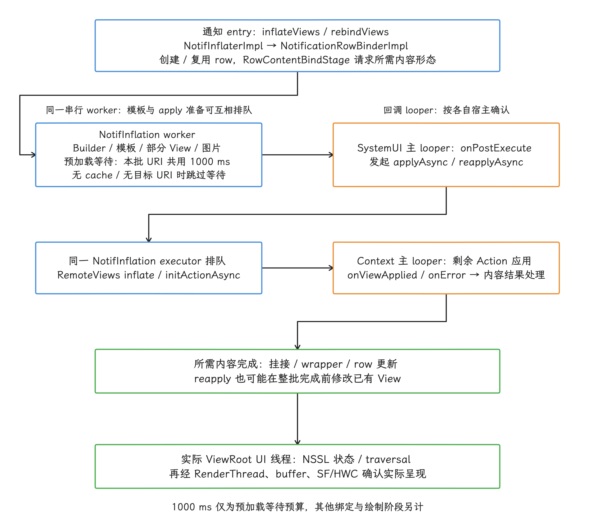

# SystemUI 性能分析

普通 App 卡顿时，受影响的画面往往只在一个任务里；SystemUI 负责的状态栏、通知抽屉、锁屏和导航覆盖面大得多，同一段阻塞还可能与 Launcher（桌面与最近任务组件）、WM Shell（窗口管理的交互与动画组件） 和目标 App 自己的动画重叠。只看 `com.android.systemui` 的主线程，容易分不清窗口由谁创建、工作落在哪个线程、最终画面何时呈现。这篇文章要做的，就是把这几个问题拆开回答。

> 源码基线：AOSP `android-17.0.0_r1`；内核 `android17-6.18-2026-06_r6`。版本差异的讨论以 Android 12—16 的演进为参照，现行结论统一取 Android 17 / API 37。

同一份 SystemUI 代码中，legacy shade（传统通知面板）与 SceneContainer（基于场景切换的新容器）两条路径并存，状态栏、通知抽屉、返回手势还各有专用 UI 线程开关。动手分析前，我们先把目标构建的 flag（功能开关）、窗口和线程记下来：实际执行哪条路径，由这些记录决定，系统版本号本身说明不了。

## 版本、flag、窗口和线程

动手分析 SystemUI，先要回答这份代码在目标设备上走的哪条路径——它的结构用一张固定架构图概括不了：`scene_container`、`dual_shade`、`status_bar_for_desktop`、`status_bar_root_modernization`、`status_bar_system_status_icons_in_compose`、`status_bar_ui_thread`、`notification_shade_ui_thread` 与 `edge_back_gesture_handler_thread` 这些开关，每一个都可能改变我们该观察的窗口、线程或 UI 实现。AOSP tag（源码版本标签） 只能证明对应代码存在；产品是否真的执行那条分支，要看构建配置和运行时 flag。

先用下面这组只读命令，把设备身份、aconfig（Android 平台功能开关系统）状态、线程名和窗口名保存下来：

```bash
adb shell getprop ro.build.fingerprint
adb shell aflags list | grep -E 'com\.android\.systemui\.(scene_container|dual_shade|status_bar_for_desktop|status_bar_root_modernization|status_bar_system_status_icons_in_compose|status_bar_ui_thread|notification_shade_ui_thread|edge_back_gesture_handler_thread)'
adb shell ps -A -T | grep -E 'systemui|launcher|ShellMain|ShellAnimation|Splashscreen|BackPanelUiThread|NotifInflation|RenderThread'
adb shell dumpsys window windows | grep -E 'NotificationShade|StatusBar|NavigationBar'
```

这组输出要与 Perfetto trace（系统跟踪） 一起存档。`aflags list` 只给出 flag 值，窗口列表和线程列表才能证明对应实现真的建出来了。量产设备还可能隐藏部分调试信息，这时要借助 userdebug（可调试系统构建）或厂商内部符号补齐材料。


### 组件边界

| 画面或工作 | Android 17 的主要实现 | 分析时要确认的窗口或线程 |
| --- | --- | --- |
| 状态栏窗口 | <code>Status<wbr>Bar<wbr>Window<wbr>Controller<wbr>Impl</code>、状态栏 View/Compose root（根节点）、通知与系统图标绑定 | <code>Status<wbr>Bar</code> 或 <code>Status<wbr>Bar(display<wbr>Id=N)</code> 窗口；主线程或专用 UI 线程 |
| 通知抽屉与锁屏主窗口 | legacy <code>Notification<wbr>Shade<wbr>Window<wbr>View</code>，或 <code>Scene<wbr>Window<wbr>Root<wbr>View</code> 承载的 View/Compose 混合树 | <code>Notification<wbr>Shade</code> 窗口；主线程或专用 UI 线程 |
| 通知列表 | <code>Shared<wbr>Notification<wbr>Container</code> 与 <code>Notification<wbr>Stack<wbr>Scroll<wbr>Layout</code>（简称 NSSL，通知列表容器） | Scene 与 legacy 两条路径都可能出现 NSSL |
| 三按钮导航 | <code>Navigation<wbr>Bar</code>、<code>Navigation<wbr>Bar<wbr>View</code> | <code>Navigation<wbr>Bar<wbr>N</code> 窗口及其 ViewRoot |
| 边缘返回 | <code>Edge<wbr>Back<wbr>Gesture<wbr>Handler</code>、<code>Display<wbr>Back<wbr>Gesture<wbr>Handler<wbr>Impl</code>、Back Panel（返回手势箭头面板） | <code>edge-swipe</code> input monitor（输入监听器）；<code>Back<wbr>Panel<wbr>Ui<wbr>Thread</code> 或主线程 |
| Overview / Recents | Launcher3 Quickstep 的 <code>Recents<wbr>View</code> 等组件 | 设备当前 Launcher 进程，包名不必然是 <code>com.<wbr>android.<wbr>launcher3</code> |
| 窗口转场与起始窗口 | WM Shell <code>Transitions</code>、<code>Starting<wbr>Window<wbr>Controller</code> | Shell main/animation/splashscreen executor（主逻辑/动画/启动画面执行器）所在线程及宿主进程 |
| 最终合成与显示 | SurfaceFlinger、HWC（Hardware Composer，硬件合成器）、显示驱动 | SurfaceFlinger、FrameTimeline（逐帧时间线）、fence（同步栅栏）与显示时序 |

还要说明一点：WM Shell 是一组组件，未必对应一个独立进程。目标产品可以把 Shell 组件装进 SystemUI 宿主，也可以另选宿主。所以在 Perfetto 里，我们按进程的 `cmdline`（命令行标识） 和线程名定位，不预设总有一个固定的“WM Shell 进程”。

## 三个系统栏窗口的拓扑

我们先从布局文件看起：`super_notification_shade.xml` 的根节点是 `NotificationShadeWindowView`，并通过 `<include>` 引入 `status_bar_expanded`。注意 `status_bar_expanded` 是展开面板的布局名，和屏幕顶部的状态栏窗口是两回事。状态栏、通知抽屉/锁屏主窗口和三按钮导航栏，各自通过 `WindowManager.addView()` 路径创建窗口，三个入口都能从 `WindowManager.LayoutParams` 直接对上：

| 窗口 | 类型 | AOSP 标题 | 源码入口 |
| --- | --- | --- | --- |
| 顶部状态栏 | <code>TYPE_<wbr>STATUS_<wbr>BAR</code> | 默认屏为 <code>Status<wbr>Bar</code>，辅助屏为 <code>Status<wbr>Bar(display<wbr>Id=N)</code> | <code>Status<wbr>Bar<wbr>Window<wbr>Controller<wbr>Impl.<wbr>get<wbr>Bar<wbr>Layout<wbr>Params<wbr>For<wbr>Rotation()</code> |
| 通知抽屉/锁屏主窗口 | <code>TYPE_<wbr>NOTIFICATION_<wbr>SHADE</code> | <code>Notification<wbr>Shade</code> | <code>Shade<wbr>Window<wbr>Layout<wbr>Params.<wbr>create()</code> |
| 三按钮导航栏 | <code>TYPE_<wbr>NAVIGATION_<wbr>BAR</code> | <code>Navigation<wbr>Bar<wbr>N</code> | <code>Navigation<wbr>Bar.<wbr>get<wbr>Bar<wbr>Layout<wbr>Params()</code> |

窗口名和 Layer（图层） 也未必一一对应：一个窗口可以在 SurfaceFlinger 中产生多个图层。窗口由谁创建，用 `dumpsys window` 确认；到了合成阶段，再按名称和时间在 SurfaceFlinger Layers 里找对应图层。


### Legacy shade 的树

`ShadeViewProviderModule` 在 `SceneContainerFlag.isEnabled == false` 时直接 inflate（按布局资源创建 View）`super_notification_shade.xml`。这棵树包含：

- 背景、通知区和前景 Scrim（半透明遮罩）；
- `status_bar_expanded`；
- `KeyguardRootView`；
- `SharedNotificationContainer`；
- bouncer（锁屏认证界面）、light reveal（亮屏揭示动画）等兼容内容。

<!-- gracker-diagram: ch07-04-legacy-shade-tree -->


图：Legacy Shade 的 XML 根直接包含展开面板、Scrim、锁屏与共享通知容器等区域；共享容器并非 status_bar_expanded 的子节点，NSSL 还可能由运行时 section 移入共享容器。

`NotificationShadeWindowView` 会在 `onMeasure()` 中写入 `NotificationShadeWindowView#onMeasure` slice（时间区间），并在 `requestLayout()` 时写入 instant event（瞬时事件）。它的类注释也写明：该 View 可以担任主 SystemUI 窗口的根节点，但调用方别假定它永远处于根节点位置。

### Scene shade 是 Compose 与 View 的混合树

Scene flag 开启时，`ShadeViewProviderModule` 改为 inflate（从布局资源创建 View） `scene_window_root.xml`。该 XML 以 `SceneWindowRootView` 为根，内部仍通过 include 包含完整的 `super_notification_shade.xml`。接下来 `SceneWindowRootViewBinder` 做的三件事，都和性能分析直接相关：

1. 创建承载 `SceneContainer` 的 `ComposeView`。
2. 将 `legacy_window_root`（传统窗口根节点）设为不可见。
3. 把包含 NSSL 的 `SharedNotificationContainer` 从旧父节点移出，放到 Scene ComposeView 之后，作为同一窗口中的兄弟 View。

所以 Scene 开启后，NSSL 相关观察点仍要保留：锁屏、Shade、QS（Quick Settings，快捷设置）等场景切换进了 Compose，通知行仍可以走 View 体系。一次面板展开，可能同时包含 Compose 的 recomposition/layout/draw（重组/布局/绘制）、NSSL 的 View 测量与状态计算、UI 线程的绘制记录、RenderThread 的绘制执行与提交，以及 SurfaceFlinger 合成。

<!-- gracker-diagram: ch07-04-scene-view-hybrid -->


图：SceneWindowRootViewBinder 添加 ComposeView、隐藏 legacy root，并把共享通知容器移到根下。省略教育提示、Bouncer 专用 ComposeView 和认证涟漪等附加兄弟节点。

## SceneContainer 的开关与场景

Scene 路径在不在跑，先看 `SceneContainerFlag.isEnabled`：它在 `android-17.0.0_r1` 中等于 `Flags.sceneContainer() && isEnabledOnVariant`，并不要求一组 secondary flags（辅助开关） 同时开启。Automotive 等 SystemUI variant（产品变体） 可以通过 `isEnabledOnVariant` 强制关闭；普通产品仍以目标构建的 aconfig 值为准。

开关打开后，`SceneContainerFrameworkModule` 注册的场景包括 `Gone`、`Communal`、`Dream`、`Occluded`、`Lockscreen`、`QuickSettings` 和 `Shade`；overlay（覆盖层）包括通知 Shade、QS Shade 与 Bouncer；Quick Actions 只在 `StatusBarPopupChips.isEnabled` 时加入。Dual Shade（双面板通知/快捷设置）生效后，某些大屏配置会省去 Shade/QS scene，改用两类 overlay——这个差异会直接改变 Compose 节点数量、过渡路径和 trace 名称。

<!-- gracker-diagram: ch07-04-scene-configuration-branches -->


图：Dual Shade 开启并且资源配置不要求保留时，才省去 Shade/QS 两个 scene。通知与 QS overlay 仍在配置中；Quick Actions 另有条件。

### 性能观察点

> ⚠️ 矛盾校正（Android 17 r1）：旧文将 `SceneTransitionLatencyMonitor` 概括为完整转场的起止监控；当前实现只在进入 Shade/QS 内容时开启 `ACTION_EXPAND_PANEL`，并以主线程队首回调结束，不能替代整段转场或实际呈现测量。

- `SceneWindowRootViewBinder` 被传给 `view.viewModel()` 的 `traceName`，用于根节点生命周期绑定相关跟踪。至于每次 scene transition 的时长、目标帧有没有呈现，要靠随后的两个监控和帧时间线另行确认。
- `SceneJankMonitor` 将特定 scene transition（场景过渡）映射到 `InteractionJankMonitor` 的 CUJ（Critical User Journey，关键用户操作流程）。
- `SceneTransitionLatencyMonitor.onTransitionStart()` 在目标为 Shade/QS scene 或相应 overlay 时启动 `ACTION_EXPAND_PANEL`，再向 `@Main Handler` 的队首投递结束回调。源码注释把它限定为首帧相关区间：以符合条件的转场开始通知启动，主线程队首回调结束；它不等待整段转场完成，也不以 present fence 为结束条件。
- `SceneTransitionBlurViewModel.requestWindowBackgroundBlur()` 根据 transition state（过渡状态） 和进度请求窗口背景模糊；`WindowBackgroundBlur` log buffer（日志缓冲区） 会记录请求值和支持状态。
- `status_bar_root_modernization` 与 `status_bar_system_status_icons_in_compose` 是分别控制状态栏迁移的开关，不能只由 `scene_container` 的值推导，要逐项核对目标构建配置。

<!-- gracker-diagram: ch07-04-scene-monitor-boundaries -->


图：CUJ、LatencyTracker 与 FrameTimeline 的结束条件不同；绑定 trace 用于根节点生命周期相关的绑定跟踪，不能直接代表每次转场。模糊成本需在目标设备上对照验证。

模糊的成本要按目标设备的 RenderThread、GPU 和 SurfaceFlinger 数据判断。`debug.hwui.disable_blur_visual_feedback` 在参考源码中没有形成稳定的 SystemUI 诊断接口，别把它当通用诊断入口。工程验证可以在可控分支中关闭具体的 blur flag，或把模糊半径设为零做实验，同时保留同一设备、同一场景、同一热状态下的对照 trace。

Compose 路径的 PSS（按比例分摊的进程内存）也没有固定增幅：Scene 数量、always-compose（始终保持组合）策略、状态对象、缓存和 OEM 内容都会影响初始值。我们按 flag 组合分别记录冷启动后、稳定待机、展开 Shade、通知集中到达后的内存，再看这些内存落在哪些对象和 native/GPU（原生/GPU） 分配上。

## 通知从入库到显示的路径

分析通知列表的性能，我们至少要把四段工作分开：集合变化、通知行内容绑定、列表状态计算、窗口绘制。主要调用关系如下：

1. `NotifInflaterImpl.inflateViews()` 或 `rebindViews()` 把 entry（一条通知记录）交给 `NotificationRowBinderImpl`。
2. `NotificationRowBinderImpl` 创建或复用 `ExpandableNotificationRow`（可展开的通知行 View），更新图标，并通过 `RowContentBindStage` 请求需要的 contracted、expanded、public、single-line（折叠、展开、隐私、单行）等内容形态。
3. `NotificationRowContentBinderImpl` 创建 `AsyncInflationTask`；正常异步路径先在 `@NotifInflation Executor` 上恢复 Builder、生成模板与部分 View，加载所需图片并等待预加载任务。该阶段的结果经 `onPostExecute()` 回到 SystemUI 主线程，再发起 RemoteViews apply。
4. 新建 RemoteViews 内容走 `applyAsync()`，复用现有内容走 `reapplyAsync()`，两者都显式使用同一个 `inflationExecutor`。RemoteViews 的 worker 阶段负责 inflate 与 `initActionAsync` 等准备；剩余 Action 应用及 `onViewApplied/onError` 在其 Context 的主 looper 回调，不能把整个 apply 都归到 worker。
5. 异步 apply 失败时，`OnViewAppliedListener.onError()` 会在 UI 回调路径尝试同步 `apply()` 或 `reapply()`，用来区分异步框架的异常和通知内容自身的 inflate 失败。
6. 所需内容全部完成后，更新后的 row 进入 View 树，引起后续的测量、布局、动画和绘制。

<!-- gracker-diagram: ed07-04-notification-binding-handoffs -->


图：限定 Android 17 r1 的正常异步内容绑定：entry/row 请求所需形态，模板与图片准备、RemoteViews 准备共用同一 NotifInflation 执行器，中间经 SystemUI 主 looper 发起 apply，剩余 Action 与结果回调回到 RemoteViews Context 的主 looper。1000 ms 仅为该批 URI 预加载等待的共享预算，无 cache 或目标 URI 时可跳过；其他阶段另计。reapply 可在整批完成前修改已有 View；实际 ViewRoot 线程及窗口呈现仍须另查，异步失败的同步回退见下文。

这里有一个容易踩的坑：Android 17 已经没有旧路径中的 `NotificationContentInflater.java`，实现类迁移为 Kotlin 的 `NotificationRowContentBinderImpl.kt`，但 `doInBackground()` 仍保留历史 trace 名 `NotificationContentInflater.AsyncInflationTask#doInBackground`。搜 trace 时记住，这个 slice 名是为了兼容保留的，对应的是迁移后的 Kotlin 实现类。

### 异步绑定后的线程分工

`NotifInflation` 在参考实现中是单个后台优先级 `HandlerThread`，由 `ExecutorImpl` 投递任务；Builder/模板阶段与后续 RemoteViews 准备阶段共享这个执行器，可能互相排队。`AsyncInflationTask.onPostExecute()` 使用默认主 looper；RemoteViews 回调使用其 Context 的主 looper，完成部分 Action、wrapper 更新和内容挂接等工作。窗口 traversal 仍要到该 ViewRoot 的实际 UI 线程核对；窗口线程 flag 给出的是窗口自身的宿主，哪些通知回调迁过去了要逐个核对。所以大量通知在短时间内到达时，可能观察到：


- `NotifInflation` 队列持续工作；
- 多个异步结果在相近时刻完成；
- UI 线程集中把通知 row 加入 View 树；
- NSSL 与状态栏图标容器在随后几帧反复更新；
- RenderThread 或 SurfaceFlinger 在同一时间段承接更大的绘制与合成负载。

同步 fallback（后备路径）也要单独标记。trace 或日志里如果看到 `applyAsync()` 失败后频繁回到同步处理，耗时位置就会从 worker（工作线程） 转移到 UI 回调。这时降低通知更新频率，只能减少发生次数；我们还要查清楚，自定义 `RemoteViews`、资源、URI 权限或厂商控件，到底是哪个导致了异步 apply 失败。

<!-- gracker-diagram: ch07-04-async-apply-fallback -->


图：异步失败会在 UI 回调里尝试同步 apply/reapply；即使成功，这段同步路径的耗时也留在 UI 回调里。应定位失败原因，并核对同步回退是否拖延目标帧。

### NSSL 的测量成本由什么决定

`NotificationStackScrollLayout#onMeasure` 先调用父类测量；当 `mSuppressChildrenMeasureAndLayout` 为真时会提前返回。通常未抑制的分支显式遍历全部直接 child（子 View），连 `GONE` 的也调用 `measureChild`，因为算法要用这些高度估算面板能容纳多少条通知。也就是说，通知行在视觉上被藏起来了，测量工作照样在进行。一帧里工作量的大小，取决于这些条件：

<!-- gracker-diagram: ch07-04-nssl-measure-branches -->


图：NSSL 通常显式测量所有直接 child，包括 GONE；但抑制标志为真会提前返回。图不把一次 measureChild 调用等同于整棵子树必然重新完整计算。

- entry（SystemUI 中的一条通知记录） 与 row 总数；
- 分组展开/折叠和 heads-up（悬浮通知）状态；
- public、contracted、expanded、single-line 等内容变体是否已绑定；
- OEM 增加的包装层和装饰 View；
- 配置变化、字体缩放、屏幕形态切换触发的重新测量。

NSSL 的状态更新在两条路径中时机不同：legacy 通过 pre-draw listener（绘制前监听器） 调用 `updateChildren()`，Scene 在 `onDraw()` 开始调用 `onJustBeforeDraw()`，且仅在 `mChildrenUpdateRequested` 为真时处理待更新状态；两条路径都保留 `NSSL#updateChildren` slice。这个 slice 里做的是运行 stack algorithm（通知堆叠布局算法）、应用当前状态或启动状态动画，并处理通知之间的重叠。

<!-- gracker-diagram: ch07-04-nssl-update-entry-points -->


图：Legacy 使用 pre-draw listener；Scene 在 onDraw 开始且有待更新请求时进入。两条路径共用 NSSL#updateChildren，随后选择直接应用状态或启动状态动画。

### 普通模板、自定义 RemoteViews 与大图

| 负载 | 主要风险 | 证据入口 |
| --- | --- | --- |
| 标准模板高频更新 | entry 反复 rebind（重新绑定）、图标变化、多个完成回调集中到达 | <code>Notif<wbr>Inflation</code> 队列、row bind 日志、NSSL requestLayout |
| 自定义 <code>Remote<wbr>Views</code> | 层级复杂、资源异常、异步 apply fallback、内存校验失败 | <code>apply<wbr>Async/reapply<wbr>Async</code>、<code>on<wbr>Error</code>、<code>Custom<wbr>View<wbr>Memory<wbr>Size<wbr>Exceeded<wbr>Exception</code> |
| 大图通知 | 解码与缩放、像素常驻、异步预加载等待、纹理上传 | worker CPU、bitmap/native（位图/原生）内存、RenderThread 与 GPU |
| 分组通知 | summary/child（摘要/子通知）内容形态、展开状态与动画、更多 row 参与测量 | group 状态变化、NSSL measure/updateChildren |

`BigPictureIconManager` 对部分 URI/resource（资源） 类型支持延迟加载；bitmap（位图）、adaptive bitmap（自适应位图）和 data 类型会跳过这套延迟策略，因为像素仍会常驻内存。

<!-- gracker-diagram: ch07-04-big-picture-loading-types -->


图：BigPictureIconManager 对 bitmap、adaptive bitmap 和 data 类型跳过这套延迟策略；URI/resource 等类型能否延迟，还要结合功能开关、可见性和消费方状态。

`NotificationRowContentBinderImpl` 的正常异步任务为 `waitForPreloadedImages()` 传入 1000 ms；resolver 为这一批目标 URI 共用一个截止时间，并逐张递减剩余等待预算。这笔预算按整批结算，分不到每张图各一秒；它只约束预加载等待这一段，不给整个绑定任务设统一总时限；其他阶段的耗时需另行测量。该等待发生在 worker 中，UI 线程未必跟着卡一秒；但队列延迟、完成回调集中到达和后续纹理上传，仍可能影响可见帧。


App 侧的改进通常更直接：合并高频进度更新，保持通知 ID 与模板稳定，减少内容未变化时的 `notify()`，避免每秒替换大图，控制自定义 RemoteViews 层级，并利用通知分组减少不必要的结构变化。SystemUI 侧则要保留异步路径，修复触发 fallback 的原因，限制同一帧中的状态更新量，并用设备数据验证任何缓存策略。

## 状态栏图标：通知图标与系统状态图标分开看

左侧通知图标，Android 12—14 的资料常从 presenter/controller 追起；当前实现已经移到 `statusbar/notification/icon/ui`，按三个组件看：

- `NotificationIconContainerStatusBarViewModel.icons` 从 `iconsInteractor.statusBarNotifs` 生成 `NotificationIconsViewData`；map 在后台 context（协程执行上下文）中执行，更新再经过 `conflate()` 与 `distinctUntilChanged()` 控制：前者在下游来不及处理时保留最新值，后者过滤相邻相等结果；至于更新是否被压到“每帧最多更新一次”，要到实际帧里统计确认。
- `NotificationIconContainerStatusBarViewBinder.bindWhileAttached()` 按 `displayId` 选择图标 View store，再绑定到 `NotificationIconContainer`。
- 默认屏复用通知处理流程保存的 status bar icon；辅助屏使用 `ConnectedDisplaysStatusBarNotificationIconViewStore`，按通知 key 缓存为目标 display context 创建的 `StatusBarIconView`。

<!-- gracker-diagram: ch07-04-notification-icon-flow -->


图：图标集合在后台映射，再合并积压值和过滤相邻相等值；算子之后的更新频率与最终呈现，仍要靠后续 View 与帧时间线分析。

`NICStatusBar#bindWhileAttached` 只覆盖绑定关系建立的过程。每次通知变化产生的帧耗时，我们还要从 Flow（异步数据流）更新、View 容器变化、ViewRoot traversal 与 FrameTimeline 中观察。

<!-- gracker-diagram: ch07-04-icon-store-by-display -->


图：同一条通知数据可以对应不同的 View 实例：默认屏复用 pipeline 中的图标，辅助屏按 display context 创建并缓存 View。绑定入口的 trace 只到绑定为止，每次通知更新的完整帧要另行跟踪。

右侧网络、电池、时钟和其他系统状态图标，仍由状态图标处理流程与 `StatusBarIconControllerImpl` 等组件管理；另有 `status_bar_system_status_icons_in_compose` 开关，目标产品可能把部分区域迁到 Compose。排查大量通知同时到达的场景时，应把两类输入分开：

- 左侧压力来自通知集合和图标 View 增删；
- 右侧压力来自网络、电话、热点、隐私指示、OEM 扩展等状态变化；
- 两者可在同一状态栏窗口帧内叠加，但原因和限制更新频率的位置不同。


## 导航输入的两条路径

本节对比三按钮和边缘返回两条输入路径：三按钮经 `NavigationBarView` 处理触摸，边缘返回经对应 input monitor 进入。手势导航还包含由 Launcher/Quickstep 等实现参与的主页、最近任务手势，不能全部归入边缘返回入口。

### 三按钮导航

`NavigationBarView.onInterceptTouchEvent()` 和 `onTouchEvent()` 把事件交给 `mTouchHandler`，按钮再触发 back、home、recents（返回、主页、最近任务） 等行为。定位三按钮延迟时，时间线应包含：

`InputDispatcher` 投递 → `NavigationBarN` 窗口 UI 线程 → 事件与按钮处理。此后分开记录导航栏 pressed/动画反馈帧，以及按钮行为触发的 WM/Launcher 或目标 App 状态变化与转场；两条结果路径可交叠，反馈帧不必等目标窗口切换完成。

<!-- gracker-diagram: ch07-04-three-button-parallel-results -->


图：从导航栏事件处理处分开跟踪反馈帧与目标窗口行为。底部只是可交叠的阶段示意，具体先后与耗时应读取设备 trace。

如果 Input 已经送达，按钮 pressed（按下状态） 或动画却迟到了，先查这个窗口的 UI 线程和 ViewRoot；如果按钮反馈及时、窗口切换迟到，就继续看 WM Shell、Launcher 或目标 App，别把整段延迟都算到 `NavigationBarView` 头上。

### 边缘返回手势

返回手势把 per-display（每块显示屏独立） 的资源放进 `DisplayBackGestureHandlerImpl`：它为每个 display 创建 `InputMonitorCompat("edge-swipe", displayId)`，用 `UiThreadContext` 的 looper（消息循环） 与 Choreographer 建立 input receiver（输入接收器），并注册 system gesture exclusion listener（系统手势排除区域监听器）。跨 display 的共享状态和回调收在 `EdgeBackGestureHandler` 里，它保存多个 `DisplayBackGestureHandler`。

`edge_back_gesture_handler_thread` 开启时，`SysUIConcurrencyModule` 创建具有显示相关优先级的 `BackPanelUiThread`；关闭时，同一个 `UiThreadContext` 改用 SystemUI 主线程。由此得到两个诊断分支，外加一条后续检查：

<!-- gracker-diagram: ch07-04-edge-back-thread-branches -->


图：边缘返回不依赖三按钮窗口的触摸入口；它使用 per-display input monitor。线程开关决定 UiThreadContext 使用专用 BackPanelUiThread 还是主线程。

- trace 中有 `BackPanelUiThread`：检查 input receiver、手势判定、Back Panel 绘制与该线程的 Choreographer；
- trace 没有该线程：检查 aconfig 值，并在 SystemUI 主线程寻找同一路径；
- 手势进入 back animation 后：继续看 WM Shell back transition、目标窗口与 SurfaceFlinger。

三按钮路径和边缘返回共享部分窗口管理结果，但输入入口不同：gesture mode（手势导航模式）中的边缘返回走 edge-swipe input monitor 和 Back Panel，只搜 `NavigationBarView` 会漏掉这一路径。

## 多显示、折叠屏与桌面窗口模式

per-display status bar（每块显示屏独立状态栏） 的基础设施已经就位：`StatusBarWindowControllerImpl` 持有 `mDisplayId`，辅助屏窗口标题带 display id（显示屏标识）；`MultiDisplayStatusBarWindowControllerStore` 按 display 提供 controller；通知图标 binder（绑定器） 也接受 `displayId`。在折叠屏、外接屏这些设备形态上，“StatusBar 只有一个实例”的假设不再成立。

具备基础设施，离每块 display 都创建状态栏还差几道判断。`DisplayContent.isSystemDecorationsSupported()` 会排除 VR 2D display 和不可信 display，再检查 display window settings（显示窗口设置）、`FLAG_SHOULD_SHOW_SYSTEM_DECORATIONS`，以及旧 display-content-mode 管理路径下的强制桌面条件。产品 flag、display 类型、信任属性和系统策略共同决定结果。

<!-- gracker-diagram: ch07-04-display-decor-policy -->


图：系统装饰支持先经过安全排除，再看设置/flag 与特定旧桌面条件。要证明每块屏真的建起了系统栏，还要回到运行时窗口列表。

还有三件事容易混：

- `NavigationBarControllerImpl` 用 `SparseArray<NavigationBar>` 按 display 管理导航栏，并通过 WMS（WindowManagerService，窗口管理服务）查询该 display 是否有 navigation bar/taskbar（导航栏/任务栏）。连接屏的 Taskbar 可能由 Launcher 管理，SystemUI 的 `TaskbarDelegate` 负责协调状态与回调。
- AOSP Shade 是 display-aware（能够识别不同显示屏） 的单例主窗口，可以在 display 之间移动，或在 display 移除时重新挂到默认屏；“每块屏都有一套 NotificationShade”的说法，要从窗口列表单独验证。
- 桌面任务布局、窗口装饰与转场主要属于 WM Shell desktop mode；任务应用的 View、Shell 的窗口装饰与输入系统的光标应按实际宿主分别分析，不能统一归入 desktop mode 渲染。


多显示性能，我们至少要分别记录：单屏折叠态、单屏展开态、外屏连接但休眠、双屏点亮、桌面窗口模式，以及导航栏与 Taskbar 两种界面形态。实验记录还要包含分辨率、刷新率、Layer 数、状态栏实例数和通知 Shade 所在 display。CPU、GPU、显存或 PSS 的增幅，只能根据同一设备上的对照数据得出。

## App 启动与 Overview 的参与者

从桌面或 Overview 启动一次 App，我们至少要核对以下参与者。下面按职责列举，实际执行未必按编号串行：starting window、目标 App 生产 buffer、系统栏更新和转场可能交叠：

1. Launcher/Quickstep 接收点击或手势，更新 workspace（桌面工作区）、任务卡片或 Overview 状态。
2. system_server 的窗口管理核心创建并推进 transition（窗口过渡）。
3. WM Shell `Transitions` 接收 request/ready（请求/就绪） 回调，选择 transition handler（过渡处理器），由 Shell main executor 调度；动画执行位置取决于所选 handler，可能在 Shell animation executor，也可能委托 Launcher 等 remote transition 宿主。
4. `StartingWindowController` 调用 `StartingWindowTypeAlgorithm` 在 splashscreen executor 中选择 snapshot（任务快照）、solid-color splash（纯色启动画面）、SplashScreen、windowless starting surface（无独立窗口的起始 Surface）或无起始窗口，并执行相应创建；移除请求先由 Shell main 上的 observer 协调，再把实际移除提交给 splashscreen executor。
5. 目标 App 提交首批 buffer。
6. SystemUI 更新状态栏、导航栏、锁屏或 Shade 的相关状态。
7. SurfaceFlinger 合成 Launcher、starting window、目标 App 与系统栏，并交给 HWC 和显示设备呈现。

<!-- gracker-diagram: ch07-04-launch-participants-overlap -->


图：启动职责按交叠关系排布，Shell handler、起始画面、目标 App 与系统栏可能同时在场；示意条长不表示真实耗时，生产者也未画全。

`Transitions.java` 保留了 `dispatchRequest: <type>`、`playTransition: <type>` 与 `<Handler>#startAnimation animated <type>` 等 WM trace。`StartingWindowController` 同时使用 Shell main executor 和 splashscreen executor；起始窗口的工作要按 executor 分开核对，Shell main 承担协调，创建与移除的实际执行在 splashscreen executor。

<!-- gracker-diagram: ch07-04-starting-surface-executors -->


图：添加请求分别提交 Shell main 状态协调与 splashscreen 创建工作；类型选择含 windowless/none。移除请求先协调，再派发实际移除。

Overview 的 `RecentsView.applyLoadPlan()` 会增删、复用并绑定任务卡片，但该方法名本身并未成为稳定的 trace slice；源码中的方法与设备上实际出现的 trace，要分开说明。


Launcher 的包名和进程名受产品实现影响：AOSP 的参考实现是 Launcher3 Quickstep，Pixel 或 OEM 构建可能用不同包名。我们通过默认 HOME activity、进程 `cmdline` 和窗口 owner（所有者） 找到当前宿主，别只搜索固定的 `com.android.launcher3`。

## 把 SystemUI 放回标准渲染管线

SystemUI 特殊在窗口数量多、状态来源多，还能通过开关选择专用线程；但 HWUI 的主路径仍遵循标准时序：

`VSync` 驱动对应窗口 UI 线程的 Choreographer；`doFrame()` 按 `INPUT`、`ANIMATION`、`INSETS_ANIMATION`、`TRAVERSAL`、`COMMIT` 顺序分发回调。输入和动画更新发生在相应阶段，ViewRoot 的 traversal/绘制记录及向 RenderThread 同步通常位于 `TRAVERSAL`，早于 `COMMIT`。RenderThread/HWUI 经 BLAST buffer queue（窗口缓冲队列）向 SurfaceFlinger 提交结果，再由 HWC/present 链路处理；各线程阶段可流水交叠，`COMMIT` 不等待 GPU 或显示呈现完成；它们的完成时刻需在各自时间线上确认。

<!-- gracker-diagram: ch07-04-ui-callback-render-pipeline -->


图：ViewRoot traversal 通常在 TRAVERSAL 回调中记录绘制并与 RenderThread 同步；COMMIT 在其后，GPU 或屏幕呈现的完成点要另找 fence 与 present。底部只表示可能流水交叠，不按时长比例绘制。

我们沿着这条路径核对时，记住几点：

- `doFrame` 很长，首先说明该 slice 的墙钟区间较长；其中可能包含 CPU 执行、Runnable 排队和阻塞等待。先结合 sched 分解，再判断输入、动画、measure/layout、绘制记录或同步等待哪一段变长。
- `Traversal` 包含 measure/layout、绘制记录和向 RenderThread 同步等工作。其尾部的 `syncAndDrawFrame()` 可能等待 RenderThread 状态同步；后续阶段处理不及时造成的 backpressure（反压）也可能延长 traversal。
- Compose 的 recomposition、layout 和 draw 记录仍在对应窗口的 UI 线程；GPU 工作与 display 合成，要到 RenderThread、SurfaceFlinger 和 HWC 中继续确认。
- `requestLayout` instant event 只说明请求已经发出，当场是否完成 layout 要看后续的 measure/layout。
- App `SurfaceFrame` 使用 `surface_frame_token`，Display `DisplayFrame` 使用 `display_frame_token`；二者分属不同命名空间；数值相同本身不证明关联，关联两者要走 FrameTimeline 的对应关系。


### Perfetto 中的观察顺序

| 步骤 | 要回答的问题 | 主要轨道或证据 |
| --- | --- | --- |
| 确认呈现异常 | 哪个 display frame missed（错过截止时间），异常在 deadline 还是 present 环节 | FrameTimeline <code>Display<wbr>Frame</code>、VSYNC、HWC |
| 找到受影响 Surface | 是 NotificationShade、StatusBar、NavigationBar、Launcher 还是目标 App | <code>Surface<wbr>Frame</code>、SurfaceFlinger Layers、窗口 owner |
| 确认生产者线程 | 哪个进程和 ViewRoot 产生该 buffer | 目标进程 UI 线程、RenderThread、BLAST |
| 细分应用或系统 UI 工作 | 输入、动画、绑定、measure/layout、绘制记录中哪段变长 | slice、sched（调度）、binder、CPU frequency（频率） |
| 检查后续阶段的反压 | UI 是否等待 RenderThread，RenderThread 是否等待 GPU/buffer，SurfaceFlinger 是否错过合成 | <code>sync<wbr>And<wbr>Draw<wbr>Frame</code>、dequeue/queue（出队/入队）、fence、SurfaceFlinger/HWC |
| 回到源码 | trace 名对应哪个 Android 17 方法，目标 flag 是否选择该实现 | <code>android-17.<wbr>0.<wbr>0_<wbr>r1</code> 源码、aflags、产品差异 |

下面的 Trace Processor SQL 用于列出 SystemUI 中三个已核对的通知列表 slice：

```sql
SELECT
  s.id AS slice_id,
  p.upid,
  p.pid,
  p.name AS process_name,
  t.utid,
  t.tid,
  t.name AS thread_name,
  s.ts,
  s.dur,
  s.dur / 1e6 AS wall_dur_ms,
  s.name
FROM slice AS s
JOIN thread_track AS tt ON s.track_id = tt.id
JOIN thread AS t USING (utid)
JOIN process AS p USING (upid)
WHERE p.name GLOB '*systemui*'
  AND s.dur >= 0 -- 排除尚未结束的 slice；空结果不证明该工作没有发生
  AND s.name IN (
    'NotificationShadeWindowView#onMeasure',
    'NotificationStackScrollLayout#onMeasure',
    'NSSL#updateChildren'
  )
ORDER BY s.ts;
```

查询结果给出已完成 slice 的墙钟时长，包含运行、调度等待或阻塞，与线程 CPU 时间是两个量。进程名和三个 slice 名只适用于相应实现及采集覆盖；空结果也可能来自 OEM 改名、未采集或未完成区间。接下来用实际进程/线程身份、Surface 与逐帧关联，核对同一时间范围内的 `SurfaceFrame`、`DisplayFrame`、RenderThread、SurfaceFlinger 和调度状态；时间重叠只提供候选，认定用户可见卡顿要靠逐帧证据。


## 四类常见现场

把前面的窗口、线程和绑定知识落到四类现场：Shade 展开、通知集中到达、返回手势、启动动画。每一类都从用户可见的异常帧入手，再回到对应的生产者线程。

### Shade 展开掉帧

我们先在 FrameTimeline 中选中 missed display frame，再定位 `NotificationShade` SurfaceFrame，随后检查当前窗口的 UI 线程：

- legacy 路径关注 `NotificationShadeWindowView#onMeasure`、NSSL measure 和 `NSSL#updateChildren`；
- Scene 路径还要加入 Compose recomposition/layout/draw、scene transition/CUJ、blur 请求；
- 两条路径都要检查 NSSL，因为 Scene 仍保留 View 通知容器；
- UI 线程没有超过该帧可用时间时，继续查看 RenderThread、buffer queue、SurfaceFlinger 和 GPU。

下一步看信号落在哪：NSSL measure 随通知总数增长，优化目标就是减少参与测量的 row、内容形态和层级；`NSSL#updateChildren` 变长，就检查分组、heads-up、动画状态与同一帧中的更新次数；UI 与 RenderThread 都没有异常而 display frame 仍然 miss，继续检查 SurfaceFlinger/HWC、其他高层 Surface 或显示模式切换。


### 通知集中到达

我们分别检查三组信号：`NotifInflation` worker、SystemUI 窗口 UI 线程，以及状态栏/NotificationShade 的 FrameTimeline。常见原因包括 worker 排队、图片预加载、异步 apply fallback、完成回调集中到达、row 批量挂接、图标批量变化和 NSSL 连续重新计算。

主线程里看不到 `RemoteViews.apply()`，离排除通知绑定还远：异步的主要工作本来就在 worker 上，用户可见的卡顿往往发生在任务完成后的 View 树更新阶段。反过来，worker 队列变长而可见帧没有受影响时，先把它记作候选原因，是否成立还要更多证据。


### 返回手势反馈迟缓

以 input event 到达 `edge-swipe` receiver 为起点，以 Back Panel 首帧或目标窗口 transition 为终点。若 `BackPanelUiThread` 存在，主线程上的通知工作未必会直接阻塞箭头绘制；两条线程仍可能通过共享状态、WM 调用和合成资源相互影响。若 input receiver 很快、Back Panel 也按时出帧，只有窗口切换阶段变慢，就应检查 WM Shell 和目标 App。


### 启动动画不连贯

同一个时间范围内，应同时比较 Launcher、Shell、starting window、目标 App、SystemUI 和 SurfaceFlinger 的轨道，并区分：

- Launcher 任务卡或 workspace 自身掉帧；
- Shell handler 选择或动画执行延迟；
- starting window 创建慢或移除时机不合适；
- 目标 App 首 buffer 晚；
- StatusBar/NavigationBar 同期更新超预算；
- SurfaceFlinger/HWC 合成或 present 延迟。

归因要走完三步：受影响的系统栏 SurfaceFrame 与其 UI/RenderThread 工作在时间上对应，这只建立候选；再证明最早拖延该帧的依赖，区分本地计算与等待外部资源；最后用同场景对照验证。时间重叠和 CPU 峰值都停在第一步，单凭它们认定 SystemUI 是根因是不够的。

## OEM 差异的处理方式

厂商经常改动状态栏层级、QS、锁屏、通知模板、插件、模糊、动画和线程开关。AOSP 方法可以提供稳定的分析起点，但具体类名与 trace slice 仍可能变化。审查厂商实现时，应保留三类材料：

- AOSP Android 17 的基准源码与 flag；
- 产品分支相对 AOSP 的 diff；
- 目标设备的窗口、线程、Layer、Perfetto 和日志。

写结论时也要带上适用条件。例如，“Scene path 的 NSSL 仍参与通知行布局”有 AOSP Android 17 源码直接支持；“某机型在 120 Hz 下展开通知面板时 blur 是瓶颈”需要该机型的对照 trace；“连接显示器后会创建第二个 StatusBar”还需要 display policy（显示策略）与运行时窗口列表证明。


## 实战检查清单

采集前：

- 记录 build fingerprint（系统构建指纹）、刷新率、分辨率、导航模式、折叠状态和外接屏状态。
- 保存相关 aconfig 值。
- 保存 `dumpsys window` 中三个系统栏窗口及 display id。
- 保存 SystemUI、Launcher、Shell 相关线程分别属于哪个进程。
- 固定通知集合、分组、图片和更新频率，控制温度与电源状态。

读 trace 时：

- 从 missed `DisplayFrame` 开始，找到对应的 Surface 和 owner。
- 区分 MainThread、专用窗口 UI 线程、`NotifInflation`、RenderThread 和 Shell executor。
- 将 `requestLayout` 当成触发信号，将 measure/layout/draw 与 `syncAndDrawFrame` 分开。
- 对照 legacy/Scene、View/Compose、三按钮/手势、单屏/多屏分支。
- 检查 CPU 调度、频率、binder、GPU、buffer queue、SurfaceFlinger/HWC，避免只凭一条 slice 判断责任。

形成结论时：

- 写明 Android 17 tag、产品分支、flag 和 display 条件。
- 给出 FrameTimeline 与线程 slice 的时间关系。
- 标明直接源码事实、trace 观察和工程推断。
- 优化后复测同一场景，并报告分位数、missed frame 类型和 thermal（温控）状态。

## 与其他章节的关系

- **§2.4 MainThread 与 RenderThread 协作**：介绍标准 HWUI、BLAST 与 SurfaceFlinger 的分工；SystemUI 还需检查专用 UI 线程。
- **§7.1 卡顿的定义与分类**：SystemUI 仍需从 FrameTimeline 的用户可见帧开始判断责任。
- **§7.2 典型卡顿场景**：Shade、导航、启动和 Overview 的现象，需要结合这里的窗口与组件边界进一步分析。
- **§14.2 Perfetto View 解读**：线程、FrameTimeline、Layer 和 SQL 操作可参考该章。

## Android 17 源码与官方资料

- AOSP [`systemui.aconfig`](https://android.googlesource.com/platform/frameworks/base/+/android-17.0.0_r1/packages/SystemUI/aconfig/systemui.aconfig)
- AOSP [`super_notification_shade.xml`](https://android.googlesource.com/platform/frameworks/base/+/android-17.0.0_r1/packages/SystemUI/res/layout/super_notification_shade.xml)
- AOSP [`scene_window_root.xml`](https://android.googlesource.com/platform/frameworks/base/+/android-17.0.0_r1/packages/SystemUI/res/layout/scene_window_root.xml)
- AOSP [`ShadeViewProviderModule.kt`](https://android.googlesource.com/platform/frameworks/base/+/android-17.0.0_r1/packages/SystemUI/src/com/android/systemui/shade/ShadeViewProviderModule.kt)
- AOSP [`ShadeWindowLayoutParams.kt`](https://android.googlesource.com/platform/frameworks/base/+/android-17.0.0_r1/packages/SystemUI/src/com/android/systemui/shade/ShadeWindowLayoutParams.kt)
- AOSP [`NotificationShadeWindowView.java`](https://android.googlesource.com/platform/frameworks/base/+/android-17.0.0_r1/packages/SystemUI/src/com/android/systemui/shade/NotificationShadeWindowView.java)
- AOSP [`SceneContainerFlag.kt`](https://android.googlesource.com/platform/frameworks/base/+/android-17.0.0_r1/packages/SystemUI/src/com/android/systemui/scene/shared/flag/SceneContainerFlag.kt)
- AOSP [`SceneContainerFrameworkModule.kt`](https://android.googlesource.com/platform/frameworks/base/+/android-17.0.0_r1/packages/SystemUI/src/com/android/systemui/scene/SceneContainerFrameworkModule.kt)
- AOSP [`SceneWindowRootViewBinder.kt`](https://android.googlesource.com/platform/frameworks/base/+/android-17.0.0_r1/packages/SystemUI/src/com/android/systemui/scene/ui/view/SceneWindowRootViewBinder.kt)
- AOSP [`NotificationStackScrollLayout.java`](https://android.googlesource.com/platform/frameworks/base/+/android-17.0.0_r1/packages/SystemUI/src/com/android/systemui/statusbar/notification/stack/NotificationStackScrollLayout.java)
- AOSP [`NotificationRowContentBinderImpl.kt`](https://android.googlesource.com/platform/frameworks/base/+/android-17.0.0_r1/packages/SystemUI/src/com/android/systemui/statusbar/notification/row/NotificationRowContentBinderImpl.kt)
- AOSP [`NotificationIconContainerStatusBarViewBinder.kt`](https://android.googlesource.com/platform/frameworks/base/+/android-17.0.0_r1/packages/SystemUI/src/com/android/systemui/statusbar/notification/icon/ui/viewbinder/NotificationIconContainerStatusBarViewBinder.kt)
- AOSP [`StatusBarWindowControllerImpl.java`](https://android.googlesource.com/platform/frameworks/base/+/android-17.0.0_r1/packages/SystemUI/src/com/android/systemui/statusbar/window/StatusBarWindowControllerImpl.java)
- AOSP [`NavigationBarControllerImpl.java`](https://android.googlesource.com/platform/frameworks/base/+/android-17.0.0_r1/packages/SystemUI/src/com/android/systemui/navigationbar/NavigationBarControllerImpl.java)
- AOSP [`DisplayBackGestureHandler.kt`](https://android.googlesource.com/platform/frameworks/base/+/android-17.0.0_r1/packages/SystemUI/src/com/android/systemui/navigationbar/gestural/DisplayBackGestureHandler.kt)
- AOSP [`DisplayContent.java`](https://android.googlesource.com/platform/frameworks/base/+/android-17.0.0_r1/services/core/java/com/android/server/wm/DisplayContent.java)
- AOSP [`Transitions.java`](https://android.googlesource.com/platform/frameworks/base/+/android-17.0.0_r1/libs/WindowManager/Shell/src/com/android/wm/shell/transition/Transitions.java)
- AOSP [`StartingWindowController.java`](https://android.googlesource.com/platform/frameworks/base/+/android-17.0.0_r1/libs/WindowManager/Shell/src/com/android/wm/shell/startingsurface/StartingWindowController.java)
- AOSP Launcher3 [`RecentsView.java`](https://android.googlesource.com/platform/packages/apps/Launcher3/+/android-17.0.0_r1/quickstep/src/com/android/quickstep/views/RecentsView.java)
- Android Open Source Project：[读取和修改 aconfig flag](https://source.android.com/docs/setup/build/feature-flagging/flip-a-flag)
- Android Developers：[通知概览](https://developer.android.com/develop/ui/views/notifications)
- Android Developers：[SplashScreen API](https://developer.android.com/develop/ui/views/launch/splash-screen)

- [NotificationInlineImageResolver.java](https://android.googlesource.com/platform/frameworks/base/+/android-17.0.0_r1/packages/SystemUI/src/com/android/systemui/statusbar/notification/row/NotificationInlineImageResolver.java)
- [RemoteViews.java](https://android.googlesource.com/platform/frameworks/base/+/android-17.0.0_r1/core/java/android/widget/RemoteViews.java)
- [AsyncTask.java](https://android.googlesource.com/platform/frameworks/base/+/android-17.0.0_r1/core/java/android/os/AsyncTask.java)
- [SceneTransitionLatencyMonitor.kt](https://android.googlesource.com/platform/frameworks/base/+/android-17.0.0_r1/packages/SystemUI/src/com/android/systemui/scene/ui/view/SceneTransitionLatencyMonitor.kt)
- [StatusBarWindowControllerStore.kt](https://android.googlesource.com/platform/frameworks/base/+/android-17.0.0_r1/packages/SystemUI/src/com/android/systemui/statusbar/window/StatusBarWindowControllerStore.kt)
- [Perfetto FrameTimeline](https://perfetto.dev/docs/data-sources/frametimeline)
- [Perfetto slice 表与线程时间字段](https://perfetto.dev/docs/analysis/sql-tables#slice)

- [Launcher3 TouchInteractionService：主页/最近任务手势的输入监控与 consumer（固定提交）](https://android.googlesource.com/platform/packages/apps/Launcher3/+/4e7411c54cf4dbb92764d275bc8dcf6d6ed73a0e/quickstep/src/com/android/quickstep/TouchInteractionService.java)
- [PointerChoreographer：输入系统光标控制（Android 17 r1）](https://android.googlesource.com/platform/frameworks/native/+/android-17.0.0_r1/services/inputflinger/PointerChoreographer.cpp)
