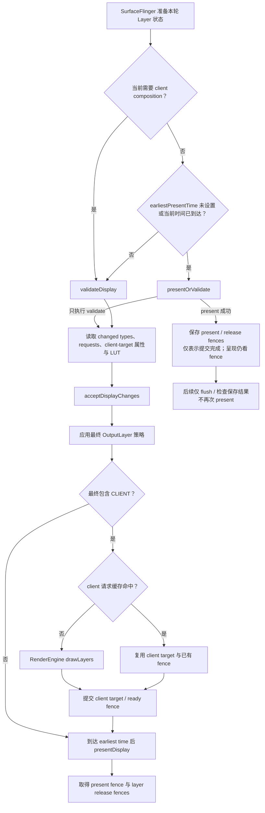

# HWC Overlay Plane 与合成降级排查

应用按时提交 buffer，画面还是迟到——合成策略变化是需要验证的一条候选路径：本来由设备处理的 Layer（图层） 改为 client composition 后，可能增加 GPU 工作，也可能复用已有 client target。是否因此迟到，要继续核对实际绘制、fence 和呈现。我们这章要做的，就是从具体的 DisplayFrame 和 Layer 属性出发，验证 HWC 的 validate/present 决策；plane（显示硬件合成平面） 数量和单一 composition type（合成类型） 描述的都是单台设备、单次协商的结果，换一台设备就要重新取证。

> 源码基线：AOSP `android-17.0.0_r1`（Android 17 / API 37）；内核 `android17-6.18-2026-06_r6`。

Composer HAL（显示合成器硬件抽象层）、显示驱动和 plane 怎么分配，通常由厂商自己实现。AOSP 能确认的是接口含义和 SurfaceFlinger（系统合成服务） 的调用关系；设备上的实际行为，要以实机证据为准。

## 诊断边界：App 按时交帧，屏幕仍可能迟到

我们先看一次可见更新会留下哪些帧记录：

- **SurfaceFrame**：某个 App 或系统 Layer 生产并提交的一帧，通常关联 `surface_frame_token`（Surface 帧标识）。
- **DisplayFrame**：SurfaceFlinger 汇集本轮可见 Layer、完成合成并提交显示的一帧，关联 `display_frame_token`（显示帧标识）。

App 的 `Choreographer#doFrame` 和 RenderThread（渲染线程） slice 按时结束，仍不足以证明 SurfaceFrame 按时 ready：还要核对 buffer 的提交、GPU 完成或 acquire fence，以及 FrameTimeline 的对应截止时间。即使生产者已按时 ready，后续合成与呈现仍可能迟到。它随后要依次经过 BufferQueue（图形缓冲队列）、SurfaceFlinger latch（获取并采用缓冲区）和 composition strategy（合成策略），再由 RenderEngine（GPU 合成引擎） 或 Composer HAL 完成合成，最后交给 display driver（显示驱动） 和 panel scanout（面板逐行扫描显示）。后半程同样有自己的时间预算，DisplayFrame 一旦在这里错过目标 VSync（垂直同步），用户看到的仍然是掉帧或延迟。这也正是本章的调查范围：先证实生产者路径的时序，再检查后续合成和显示；不能预先排除 App 或输入 buffer 的依赖。

<!-- gracker-diagram: ch07-05-producer-ready-display-boundary -->


图：先确认生产者 buffer 已按时 ready，再检查后续链路。底部只示意一个缓冲区的主要依赖顺序，其他帧可流水交叠，不按实测时长绘制。

什么情况该往 HWC 合成这个方向查？通常是下面这些信号组合出现：

- App 侧 SurfaceFrame 大多按时，关联的 DisplayFrame 却出现 `SurfaceFlingerCpuDeadlineMissed`、`SurfaceFlingerGpuDeadlineMissed` 或 `DisplayHAL`（显示侧错过时限）。
- 视频、相机、画中画、外接屏、系统浮层或高刷新率打开后复现，关闭其中一个条件后缓解。
- SurfaceFlinger 侧出现 GPU composition（GPU 合成），或同一 Layer 的最终 composition type 在 `DEVICE` 与 `CLIENT` 之间变化。
- RenderEngine、HWC validate/present（合成方式校验/显示提交） 或 fence 等待的时长与卡顿帧在时间上对应。

这里先提醒一句：composition type 变化本身算不上故障。要把“合成方式变化导致问题”这个结论立起来，除了与 DisplayFrame、GPU/DPU（图形/显示处理器）或 fence 异常对齐，还要确认它位于最早拖延目标帧的依赖链，并用同场景控制实验验证。单纯同时出现只能作为线索。


## 先分清 Surface、Layer 与显示合成对象

业务看到的是一个页面，SurfaceFlinger 处理的却是一组独立 Layer。内容通过哪种载体输出，会直接改变 HWC 收到的输入，所以我们先把几种输出形态摆在一张表里：

| 输出形态 | SurfaceFlinger 看到的对象 | HWC 的选择空间 |
|---|---|---|
| 普通 View / Compose | 宿主 App Window Layer | 对宿主最终 buffer 选择 DEVICE 或 CLIENT |
| <code>Surface<wbr>View</code> | 宿主窗口与独立 child Surface | 视频、相机 Layer 可以独立参与每帧协商 |
| <code>Texture<wbr>View</code> | 外部 buffer 已由宿主 HWUI 采样进 App Window | HWC 看不到可以单独分配给视频矩形的 Layer |
| Tunneled Playback | sideband Layer 与厂商媒体路径 | 依赖 <code>SIDEBAND_<wbr>STREAM</code> capability、codec HAL 和 HWC |
| Protected content | 带安全约束的 Layer / buffer | 只能选择满足 secure composition 要求的路径 |

`SurfaceView` 提供独立 Layer，显示硬件因此有机会单独处理视频或相机画面；这个机会最终由 HWC 按帧协商决定。`TextureView` 走的是另一条路：View 变换、裁剪和 alpha（透明度） 更灵活，代价是视频 buffer 要由宿主 RenderThread 采样进 App Window，独立的视频 Layer 到这一步就消失了。

<!-- gracker-diagram: ch07-05-surfaceview-textureview-objects -->


图：SurfaceView 保留独立内容层，TextureView 的内容通常先进入宿主窗口 buffer。是否使用 device composition 仍由设备和当前层属性决定。

受保护内容的合成路径另算。设备可能使用安全 plane，也可能用受保护图形上下文做安全合成。遇到黑屏、外接屏失败或截图不可见这类现场，我们依次核对 DRM（数字版权管理）、secure decoder（安全解码器）、buffer usage（缓冲区用途标记）、HDCP（数字内容传输保护） 与 Composer capability——问题出在哪一环，单看 `DEVICE` 一个字段是定位不出来的。

<!-- gracker-diagram: ch07-05-protected-sideband-capabilities -->


图：受保护图形与 sideband 媒体有不同约束。RenderEngine 的受保护路径也需 display、能力与内容条件满足；SIDEBAND_STREAM 是能力名，SIDEBAND 是合成类型。

还有一层合成方式之外的问题：独立 producer（内容生产者） 之间，本来就没有同一个显示周期一起更新的约定。所以一个 DisplayFrame 可以合法地组合“新宿主 UI + 旧视频 buffer”或“旧宿主 UI + 新视频 buffer”。遇到字幕、遮罩和视频内容错位时，我们要核对目标 present 采用了哪组 buffer 与 transaction（图层状态事务）；内容是否来自同一时刻，答案在这组核对里，composition type 只回答合成方式。

<!-- gracker-diagram: ch07-05-independent-producer-content-time -->


图：示意独立队列可能采用不同进度的 UI 与视频；条长仅表示可选内容阶段，不是播放时长或设备测量。错位问题要核对实际采用的 buffer 与事务。

视频从 codec 提交到 Surface 后仍要经历 queue、latch、合成与 present。完整的视频时序和 SurfaceView / TextureView 差异见 [13.11 视频 Overlay、Media3 与专业编解码管线](../ch13-rendering-pipelines/11-video-overlay-media3-codec-pipeline.md)。

## Composition 类型

排查工具里显示的 composition type，定义都来自 Composer3 AIDL（Android 接口定义语言） 的 `Composition.aidl`，一共八个枚举值，我们按下面的定义理解：

| 类型 | 语义 | 诊断时要注意 |
|---|---|---|
| <code>INVALID</code> | 无效占位值 | 不能作为有效策略 |
| <code>CLIENT</code> | SurfaceFlinger client 将 Layer 画进 client target，再用 <code>set<wbr>Client<wbr>Target</code> 交给设备 | 说明该 Layer 参加 GPU/client composition |
| <code>DEVICE</code> | 设备通过 hardware overlay 或相似机制处理 Layer | 不足以证明占用某个物理 plane |
| <code>SOLID_<wbr>COLOR</code> | 设备按 <code>set<wbr>Layer<wbr>Color</code> 直接生成纯色 | 能力不满足时，HWC 可要求改为 <code>CLIENT</code> |
| <code>CURSOR</code> | 类似 <code>DEVICE</code>，还允许异步更新 cursor 位置 | HWC 可改为 <code>DEVICE</code> 或 <code>CLIENT</code> |
| <code>SIDEBAND</code> | 设备接管 Layer 的内容更新与同步 | 只在声明 <code>SIDEBAND_<wbr>STREAM</code> capability 的设备上成立 |
| <code>DISPLAY_<wbr>DECORATION</code> | 为挖孔和屏幕圆角提供抗锯齿装饰 | 依赖 <code>get<wbr>Display<wbr>Decoration<wbr>Support()</code> |
| <code>REFRESH_<wbr>RATE_<wbr>INDICATOR</code> | 类似 <code>DEVICE</code>，更新不应重置 HWC 的 activity timer | 能力不足时可改为 <code>CLIENT</code> |

<!-- gracker-diagram: ch07-05-mixed-client-device-composition -->


图：混合合成中，CLIENT 内容进入 client target，再与设备侧 Layer 一起提交；client target 可能复用，不能把 CLIENT 数量直接当作 GPU 新绘制量。

`DEVICE` 的接口定义特意保留了 “hardware overlay or other similar means”。所以从 `DEVICE` 出发，我们能确认的只有一件事：这一层交给了设备处理。至于该 Layer 是否独占一个物理 overlay plane、设备 plane 总数是多少、后续帧是否维持相同分配，`DEVICE` 本身给不了答案——统计 `DEVICE` Layer 数反推 plane 总数，或因某一帧是 `DEVICE` 就认定后续帧分配不变，都站不住脚。合成策略按当前帧的 Layer 与显示状态适用；HWC 可以给出不同结果，但并非每帧都必须重新 validate。状态允许时可以跳过 validate，client target 也可能命中复用缓存；“类型为 CLIENT”与“本帧实际重新做了 GPU 合成”应分别记录。混合合成也很常见：一部分 Layer 为 `CLIENT` 时，RenderEngine 会把它们画进一张 client target，HWC 再把 client target 与剩余的 `DEVICE`、`CURSOR` 或其他 Layer 一起提交显示。


## Overlay 能力没有通用的 plane 数字

设备上实际能用几个 plane，各家厂商各定各的，跨厂商统一的数字并不存在。官方文档里出现的“四个 overlay plane”是典型值说明：HWC 概览用它解释“典型 Android 设备通常支持四个 overlay plane”，以及资源不足时会退到 GLES/client composition；Implement HWC 把“至少四个 overlays”列为实现应支持的项目。这些是文档中的 overlay 支持要求与示例背景，不等价于“所有设备都有至少四个独立物理 plane”；某台设备的物理 plane 总数、每帧可用的 plane 数，以及应用能锁定的资源，都要走实机这一条路，普通应用也没有公开 API 可以查询或锁定 plane。

`IComposerClient.getOverlaySupport()` 在底层 HAL 支持时返回 `OverlayProperties`，不支持时接口可报 `EX_UNSUPPORTED`。该结构描述以下能力：

- pixel format（像素格式） 与 dataspace 在 standard、transfer、range（色彩标准、传递函数、范围） 三个维度上的有效组合；
- DPU 能否对至少两个具有不同输入色彩空间的 overlay 进行色彩管理（`supportMixedColorSpaces`）；
- HWC 支持的 1D / 3D LUT（颜色查找表） 属性。

接口返回成功，给出的也只有上面这些能力项；物理 plane 数量、每个 plane 的缩放器数量、当前帧的分配结果、厂商功耗策略，都要走别的途径去查。它位于系统与 Composer HAL 之间，应用 SDK 里看不到它。

<!-- gracker-diagram: ch07-05-overlay-capability-query-scope -->


图：getOverlaySupport 描述格式/色彩组合、混合色彩管理和 LUT 能力，不是 plane 计数或实时分配接口；返回成功也不能推出某层本帧获得硬件平面。

设备评估至少要同时记录这些条件：

| 约束 | 容易触发变化的现场 | 需要核对的内容 |
|---|---|---|
| Layer 数量与共享资源 | 双视频、相机预览、字幕、系统栏、悬浮窗并存 | 可见 Layer 集合、z-order、最终类型 |
| format / dataspace | YUV + RGBA、HDR + SDR、广色域 UI | buffer 格式、dataspace、颜色转换 |
| crop / scale / transform | 画中画、旋转动画、自由窗口、外接屏 | source crop、display frame、transform |
| alpha / blending | 半透明控制栏、圆角遮罩、模糊、淡入淡出 | plane blending 能力、client target |
| protected / sideband | DRM 视频、tunneled playback | secure path、capability、HWC/DRM 日志 |
| display decoration | 屏幕圆角、挖孔抗锯齿 | <code>DISPLAY_<wbr>DECORATION</code> 支持及最终类型 |
| 刷新率与分辨率 | 120 Hz、4K 外接屏、多显示器 | active mode、像素吞吐、带宽与时钟 |
| 厂商资源策略 | 温控、省电、writeback、并发显示 | 同机 HWC 日志、驱动 trace、功耗状态 |

格式、缩放、颜色混合与 plane 往往共享 DPU 资源。所以除了 Layer 数，我们还要同时看格式、色彩与缩放需求，才能把“plane 不够”“该格式不支持缩放”“HDR/SDR 混合超出色彩能力”和“厂商策略主动选择 client composition”区分开。


## validate、presentOrValidate 与 present

很多旧资料把每帧画成固定两步：先调 `validateDisplay()（校验各 Layer 的合成方式）`，再调 `presentDisplay()（提交本轮显示）`。实际的提交路径有两种：`HWComposer::getDeviceCompositionChanges()` 支持快速分支：`presentOrValidate()` 尝试直接提交；不允许跳过时执行 validate，而不是保证一次调用同时完成两者。


下面的状态图展示未展开策略预测的常规路径。r1 的快速条件是 `!frameUsesClientComposition && (!earliestPresentTime || steady_clock::now() >= earliestPresentTime)`；不存在 earliestPresentTime 时允许尝试，否则必须已到该时间。`prepareFrameAsync()` 还可把策略预测与 client 准备并行，不能把所有设备 trace 强行排成同一顺序。

<!-- gracker-diagram: ch07-05-composition-strategy-prediction -->


图：策略预测允许 HWC 选择与提前准备并行；成功后可消费已准备的结果，失败时按实际策略收尾。底部是源码阶段关系示意，不是实测耗时。



图中的 present 成功（包装层 `state == 1`）表示本轮提交调用已成功，不表示物理屏整帧扫描完毕；`Validated` 表示本轮只完成了 validate，后续仍要读取 HWC 要求的类型变化并继续提交。进入 `presentAndGetReleaseFences()` 时，`validateWasSkipped` 分支只做两件事：flush（提交）待执行命令、检查已经保存的结果，present 在上一阶段已经做完了。

源码调用关系可以按三层阅读：

1. `CompositionEngine/src/Display.cpp` 的 `chooseCompositionStrategy()` 调用 `HWComposer::getDeviceCompositionChanges()`；`applyCompositionStrategy()` 把 HWC 返回的 changed types（要求修改的合成类型） 和 requests（显示或图层请求） 应用到 Layer，并重新计算 `usesClientComposition`（是否需要客户端合成）。
2. `DisplayHardware/HWComposer.cpp` 决定调用 `presentOrValidate()` 或 `validate()`，读取 changed types、display/layer requests、client-target 属性后执行 `acceptChanges()（接受 HWC 提出的修改）`。
3. `CompositionEngine/src/Output.cpp` 的 `composeSurfaces()` 先检查 `usesClientComposition`。需要 client 时还可能命中 `ClientCompositionCacheHit`，直接复用已有内容与 fence；未命中才进入 `RenderEngine::drawLayers()`。策略预测成功时也可直接使用提前准备的结果；`Display::presentFrame()` 再调用 `presentAndGetReleaseFences()`（提交显示并取得释放栅栏）。

<!-- gracker-diagram: ch07-05-client-composition-cache -->


图：常规 client 路径可因请求缓存命中而复用内容和 fence；未命中才新绘制。图省略无效 buffer 与错误退出，实际 GPU 工作需结合对应 slice 与 fence。

排查时还有一个容易踩的坑：工具里如果同时展示“客户端原始请求类型”和“validate 后的最终类型”，我们要采用最终被接受的那个，避免把 `DEVICE` 的初始请求误当成该帧的实际结果。接受 HWC 修改这一步就是 `acceptDisplayChanges()`。


## 证据采集：从 DisplayFrame 回到合成决策

取证时我们按一条固定的顺序走：先定位迟到的 DisplayFrame，判断本轮是否使用 GPU composition，再查看 Layer composition、RenderEngine/HWC slice（时间区间） 与 fence。每一步都要落到具体时间和具体 Layer 上，快照类证据只够做前后对照。


### FrameTimeline：定位责任范围

FrameTimeline 从 Android 12 起可用。我们先用 SurfaceFlinger 的 Actual Timeline（实际时间线） 做第一层区分——它覆盖 SurfaceFlinger、Composer 和 Display HAL，适合把问题初步定位到 App、SurfaceFlinger CPU、SurfaceFlinger GPU 或 DisplayHAL。不过 SurfaceView 的应用侧轨道仍有覆盖限制，视频和相机场景还要补充 Layer 与 HWC 证据。

下面的查询列出已结束、带 jank 标记的候选区间，并保留 SurfaceFrame/DisplayFrame 类型、进程身份与 GPU composition 字段。jank 标记不等同于一律 late present；要查实际迟到，可进一步限定 `present_type = 'Late Present'`。

```sql
select
  actual.id as slice_id,
  actual.ts,
  actual.dur,
  actual.dur / 1e6 as wall_dur_ms,
  case when actual.surface_frame_token is null
       then 'DisplayFrame' else 'SurfaceFrame' end as frame_kind,
  actual.surface_frame_token,
  actual.display_frame_token,
  actual.jank_type,
  actual.present_type,
  actual.gpu_composition,
  actual.layer_name,
  actual.upid,
  process.pid,
  process.name as process_name
from actual_frame_timeline_slice as actual
left join process using (upid)
where actual.dur >= 0
  and actual.jank_type is not null
  and actual.jank_type != 'None'
order by actual.ts;
```

查到记录后，先看 `frame_kind`：同表同时包含 SurfaceFrame 与 DisplayFrame。`surface_frame_token` 与 `display_frame_token` 分属不同命名空间，数值相等不构成关联；应结合 flow、Layer/进程身份和 `display_frame_token` 核对。DisplayFrame 的 `gpu_composition` 在 r1 按是否记录了 GPU fence 设置，它不是每层最终类型、物理 plane 分配，也不等价于本帧新增 GPU 重绘的计数；复用 client 内容时仍可能沿用 fence。值为 0 同样不能直接证明所有 Layer 都是 DEVICE。


FrameTimeline 的三类显示侧结果可用于缩小检查范围：

- `SurfaceFlingerCpuDeadlineMissed`：检查 SurfaceFlinger 主线程、validate/present 阻塞、Layer 数与 transaction 压力。这段 slice 是墙钟时间，可能包含运行、调度等待、Binder/HWC 同步调用或阻塞，不能当作纯 CPU 执行或硬件实际工作时长。
- `SurfaceFlingerGpuDeadlineMissed`：检查 RenderEngine client target、GPU fence、颜色转换和 client composition 覆盖的像素面积。
- `DisplayHAL`：SurfaceFlinger 已按时把帧交给显示侧，但目标 VSync 没有呈现。检查 HWC/display driver、present fence、模式切换和带宽。

这三类结果指出的是继续检查的方向，原因还要往下挖。`SurfaceFlingerGpuDeadlineMissed` 可能来自像素工作较多的 client composition，也可能来自 GPU 降频或其他 GPU 工作竞争。


### SurfaceFlinger Layer trace 与 Winscope：查看最终 Layer 状态

Android 15 起，Winscope trace（窗口与图层跟踪） 已接入 Perfetto。采集 Layer trace 要使用 `android.surfaceflinger.layers`，并启用 `TRACE_FLAG_COMPOSITION`，才能记录 composition type 与 visible region（可见区域）；`TRACE_FLAG_HWC` 可以加入更多非结构化的 HWC 元数据。

下面的最小配置面向短时、可重复的实验室复现。

```text
buffers {
  size_kb: 65536
  fill_policy: RING_BUFFER
}
duration_ms: 10000
data_sources {
  config {
    name: "android.surfaceflinger.frametimeline"
  }
}
data_sources {
  config {
    name: "android.surfaceflinger.layers"
    surfaceflinger_layers_config {
      mode: MODE_ACTIVE
      trace_flags: TRACE_FLAG_COMPOSITION
      trace_flags: TRACE_FLAG_HWC
      trace_flags: TRACE_FLAG_BUFFERS
    }
  }
}
```

`MODE_ACTIVE` 和 HWC/buffer flags 会增加采集开销与内存占用，只适合受控的短时间测试；性能敏感的长时间采集应使用官方建议的 generated/bugreport（系统生成/错误报告） 模式，再根据设备构建确认能保留哪些 composition 信息。上面的 adb/Winscope 流程以官方说明的 `userdebug` 或 `eng`（工程调试） 构建与相应权限为前提。该最小配置只含 FrameTimeline 和 Layer 状态；分析 CPU 调度、Binder、RenderEngine/HWC slice 或 GPU 时，还需按目标设备补齐 ftrace/atrace 与相关数据源。


Winscope 分析时应在同一时间范围内检查：

- 视频、相机、App Window、系统栏和弹窗是否为独立 Layer；
- Layer 的 parent（父图层）、z-order、crop、transform、alpha、dataspace 和 buffer 更新；
- validate 后的 composition type 是否变化；
- client target 是否出现，变化是否与卡顿 DisplayFrame 同步。

顺带提醒一句旧资料：Winscope 旧版界面曾提供单独的“HWC”标记，该显示项从 Android 15 起已经废弃。排查时以采集配置中的 composition 字段、原始属性和源码定义为准，旧截图里的 UI 标签就此作废。

### dumpsys：做复现前后的静态对照

`dumpsys SurfaceFlinger` 或 `adb exec-out dumpsys SurfaceFlinger --proto` 适合保存正常状态与异常状态的快照，用来对比 Layer 数、visible region、z-order、buffer format、dataspace 和 composition 信息。文本字段会随 Android 版本和厂商构建变化，脚本应先检测当前设备有哪些字段。

dumpsys 的时间粒度也要留意：一份 dumpsys 反映的是执行命令那一刻附近的状态。若 composition type 每帧变化，静态快照可能恰好采到正常帧；这时要靠 Layer trace 或 HWC 日志补上每一帧的变化过程。


### SurfaceFlinger、RenderEngine 与 HWC slice：定位耗时段

Layer 状态核对完，我们进入 `/system/bin/surfaceflinger` 进程，按时间找到卡顿 DisplayFrame 对应的 `composite`、CompositionEngine、HWC validate/present、RenderEngine `drawLayers` 和 fence wait。slice 名称取决于源码版本、atrace category（跟踪类别） 与厂商埋点，名称跨版本可能对不上，搜索前先在当前构建上核对一遍。

判断时可按四个分支处理：

1. **Layer 未按时 ready（就绪）**：acquire fence（缓冲区可读栅栏）、BufferQueue 或 producer 延迟，HWC 只是后续阶段。
2. **SurfaceFlinger CPU / validate 延迟**：Layer 数、事务、HWC validate 或同步 device composition 占用 SurfaceFlinger 主线程时间。
3. **client target 延迟**：`usesClientComposition` 为真，RenderEngine `drawLayers` 或 GPU fence 迟到。
4. **present 之后延迟**：耗时发生在 Composer HAL、display driver、present fence 或 panel 时序中。

只有第 2～4 类问题在时间上与类型变化、显示配置或 HWC 约束对应，才适合继续优化 overlay / composition strategy。


### Fence 与 kernel：确认所有权何时释放

> ⚠️ 矛盾校正：旧文把 present fence 简称为“完成显示”，并把多显示 FrameTimeline 当成每屏独立覆盖。r1 接口区分物理显示的开始呈现与虚拟输出写完；SF FrameTimeline 使用 pacesetter fence，多屏必须另核对逐 display 的 HWC 结果。

物理显示的 present fence 在这一帧的合成结果开始出现于屏幕（video mode），或开始传入面板存储（command mode）的 VSync 点 signal，不代表整帧已扫描完或像素响应结束；虚拟显示则在输出 buffer 写完且可读时 signal。HWC layer release fence（图层释放栅栏）表示设备已读完相应旧 Layer buffer，可以在队列所有权等条件满足后再写。它不是该 Layer 新内容或整屏的呈现时间，不能拿它代替 display present fence。Fence 基础见 [2.8 BufferQueue、Gralloc 与 Sync Fence](../../part1-fundamentals/ch02-rendering/08-bufferqueue-gralloc-sync-fence.md)。

<!-- gracker-diagram: ch07-05-fence-scopes-and-ownership -->


图：Acquire 约束读、release 约束旧缓冲复用；display present fence 的物理/虚拟显示含义不同。它们不能相互替代，也不能单独代表队列所有权或整帧像素显示完成。

kernel 这边，`android17-6.18-2026-06_r6` 中 dma-buf（设备间共享缓冲区）、dma-fence 与 `sync_file` 提供跨 codec、GPU、SurfaceFlinger、HWC 和驱动的 buffer/fence 基础机制。AOSP common kernel（通用内核） 讲的是通用机制，具体 SoC（片上系统） 的 plane 分配，要去厂商 Composer HAL、DPU/display 驱动与设备 tracepoint（跟踪点） 里找。

## 典型场景怎样控制测试条件

排查中最常见的现场集中在几类：视频叠加、相机预览、多窗口和高刷新率。我们逐个看这些场景里测试条件该怎么控制。

### SurfaceView 视频 + 字幕、弹幕或控制栏

视频 Layer、宿主 UI、系统栏和弹窗会一起参与 HWC 协商。打开半透明控制栏后某一帧变成 `CLIENT`，原因可能是 blending、色彩、scale（缩放） 或资源竞争，把它直接归结为“多了一个浮层”，排查就会漏掉前面这几种可能。

我们在同一台设备上固定视频分辨率、HDR 状态、刷新率和窗口尺寸，每轮只改变一个浮层。每组都记录最终 composition、FrameTimeline、RenderEngine、GPU/DPU 频率与 fence。


### TextureView 视频

TextureView 已把视频纹理采样进宿主窗口。即使宿主 App Window 最终为 `DEVICE`，视频也未必获得了独立 overlay；若问题发生在宿主 RenderThread 的 texture acquire（纹理获取）、采样或 GPU 绘制阶段，HWC trace 里能看到的就只剩后续的合成结果。


选择 SurfaceView 或 TextureView 时，要同时评估动画与裁剪需求、延迟、功耗、安全内容，以及保留独立 Layer 的价值。只为减少 Layer 就把视频迁进 TextureView，HWC 可选的合成方式可能反而更少。

### 相机预览 + 业务标注

相机预览常见 YUV 格式、固定宽高比、旋转和动态 crop。人脸框、扫描框、AR（增强现实） 特效、模糊或半透明蒙层又会增加 blending 与 GPU 工作。

测试条件至少包含预览分辨率、帧率、Surface 类型、横竖屏、浮层开关和录制状态。预览 producer 产出慢、App 标注提交晚与 HWC composition 变化，需要分别判断原因。


### 画中画、多窗口与外接屏

画中画和自由窗口会改变 crop、scale、圆角、系统装饰与 z-order；外接屏还会引入另一套分辨率、色彩空间、刷新率和 bandwidth（带宽） 条件。同一个 Layer 在内屏全屏时为 `DEVICE`，切到外屏或 PIP（画中画） 后变成 `CLIENT`，可能是合理的逐显示协商结果。

应记录 display id（显示屏标识）、active mode、窗口 bounds（边界）、transform 和 Layer stack（图层堆栈）。多显示器场景要按 physical display id 分别核对 HWC 提交、配置和 present fence。r1 的 `SurfaceFlinger::onCompositionPresented()` 将 pacesetter display 的 present/GPU fence 交给 FrameTimeline 的 `setSfPresent()`；不能假定一条 SF DisplayFrame 轨道已经独立覆盖每块物理屏，也不能从 `display_frame_token` 直接反推 physical display id。

<!-- gracker-diagram: ch07-05-multi-display-pacesetter-scope -->


图：r1 按 physical display id 管理 HWC fences，但传给 SF FrameTimeline 的是 pacesetter fence。外屏与其他输出仍需各自 HWC/驱动证据，不能从 token 反推物理屏。

### 高刷新率、温控与省电模式

120 Hz 缩短每帧可用时间，高分辨率提高像素吞吐；温控和省电模式还可能调整 GPU、DPU 或内存带宽。Qualcomm、MediaTek、Pixel 的具体 HWC 策略属于厂商私有实现，公开资料缺少时，结论就只能落在目标设备上。

应分别测试设备温度较低和升温后的状态、60/90/120 Hz，以及正常和省电模式。composition type 保持稳定时，实际像素工作、缓存命中、输入 ready fence、共享 GPU/带宽和显示侧等待仍可能变化。先找最早拖延目标帧的依赖，再检查时钟、温控、内容与显示配置；类型不变本身不足以排除 Layer 或 producer。


## 优化动作：根据证据选择拆分或合并

plane 怎么分配由 HWC 按帧协商决定，App/上层通常先调整输入 Layer 结构、buffer 属性与动画组合；有系统或厂商源码权限时，还可修复 Composer HAL/驱动策略和资源管理。无论改哪一层，都需在同一设备上验证正确性、呈现与功耗。

### 独立 Surface 的取舍

- 不需要独立更新、没有安全要求的小型 UI Surface，可以评估并入宿主 View/Compose 树，减少 Layer 和 HWC 需要管理的状态。
- 视频、相机或高频独立 producer 使用 `SurfaceView`，可能减少宿主 GPU 采样并保留 device composition 机会。
- 合并后若形成更大的 client target、失去 YUV/secure plane，或增加全屏采样，性能与功耗可能反而变差。

“减少 Layer”和“保留独立视频 Layer”是两种不同方案，选择依据是目标设备上的 composition、GPU 时间、功耗与视觉约束。

<!-- gracker-diagram: ch07-05-split-merge-surface-tradeoffs -->


图：按独立更新、安全和视觉需求选择结构，再比较 composition、GPU、呈现与功耗。z-order 调整可以改变合成输入，不能直接申请或保留物理 plane。

### 控制 HWC 难处理的属性组合

- 缩小持续半透明、模糊、圆角遮罩的面积和时长。
- 避免在同一转场同时改变大比例 scale、rotation、crop 与 alpha。
- HDR/SDR、广色域与外接显示场景要保持正确 dataspace，色彩正确性优先于追求 `DEVICE`。
- protected 与 tunneled 路径必须满足安全和媒体 capability，secure 要求是硬性的。

`SurfaceView#setZOrderMediaOverlay()` 和 `setZOrderOnTop()` 只改变受支持的 z-order 关系，plane 申请这件事它们管不着；`SurfaceControl.Transaction#setRelativeLayer()` 也只表达 Layer 的相对顺序，普通应用还受 API 与权限限制。

### 按设备和状态控制策略

同一 UI 组合在不同 Composer HAL 上可能得到不同结果。在部分设备上逐步验证策略时，数据至少要包含机型、SoC、Android build、显示模式、窗口模式、温控和内容类型。只有厂商日志确认了具体限制，才应增加针对性分支；营销规格或网上的 plane 数表顶多当参考，实测说了才算。

## 修改后验证：既证明合成方式变化，也证明用户受益

每次修复都应保留一组修改前数据，并进行一组只改变一个因素的实验。建议把结果记录成下表：

| 维度 | 修改前 | 实验 | 判定 |
|---|---|---|---|
| 可见 Layer 与属性 | Layer 数、format、dataspace、crop、alpha | 只记录本次变更 | 排除同时变化的其他因素 |
| 最终 composition | 每个目标 Layer 的类型序列 | 类型是否稳定或按预期改变 | 证明合成策略变化 |
| FrameTimeline | SF CPU/GPU/DisplayHAL 与 late present | 卡顿次数和连续性 | 证明显示结果改善 |
| RenderEngine | <code>draw<wbr>Layers</code>、client target 面积与 GPU fence | 耗时是否下降 | 证明 client composition 成本变化 |
| HWC / fence | validate、present、present/release fence | 等待是否转移到其他阶段 | 防止问题转移到显示侧 |
| 功耗与频率 | GPU/DPU/内存频率、温度、功耗 | 同环境对比 | 防止用功耗换帧率 |

下结论前我们先问一遍：FPS、主线程耗时或一次 dumpsys，任何单项都撑不起“修复完成”。一个可信结论至少要同时满足：目标 DisplayFrame 改善；合成或 fence 证据按假设变化；同一设备上重复测试能复现结果；视觉和功耗没有出现新的问题。


## 线上可观测性

逐帧 HWC composition type 没有面向普通应用的稳定公开 API，物理 plane 使用率普通应用同样统计不到。线上能收集的是一组代理信号：它们与问题相关，对 HWC 结果只是间接反映：

- JankStats、FrameMetrics 或自有帧指标，并记录页面和交互标签；这些 App/窗口指标有各自覆盖边界，尤其不能直接当作独立视频 Surface 或 SF/display 的完整逐帧结果；
- SurfaceView / TextureView、视频/相机/PIP/多窗口等场景标签；
- Android 版本、build、机型、SoC、刷新率、分辨率、温控与省电状态；
- 实验室代表设备的 Perfetto、Winscope、dumpsys 与 HWC 日志样本。

两边的分工是：线上数据找出问题集中在哪些设备和场景，实验室 trace 确认 composition 发生了什么变化及其原因。代理指标只用来触发进一步复核；把它直接标记成“CLIENT composition 率”，排查方向会被带偏。


## 版本边界

- **Android 12 / API 31**：FrameTimeline 成为分析显示卡顿责任范围的主要数据源，SurfaceView 应用侧轨道仍有覆盖限制。
- **Android 13 / API 33**：Composer HAL 开始以 AIDL Composer3 为平台主接口，旧 HIDL/HWC2 文档仍有历史参考价值。
- **Android 15 / API 35**：Winscope trace 接入 Perfetto；旧 Winscope 的 HWC UI 标记开始废弃。
- **Android 17 / API 37**：composition type、skip-validate、client target 与 fence 结论均按 `android-17.0.0_r1` 核对。

## 源码与资料

- [`Composition.aidl`](https://android.googlesource.com/platform/hardware/interfaces/+/android-17.0.0_r1/graphics/composer/aidl/android/hardware/graphics/composer3/Composition.aidl)：Android 17 composition type 定义与切换边界。
- [`OverlayProperties.aidl`](https://android.googlesource.com/platform/hardware/interfaces/+/android-17.0.0_r1/graphics/composer/aidl/android/hardware/graphics/composer3/OverlayProperties.aidl) 与 [`IComposerClient.aidl`](https://android.googlesource.com/platform/hardware/interfaces/+/android-17.0.0_r1/graphics/composer/aidl/android/hardware/graphics/composer3/IComposerClient.aidl)：overlay capability 查询内容。
- [`HWComposer.cpp`](https://android.googlesource.com/platform/frameworks/native/+/android-17.0.0_r1/services/surfaceflinger/DisplayHardware/HWComposer.cpp) 与 [`HWC2.cpp`](https://android.googlesource.com/platform/frameworks/native/+/android-17.0.0_r1/services/surfaceflinger/DisplayHardware/HWC2.cpp)：validate、presentOrValidate、accept 与 fence 包装。
- [`CompositionEngine/src/Display.cpp`](https://android.googlesource.com/platform/frameworks/native/+/android-17.0.0_r1/services/surfaceflinger/CompositionEngine/src/Display.cpp) 与 [`Output.cpp`](https://android.googlesource.com/platform/frameworks/native/+/android-17.0.0_r1/services/surfaceflinger/CompositionEngine/src/Output.cpp)：策略应用、RenderEngine client composition 与 present。
- [Hardware Composer HAL](https://source.android.com/docs/core/graphics/hwc) 与 [Implement HWC](https://source.android.com/docs/core/graphics/implement-hwc)：系统合成模式、同步与 HAL 接口背景。
- [Perfetto FrameTimeline](https://perfetto.dev/docs/data-sources/frametimeline)：SurfaceFrame / DisplayFrame、jank 分类与 SQL 表。
- [Winscope adb capture](https://source.android.com/docs/core/graphics/winscope/capture/adb) 与 [SurfaceFlinger viewer](https://source.android.com/docs/core/graphics/winscope/analyze/sf)：Android 17 Layer trace 配置及字段边界。
- [`sync_file.c`](https://android.googlesource.com/kernel/common/+/refs/tags/android17-6.18-2026-06_r6/drivers/dma-buf/sync_file.c) 与 [`dma-fence.h`](https://android.googlesource.com/kernel/common/+/refs/tags/android17-6.18-2026-06_r6/include/linux/dma-fence.h)：固定 kernel tag 下的 fence 基础机制。

- [SurfaceFlinger.cpp](https://android.googlesource.com/platform/frameworks/native/+/android-17.0.0_r1/services/surfaceflinger/SurfaceFlinger.cpp)
- [HWC fence 接口定义](https://android.googlesource.com/platform/hardware/libhardware/+/android-17.0.0_r1/include_all/hardware/hwcomposer2.h)
- [DisplayCommand.aidl](https://android.googlesource.com/platform/hardware/interfaces/+/android-17.0.0_r1/graphics/composer/aidl/android/hardware/graphics/composer3/DisplayCommand.aidl)
- [FrameTimeline.cpp](https://android.googlesource.com/platform/frameworks/native/+/android-17.0.0_r1/services/surfaceflinger/Scheduler/FrameTimeline.cpp)
- [SurfaceFlinger Layer trace 配置 schema](https://android.googlesource.com/platform/external/perfetto/+/android-17.0.0_r1/protos/perfetto/config/android/surfaceflinger_layers_config.proto)
- [AIDL Composer HAL](https://source.android.com/docs/core/graphics/aidl-hwc)
