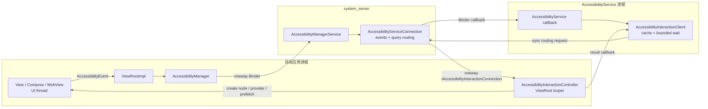
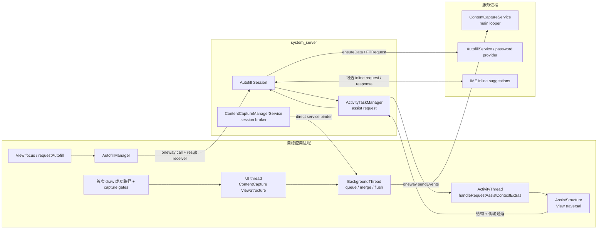
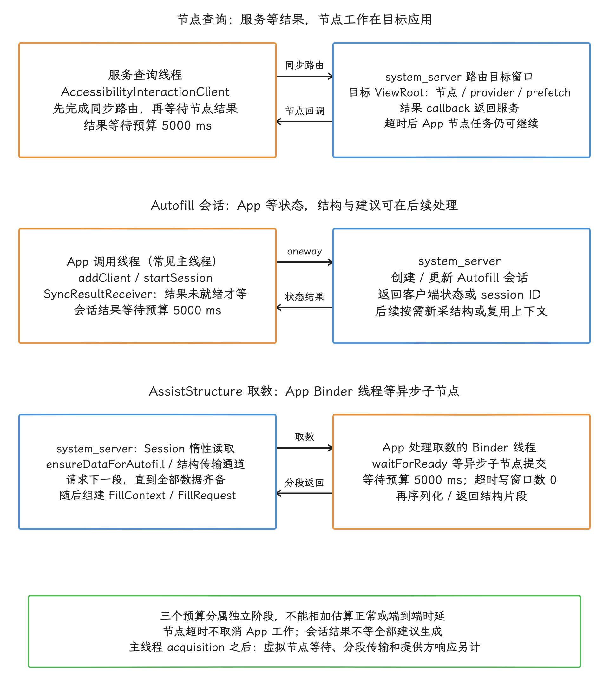

# Accessibility（无障碍）、ContentCapture 与 Autofill 性能

Accessibility、ContentCapture 和 Autofill 都会读取或描述界面状态，三者的触发条件、数据范围和服务端组件各不相同，性能问题通常来自频繁事件、视图树遍历、跨进程调用或第三方服务处理。我们排查这类性能问题时，先把开销定位到具体的链路和进程，再谈优化。

> 源码基线：Android 17 / API 37，AOSP `android-17.0.0_r1`；全文讨论 framework、Binder、应用 UI 线程和无障碍服务进程，不涉及需要厂商内核 trace 标签才能识别的专有机制。

讨论无障碍开销时，我们先把“无障碍是否开启”这一档拆开来看。无障碍框架既支持屏幕阅读、开关控制、放大和语音控制，也被测试自动化等场景使用；不同服务订阅的事件类型、读取窗口内容的能力、节点查询频率、输入模式和实现方式都有差异。

## 无障碍事件、节点查询与服务开销

### 两条方向相反的性能链

无障碍框架里影响性能的工作主要落在两条路径上：

- **事件上报**：应用把点击、焦点、文本、滚动或窗口内容变化通知给系统，系统再按照各项服务配置分发事件。
- **节点查询**：`AccessibilityService` 查询窗口或节点，目标应用在 ViewRoot 所在线程生成 `AccessibilityNodeInfo`，再通过回调返回结果。ViewRoot 连接界面树和窗口系统，普通应用里这项工作通常运行在主线程消息循环上。

下图标出了两条路径的方向和实际等待结果的一方。

<!-- gracker-diagram: ch07-06-a11y-opposite-directions -->


图：上排是事件上报，下排是节点查询。应用不等待服务业务回调完成；查询结果通常由目标 ViewRoot looper 生成，服务查询线程等待。图省略输入过滤等独立路径。

<details>
<summary>对应 Mermaid 源码（保留，可展开）</summary>



</details>

两条路径的等待方向正好相反：事件通过 `oneway` Binder 调用上报，应用把事务发出去就继续往下走，`AccessibilityService` 什么时候处理完由服务侧自己安排；节点查询则是服务侧在等结果，目标应用在自己的 ViewRoot looper（消息循环） 上生成节点。所以我们分析阻塞时，第一步是判断走的是哪条路径，再按各自的等待方向找阻塞的一方。

### 事件上报：oneway 调用的剩余成本

`IAccessibilityManager.aidl` 把 `sendAccessibilityEvent()` 声明为 `oneway`，调用方把事务发出去就返回。以常规 View 上报为例，调用方执行以下 1—4 步，第 5 步由 `system_server` 异步完成，两边各按各的时间线走：

1. View 或 ViewParent 创建并补全 `AccessibilityEvent`；
2. `AccessibilityManager` 检查当前状态以及 `mRelevantEventTypes`，后者记录当前服务关心的事件类型；
3. 将事件对象序列化到 Parcel——Binder 传输参数用的数据容器；
4. Binder 驱动接收这笔 `oneway` 事务并排队；
5. `system_server` 的 Binder 线程处理权限、用户、窗口和事件来源信息。

所以 `oneway` 省掉的只是等待远端方法完成这一段；事件构造、字符串复制、Parcel 写入和 Binder 入队仍由调用链承担，高频事件照样消耗 UI 线程 CPU、Binder 传输缓冲区和 `system_server` 资源。

<!-- gracker-diagram: ch07-06-oneway-event-cost -->


图：oneway 免去的是等待远端方法结束，构造、复制、序列化和入队仍有成本。轨道只示意异步关系，起点与条长不代表实测时延。

#### system_server 怎样过滤和排队

事件到达 `system_server` 后，`AccessibilityManagerService.sendAccessibilityEvent()` 先校验调用用户和包名，更新活动窗口和无障碍焦点，必要时让 WindowManager 重新计算可访问窗口；随后遍历当前用户已经绑定到系统的无障碍服务。

每个 `AbstractAccessibilityServiceConnection` 会按以下条件决定是否接收：

- 服务声明的 `eventTypes`；
- 服务声明的 `packageNames`；
- 事件来源是否被标记为对无障碍重要；
- 服务是否要求 `FLAG_INCLUDE_NOT_IMPORTANT_VIEWS`；
- 敏感事件是否只允许 `isAccessibilityTool=true` 的服务；
- 当前服务是否具备相应的访问权限。

这里要区分“业务需要事件”和“缓存一致性需要事件”两条独立的判断线。`notifyAccessibilityEvent()` 在 `clientWantsEvent` 为假、但已使用无障碍缓存且事件属于 cache-critical 类型时，仍可继续发送，随后还会检查访问权限。服务客户端先把缓存更新好，只在 `serviceWantsEvent=true` 且连接有效时才调用业务 `onAccessibilityEvent()`。所以 Binder 事件数和业务回调数要分开统计，前者是 Binder 上的事件流量，后者才是服务实际处理的量。每个继续分发的连接会获得事件副本，再投递到 `mEventDispatchHandler`。

<!-- gracker-diagram: ch07-06-event-cache-business-gates -->


图：系统兴趣判断与缓存一致性是两个入口；通过权限与连接检查后，客户端仍先维护缓存，再判断是否运行服务业务回调。

当 `notificationTimeout > 0` 时，同一服务通常只保留同类型事件中最新的一条待发送记录。但 `TYPE_WINDOW_CONTENT_CHANGED` 是个例外：它绕开这组 `mPendingEvents` 合并，每条消息仍通过 `sendMessageDelayed(..., mNotificationTimeout)` 投递——合并没有了，投递延迟还在。分析去重效果时要把它单独拿出来看。

<!-- gracker-diagram: ch07-06-event-timeout-merge-exception -->


图：notificationTimeout 为正时，普通事件按类型替换待发项；内容变化事件不走这组替换，但仍应用配置的投递延迟。

View 侧还有一层内容变化节流。`ViewRootImpl.SendWindowContentChangedAccessibilityEvent` 会合并可兼容的 change types（变化类型），并按照 `ViewConfiguration.getSendRecurringAccessibilityEventsInterval()` 给出的间隔安排发送。在 r1 中，`AccessibilityEvent.obtain()` 每次实际创建新对象，`recycle()` 是空方法；评估分配与发送量时以这个实现为准，看节流配置与实际事务计数。

> ⚠️ 矛盾校正：旧文把 `obtain()` / `recycle()` 当作对象池复用证据。API 33 起相关对象池已停用，本文以 r1 实现为准。

<!-- gracker-diagram: ch07-06-viewroot-content-change-throttle -->


图：ViewRoot 在发送前合并兼容变化，再按 recurring interval 调度；这是源端节流。r1 的 obtain/recycle 不再说明对象池复用。

#### 高频从哪里产生

| 事件类别 | 常见来源 | 分析重点 |
|---|---|---|
| `TYPE_VIEW_SCROLLED` | 列表、滚动容器、虚拟节点 | 每次滚动是否都附带大量文本，或触发额外节点查询 |
| <code>TYPE_<wbr>WINDOW_<wbr>CONTENT_<wbr>CHANGED</code> | 子树、文本、状态、内容描述变化 | change type、source、ViewRoot 合并情况 |
| <code>TYPE_<wbr>VIEW_<wbr>TEXT_<wbr>CHANGED</code> | 输入框、编辑器、自定义文本控件 | 是否手动重复发送，Parcel 文本是否过大 |
| 焦点事件 | 键盘焦点、无障碍焦点、虚拟节点 | touch exploration（触摸探索）与焦点移动节奏 |
| 窗口事件 | Activity、Dialog、PIP、系统窗口变化 | WMS 可访问窗口计算与服务窗口查询 |

事件数量只反映调用流量。单个事件携带的文本长度、事件是否触发后续节点查询、服务能否命中缓存，以及目标应用生成节点的开销，都会影响最终表现。

### 节点查询：工作落在目标应用的 ViewRoot looper

再看另一条路径。`getRootInActiveWindow()`、`event.source` 等按节点 ID 查询的常规路径，以及 `findFocus()`，可先使用当前连接的 `AccessibilityCache`；按 ID 查询还要看 `bypassCache`。命中时可直接返回。`AccessibilityInteractionClient` 的按文本或 View ID 搜索走的是另一套实现，查询前没有缓存短路，`refresh()` 等也可能绕过缓存——缓存帮不帮得上忙，要按具体 API 分别核对。

<!-- gracker-diagram: ch07-06-node-cache-api-boundary -->


图：常规按 ID 查询和 findFocus 可利用缓存，refresh/bypass 与文本、View ID 搜索要按各自实现核对。缓存策略会改变目标应用工作量。

请求先由 `AccessibilityServiceConnection` 找到目标窗口的 `IAccessibilityInteractionConnection`，随后进入目标应用的 `AccessibilityInteractionController`。这个 controller 用的是 `ViewRootImpl.mHandler` 所在线程的 looper，所以常规 View 树的节点生成和应用的 UI 工作跑在同一条线程上。

节点创建有两种入口：

- 普通 View 调用 `View.createAccessibilityNodeInfo()`，进而执行 `onInitializeAccessibilityNodeInfo()`；
- 暴露虚拟节点的控件调用 `AccessibilityNodeProvider.createAccessibilityNodeInfo()`。虚拟节点没有一一对应的真实 View，常见于画布、自定义控件和 WebView 内部内容。

这解释了 trace 里一个常见现象：应用没有主动刷新 UI，主线程上却出现无障碍节点构造。触发查询的可能是另一个进程里的 `AccessibilityService`，也可能是测试工具使用的 `UiAutomation`；r1 的部分 ContentCapture flag 路径也会构造节点，后文单独说明。

#### prefetch（预取） 策略与查询规模

一次查询会带多大的量，要看 prefetch 策略。框架提供 ancestors（祖先节点）、siblings（同级节点），以及 hybrid、depth-first、breadth-first 三种后代节点遍历顺序，同时配了三条硬性限制：

- 预取结果列表以 `MAX_NUMBER_OF_PREFETCHED_NODES = 50` 为上限。可中断模式先返回请求节点，再单独回传预取列表；不可中断模式把请求节点计入同一个结果列表。这个数不限制所有节点查询 API 的返回量，也不限制单个 provider 回调的执行时间；
- 可中断 prefetch 判断待处理消息，用的是 controller 自己的 `PrivateHandler.hasMessagesOrCallbacks()`，检测范围止于这个 handler，整个 ViewRoot 队列里的其他输入消息要另行查看；
- 客户端根据近期观测到的窗口滚动事件判断滚动状态，并在相应按 ID 查询中清除 prefetch flags；绕过缓存或缓存被禁用时也可清除这些标志。

<!-- gracker-diagram: ch07-06-prefetch-batch-and-interruption -->


图：客户端可在滚动、禁用缓存或 bypass 时清除预取标志；两种返回模式的计数范围不同。PrivateHandler 只检测以自身为 target 的消息与回调；这些消息仍位于关联 Looper 的共享队列中，不能视为独立队列。

有这三条限制在，一次 `getRootInActiveWindow()` 查询的实际规模，要按缓存命中情况和 prefetch 实际放行的节点数来确认。我们定位成本时，要同时记录请求 API、prefetch flags、缓存是否命中、虚拟节点 provider 和实际返回的节点数。

服务侧先通过同步的 `IAccessibilityServiceConnection` 方法完成系统路由，再进入 `AccessibilityInteractionClient` 的结果等待；后一个阶段的超时常量为 5000 ms，发生在发起查询的服务线程。它不是整个 API 的统一耗时上限，也不会在超时瞬间取消已经运行的应用节点回调。目标应用承担的是另一类风险：ViewRoot looper 上多了节点创建任务，同一条线程上的输入分发、traversal（测量、布局与绘制） 或逐帧回调就可能往后排。


### 成本应按四个进程位置拆开

| 位置 | 工作 | 卡顿表现 |
|---|---|---|
| 目标应用 | 事件构造与 Parcel 写入；节点创建、provider 查询、prefetch | UI 线程 CPU 增长，frame callback 或 traversal 排队 |
| `system_server` | 权限过滤、窗口状态维护、bound service 遍历、事件复制与排队 | Binder 或 `system_server` CPU 上升、锁竞争 |
| <code>Accessibility<wbr>Service</code> | <code>on<wbr>Accessibility<wbr>Event()</code>、cache miss 后的查询、业务处理 | 服务主线程阻塞、事件积压、反馈延迟 |
| Binder 与调度 | oneway event、query request、result callback | 线程唤醒、Parcel 处理开销、目标线程调度延迟 |

同时开启两个服务，成本也未必是一个服务时的两倍。我们对比开销时，`eventTypes`、`packageNames`、`notificationTimeout`、读取窗口内容的 capability、缓存使用方式和查询策略，往往比服务数量更能解释差异。

Touch exploration（触摸探索）、按键过滤、手势观察和放大还会改变输入处理链。遇到点击延迟或手势行为变化时，要分别检查输入过滤和 `AccessibilityEvent` / `AccessibilityNodeInfo` 开销；按键过滤的系统路径见 [3.1 Input 分发、拦截与安全边界](../../part1-fundamentals/ch03-input/01-input-dispatch-interception-security.md)。


### 应用侧：保持语义正确，再去掉无意义工作

无障碍上的优化有一条底线：可操作节点保留、状态可见、必要事件照发，性能要从这三者之外的无意义工作里省出来。无障碍功能一旦退化，依赖屏幕阅读器、语音控制或开关控制的用户可能连操作都完成不了。

#### `importantForAccessibility` 只处理装饰与重复语义

纯装饰图片、分隔线，以及语义已经由父控件完整表达的重复子元素，适合设置 `importantForAccessibility="no"`。`no` 不会自动隐藏重要的后代，`NO_HIDE_DESCENDANTS` 则把自身及后代都标为不重要，只适用于已经保留等价语义与操作的场景。服务若请求 `FLAG_INCLUDE_NOT_IMPORTANT_VIEWS`，框架仍可能纳入这些节点；importance 不是隐私隔离，也不保证所有查询都减少固定数量的节点。

<!-- gracker-diagram: ch07-06-a11y-importance-scope -->


图：no 针对当前节点，NO_HIDE_DESCENDANTS 声明整个子树不重要。服务请求包含不重要节点时，实际可见范围仍会变化。

下面的 XML 仅把无交互、无信息价值的装饰图排除在无障碍树外。

```xml
<ImageView
    android:id="@+id/cardDecoration"
    android:layout_width="match_parent"
    android:layout_height="wrap_content"
    android:importantForAccessibility="no"
    android:src="@drawable/card_decoration" />
```

这项设置只用来减少没有信息或操作价值的节点；按钮图标、错误提示、金额和开关状态这些用户需要感知的信息，仍然要留在无障碍树里。

#### 节点回调内只读取已准备好的状态

滚动、焦点移动或自动化查询期间，`onInitializeAccessibilityNodeInfo()` 和 `AccessibilityNodeProvider` 都可能被频繁调用，而它们通常处在目标应用的 UI 工作路径上。回调里只做一件事：读取已经准备好的状态。网络、磁盘或数据库访问，以及大型 JSON 解析、位图分析、全量集合排序，都放到回调之外去做。

下面的自定义 View 在业务状态变化时预先生成语义文本，节点查询时只需读取已有字段。API 34 及以上版本还可以在节点上声明内容变化的最小处理间隔，供服务采用；这不会自动减少应用发往系统的事件数量。

```kotlin
class PriceTickerView(context: Context) : View(context) {
    fun updatePrice(price: BigDecimal, change: BigDecimal) {
        contentDescription = formatPriceForAccessibility(price, change)
        invalidate()
    }

    override fun onInitializeAccessibilityNodeInfo(info: AccessibilityNodeInfo) {
        super.onInitializeAccessibilityNodeInfo(info)
        info.className = PriceTickerView::class.java.name

        if (Build.VERSION.SDK_INT >= Build.VERSION_CODES.UPSIDE_DOWN_CAKE) {
            info.minDurationBetweenContentChanges = Duration.ofMillis(500)
        }
    }
}
```

这个示例把格式化工作放在业务状态更新处：`View.setContentDescription()` 在描述变化时通知无障碍框架，后续节点初始化直接读 View 已保存的属性。`AccessibilityService` 可以读取节点声明的最小间隔，据此限制来自该节点的内容变化事件频率。`setMinDurationBetweenContentChanges()` 适合进度、计时器、行情这类持续变化但无须逐次朗读的节点；间隔按用户能理解的更新节奏设置，焦点、错误、可操作状态和关键结果仍要及时上报。


批量更新时，把真实内容临时设置成 `NO_HIDE_DESCENDANTS` 换来的问题更多：当前焦点节点消失、节点树结构改变，还可能额外触发内容变化。列表更新应该走增量数据加正确的 change type，交给 ViewRoot 或控件库已有的事件合并机制。

#### RecyclerView

标准 RecyclerView 路径里，节点和集合信息主要由当前附着的 item 与 LayoutManager 提供，一次常规节点查询不等于遍历全部数据项；自定义 delegate 或 provider 扩展的虚拟层级仍须另外核对。应用侧更常见的额外开销来自这些做法：

- item delegate（列表项无障碍代理） 动态拼接复杂描述；
- 每次 bind（绑定数据） 都重复安装 delegate，或创建大量 action；
- 使用全量 `notifyDataSetChanged()`，使语义信息和可见内容一起大范围失效；
- item 的语义状态没有随数据更新，导致服务反复调用 `refresh()`。

改法也直接：用 `DiffUtil` / `ListAdapter` 精确更新发生变化的列表项，复用稳定的 delegate，并在业务状态改变时同步更新简洁的 `stateDescription`、文本和 action。


### Compose：按逻辑控件设计 semantics tree（语义树）

Compose 在 UI 树之外维护一棵 semantics tree，供无障碍服务和测试工具读取；哪些 layout node（布局节点） 会成为 semantics node，取决于它是否带语义属性。我们给 `Column` 添加 `Modifier.semantics {}` 时，也推不出框架每次都会递归重建这个 `Column` 的全部子树。

分析时要区分：

- **unmerged tree（未合并树）**：保留各个 semantics node，`AccessibilityService` 会结合 `mergeDescendants` 自行处理；
- **merged tree（合并树）**：测试 API 默认使用的视图，会按照 `mergeDescendants` 和 `clearAndSetSemantics` 简化节点。

Material 与 Foundation 中的 `Button`、`clickable`、`toggleable` 已经提供常用语义和合并规则。自定义组件可以减少重复或没有信息价值的节点，但仍要把一项逻辑控件需要的说明和操作完整保留下来：

- 装饰性或重复内容可用 `hideFromAccessibility()`；它保留测试等用途的语义。装饰性 `Icon` / `Image` 可用 `contentDescription = null`，空字符串起不到统一隐藏任意组件的作用；
- 一组文字、图标和单一点击动作可按逻辑合并；
- 子项有独立动作时保留独立节点；
- `clearAndSetSemantics` 会覆盖无障碍服务和测试工具随后看到的子树语义，使用前要验证 TalkBack、Switch Access、Voice Access 以及自动化测试；
- 动画每帧变化但用户无需逐帧感知的数值，不要每帧写入语义属性。

Compose 属于 AndroidX 依赖，性能行为要按项目锁定的 Compose 版本核对，Android 17 的平台 tag 代替不了库版本。

<!-- gracker-diagram: ch07-06-compose-two-semantics-views -->


图：同一界面可有合并与未合并两种语义视图。合并应服务于逻辑操作；节点更少要以语义和测试正确性都保住为前提。

### AccessibilityService 开发者：缩小订阅与查询范围

如果我们可以修改 `AccessibilityService` 的实现，通常应先检查服务配置和查询策略。

下面假设这是面向残障用户的辅助工具：它只订阅目标包中的点击与窗口切换业务事件，并声明读取窗口内容的能力。`isAccessibilityTool=true` 如实描述用途即可；开销和数据访问范围的调整，要落在事件订阅与 capability 这些实际配置上。缓存维护事件仍按前述独立路径处理。

```xml
<accessibility-service
    android:accessibilityEventTypes="typeViewClicked|typeWindowStateChanged"
    android:accessibilityFeedbackType="feedbackSpoken"
    android:notificationTimeout="100"
    android:packageNames="com.example.target"
    android:canRetrieveWindowContent="true"
    android:isAccessibilityTool="true" />
```

如果服务确实需要支持所有应用，`packageNames` 就按产品功能如实填写；配置范围应与产品功能一致，只在确实读取窗口内容时请求对应的 capability（能力声明）。

服务侧建议遵守以下约束：

1. `eventTypes` 只订阅功能需要的类型，运行时场景变化可用 `setServiceInfo()` 调整。
2. 为可合并事件设置合理的 `notificationTimeout`，同时针对 `TYPE_WINDOW_CONTENT_CHANGED` 绕开合并的特殊处理单独实测。
3. 让 `onAccessibilityEvent()` 尽快返回；网络、磁盘、模型推理和大规模解析转到工作线程执行。
4. 优先使用事件已有字段和明确的 source（来源节点）；缓存未命中时再发起节点查询。
5. 避免每个事件都调用 `getRootInActiveWindow()`，也不要从 root 反复扫描寻找同一个节点。
6. 跨线程只传需要的稳定字符串、ID 和业务值，或明确复制的快照，避免持有大对象和过期语义状态；不要再以 r1 中无效的对象池回收来解释这个约束。
7. 记录查询 API、缓存命中 / 未命中、返回节点数和业务触发原因，以便与目标应用的 trace 对齐。

服务主线程等待节点查询结果期间，该服务收到的其他事件也可能排队。频繁查询 root 节点既会增加目标应用的 UI 线程工作，也会延迟服务自身的反馈。


### 测量条件与 A/B 设计

#### A/B 条件

先把条件钉死：设备、build（系统构建版本）、刷新率、温度、账号数据和交互脚本保持一致，至少比较以下四组条件。

1. 没有目标服务；
2. 只启用目标服务；
3. 目标服务与用户常用服务共同启用；
4. 服务功能不变，但减少 event types（事件类型）、节点查询和后台工作的版本。

要停用用户辅助服务的测试，只能在受控测试设备上进行，并确保用户明确知情；线上产品要改善帧率，从应用和服务自身的配置入手，用户的 `AccessibilityService` 保持原样。

#### Perfetto：定位线程和帧

采 trace 时至少带上 FrameTimeline、应用主线程、`system_server`、`AccessibilityService` 进程、Binder driver、sched、freq，以及应用自定义的业务 slice（时间片标记）——sched / freq 记录线程调度和 CPU 频率，slice 是应用标注的一段工作区间。拿到 trace 后，我们按这条线检查：

- App frame（应用帧）迟到前，是否出现节点查询任务或耗时较长的 `onInitializeAccessibilityNodeInfo()`；
- 事件上报的 oneway Binder 数量与 Parcel 大小是否异常；
- `system_server` 是否忙于窗口计算、服务过滤或其他锁；
- 服务主线程是否停在 `AccessibilityInteractionClient` 中等待结果；
- 节点结果返回后，服务是否立即进入长 CPU、I/O 或 Binder 工作。

`BinderProxy.transactNative` 能证明的只有这里发生了一次 Binder 调用；调用目的要结合 interface / method（接口与方法）、调用进程和回调时序来认。事件上报和节点查询方向相反，认出具体路径之后再往下归因。


#### Android 17 accessibility trace

`userdebug` 和 `eng` 构建带有面向调试和工程验证的系统能力，可以启用专用的 accessibility trace。下面的命令只打开相关接口类型，避免其他无障碍调用占满 trace。

```bash
adb root
adb shell cmd accessibility start-trace -t \
  IAccessibilityManager \
  IAccessibilityServiceConnection \
  IAccessibilityInteractionConnection \
  IAccessibilityInteractionConnectionCallback \
  AccessibilityService

# 复现目标操作

adb shell cmd accessibility stop-trace
adb pull /data/misc/a11ytrace/a11y_trace.winscope
```

r1 源码明确禁止在面向普通用户发布的 user build 上启用这项 trace。停止命令会异步写入 Winscope 文件，拉取前应先确认文件已经生成。Tracing 会记录调用参数、线程和调用栈，本身也会增加运行开销，因此只适合短时间定位问题。


#### dumpsys 的用途与局限

`adb shell dumpsys accessibility` 可以查看当前用户处于 bound、enabled、binding 或 crashed 状态的服务，也就是已连接、已启用、正在连接或已崩溃的服务；每个 bound service 的 dump 会列出 label、feedback type、capabilities、event types、`notificationTimeout` 和 accessibility button 请求。

配置查到这里就够了；事件率和查询率要换一条路来测。AOSP dump 提供的是配置视图，通用的“Event Dispatch Statistics”或“Interaction Connection Pool”计数器它并不输出，在 AOSP 设备上需要通过 trace、自有计数或服务日志来测；厂商版本如果扩展了字段，应在报告中标明 build。

### 归因表

| 现象 | 还缺的证据 | 更可能的负责位置 |
|---|---|---|
| App 主线程长时间执行节点回调 | 查询来源、node / provider、prefetch、返回数量 | App 自定义 View、Compose adapter 或 WebView provider |
| App 有大量短 oneway event transaction | 事件类型、source、文本大小、ViewRoot 合并 | App 事件设计或高频状态更新 |
| 服务主线程停在 <code>Accessibility<wbr>Interaction<wbr>Client</code> | cache miss、目标窗口、callback 时间 | 目标 App UI、`system_server` 路由或服务查询策略 |
| 服务收到事件后长时间运行 | <code>on<wbr>Accessibility<wbr>Event()</code> 后续 CPU/I/O | AccessibilityService 实现 |
| `system_server` 中 A11yMS 段变长 | bound service 数、窗口计算、锁和 CPU 调度 | framework、WMS 或设备系统实现 |
| 开启 touch exploration 后输入节奏变化 | `InputFilter`、手势 / 按键配置、事件与帧 | Accessibility input path（无障碍输入路径），不能只看节点树 |

归因要落到具体路径上：“无障碍开启时更慢”只是起点，报告里应写清事件、查询、节点、服务或输入中的哪条路径发生了变化。

### 运行时上下文与隐私

`AccessibilityManager.isEnabled()` 查询的是框架当前是否启用了无障碍事件发送。Javadoc 也提醒过：产品 UI 或交互行为的调整要另找依据，别挂在这个状态上。它适合作为监控上下文；节点查询、输入辅助和具体服务的完整能力，要配合其他信息一起看。专门设置的分支往往测试不足，辅助技术用户反而拿到维护较差的体验。

性能监控可把以下信息作为受控实验上下文：

- `accessibility enabled` 状态；
- `touch exploration enabled` 状态；
- 当前页面是否包含 SurfaceView、WebView、Compose 或大量虚拟节点；
- 测试设备上启用服务的数量和反馈类型。

`getEnabledAccessibilityServiceList()` 会发起跨 Binder 查询，调用位置放在低频路径上。启用哪些服务还可能暴露敏感的设备使用状态，线上采集前要过隐私评审，优先记录匿名化的能力类别和数量，服务组件名这类可定位到具体应用的标识留在设备本地。


### Android 12—17 版本边界

- **Android 12 / API 31**：`AccessibilityServiceInfo.isAccessibilityTool()` 成为公开 API，系统可以区分面向残障用户的辅助工具和其他服务。
- **Android 13 / API 33**：新增节点 prefetch strategy 与 `MAX_NUMBER_OF_PREFETCHED_NODES = 50`；多项 `obtain()` / `recycle()` 对象池 API 被废弃。
- **Android 14 / API 34**：新增 `setMinDurationBetweenContentChanges()` 和 accessibility data sensitive（无障碍数据敏感）能力，为高频内容节流和敏感事件过滤提供公开接口。
- **Android 17 / API 37**：按 `android-17.0.0_r1` 核对。事件仍通过 oneway `sendAccessibilityEvent()` 上报；服务连接仍按配置过滤/延迟；节点请求仍进入目标 ViewRoot looper，并受缓存、prefetch 策略和 50 节点上限约束。

平台版本代替不了 `AccessibilityService`、TalkBack、Compose、WebView 和厂商 framework 的具体版本。任何以百分比表示的性能结论都应附带设备、服务版本、页面、交互过程和 trace 条件，换一台设备就要重新验证。


### 无障碍源码与资料

- [`AccessibilityEvent.java`](https://android.googlesource.com/platform/frameworks/base/+/android-17.0.0_r1/core/java/android/view/accessibility/AccessibilityEvent.java) 与 [`AccessibilityService.java`](https://android.googlesource.com/platform/frameworks/base/+/android-17.0.0_r1/core/java/android/accessibilityservice/AccessibilityService.java)：已停用对象池、缓存维护事件与业务回调门控。

- [`AccessibilityManager.java`](https://android.googlesource.com/platform/frameworks/base/+/android-17.0.0_r1/core/java/android/view/accessibility/AccessibilityManager.java) 与 [`IAccessibilityManager.aidl`](https://android.googlesource.com/platform/frameworks/base/+/android-17.0.0_r1/core/java/android/view/accessibility/IAccessibilityManager.aidl)：客户端状态、相关事件过滤和 `oneway` 上报。
- [`AccessibilityManagerService.java`](https://android.googlesource.com/platform/frameworks/base/+/android-17.0.0_r1/services/accessibility/java/com/android/server/accessibility/AccessibilityManagerService.java)：事件安全检查、窗口更新与 bound service 分发。
- [`AbstractAccessibilityServiceConnection.java`](https://android.googlesource.com/platform/frameworks/base/+/android-17.0.0_r1/services/accessibility/java/com/android/server/accessibility/AbstractAccessibilityServiceConnection.java)：事件类型、包名、敏感数据、重要性与 `notificationTimeout` 处理。
- [`AccessibilityInteractionClient.java`](https://android.googlesource.com/platform/frameworks/base/+/android-17.0.0_r1/core/java/android/view/accessibility/AccessibilityInteractionClient.java) 与 [`AccessibilityInteractionController.java`](https://android.googlesource.com/platform/frameworks/base/+/android-17.0.0_r1/core/java/android/view/AccessibilityInteractionController.java)：cache、5000 ms 等待、ViewRoot handler、节点创建和 prefetch。
- [`ViewRootImpl.java`](https://android.googlesource.com/platform/frameworks/base/+/android-17.0.0_r1/core/java/android/view/ViewRootImpl.java) 与 [`View.java`](https://android.googlesource.com/platform/frameworks/base/+/android-17.0.0_r1/core/java/android/view/View.java)：事件上报、窗口内容变化合并与节点初始化。
- [`AccessibilityNodeInfo.java`](https://android.googlesource.com/platform/frameworks/base/+/android-17.0.0_r1/core/java/android/view/accessibility/AccessibilityNodeInfo.java) 与 [`AccessibilityServiceInfo.java`](https://android.googlesource.com/platform/frameworks/base/+/android-17.0.0_r1/core/java/android/accessibilityservice/AccessibilityServiceInfo.java)：prefetch、最小内容变化间隔、事件订阅与服务配置。
- [`AccessibilityTraceManager.java`](https://android.googlesource.com/platform/frameworks/base/+/android-17.0.0_r1/services/accessibility/java/com/android/server/accessibility/AccessibilityTraceManager.java) 与 [`AccessibilityController.java`](https://android.googlesource.com/platform/frameworks/base/+/android-17.0.0_r1/services/core/java/com/android/server/wm/AccessibilityController.java)：trace 命令、user build 限制与输出文件。
- [AccessibilityManager API](https://developer.android.com/reference/android/view/accessibility/AccessibilityManager)、[AccessibilityServiceInfo API](https://developer.android.com/reference/android/accessibilityservice/AccessibilityServiceInfo) 与 [创建 AccessibilityService](https://developer.android.com/guide/topics/ui/accessibility/service)：公开接口契约。
- [Compose semantics](https://developer.android.com/develop/ui/compose/accessibility/semantics) 与 [merging/clearing](https://developer.android.com/develop/ui/compose/accessibility/merging-clearing)：merged / unmerged tree 和语义边界。


## 内容捕获、自动填充与视图结构传输

无障碍服务面向交互辅助，ContentCapture 和 Autofill 面向内容理解与字段填充。三者都可能遍历同一棵视图树，但开关状态、触发条件和归因方法要各自独立判断。

入口先分清：ContentCapture 持续向系统选定的服务报告页面内容变化；Autofill 由会话、字段焦点和显式请求等条件触发，需要新结构或响应时采集快照，也可以复用上下文。遍历是否发生、发生几次都由触发条件决定：一次焦点变化可能触发遍历，也可能只是复用上下文；一个会话可能采集一次，也可能采集多次。数据模型和进程路径随之不同。

密码管理器、IME 和 WebView 同时参与时，我们要分别判断每条路径产生了什么开销。

### 三个容易混在一起的数据模型

分析前先区分三套框架及其数据对象：

| 框架 | 主要数据对象 | 生成方式 | 常见消费者 |
|---|---|---|---|
| Accessibility | `AccessibilityEvent`、<code>Accessibility<wbr>Node<wbr>Info</code> | 事件上报；服务按需查询节点 | TalkBack、Switch Access、自动化工具 |
| ContentCapture | `ContentCaptureEvent`、轻量 `ViewNode` / `ViewStructure` | 初始结构报告；View 出现、消失、文本变化等增量事件 | 系统选中并授权的 <code>Content<wbr>Capture<wbr>Service</code> |
| Autofill | `AssistStructure`、`FillRequest` | Autofill 会话触发后采集应用窗口结构 | `AutofillService`、密码管理器、Credential Manager 相关提供方 |

ContentCapture 的常规采集走自己的 `ContentCaptureEvent` 和轻量 `ViewNode`，增量变化时并不重建完整的 `AssistStructure`；承载完整结构快照的是 Autofill 管线。三者混在一起统称“无障碍全树扫描”时，请求由谁发起、工作在哪个线程执行就看不清了，对应的优化位置也随之丢失。


下图给出 ContentCapture 和 Autofill 的主要调用方向。

<!-- gracker-diagram: ch07-06-contentcapture-autofill-directions -->


图：两列各有会话和授权条件。ContentCapture 连接建立后事件直送服务；Autofill 由系统请求应用构建结构并路由给提供方，相邻的工作要按各自的触发者分开认。

<details>
<summary>对应 Mermaid 源码（保留，可展开）</summary>



</details>

看这张图的走向：ContentCapture 会话由 `system_server` 协调，连接建立后，应用通过服务提供的 direct Binder 直接发送事件批次，无须每一批再过一遍 `system_server`；Autofill 的结构请求则由 `system_server` 发回应用，在应用主线程采集完成后再送给数据提供方。两条路径可能在同一时间窗口出现；时间重叠只说明两边都在工作，是否重复采集了同一份结构，要从各自的数据对象和触发条件确认。

### ContentCapture：初始 UI 遍历与后台事件管线

#### `system_server` 负责会话，事件直送服务

Activity 创建时，`ContentCaptureManager` 通过 `IContentCaptureManager.startSession()` 请求 `ContentCaptureManagerService` 建立会话。这个 AIDL 接口是 `oneway`，结果另行通过 `IResultReceiver` 返回；服务端做完权限、用户、组件和 allowlist（允许列表） 检查，把 `IContentCaptureDirectManager` Binder 交给应用。

有了 direct Binder，后续事件就无须逐批经过 `system_server`：`MainContentCaptureSession` 调用 direct interface（直连接口） 的 `sendEvents()`，把装有一批 `ContentCaptureEvent` 的 `ParceledListSlice` 直接发往 `ContentCaptureService`，这个接口同样是 `oneway`。

<!-- gracker-diagram: ch07-06-contentcapture-broker-and-direct -->


图：系统代理决定会话与连接，后续 sendEvents 由应用直达 ContentCaptureService。oneway 返回与服务 main looper 已处理完成是不同边界。

和事件上报一样，`oneway` 免掉的只是发送方等结果这一段；应用仍要创建事件、复制文本、写入 Parcel，并把 transaction（事务） 放进 Binder 队列。服务处理过慢，还会消耗异步 Binder 配额和系统 CPU。

#### 初始结构生成仍在 UI 线程

初始结构是另一回事，它就发生在 UI 线程上。在首次满足 `performDraw()` 成功路径且初始报告标志有效时，`ViewRootImpl` 调用 `performContentCaptureInitialReport()`；这里的 draw 说的是绘制路径走通，画面此刻未必上屏，且还要通过启用状态、根节点 importance 与 session 等检查。通过后：先调用根 View 的 `dispatchInitialProvideContentCaptureStructure()`，再由 `ViewGroup.dispatchProvideContentCaptureStructure()` 遍历允许采集的子节点，每个节点通过 `onProvideContentCaptureStructure()` 填充自己的结构信息。

这段工作属于 ViewRoot 的一次 traversal 路径。自定义 View 如果在回调中访问磁盘、数据库或网络，或者临时解析大型对象，会直接延长这次主线程任务。

<!-- gracker-diagram: ch07-06-contentcapture-initial-report-gates -->


图：初始报告在 ViewRoot 绘制成功路径中执行，经过启用、根节点和 session 检查后遍历；回调耗时会延长对应 UI 任务。

遍历范围由 `importantForContentCapture` 和 View 的启发式判断共同决定。`no` 只排除当前节点，框架仍可能访问它的子节点；`noExcludeDescendants` 才是整棵子树都不参与采集。父节点一旦用了 exclude-descendants（排除后代） 模式，子节点即使显式设置为重要，也回不到这次采集里。

<!-- gracker-diagram: ch07-06-contentcapture-importance-pruning -->


图：普通容器 no 只排除自身，重要后代仍可被寻找；exclude-descendants 模式由祖先约束后代。根节点初始报告还有独立入口检查。

#### 后续变化按 traversal 批量转交

初始结构之后的变化走批量管线。View 的出现、消失和交互变化先记录在 `AttachInfo` 中，`ViewRootImpl` 在 traversal 结束阶段调用 `notifyContentCaptureEvents()`，主会话通过 `mUiHandler` 准备对应的 `ViewStructure`；r1 的这个 handler 绑定应用主 looper，普通应用窗口通常与它同线程，换成任意自建 ViewRoot，looper 归属要单独确认。读取完属性后，事件进入应用进程的 `BackgroundThread`：

<!-- gracker-diagram: ch07-06-contentcapture-dynamic-thread-handoff -->


图：动态 View 报告先准备结构，再交给后台；文本等通知还可经过独立事件队列。消失 ID 不需要重建对应 View 结构，图省略交互类细节。

- `ConcurrentLinkedQueue` 接收来自不同线程的事件；
- 输入法仍在组合候选文本期间产生的 composing 事件，可以与同一节点的待发事件合并；
- 连续的 disappeared 事件可合并为一个带多个 ID 的事件；
- buffer 达到 `maxBufferSize`，或遇到会话边界、显式 flush、idle timeout、text-change timeout 时发送；这里的 flush 表示尝试发送当前缓冲批次；空批次、禁用状态或 direct Binder 尚未就绪时可能返回或延后，服务端接收与处理的情况要靠服务侧证据确认；
- 批次通过 direct `oneway` Binder 进入 ContentCaptureService。


我们分析 ContentCapture 性能时要两头看：UI 线程上的 `ViewStructure` 准备，后台线程上的事件合并、Parcel 写入和 Binder 发送。只看到其中一侧，开销落在哪里就还是个问号。

r1 还存在按 flag 与采集条件启用的桥接路径：`newHeuristicsForImportanceEnabled()` 可让部分非 TextView 的结构准备调用 `View.createAccessibilityNodeInfo()` 补充描述；`enableExportAssistVirtualNodeToCcapi()` 配合 provider 与相应 condition 时，可在 ContentCapture 后台线程导出虚拟子节点。这条桥接服务于 ContentCapture 自己的结构描述，促成它的是 flag 和采集条件，与服务发起的无障碍查询、`AccessibilityEvent` 驱动的常规采集都对不上号。看到节点回调时，我们先核对实际调用栈、flag 和线程。

<!-- gracker-diagram: ch07-06-contentcapture-optional-node-bridge -->


图：r1 可按开关复用节点语义或导出虚拟子节点；这条路径服务于 ContentCapture 自己的结构描述，常规事件模型保持原样，AccessibilityService 那边的查询另有入口。

#### 服务回调运行在服务主线程

批次到达服务端后，`ContentCaptureService` 的 direct Binder stub（接收 Binder 调用的服务端对象） 把消息投递到服务进程的 main looper，再按事件类型分派：普通内容事件进入 `onContentCaptureEvent()`，会话创建、销毁等边界由对应的生命周期回调处理。回调里如果有大规模解析、同步 I/O 或模型推理，服务自己的事件队列就会延迟；应用侧用的是 `oneway`，照常往下执行，这种积压通常表现为服务处理滞后、异步 Binder 压力或系统 CPU 上升。

<!-- gracker-diagram: ch07-06-contentcapture-service-main-queue -->


图：内容与生命周期回调在服务主 looper 分派。服务回调慢首先影响其队列与反馈，是否进一步影响 App 仍须按传输和调度证据判断。

ContentCapture 的结构大小和耗时没有全设备通用的阈值：节点字段、文本长度、虚拟层级、更新频率、服务配置和设备 CPU 都会影响结果，“500 个 View 固定需要 30–100 ms”这类数字只对产生它的那组条件有效。

### Autofill：会话等待、AssistStructure 与提供方响应

#### 焦点进入才是常见入口

标准 View 获得焦点时会间接调用 `AutofillManager.notifyViewEntered()`，自定义控件也可以在用户发起自动填充操作时调用 `requestAutofill()`。Autofill 通常就从这类焦点或显式请求开始；完整的结构采集等的是焦点或显式请求，View 树构建完成这一步本身并不附带采集。

`IAutoFillManager` 是 `oneway` 接口，但 `AutofillManager` 的 `addClient()` 和 `startSession()` 会附带 `SyncResultReceiver`，通过另一条结果通道等会话建立完成，超时常量 5000 ms。焦点事件通常来自 UI 线程，所以 trace 里出现 `SyncResultReceiver` 等待时，我们要沿 Binder flow（跨进程调用流） 继续查 `system_server` 创建 Autofill 会话的过程。


注意 5000 ms 是异常情况下的保护上限，正常延迟以实测为准；“每次 Binder 约 5–10 ms”这类固定耗时并没有契约依据。

#### AssistStructure 在应用主线程采集

会话建立后，Autofill Session 需要新响应时通过 `ActivityTaskManager.requestAutofillData()` 请求应用提供 assist data（辅助上下文数据）。应用的 `ActivityThread.handleRequestAssistContextExtras()` 在主线程创建 `AssistStructure`——描述当前窗口和可填充节点的结构快照。构造时枚举 Activity 的 ViewRoot，调用根 View 的 `dispatchProvideAutofillStructure()`：

1. `View.onProvideAutofillStructure()` 写入资源 ID、尺寸、可见性、autofill type、hints、value 等字段；
2. `View.onProvideAutofillVirtualStructure()` 允许 WebView、自绘控件等暴露没有对应实体 View 的虚拟节点；
3. `ViewGroup` 选择需要进入结构的子节点并递归采集；
4. `ActivityThread` 记录 acquisition start / end（采集开始 / 结束），再把结构的传输通道报告给 `system_server`。

<!-- gracker-diagram: ch07-06-autofill-assist-main-thread -->


图：ActivityThread 处理 Autofill 类型的 assist 请求时创建结构，枚举窗口并调用结构回调。采集时间戳结束后仍可能存在异步补齐和多轮取数。

这些回调和应用 UI 工作共享线程。虚拟层级可以用 `asyncNewChild()` / `asyncCommit()` 在异步任务中补充；`AssistStructure.waitForReady()` 在传输通道开始写结构时等待异步子节点，预算为 5000 ms。普通跨进程读取中，等待落在应用处理该 Binder 取数请求的线程上，与 Activity 主线程遍历分开记；超时后传输头中的窗口数为 0。`ActivityThread` 的 acquisition start / end 早于后续惰性传输，异步补齐、全部分段传输和提供方响应的总时长要另行计量。

<!-- gracker-diagram: ed07-06-three-wait-budgets -->


图：三行是独立调用路径：服务线程在同步路由返回后等节点结果；Autofill 调用线程按需等客户端状态/session ID；AssistStructure 惰性取数时，应用处理 Binder 请求的线程可等异步子节点。各自 5000 ms 是阶段保护预算，不能相加估算正常或端到端耗时。节点超时不取消应用任务，会话结果也不等全部建议生成；虚拟子节点超时可令传输头窗口数为 0，主线程 acquisition 之后的等待、分段传输与提供方响应仍需另计。

#### 大结构采用分段传输

`AssistStructure` 的传输按分段进行，整个对象无须装进一次 Binder transaction：`ParcelTransferWriter` 在 Parcel 达到 `IBinder.MAX_IPC_SIZE` 边界后写入 continuation token（续传令牌），接收方凭这个令牌请求下一段。`Session.AssistDataReceiver` 调用 `ensureDataForAutofill()` 取回全部数据，建立代表本次填充上下文的 `FillContext`，然后创建 `FillRequest`。

分段传输控制常规批次体积；r1 的检查时机是写完一个 entry 之后才看 `IBinder.MAX_IPC_SIZE`，异常大的单个字段或节点仍有造成传输失败的可能。遍历、字段复制、序列化、反序列化和多次 Binder 往返仍有成本。报告里应记录这次结构包含的 window 数、node 数、文本规模、采集时长和分段次数，“中等页面 1–5 MB”这类估计要先换成当次实测的数字再用。

<!-- gracker-diagram: ch07-06-assiststructure-chunked-transfer -->


图：结构先报告通道，系统再按片段读取；应用通道端等待异步子节点并写数据。分段控制批次体积；检查发生在写入之后，异常大的单个 entry 仍有传输失败的风险。

#### 密码管理器、IME 与结构采集的关系

用户选中的 `AutofillService` 通常由密码管理器提供，IME inline suggestions（输入法内联建议） 则是展示 Autofill 数据集的一条界面路径：在 IME 与提供方支持、且当前请求启用 inline 的路径中，Autofill Session 向 IME 获取可选的 `InlineSuggestionsRequest`，随 `FillRequest` 交给提供方，再协调建议的渲染与 IME 展示；不支持或请求为空时，仍可走其他建议 UI 路径。

这组协作会增加 `system_server`、提供方、IME 和渲染服务之间的 IPC 与等待，也可能与键盘显示动画重叠。好在这条协作建立在现成结构上：IME 无须为此单独再建一份 `AssistStructure`，主、次提供方路径也可以复用已有的 `FillContext`，提供方数量与应用 View 树的遍历次数之间没有换算关系。

<!-- gracker-diagram: ch07-06-autofill-inline-optional-path -->


图：inline 是可选展示路径，IME 参与内联请求与建议展示，无须为此独立再建一份 AssistStructure。候选晚到应沿系统、提供方、IME 与渲染分段取证，遍历次数与提供方数量之间没有换算关系。

IME 自身的启动、`InputConnection` 和窗口动画问题见 [3.5 InputMethodManager 与软键盘性能](../../part1-fundamentals/ch03-input/05-input-method-manager-performance.md)。Binder 等待和异步事务容量可结合 [1.9 Android IPC 全景与 Binder 性能](../../part1-fundamentals/ch01-architecture/09-ipc-binder-performance.md) 继续分析。

### 把成本按线程和进程拆开

| 位置 | ContentCapture | Autofill | trace 中的表现 |
|---|---|---|---|
| 应用 UI 线程 | 初始结构遍历；动态节点的 `ViewStructure` 准备 | 等待会话结果；遍历 `AssistStructure` | frame / traversal 延长、主线程 waiting 或 Runnable |
| 应用后台线程 | 事件合并、buffer、Parcel、direct Binder | 通常不负责遍历标准 View 的 `AssistStructure` | `BackgroundThread` CPU、Binder transaction |
| `system_server` | 会话、allowlist、服务连接 | Session、assist request、`FillContext`、IME 协调 | Autofill / ATM handler、Binder、锁与调度 |
| <code>Content<wbr>Capture<wbr>Service</code> | 主线程逐个处理增量事件 | 无 | 服务 main looper 积压 |
| `AutofillService` / 密码提供方 | 无 | 解析 `FillRequest`、生成 dataset、处理认证 | provider CPU / I/O、response latency |
| IME | 无 | inline request、展示与交互 | IME main/render、窗口动画 |

应用 UI 线程出现一次较长的 traversal 时，先确认触发者是 ContentCapture 初始报告还是 Autofill assist request；后台 `sendEvents()` 变长时，检查事件批次、Parcel 和 Binder 异步压力。如果建议出现得晚而 App frame 正常，我们就继续分解系统路由、提供方响应、IME 与建议渲染的时延，用分段证据锁定主要耗时方——App 帧正常只说明当前样本未观察到对应的帧异常，仍需检查其他应用侧工作与跨进程等待；端到端时延按链路分段记录，与 App 渲染卡顿分开看。

### 应用侧结构设计

#### 让登录字段保留明确语义

下面的 XML 为登录字段提供稳定的 hints（字段类型提示），并把纯装饰图片声明为对 ContentCapture 与 Autofill 不重要。ContentCapture 的常规遍历据此过滤；Autofill 的实际包含范围仍受请求 flags 和设备选项影响，这份 XML 只是第一步，两套结构是否都删掉了该节点，还要按请求模式核对。

```xml
<LinearLayout
    android:layout_width="match_parent"
    android:layout_height="wrap_content"
    android:orientation="vertical">

    <ImageView
        android:layout_width="match_parent"
        android:layout_height="96dp"
        android:importantForAutofill="no"
        android:importantForContentCapture="no"
        android:src="@drawable/login_decoration" />

    <EditText
        android:id="@+id/username"
        android:layout_width="match_parent"
        android:layout_height="wrap_content"
        android:autofillHints="username"
        android:importantForAutofill="yes"
        android:inputType="textEmailAddress" />

    <EditText
        android:id="@+id/password"
        android:layout_width="match_parent"
        android:layout_height="wrap_content"
        android:autofillHints="password"
        android:importantForAutofill="yes"
        android:inputType="textPassword" />
</LinearLayout>
```

`autofillHints` 帮助提供方稳定识别字段用途，系统该做的结构采集一样要做；用户名、密码、地址和银行卡这些待自动填充的字段完整保留，缩小结构的工作交给纯装饰内容。

只有在整块 UI 都没有可填充字段或可采集内容时，才值得考虑在容器上用 `noExcludeDescendants`：ContentCapture 会据此排除整棵子树，之后其中新增的有效内容服务也看不到了。Autofill 的同名模式表达相同意图，但请求 flags 和系统配置选项仍可能要求包含更多节点，复用组件和动态页面都要覆盖回归测试。

从 Android 14 / API 34 开始，Autofill 会结合 importance、其他 View 属性、请求 flags 和系统配置选项，决定是否触发以及结构中包含哪些节点；手动请求、compat mode（兼容模式）、PCC detection（Autofill 的字段分类检测流程） 或设备配置，都可能把原本标记为不重要的节点纳进来。`importantForAutofill` 的定位是语义提示，每种请求模式下结构能减多少，取决于当次的组合判断。

<!-- gracker-diagram: ch07-06-autofill-importance-request-gates -->


图：字段类型提示改善识别，不省略系统必要采集。实际结构由 importance、请求 flags、View 属性与设备选项组合决定，回归应覆盖相关请求模式。

#### 保持结构回调纯内存

`onProvideAutofillStructure()`、`onProvideAutofillVirtualStructure()` 和 `onProvideContentCaptureStructure()` 应当只读取已经准备好的 UI 状态。以下工作应移出回调：

- 数据库、文件、网络和跨进程查询；
- 为描述临时解码图片或解析整份文档；
- 对全量业务集合排序、去重或格式转换；
- 等待锁、`Future` 或主线程之外的渲染进程；
- 每次回调重新构造不变的 hints、资源映射和长文本。

自绘控件和虚拟层级要保持 `AutofillId` 稳定，让框架在多次请求间认得出同一个节点，并且只报告当前可交互、语义完整的节点。ContentCapture 的多个虚拟节点可以用 `notifyViewsAppeared()` / `notifyViewsDisappeared()` 批量报告；Autofill 的异步虚拟节点必须在时限内调用 `asyncCommit()`。批量 API 可以减少调用次数，但节点该不该报告仍由产品语义决定。

#### 避免重复触发

标准 `TextView`、`EditText` 和常见 View 已经接入 Autofill 与 ContentCapture。自定义组件只有在以下情况中才需要补充通知：

- 虚拟节点进入、离开或值改变；
- 自绘文本发生用户可感知的语义变化；
- 用户明确选择“自动填充”操作；
- 子 ContentCaptureSession 的上下文发生切换。

反过来，每次 `onDraw()`、动画帧，或数据没有变化的 bind 都去调 `requestAutofill()`、`notifyValueChanged()` 或 ContentCapture 文本通知，就纯属浪费；焦点在相邻节点间反复切换，也会产生额外的会话更新、结构请求或建议 UI 显示与隐藏。


`ContentCaptureManager.getContentCaptureConditions()` 用带超时的结果接收器查询系统服务。浏览器可以根据 URL 条件判断是否报告虚拟页面，这条查询安排在低频路径上调用即可。

### 隐私边界也会改变性能路径

`ContentCaptureService` 需要声明 `android.permission.BIND_CONTENT_CAPTURE_SERVICE`，这项绑定权限由系统控制；面向普通应用的 `CAPTURE_CONTENT` 运行时授权流程在 Android 14 里并不存在。`RedactionRule` / `ContentCaptureContext.addRedactionRule()` API 平台上也没有，脱敏方案要落在平台真实提供的接口上。

`ContentCaptureManager.setContentCaptureEnabled()` 已在 API 37 标记为 deprecated，在 r1 中，弃用 flag 与面向 target SDK 37+ 的 compat change 同时启用时，该调用成为 no-op（不执行任何操作）；平台文档要求敏感窗口用 `WindowManager.LayoutParams.FLAG_SECURE` 退出 content capture。但 `FLAG_SECURE` 同时会限制截图和非安全显示，是给有明确安全需求的窗口准备的，性能问题另找开关。

页面内更细的控制仍可用 `importantForContentCapture`。Autofill 的敏感数据有自己独立的处理规则，信任范围以用户所选的 provider 为准；密码字段要由密码管理器填充时，保留正确的 Autofill 结构，并按字段敏感性、请求 flags、允许值和填充/保存阶段核对框架的清理规则——“会清理”要按这些规则逐项理解，它给不了“所选提供方永远接触不到密码等值”的保证。ContentCapture 的设置管好 ContentCapture 自己的采集就够了。


### WebView 与跨框架页面

WebView 可以通过 `onProvideAutofillVirtualStructure()` 向 Autofill 暴露 HTML 虚拟节点，也可以通过 `ContentCaptureSession` 报告虚拟页面内容——“WebView 会绕过系统 Autofill”这种笼统说法站不住脚。

同一 WebView 同时参与两条管线时，成本可能包含：

- Autofill 会话触发的一次 AssistStructure 与虚拟节点构建；
- ContentCapture 初始结构及后续增量事件；
- WebView 渲染进程准备虚拟节点的语义数据；
- provider、IME 与 ContentCaptureService 各自的处理。

是否存在重复计算，取决于 WebView 的版本和实现，所以我们同时记录 WebView provider 版本、页面 DOM（文档对象模型） 规模、虚拟节点数、目标字段、ContentCapture 采集条件和 Autofill request ID，再从 trace 判断哪条路径占用了 UI 线程。


### 观测与复现

#### Perfetto 中使用源码存在的标记

采 Perfetto trace 时打开 `view`、`am`、`wm` 这些 atrace 类别，并启用 app、`system_server`、provider 和 IME 的线程调度与 Binder 数据。源码里能直接对应到实现位置的 slice 包括：

- `dispatchContentCapture() for ...`：ViewRoot 初始 ContentCapture 遍历；
- `flushContentCapture for ...`：ViewRoot 焦点相关的 flush 调用范围，服务侧处理是否完成要看服务侧证据；
- `sendEventAsync`：ContentCapture 后台处理 view-tree appearing / appeared 事件之间的异步标记，不是跨进程端到端采集时长；
- `notifyContentCaptureEvents`：应用 BackgroundThread 处理动态事件，不覆盖此前的主 looper 结构准备；
- `handleRequestAssistContextExtras`：应用主线程处理 assist 请求的入口；Autofill 是其中一种 request type，同一标记还服务其他 assist 用途，归因时先确认 request type。

`android.content_capture.request`、`android.content_capture.process`、`android.autofill.request` 和 `android.autofill.process` 在 AOSP 的对应类中没有定义；设备上出现同名标记，先确认是不是厂商、provider 或应用自行添加的。


#### dumpsys 确认服务与会话

下面的命令用于确认当前设备上两套服务的启用状态、会话和配置，输出字段可能随厂商 build 变化。

```bash
adb shell dumpsys content_capture
adb shell dumpsys autofill
```

`dumpsys` 适合确认“哪个服务、哪个会话、使用了哪些配置选项”，代替不了帧时间、线程 slice、Binder flow 和结构规模数据。输出里可能有账号、字段、组件或采集条件等敏感信息，分享前要脱敏。

#### 一轮可复核的 A/B

使用受控测试用户并固定 provider 版本，保持设备温度、刷新率、页面数据、IME、账号和输入脚本一致，至少采集以下五组条件：

1. 页面进入但不聚焦 Autofill 字段；
2. 聚焦字段并等待 provider 建议；
3. 开启与关闭 IME inline suggestions 的相同操作；
4. ContentCapture 服务允许该页面与不允许该页面的相同操作；
5. 移除回调中的耗时工作，或排除无关虚拟子树后的版本。

每组都记录 App frame、主线程 `handleRequestAssistContextExtras`、ContentCapture 初始 slice、`BackgroundThread`、`AssistStructure` acquisition 时间、provider 首次响应时间和 IME 建议出现时间。用户日常使用的设备上，密码管理器、辅助服务和内容采集组件保持原样，实验放到受控测试设备上做。


### 归因检查表

| 现象 | 需要补充的证据 | 可能的修复位置 |
|---|---|---|
| 首屏 draw 后主线程出现长任务 | <code>dispatch<wbr>Content<wbr>Capture()</code>、节点数、回调栈 | App 自定义 ContentCapture structure、无关子树 |
| 聚焦输入框时主线程处于 waiting | Autofill `startSession`、result receiver、`system_server` flow | Autofill Session、`system_server` 锁或调度 |
| 主线程执行大量结构回调 | <code>handle<wbr>Request<wbr>Assist<wbr>Context<wbr>Extras</code>、request ID、virtual nodes | App View / WebView / custom provider |
| 应用 BackgroundThread CPU 高 | ContentCapture queue、flush reason、batch size、文本长度 | App 事件频率、虚拟节点报告 |
| 密码建议出现较晚但帧正常 | provider response、IME inline request、render service | `AutofillService`、IME 或 inline 渲染 |
| <code>Content<wbr>Capture<wbr>Service</code> 事件积压 | 服务 main looper、每事件处理时间、I/O | <code>Content<wbr>Capture<wbr>Service</code> 实现 |
| 大结构出现多段 Binder | window/node/文本规模、partial transfer 日志 | App 结构设计、虚拟层级、字段体积 |

性能报告至少写明触发字段、request / session ID、目标线程、provider / IME / WebView 版本和结构规模。只记一句“开启密码管理器后变慢”，会话等待、结构遍历、服务响应和建议 UI 各自的耗时就分不开了。

### Android 8—17 版本边界

- **Android 8.0 / API 26**：Autofill Framework 和 `importantForAutofill` 进入公开 API。
- **Android 10 / API 29**：`ContentCaptureManager`、`ContentCaptureSession` 和 `ContentCaptureService` 进入公开 API。
- **Android 11 / API 30**：`importantForContentCapture` 和 IME inline suggestions 相关公开 API 可用。
- **Android 14 / API 34**：Autofill 对 importance、其他 View 属性和优化选项的组合判断发生变化，早期版本的固定包含规则就此失效。
- **Android 17 / API 37**：按 `android-17.0.0_r1` 核对。ContentCapture 使用 UI 结构准备、应用 `BackgroundThread` 缓冲和 direct `oneway` Binder；Autofill 仍通过 `ActivityThread` 构建 `AssistStructure`。`setContentCaptureEnabled()` 在 API 37 已 deprecated，目标 SDK 37 及以上版本应按照 `FLAG_SECURE` 契约处理敏感窗口。

这些路径属于 framework 和应用 / 服务进程，理解它们不需要依赖 `android17-6.18-2026-06_r6` kernel tag；Binder 驱动、线程调度和内存压力会影响时延，但本文讨论的调用关系没有引入 Android 17 内核专属机制。

### ContentCapture 与 Autofill 源码与资料

- [`SyncResultReceiver.java`](https://android.googlesource.com/platform/frameworks/base/+/android-17.0.0_r1/core/java/com/android/internal/util/SyncResultReceiver.java) 与 [`IContentCaptureManager.aidl`](https://android.googlesource.com/platform/frameworks/base/+/android-17.0.0_r1/core/java/android/view/contentcapture/IContentCaptureManager.aidl)：结果等待与异步会话入口。

- [`ContentCaptureManager.java`](https://android.googlesource.com/platform/frameworks/base/+/android-17.0.0_r1/core/java/android/view/contentcapture/ContentCaptureManager.java)、[`MainContentCaptureSession.java`](https://android.googlesource.com/platform/frameworks/base/+/android-17.0.0_r1/core/java/android/view/contentcapture/MainContentCaptureSession.java) 与 [`IContentCaptureDirectManager.aidl`](https://android.googlesource.com/platform/frameworks/base/+/android-17.0.0_r1/core/java/android/view/contentcapture/IContentCaptureDirectManager.aidl)：会话、后台队列、事件合并、flush 和 direct `oneway` Binder。
- [`View.java`](https://android.googlesource.com/platform/frameworks/base/+/android-17.0.0_r1/core/java/android/view/View.java)、[`ViewGroup.java`](https://android.googlesource.com/platform/frameworks/base/+/android-17.0.0_r1/core/java/android/view/ViewGroup.java) 与 [`ViewRootImpl.java`](https://android.googlesource.com/platform/frameworks/base/+/android-17.0.0_r1/core/java/android/view/ViewRootImpl.java)：两套 structure 回调、importance、初始报告、动态事件和 AOSP trace slice。
- [`ContentCaptureManagerService.java`](https://android.googlesource.com/platform/frameworks/base/+/android-17.0.0_r1/services/contentcapture/java/com/android/server/contentcapture/ContentCaptureManagerService.java) 与 [`ContentCaptureService.java`](https://android.googlesource.com/platform/frameworks/base/+/android-17.0.0_r1/core/java/android/service/contentcapture/ContentCaptureService.java)：会话代理、direct service Binder 与服务 main-looper 回调。
- [`AutofillManager.java`](https://android.googlesource.com/platform/frameworks/base/+/android-17.0.0_r1/core/java/android/view/autofill/AutofillManager.java) 与 [`IAutoFillManager.aidl`](https://android.googlesource.com/platform/frameworks/base/+/android-17.0.0_r1/core/java/android/view/autofill/IAutoFillManager.aidl)：焦点触发、会话状态、`oneway` 调用和结果接收器等待。
- [`ActivityThread.java`](https://android.googlesource.com/platform/frameworks/base/+/android-17.0.0_r1/core/java/android/app/ActivityThread.java) 与 [`AssistStructure.java`](https://android.googlesource.com/platform/frameworks/base/+/android-17.0.0_r1/core/java/android/app/assist/AssistStructure.java)：主线程采集、虚拟节点等待与分段 Binder 传输。
- [`Session.java`](https://android.googlesource.com/platform/frameworks/base/+/android-17.0.0_r1/services/autofill/java/com/android/server/autofill/Session.java) 与 [`AutofillInlineSuggestionsRequestSession.java`](https://android.googlesource.com/platform/frameworks/base/+/android-17.0.0_r1/services/autofill/java/com/android/server/autofill/AutofillInlineSuggestionsRequestSession.java)：assist request、FillContext、provider 与 IME inline suggestions 协作。
- [Autofill 优化指南](https://developer.android.com/identity/autofill/autofill-optimize)、[View API](https://developer.android.com/reference/android/view/View) 与 [ContentCaptureManager API](https://developer.android.com/reference/android/view/contentcapture/ContentCaptureManager)：公开属性、版本行为与 API 37 弃用边界。
