# 响应速度原理、场景与案例

一次点击从手指落下走到画面变化，中间要穿过输入系统、应用主线程、渲染和显示合成。延迟可能出在任何一段，所以响应速度的排查要先把起点、终点和各段负责的线程定清楚，再判断延迟来自主线程工作、异步依赖、IPC、I/O 还是调度。这篇文章按这个顺序展开：先定端点，再拆路径，最后用真实案例收尾。

> 源码基线：AOSP `android-17.0.0_r1`；内核 `android17-6.18-2026-06_r6`。

## 交互起止点、等待类型与感知阈值

### 响应速度要量哪一段

拿到“响应慢”的反馈时，我们首先要量出这段延迟有多长、落在哪一段。响应速度描述从用户操作到界面出现可见反馈所经历的延迟；动手测量前，先回答三个问题：起点在哪里，终点在哪里，这次交互以按下、抬手还是业务结果算完成。

以同一个按钮为例，至少有两种合理的测量口径：

- 按压反馈：从 `ACTION_DOWN` 的事件时间开始，到包含按钮按下状态的帧实际呈现为止。
- 点击结果：从 `ACTION_UP` 的事件时间开始，到包含操作结果的帧实际呈现为止。Android 的普通 `View` 通常在抬手后才确认点击；这里选择 `ACTION_UP` 是本指标的约定。键盘、无障碍和其他业务入口应分别定义起点，不能要求所有业务耗时都从触摸抬手起算。


拖动和滚动要换一种测法：逐个考察输入样本与对应画面更新之间的 event-to-photon（事件采样到画面发光） 延迟，并观察整段手势中的延迟分布是否稳定。只记录“手指开始移动到列表开始滚动”这一个数，手势中段偶发的延迟波动就看不见了。

启动场景有两个现成的端点。TTID（Time to Initial Display）量的是从启动请求到首帧显示，TTFD（Time to Full Display）量的是从启动请求到应用报告内容已经完整呈现。一个回答“画面出来没有”，一个回答“内容完整可用没有”，我们按要回答的问题选端点。

常用场景与测量端点如下：

| 场景 | 建议起点 | 建议终点 | 容易误读的信号 |
| --- | --- | --- | --- |
| 按压态 | `ACTION_DOWN.eventTime` | 按下态帧的呈现时间 | `onTouchEvent()` 返回只说明事件处理结束 |
| 点击导航 | `ACTION_UP.eventTime` | 目标界面第一帧或约定反馈帧 | Activity 创建完成不代表画面已经呈现 |
| 拖动、滚动 | 每个运动样本的事件时间 | 消费该样本的帧呈现时间 | 一个批处理事件可能包含多个 historical sample（历史采样点） |
| 应用启动 | 系统接收启动请求 | TTID 或 TTFD | TTID 只到首帧，与“内容可交互”含义不同 |
| 长任务 | 用户确认操作 | 进度反馈帧与业务完成点 | 只量业务耗时会漏掉反馈延迟 |

`MotionEvent.getEventTimeNanos()` 在 API 34 才成为公开 API；Android 12–13 可使用毫秒精度的 `getEventTime()`，历史样本也要保留对应时间。两者使用不含深度睡眠时间的 uptime 时钟，不能直接与含 suspend 的 boottime 时间戳相减；跨 trace 时钟应先用时钟快照换算。纳秒单位也不保证纳秒测量准确度。这些时间接近输入样本的时间基准，但不等同于手指接触屏幕玻璃的物理时刻。帧的 present 信号也证明不了面板像素已经完成发光。所以要测实验室级 touch-to-photon（触摸到画面发光） 延迟，需要高速相机、光电传感器或厂商显示链路 trace；普通应用采集的 Perfetto 更适合定位软件路径中的耗时阶段。


### RAIL 在 Android 中怎样使用

[RAIL](https://web.dev/articles/rail) 是较早的 Web 性能模型；该文档现在建议用 Core Web Vitals 评估现代 Web 体验。RAIL 名称来自 Response、Animation、Idle、Load 四类工作预算。我们可以借它讨论用户对等待的感受，数值则产生于浏览器环境；落到 Android，判断依据仍然是帧期限、Android Vitals 和产品实测基线。

| RAIL 项 | Web 文档口径 | Android 中可借鉴的做法 | 不应照搬的部分 |
| --- | --- | --- | --- |
| Response | 输入后 100 ms 内响应 | 为交互设定可见反馈的长尾延迟目标 | 100 ms 不是 Android API 或 ANR 的硬阈值 |
| Animation | Web 主线程约 10 ms 产出一帧 | 以 FrameTimeline 的 expected deadline 判断是否按时 | 10 ms 预留了浏览器渲染时间，不能当作 Android 通用帧预算 |
| Idle | 空闲任务分块，每块不超过约 50 ms | 将可延后的工作切片，并在片间返回事件循环，让交互获得执行机会 | 50 ms 的主线程任务仍可能跨过多个高刷新率帧期限 |
| Load | 慢 3G、中低端手机的首次可交互约 5 s，后续约 2 s | 区分首屏反馈与完整可用状态 | Web 网络条件下的 load 目标不等于 Android 启动告警 |

Android 动画和滚动应以系统为当前帧分配的 deadline（截止时间） 为准。60 Hz 屏幕的刷新周期约为 16.67 ms，120 Hz 约为 8.33 ms；留给应用 CPU 的时间通常更少，因为 RenderThread、GPU、SurfaceFlinger 和显示提交还要继续工作。从 Android 12（API 31）开始，Perfetto FrameTimeline 会同时给出 expected timeline（预期时序） 和 actual timeline（实际时序），也就是系统预期的时序与实际执行的时序；我们直接比较这两条时序，比套用固定的 16 ms 可靠。

支持 Adaptive Refresh Rate（ARR，自适应刷新率）的设备还会动态改变刷新节奏。ARR 从 Android 15 QPR1 开始面向满足 HAL 等条件并启用该能力的设备提供，是否生效仍取决于设备显示能力、系统策略以及应用或窗口的帧率请求。Android 16 增加了 `Display.hasArrSupport()` 和 `Display.getSuggestedFrameRate(int)` 等查询能力。解释数据时仍需结合当前帧率、应用请求的帧率和 FrameTimeline——设备未必一直跑在最高刷新率上。


### 触摸到显示的完整路径

本节沿输入、应用、渲染和显示四个阶段追踪一次触摸。涉及内核调度、IRQ（硬件中断请求）和驱动的部分，以篇首给出的内核基线为准；分析普通应用层的阻塞，用平台源码就够了。

下图是完整路径（ACK 与帧处理并非固定串行）：

<!-- gracker-diagram: ch08-01-touch-to-display-path -->


图：输入传输、窗口输入、应用帧与显示分属不同阶段。ACK 回到分发端，帧处理可能与输入交叠，图中连线表达依赖而非全程串行。

```mermaid
flowchart LR
    subgraph K["触摸与内核"]
        A["触摸控制器与 IRQ"] --> B["Linux input 子系统"]
        B --> C["/dev/input/event*"]
    end

    subgraph S["system_server 输入服务"]
        C --> D["EventHub"]
        D --> E["InputReader"]
        E --> F["InputDispatcher"]
    end

    subgraph P["应用进程"]
        F -->|InputChannel socket| G["NativeInputEventReceiver"]
        G --> H["ViewRootImpl 输入阶段"]
        H --> I["View.dispatchTouchEvent"]
        I --> J["状态更新或 invalidate"]
        J --> K1["scheduleTraversals"]
        K1 --> L["Choreographer 回调"]
        L --> M["UI Thread 记录绘制命令"]
        M --> N["RenderThread 与 GPU"]
    end

    subgraph D1["合成与显示"]
        N --> O["BufferQueue / Surface"]
        O --> Q["SurfaceFlinger"]
        Q --> R["HWC present"]
        R --> T["面板扫描显示"]
    end

    H -->|处理结束后经 InputEventReceiver 回 ACK| F
```

<details>
<summary>查看 Mermaid 源码</summary>



</details>

图中的 ACK（确认消息）由 `ViewRootImpl` 输入处理收尾经 `InputEventReceiver` 回传，表示该输入事件已完成处理。普通 View 的 `PerformClick` 通常另行 post，业务 `onClick()` 可能在 ACK 之后才执行。ACK 与反馈帧完成没有固定的先后边界，buffer 也可能尚未呈现。

#### 输入读取与目标窗口选择

我们从内核侧看起。触摸驱动通过 Linux input 子系统产生事件，Android 的 `EventHub` 从输入设备节点读取原始数据；`InputReader` 完成设备映射、坐标变换和手势状态整理等工作，再把格式统一后的事件交给 `InputDispatcher`。

`InputManager` 分别启动 `InputReader` 和 `InputDispatcher` 的 native 线程，二者都由 `system_server` 中的 `InputManagerService` 托管。这里描述常规 Android 设备中由 `system_server` 托管的路径；分析具体产品仍应核对进程和线程，不能用目录名 `inputflinger` 推定进程名或线程名。

`InputDispatcher` 根据当前窗口、触摸目标、焦点和系统策略选择接收端。`publishMotionEvent()` 通过 `InputPublisher` 将事件写入目标 `InputChannel`。`InputTransport.cpp` 中的 `InputChannel::sendMessage()` 和 `receiveMessage()` 展示了这条逐事件传输通道，其底层使用 Unix domain socket（本机进程间套接字）。Binder 负责窗口与通道的建立、配置和控制调用，不传输每一条 `MotionEvent`。

<!-- gracker-diagram: ch08-01-input-owner-and-transport -->


图：上方表示托管关系，两线程通过输入处理链衔接；目标事件走 socket，不能按 inputflinger 目录名猜测独立进程。

#### 应用接收、排队与 ACK

应用侧的 `NativeInputEventReceiver` 监听 `InputChannel` 文件描述符，并将输入消息转换为 Java `InputEvent`。窗口接收端通常绑定主线程 Looper（消息循环）；事件随后进入 `ViewRootImpl` 的输入阶段，依次经过窗口前处理、IME、View 后处理等环节，最后到达 `View.dispatchTouchEvent()`。

这一段至少包含三类等待：

- socket 消息到达前的系统分发时间；
- 消息已经可以读取，但应用 Looper 尚未执行接收回调的排队时间；
- `dispatchTouchEvent()`、监听器和业务代码的执行时间。

应用输入阶段处理完成后经 `finishInputEvent()` 回送 ACK。`android.input` 的 dispatch 区间从系统发送到应用接收，已包含通道与接收线程调度等待；handling 区间从接收到发 ACK，也可能包含批处理或延后处理的等待。不能把这些列逐一等同于纯排队、纯业务 CPU 时间，应继续检查线程状态和切片。


连续的 `MOVE` 事件可能被批量传递，一个 `MotionEvent` 可以携带多个 historical samples；`ViewRootImpl` 也可以等到下一次帧回调前再消费这批样本。分析滑动时要保留历史样本：只看最新坐标会漏掉中间轨迹，也容易把框架有意做的帧对齐误判成事件丢失。


#### 状态变更与帧调度

调用 `invalidate()`、`requestLayout()` 或改变 Compose 状态，会促使窗口安排后续遍历。`ViewRootImpl.scheduleTraversals()` 会向 `Choreographer` 投递 traversal callback（遍历回调），并在消息队列中设置同步屏障。队列扫描到屏障时，可跳过其后的同步消息寻找异步消息；屏障前已到期的同步消息仍可执行，正在运行的消息也不会被抢占。这里的“异步”是消息标志，不代表在后台线程执行。

<!-- gracker-diagram: ch08-01-sync-barrier-scope -->


图：同步屏障不会抢占当前长消息，也不把主线程工作转交后台。阻塞出现在帧回调之前时，仍要回查当前消息和调度。

`Choreographer` 需要生成新帧时，会通过 `DisplayEventReceiver.scheduleVsync()` 请求 VSync（显示垂直同步信号）。主路径中的回调顺序如下：


1. input；
2. animation；
3. insets animation；
4. traversal；
5. commit。


输入事件到达时刻与 VSync 相位会影响等待时间：业务处理再短，只要刚好错过可用的帧槽，视觉反馈仍可能多等一个刷新周期。这部分等待记在帧调度阶段，`onClick()` 自身的执行时间另算。

#### UI Thread、RenderThread、GPU 与 SurfaceFlinger

View 体系的 traversal 按窗口和脏状态按需执行 measure、layout、draw，也就是测量、布局与绘制；并非每帧都会完整测量、布局整棵树。启用硬件加速时，UI Thread 记录或更新渲染节点和绘制命令，RenderThread 在 `DrawFrame` 等阶段执行同步、绘制命令处理和 buffer 提交；CPU 切片结束或 buffer 入队都不单独证明 GPU 已完成写入，仍要检查 acquire fence。GPU 工作可能与 CPU 工作部分重叠，也可能等待 fence（表示前序图形工作完成的同步对象）、内存或驱动。

生成的 buffer 经 Surface / BufferQueue 交给 SurfaceFlinger。SurfaceFlinger 按显示调度选择可用 buffer 并计算合成策略，client composition 由 SurfaceFlinger 的 RenderEngine 处理，device composition 由 HWC 承担，client target 也交给 HWC 参与最终 present。两种工作可能混合存在。应用帧即使按时结束，仍可能遇到 SurfaceFlinger、GPU 或 HWC 延迟；我们一路要追到呈现为止，单看 `Choreographer#doFrame` 只覆盖应用这一段。

<!-- gracker-diagram: ch08-01-cpu-gpu-composition-boundaries -->


图：生产者 GPU 写入可与 SurfaceFlinger 的 CPU 准备交叠，实际使用仍须满足 fence 依赖。RenderEngine 承担 client composition，HWC 承担 device composition 与 present。

### 用一组时间点定位延迟

实际排查应记录里程碑和真实区间，而不是预设所有时间点都按 `t0 → t7` 串行发生：

| 里程碑 | 含义 | 主要证据 |
| --- | --- | --- |
| 样本时间 | 输入设备报告的事件时间 | `eventTime`，注意时钟域与精度 |
| read | 输入读取链路上的 trace 标记 | `read_time`，r1 从 notifyMotion 切片提取 |
| dispatch / receive | 系统发出、应用接收 | `dispatch_ts` / `receive_ts` |
| finish / ACK received | 应用发完成消息、系统收到 | handling / ack 两段，不是同一时刻 |
| doFrame | 候选反馈帧开始 | `Choreographer#doFrame`、帧标识 |
| CPU submit / buffer ready | CPU 提交、GPU 写入完成 | UI/RenderThread 切片、入队、acquire fence，分别记录 |
| present | 采用该 buffer 的显示帧呈现 | FrameTimeline 与 SF/HWC present fence，不能代替完整扫描到发光 |

按有证据的区间分解：

- `dispatch - read` 长：检查读取后处理、策略、分发和 `system_server` 调度。
- `receive - dispatch` 长：检查 socket、接收线程调度和冻结状态。
- `finish - receive` 长：检查输入阶段、批处理等待、同步 Binder、锁、GC、I/O 和执行时间。
- `ACK received - finish` 长：检查回传与系统接收线程。
- 帧请求到可执行帧槽、UI 工作、RenderThread、GPU 与合成各自单独计时，再按依赖连接；并行区间不能直接相加。

批量 MOVE 可以在 `doFrame` 的 input 阶段才消费，所以帧开始可能早于消费和 ACK；`PerformClick` 又可能晚于 ACK。不能把“doFrame 开始减 ACK”当作普遍成立的帧调度等待，更不能把 `DrawFrame` 返回到 present 全部算作 SurfaceFlinger 耗时。present fence 对物理显示器通常表示该帧开始出现在屏幕，或开始传输到面板，仍有面板扫描与发光过程。

<!-- gracker-diagram: ch08-01-milestones-not-linear-timestamps -->


图：上、下两组是独立的常见时序示例：批量输入可在帧内处理，普通点击业务可在输入 ACK 之后执行。条宽不代表测量值，不能拼成同一个真实样本。

每一段都按 trace 里实际看到的来判断；给输入系统、主线程或 GPU 预设固定毫秒阈值的做法，在刷新率、芯片、触摸采样率或系统负载一变时很容易失真。

### Perfetto：直接查询 input 到 present

本文以 AOSP `android-17.0.0_r1` 的 `android.input` SQL 为准。`android_input_events` 依赖 `sendMessage` / `receiveMessage`、输入处理等 atrace 切片及帧数据；只启用 input proto 与 FrameTimeline 数据源，未必满足这些条件。缺少完整传输四阶段时，事件可能整行缺失；帧关联失败则相关列可能为 `NULL`。空表不能证明没有输入，也不能把缺失事件记成零延迟。

下面的 SQL 按 dispatch 到系统收到 ACK 的往返时间选出指定进程中最慢的 50 行，并保留通道、序号、输入 ID、候选帧和推测标志，供后续复核：

```sql
INCLUDE PERFETTO MODULE android.input;

WITH candidates AS (
  SELECT *, COUNT(*) OVER (
    PARTITION BY upid, event_channel, event_seq, dispatch_ts, receive_ts
  ) AS attachment_row_count
  FROM android_input_events
)
SELECT upid, pid, process_name, thread_name AS finish_thread_name,
  event_channel, event_seq, dispatch_ts, receive_ts, receive_track_id,
  input_event_id AS candidate_input_event_id,
  event_action AS candidate_action,
  total_latency_dur / 1e6 AS dispatch_to_ack_ms,
  end_to_end_latency_dur / 1e6 AS candidate_read_to_present_ms,
  frame_id AS candidate_surface_frame_token, is_speculative_frame,
  attachment_row_count,
  CASE WHEN attachment_row_count > 1 THEN 'ambiguous_attachment'
       WHEN frame_id IS NULL THEN 'missing_frame_candidate'
       ELSE 'unverified_stdlib_candidate' END AS association_status
FROM candidates
WHERE process_name = 'com.example.app'
ORDER BY total_latency_dur DESC, upid, dispatch_ts, event_channel
LIMIT 50;
```

`total_latency_dur = ACK_received - dispatch`，`end_to_end_latency_dur = candidate_present - read_time`，二者起点不同且可能重叠；相减不能得到“ACK 之后的渲染时间”。r1 的帧关联先找同线程中与输入分发切片相交的 `doFrame`，否则选择随后一帧并标记 `is_speculative_frame = 1`。即使标志为 0，也只是时间相交，不能证明画面包含业务结果。

<!-- gracker-diagram: ch08-01-sql-latency-origins -->


图：往返时间解释输入协议处理，read 到候选呈现解释软件链路候选。列名相似不代表可以直接做差得到渲染时间。示例列出原始候选附件；附件歧义可放大行数，统计往返需另按消息身份去重。

r1 还存在实现限制：最终帧连接只按 `event_seq`，未同时约束 channel；选择非丢弃显示帧的子查询缺少进程过滤与显式排序。多窗口、多个通道、丢帧或并发输入时必须回查完整身份与实际采用的 buffer，不能把本查询直接作为产品验收指标。此处说明固定版本的实现，其他 processor 版本应重新核对。

<!-- gracker-diagram: ch08-01-sql-frame-candidate-gates -->


图：r1 的两种候选路径都不证明业务反馈内容。多通道连接和显示帧选择还有实现限制，不能直接作为验收真值。

示例已在官方输入测试 trace 上用 Perfetto v58.2 内置库和 r1 SQL 分别执行：均可返回输入行，覆盖候选帧、推测关联与帧为 NULL 的情况。这只验证查询与数据边界，不代表目标应用的响应性能。

Perfetto UI 中可按以下顺序核对：

1. 用进程实例、通道、序号与原始消息时间定位 InputDispatcher 和应用接收事件；input event id 在此属于待核验附件，不能独立充当全局身份。
2. 沿 `receive_track_id → thread_track.utid → thread` 找到实际接收线程，再查看 thread state（线程状态）；公开 `thread_name` 来自应用发送 FINISHED 的线程，不能默认就是接收线程。区分 Running、Runnable、Sleeping 和不可中断 I/O。
3. 展开应用 FrameTimeline 的 expected / actual 轨道，确认关联的 frame id 和 jank type。
4. 查看 `Choreographer#doFrame`、`performTraversals`、RenderThread `DrawFrame`、GPU 工作与 fence。
5. 延伸到 SurfaceFlinger 和 HWC，确认应用 buffer 是否被该显示帧采用。

没有 input-to-frame 关联时，可以根据事件时间、业务 `Trace.beginSection()` 标记和首个视觉变化帧进行人工对齐，同时在结论中注明这是“推测关联”。两个事件时间接近，只说明时序相邻；查询给出候选关系后，仍需用事件身份、业务阶段、窗口/图层和采用的 buffer 确认是否属于同一次交互。


### Capacity 与 Jitter

AOSP 的 [Evaluate performance](https://source.android.com/docs/core/tests/debug/eval_perf) 将系统性能问题分为 capacity（资源容量） 和 jitter（偶发抖动） 两类。

按这个分类先看 capacity：它表示一段时间内可用的 CPU、GPU、I/O 和内存带宽等资源总量。如果布局、绘制或计算在稳定状态下持续超过 deadline，多半是资源容量不足，或者工作量本身就太大。

Jitter 则是偶发工作阻塞了用户能感知到的执行路径，常见来源包括调度延迟、IRQ 和 softirq（软件中断）、长时间禁止抢占的代码区间、锁竞争、Binder 等待、I/O、CPU idle 状态切换和 page cache（页缓存） 波动。提高 CPU 或 GPU 频率或许能缩短计算时间；固定时长的驱动等待或锁持有属于另一类问题，加频率解决不了。

平均值会掩盖 jitter。响应速度报告至少应保留 P50、P90、P99（第 50、90、99 百分位）、最大值、超过目标的样本占比和总样本量，并按设备档位、刷新率、温度、前后台状态及交互类型分组。平均耗时降低了，最慢的那批交互未必跟着变好，这正是要保留高分位的原因。


### Android Vitals 能回答什么

Google Play 的 Android Vitals 提供多类真实用户设备指标，不过公开指标里，既没有覆盖“所有点击到下一次绘制”的统一指标，也没有和 Web INP 完全等价的那一个。分析响应问题时，我们把下面几类数据组合起来看：

| 指标 | 回答的问题 | 边界 |
| --- | --- | --- |
| Slow rendering | UI Toolkit 帧是否超过 16 ms；冻结帧另列监控 | 固定 16 ms 是 Vitals 分类口径，诊断仍要结合设备 deadline |
| Frozen frames | UI Toolkit 帧是否超过 700 ms | 原生 Vulkan、OpenGL、Unity 等路径可能不在这组统计内 |
| User-perceived ANR rate | 用户可感知 ANR 的现场发生率 | ANR 类型和超时规则不同，不能从一个固定数字反推全部原因 |
| TTID | 启动请求到首帧显示 | 首帧可为应用自己的占位 UI，未必可交互；系统 starting window 本身不是此应用首帧 |
| TTFD | 启动请求到应用报告 fully drawn | 依赖应用在可用状态调用 `reportFullyDrawn()` |
| Slow sessions | 游戏会话中慢帧占比 | 游戏专用，统计口径不同于普通 UI Toolkit 帧 |

Android Vitals 将冷启动达到 5 秒、温启动达到 2 秒、热启动达到 1.5 秒视为 excessive startup（启动时间过长），并使用 TTID 统计告警。TTFD 包含 TTID 以及首帧后的异步内容加载时间，需要应用在内容可用时主动报告。这两个指标描述的是启动的不同阶段：TTID 短只代表首帧快，内容何时完整可用，还要看 TTFD 里首帧之后那段异步加载。


ANR 同样要按类型分别看。AOSP / Pixel 的 input dispatch 默认超时为 5 秒；`Service`、`BroadcastReceiver`、`ContentProvider`、`JobService` 和前台服务还有各自的规则。Android 14 及更高版本会根据进程是否 CPU-starved（长时间得不到足够 CPU）在一定区间内调整广播超时，OEM 也可能修改默认值。分析响应问题时，应先确认 ANR 类型，再检查对应的计时起点、截止条件和责任线程。

### 从 Web INP 借鉴交互口径

Web INP（Interaction to Next Paint）包含输入等待、事件处理和下一次绘制前的呈现延迟。页面访问内选最差交互，并按每 50 次交互可忽略一个最高值的规则处理长尾；站点层面用页面访问的第 75 百分位评估。它既不等于单次 handler 耗时，也不等于所有交互的 P99。Android 没有与它同名、按同样方式统计的公开 Vitals 指标，不过有两点值得借鉴：


- 以完整交互为单位关联输入、处理与下一次可见更新；
- 关注高分位和最差交互，避免只看平均帧率。

Android 上的依据应来自 input trace、应用标记、FrameTimeline 和显示呈现信息。团队可以把内部指标命名为 UIL（User Interaction Latency，用户交互延迟），文档里就要写清起点、终点、采样范围，以及关联不到帧时如何处理。例如“P99 ≤ 200 ms”应明确是团队自定的目标；Web INP 的良好阈值为 200 ms，配套的是上述页面访问与 P75 口径，不能连同数字改写为 Android P99 标准；Android 官方标准里并没有对应指标。


### 感知速度的工程边界

视觉反馈能减少用户对等待结果的不确定感，输入分发、计算或画面呈现的耗时则要靠优化来缩短。所以界面既要及时反馈，也要准确表达当前状态。

#### 即时反馈

按钮收到有效操作后，可以立即进入 pressed、loading 或 disabled 状态，再执行异步工作。表示这些状态的帧仍要经过完整渲染路径；主线程阻塞时，光调用一次状态更新，画面不会立刻变。

下面的示例先将 UI 切换为提交中状态，再把耗时的提交工作放到 I/O 调度器执行：

```kotlin
binding.submitButton.setOnClickListener {
    if (uiState != UiState.Idle) return@setOnClickListener

    uiState = UiState.Submitting // 同步改变用于防重复提交的状态
    render(uiState)
    lifecycleScope.launch {
        val result = withContext(ioDispatcher) {
            repository.submit()
        }
        uiState = UiState.from(result)
        render(uiState)
    }
}
```

`render(Submitting)` 会请求一帧，但协程在第一次挂起前仍从主线程开始执行。`repository.submit()` 必须切换到合适的调度器，提交前还要避开同步 I/O、长时间计算和阻塞锁，否则 loading 状态仍会延迟显示。

<!-- gracker-diagram: ch08-01-feedback-background-overlap -->


图：先写状态为绘制创造条件，显示仍需帧路径。后台任务也要控制争用，suspend 或 launch 本身不保证阻塞工作离开主线程。

#### 骨架屏与占位图

骨架屏适合表示页面结构已经确定、具体内容尚未填充的状态，也可以通过预留固定尺寸减少内容到达后的布局跳变。骨架动画会占用帧预算，应在低端设备上验证 shimmer（扫光动画）是否造成额外掉帧；数据已有缓存或加载极快时，短暂闪过骨架屏反而增加视觉干扰。

图片占位图应提前保留目标尺寸，避免图片解码完成后触发大范围重新布局。模糊缩略图可以让内容切换更连续，但仍要控制解码、缩放和 GPU 上传开销。


#### 过渡动画与进度

过渡动画用来说明界面如何从一个状态变到另一个状态，拿无限延长动画来掩盖等待属于误用。耗时还估计不出来时改用不确定进度，进度可以估算时再显示有依据的确定进度。长时间操作还应允许用户取消、重试或转到后台继续，别让界面一直在动、用户却无从下手。

#### 触摸预测

Android 14（API 34）开始提供公开的 `MotionPredictor` API，用来根据已收到的运动样本预测短时间后的触点位置。应用需要把完整事件序列传给 `record(MotionEvent)`，在调用 `predict(long)` 前使用 `isPredictionAvailable(deviceId, source)` 检查设备和输入源是否支持，并处理预测结果中的 historical samples。预测目标参数使用 uptime 基准的纳秒时间，不能传墙钟或直接传未换算的 boottime。

预测用估算位置补偿采样到显示之间的空间滞后，不会改变原始事件的分发时间。预测可能返回 `null`，也可能达不到请求的时间点；手势结束、方向突然变化或设备不支持时，应用必须回退到真实样本。Android 不会自动为所有 View 或 Compose 手势启用这项能力。

<!-- gracker-diagram: ch08-01-motion-prediction-fallback -->


图：预测基于已收到的样本；遇到不支持、手势结束或不可靠结果，应继续使用真实输入。

### 一套可复现的检查流程

1. 定义单一交互，例如“搜索页 `ACTION_UP` 到结果骨架首帧呈现”，不要把后续网络完成时间混入同一指标。
2. 记录设备、构建、刷新率、温度、电源模式、网络条件和缓存状态。
3. 在业务各阶段之间加入稳定的 trace 标记，并采集 input、sched、binder、freq、gfx、view、FrameTimeline、SurfaceFlinger 和厂商 GPU / display 事件。
4. 用 `android_input_events` 或 event id 建立输入到帧的关联；建立不起来时保留不确定性。
5. 根据时间区间找出最慢阶段，再检查对应线程、Binder 对端、GPU 或 HWC 的 trace。
6. 修复后使用相同设备状态和操作脚本复测，比较分位数、超目标占比和回归样本。

自动化点击会改变输入来源和时间路径，Macrobenchmark、UI Automator、真实触摸和硬件注入的结果应分别记录，混合使用前先说明条件差异。验收端到端硬件延迟时还要加入外部测量，软件 trace 则用于解释系统内部各阶段的耗时。


### 常见判断错误

#### “主线程没有长任务，响应就一定快”

主线程只是整条路径中的一个阶段。InputDispatcher 排队、线程长时间没有获得 CPU、RenderThread 或 GPU 阻塞、SurfaceFlinger 合成方式变化，以及 HWC present 延迟，都可能推迟画面呈现。

#### “事件 ACK 很快，点击反馈已经完成”

ACK 表示这次输入事件已处理完成；另行 post 的点击业务和反馈帧仍可能未完成。帧处理可与输入处理相交，应继续复核候选关联、业务状态、FrameTimeline 和实际呈现，不能预设后续阶段全从 ACK 之后开始。

#### “所有主线程任务控制在 100 ms 就够了”

100 ms 来自 RAIL 的交互响应目标，远大于高刷新率设备的一帧期限。一个 40 ms 的主线程任务，在 120 Hz 设备上已经可能阻塞多个帧。交互反馈目标和单帧执行预算应分别设定。

#### “把工作放到后台线程即可”

后台线程可能争用 UI 所需的 CPU，持有主线程正在等待的锁，占满 Binder 线程池，或在完成后把大量回调一次性投回主线程。移动工作线程之后，仍要检查调度、同步关系和回调批量。

#### “骨架屏会让启动更快”

骨架屏只改变用户看到的中间状态，不会自动降低 TTID 或 TTFD。如果骨架布局复杂、动画持续运行，或真实内容到达后发生大范围重排，还可能增加渲染开销。

## 页面、输入、网络与后台唤醒场景

上一节定义了端点和路径，这一节把它们落到具体交互上：页面打开、搜索、输入、登录和后台唤醒的完成信号各不相同，等待出现的位置也不同。

### 把“响应快”定义成可测量的终点

应用完成启动后，用户仍会不断触发页面跳转、Tab 切换、点击和搜索。我们为每个场景同时记录起点和终点；只量回调执行时间，回答不了反馈画面何时出现、业务数据何时可用这两个问题。

各场景的起点、终点定义如下：

| 场景 | 起点 | 第一个终点 | 业务终点 |
| --- | --- | --- | --- |
| Activity / Fragment 跳转 | 触发导航的输入事件 | 目标页第一帧实际呈现 | 目标内容可交互 |
| Tab 切换 | 点击 Tab 或滑动手势 | 新页稳定呈现 | 新页主要数据可用 |
| 普通点击 | 输入事件进入应用 | pressed、Ripple 或状态变化呈现 | 点击动作完成或进入可恢复状态 |
| 实时搜索 | 归一化后的查询发生变化 | Loading / 空结果状态呈现 | 当前查询的结果呈现 |
| Deep Link / Widget | 外部宿主发起 Intent 或 PendingIntent | 目标页第一帧 | 链接内容可交互 |

起点同样需要明确。`ACTION_DOWN`、`ACTION_UP`、`onClick()` 和导航调用分别发生在不同时间点；搜索文字变化、debounce 等待结束和请求发出也属于不同阶段。Perfetto 适合关联 Input、主线程、Binder、FrameTimeline 和自定义 trace，Macrobenchmark 适合重复执行固定交互。


任何固定毫秒数的收益，都必须附带设备、刷新率和业务入口条件；平台与内核基线见篇首。

### 页面跳转：Activity 与 Fragment 要分开看

#### Activity 跳转路径

即使在同一个应用内调用 `startActivity()`，请求仍会经过 `system_server`。主要步骤如下：

1. `Activity.startActivityForResult()` 调用 `Instrumentation.execStartActivity()`。
2. 客户端通过 `IActivityTaskManager.startActivity()` 发起 Binder 请求。
3. ATMS / `ActivityStarter` 解析 Intent、权限、Task、launch mode（启动模式）和窗口状态。
4. 目标进程不存在时，系统先请求 Zygote 创建并绑定进程。
5. 目标进程已存在，或新进程启动、绑定就绪后，系统通过 `ClientTransaction` 发送相应启动/恢复事务项；新建 Activity 才需要 `LaunchActivityItem`，复用已有实例可能走新 Intent 和恢复路径。
6. 应用主线程创建 Activity，执行生命周期、构建窗口和 UI，并提交目标页首帧。

Android 9（API 28）引入了 `ClientTransaction` 体系；Android 8.x 的旧路径使用 `scheduleLaunchActivity()`。这项版本差异可以解释旧 trace 中的方法名；本文结论统一对照 `android-17.0.0_r1`。

“打开 Activity”至少有三种成本形态：


| 状态 | 可能出现的工作 |
| --- | --- |
| 目标 Activity 尚未创建，应用进程存活 | ATMS 调度、Activity 实例与窗口、生命周期、UI 和首帧 |
| 目标 Activity 已在 Task 中 | Task / launchMode 决策、`onNewIntent()` 或生命周期恢复、必要重绘 |
| 目标进程不存在 | 额外包含进程创建、`Application`、Provider 和首 Activity；接近冷启动 |

<!-- gracker-diagram: ch08-01-activity-cold-warm-routing -->


图：新进程绑定后也要接收启动事务，复用实例则不必再次 Launch。各状态的实际工作与首帧成本应分别测量。

Binder、Activity 构造、inflate、首帧这几段都没有可套用的通用时间：进程是否存活、目标页资源、转场、系统负载和编译状态都会改变结果。

#### 从输入到目标帧拆开测

页面跳转延迟可能发生在以下五个区间：

- 输入已经到应用，但主线程迟迟没有进入点击回调；
- 导航调用到 `system_server` 接收之间存在主线程或 Binder 等待；
- ATMS 解析、Task 操作或进程启动耗时；
- 目标 Activity / Fragment 的创建、数据读取和 UI 构建耗时；
- 目标内容已准备，但 measure、layout、draw、RenderThread 或合成错过帧截止时间。

下面的 AndroidX trace 只标记 `navigate()` 调用本身，便于在 Perfetto 中定位业务发起导航的时间：

```kotlin
trace("Navigation.OpenDetail") {
    navController.navigate(
        DetailRoute(itemId = item.id)
    )
}
```

这个 slice 会在 `navigate()` 返回时结束，并不表示目标页已经显示。验收时还要结合目标窗口的 FrameTimeline、目标页的阶段标记和内容就绪事件。slice 命名同样要控制基数，做法见“用 Perfetto 和基准把场景关联起来”。

<!-- gracker-diagram: ch08-01-navigation-marker-scope -->


图：导航 slice 定位调用入口；目标页面可能在其返回后继续准备，转场动画也可能与准备交叠。示意轨道无实测比例。

转场动画需要单独测量。动画播放期间可以同时创建页面；流畅动画能遮住部分准备时间，掉帧动画则会让延迟感更明显。动画时长代替不了页面准备耗时，两个数要分开记；有助于理解页面空间关系的过渡，也不必为了一个数字而删除。

#### Android 17 的配置变更边界

Android 17 默认不再因以下变化重建 Activity：

- keyboard、keyboardHidden、navigation、touchscreen、colorMode；
- `uiMode` 只在进入或离开 `UI_MODE_TYPE_DESK` 时变化的情况。

这里是默认策略，不能读成所有 Activity 必然不重建：r1 的 `ActivityRecord` 对 desk 切换还检查应用是否有 desk 资源；`AppCompatRecreateOnConfigChangePolicy` 会检查 keyboard 等专用资源并可要求重建，另有运行时 flag/compat 条件。未重建的 Activity 才走配置回调。若应用依赖重建，应按 Manifest 支持的标志配置 `android:recreateOnConfigChanges`；该属性在 r1 并没有可声明的 `uiMode` 标志。`android-17.0.0_r1` 的 Manifest 属性说明还规定：同一个标志同时写入 `configChanges` 和 `recreateOnConfigChanges` 时，Activity 不会重建。

<!-- gracker-diagram: ch08-01-configuration-recreation-gates -->


图：不能由 Android 17 默认策略推断某次切换必定没有重建。声明规则与源码资源策略都需核对，最终以实际生命周期和 UI 更新验证。

这项变化可以减少某些显示器、输入设备和桌面模式切换时的状态丢失，但资源刷新也因此由仍然存活的 Activity 负责。测试应覆盖主题、drawable、尺寸、导航状态和输入设备切换；只统计生命周期调用次数，会漏掉资源没有更新的问题。

#### FragmentTransaction 是主线程异步队列

`FragmentTransaction.commit()` 会把事务加入主线程队列，不会在调用点同步完成。`setReorderingAllowed(true)` 允许 FragmentManager 优化同批执行/回退操作中的冗余中间状态，例如略去随即被替换的 Fragment 的生命周期和转场；它不承诺任意事务都会合并为一笔，官方建议每个事务都启用。`replace()` 的效果接近在同一容器中先 remove 再 add；事务加入 back stack（返回栈） 后，旧 Fragment 实例和它的 View 生命周期会分别转换状态，返回时可能重新创建 View。

Fragment 切换的常见成本包括：

- pending transaction（待处理事务） 在主线程队列中等待执行；
- Fragment 实例与依赖创建；
- `onCreateView()` / ComposeView 首次组合；
- FragmentStateManager 状态推进；
- `SpecialEffectsController` 管理的动画或 transition（转场）；
- RecyclerView、图片和数据在同一帧集中更新；
- 返回栈恢复时重新创建 View。

AndroidX Fragment 没有保证为每个生命周期或事务自动生成稳定的 Perfetto slice。应用应在导航入口、目标页 UI 构建和数据提交处加入 trace 标记，再结合 `inflate`、RecyclerView、FrameTimeline 和线程状态分析。

`commitNow()` 会立即在当前主线程执行事务，而且与 `addToBackStack()` 互斥。它只适合调用方必须立刻读取事务结果的少数情况；为追求“更快”而使用它，会把事务执行、创建和生命周期等工作同步放进当前消息；View 创建完成仍不意味着后续窗口 layout、draw 或 present 已完成。FragmentManager 已保存状态后，普通 commit 还会抛出异常；`commitAllowingStateLoss()` 也不是性能优化手段。

<!-- gracker-diagram: ch08-01-fragment-transaction-boundaries -->


图：commitNow 改变事务执行时机，也可能把创建工作集中进当前消息；它不是保证页面立即显示的性能开关。

#### Fragment 页面怎样减少等待

- 使用接收 Fragment class 的事务 API，让 `FragmentFactory` 参与正常创建和状态恢复；
- 将依赖注入放在 Factory 或 DI 容器中，把路由参数放在 arguments / Navigation route 中，构造过程不访问磁盘和网络；
- 目标页尽快提交稳定骨架或缓存内容，把次要区域放到首帧后；
- View 销毁后取消与 `viewLifecycleOwner` 绑定的图片、列表和动画工作；
- `postponeEnterTransition()` 只等待 shared element（共享元素） 等转场必需内容，并同时设置 `postponeEnterTransition(timeout, unit)`；
- 成功、失败、取消和超时路径都要调用或触发 `startPostponedEnterTransition()`；
- 返回栈频繁重建 View 时，应区分数据复用和 View 复用；长期保留大型 View 树换速度的做法并不可取。

<!-- gracker-diagram: ch08-01-fragment-postpone-timeout -->


图：延后转场是带边界的依赖等待；需要正常、失败、取消和超时均能退出，并与 View 销毁后的工作取消配合。

Activity 和 Fragment 的选择应由导航、模块划分、状态恢复和窗口需求决定。二者都会在应用主线程创建 UI，Fragment 也可能因为复杂布局和同步工作产生长帧。

### Tab 切换：ViewPager2 的保留范围与生命周期

#### `offscreenPageLimit` 是内存与重建成本的交换

ViewPager2 内部使用 RecyclerView。默认值 `OFFSCREEN_PAGE_LIMIT_DEFAULT (-1)` 沿用 RecyclerView 的缓存策略，不保证固定保留多少个相邻页面。手动设置时，值必须大于等于 1；传入 0 会抛出 `IllegalArgumentException`。

设置为 `N` 后，当前页两侧各最多 N 个实际存在的页面会被创建并保留在 View 层级中；范围外的页面会从 View 层级移除，再按照 adapter / RecyclerView 规则在需要时重建或复用。增大这个值可能减少往返滑动时的 inflate 和 layout，也会增加 View、图片、Compose composition 和数据订阅所占用的内存与资源。

我们可以按下面的步骤对候选值做对照测试：

1. 用默认 `-1` 建立切换帧与内存基线；
2. 只测试业务能够长期承担内存开销的较小值；
3. 覆盖快速往返、跨多页、旋转、后台恢复和低内存；
4. 同时看 FrameTimeline、创建次数、PSS、GC 和数据请求；
5. 根据页面复杂度与设备层级决定，不按 Tab 总数套用固定值。

ViewPager2 的公开 API 不允许替换内部 `LayoutManager`。可调整的范围主要包括页面保留数量、页面构建开销、adapter 稳定 ID、数据预取和生命周期管理。

<!-- gracker-diagram: ch08-01-pager-retention-tradeoff -->


图：offscreen limit 决定保留范围，收益与内存成本取决于页面复杂度。默认缓存不等于固定一个相邻页。

#### FragmentStateAdapter 的可见生命周期

`FragmentStateAdapter` 通过 `setMaxLifecycle()` 限制各页面的最高生命周期状态：在 pager 空闲且宿主允许时，选中页的上限为 `RESUMED`，其他已添加页面的上限为 `STARTED`。这只是上限，实际状态还受宿主和 FragmentManager 限制；拖动、settling 时的选中位置不保证已立即完成生命周期更新。旧 ViewPager 的 `setUserVisibleHint()` 已废弃，旧 adapter 的 `BEHAVIOR_RESUME_ONLY_CURRENT_FRAGMENT` 也不属于 ViewPager2 API。

数据加载可以分为两件事：

- View 在 `STARTED` 时收集并渲染可见或即将可见的数据；
- Fragment 进入 `RESUMED` 时触发幂等的 `ensureLoaded()`，只启动尚未完成的业务加载。

下面的示例把加载状态交给 ViewModel，并让 UI 状态收集在 View 离开 `STARTED` 后自动停止：

```kotlin
override fun onViewCreated(view: View, savedInstanceState: Bundle?) {
    viewLifecycleOwner.lifecycleScope.launch {
        viewLifecycleOwner.repeatOnLifecycle(Lifecycle.State.STARTED) {
            viewModel.uiState.collectLatest(::render)
        }
    }
}

override fun onResume() {
    super.onResume()
    viewModel.ensureLoaded()
}
```

`ensureLoaded()` 要能区分 Loading、Success、可重试 Error 和强制刷新，仅靠 Fragment 中的一个布尔成员表达不出这些状态。ViewModel 可以在同一 Fragment 重建 View 时保留状态；进程死亡后的恢复仍需要 SavedState 或持久化数据源。

<!-- gracker-diagram: ch08-01-pager-lifecycle-and-loading -->


图：最大生命周期不是当前状态保证；滑动期间要看 pager 状态。加载幂等与 UI 订阅分别管理，避免每次返回都重复请求。

不要把页面可见性与数据加载直接绑定到 `onViewCreated()`：相邻页面可能提前创建，从而让所有 Tab 的请求同时发生在当前交互期间。也不要在每次 `onResume()` 时无条件刷新，否则往返滑动会触发重复网络请求和列表更新。

#### 邻页预取要有预算

`OnPageChangeCallback.onPageSelected()` 可以作为邻页数据预取的触发点，但它只提供当前选中位置；用户下一步会滑向哪一页，要结合前一个位置、页面顺序、网络类型、缓存新鲜度，以及用户是否已经停止滚动来推断。

预取结果需要：

- 与页面 key、账号和筛选条件绑定；
- 有容量和 TTL（存活时间） 限制；
- 页面远离、查询变化或宿主销毁时可取消；
- 失败时不覆盖正常加载的错误处理；
- 避免和页面自己的首次请求重复；
- 在低内存或受限网络下可以关闭。

滑动动画期间应优先保证主线程和 RenderThread 获得资源。大量 JSON 解析、图片解码、DiffUtil 提交或 Compose 状态更新即使发生在 worker 中，也可能在提交结果时集中进入同一批帧。


#### adapter 数据变化也会制造抖动

`FragmentStateAdapter` 默认将 item ID 与 position 绑定。动态增删或重排页面时，应按照文档实现稳定的 `getItemId()` 和 `containsItem()`，让同一业务页面在位置变化后仍保持身份；否则 Fragment 状态恢复和创建次数可能偏离业务预期。更新时应使用 `notifyItem*` 或可靠的差分通知，不要每次刷新都重建整个 ViewPager2 adapter。


### 点击响应：反馈帧比 onClick 返回更接近用户感受

#### 从输入到 View 的路径

我们把触摸事件从设备到目标 View 的路径拆成以下步骤：

1. 内核 evdev（Linux 输入事件接口）上报触摸数据；
2. InputReader 读取数据、统一坐标和状态，并生成规范化的原生运动事件；
3. InputDispatcher 根据窗口、触摸焦点和策略选择目标；
4. InputChannel 将带序号的事件送到应用，应用处理后回传完成状态；
5. `ViewRootImpl.WindowInputEventReceiver` 把事件交给应用主线程输入阶段；
6. DecorView / ViewGroup 执行 `dispatchTouchEvent()`、拦截和命中测试；
7. 目标 View 维护 pressed、长按和手势状态；
8. 合法点击在 `ACTION_UP` 后通过 `performClick()` 调用 listener（监听器）；
9. 下一次遍历、渲染与合成把反馈像素呈现到屏幕。

上面这些平台步骤来自 `android-17.0.0_r1` 的 InputDispatcher、InputTransport、ViewRootImpl 和 View；驱动调度和 CPU 运行状态对应内核基线。每个阶段的时长都会受到触控采样、队列、刷新率和系统负载影响，判断时以 trace 实测为准。

`MotionEvent.getEventTime()` 和 `SystemClock.uptimeMillis()` 可以在应用内粗略比较事件采样时间和回调开始时间。`Choreographer.postFrameCallback()` 只表示帧回调发生；精确分析 input-to-display（输入到显示） 延迟、核对面板呈现时间时，应使用 Perfetto 的 Input 关联、FrameTimeline 和显示轨迹。

#### pressed 与 Ripple 也依赖主线程和帧

`View.onTouchEvent()` 会在普通可点击 View 收到 `ACTION_DOWN` 时设置 pressed 状态。View 位于可滚动容器中时，Framework 会先进入 prepressed（预按下）状态，并等待一个 tap timeout（点击判定时限），避免用户其实想滚动时过早显示点击反馈。`ACTION_UP` 路径通常 post `PerformClick`（post 失败时直接执行），源码意图是先处理视图状态；这不是保证 pressed 已经 present 的帧屏障。

<!-- gracker-diagram: ch08-01-pressed-click-ack-boundaries -->


图：按压态、点击业务和输入 ACK 是不同信号。主线程或显示链路堵塞时，状态写入也可能尚未成为可见反馈。

Ripple 的初始状态更新依赖输入/UI 路径；支持硬件动画的实现可在 RenderThread 上继续动画，不能把每次波纹推进都算成主线程绘制。主线程被长消息、同步 Binder、锁或停顿阻塞时，即使 pressed 状态已经写入，也可能错过下一帧。

一次点击可以有两个视觉终点：

- 输入确认：pressed、Ripple、选中态或按钮禁用已经呈现；
- 动作结果：导航页、保存成功、错误提示或可重试状态已经呈现。

页面应尽早显示操作已被接收，再让长任务在受控作用域中执行。在回调中同步查询数据库、调用 `SharedPreferences.commit()`、执行文件 I/O 或图片解码、等待锁或同步 Binder，都会推迟反馈帧。把函数标为 `suspend` 不会自动切换线程，仍应遵守数据源 API 的线程约定。

#### 自定义 View 保留系统点击语义

自定义手势识别如果直接调用业务函数，会绕过 `OnClickListener`、点击音效和无障碍 `ACTION_CLICK`。识别出合法单击后应调用 `performClick()`，覆盖 `performClick()` 时也要调用父实现。拖动、滑出边界、长按、多指、pressed 清理和 `ACTION_CANCEL` 都需要由完整状态机或 `GestureDetector` 处理；若在每次 `ACTION_UP` 时都无条件调用业务函数，滚动和已取消的手势也可能被识别成点击。

能够使用标准 `Button`、可点击 View 或 Compose `clickable` 时，应保留组件自带的语义、触摸目标、键盘操作和无障碍支持。自定义 View 还要让触摸、键盘和无障碍动作进入同一个业务入口，避免三种输入方式维护各自不同的状态。

<!-- gracker-diagram: ch08-01-custom-view-click-semantics -->


图：自定义手势状态机确认点击后进入 performClick；标准输入和辅助功能也应共享业务入口。取消的手势不能提交操作。

#### 重复点击要按业务状态处理

只设置固定点击间隔，可能误伤快速但合法的操作，也拦不住已经发往服务端的两个请求。更可靠的方案包括：


- 提交期间把按钮状态切为 Loading，并决定是否允许取消；
- 为创建、支付等操作使用业务幂等键，让服务端识别并拒绝同一次操作的重复提交；
- 导航前检查当前 destination 与生命周期状态；
- 列表操作按 item ID 隔离，避免全页面禁用；
- 失败后恢复按钮并给出明确重试入口；
- 仍需时间门限时使用单调时钟 `SystemClock.elapsedRealtime()`，并覆盖键盘与无障碍点击。


### 实时搜索：把等待、执行和过期结果分开

#### 搜索管线有四段延迟

一次“边输入边搜索”通常包含四个阶段：

1. IME / TextField 把查询写入状态；
2. 归一化、debounce（等待输入短暂停顿）和重复值过滤；
3. 本地索引、数据库或网络执行；
4. 结果 Diff、列表布局和结果帧呈现。

debounce 会主动增加一段等待，用来减少用户仍在输入时发出的查询。这段等待是前端主动加的，我们统计时要单独列出来，别把它混进一个不分阶段的“搜索总耗时”数字里。等待期间可以显示 Loading，或先清空已经过期的旧结果。


#### Flow 管线要处理空查询与取消

下面的 ViewModel 管线会让空查询立即清空结果，为非空查询使用可配置的 debounce，并在新查询到来时停止收集旧查询：

```kotlin
@OptIn(ExperimentalCoroutinesApi::class)
val searchState: StateFlow<SearchUiState> = query
    .map { it.trim() }
    .distinctUntilChanged()
    .flatMapLatest { value ->
        if (value.isEmpty()) {
            flowOf(SearchUiState.Empty)
        } else {
            flow<SearchUiState> {
                delay(searchDebounceMs)
                emitAll(repository.observeSearch(value))
            }
        }
    }
    .buffer(0)
    .stateIn(
        scope = viewModelScope,
        started = SharingStarted.WhileSubscribed(),
        initialValue = SearchUiState.Empty
    )
```

`distinctUntilChanged()` 只去掉相邻的相同值。序列 `foo → bar → foo` 仍会再次搜索 foo，这通常符合用户重新选择查询的预期。如果需要缓存，应在 repository 中按照规范化 query、账号、筛选条件和数据版本建立 key。

把 `delay` 放在 `flatMapLatest` 内，新归一化查询才会立即取消旧查询的等待与收集；若把 `debounce` 放在它之前，旧查询会一直收集到新值通过去抖，期间仍可发出过期结果。`buffer(0)` 减少算子预先缓存的结果，但不会撤回已经交给 UI 的值。`SharingStarted.WhileSubscribed()` 默认也会保留上次状态，重新订阅时需校验状态所属查询。底层 Room、网络客户端或自定义数据源还需要支持协作式取消；服务器已经收到的请求仍可能继续执行。每个结果都应携带 query 或 generation（查询代次编号），UI 只接受当前 generation，旧回调即使取消不掉，也覆盖不了新结果。

<!-- gracker-diagram: ch08-01-search-cancellation-window -->


图：真实协程虚拟时间测试复现了旧查询在去抖期间发结果；把等待放入最新作用域后，新查询可立即取消旧收集。轨道无时间比例。

`searchDebounceMs` 没有适用于所有应用的固定值。内存索引可能完全不需要 debounce，远程补全则要结合打字节奏、请求成本和服务端限流选择。应根据输入到反馈的延迟、请求数、取消率、结果呈现分布和用户完成率调整参数。

#### 按键帧里的索引与缓存

- Room / SQLite 查询应使用索引，并限制返回列和首批结果数量；
- 拼音、首字母或全文索引在数据变化时增量更新，不在每次按键时全量转换；
- 大列表 Diff 可以在 worker 中计算，但提交阶段仍要观察主线程和布局开销；
- 内存缓存设置容量，持久缓存设置数据版本与过期规则；
- 热门查询预取受网络、账号、隐私和存储预算约束；
- 页面退出或查询变化时取消预取和图片工作；
- 错误、离线和空结果属于不同 UI 状态，旧列表要与新查询的结果区分开。

搜索结果呈现时，键盘、焦点和无障碍播报也会影响响应。大量结果一次性触发布局和 accessibility event，可能出现网络请求很快、界面更新却仍然迟缓的情况。

<!-- gracker-diagram: ch08-01-search-result-generation -->


图：取消减少无用工作，generation 防止过期回调或已缓存状态误盖新页面。提交成本仍应纳入反馈帧。

### Deep Link（外部链接进入应用的路径）：路由正确性属于响应时间

Android 使用 Intent filter 路由 Deep Link。从 Android 12（API 31）开始，普通 HTTP(S) 链接如果没有通过域名验证，通常会交给默认浏览器；自有域名应使用 verified App Links（已验证应用链接），避免出现 chooser（应用选择器）或先进入浏览器再返回应用。

Deep Link 入口可能命中存活进程，也可能触发完整冷启动。优化时要覆盖：

- URI 解析和安全校验应限制输入长度，并且只执行内存中的快速操作；
- 直接创建能展示目标内容的宿主，减少只负责转发的 Activity；
- 缺少登录认证时保存规范化后的 route，在登录后恢复，不要重复解析不可信 URI；
- 目标内容未到时先展示合法占位、缓存或错误状态；
- Intent 通过 `onCreate()` 与 `onNewIntent()` 进入时采用同一条幂等路由；
- App Link 验证失败、无网络、非法参数和不存在内容都有稳定退路；
- Back / Up 栈符合外部进入时的导航预期。

下面的命令发起一次 Deep Link 启动，并通过 `-W` 等待 Activity 启动结果：


```bash
adb shell am start \
  -W \
  -a android.intent.action.VIEW \
  -d 'https://www.example.com/items/42' \
  com.example.app
```

这条命令指定了目标包，只验证该包能否处理链接，不能证明无包限制时的默认 App Link 路由；验证域名与默认选择时，还要去掉末尾包名，并覆盖真实外部入口。`-W` 输出适合快速回归；要分别统计路由、页面创建和结果渲染耗时，还得靠正式实验——对同一个 URI 分别测量冷、温状态，并用 Macrobenchmark / Perfetto 关联目标页 TTID、TTFD 和 FrameTimeline。

<!-- gracker-diagram: ch08-01-deep-link-route-and-ready -->


图：Android 12+ HTTP(S) 默认路由受域名验证影响；路由正确性、冷暖启动与内容就绪应分段计时。

### Widget 点击：从宿主进程进入应用

App Widget 的 View 实际显示在 Launcher 等宿主进程中，界面由应用提供的 `RemoteViews` 跨进程描述。点击通常触发应用预先创建的 `PendingIntent`，因此会经过宿主、系统和目标组件；应用进程不存在时还会包含一次冷启动。

用于打开页面的 Widget 点击，应尽量使用直接指向目标 Activity 的 `PendingIntent.getActivity()`。从 Android 12 开始，Launcher 可以为这种直接启动提供专用转场；如果先进入 `BroadcastReceiver` 或 Service，再通过 trampoline 跳转到 Activity，这套动画就用不上了。

下面的代码为每个 Widget 实例创建身份不同且不可变的页面 `PendingIntent`：

```kotlin
val intent = Intent(context, DetailActivity::class.java)
    .setData("example://widget/$widgetId".toUri())
    .putExtra(AppWidgetManager.EXTRA_APPWIDGET_ID, widgetId)

val pendingIntent = PendingIntent.getActivity(
    context,
    widgetId,
    intent,
    PendingIntent.FLAG_UPDATE_CURRENT or PendingIntent.FLAG_IMMUTABLE
)

remoteViews.setOnClickPendingIntent(R.id.widget_root, pendingIntent)
```

`requestCode` 和 Intent data 都参与 `PendingIntent` 身份判断，因而可以避免多个 Widget 实例错误复用旧路由。只有系统或宿主必须补充 Intent 内容的 API 才使用 mutable（可变） 模式；直接打开 Activity 的简单点击应保持 immutable（不可变）。Widget 顶层背景使用 `@android:id/background`，可以让 Android 12 及以上版本的 Launcher 识别转场背景。

<!-- gracker-diagram: ch08-01-widget-host-pending-intent -->


图：Widget 界面在宿主进程。多实例应有不同动作身份，直接 Activity PendingIntent 可使用支持的启动转场。

切换开关或执行轻量命令时，可以把 `PendingIntent` 指向 Receiver。`onReceive()` 应尽快返回：先提交 Widget 状态更新请求（宿主还需渲染才可见），再把可延迟工作交给受约束的后台机制；长时间网络请求要放到 Receiver 之外。还要分别测试应用进程存活、进程不存在、设备锁定、Widget 多实例，以及目标页面已经位于 Task 中的情况。

### 用 Perfetto 和基准把场景关联起来

#### Trace 中关注四条证据

1. **Input**：事件何时进入系统、何时送到应用，以及应用何时完成处理。
2. **Main thread / Binder**：回调前排队、同步调用、锁、I/O、类加载和生命周期。
3. **FrameTimeline**：哪个 intended frame（原计划承载反馈的帧）包含这次更新，是否迟交，以及延迟来自 App 还是 SurfaceFlinger。
4. **Business state**：页面、Tab、点击动作或搜索结果何时达到定义的可用状态。

自定义 slice 应使用稳定名称，例如 `Navigation.Detail`、`Tab.Select`、`Search.Query`。使用 `androidx.tracing.trace` 或 try / finally，确保发生异常时也能结束 section。不要把 URI、query、用户 ID 或 item ID 直接拼进 slice 名，以免大量不同取值形成高基数数据，并把敏感信息写入 trace。

Macrobenchmark 可以通过 UIAutomator 重复执行点击、滑动和输入，并配合 `FrameTimingMetric`、自定义 trace 和目标状态等待。每个用例都要固定入口、数据、动画、编译状态和设备。点击后只调用 `waitForIdle()` 可能过早或过晚，应等待明确的页面节点或业务完成标记。


#### 响应回归看分布与失败

页面切换和搜索都可能因为缓存是否命中而形成双峰分布，也就是快速和慢速样本各聚成一组。报告至少应按冷 / 温数据、入口、设备、Android 版本和网络条件分组，并同时记录：

- 输入到首个反馈帧；
- 输入到业务内容；
- 慢帧与冻结帧比例；
- 请求数、取消率、缓存命中率；
- 超时、空态、错误和降级比例；
- 样本量以及 P50、P90 / P95。

少量但很慢的长尾样本，平均值描述不了。阈值应来自产品场景和设备基线；RAIL 可以作为 Web 交互的参考，各 Android 设备的硬门槛要按自己的基线定。


### 平台改动与进入内核分析的时机

Android 17 会为 targetSdk 37 及以上的应用启用 lock-free（无锁） `MessageQueue`。它可能减少消息生产者和 Looper 之间的锁竞争，也会让通过反射读取 `mMessages` 或调用私有方法的旧监控失效。页面切换和点击监控应使用公开 trace、FrameTimeline 和测试 API；队列实现发生变化后，仍需进行应用侧对照测量。

⚠️ 矛盾校正：旧文把 generational Concurrent Mark-Compact GC 的引入归于 Android 17；[Android 16 QPR2 发布说明](https://developer.android.com/about/versions/16/qpr2/release-notes)已明确包含该能力，与第 4 章的版本说明一致。Android 17 继续演进；具体设备的 ART/Mainline 版本与开关仍需核对，不能仅按系统大版本推定 collector。这会改变停顿和 CPU 时间分布。看到点击或切换附近出现 GC slice 时，应检查对象分配速率、堆状态和 collector 事件；固定收益要从测量来，单看平台版本推不出来。

线程长时间处于 runnable（可运行但未获得 CPU）、频繁被抢占、CPU frequency 不足、input driver 延迟或 I/O wait，是继续进入 `android17-6.18-2026-06_r6` 分析调度和驱动。Activity、View、InputDispatcher、MessageQueue 和配置变更仍应依据 `android-17.0.0_r1` 的平台源码。


### 场景审计清单

#### 页面与 Tab

- 记录输入、导航调用、目标首帧和内容可用四个时间点。
- 区分目标进程、Activity 和 Fragment 是否已经存在。
- 检查目标 UI 创建、同步数据、转场和结果提交。
- Fragment 事务启用 reordering，并避免只为追求速度而使用 `commitNow()`。
- 对 ViewPager2 默认缓存和候选 offscreen limit 进行帧与内存对照。
- 数据加载幂等、可取消，并与 View 生命周期分离。
- 覆盖返回栈、配置变化、进程重建和动态 Tab。

#### 点击与搜索

- 检查事件到 callback 的主线程排队。
- 确认 pressed / Ripple 或业务状态能在回调快速返回后完成绘制。
- 自定义 View 通过 `performClick()` 保留无障碍语义。
- 用业务状态和幂等保护重复提交。
- 搜索把 debounce、执行、结果渲染分别计时。
- 空查询立即清理，旧查询可取消或带 generation 防覆盖。
- 索引、Diff、图片和 accessibility 更新都纳入结果帧分析。

#### 外部入口

- Deep Link 同时测试冷启动、温启动、`onNewIntent()` 和非法参数。
- 自有域名检查 App Link 验证和 Android 12+ 路由。
- Widget 直达 Activity，避免 Broadcast / Service trampoline。
- 测试 PendingIntent 身份、可变性设置、多实例和返回栈。
- 外部入口同样定义 TTID 与内容可用终点。

## 案例：时间线、优化动作与收益边界

案例分析应保留原始时间线、关键依赖和对照结果，避免只记录修改动作。

下面我们用四个案例检验前文分析响应时间、启动流程和交互路径的方法。资料只采用 Android 官方内容或相关团队发布的一手复盘；二手转述、来源追溯不到的公司数据，以及根据零散信息拼出的毫秒数，都不进入结论。

公开资料经常只披露相对变化。遇到这种情况，表格会把优化前的数值归一化为 1.00，再按照报告中的比例换算优化后数值。例如，“耗时降低 20%”记为 1.00 → 0.80。归一化值没有秒或毫秒单位，也不表示原报告中存在未公开的绝对值。

阅读案例前要分清几类口径：

- 启动耗时、页面 Time to Interactive（TTI，可交互时间）和点击后的可见反馈使用不同的起止点；TTID 止于首帧显示，TTFD 止于应用声明主要内容已经就绪。
- P50、P90、P95 表示第 50、90、95 百分位，横向比较前先确认各自的统计条件。
- 实验室 Macrobenchmark、线上 Android Vitals 和产品转化率回答的问题不同。
- 一项发布同时带有 R8、Baseline Profiles 或 UI 重写时，只能报告组合结果，除非原团队做过单变量实验。

这些生产案例形成于不同年份，保留历史数据是为了分析优化方法；把结论迁移到当前平台时，仍以篇首的统一基线为准。

### 案例一：Reddit 用分页面 CUJ 改善冷启动与页面切换

#### 优化前数据

CUJ（Critical User Journey，关键用户旅程）指的是一条典型用户操作路径，可以重复执行和测量。Reddit 没有公开启动耗时的绝对毫秒数。团队在 2024 年发布的案例中说明，他们已经进行过多轮性能优化，容易处理的问题大多已经解决，仍需继续降低启动、页面加载和滚动开销。团队按页面维护性能指标，并结合地域和设备档位观察线上表现。

全局启动指标仍有价值，但单个页面的问题可能被总体分布掩盖。Reddit 为五条高频用户路径维护 Baseline Profile：

- 首页 Feed 滚动
- 登录
- 全屏视频播放器启动
- subreddit 之间的导航与 Feed 滚动
- 聊天

公开资料没有给出这些路径启用前的绝对值，因此本案例使用每项实验自己的基线 1.00 表示优化前状态。

#### 分析过程

团队将“启动后用户会做什么”定义成可执行的 CUJ，从而覆盖三个阶段：进程和首页的冷启动、社区之间的页面加载，以及页面显示后的滚动帧质量。

这种划分也让归因更明确。首页 Feed、社区 Feed 和登录路径执行的热点代码不同；分别生成 Profile 后，某条路径的变化不会被另一条路径的大量样本掩盖。团队还将 Profile 生成接入 CI，为每个版本自动重新生成，减少代码演进后规则与真实路径不再匹配的问题。

Reddit 同期还启用了 R8 full mode（完整优化模式），并升级、重写了部分 Compose UI。官方文章将若干全局指标归为整个性能计划的结果；哪些百分比算 Baseline Profile 的独立收益，要按下表的归因列分开看。

#### 优化手段

Reddit 进行了四项工程改动：

1. 用页面级指标选出高流量 CUJ。
2. 让 Macrobenchmark 执行稳定、可重复的用户操作。
3. 为每条 CUJ 生成 Baseline Profile，并随版本自动更新。
4. 分阶段发布 R8、Profile 和 Compose 改动，观察实验室结果和线上分位数是否同向变化。


Baseline Profile 让 ART 在安装或后台优化阶段优先编译已标记的热点方法，从而减少关键路径上的解释执行和 JIT（运行时即时编译）。I/O、锁等待或低效布局仍在原地，页面指标还要结合 Perfetto 和帧数据分析。

#### 优化后数据

以下数字均来自 Reddit 与 Android Developers 联合发布的 [2024 年案例](https://android-developers.googleblog.com/2024/12/reddit-improved-app-startup-speed-using-baseline-profiles-r8.html)。

| 范围 | 指标 | 优化前（归一化） | 优化后（归一化） | 原文披露的变化 | 归因边界 |
|---|---:|---:|---:|---:|---|
| 首个 Feed Profile 的早期基准 | 启动耗时中位数 | 1.00 | 0.49 | 降低 51% | 首个 Feed Profile 的早期基准，处在 Profile/R8 组合计划中；未公开单变量对照 |
| 首页 Feed | P95 frozen frames | 1.00 | 0.64 | 降低 36% | 原文归到首页 Feed Profile |
| 社区 Feed | P90 TTI | 1.00 | 0.88 | 改善 12% | 原文归到社区 Feed Profile |
| 社区 Feed | P90 time to first draw | 1.00 | 0.78 | 降低 22% | 原文归到社区 Feed Profile |
| 社区 Feed | P90 slow frames | 1.00 | 0.88 | 降低 12% | 原文归到社区 Feed Profile |
| App 全局 | 冷启动 | 1.00 | 0.80 | 改善 20% | Profile/R8 段落的整体结果，Compose 后续升级另报 |

“首个 Feed Profile 的 51%”描述特定路径，“全局冷启动的 20%”描述整体分布，两者口径不同。


#### 投入产出比

所引 2024 年一手文章没有披露单条 CUJ 的小时数、观察一周或具体人天。旧文“数小时、一周见效”的成本说法缺少该来源支持，已撤回；不能用它承诺本地实施周期。

可以确认的产出包括冷启动与页面切换分位数下降，以及 Profile 能随版本重复生成。原文没有公开具体人天成本、服务器费用和每项工具的独立收益。本地评估时，应把 Profile 生成、基准设备维护、失败用例修复和发布观察都计入投入。

#### 可迁移的做法

首页包含多个入口时，只录“启动到首页”并不够。列表到详情、Tab 切换、搜索结果和深链入口可以分别建立 CUJ，再记录各自的 TTID、TTFD、页面 TTI 和帧指标。Profile 覆盖的操作应代表稳定、高频的真实用户路径；纳入大量低频分支会增加编译成本，也会降低热点集合的集中度。

### 案例二：Gmail Wear OS 用 Perfetto 找到 CPU 争用

#### 优化前数据

Gmail Wear OS 团队公开了诊断步骤和相对收益，但没有披露优化前的毫秒数、设备型号或投入人天。优化前的 Perfetto trace 显示，测试使用的 Wear OS 设备只有两个 CPU，启动期间主线程有较多 Runnable 时间。加载动画、系统工作和应用初始化会争用有限的 CPU 时间。

案例中的 `Android App Startups` 轨道止于首帧，对应 TTID。即使应用调用了 `reportFullyDrawn()`，这条轨道也不会自动延长到 TTFD。分析完整内容可用时间时，需要在 Perfetto 中另外找到 `reportFullyDrawn()` 标记。

#### 分析过程

官方 [Gmail Wear OS 启动案例](https://developer.android.com/topic/performance/appstartup/case-study-gmail-wear) 给出一条可复用的排查顺序：

1. 在 Perfetto 中固定显示 `Android App Startups`、应用主线程状态和主线程 tracepoint（代码埋入的跟踪点）。
2. 比较主线程 `Running` 与 `Runnable` 的时间。`Runnable` 表示线程已可运行却暂时没有获得 CPU；占比偏高时继续检查 CPU 争用。
3. 查看 `bindApplication` 附近的 `OpenDexFilesFromOat*`，判断读取 OAT / DEX 和代码体积是否占用了启动时间窗口。
4. 沿 `binder transaction` 找到 `system_server` 的 reply（回复） 线程，再查看它是否处于 `Runnable (Preempted)`，也就是可运行但刚被其他线程抢占。
5. 检查首帧前后的 JIT 线程。案例中首帧前的 JIT 很少，但 `Application creation` 附近仍有后台 JIT 活动，说明 Profile 的录制范围可以延伸到页面达到可用状态。

这套步骤进一步判断“主线程没有执行”的原因究竟是等待 Binder、等待调度、等待 I/O，还是 CPU 被应用自己的动画和工作线程占用。只看主线程方法栈，很难完整区分这几种情况。

<!-- gracker-diagram: ch08-01-gmail-runnable-contention -->


图：概念轨道区分主线程 Runnable 与阻塞等待 Binder：等待回复时，延迟可能来自对端线程未获 CPU。条宽不是案例原始数据，不能用 Runnable 代替所有“未执行”状态。

#### 优化手段

团队做了两组改动，原文分别报告收益：

- 将加载 spinner（旋转指示器）换成静态图片，并推迟 shimmer 状态，让启动阶段减少持续动画，把更多 CPU 时间留给应用主线程和系统服务。
- 启用 R8 对 Baseline Profile 的重写，使代码缩减、重命名后 Profile 仍能对应优化后的程序结构。官方案例注明这项能力要求 AGP 8.2 或更高版本。

延长启动画面不是通用优化手段。这个案例减少的是双核 Wear OS 设备启动期间的动画争用；手机、不同 UI 状态或没有 CPU 争用的应用都应重新测量。为了视觉稳定而无条件延长 Splash，只会增加用户等待时间。

#### 优化后数据

| 实验 | 指标 | 优化前（归一化） | 优化后（归一化） | 原文披露的变化 |
|---|---:|---:|---:|---:|
| 静态加载图 + 延后 shimmer | 启动延迟 | 1.00 | 0.50 | 改善 50% |
| R8 重写 Baseline Profile | 启动延迟 | 1.00 | 0.80 | 改善 20% |

两行来自不同改动，官方资料也没有说明它们是否基于同一版本、是否串行叠加；能引用的只有各自一行，“合计改善 70%”推不出来，把 0.50 与 0.80 相乘当成最终值，同样没有依据。


#### 投入产出比

团队没有披露工期。从公开信息看，UI 修改和构建配置涉及的代码范围较小；但采集可比较的 trace、维护 Wear OS 设备组合、执行 A/B 测试和验证视觉状态仍需要工程投入。

这个案例的诊断结论是：主线程方法执行时长不足以解释全部启动延迟，还要沿 DEX、Binder、调度和 JIT 继续核对；这不排除主线程本身仍有可优化工作。资源有限的团队可以借此少做没有依据的重构。

### 案例三：Disney+ 清理旧 R8 默认规则

#### 优化前数据

Disney+ 的案例没有披露业务规模、DRM 初始化、播放器加载或启动绝对耗时。公开材料只有构建配置和上线后的相对结果，未发布的启动路径细节也就无从补充。

团队检查 R8 配置时发现，项目使用的默认规则文件带入了 `-dontoptimize`。旧文件 `proguard-android.txt` 包含这条指令，会让 R8 跳过代码优化步骤。因此 release 构建即使开启了重命名或代码缩减，方法内联、类合并这些优化是否生效，还要看实际使用的规则文件。

#### 分析过程

这个问题涉及五个配置面：


- `isMinifyEnabled` 控制 release 变体是否运行代码缩减和优化流程。
- `isShrinkResources` 控制资源缩减。
- `proguard-android.txt` 是旧默认规则集，其中的 `-dontoptimize` 会关闭代码优化。
- `proguard-android-optimize.txt` 是当前推荐的优化规则入口。
- 从 AGP 8.0 开始，R8 full mode 默认开启；历史项目仍可能在 `gradle.properties` 中保留 `android.enableR8.fullMode=false`。从 AGP 9.0 开始，官方已经移除对 `proguard-android.txt` 的支持。


文件名、Gradle 属性和 keep rules（保留规则）需要分别检查。只替换规则文件却保留 `fullMode=false`，或者使用优化文件后又通过宽泛的 keep rules 保留大量代码，都会削弱收益。

#### 优化手段

Disney+ 将 `proguard-android.txt` 替换为 `proguard-android-optimize.txt`。当前项目照做时还应完成这些验证：

1. 删除历史 compat mode 开关。
2. 在 release 变体开启代码缩减和资源缩减。
3. 重点检查反射、序列化、JNI、动态类加载和依赖注入相关的 keep rules。
4. 对优化前后构建运行同一套 Macrobenchmark 和端到端测试。
5. 分阶段发布，并同时观察启动分位、user-perceived ANR、崩溃和功能成功率。

R8 会删除、重命名、移动或合并程序元素。测试只覆盖应用能否启动还不够，低频反射入口、native 注册和按名称加载的类也要纳入回归测试。

#### 优化后数据

数据来自 Android Developers 发布的 [R8 与 Disney+ 案例](https://developer.android.com/blog/posts/use-r8-to-shrink-optimize-and-fast-track-your-app?hl=en)。

| 指标 | 优化前（归一化） | 优化后（归一化） | 原文披露的变化 |
|---|---:|---:|---:|
| App 启动 | 未披露绝对值 | 不作精确耗时比换算 | 原文：30% faster app startup |
| user-perceived ANR | 1.00 | 0.75 | 减少 25% |

第一行保留原文的 faster 表述；“速度提高 30%”与“耗时降低 30%”在数学上不同，原文不足以判定 0.70 或 1/1.30 的精确耗时比。第二行是 Google Play 定义的 user-perceived ANR（用户感知到的 ANR），适用范围就到这一类 ANR 为止。原文只说明新版本发布后观察到这两项变化，没有公开 ANR 类型分布，也没有给出各项 R8 优化分别贡献了多少。现有数据只能支持配置变更与生产指标同向变化这一层结论。


#### 投入产出比

官方没有披露 Disney+ 的工期和人力，数值化 ROI（投资回报率）算不出来。配置改动看起来很小，发布风险却取决于代码库中的反射、JNI 和历史 keep rules。大型应用可能需要投入较多时间清理规则并补齐测试。

评估这类工作时，成本应包括规则检查、自动化测试、灰度发布、崩溃反混淆和回滚准备；产出应同时记录启动耗时和 ANR；单看包体积，会漏掉这两项主要目标。完成配置迁移后，依赖升级时还要检查新增的 consumer rules（库随包提供的消费者规则）。

### 案例四：Duolingo 缩短点击后的可见等待

#### 优化前数据

Duolingo 围绕三条产品路径开展性能实验：打开应用、开始一次学习和结束一次学习。团队发布的 [Android 性能复盘](https://blog.duolingo.com/android-app-performance/) 说明，课程结束时需要提交本次学习数据，并获取广告、奖励等后续页面信息。旧流程在所有这些工作完成前一直显示全屏加载指示器。

旧流程的主要可见等待是全屏加载；一手文字没有分别测量按钮按下态何时显示，不能据此补造“按压反馈已立即呈现”的细节。这个案例测量的是从点击到出现有意义完成反馈的感知等待。公开资料没有披露输入事件到首帧的绝对毫秒数，也没有证明后端请求本身变快。

#### 分析过程

团队使用 trace marker（自定义跟踪标记）、系统 trace 和 Perfetto 检查用户路径，重点观察两类区间：

- 主线程空闲，但 UI 必须等待后台 I/O 或网络结果才能继续。
- 主线程长时间执行，导致 frozen frame 或 ANR 风险。

课程结束属于第一类。旧流程的继续条件是“全部后续数据都已准备完成”，但下一步固定会展示 Session Complete 页面。因此我们可以把状态分成两步：课程在本地结束后立即显示完成反馈，数据提交和后续页面准备继续在后台进行。

这种处理要求产品语义允许提前反馈。如果操作涉及不可逆支付、必须等待服务器确认，或可能失败的安全动作，“已完成”就要留到成功条件成立之后再显示。即使允许 optimistic feedback（基于本地状态提前反馈），也要定义重试、离线持久化、失败提示和进程死亡后的恢复方式。

#### 优化手段

新流程在用户点击 `continue` 后立即显示烟花、动画和 `Session Complete` 文案，同时在后台提交数据并准备后续页面。它改变的是可见状态的先后顺序，并未声称整个网络事务变得更快。

<!-- gracker-diagram: ch08-01-duolingo-feedback-order -->


图：案例降低的是有意义反馈前的感知等待，不证明网络更快。轨道只对比依赖关系，后台条宽相同也不表示实测耗时相同。

[推断] 工程上可分别记录以下里程碑，这是一种本地测量设计，不是 Duolingo 公布的原始 marker：

- `input_received`：应用接收到该输入，另行记录业务点击回调起点。
- `feedback_submitted`：反馈状态对应的帧已提交，尚不证明可见。
- `feedback_presented`：经窗口/图层和帧证据复核，反馈帧已经呈现。
- `operation_durably_queued`：业务操作已写入可恢复的本地可靠队列，仍可能未到服务端。
- `operation_server_confirmed`：服务端确认成功。

可见点击响应量到 `feedback_presented`；本地持久化与服务端确认分别统计，不能把它们并为同一个“已提交成功”。业务允许哪一阶段展示何种反馈，要由状态语义决定。

<!-- gracker-diagram: ch08-01-feedback-durability-confirmation -->


图：图是从案例推导的测量设计。提交帧不等于可见，本地可靠入队也不等于服务器已经成功处理。

#### 优化后数据

| 指标 | 优化前（归一化） | 优化后（归一化） | 原文披露的变化 |
|---|---:|---:|---:|
| 感知到的 session end 延迟 | 1.00 | 小于 0.40 | 原文 60%+ 降幅 |
| 服务端提交耗时 | 未披露 | 未披露 | 不能从案例推断 |
| DAU 与完成 session 数 | 未披露 | 上升 | 原文只给定性结果 |

同一篇复盘还披露了整个 2024 Android 性能计划的总体结果：团队运行了 200 多个 A/B 实验；入门设备的应用打开转化率从 91% 提高到 94.7%；启动等待超过 5 秒的入门设备用户占比从 39% 降到 8%。这些数据属于整个计划整体，不是 session end 这一项改动单独带来的。


#### 投入产出比

Duolingo 没有公开这项改动投入的人天。案例确认感知等待下降 60% 以上，并报告 DAU（日活跃用户数）和完成 session 数上升，但没有给出这项实验独立贡献的用户数。

评估 ROI 时要同时检查两方面：用户更早看到有意义反馈后，路径转化率如何变化；为后台任务失败、重试和状态恢复新增了多少实现成本。只移动动画而不保证业务状态可靠，会让延迟问题转变为数据一致性问题。

#### 可迁移的做法

点击后存在躲不开的耗时任务时，应先找出用户能够看到的最早可信反馈。常见选择包括按钮状态变化、操作已接收提示、本地结果预览或可取消的进行中状态。反馈必须符合当前业务事实，并且有机会在下一帧绘制；`onClick` 中的同步 I/O、锁等待或大量计算仍应移出主线程。

### 四个案例放在一起怎么看

| 案例 | 覆盖场景 | 主要证据 | 改动位置 | 结果边界 |
|---|---|---|---|---|
| Reddit | 冷启动、页面切换、滚动 | Macrobenchmark、页面级线上指标 | Baseline Profile、R8、UI 演进 | 特定 CUJ 与全局指标分开 |
| Gmail Wear OS | 冷启动 | Perfetto、线程状态、Binder/JIT 轨道 | 加载 UI、Profile 重写 | 两项收益不可相加 |
| Disney+ | 冷启动、ANR | 新旧 release 生产对照 | R8 默认规则 | 无绝对耗时与工期 |
| Duolingo | 点击响应 | trace、A/B 测试、产品转化 | 反馈状态与后台任务顺序 | 感知延迟不等于事务耗时 |

这些案例没有给出适用于所有应用的固定优化顺序，但都采用了相似的做法：先定义用户路径和起止点，再用 trace 判断瓶颈位于 CPU、调度、I/O、Binder、编译还是绘制，尽量一次只改变一个因素，最后按相同的统计条件比较前后版本。

#### 实验记录模板

每次响应速度优化至少记录这些字段：

| 字段 | 要回答的问题 |
|---|---|
| CUJ | 用户从哪个动作开始，到哪个可见或可交互状态结束？ |
| 指标定义 | TTID、TTFD、页面 TTI、点击到反馈或事务完成中的哪一个？ |
| 样本 | 设备档位、系统版本、刷新率、温度、网络与登录状态是否一致？ |
| 基线 | 优化前的 P50、P90、P95、样本量和构建版本是什么？ |
| Trace 证据 | 时间花在 Running、Runnable、Sleep、Binder、I/O、JIT 还是帧处理路径？ |
| 变量 | 改了哪些内容，能否和其他变更隔离？ |
| 结果 | 实验室与线上指标是否同向，置信区间和异常样本如何？ |
| 成本 | 开发、测试、CI、设备、发布观察和维护分别花了多少？ |
| 风险 | 功能成功率、崩溃、ANR、功耗、内存和数据一致性是否回退？ |
| 守门 | 使用什么阈值阻止后续版本出现性能回退？ |

Macrobenchmark 适合建立可重复的启动和交互基准，[官方概览](https://developer.android.com/topic/performance/benchmarking/macrobenchmark-overview) 说明了可测量的启动、帧和自定义 trace 指标。生产分布还应结合 Android Vitals 和应用自己的 CUJ 指标；实验室中的一台高性能设备，代表不了真实用户的设备分层。

#### 投入产出比的计算边界

没有金额和人天数据时，结论里先别写“高 ROI”，可以报告三组能够复核的信息：

- 一次性成本：实现、测试、基准设施、灰度发布和回滚。
- 持续成本：Profile 更新、设备实验室、告警维护和规则审计。
- 产出：耗时分位、慢帧、ANR、转化率、留存或支持工单的变化。

同一项收益只计一次。启动变快可能同时改善转化率，两者可以并列展示；没有经济模型时，相加只会得到一个虚构金额。案例只提供相对变化时，本地团队仍需根据自己的样本量和用户价值判断是否值得投入。


### 把案例方法迁移到当前基线

四个案例主要涉及应用代码和构建工具，并不依赖某个 Android 17 新 API。把方法迁移到当前平台时，我们仍用统一基线解释 trace：

- 平台源码对照 `android-17.0.0_r1`，API 上限为 37。
- 内核调度、唤醒、页缓存和 Binder 驱动对照 `android17-6.18-2026-06_r6`。
- 主线程处于 Running 时，优先检查应用或 framework 正在执行的代码。
- 主线程处于 Runnable 时，继续检查 CPU 争用、线程优先级和调度；Runnable 的含义是“可运行而未获得 CPU”，写成“CPU 不够”还缺一层调度侧的依据。
- Binder 调用耗时时，沿 transaction/reply 查看服务端线程和调度状态；调用端切片长只说明调用端在等，system_server 执行快慢要看服务端线程。
- I/O 或缺页占主要时间时，要区分冷缓存、设备存储和内核版本，避免把一台设备上的收益外推到全部用户。

Android 17 framework 或 6.18 内核可能改变某些 slice 的耗时，案例中的历史百分比只是当时的测量结果；迁移时可以复用诊断步骤，数据必须在当前基线上重新采集。


### 常见误读

#### 把归一化值当成毫秒

1.00 → 0.70 只表示相对耗时降低 30%。原报告没有提供绝对值，节省了多少毫秒、优化后是否达到产品目标，这两件事它都回答不了。

#### 把多个百分比相加

同一团队可能针对不同版本、设备和指标报告多项变化。没有实验设计说明时，51% 与 20%、50% 与 20% 都要分开引用，直接相加得不出有依据的结果。按顺序进行的多次实验还会受到基线变化和交互效应影响，后者表示一项改动可能改变另一项改动的收益。

#### 用启动首帧代替可交互

TTID 只能说明首帧已经显示，页面数据、控件可用性和必需状态仍可能没有准备完成。应为 TTFD 或页面 TTI 设置独立标记，并写清 `reportFullyDrawn()` 的调用条件。

#### 用点击回调结束代替用户反馈

`onClick` 返回只说明回调已经结束，不说明新状态已经显示。点击响应指标至少应延伸到包含有意义反馈的帧呈现；需要服务端确认的操作还要单独保留事务完成指标。

#### 根据配置名猜测 R8 已优化

minify 开关、默认规则文件、full mode 属性和 keep rules 会共同影响结果。要下结论，就检查 release 产物、测试行为和基准数据；一个布尔值或文件名撑不起这个结论。

#### 把生产相关性写成代码机制证明

生产版本上线后，启动和 ANR 指标同向改善，可以支持“这次发布有效”，但不足以证明某个方法内联或类合并直接减少了某类 ANR。要证明具体机制，还需要 trace、消融实验，或更细的错误分类；消融实验是指只移除或保留某一项改动，观察结果如何变化。

## 版本与实现边界

- Android 12（API 31）提供 FrameTimeline，应用与 SurfaceFlinger 的 expected / actual frame 关联成为主要诊断依据。
- Android 14（API 34）加入公开的 `MotionPredictor`；同版本开始，广播 ANR 会对 CPU-starved 进程采用可调整的超时区间。
- Android 15 QPR1 在满足 HAL 条件的设备上支持 ARR。
- Android 16 增加 `Display.hasArrSupport()`、`getSuggestedFrameRate(int)` 等 ARR 查询接口。
- Android 17（API 37）是本文核对的平台上限。API 37 没有统一的 Android INP / UIL Vitals 指标，厂商私有的输入预测或显示 trace 也不算 AOSP 通用接口。

## 小结

分析响应速度时，我们要把输入、线程调度、业务执行和反馈帧分别计时。Activity、Fragment、ViewPager2、点击、搜索、Deep Link 和 Widget 的入口各不相同，对主线程的要求却一致：会超过交互/帧预算或不可控阻塞的工作应移出主线程；后台任务也要限制 CPU、I/O，并正确处理取消和结果提交。

固定毫秒经验、单一回调耗时，以及简单地“加一个异步”，都不足以证明性能已经改善；能作数的，是起止点一致的基准测试、Perfetto 关键路径和线上分布。

## 参考资料

### Android 17 输入链的核对入口

#### Android 17 源码

- [`InputManager.cpp`](https://android.googlesource.com/platform/frameworks/native/+/android-17.0.0_r1/services/inputflinger/InputManager.cpp)：创建并启动 `InputReader`、`InputDispatcher`。
- [`InputReader.cpp`](https://android.googlesource.com/platform/frameworks/native/+/android-17.0.0_r1/services/inputflinger/reader/InputReader.cpp)：从 EventHub 读取并处理原始输入。
- [`InputDispatcher.cpp`](https://android.googlesource.com/platform/frameworks/native/+/android-17.0.0_r1/services/inputflinger/dispatcher/InputDispatcher.cpp)：目标选择与 `publishMotionEvent()`。
- [`InputTransport.cpp`](https://android.googlesource.com/platform/frameworks/native/+/android-17.0.0_r1/libs/input/InputTransport.cpp)：`InputChannel` 消息发送、接收和 ACK。
- [`android_view_InputEventReceiver.cpp`](https://android.googlesource.com/platform/frameworks/base/+/android-17.0.0_r1/core/jni/android_view_InputEventReceiver.cpp)：应用 native 接收与 `finishInputEvent()`。
- [`ViewRootImpl.java`](https://android.googlesource.com/platform/frameworks/base/+/android-17.0.0_r1/core/java/android/view/ViewRootImpl.java)：窗口输入阶段、批处理输入与 traversal 调度。
- [`Choreographer.java`](https://android.googlesource.com/platform/frameworks/base/+/android-17.0.0_r1/core/java/android/view/Choreographer.java)：VSync 请求和回调顺序。
- [`RenderThread.cpp`](https://android.googlesource.com/platform/frameworks/base/+/android-17.0.0_r1/libs/hwui/renderthread/RenderThread.cpp)：HWUI RenderThread 主循环与帧工作。
- [`SurfaceFlinger.cpp`](https://android.googlesource.com/platform/frameworks/native/+/android-17.0.0_r1/services/surfaceflinger/SurfaceFlinger.cpp)：显示帧调度、合成与提交。

#### 官方文档

- [Evaluate performance](https://source.android.com/docs/core/tests/debug/eval_perf)
- [PerfettoSQL `android.input`](https://perfetto.dev/docs/analysis/stdlib-docs#android-input)
- [AOSP Android 17：Perfetto `android.input` stdlib](https://android.googlesource.com/platform/external/perfetto/+/refs/tags/android-17.0.0_r1/src/trace_processor/perfetto_sql/stdlib/android/input.sql)
- [Slow rendering and frozen frames](https://developer.android.com/topic/performance/vitals/render)
- [Google Play Android vitals：Slow rendering](https://developer.android.com/google/play/vitals/render)
- [App startup time: TTID and TTFD](https://developer.android.com/topic/performance/vitals/launch-time)
- [Google Play Android vitals：App startup time](https://developer.android.com/google/play/vitals/launch-time)
- [Diagnose and fix ANRs](https://developer.android.com/topic/performance/anrs/diagnose-and-fix-anrs)
- [`MotionPredictor` API](https://developer.android.com/reference/android/view/MotionPredictor)
- [Adaptive refresh rate](https://developer.android.com/develop/ui/views/animations/adaptive-refresh-rate)
- [`Display` API](https://developer.android.com/reference/android/view/Display)
- [RAIL performance model](https://web.dev/articles/rail)

- [MotionEvent 时间 API 与版本](https://developer.android.com/reference/android/view/MotionEvent#getEventTimeNanos())
- [Web INP：输入、处理、呈现与页面访问聚合](https://web.dev/articles/inp)
- [Android 16 QPR2：Generational CMC](https://developer.android.com/about/versions/16/qpr2/release-notes)
- [r1 配置变更资源策略](https://android.googlesource.com/platform/frameworks/base/+/android-17.0.0_r1/services/core/java/com/android/server/wm/AppCompatRecreateOnConfigChangePolicy.java)
- [r1 ActivityRecord：desk 资源与重建判定](https://android.googlesource.com/platform/frameworks/base/+/android-17.0.0_r1/services/core/java/com/android/server/wm/ActivityRecord.java)
- [r1 InputEventReceiver：输入完成回传](https://android.googlesource.com/platform/frameworks/base/+/android-17.0.0_r1/core/java/android/view/InputEventReceiver.java)
- [r1 HWC present fence 语义](https://android.googlesource.com/platform/hardware/libhardware/+/android-17.0.0_r1/include_all/hardware/hwcomposer2.h)
- [Perfetto 官方输入测试 trace 的校验和](https://android.googlesource.com/platform/external/perfetto/+/android-17.0.0_r1/test/data/android_input_tracing_e2e_latency.pb.gz.sha256)

### 场景与平台资料

- [AOSP Android 17：Activity.java](https://android.googlesource.com/platform/frameworks/base/+/refs/tags/android-17.0.0_r1/core/java/android/app/Activity.java)
- [AOSP Android 17：Instrumentation.java](https://android.googlesource.com/platform/frameworks/base/+/refs/tags/android-17.0.0_r1/core/java/android/app/Instrumentation.java)
- [AOSP Android 17：ActivityThread.java](https://android.googlesource.com/platform/frameworks/base/+/refs/tags/android-17.0.0_r1/core/java/android/app/ActivityThread.java)
- [AOSP Android 17：ActivityStarter.java](https://android.googlesource.com/platform/frameworks/base/+/refs/tags/android-17.0.0_r1/services/core/java/com/android/server/wm/ActivityStarter.java)
- [AOSP Android 17：ActivityInfo.java](https://android.googlesource.com/platform/frameworks/base/+/refs/tags/android-17.0.0_r1/core/java/android/content/pm/ActivityInfo.java)
- [AOSP Android 17：Manifest attributes](https://android.googlesource.com/platform/frameworks/base/+/refs/tags/android-17.0.0_r1/core/res/res/values/attrs_manifest.xml)
- [AOSP Android 17：View.java](https://android.googlesource.com/platform/frameworks/base/+/refs/tags/android-17.0.0_r1/core/java/android/view/View.java)
- [Android Developers：Fragment transactions](https://developer.android.com/guide/fragments/transactions)
- [Android Developers：Fragment animations and postponed transitions](https://developer.android.com/guide/fragments/animate)
- [FragmentStateAdapter 源码快照](https://android.googlesource.com/platform/frameworks/support/+/35d8f1dda494fcd09f52177d9dd54bc65f9929de/viewpager2/viewpager2/src/main/java/androidx/viewpager2/adapter/FragmentStateAdapter.java)：2026-10-23 核对的 AndroidX 提交。
- [Android Developers：ViewPager2 API](https://developer.android.com/reference/androidx/viewpager2/widget/ViewPager2)
- [Android Developers：Swipe views with ViewPager2](https://developer.android.com/develop/ui/views/animations/screen-slide-2)
- [Android Developers：Lifecycle-aware coroutine collection](https://developer.android.com/topic/libraries/architecture/coroutines)
- [Kotlin Coroutines API：debounce](https://kotlinlang.org/api/kotlinx.coroutines/kotlinx-coroutines-core/kotlinx.coroutines.flow/debounce.html)
- [Kotlin Coroutines API：distinctUntilChanged](https://kotlinlang.org/api/kotlinx.coroutines/kotlinx-coroutines-core/kotlinx.coroutines.flow/distinct-until-changed.html)
- [Kotlin Coroutines API：flatMapLatest](https://kotlinlang.org/api/kotlinx.coroutines/kotlinx-coroutines-core/kotlinx.coroutines.flow/flat-map-latest.html)
- [Android Developers：Create Deep Links](https://developer.android.com/training/app-links/create-deeplinks)
- [Android Developers：Create an App Widget](https://developer.android.com/develop/ui/views/appwidgets)
- [Android Developers：Enhance App Widget transitions](https://developer.android.com/develop/ui/views/appwidgets/enhance)
- [Android Developers：Handle configuration changes](https://developer.android.com/guide/topics/resources/runtime-changes)
- [Android Developers：Android 17 MessageQueue behavior](https://developer.android.com/about/versions/17/changes/messagequeue)
- [Perfetto：FrameTimeline data source](https://perfetto.dev/docs/data-sources/frametimeline)
- [Android Developers：Macrobenchmark overview](https://developer.android.com/topic/performance/benchmarking/macrobenchmark-overview)

### 案例资料

- [Reddit：Baseline Profiles、R8 与 Compose 的生产案例](https://android-developers.googleblog.com/2024/12/reddit-improved-app-startup-speed-using-baseline-profiles-r8.html)
- [Reddit：R8、Baseline Profiles 与 Startup Profiles 的后续基准](https://developer.android.com/blog/posts/how-reddit-used-the-r8-optimizer-for-high-impact-performance-improvements?hl=en)
- [Gmail Wear OS：用 Perfetto 分析启动并改善 50%](https://developer.android.com/topic/performance/appstartup/case-study-gmail-wear)
- [Disney+：清理旧 R8 默认规则后的生产结果](https://developer.android.com/blog/posts/use-r8-to-shrink-optimize-and-fast-track-your-app?hl=en)
- [Duolingo：Android 性能实验与点击后感知等待案例](https://blog.duolingo.com/android-app-performance/)
- [Baseline Profiles 官方概览](https://developer.android.com/topic/performance/baselineprofiles/overview)
- [R8 full mode 官方说明](https://developer.android.com/topic/performance/app-optimization/full-mode?hl=en)
- [启用 App 优化的官方指南](https://developer.android.com/topic/performance/app-optimization/enable-app-optimization)
- [Android App 性能度量概览](https://developer.android.com/topic/performance/measuring-performance)
