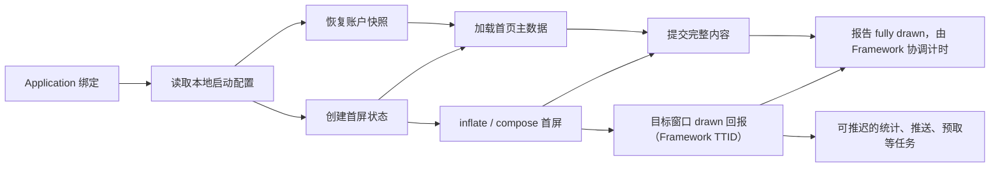

# 启动优化策略

启动优化围绕用户可见的关键路径安排初始化：把任务全部异步化只是换了线程，关键路径还在原地。我们先固定 TTID、TTFD 和业务可用点，再决定哪些工作必须前置、哪些可以懒加载、哪些适合并发，最后用依赖与资源争用验证收益。

## 工程决策边界

[8.2 App 冷启动链路与 Binder Trace 分析](02-app-cold-start-binder-trace.md)解释了 Android 如何创建进程、绑定 `Application`、安装 Provider、创建 Activity 并提交首帧。我们沿着这条时序逐项判断：哪些工作可以删除、哪些可以推迟、哪些适合并发、哪些必须留在主线程，以及怎样验证改动有效。

> 源码基线：Android 17 / API 37，AOSP `android-17.0.0_r1`；涉及线程调度、缺页和存储 I/O 时，内核基线为 `android17-6.18-2026-06_r6`。历史版本只用于解释 API 和行为演进。

启动收益还受设备、构建产物、入口、数据状态和编译状态影响，任何 SDK、布局或优化手段都没有一个可以直接套用的通用毫秒数。

启动优化可以按下面的顺序推进：

1. 固定测量口径并保存基线。
2. 找到决定 TTID 或 TTFD 的关键路径，也就是从启动起点到对应终点之间耗时最长的依赖链。
3. 删除无效工作，推迟暂不需要的工作。
4. 缩短仍在关键路径上的工作。
5. 只对相互独立且值得并发的任务做调度。
6. 用相同构建、设备和编译状态复测。
7. 通过线上分位数和版本对照，持续确认收益没有回退。

这几步要按顺序走：把无用初始化移到后台，它照样消耗 CPU、I/O 和内存；盲目增加并发，还可能让首帧线程长时间拿不到 CPU。


## 从 TTID、TTFD 和关键路径开始

动手删任务之前，先把两个终点和一条关键路径定清楚，后面的每一步取舍都挂在它们上面。

### TTID 与 TTFD 的终点定义

我们先把 Framework TTID 的终点定准：系统收到目标应用窗口的 drawn 回报。它是一个软件侧信号，GPU 完成、HWC present、面板发光是另外几件事；Perfetto / Macrobenchmark 的具体显示代理端点也需按版本核对（见 8.2）。首帧可以是完整首页、骨架屏、占位或错误页。keep condition 的作用方向要分清：用它阻止应用首帧绘制，会推迟这个端点；已绘制之后再延长退出覆盖动画，影响的是覆盖可见时长，应与 TTID 增长分开判断。

TTFD（Time to Full Display，完整显示时间）由应用调用 `reportFullyDrawn()` 标记，表达“当前入口的主要内容已经可用”。这条线具体怎么算，由产品和工程团队共同定义：支持离线使用的首页，可以在本地数据显示完成后上报，无须等推荐位、广告和后台同步。应用没有上报时，测量工具可能拿不到 TTFD 结果，这时拿 TTID 顶替不了它。

`adb shell am start -W`、Perfetto 的 `android_startups`、Macrobenchmark 的 `StartupTimingMetric` 和 Play Android Vitals 使用的数据来源相关但不完全相同，所以分析前我们先记录工具、版本、启动类型和终点定义；跨工具的数字各自成线，拼不成一条趋势线。


### 给启动工作分三类

我们把启动期要做的事逐项过一遍——`ContentProvider.onCreate()`、`Application.onCreate()`、首个 Activity、首屏 ViewModel 和首屏布局——按下面三类分放：

| 类别 | 判断问题 | 常见处理 |
| --- | --- | --- |
| TTID 必需 | 缺少它时，应用能否提交一帧稳定、无错误的界面 | 保留在首帧路径，继续缩短执行时间 |
| TTFD 必需 | 首帧可以出现，但主要内容或主交互尚不可用 | 可与首帧工作并行；主内容提交并可用后再报告 fully drawn |
| 当前入口不需要 | 用户没有进入相关功能时，是否可以一直不执行 | 条件初始化或按需初始化 |

分类的依据是当前入口的依赖和任务失败后的影响，SDK 名字本身说明不了什么。崩溃恢复、加密密钥、用户同意状态和路由规则，在某些产品中必须很早准备；图片、网络、统计或推送，在另一个入口可能完全用不到。


### 关键路径决定总时长

我们把启动任务画成 DAG（Directed Acyclic Graph，有向无环图），节点是任务，箭头是先后依赖，图中没有循环依赖。[推断：依赖模型] 只看依赖、假定资源充足且任务时长固定时，最长依赖链给出该终点的理想完成时间；真实执行还受线程亲和性、队列、CPU / I/O 争用和渲染约束影响，可能更长。所以读这张图要守住两条：任务耗时沿依赖链取最长，逐项相加得不出完成时间；静态 DAG 的最长链也只是模型推演，要拿实测启动时间来对照。下图是一个只保留实际执行依赖的简化入口，用来看首帧与完整可交互内容各自依赖哪些任务：

<!-- gracker-diagram: ch08-03-04-content-dag -->


图：图中主数据可与首屏 UI 准备交叠，完整内容提交同时依赖两者；报告时刻与窗口 drawn 计时仍要核对。

<details>
<summary>查看 Mermaid 源码</summary>



</details>

在这个简化依赖图中，若 `F / G` 的结果确实不阻塞 `D / E`，只加速 `F / G` 就不会直接缩短 TTID；即使 `D` 是链上最大节点，也应检查其他前置依赖和资源竞争。工作线程争用 CPU 时，TTID 还可能变差。所以每次修改前，我们先在 Perfetto 中标出目标 slice（时间片）、线程状态和前后依赖。

<!-- gracker-diagram: ch08-03-05-critical-resources -->


图：静态最长依赖链是资源充足模型的理想时间；队列与争用可延长真实关键路径。

## 延迟、懒加载与异步初始化

延迟、懒加载、异步这三个词经常被混着用，但它们改变的是初始化的不同属性：

- **延迟初始化**改变开始时间，例如在首帧提交后启动。
- **懒加载**改变触发条件，例如用户进入搜索页时才创建搜索索引。
- **异步初始化**改变执行线程或等待方式，但任务仍可能在启动时立即开始。


还要记住一点：换了线程，任务仍可能留在关键路径上。若首帧仍必须等后台结果，换线程不会消除这条依赖；是否能与其他必需工作重叠要按实际时序判断。协程的挂起式 `await` / `join` 可释放主线程执行别的消息，和 `CountDownLatch.await()` 或阻塞锁不同，但结果未就绪仍可能阻止约定的首帧 / 完整内容。

<!-- gracker-diagram: ch08-03-07-suspend-blocking -->


图：挂起 await 可释放主线程处理其他消息，阻塞等待会占住线程；必需结果未就绪时，两者仍有显示依赖。

### 为每项初始化写出任务契约

项目大了以后，我们可以给每项初始化配一份统一描述符。描述符至少要回答以下问题：

| 字段 | 需要写清楚的内容 |
| --- | --- |
| owner | 维护模块与故障联系人 |
| trigger | 进程绑定、首帧后、登录后、页面进入或功能调用 |
| deadline | TTID 前、TTFD 前或无启动期期限 |
| dependencies | 直接依赖及其完成语义 |
| thread affinity | 线程亲和性：必须运行在主线程、CPU worker 还是 I/O worker，是否调用 Looper / Handler |
| resource class | CPU、磁盘、Binder、网络或混合 |
| failure policy | 失败阻断、降级、重试或禁用功能 |
| idempotence | 幂等性：重复调用或进程重建时，是否会得到一致且安全的结果 |
| observability | trace 名称、耗时、结果与失败原因 |

下面的 Kotlin 数据结构只记录任务契约，不包含实际调度逻辑；`FailurePolicy` 是项目自行定义的失败策略类型：

```kotlin
enum class StartupDeadline {
    BEFORE_TTID,
    BEFORE_TTFD,
    ON_DEMAND
}

enum class ThreadAffinity {
    MAIN,
    CPU,
    IO
}

data class StartupTaskSpec(
    val name: String,
    val dependencies: Set<String>,
    val deadline: StartupDeadline,
    val affinity: ThreadAffinity,
    val failurePolicy: FailurePolicy,
    val idempotent: Boolean
)
```

有了这些字段，代码评审就能检查一项任务为何必须提前执行、失败会影响谁。依赖检查、状态管理、线程切换、取消和追踪这些执行逻辑，仍要由执行器另外实现。


### 推迟到首帧之后

主线程 `post`、协程 `launch` 或生命周期回调，本身都算不上“首帧已经绘制 / 提交”的信号，任务还可能早于首帧运行。若约定“首帧后”，我们先核对实际绘制 / 提交信号及其软件端点，再安排任务；这些信号描述的是软件端点，不能替代物理 present 证据。轮到任务执行时，系统是否空闲同样没有保证；首帧后一口气提交过多任务，第二帧和输入响应照样受影响。实践上可以采用这些约束：

- 按用户可见价值排序，并限制同一时刻的 CPU 与 I/O 工作量；
- 将大任务分成带有明确检查点的小段，并允许随生命周期取消；
- 页面退出后取消预取、解码和无用网络请求；
- 限制主线程任务每次执行的时长，必要时跨帧继续；
- 缓存与预取失败时允许页面走正常加载路径。


`MessageQueue.IdleHandler` 在所属 Looper 的队列被判定 idle 时执行；r1 的实现会检查队列内容、消息时间及同步屏障等条件，到期屏障要单独判断，未必意味着“没有可执行消息所以空闲”。它观察的只是所属消息队列，CPU / 磁盘 / 全进程是否空闲一概看不到，执行时机也未必落在首帧之后或固定期限内。回调本身占用该 Looper 线程，只适合短小且可延后甚至跳过的工作。


### 按需初始化的状态机

按需初始化可能被多个线程同时触发，所以我们需要一个状态机，明确当前处于 `UNINITIALIZED`、`INITIALIZING`、`READY` 还是 `FAILED`，并规定失败后能否重试。把初始化对象交给其他线程前，还要满足内存可见性要求，确保对方看到的是完整状态；语言级同步原语、`Mutex`、`CompletableFuture` 或受控的 `Deferred` 都可以做到。

<!-- gracker-diagram: ch08-03-11-init-state -->


图：多线程触发须合并初始化；成功后安全发布，失败按有界策略处理，不让主线程无限阻塞。

主线程发现组件仍处于 `INITIALIZING` 时，可以暂时禁用局部操作、缓存事件或显示轻量占位。无条件调用 `CountDownLatch.await()`，等于让主线程重新等后台任务，还可能因锁获取顺序形成死锁；业务确实降级不了时才选择等待，并且要设好有限期限、取消语义和现场记录。

### 异步任务的资源代价

启动期的后台工作和主线程抢的是同一份资源：CPU 时间、内存带宽、文件缓存、Binder 线程和存储队列。在 `android17-6.18-2026-06_r6` 上，调度器只负责从可运行任务中挑出下一项，哪个自定义 SDK 对 TTID 更重要，它并不知道；线程优先级、CPU 集群选择和频率，还要受系统策略影响。

并发上限的确定顺序是：先看 Perfetto 中的 `sched`、`thread_state`、CPU frequency、Binder 和 I/O 轨迹，再结合设备实验和任务消耗的资源类型定数字。照 CPU 核数建同等数量的启动线程、给每个库单独建线程池，这两种捷径都容易把并发开过头。


## 多线程初始化：DAG 只是起点

把任务画成 DAG 只是第一步；执行器怎么调度这些任务，决定收益最终能否兑现。

### 拓扑排序与执行器职责

拓扑排序回答的是合法性问题：DAG 中存在 `A → B`，B 就要等 A 达到约定状态；两个节点之间没有依赖边，并发就是允许的。但允许并发只解决了顺序，执行器还要判断线程亲和性和资源冲突——两个互不依赖的磁盘扫描同时跑，随机 I/O 可能比顺序执行更多；两个 CPU 密集任务，也可能正好撞上主线程需要的 CPU。

调度器至少应具备以下能力：

- 在构建期或启动前检测未知依赖、重复名称和循环依赖；
- 对 `MAIN`、`CPU`、`IO` 采用不同执行策略；
- 只在依赖成功或满足降级条件后释放节点；
- 记录排队时间、执行时间、线程、结果和关键路径归属；
- 支持入口条件、用户状态和进程类型过滤；
- 让超时、取消和任务本身的停止动作保持一致；
- 阻止失败任务被无边界地重复提交。


超时的效果取决于 API：例如协程 `withTimeout` 会取消其代码块及结构化子任务，但取消是协作式的，不保证强行终止非协作 SDK、同步 Binder 或阻塞 I/O。所以执行器必须知道任务是否支持协作式取消——也就是任务能否主动检查并响应取消信号；对不支持取消的任务，要把结果隔离起来，避免稍后写入已经销毁的页面。

<!-- gracker-diagram: ch08-03-14-cancellation -->


图：协程超时会取消代码块，但停止执行仍取决于合作；非协作工作返回后不得污染已失效页面。

### 主线程亲和性的判断依据

应按 API 的 `@MainThread` / `@UiThread`、组件所有者线程与 SDK 文档决定亲和性。依赖“当前 Looper”并不自动等于必须使用主 Looper；某些 API 可用于准备好 Looper 的其他线程，而 AsyncLayoutInflater 也只在受限条件下允许后台构造 View。把这类代码放进 worker（工作线程），少量测试可能暂时通过，随后却因 Handler、线程局部状态或回调顺序而崩溃。任务契约里 thread affinity 一栏要认真填，依据就在这里。


CPU 任务和阻塞 I/O 也要分开管理。协程的 `Dispatchers.Default` 与 `Dispatchers.IO` 调度策略不同，但 CPU、锁和 Binder 的争用仍在原地，换用协程本身消不掉。任务契约应记录调用链中的真实阻塞点，只看最外层函数是否标记为 `suspend` 是不够的。

### 失败降级的分级处理

启动执行器如果把所有节点汇总到一个全局 `awaitAll`，任意一个非必要 SDK 出问题，都可能拖住首页显示。更稳妥的做法是按失败结果对页面的影响分三类：

- 首帧门槛：失败时仍能绘制明确的错误或降级界面；
- 完整内容门槛：失败时保留重试入口，并按产品定义决定是否上报 TTFD；
- 附加能力：失败只影响对应功能，同时留下诊断信息。

任务完成状态还要和进程生命周期绑定。Android 可能杀死后台进程，内存里的“已初始化”出了本进程就作废；持久化标记同样证明不了 SDK 在新进程中的对象已经就绪。


## Jetpack App Startup 的准确边界

Jetpack App Startup 使用一个 `InitializationProvider`，读取 manifest metadata 中注册的 `Initializer`，并通过 `dependencies()` 声明依赖顺序。AndroidX `AppInitializer#doInitialize()` 会先递归完成依赖，再调用 `Initializer.create()`。

这项自动注册处理发生在 Provider 安装阶段，通常运行在应用主线程上，并且早于 `Application.onCreate()`。

它可以减少独立 Provider 的数量并统一依赖顺序，但有三件事它管不到：

1. 各 `Initializer` 之间即便互不依赖，库也不会自动并行执行。
2. `create()` 的耗时仍计入启动；合并 Provider 消除的只是 Provider 数量，库本身的工作还在。
3. 是否应自动初始化，应按该 Provider 所属进程和实际入口判断；库不会因为使用 App Startup 就自动在 APK 的全部进程执行。

需要推迟的组件应移除对应 `<meta-data>`，并确认它不再被其他 eager Initializer 的依赖图引用；只移除自己的注册，仍可能因依赖而提前执行。之后在业务触发点调用 `AppInitializer.initializeComponent()`；手动入口会在调用线程同步递归依赖，不会自动切后台。

<!-- gracker-diagram: ch08-03-17-app-startup -->


图：自动 discovery 由 Provider 触发，递归依赖同步完成；移除 metadata 后还须检查其他 eager 依赖。

如果 `Initializer.create()` 内部自己发起异步工作并立即返回，返回值是否已经可用就必须写清楚。其他 `Initializer` 会把这次返回视为依赖完成；返回的若只是个尚不可用的外壳对象，后续组件就可能过早访问它。

<!-- gracker-diagram: ch08-03-18-initializer-ready -->


图：App Startup 把 create 返回视为本次依赖完成，不自动等待内部另起的异步任务。

## ContentProvider：先发现，再决定是否移除

第三方库的自动初始化常常走 Provider 这条路，所以我们先把每个 Provider 的来历查清楚，再决定哪个移除、哪个保留。

### Provider 位于 Application.onCreate 之前

`ActivityThread#handleBindApplication()` 在创建 `Application` 后，会先调用 `installContentProviders()`，随后才调用 `Instrumentation.callApplicationOnCreate()`。Provider 的 `onCreate()` 通常在应用主线程执行，第三方库靠 Provider 完成的自动初始化，就这样直接进入冷启动路径。

每个 Provider 都可能有一份正当职责——跨进程数据、`FileProvider` URI、数据库、WorkManager、Emoji 或其他功能。按下面的顺序逐个确认，再决定去留：

1. 从目标 variant（构建变体）的合并 Manifest 中找出 Provider 和 `meta-data`；
2. 追溯来源依赖、authorities、exported、process 和启动逻辑；
3. 查库文档是否支持关闭自动初始化；
4. 为手动初始化选定触发点和失败策略；
5. 覆盖冷启动、后台任务、通知、深链和多进程入口。


下面的命令先生成 release variant 的合并 Manifest，再搜索其中的 Provider 和 metadata：

```bash
./gradlew :app:processReleaseMainManifest
rg -n '<provider|<meta-data' \
  app/build/intermediates/merged_manifests \
  app/build/intermediates/packaged_manifests
```

AGP 版本和模块结构会改变中间目录。Android Studio 的 Merged Manifest 视图可以继续追踪声明来源；命令找不到目录时，应根据 Gradle task 输出定位该 variant 的实际产物。

### 关闭 App Startup 的单个自动项

下面的 Manifest 片段只移除一个 App Startup metadata 注册项，同时保留公共的 `InitializationProvider`：

```xml
<provider
    android:name="androidx.startup.InitializationProvider"
    android:authorities="${applicationId}.androidx-startup"
    android:exported="false"
    tools:node="merge">

    <meta-data
        android:name="com.example.analytics.AnalyticsInitializer"
        tools:node="remove" />
</provider>
```

移除后先检查其他 eager Initializer 是否仍依赖它，再在使用分析能力的入口手动初始化；其依赖也要按实际触发时点验证。对第三方自定义 Provider，`tools:node="remove"` 只在库文档明确支持时才能用，否则可能破坏启动、备份、分享、后台任务或远程进程。


### 多进程应用的逐进程成本

组件的 `android:process`（或 application 的默认进程）决定所属进程；普通新应用进程创建自己的 `Application`，安装系统分配给该进程的 Provider，而不是安装所有“可见”的 Provider。冷启动要逐进程核算：共享代码、Profile 或缓存优化也可能同时惠及多个进程，但主进程指标改善，还证明不了子进程同样改善。初始化器应检查当前进程和入口需求，避免所有进程都加载主进程专属组件。

<!-- gracker-diagram: ch08-03-21-process-costs -->


图：每个普通新进程有自己的 Application 与所属 Provider；主进程结果不代替子进程测量。

## SplashScreen：控制过渡画面，不隐藏等待

从 Android 12（API 31）开始，系统为冷启动和温启动提供标准 Splash，热启动通常不显示；`androidx.core:core-splashscreen` 把兼容实现带到 API 23。Splash API 本身不自动减少必要初始化和首帧工作；移除独立 Splash Activity 等迁移可以实际减少冗余生命周期 / 窗口开销，保持与退出动画也有自己的渲染成本，须分别衡量。

专门创建透明或全屏的 Splash Activity，会多付一次 Activity 生命周期、窗口创建和转场，通常应迁移到启动主题。Splash 颜色与首屏背景协调，退出时才不会闪色；图标和动画遵循系统的尺寸与时长规范。


### 安装顺序与启动主题

下面的 XML 为启动 Activity 定义 Splash 主题，并通过 `postSplashScreenTheme` 指定退出后使用的常规主题：

```xml
<style name="Theme.App.Starting" parent="Theme.SplashScreen">
    <item name="windowSplashScreenBackground">@color/startup_background</item>
    <item name="windowSplashScreenAnimatedIcon">@drawable/ic_startup</item>
    <item name="postSplashScreenTheme">@style/Theme.App</item>
</style>
```

还需要在 Manifest 中把 `Theme.App.Starting` 配置给启动 Activity。`postSplashScreenTheme` 负责恢复常规主题，深色模式、边到边窗口和状态栏配置也都要在这一并处理。

下面的 Activity 代码展示 `installSplashScreen()` 的调用顺序，并且只读取一个已准备好的布尔状态来判断是否短暂保留 Splash：

```kotlin
override fun onCreate(savedInstanceState: Bundle?) {
    val splash = installSplashScreen()
    super.onCreate(savedInstanceState)

    // 在绘制条件外取得 ViewModel / 状态对象，避免首次求值才触发懒创建。
    val blocksFirstDraw = viewModel.blocksFirstDraw
    splash.setKeepOnScreenCondition {
        blocksFirstDraw.value
    }

    setContentView(R.layout.activity_main)
}
```

`installSplashScreen()` 必须在 `super.onCreate()` 之前调用。保持条件会在绘制路径上频繁执行，因此函数体要快速、无锁、无 I/O，也不要修改状态。耗时工作放在别处完成，这里只读取已经安全发布的状态。


### Splash 的保持条件与 TTID

短暂保持 Splash 的适用场景很窄：首屏确实要先读少量本地设置，而且不读就会立刻切换主题、改变路由或显示错误内容。等待网络、广告、完整远程配置或大型数据库迁移，会直接延长应用首帧，失败后的界面也会迟迟不出现。这类场景更合适的做法，是先绘制可用占位、缓存内容或局部错误状态，再异步更新。

保持条件还需要明确的失败出口：页面仍存活时，数据失败或任务取消应切换到可绘制的降级状态，或交接给替代任务；页面已销毁则取消观察、丢弃旧结果，不要求继续更新销毁页面。超时策略放在状态持有层实现并记录原因；时钟查询、磁盘访问和网络操作，都不要放进每次条件求值里。

<!-- gracker-diagram: ch08-03-24-keep-predraw -->


图：keep=true 时 pre-draw 返回 false，应用首帧被推迟；保持门槛须有存活页面的失败出口。

### 退出动画的线程约束

沿用上文 AndroidX 入口，`setOnExitAnimationListener` 得到的是 `SplashScreenViewProvider`，接管后必须在结束或取消的清理路径调用它的 `remove()`。若要衔接图标动画，AndroidX 属性名是 `iconAnimationStartMillis` / `iconAnimationDurationMillis`：API 31+ 开始值使用 epoch 毫秒，与 uptime 分属两个时钟体系，直接相减得到的是错误结果；API 31 以下图标不可动画且值为 0。剩余时间需夹到不小于零，并允许跳过。`windowSplashScreenAnimationDuration` 只承载图标时长信息，Splash 总停留时间要另作判断。退出回调里适合做的事很少，启动 SDK、同步准备首页数据都不要放在这里。

<!-- gracker-diagram: ch08-03-25-splash-exit -->


图：AndroidX listener 给出 SplashScreenViewProvider；动画属性采用 Millis 名称与 epoch 起点，结束和取消都要清理覆盖。

## 首屏布局：减少必须创建的节点

这一节回答两个问题：首屏布局的时间花在哪一段，以及怎样减少必须创建的节点。

### 先确认耗时属于 inflate、measure、layout 还是 draw

`setContentView()` 耗时较长时，先别急着全怪 XML：inflate 里混着资源解析、类加载、反射或构造器调用、属性解析和子树创建，之后还有 measure、layout、绘制命令记录和 RenderThread 工作。时间到底花在哪一段，我们在 Perfetto 中结合 `inflate`、`measure / layout`、`DrawFrame`、类加载、GC 和 Binder slice 定位。

布局检查可以从这些位置开始：

- 删除首屏不可见且没有状态作用的节点；
- 避免在 View 构造器和自定义属性解析中做 I/O、Binder 或大对象解码；
- 让列表首批数据和占位数量接近首屏实际需要；
- 检查重复背景、过度绘制和复杂文本测量；
- 对 Compose 检查首次组合读取的状态、同步数据源和耗时较长的 `remember` 计算；
- 把首帧无关页面从导航图的即时构建路径移开。

布局层级数只能当线索，当不了结论：`ConstraintLayout` 可能减少嵌套，也可能因约束规模增大而提高求解成本。最终以 trace 和 Macrobenchmark 结果为准。


### ViewStub 适合可选 View 子树

下面的 XML 使用 `ViewStub` 占据错误详情的位置，只有真正需要显示时才创建对应布局：

```xml
<ViewStub
    android:id="@+id/error_details_stub"
    android:inflatedId="@+id/error_details"
    android:layout="@layout/view_error_details"
    android:layout_width="match_parent"
    android:layout_height="wrap_content" />
```

`ViewStub` 本身不绘制，measure 结果为零；调用 `inflate()`，或者把可见性设置为 `VISIBLE` / `INVISIBLE` 时，它会被目标布局替换，而目标布局的根要避开 `<merge>`。替换完成后，原 `ViewStub` 已从父节点移除，代码要保存新 View 的引用，或通过 `inflatedId` 查找。

<!-- gracker-diagram: ch08-03-27-viewstub -->


图：ViewStub 不绘制、测量为零；触发时被真实布局替换，调用方应保存新 View 或使用 inflatedId。

`ViewStub` 的前提是这块子树本次首帧大概率不会出现。如果每次启动都会立即 inflate，它换来的只是创建时机的移动，还可能多付一次查找和状态切换。

### AsyncLayoutInflater 的适用前提

`AsyncLayoutInflater` 适合延后创建、或用户交互后才需要的布局。它的构造和 `inflate()` 调用发生在 UI 线程，View 在后台线程创建；没有传入 callback executor 时，完成回调回到 UI 线程，创建出的布局也不会自动加入 parent。

<!-- gracker-diagram: ch08-03-28-async-inflate -->


图：后台构造需线程安全，失败回 UI 重试；显式 callback executor 不保证 UI 线程，附加逻辑由调用方负责。

下面的示例提前创建一个首帧之后才可能展示的筛选面板，并在回调中把它加入父容器：

```kotlin
// Activity 示例：filterContainer 是已挂接且专用的空容器。
val requestId = ++filterPanelGeneration
val inflater = AsyncLayoutInflater(this)

inflater.inflate(R.layout.view_filter_panel, filterContainer) {
        view, _, parent ->
    if (isFinishing || isDestroyed || requestId != filterPanelGeneration ||
        parent !== filterContainer || !filterContainer.isAttachedToWindow ||
        filterContainer.childCount != 0
    ) return@inflate
    filterContainer.addView(view) // 默认回调在 UI 线程
}
```

`filterPanelGeneration` 是 Activity 持有的主线程整数字段；页面作废或请求被替换时递增，使旧结果失效。上述默认重载没有取消接口，丢弃结果只是不再理会返回值，后台 inflate 可能仍在执行。父容器的 `generateLayoutParams()` 和所有 View 构造过程都要能在后台线程安全执行；View 的构造过程里要避开创建 Handler，也要避开对当前 Looper 的依赖。

<!-- gracker-diagram: ch08-03-29-async-result-validity -->


图：在默认 UI 回调中核对 Activity、请求代次与专用容器，附加一次；丢弃结果不停止后台工作。

普通的 `LayoutInflater.Factory / Factory2` 设置方式和包含 Fragment 的布局不受支持；当前库提供的 `AsyncLayoutFactory` 构造入口需要单独验证适配。后台 inflate 抛出 `RuntimeException` 时会经 Handler 在 UI 线程重试；重试仍可能失败。若显式传 callback executor，回调最终在该 executor 执行，附加 View 前还须切回 UI 线程。所核对实现使用一个共享 inflate worker 和容量 10 的阻塞队列，提交调用用 `put()`，队列满时可能阻塞提交的 UI 线程；预创建的数量因此要有上限。

<!-- gracker-diagram: ch08-03-30-async-backpressure -->


图：所核对实现只有一个共享 worker，等待队列容量 10；enqueue 使用阻塞 put，预创建数量要有上限。

如果应用必须等异步结果才能设置首屏根布局，这项工作就还在 TTID 关键路径上，线程切换还可能多一层开销。它更适合提前准备后续 UI，或让当前 UI 在 inflate 期间保持可响应。选用前测试主题包装、AppCompat / Material 自定义 View、回调生命周期，以及任务取消后如何丢弃结果。

## Baseline Profile 与 Startup Profile

Baseline Profile 随 release 产物发布热点类和方法规则，供 ART 对覆盖路径做运行前编译；实际何时完成依赖系统与安装渠道。API 26–27 可能在首次运行由 ProfileInstaller 写入，再等待后台编译，首次启动时未必已经拿到 AOT 收益。Startup Profile 面向 DEX 布局，让构建工具把启动期类和方法排列到更便于连续读取的位置。两者作用于不同阶段，可以同时使用。


官方资料里“代码执行从首次启动起约有三成改善”是跨样本的概述，落到单个应用的 TTID 上未必兑现三成。评估收益要回到自己关键路径中可改善的比例：布局、初始化等 CPU 路径也可能被 Baseline Profile 加速，Startup Profile 还可改善 DEX 访问布局；至于磁盘、锁、Binder、网络或显示瓶颈，Profile 并不会自动消除它们。完整的生成、打包、分发渠道和设备编译状态，见 [21.4 Baseline、Startup 与 Cloud Profile 编译优化](../../part5-app/ch21-startup/04-baseline-startup-cloud-profile.md)。

### 用对照实验量化

在同一台物理设备上，使用同一个 release-like APK、入口和数据状态，对比 `CompilationMode.None()` 与强制要求 Baseline Profile 的 `CompilationMode.Partial`。下面的 Macrobenchmark 展示两个实验组共用的测试结构：

```kotlin
@Test
fun coldWithoutProfile() = measureCold(CompilationMode.None())

@Test
fun coldWithBaselineProfile() = measureCold(
    CompilationMode.Partial(
        baselineProfileMode = BaselineProfileMode.Require
    )
)

private fun measureCold(mode: CompilationMode) {
    benchmarkRule.measureRepeated(
        packageName = TARGET_PACKAGE,
        metrics = listOf(StartupTimingMetric()),
        compilationMode = mode,
        startupMode = StartupMode.COLD,
        iterations = 10,
        setupBlock = { pressHome() }
    ) {
        startActivityAndWait()
    }
}
```

`BaselineProfileMode.Require` 会在 Baseline Profile 安装失败或达不到要求时暴露错误，适合验收；Partial 默认 `warmupIterations = 0`，可在需要排除额外 warmup 时显式设置。None / Partial 控制的是 ART 编译状态，同一 APK 的对比没有触碰构建期 Startup Profile DEX 布局，所以这组实验量不出 Startup Profile 的单独收益。示例里的迭代次数只是示例，样本量根据设备噪声和 CI 成本确定，并检查原始分布；模拟器与宿主机共享资源，最终的启动性能结论要由物理设备给出。

<!-- gracker-diagram: ch08-03-32-profile-experiments -->


图：None / Partial 对比固定 APK 的 ART 状态；Startup Profile 的单独收益需要控制构建期布局变量。

需要测 TTFD 时，在页面稳定且可交互的业务状态调用 `reportFullyDrawn()`，并让 benchmark 操作等待对应 UI 状态；缺了这个标记，TTFD 结果就是缺失，TTID 也填补不了这个位置。还要确认 APK / AAB 内的 profile、设备编译状态和 R8 映射一致，避免文件生成成功、目标产物却没有实际使用。

### 分发路径影响首次体验

Google Play 可以在安装阶段使用随包提供的 Baseline Profile，也可以根据用户设备数据聚合并分发 Cloud Profile。其他渠道能否在安装时编译，取决于安装器和系统；`ProfileInstaller` 能把随包 profile 写入设备，后续编译仍受系统任务执行时机和设备状态影响。

评估渠道差异时，检查构建产物和设备编译状态本身；地区并不决定 Baseline Profile 是否有效。Cloud Profile 属于 Google Play 的分发能力，与随 APK / AAB 发布的 Baseline Profile 是两条不同路径。

<!-- gracker-diagram: ch08-03-33-profile-distribution -->


图：随包规则、安装器编译与 Play 聚合是不同路径；API 26–27 首次写入后可能仍等待后台编译。

## 观测与回归：把收益变成可维护指标

优化做完之后，收益要变成可维护的指标，才守得住不回退。

### 实验室、系统 trace 与线上数据各有职责

| 层级 | 适合回答的问题 | 建议工具 |
| --- | --- | --- |
| 可重复基准 | 某次代码或 profile 改动是否影响指定入口 | Macrobenchmark、物理设备、固定构建与数据 |
| 单次现场 | 时间花在哪个线程、锁、Binder、I/O 或帧阶段 | Perfetto、Android App Startups、FrameTimeline |
| 用户分布 | 哪些设备、版本、入口或启动类型恶化 | Android vitals、应用自有启动事件 |
| 业务完成 | 主内容何时可用，失败和降级占比多少 | `reportFullyDrawn()`、业务状态与 trace ID |


Play Android Vitals 把冷启动 5 秒、温启动 2 秒、热启动 1.5 秒及以上归为 excessive startup（启动时间过长）。这些数值是平台健康阈值，产品自己的时间预算要另行设定：按入口和设备层级设置预算，观察 P50、P90 / P95、超过阈值的比例、失败率和样本量。

线上事件至少带上：

- 应用版本、Android 版本、设备型号和构建类型；
- 冷、温、热启动类型及入口来源；
- 进程启动原因、目标 Activity 和用户登录状态；
- TTID / TTFD 是否存在，以及 `reportFullyDrawn()` 采用的业务条件；
- 初始化任务结果、降级原因和实验分组。

平均值会被大量高性能设备摊薄，慢设备的问题就藏在里面，所以分位数必须附带样本量。设备构成一变，整体 P90 就可能跟着变，哪怕同一型号的性能没有任何变化。

<!-- gracker-diagram: ch08-03-35-distribution-mix -->


图：整体分位数随样本混合比例变化；按设备、入口、版本与启动类型分层比较后再解释回归。

### Perfetto 中验证关键路径

`android.startup.startups` 识别派生启动区间；下面只列记录、类型和该 slice 时长，不直接计算 TTID / TTFD。显示指标及其代理端点另查 `android.startup.time_to_display` 并复核帧关联，见 8.2：

```sql
INCLUDE PERFETTO MODULE android.startup.startups;

SELECT
    startup_id, ts, ts_end,
    package,
    startup_type,
    dur / 1e6 AS startup_slice_ms
FROM android_startups
ORDER BY ts;
```

表字段依赖所用离线 Trace Processor，而不是只看设备 Android 版本。本文验证的处理器不接受 `DESCRIBE android_startups`；可在 INCLUDE 后运行 `SELECT name, type FROM pragma_table_info('android_startups');` 核对模式，并结合该版本源码。拿到启动区间后，我们接着检查应用主线程、worker、Binder、`sched`、频率、缺页、I/O、GC、`inflate` 和 FrameTimeline——总区间只说明慢，该改哪一段要从这些轨道里找。


应用自己的任务用 `androidx.tracing.trace` 或平台 trace API 标记稳定名称，用户 ID、URL 这类高基数字段（取值组合极多）不要写进 slice 名。在线上采样时，还要控制性能开销并保护隐私。

### CI 门禁与测量噪声

CI 规定“单次慢 5% 就失败”，很容易把温度、后台负载和动态调频造成的波动误判成回归。更可靠的门禁应包含：

- 专用或受控物理设备；
- 一致的电量、温度范围、动画和网络数据；
- release-like、可 profile 的 benchmark 目标；
- 固定 startup mode、编译模式和入口；
- 足够迭代与历史基线；
- 同时检查变化幅度、波动范围和连续构建趋势；
- 失败时保存 benchmark JSON、APK 版本和 Perfetto trace。


Manifest 的正确写法，是在 `<application>` 内放置 `<profileable android:shell="true" />` 子元素（API 29+）；`android:profileable="true"` 属性写法则是误用。它允许 shell 对不可调试应用采集受支持的 profiling 数据；API 26–28 需另核对工具的采集条件。benchmark target 通常由构建插件为性能测试配置；它说明不了 Cloud Profile 是否会生成，把它简单归结为“release 构建一律关闭”也不合适。


## Android 17 与环境边界

这一节收集与启动相关的平台环境变化：新的 MessageQueue 实现、16 KB 页，以及内核源码什么时候才需要看。

### lock-free MessageQueue 的兼容性检查

Android 17 会为 targetSdk 37 及以上的应用启用新的 lock-free（无锁）`android.os.MessageQueue` 实现，减少队列锁竞争和 missed frames（错过截止时间的帧）。私有字段 `mMessages` 为兼容旧实现仍然保留，在新实现下始终为 null。性能 SDK、测试工具和自研 Hook 里凡是反射读取私有字段或调用私有方法的，都要迁移。

下面的命令用于在 Android 17 的 debuggable 构建上，按包名开启或关闭新实现，以便进行兼容性对照：

```bash
adb shell am compat enable USE_NEW_MESSAGEQUEUE com.example.app
adb shell am compat disable USE_NEW_MESSAGEQUEUE com.example.app
```

执行任一命令后，先强制结束目标进程，再重新运行启动和 UI 测试。Espresso 升级到 3.7.0 或更高版本；Robolectric 升级到 4.17 或更高版本，并迁移旧 Looper 模式。新队列可能减少某些样本中的锁竞争，但启动是否因此变快，仍要对照 trace 验证。


启动监控用 Perfetto、Macrobenchmark、`Looper.setMessageLogging()` 的公开行为或受支持的测试 API。依赖 `MessageQueue` 私有链表布局的实现，在 `android-17.0.0_r1` 中已经没有稳定的结构保证。

### 16 KB 页与 Zygote COW 传闻

支持 16 KB 内存页的设备会改变 native 库对齐、内存页粒度和部分缺页行为。应用需要按官方 16 KB page-size 指南检查 ELF LOAD 段、打包方式和第三方 native 依赖，并在目标设备上测量启动、内存和兼容性。

“启动时写应用静态字段会按 16 KB 触发 Zygote COW，因此应统一推迟写入”——这条推断缺少对象到共享物理页的映射证据，还容易把应用后来创建的类静态存储和 Zygote 共享页混为一谈。要诊断 COW（写时复制），我们看的是 page fault、PSS（进程按共享比例折算后的内存）、映射属性和可复现实验；物理页归属从字段类型是推不出来的。

<!-- gracker-diagram: ch08-03-40-page-cow-evidence -->


图：先证明对象映射到共享物理页，再讨论写入引发的 COW；页大小与字段类型不足以推导优化策略。

### 内核基线的适用范围

若用户态与系统 trace 都指向调度、存储或缺页瓶颈，可以继续查 `android17-6.18-2026-06_r6` 里的调度、存储和内存路径。平台侧的 `ActivityThread`、ART、MessageQueue 和 SplashScreen 行为仍以 `android-17.0.0_r1` 为准，内核分支名代替不了平台源码。


## 一套可执行的审计清单

把前面的方法收成四张清单，按顺序执行。

### 建立基线

- 选定冷、温、热启动及通知、深链等业务入口。
- 固定 release-like 产物、设备、数据和编译状态。
- 始终记录 TTID；页面定义了完整可用状态时，再记录 TTFD，并保存 trace。
- 写明 `reportFullyDrawn()` 的业务条件。

### 清点启动工作

- 查看合并 Manifest 中的 Provider 和 App Startup metadata。
- 标记 `Application.onCreate()`、首个 Activity 和首屏数据调用。
- 为每项工作填写 trigger、deadline、执行线程、依赖和失败策略。
- 删除重复、无入口需求或可以由功能触发的初始化。

### 修改关键路径

- TTID 前只保留提交稳定首帧所需的工作。
- TTFD 前只保留主内容和主交互所需的工作。
- 独立任务也要先评估 CPU、I/O、Binder 和锁争用，再决定是否并发。
- 用 ViewStub、条件组合或预创建处理可选 UI。
- 用 Baseline / Startup Profile 改善代码执行和 DEX 布局。
- Splash 只处理过渡和短暂本地准备，不等待无界外部资源。

### 验收与上线

- 用相同 Macrobenchmark 配置做修改前后对照。
- 在 Perfetto 中确认目标 slice 离开关键路径或自身变短。
- 覆盖失败、离线、慢磁盘、进程重建、多进程和页面退出。
- 分批发布，按版本、入口、设备和启动类型观察分位数。
- 回归时保留 trace、构建产物、profile 状态和实验配置。


## 常见误判

下面这些判断听起来都有道理，我们逐条用前面的方法拆开验证。

### “提交到后台”就算完成优化

后台任务照样消耗资源；主线程还在等它的话，关键路径一点没变。优化是否成立，用依赖关系和线程状态验证。

### Splash 消失得晚，首页就更稳定

保持 Splash 会推迟应用首帧，只适合等待短暂且确定的本地前置条件，并且必须提供失败出口。

### App Startup 会并行没有依赖的 Initializer

AndroidX 只负责统一发现 `Initializer` 并按依赖顺序执行。自动初始化发生在 Provider 路径里，互不依赖的节点也不会自动并发。

### Provider 数量减少就等于初始化耗时消失

统一 Provider 减少的是组件创建和发现开销，`Initializer` 里的业务工作照样执行。实际收益用 trace 测量。

### AsyncLayoutInflater 适合所有首屏布局

它要求 View 构造过程能在后台线程安全执行，不支持包含 Fragment 的布局，失败时还会回到 UI 线程重试；首帧必须等结果的话，TTID 未必缩短。

### Baseline Profile 有固定启动收益

Baseline Profile 主要改善覆盖代码的编译与执行，Startup Profile 改善构建期 DEX 布局。UI / 初始化 CPU 和部分 DEX 访问也可能受益；实际收益依赖覆盖比例、编译状态与剩余等待，固定启动百分比在这里套不上。

## 小结

启动优化针对的是入口关键路径：TTID、TTFD、Splash 可见时间和业务数据就绪时间分别定义，删除、推迟、缩短和受控并发分别验证。DAG、App Startup、`AsyncLayoutInflater` 和 Baseline Profile 各有适用条件，代替不了 trace 与对照实验。面向 targetSdk 37 的项目，还要检查启动 SDK 和测试框架是否兼容 lock-free MessageQueue。

## 参考资料

- [Android Developers：App startup time](https://developer.android.com/topic/performance/vitals/launch-time)
- [Android Developers：App startup analysis and optimization](https://developer.android.com/topic/performance/appstartup/analysis-optimization)
- [Android Developers：Splash screens](https://developer.android.com/develop/ui/views/launch/splash-screen)
- [Android Developers：Migrate your existing splash screen implementation to Android 12](https://developer.android.com/develop/ui/views/launch/splash-screen/migrate)
- [Android Developers：Jetpack App Startup](https://developer.android.com/topic/libraries/app-startup)
- [Android Developers：AsyncLayoutInflater API](https://developer.android.com/reference/androidx/asynclayoutinflater/view/AsyncLayoutInflater)
- [AndroidX：AsyncLayoutInflater source](https://android.googlesource.com/platform/frameworks/support/+/35d8f1dda494fcd09f52177d9dd54bc65f9929de/asynclayoutinflater/asynclayoutinflater/src/main/java/androidx/asynclayoutinflater/view/AsyncLayoutInflater.java)
- [AndroidX：AppInitializer source](https://android.googlesource.com/platform/frameworks/support/+/35d8f1dda494fcd09f52177d9dd54bc65f9929de/startup/startup-runtime/src/main/java/androidx/startup/AppInitializer.java)
- [Android Developers：ViewStub 按需加载布局](https://developer.android.com/develop/ui/views/layout/improving-layouts/loading-ondemand)
- [AOSP Android 17：ActivityThread.java](https://android.googlesource.com/platform/frameworks/base/+/refs/tags/android-17.0.0_r1/core/java/android/app/ActivityThread.java)
- [AOSP Android 17：ViewStub.java](https://android.googlesource.com/platform/frameworks/base/+/refs/tags/android-17.0.0_r1/core/java/android/view/ViewStub.java)
- [Android Developers：Baseline Profiles overview](https://developer.android.com/topic/performance/baselineprofiles/overview)
- [Android Developers：Benchmark Baseline Profiles](https://developer.android.com/topic/performance/baselineprofiles/measure-baselineprofile)
- [Android Developers：Startup Profiles and DEX layout](https://developer.android.com/topic/performance/startupprofiles/dex-layout-optimizations)
- [Perfetto stdlib：Android startup tables](https://perfetto.dev/docs/analysis/stdlib-docs#android-startup-startups)
- [Android Developers：Android 17 MessageQueue behavior change](https://developer.android.com/about/versions/17/changes/messagequeue)
- [Android Developers：Support 16 KB page sizes](https://developer.android.com/guide/practices/page-sizes)

- [Android Developers：profileable Manifest 子元素（API 29+）](https://developer.android.com/guide/topics/manifest/profileable-element)
- [AndroidX 固定提交：SplashScreen.kt](https://android.googlesource.com/platform/frameworks/support/+/35d8f1dda494fcd09f52177d9dd54bc65f9929de/core/core-splashscreen/src/main/java/androidx/core/splashscreen/SplashScreen.kt)
- [AndroidX 固定提交：SplashScreenViewProvider.kt](https://android.googlesource.com/platform/frameworks/support/+/35d8f1dda494fcd09f52177d9dd54bc65f9929de/core/core-splashscreen/src/main/java/androidx/core/splashscreen/SplashScreenViewProvider.kt)
- [Kotlin：withTimeout 与协作式取消](https://kotlinlang.org/api/kotlinx.coroutines/kotlinx-coroutines-core/kotlinx.coroutines/with-timeout.html)
- [Android Developers：进程、线程与 UI 线程规则](https://developer.android.com/guide/components/processes-and-threads)
- [AOSP r1：CombinedMessageQueue 实现](https://android.googlesource.com/platform/frameworks/base/+/android-17.0.0_r1/core/java/android/os/CombinedMessageQueue/MessageQueue.java)
