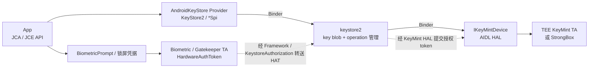
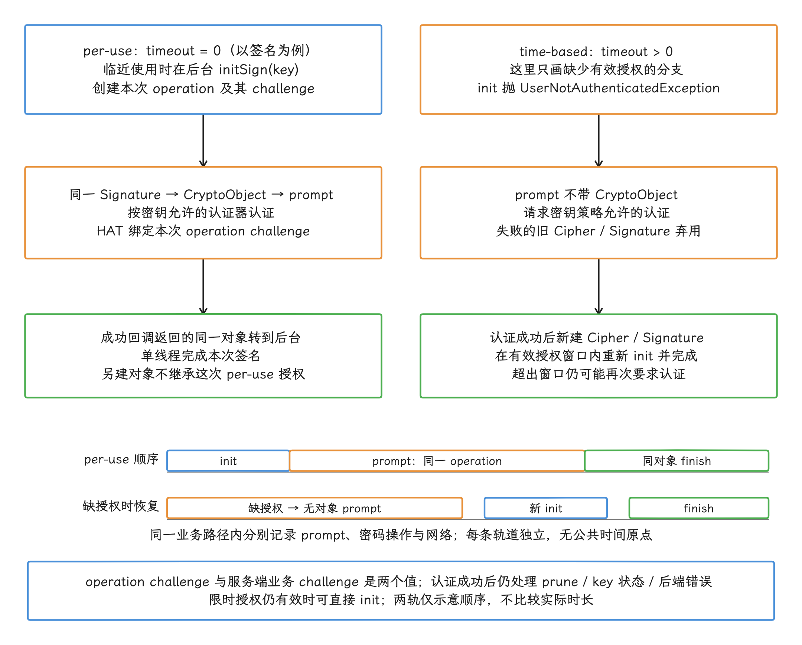
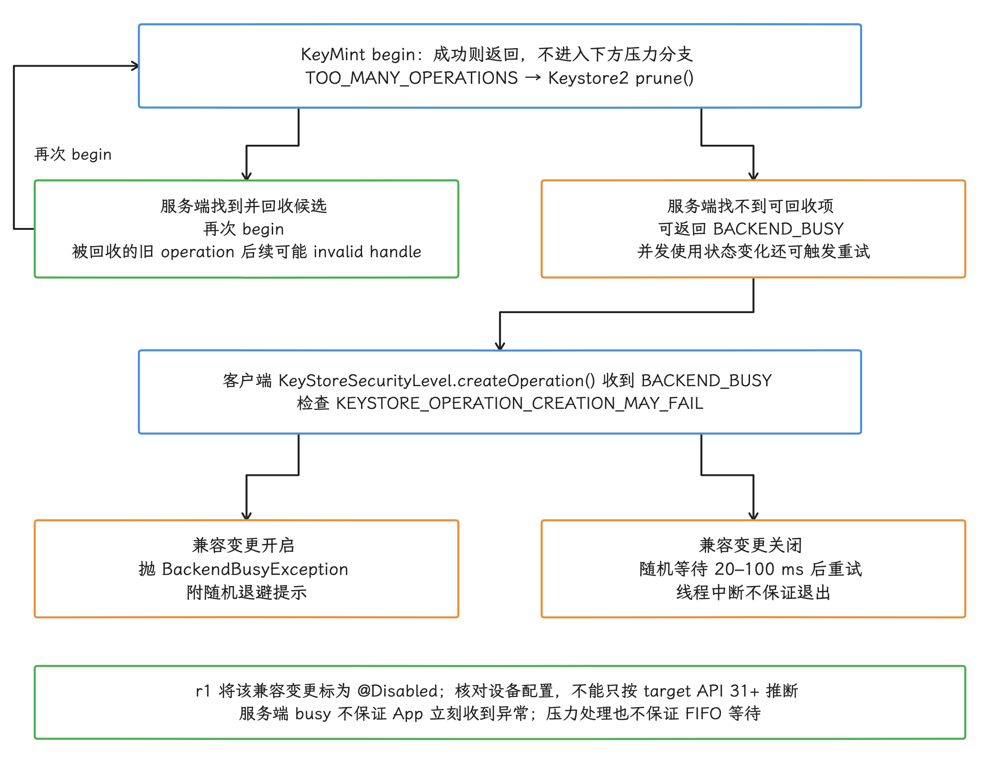
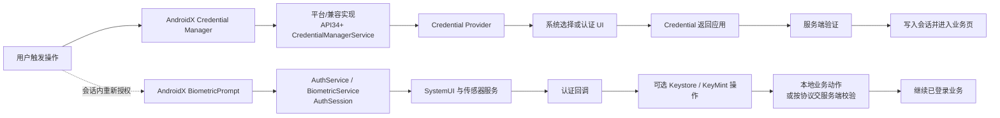
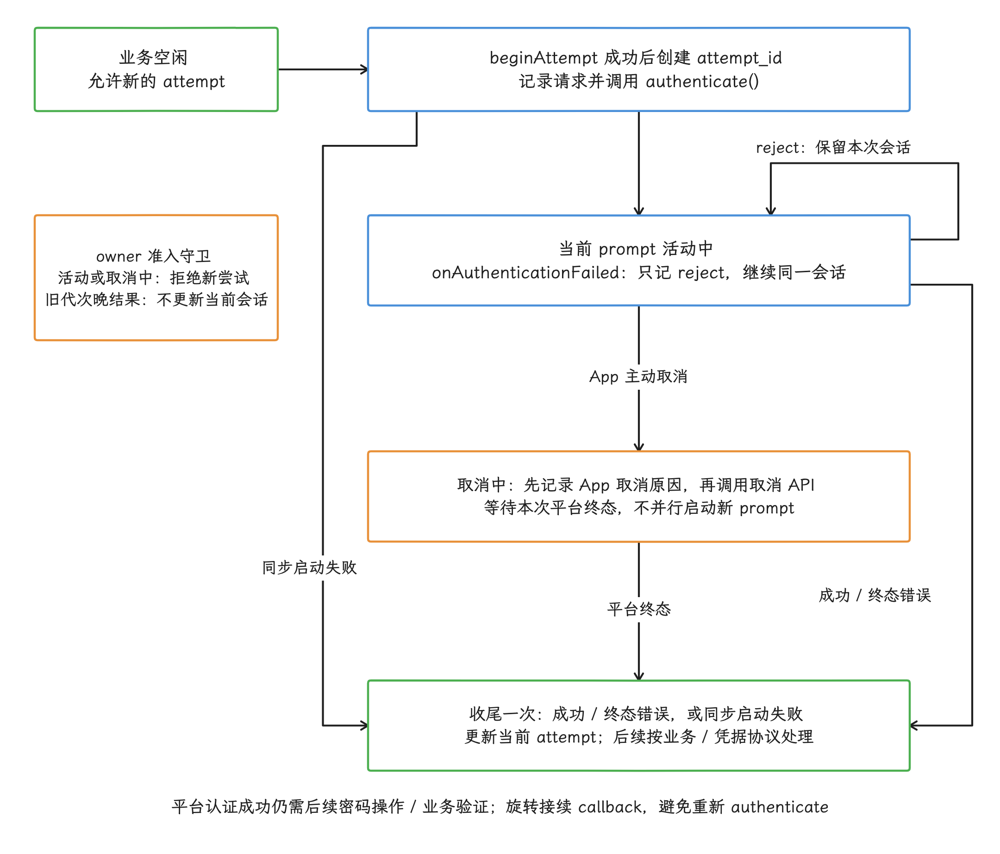
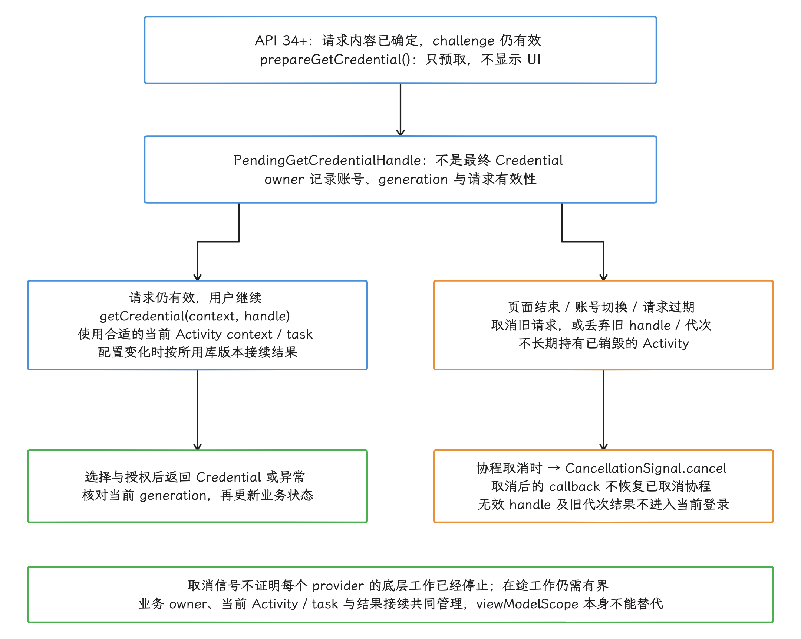
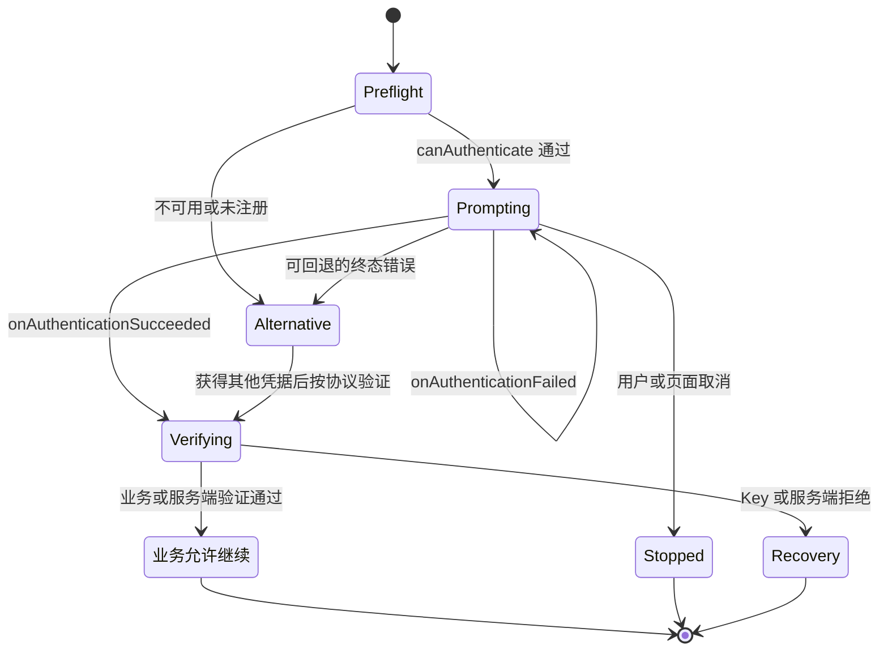

# Keystore、Biometric 与 Credential 登录性能

登录流程中的一次签名或解密，可能依次经过 App、`keystore2`、KeyMint HAL（硬件抽象层），随后进入 TEE（Trusted Execution Environment，可信执行环境）或 StrongBox 安全硬件。若密钥绑定了用户认证，链路上还会出现系统认证 UI、传感器、Gatekeeper 或运行在安全环境里的 biometric TA（处理生物识别的可信应用；只有满足相应强度要求的认证才能参与密钥授权），以及用于证明认证结果的 Hardware Auth Token。

登录链路可能同时访问 Keystore/KeyMint、BiometricPrompt 和 Credential Manager。排查登录耗时时，我们先做一件事：把链路拆开，密钥操作、硬件认证、系统 UI 与网络请求分段计时，看清时间落在哪一段。一句“Keystore 很慢”既定位不了瓶颈，也可能让性能改动破坏原有安全约束。

> 源码基线：AOSP `android-17.0.0_r1`；内核 `android17-6.18-2026-06_r6`；设备可能使用其他内核分支。应用 API 以 Android Developers 文档为准。

> ⚠️ 校勘（2026-10-23）：已按固定源码补正 IAuthService 前端、进程边界、prune / busy 客户端分支、同步调用超时与释放语义，并区分平台认证、密码操作和业务会话完成。KeyMint 的最低 32 项合同与旧说明的 16 项存在文档差异，本文保留固定 AIDL 与实际设备两层证据。

文中说的 operation，指一次有状态的密码操作会话：成功 begin 后，尚未结束或被回收的 operation 会保留后端状态；真正释放由 finish、abort、错误和服务回收路径决定。它的生命周期和服务行为，我们按 framework 与 `system/security` 源码逐一核对。

## 密钥生成、访问与 KeyMint 延迟

这一节我们沿一次密钥操作的路径往下走：调用链经过哪些进程、耗时落在哪几段、slot 与线程怎么调度，以及怎样观测这些延迟。

### 调用路径：App、Keystore2、KeyMint 与安全环境

我们先从调用路径看起。Android Keystore 以 JCA/JCE Provider（Java 密码体系的算法提供方）的形式接入 Java 密码 API：`KeyStore`、`KeyGenerator`、`KeyPairGenerator`、`Cipher`、`Signature` 和 `Mac` 这些对象都在 App 进程中创建，等到真正要用受保护的密钥时，调用才通过 Binder 进入 `keystore2`。

下面的图同时展示密码操作和用户认证两条路径，说明认证结果怎样参与密钥授权；两条路径的执行阶段并不完全重合。

<!-- gracker-diagram: ch08-05-01-key-and-auth-path -->


图：硬件密钥操作经 Keystore2 和 KeyMint；HAT 经系统桥接加入授权，不由 App 取得明文密钥。

<details>
<summary>查看 Mermaid 源码</summary>



</details>

图中的 `keystore2` 保存 KeyMint 返回的加密 key blob（由安全环境封装的不透明密钥数据） 和元数据；硬件内生成且不可导出的密钥，其明文密钥材料不由 Keystore 导出到 App；若是应用先持有明文再导入，导入前的暴露面必须另算。实际保护级别以该密钥的 KeyInfo / 证明结果为准。不过这只覆盖密钥材料本身：待签名消息、待加密明文或密文，仍会从 App 传到系统进程，再交给 KeyMint 处理，所以“业务数据从未离开 App”这句话在这里站不住。


#### 一次操作至少有五段

表里的“可观测性”一列会反复出现 App trace marker（应用写入时间线的自定义起止标记）。

| 阶段 | 入口示例 | 主要成本 | 可观测性 |
|---|---|---|---|
| 密钥查找（key lookup） | `KeyStore.getKey()`、`getEntry()` | Provider、Binder、数据库/key blob 读取 | App trace marker、Binder、`keystore2` 调度 |
| 密钥生成或导入 | `generateKey()`、`generateKeyPair()` | 随机数、参数校验、安全级别、key blob、证书 | 端到端 trace marker、错误码 |
| operation 初始化 | `Cipher.init()`、`Signature.initSign()` | 密钥查找、KeyMint `begin()`、slot、challenge | App trace marker、Binder、operation 错误 |
| 数据处理与结束 | `update()`、`doFinal()`、`sign()` | 数据传输、硬件计算、认证 token 校验 | payload 大小、端到端耗时 |
| 用户认证 | `BiometricPrompt.authenticate()` | 系统 UI、用户操作、传感器、认证 TA | prompt 回调与认证错误 |

分段时我们先定好切分点：认证 UI 的等待时间归认证阶段，密码算法耗时另算；网络换会话 token、由服务端校验 attestation 的时间，都记到网络和服务端段。指标沿这些切点记录，各段耗时才有归因的意义。这些切点是观测用的，各段之间可能重叠；重叠的 span 直接相加会重复计时，总耗时要单独测量。

<!-- gracker-diagram: ch08-05-03-phase-spans -->


图：key lookup、begin、prompt、finish 与网络各设切点；有重叠时把 span 相加会重复计时。

### `init()` 已经创建 KeyMint operation

埋点时容易只把 `doFinal()` 或 `sign()` 圈进去，而 operation 早在 `init` 阶段就已经创建：`AndroidKeyStoreCipherSpiBase.engineInit()` 会调用 `ensureKeystoreOperationInitialized()`，后者进入 `KeyStoreSecurityLevel.createOperation()`，`Signature.initSign()`、`Mac.init()` 也遵循同一个 operation 模型。每个 operation 关联一个后端句柄、占用一个 slot（可同时存在的操作名额），所以只测后半段，会漏掉 `begin()`、key blob 读取和 slot 分配的耗时。

<!-- gracker-diagram: ch08-05-04-init-creates-operation -->


图：成功的硬件 Cipher init、Signature initSign、Mac init 可创建 operation；仅测 finish 会漏掉 begin。

源码还给出两个工程约束：

- `engineGenerateKey()` 和多处 `engineInit()` 会调用 `StrictMode.noteSlowCall()`，或标记磁盘读写，表明这些路径可能阻塞调用线程。
- `Cipher` 的 reset、成功结束和部分错误都会 abort（中止） operation；finalizer 只是对象回收前的兜底清理，别指望 GC 及时释放硬件 slot。

所以 `Cipher`、`Signature`、`Mac` 在 `init` 之后要尽快用完：提前几分钟把对象建好、再等用户操作，等于白白延长 operation 和 slot 的占用时间。

#### operation 的完整生命周期

一个 KeyMint operation 从 `begin()` 开始，以下事件都会结束这次会话：

- `finish()` 成功；
- `update()` 或 `finish()` 返回错误；
- 客户端显式 `abort()`；
- operation 对应的 Binder 对象被释放；
- slot 紧张时被 Keystore2 prune，也就是选中并回收。

同一个 operation 自身还有并发保护：`operation.rs` 在多个线程同时调用同一 operation 时可返回 `OPERATION_BUSY`，所以同一个 `Cipher` 或 `Signature` 实例要当作单线程对象使用。

<!-- gracker-diagram: ch08-05-05-operation-lifecycle -->


图：finish、错误、abort、Binder 释放或 prune 都可结束 operation；并发调用同一 operation 还会遇到 OPERATION_BUSY。

### 密钥生成、签名、解密与 attestation

#### 密钥生成（key generation）

生成密钥通常比读取已有密钥更耗时。我们把可能产生耗时的环节拆开看：生成安全随机数、创建 key blob、检查硬件能力、持久化，非对称密钥还要生成证书；若设置 attestation challenge（服务端提供的随机质询），还要再生成带密钥证明扩展 attestation extension（密钥证明扩展） 的证书链。

生成动作适合放在：

- 首帧后的明确后台任务；
- 用户启用支付、设备绑定或安全登录的设置流程；
- 注册完成后、进入高频登录之前的准备阶段。

同一用途的密钥，没必要在每次 App 冷启动、每次登录点击或每个网络请求里重复生成。检查密钥是否存在时，还要考虑它可能已被删除，或按密钥策略因锁屏重置、biometric enrollment 变化而失效。OTA 本身给不出让所有 key 失效或重建的理由；升级后遇到错误，仍须区分暂时不可用、可升级 key blob 与永久失效。


#### begin/update/finish

硬件保护的 operation 适合轻量工作：处理密钥、短 challenge、小 token，或做一次数据密钥封装 data key wrapping（数据密钥封装）。大文件、数据库页或长 JSON 直接送进 Keystore，Binder/KeyMint 往返和数据传输都会变多，operation slot 也被长时间占住。

大数据加密常改用信封加密 envelope encryption（信封加密）：业务数据交给临时数据密钥加密，Android Keystore 密钥只负责保护这把数据密钥。

1. 用经过安全审查的密码库生成 data encryption key（DEK，数据加密密钥）。
2. 用 DEK 对业务数据执行 AEAD（带关联数据的认证加密），同时保证机密性和完整性。
3. 用 Android Keystore 密钥包装或保护 DEK。
4. 按协议保存算法版本、nonce（一次性随机数或计数值）、wrapped key（封装后的密钥） 和 ciphertext（密文）。

这套设计能降低安全硬件的数据吞吐压力，前提是整套协议经过威胁模型和密码协议审查；协议定稿后，算法保持既定选择、nonce 保持一次性使用、明文 DEK 只在受控窗口内存在，应用侧没有自行变通的空间。


#### 密钥证明（attestation）

attestation 用证书链证明密钥的属性及其受保护环境，测量时先区分本地生成并取得证明链、上传和服务端验证。证明链可随生成调用一起返回，同一次调用内部的生成与证明开销，App 外层计时分不开；想继续拆分，就要靠 HAL / 服务插桩。另行读取证书链可单独计时，网络与服务端也各设观测切点。证书链、challenge 和应用标识本身是敏感数据：日志只记录长度、结果类别和版本，原始内容不落盘。


### 认证绑定密钥：per-use 与 time-based 两套流程

把密钥和用户认证绑在一起，从 `setUserAuthenticationRequired(true)` 开始：设上它之后，secret key（对称密钥） 或 private key（私钥） 的使用就受用户认证约束；API 30 及以上还可用 `setUserAuthenticationParameters(timeoutSeconds, authTypes)` 指定授权有效期和允许的认证类型。


| 类型 | `timeout` | 推荐流程 | operation 何时创建 |
|---|---:|---|---|
| per-use（每次使用授权） | `0` | 初始化密码 operation，作为 `CryptoObject` 交给 BiometricPrompt | prompt 前、临近使用时创建 |
| time-based（限时授权） | `> 0` | 先尝试初始化；遇到 `UserNotAuthenticatedException` 后认证，再创建一个新 operation | 有效授权期内创建 |

#### per-use 密钥

下面是 API 30+ 的 `KeyGenParameterSpec` 配置，要求每次签名都取得 Class 3 生物识别或设备锁屏凭据的授权，Class 3 是 Android 定义的最强生物识别等级。

```kotlin
val spec = KeyGenParameterSpec.Builder(
    alias,
    KeyProperties.PURPOSE_SIGN,
)
    .setDigests(KeyProperties.DIGEST_SHA256)
    .setUserAuthenticationRequired(true)
    .setUserAuthenticationParameters(
        0,
        KeyProperties.AUTH_BIOMETRIC_STRONG or
            KeyProperties.AUTH_DEVICE_CREDENTIAL,
    )
    .build()
```

生成密钥后，每次使用都新建一个 `Signature` 并调用 `initSign()`，再把它包装成 `BiometricPrompt.CryptoObject`。认证成功的回调会带回已经获得本次授权的 operation，我们在同一对象上完成签名即可；若在回调前另建了一个 `Signature`，那个对象对应另一项 operation，刚才的 per-use 认证盖不住另一项 operation。回调成功也不保证后续 sign / doFinal 必定成功：等待期间的 prune、密钥状态变化或后端错误仍须处理。KeyMint operation challenge 与服务端要求签名的业务 challenge 是两个值，别混用。


#### time-based 密钥

time-based 密钥的初始化可能抛出 `UserNotAuthenticatedException`，意思是当前没有仍在有效期内的认证授权。这时先展示策略允许的生物识别或设备凭据流程；认证成功后重新创建并初始化 `Cipher` 或 `Signature`，初始化失败的那个旧对象就此弃用。

<!-- gracker-diagram: ed08-05-auth-operation-order -->


图：左栏以Signature签名为例：per-use先创建本次operation，同一对象经CryptoObject/prompt授权后继续签名；operation challenge与服务端业务challenge不同。右栏只画time-based缺少有效授权时的恢复：无对象prompt后新建对象再init，失败旧对象弃用；已有有效授权可直接init。策略与版本限制仍须满足，认证成功后仍处理prune、key状态和后端错误。两条轨道独立示意顺序，无公共起点或实测比例。

BiometricPrompt 等待阶段需要单独记录：

- 从 `prompt_requested` 到 `onAuthenticationSucceeded`、错误或取消回调；
- 认证成功后的密码操作完成时间；
- 登录网络请求及服务端响应。

用户思考或操作的时间、系统 UI 动画、传感器重试，都算 prompt 阶段；KeyMint operation 只覆盖密码操作和授权校验的一部分，拿它代表完整的用户认证时长就会偏短。

#### 密钥永久失效（invalidation）

关闭安全锁屏、强制重置凭据或改变 biometric enrollment（生物识别模板录入状态），可能让密钥永久失效，并在初始化时抛出 `KeyPermanentlyInvalidatedException`。恢复策略应明确：

- 哪些密钥可以删除后重建；
- 哪些密钥失效后需要重新登录或在服务端解除设备绑定；
- 是否允许 `AUTH_DEVICE_CREDENTIAL`；
- enrollment 变化后密钥是否保持有效。

把“重建密钥”当通用重试手段是有代价的：旧密钥保护的数据可能再也解不开。重建前，先确认服务端和本地的恢复协议允许这样做。

<!-- gracker-diagram: ch08-05-12-invalidation-recovery -->


图：永久失效进入恢复决策；直接删 key 重建可能让旧密文永久不可解。

### StrongBox、TEE 与 security level

Android 9 / API 28 及以上设备可以提供 StrongBox KeyMint。TEE 已经与 Android 主系统隔离运行，StrongBox 再进一步，用隔离程度更高的安全硬件，面向物理攻击和侧信道风险更高的场景；代价是通常速度更慢、资源更少、并发能力更低，所以多数应用默认不必选它。


#### 设备能力与业务策略

我们先从设备能力查起。`FEATURE_STRONGBOX_KEYSTORE` 只说明设备声明了 StrongBox 能力，具体到算法、key size（密钥长度）、digest（摘要算法）、padding（填充方式） 或 attestation 的参数组合，仍可能不受支持。`setIsStrongBoxBacked(true)` 只是生成参数；生成时相应硬件不可用等错误可映射为 `StrongBoxUnavailableException`，其他参数或 Provider 错误也可能以其他异常返回。平台不会因此自动改去生成 TEE 密钥；哪些异常允许降级，要由应用按预定义策略判断，见到任意异常就降级，会把其他错误一起吞掉。

<!-- gracker-diagram: ch08-05-14-strongbox-fallback -->


图：能力声明、参数支持、生成结果和业务 fallback 是不同步骤；异常本身给不了降级许可。

应用需要预先定义三类策略：

| 策略 | StrongBox 不可用时 | 适合场景 |
|---|---|---|
| required（必须） | 终止流程并提示，或交给服务端处理 | 高价值设备绑定、明确合规要求 |
| preferred（优先） | 记录失败，经安全策略批准后重新生成非 StrongBox 密钥 | 中风险签名、可分级设备 |
| not requested（不要求） | 使用平台选择的普通 Android Keystore 安全级别 | 普通会话和大多数 App |

preferred fallback（首选方案不可用时的后备流程） 意味着由应用重新发起一次密钥生成，新密钥的安全级别已经改变，应用必须记录这次变化并通知服务端；捕获异常后悄悄继续，就漏掉了这次记录和通知。

#### 查询生成结果

Android 12 / API 31 及以上可通过 `KeyInfo.getSecurityLevel()` 读取：

- `SECURITY_LEVEL_STRONGBOX`；
- `SECURITY_LEVEL_TRUSTED_ENVIRONMENT`；
- `SECURITY_LEVEL_SOFTWARE`；
- `SECURITY_LEVEL_UNKNOWN_SECURE` / `UNKNOWN`。

埋点把三件事记全：`strongbox_requested`、密钥生成后的实际 security level、fallback 原因。三者齐全，才能比较不同安全级别的延迟，也才能数清请求 StrongBox 之后发生了多少次降级。


### operation slot 与 prune 策略

并发上限的新旧说法容易混淆，我们先把事实摆清楚：AOSP KeyMint AIDL 自 Android 12 / API 31 起，把 `IKeyMintDevice.begin()` 的最低并发上限写成 32，注释原文为 "IKeyMintDevice implementations must support 32 concurrent operations"；`source.android.com/docs/security/features/keystore/implementer-ref` 上仍写的 16，与这里核对的 Android 12 r1 和 Android 17 r1 AIDL（均为最低 32）存在差异，据此反推“所有旧版 KeyMint 都只支持 16”站不住脚；当前合同以固定 AIDL 为准。keystore2 代码本身没有固定配额常量，上限交给 KeyMint HAL 的 AIDL 合同。

`vold` 是 Android 的卷管理守护进程，会使用 KeyMint 支撑存储加密。Keystore2 源码里并没有为它写死保留 slot；想给 `vold` 留余量，正确做法是在自测时直接观察 prune 和返回错误，而不是套用旧文档里的“15+1”分配。

32 是 HAL 合同的最低支持量；把它读成普通 App 的独占配额，或读成“第 32 个请求必然失败”的阈值，都会读错它的含义。


达到设备实际容量后，新 begin 不保证按 FIFO 等待；源码的压力处理是：

<!-- gracker-diagram: ch08-05-17-prune-score -->


图：普通候选分数须高于 caller；同分优先久未用，未找到时还可回收 caller 自己的最旧项。

1. `IKeyMintDevice.begin()` 返回 `TOO_MANY_OPERATIONS`。
2. Keystore2 调用 `OperationDb::prune()`，尝试选中并释放一项已有 operation。
3. 普通请求先比较 malus：`1 + 同 owner 的其他 operation 数 + floor(log6(距上次使用秒数 + 1))`。候选分数须严格高于调用者分数；同分候选优先回收更久未使用者。找不到普通候选时，还可回收调用者自己最久未用的 operation。forced 请求 / operation 有单独的权限与权重分支，不适合套入普通 App 配额估算。
4. 找不到可回收项时，服务端可返回 `BACKEND_BUSY`。候选使用状态在并发中改变时会重试或再次 begin；被 prune 的旧 operation 后续使用可返回 invalid handle。客户端是否立即看到 busy，还取决于下一段的兼容分支。

落到应用侧，做法就是限制并发、缩短 operation 生命周期，并按请求记录 busy、pruned 和 invalid-handle（operation 句柄已失效）类错误。这里指密码 operation，与 Credential Manager 的预取 handle 无关。旧资料常把这套策略概括成“中止全局最久未使用的 operation”，这漏掉了 owner 和 sibling 数量这个维度；KeyMint AIDL 的 32 是整个 HAL 的下限，App 一次能开多少并发 operation，还要按它再往下折算。


客户端也可能把 busy 变成长等待：r1 的 `KeyStoreSecurityLevel.createOperation()` 检查兼容变更 `KEYSTORE_OPERATION_CREATION_MAY_FAIL`；开启时抛出带退避提示的 `BackendBusyException`，关闭时按随机 20–100 ms 退避后重试。该变更在 r1 声明为 `@Disabled`，仅凭 target API 31+ 还断言不了 App 一定立即收到 busy；设备兼容配置仍须核对。这条重试路径面对 Java 线程中断也未必退出。[来源][login-client-busy]。

<!-- gracker-diagram: ed08-05-backend-busy-and-client-retry -->


图：begin成功直接返回；图只展开容量压力路径。TOO_MANY_OPERATIONS先触发服务端prune/重新begin，被回收旧operation可能invalid handle；无法回收可返回BACKEND_BUSY，客户端再按兼容变更抛BackendBusyException或随机20–100ms退避重试。r1将该变更标为@Disabled，不能仅按target31推断开启；线程中断不保证退出，服务端busy不保证App立即收到异常，也不是FIFO承诺。

#### 容易耗尽 slot 的写法

- 为即将展示的多个列表项提前各建一个 `Cipher`。
- per-use operation 创建后，用户长时间没有响应 BiometricPrompt。
- 批量文件加解密为每个分片同时建立硬件 operation。
- 多个 SDK 各自使用无界线程池访问 Keystore。
- 超时后保留旧 `Cipher`，同时开始新一轮重试。

Keystore 并发预算应由设备测试决定；线程数、等待队列和在途 operation 数要分别设限；线程池大小固定，只约束住了线程这一项。合适的并发值分别在 TEE 和 StrongBox 上压测确定，直接照搬 CPU 核数得不出可靠结论。

<!-- gracker-diagram: ch08-05-20-slot-occupancy -->


图：提前 init 后等待用户会延长 slot 寿命；worker 数、排队请求数和在途 operation 数分别设预算。

### 冷启动和登录的线程调度

线程调度上，我们先记住官方的一条明确建议：主线程上避开 `AndroidKeyStore`。密钥查找、`init`、生成、签名和 `doFinal` 都可能等待 Binder、数据库或安全硬件，Provider 源码也通过 StrictMode 标出了多处慢调用。这些操作放到主线程，会直接挡住界面绘制和输入处理。


#### 时机表

| 时机 | 可安排的工作 | 应避开的工作 |
|---|---|---|
| 首帧前 | 读取不依赖 Keystore 的轻量登录状态 | 密钥生成、attestation、StrongBox operation、批量解密 |
| 首帧后 | 检查密钥能力、预生成允许提前创建的密钥 | 创建 per-use operation 后长期等待 |
| 登录点击后 | 在有界后台执行器中创建本次密码 operation | 在主线程串行执行密码操作、JSON 处理和网络请求 |
| prompt 阶段 | 展示认证 UI，处理取消和错误 | 同时启动多个备用 operation |
| 认证成功后 | 完成本次短签名/解密，发起网络换票 | 解密大文件或大数据库 |

下面的示例用 owner 持有的双 worker、容量 8 的等待队列执行短签名；2 和 8 仅为预算示例，不是设备通用推荐值。`AbortPolicy` 在队列满时拒绝提交，避免退回调用主线程执行。同步 trace 内没有挂起点，并同时覆盖查找、`initSign` 和 `sign`。

<!-- gracker-diagram: ch08-05-22-signer-budget -->


图：示例的 2 worker / 8 等待项只演示有界执行；拒绝通过协程取消处理，close 不强制中断硬件。

```kotlin
class ChallengeSigner : Closeable {
    private val executor = ThreadPoolExecutor(
        2, 2, 0L, TimeUnit.MILLISECONDS,
        ArrayBlockingQueue<Runnable>(8),
        ThreadFactory { task -> Thread(task, "keystore-worker") },
        ThreadPoolExecutor.AbortPolicy(),
    )
    private val dispatcher = executor.asCoroutineDispatcher()

    suspend fun signChallenge(
        alias: String,
        challenge: ByteArray,
    ): ByteArray = withContext(dispatcher) {
        Trace.beginSection("Keystore:sign")
        try {
            val store = KeyStore.getInstance("AndroidKeyStore").apply {
                load(null)
            }
            val privateKey = store.getKey(alias, null) as? PrivateKey
                ?: throw KeyStoreException("Signing key unavailable")
            Signature.getInstance("SHA256withECDSA").run {
                initSign(privateKey)
                update(challenge)
                sign()
            }
        } finally {
            Trace.endSection()
        }
    }

    override fun close() {
        dispatcher.close()
    }
}
```

示例适用于无需通过 `CryptoObject` 单独授权的密钥。per-use 密钥应先在后台初始化 `Signature`，再回到主线程将它交给 BiometricPrompt；认证成功后，把回调返回的同一对象转移到后台完成签名，整个过程中这个对象始终单线程使用。owner 结束时先停止接单，按策略取消或等待在途工作，再关闭 signer；close 不强制打断已进入的 Binder / KeyMint 调用。`asCoroutineDispatcher()` 遇到 Executor 拒绝会取消相应 Job 并回退 IO 推进取消清理，业务要识别拥塞 / 拒绝；拒绝后的 finally 未必还带着原线程亲和性。

#### 超时与取消

JCA Keystore API 没有统一的 per-operation deadline，超时语义要应用自己搭。`Future.get(timeout)` 终止的只是本次 get 的等待，Future 本体要另行取消；`withTimeout` 取消的是协程代码块，同步 Binder 调用尚未返回时能否立刻返回，它保证不了，父作用域也可能继续等子任务结束。UI 若必须按期限切换展示，就由明确的业务 owner 分离 UI 等待状态与受控 worker，并用请求代次隔离晚结果，后台任务的总量同样要设上限。调用一旦进入 Binder / KeyMint，上层计时器或线程中断未必能立即停止底层操作。

<!-- gracker-diagram: ch08-05-23-timeout-boundary -->


图：上层超时管不到同步 Binder 的返回时机；用 owner 与请求代次隔离晚结果，同时保留总并发预算。

处理超时应遵守：

- 旧 worker（工作线程） 线程尚未结束时，不复用同一个密码对象；
- 将晚到结果标记为过期，不写入当前会话；
- BiometricPrompt 取消按 API 结束认证会话、相关传感器工作及系统 UI，不保证中断独立的 JCA / KeyMint 调用；
- 正常路径尽快完成 finish，失败后按 Provider 契约清理并弃用旧对象；JCA 没有统一的公开 abort / close 接口，单纯丢弃引用不保证 slot 立即释放；
- 连续超时后进入退避等待或备用登录，不做没有并发上限的重试。

### 观测：分阶段、分安全级别、保护敏感数据

#### 应记录的字段

| 字段 | 示例 | 用途 |
|---|---|---|
| `scene` | `session_restore`、`biometric_login`、`payment_confirm` | 对齐用户流程 |
| `phase` | `get_key`、`generate`、`begin`、`prompt_wait`、`finish`、`attestation` | 找到耗时阶段 |
| `primitive` | `AES_GCM`、`HMAC_SHA256`、`ECDSA_P256` | 区分密码原语或算法组合 |
| `purpose` | encrypt、decrypt、sign、verify、agree | 区分授权 |
| `security_level` | TEE、StrongBox、Software、Unknown | 比较实现 |
| `strongbox_requested` | true / false | 对照策略 |
| `auth_policy` | none、per-use、duration、credential | 区分授权方式 |
| `payload_bucket` | 0—64 B、65—512 B、513 B—4 KiB | 用区间记录输入大小，避免暴露精确长度 |
| `thread` | main / keystore-worker | 暴露 UI 阻塞 |
| `duration_ms` | 单次值，服务端计算 P50/P90/P99 | 保留耗时分布，而非只看平均值 |
| `result_class` | ok、not-authenticated、invalidated、unavailable、busy | 归类失败 |
| `device/build/app` | 型号、Build、版本 | 识别设备聚集 |

key alias（密钥别名）、明文、密文、签名原文、认证 token、attestation challenge、完整证书链，这些都不进日志：alias 里常带账号或业务含义，拿它当日志标签同样不合适。


#### Perfetto 能看到什么

在能稳定复现问题的设备上，我们采集应用 trace marker、sched（线程调度）、Binder、CPU frequency（CPU 频率） 和磁盘 I/O，可以回答：

- App 主线程是否同步等待；
- Binder 调用发往 `keystore2` 的起止和调度延迟；
- `keystore2` 线程是 Running、Runnable、Sleeping，还是运行过程中被其他线程抢占；
- key 数据库访问是否伴随 I/O；
- 多个请求是否在同一时间窗内竞争 operation。

TEE/StrongBox 内部阶段在普通 Perfetto trace 里通常看不到。时间线只到 `keystore2` 进入 KeyMint 为止、安全环境内部没有细分轨道时，结论就写到“耗时位于 KeyMint/HAL/安全环境区间”为止，再往下要结合厂商日志或 HAL 内部插桩定位。时间线上的空白只说明“看不到”；某个密码算法本身慢不慢，要靠厂商日志和插桩来回答。


#### 测试组合

每个关键密码原语至少覆盖以下测试条件：

- key 首次生成与既有 key；
- 4 KB 和更小的 payload，避免只测试空消息；
- TEE 与 StrongBox 的实际 security level；
- 单 operation、少量并发，以及接近 slot 上限的受控压力测试；
- 冷机、热机、锁屏后，以及 biometric enrollment 变化后；
- 成功、用户取消、认证失败、密钥失效和 StrongBox 不可用；
- 设备型号、Android 版本、厂商 Build。

“StrongBox 比 TEE 慢多少毫秒”没有适用于所有设备的固定数字；测试时保存条件和分位数，并在同一设备上用相同的密钥类型、算法、payload 和认证策略做对照。


### 性能动作与安全策略

我们把常用的性能动作和各自的约束对照着看：

| 动作 | 性能收益 | 安全边界 |
|---|---|---|
| 首帧后预生成 | 移出冷启动和点击路径 | 只预生成已获同意、允许提前存在的 key |
| 有界后台执行 | 避免主线程卡顿 | 线程切换不改变密钥授权条件 |
| just-in-time `init`（临用时初始化） | 缩短 slot 占用 | per-use operation 要与 prompt 绑定 |
| envelope encryption | 减少安全硬件处理大 payload 的时间 | 协议、AEAD、nonce 与数据密钥生命周期需审查 |
| StrongBox preferred fallback | 提高设备覆盖 | 记录降级，并让服务端接受变化后的 security level |
| 超时或备用登录 | 让 UI 可以继续响应 | 上层超时不代表 operation 已取消 |
| 能力缓存 | 减少重复探测 | 系统升级、锁屏和 enrollment 变化后失效 |

设备能力结果、密钥是否存在这类非敏感状态、服务端策略版本，都可以缓存。解密后的 refresh token（刷新令牌） 是另一回事：明文缓存会扩大数据可能暴露的范围，想缓存就要先单独过安全评审，单看 Keystore 耗时这一项撑不起这个决定。


### Passkey / Credential Manager 的角色

密钥归谁管，直接决定性能指标该记到谁头上，我们先把这件事分清。Credential Manager 是初始登录的统一凭据入口，也支持后续的重新授权。普通依赖方 App（relying party）请求 passkey 时，私钥通常由凭据提供方 credential（凭据） provider（凭据提供方） 管理；用户创建 passkey，业务 App 自己的 `AndroidKeyStore` alias 并没有随之新增。


性能指标应分开：

- 常规 App 记录 Credential Manager 请求到结果；只有实验室或平台补足显示证据后，才进一步拆出 provider UI 出现时刻；
- 用户选择/认证；
- provider 返回 credential；
- App 与服务端完成 assertion（认证断言） 验证；
- App 自己用于会话缓存的 Keystore 解密。

只有应用自行生成 Android Keystore 密钥，或应用本身实现 credential provider 并管理相应密钥时，才需要把这些密钥纳入 alias、operation 与 security-level 清单。

### Android 6—17 的版本边界

| 版本 | 相关能力 |
|---|---|
| Android 6 / API 23 | `KeyGenParameterSpec` 与认证绑定密钥的现代应用基线 |
| Android 9 / API 28 | StrongBox API 与 `StrongBoxUnavailableException` |
| Android 11 / API 30 | `setUserAuthenticationParameters()` 明确认证有效期与 auth type |
| Android 12 / API 31 | Keystore2 + KeyMint 架构；`KeyInfo.getSecurityLevel()` |
| Android 13 / API 33 | KeyMint v2 增加 Curve25519 等能力 |
| Android 17 / API 37 | 本文源码锚点；Keystore2 operation、Provider 和 AIDL KeyMint 主线按固定 tag 核查 |

平台版本表只描述 API 和架构层面的能力。StrongBox 支持情况、算法组合、可用 operation 数和安全环境耗时，仍由具体设备实现决定。


### Android 17 与 kernel 源码入口

排查时可从以下固定源码继续追踪：

- [`KeyStore2.java`](https://android.googlesource.com/platform/frameworks/base/+/android-17.0.0_r1/keystore/java/android/security/KeyStore2.java)：App Provider 到 `IKeystoreService` 的 Binder 客户端。
- [`AndroidKeyStoreKeyGeneratorSpi.java`](https://android.googlesource.com/platform/frameworks/base/+/android-17.0.0_r1/keystore/java/android/security/keystore2/AndroidKeyStoreKeyGeneratorSpi.java)：security level 选择、密钥生成与 StrongBox 错误映射。
- [`AndroidKeyStoreCipherSpiBase.java`](https://android.googlesource.com/platform/frameworks/base/+/android-17.0.0_r1/keystore/java/android/security/keystore2/AndroidKeyStoreCipherSpiBase.java)：`engineInit()`、operation 创建及 finish/abort。
- Keystore2 [`security_level.rs`](https://android.googlesource.com/platform/system/security/+/android-17.0.0_r1/keystore2/src/security_level.rs)：KeyMint `begin()`、`TOO_MANY_OPERATIONS` 与 prune 重试。
- Keystore2 [`operation.rs`](https://android.googlesource.com/platform/system/security/+/android-17.0.0_r1/keystore2/src/operation.rs)：operation 生命周期、并发保护和 pruning 算法。
- [`IKeyMintDevice.aidl`](https://android.googlesource.com/platform/hardware/interfaces/+/android-17.0.0_r1/security/keymint/aidl/android/hardware/security/keymint/IKeyMintDevice.aidl)：KeyMint HAL 的 generate/import/begin 接口。

App 到 `keystore2`、`keystore2` 到 Binderized KeyMint HAL（通过 Binder 暴露的 KeyMint 服务），这两段都经过 Binder。内核侧按 `android17-6.18-2026-06_r6` 固定查看 [`drivers/android/binder.c`](https://android.googlesource.com/kernel/common/+/refs/tags/android17-6.18-2026-06_r6/drivers/android/binder.c)。TEE / StrongBox 的具体 transport 和集成依设备实现；common kernel 可包含 OP-TEE 等通用驱动，别把“相关 driver 都不在 common kernel”当成默认结论。要把现场归到具体通道，仍需实际设备的内核、HAL 与固件证据；手头没有设备内核与 HAL 源码时，归因到这里为止，剩余部分明确记为厂商实现内部。


## 生物认证、凭据选择与登录完成

密钥可用之后，登录流程还没走完：认证 UI 和凭据提供方会继续引入 Binder、硬件和用户交互的等待，所以最终的登录完成时间，我们要和密钥阶段分开归因。

如果登录页只记录一个 `login_cost_ms`（登录总耗时），慢登录出现时，时间花在哪里，这个数字回答不了。我们把一次凭据登录拆开看，环节可能有：Credential Provider（凭据提供方） 查询、系统凭据选择器、用户操作、传感器认证、passkey assertion（通行密钥生成的认证断言）、服务端验证和会话初始化；会话内的重新授权则可能只经过 `BiometricPrompt`、Keystore 与业务操作。两个流程都会显示系统认证界面，但调用者、各自碰到的数据和可观测信号都不一样。

分工上，应用初次登录优先使用 Credential Manager；已登录会话内确认敏感操作时，Credential Manager 或 AndroidX `BiometricPrompt` 都可以。这一分工来自当前 [Android 生物认证指南](https://developer.android.com/identity/sign-in/biometric-auth)，也省去了应用自行实现账号选择与认证界面的工作。

### 两条流程，两个责任边界

<!-- gracker-diagram: ch08-05-30-login-versus-reauth -->


图：初始凭据登录按 credential 协议验证；会话内认证可授权本地动作或签名后验证，不自动生成 passkey assertion。

登录与重新授权可以共用同一套 `flow_id`（一次用户意图的短期关联 ID） 规则，但两边的阶段名称要分开。下图中的实线表示 Credential Manager 登录，虚线表示会话内重新授权：

<details>
<summary>查看 Mermaid 源码</summary>



</details>

Credential Manager 返回的 Credential 仍需按其类型完成业务及服务端验证；passkey assertion 由服务端按 WebAuthn 协议验证。会话内 BiometricPrompt 成功只说明本次平台认证通过，后续可能是本地敏感动作，也可能是签名后交服务端校验；passkey assertion 与新登录会话，都要由后续业务步骤自己完成。

性能拆分建议使用下列口径：

| 阶段 | 应用入口或完成点 | 应用能直接观测什么 | 不应从该阶段推断什么 |
|---|---|---|---|
| 凭据请求 | `getCredential()` 开始到返回或抛出异常 | 请求类型、总等待、结果类型、异常类 | 各 provider 的查询时长、候选总数、系统 UI 出现时间 |
| 生物认证请求 | `authenticate()` 开始到成功或终态错误 | 请求时间、认证类型、错误码、调用方取消原因 | 对话框精确出现时间、实际使用的指纹或人脸传感器 |
| 加密操作 | `Cipher.init`、`Signature.initSign`、`doFinal`、`sign` | 每次调用耗时、异常家族、密钥策略 | 用户停留时间、服务端耗时 |
| 凭据验证 | Credential 返回到服务端响应 | 网络耗时、HTTP 类别、验证或风控结果 | SystemUI 或传感器性能 |
| 会话就绪 | 服务端通过到目标页面首帧 | 本地写入、数据加载、首帧时间 | 前面认证阶段的耗时 |

`CredentialManager.getCredential()` 的等待时间，包含用户在系统 UI 上查看和选择凭据的时间；`BiometricPrompt` 从发起请求到收到回调的区间，同样包含用户操作。没有平台专用观测能力时，我们只能把这类指标命名为“请求到结果”——整段时间标成“provider 查询耗时”或“传感器识别耗时”，都超出了实际观测的范围。


### BiometricPrompt：从应用调用到系统回调

AndroidX `BiometricPrompt` 是应用侧推荐使用的封装：Android 9（API 28）及以上使用系统认证界面，AndroidX 还处理版本兼容和配置变更后的回调接续。平台文档说明，`BiometricPrompt.authenticate()` 会触发准备生物识别硬件、显示系统对话框和开始扫描等后续工作；方法返回时，界面不一定已经可见。

我们顺着源码看这段工作的分布，它会经过多个进程和对象：

1. Framework 的 [`BiometricPrompt.java`](https://android.googlesource.com/platform/frameworks/base/+/android-17.0.0_r1/core/java/android/hardware/biometrics/BiometricPrompt.java) 在 `authenticateInternal()` 中先调用 `IAuthService.authenticate()`；AuthService 再转交 `IBiometricService`，并把 `CancellationSignal` 连接到返回的请求 ID。
2. `system_server` 中的 [`BiometricService.java`](https://android.googlesource.com/platform/frameworks/base/+/android-17.0.0_r1/services/core/java/com/android/server/biometrics/BiometricService.java) 接收 Binder 请求后，将 `handleAuthenticate()` 投递到服务 Handler（串行处理消息的线程队列） 上串行处理。请求会经过权限、前台状态、认证器可用性和注册状态检查。
3. [`AuthSession.java`](https://android.googlesource.com/platform/frameworks/base/+/android-17.0.0_r1/services/core/java/com/android/server/biometrics/AuthSession.java) 保存一次认证会话的状态，并通过状态栏服务请求 SystemUI 显示认证界面。
4. SystemUI 的 [`AuthController.java`](https://android.googlesource.com/platform/frameworks/base/+/android-17.0.0_r1/packages/SystemUI/src/com/android/systemui/biometrics/AuthController.java) 实现 `showAuthenticationDialog()`，处理界面展示、消失和结果回传。
5. 每个生物传感器有自己的 [`BiometricScheduler.java`](https://android.googlesource.com/platform/frameworks/base/+/android-17.0.0_r1/services/core/java/com/android/server/biometrics/sensors/BiometricScheduler.java) 实例。它维护当前操作和待处理队列，再由具体的 sensor service（传感器系统服务） 与厂商 HAL 交互。

<!-- gracker-diagram: ch08-05-34-sensor-scheduler -->


图：BiometricScheduler 维护单个 sensor 的当前操作和待处理队列；它不是全系统所有 sensor 共享的一个 FIFO。

这条路径跨越 App、`system_server`、SystemUI 和厂商 HAL；AuthService、BiometricService、AuthSession 及常见传感器系统服务都在 `system_server` 进程之内，画链路图时共用一个进程框。应用主线程 trace 覆盖的是调用方看到的这一段，再往下，各系统组件各自的耗时就分不出来了。

<!-- gracker-diagram: ch08-05-32-biometric-processes -->


图：Framework 先到 IAuthService；AuthService、BiometricService、AuthSession 与常见 sensor 服务同处 system_server。

#### 应用侧可记录的 prompt 事件

我们先看回调给了什么。AndroidX 公开的 `AuthenticationCallback` 只提供成功、终态错误和本次样本未识别三类结果，缺一个“对话框已显示”回调；埋点命名要把这个限制反映出来：


- `biometric_request_start`：调用 `authenticate()` 前；
- `biometric_rejected`：收到 `onAuthenticationFailed()`；
- `biometric_terminal`：收到 `onAuthenticationSucceeded()` 或 `onAuthenticationError()`；terminal 表示本次认证会话已经结束；
- `biometric_client_cancel`：应用调用 `cancelAuthentication()` 前记录自身原因。

`request_to_terminal_ms` 是应用可以稳定记录的指标；`prompt_show_ms` 要有依据，得先在测试环境用录屏、UI 自动化、Perfetto 或平台内部日志拿到界面实际显示时间。线上直接把调用 `authenticate()` 的时刻当作 prompt 出现时间，Binder 调度、预检查和 SystemUI 调度就都被误算成界面展示耗时了。

<!-- gracker-diagram: ch08-05-33-request-not-shown -->


图：公开 callback 不报告 prompt 已显示；线上可记录 request_to_terminal，显示耗时需测试环境证据。

#### 配置变更后的认证会话

当前 [AndroidX `BiometricPrompt` API 参考](https://developer.android.com/reference/androidx/biometric/BiometricPrompt) 明确说明，旋转等配置变更导致 Activity 或 Fragment 重建时，认证界面默认继续保留。应用应在新的 `onCreate()` 早期重新构造 `BiometricPrompt`，让新实例的 callback 接收正在进行的会话；此时既不用再次调用 `authenticate()`，也先不要调用 `cancelAuthentication()`。

<!-- gracker-diagram: ch08-05-36-config-reattach -->


图：AndroidX prompt 默认跨配置变更保留；重建时注册新 callback，进程死亡后旧会话是否还在要重新判断，持久化标记说了不算。

同一个 Activity 或 Fragment 创建多个 `BiometricPrompt` 时，只有最近创建实例的 callback 会被保存。登录页应只维护一个 prompt 实例，并用业务状态阻止重复点击。应用离开前台后，系统可能因安全策略关闭 prompt；这类终止要与旋转重建分别统计。

以下代码骨架演示怎样维持单次认证会话，并区分非终态与终态回调。`LoginViewModel` 和 `LoginMetrics` 代表业务自己的状态与埋点接口：

```kotlin
class LoginActivity : FragmentActivity() {
    private val loginViewModel: LoginViewModel by viewModels()
    private lateinit var biometricPrompt: BiometricPrompt

    override fun onCreate(savedInstanceState: Bundle?) {
        super.onCreate(savedInstanceState)

        biometricPrompt = BiometricPrompt(
            this,
            ContextCompat.getMainExecutor(this),
            object : BiometricPrompt.AuthenticationCallback() {
                override fun onAuthenticationFailed() {
                    LoginMetrics.rejected(loginViewModel.requireAttemptId())
                }

                override fun onAuthenticationError(
                    errorCode: Int,
                    errString: CharSequence
                ) {
                    loginViewModel.finishWithError(errorCode)
                }

                override fun onAuthenticationSucceeded(
                    result: BiometricPrompt.AuthenticationResult
                ) {
                    loginViewModel.finishWithSuccess(result.authenticationType)
                }
            }
        )
    }

    fun requestReauthentication(promptInfo: BiometricPrompt.PromptInfo) {
        if (!loginViewModel.beginAttempt()) return
        LoginMetrics.requestStarted(loginViewModel.requireAttemptId())
        try {
            biometricPrompt.authenticate(promptInfo)
        } catch (error: RuntimeException) {
            loginViewModel.finishWithSetupError()
            throw error
        }
    }
}
```

重建后的 Activity 会注册新的 callback，正在显示的认证会话继续运行。`beginAttempt()` 负责拒绝重复点击；`onAuthenticationFailed()` 只记录一次样本未识别，不结束业务状态。成功或错误回调结束本次 attempt；同步启动失败也必须清理。业务 ViewModel 应只允许一个活动 / 正在取消的 attempt，取消时先记原因并等平台终态，不在旧 prompt 尚未结束时启动新 prompt。旋转时保留内存中的业务 attempt；进程重建后旧系统会话是否还在要重新判断，持久化的“正在认证”标记说了不算。

<!-- gracker-diagram: ed08-05-single-biometric-attempt -->


图：这是业务owner的attempt协议：空闲才准入，reject留在同一活动prompt；App主动取消先记原因并保持取消中，平台终态后收尾。authenticate同步启动失败也须收尾，不等待不存在的callback。活动/取消中拒绝新attempt，终态去重且隔离旧代次晚结果；平台认证成功后仍按密码或业务验证协议继续，配置重建接续callback。

#### 三种回调的状态含义

| 回调 | 会话状态 | 处理方式 |
|---|---|---|
| `onAuthenticationFailed()` | 非终态；本次生物样本未识别 | 记录一次 reject（未识别），继续等待系统允许的下一次尝试 |
| `onAuthenticationSucceeded()` | 终态；当前会话不会再有事件 | 读取 `authenticationType`，进入加密操作或业务验证 |
| `onAuthenticationError()` | 终态；当前会话不会再有事件 | 按 error code 分类，释放一次性业务状态 |

`ERROR_USER_CANCELED` 是用户主动关闭认证界面；`ERROR_NEGATIVE_BUTTON` 是用户点击了应用配置的负按钮；`ERROR_CANCELED` 多用于用户切换、设备锁定、传感器不可用或另一个请求造成的系统取消。三者原因不同，合并成一个“用户取消”会丢掉关键信息。`ERROR_LOCKOUT`、`ERROR_LOCKOUT_PERMANENT`、`ERROR_HW_UNAVAILABLE` 和 `ERROR_SECURITY_UPDATE_REQUIRED` 也要分别归类。厂商错误文本可能随设备和版本变化，做稳定的聚合键靠不住；线上可按公开 errorCode（包括 ERROR_VENDOR 类别）与设备分组聚合；普通 AndroidX callback 没有独立的 vendorCode 参数，不要从错误字符串推造稳定厂商扩展码。

#### 认证类型与传感器形态

`AuthenticationResult.getAuthenticationType()` 能区分 biometric、device credential（设备 PIN、图案或密码） 和部分旧版本上的 unknown，分辨力到认证类型为止。我们想再往下问“本次用的是指纹、人脸还是虹膜、用的是哪一颗传感器”，接口层面已经没有公开信息；普通应用要读到本次认证的 modality（传感器形态），同样没有可靠的 API。


实验室的设备清单可以标注 UDFPS（屏下指纹传感器）、侧边指纹、后置指纹、2D face 或 3D face，用来解释设备组差异；线上事件则没有依据声称记录到了本次使用的 sensor 类型——设备同时支持多种 modality 时，按机型猜测尤其容易失真。

调用前，把 `PromptInfo` 使用的认证器组合原样传给 `BiometricManager.canAuthenticate()`；返回值只是调用当时的能力快照，设备状态随后仍可能变化，所以拿到可用结果之后，终态错误处理仍然要做。`PromptInfo` 一旦允许 `DEVICE_CREDENTIAL`，就不能再设置 `setNegativeButtonText()`——设备凭据入口由系统管理。


### Credential Manager 的应用方与 provider 方

Credential Manager 这套体系包含 Jetpack API、平台服务、系统 UI 和 Credential Provider。这些角色的发布节奏、权限和可见数据各不相同：

| 角色 | 典型 API 或组件 | 能掌握的数据 |
|---|---|---|
| 依赖方应用 | `androidx.credentials.CredentialManager` | 自己提交的 option（凭据选项）、返回的 credential 类型、异常与总等待 |
| Jetpack 适配层 | AndroidX Credentials | 按平台版本和 provider 能力选择实现 |
| Android 14+ 平台服务 | `CredentialManagerService` | 启用的 provider、request session（一次应用请求）和 provider session（面向单个 provider 的子会话）及取消信号 |
| Credential Provider | `CredentialProviderService`、entry、`PendingIntent` | 自己查询到的凭据、自己生成的 entry（供系统展示的候选项）、provider 内部耗时 |
| 服务端 | WebAuthn / 密码 / 联合身份验证 | challenge、assertion、账号和风控结果 |

我们把两边的视野放在一起看：业务 App 通常站在依赖方一侧，调用 `getCredential()`，拿得到最终结果，却读不到系统选择器里的候选总数，也不知道每个 provider 的查询耗时。凭据提供方可以统计自己返回的候选和内部时延，但它看不到其他 provider，自己的数量也就代表不了系统候选总数。

平台侧的结构可以在 [`CredentialManagerService.java`](https://android.googlesource.com/platform/frameworks/base/+/android-17.0.0_r1/services/credentials/java/com/android/server/credentials/CredentialManagerService.java) 里看到：`executeGetCredential()` 创建请求级 `GetRequestSession`，为各 provider 准备子会话并启动查询；`executePrepareGetCredential()` 创建 `PrepareGetRequestSession`，同样准备 provider session，并返回后续请求要继续用的 handle。

一次 API 调用可以包含多个 provider session，而依赖方应用只能收到最终 response 或 exception。

<!-- gracker-diagram: ch08-05-40-provider-fanout -->


图：API 34+ 平台请求 session 协调 provider 子会话；RP 只见最终结果，provider 只掌握自己的候选和延迟。

#### `prepareGetCredential()` 的使用条件

AndroidX [`prepareGetCredential()`](https://developer.android.com/reference/kotlin/androidx/credentials/CredentialManager#prepareGetCredential%28androidx.credentials.GetCredentialRequest%29) 需要 Android 14（API 34）及以上。它只预取凭据查询所需的信息，不显示 UI；返回的 `PendingGetCredentialHandle` 必须传给后续的 `getCredential()`，才能完成选择、授权和凭据返回。


预取可以把部分 provider 准备工作移到用户点击前，但要同时满足三个条件：

- 请求内容已经确定，其中的 passkey challenge 仍在服务端规定的有效期内；
- 页面退出、账号切换或请求失效时能够取消或丢弃旧 handle；
- 完成阶段使用 Activity context，使系统 UI 依附于当前页面所在的任务栈。

挂起版 getCredential / prepare 把协程取消传播到 CancellationSignal，且丢弃取消后到达的 callback；这不证明所有 provider 工作已经停止。跨旋转时，业务 owner、当前 Activity / task 与结果接续都要应用自己衔接，viewModelScope 替代不了这部分工作，已销毁的 Activity 也要及时放手。按所用库版本支持的 context 包装与结果衔接方式实现；页面结束、账号切换或请求过期时取消并隔离旧代次。回调版显式管理 CancellationSignal。

<!-- gracker-diagram: ed08-05-credential-handle-lifecycle -->


图：API34+的prepare只预取，不显示UI，也不返回最终Credential。有效handle结合当前账号、generation和challenge，交给合适Activity context/task的get完成选择与授权；配置变化依所用库契约接续。请求失效时取消旧请求或丢弃旧handle/代次；协程取消传播到CancellationSignal，取消后的callback不恢复已取消协程。丢弃与取消均须隔离晚结果，在途工作仍需有界，信号不证明provider底层已停止。

预取事件可以记录 `prepare_start`、`prepare_result`、`resume_start` 和 `get_result`，从而比较准备阶段与完成阶段的耗时。即使使用预取，依赖方应用仍然拿不到 prompt 出现时间或各 provider 的独立查询时间。

### Android 15 single tap：provider 侧的集成能力

再看 Android 15（API 35）加入的 Credential Manager single tap（单击登录）：单账号场景下，凭据信息可以直接显示在 Biometric Prompt 中，同时保留“更多选项”入口。一个账号即使同时拥有 passkey 和密码等多种凭据，仍可满足单账号条件；存在多个账号时，系统回到标准选择流程。这是官方指南描述的适用条件，实际可用性还依赖系统与 provider 版本，详见 [single tap 官方指南](https://developer.android.com/identity/sign-in/single-tap-biometric)。

<!-- gracker-diagram: ch08-05-43-single-tap-eligibility -->


图：API 35+ 单账号可包含多种凭据；是否 single tap 依赖系统和 provider，RP 凭短耗时推断会失真。

`BiometricPromptData` 是 AndroidX Credentials 1.5.0 增加的 provider 侧 API。凭据提供方把它放入 `CreateEntry` 或 `PublicKeyCredentialEntry` 后，系统才获得内嵌认证所需的信息。普通依赖方应用不构造这个对象，也拿不到 provider 侧的 `biometricPromptResult`。

provider 集成时有四条硬约束：

<!-- gracker-diagram: ch08-05-44-provider-crypto-policy -->


图：BiometricPromptData 的 crypto 非空时只接受精确 BIOMETRIC_STRONG，组合规则要与普通 App 分开查；固定实现部分组合未拒绝，也当不成已受支持的证明。

1. 显式设置 `allowedAuthenticators`。当前 single tap 指南的创建部分与 [`BiometricPromptData` API 参考](https://developer.android.com/reference/androidx/credentials/provider/BiometricPromptData) 对默认值的描述不一致，默认值靠不住。
2. 按公开 API 契约，`cryptoObject` 非空时，`allowedAuthenticators` 必须精确设置为 `BIOMETRIC_STRONG`。固定 AndroidX 源码的校验只检查生物强度掩码，部分 device credential 组合并不抛异常；这是实现与文档的差异；“构造成功”在这里说明的只是校验宽松，受支持与已安全授权都要按公开契约另行确认，这条宽松路径也当不成依赖。
3. 设备配置要求使用 PIN、图案或密码时，系统采用标准 Credential Manager 流程，provider 收到的 `biometricPromptResult` 为 `null`。
4. provider 必须处理 result 为成功、错误和 `null` 三种情况；`null` 只说明这次没有内嵌生物认证结果，成功与失败都读不出来；provider 仍须按业务安全要求自行完成必要认证，授权这一步绕不过去。

<!-- gracker-diagram: ch08-05-45-provider-result -->


图：null 只表示没有此次内嵌认证结果；provider 仍须完成必要授权，把它当绕过认证的捷径就错了。

因此，依赖方应用只能稳定记录本次返回的 credential 类型、总耗时和 exception 类型。只有平台或 provider 提供了直接信号时，才能上报 `single_tap_used`；仅因总耗时较短就推测使用了 single tap，会让指标失真。

### CryptoObject 的形态与约束

旧的说法常把“device credential 与 `CryptoObject` 互斥”当成适用于所有场景的规则；我们按当前 API 判断时，要结合的是密钥类型、Android 版本和调用方角色：


| 形态 | 认证器配置 | `CryptoObject` 用法 | 版本或角色边界 |
|---|---|---|---|
| AndroidX `BiometricPrompt`，只确认用户 | `BIOMETRIC_STRONG`、`BIOMETRIC_WEAK`、`DEVICE_CREDENTIAL` 或支持的组合 | 不传 | 调用前用同一组合执行 `canAuthenticate()` |
| AndroidX `BiometricPrompt`，auth-per-use key（每次使用均需授权的密钥） | `BIOMETRIC_STRONG`，Android 11+ 也可按密钥策略允许 `DEVICE_CREDENTIAL` | 初始化操作后，把同一个对象传给 `authenticate()` | Android 10 及以下不支持 crypto 与 device credential 的组合 |
| time-based key（认证后限时可用的密钥） | 密钥设置认证有效期，可允许 strong biometric 或 device credential | prompt 不带对象；认证后在有效期内新建加密操作 | 超出有效期会再次要求认证 |
| provider single tap 的 `BiometricPromptData` | 有对象时必须精确为 `BIOMETRIC_STRONG` | provider 把对象放入 entry metadata | AndroidX Credentials provider API，不能套用普通 App 的组合规则 |

当前 [Android 生物认证指南的 auth-per-use 章节](https://developer.android.com/identity/sign-in/biometric-auth#auth-per-use-keys) 给出的密钥策略允许 `AUTH_BIOMETRIC_STRONG | AUTH_DEVICE_CREDENTIAL`；AndroidX `BiometricPrompt.authenticate(info, crypto)` 参考文档还说明了 Android 11 之前的兼容限制。指南中“不带 `CryptoObject`”的说明只覆盖 time-based key 流程，Android 11+ 的 auth-per-use key 按上表第二行处理。

密钥授权条件还要和 prompt 策略保持一致。`KeyProperties.AUTH_*` 与 `BiometricManager.Authenticators.*` 是不同的常量空间，同一个整数位掩码直接传进另一种 API，含义就对不上，两边要分别构造配置。若密钥只允许 strong biometric，prompt 就算同时提供 device credential，PIN 也过不了这把密钥的授权检查。密钥允许两种认证器时，调用方仍需处理密钥失效、认证 token 不匹配和安全级别差异。完整的初始化顺序、KeyMint operation 与异常分类见前文 [「密钥生成、访问与 KeyMint 延迟」](05-keystore-biometric-credential-login.md) 一节。

<!-- gracker-diagram: ch08-05-47-auth-constant-spaces -->


图：KeyProperties.AUTH_* 与 BiometricManager.Authenticators.* 值域不同；语义一致也必须分别构造正确配置。

性能埋点至少拆成这些时间段：

| 字段 | 起止点 | 解释 |
|---|---|---|
| `crypto_init_ms` | `Cipher.init` / `Signature.initSign` 调用 | 可能已经进入 Keystore、`keystore2` 与 KeyMint |
| `auth_request_to_terminal_ms` | `authenticate()` 到成功或终态错误 | 包含系统调度、UI、用户操作与 sensor 工作 |
| `crypto_finish_ms` | `doFinal` / `sign` 调用 | 反映授权后的 KeyMint 操作，不含网络 |
| `credential_request_ms` | `getCredential()` 到 response / exception | 包含 provider 查询、系统 UI 与用户操作 |
| `server_verify_ms` | 发出验证请求到服务端响应 | 反映网络、后端验证与风控 |

`onAuthenticationSucceeded()` 的时间和 `sign()` 返回时间要分别记录；把两者合称“指纹耗时”，StrongBox、TEE 或 KeyMint 队列延迟就会被错误归因给传感器。


### 取消、失败与回退

要不要切换到其他登录方式，我们看终态：`onAuthenticationFailed()` 只表示本次样本未识别，收到一次就再弹一个 prompt 并不合适。一个稳定的状态流如下：

<!-- gracker-diagram: ch08-05-49-fallback-state -->


图：未识别留在当前 prompt；成功进入业务验证，可回退错误转其他凭据，取消停止，验证失败走恢复。

<details>
<summary>查看 Mermaid 源码</summary>



</details>

这张状态图把样本未识别、终态错误和业务验证失败放在不同状态，可以避免重复弹窗和错误归因。

| 信号 | 含义 | 合适的动作 |
|---|---|---|
| `onAuthenticationFailed()` | 当前样本未识别，会话仍在运行 | 留在系统 prompt，按区间记录 reject 次数 |
| `ERROR_USER_CANCELED` / negative button | 用户选择离开当前认证方式 | 回到当前页面，展示密码或其他凭据入口 |
| `ERROR_LOCKOUT` | 临时锁定 | 提示暂时不可用；未取得剩余时长时不编造倒计时，按策略提供其他登录方式 |
| `ERROR_LOCKOUT_PERMANENT` | 需要设备凭据解除 | 引导设备凭据，不自动循环生物认证 |
| `GetCredentialCancellationException` | 用户退出 Credential Manager | 保持登录页可操作，不转成“无凭据” |
| `NoCredentialException` | 请求范围内没有可用凭据 | 提供注册、密码或联合身份入口 |
| key invalid / auth required | 密钥状态或授权不满足 | 进入密钥恢复流程，参见 [§20.10 Keystore 配额与登录恢复](../../part5-app/ch20-stability/10-keystore-quota-login-stability.md) |
| assertion 或风控拒绝 | 服务端不接受本次凭据 | 进入账号安全流程，不归到平台认证性能 |

应用主动取消时，要在调用取消 API 前记录 `cancel_source`，例如页面关闭、账号切换、请求过期或新请求替换旧请求；系统返回的 error code 只描述平台终态，取消原因要靠这条记录还原。


### 线上事件的字段设计

我们的埋点从一次用户意图出发：为它生成 `flow_id`，每次重试再生成新的 `attempt_id`（单次尝试 ID）；事件只记录应用能够直接观测到的时间点：


| 事件 | 时间点 | 推荐字段 |
|---|---|---|
| `credential_request_start` | 调用 Credential Manager 前 | `flow_id`、`attempt_id`、`api_level`、`option_types`、`prepared` |
| `credential_request_end` | response 或 exception | `credential_type`、`exception_family`、`duration_ms` |
| `biometric_request_start` | 调用 `authenticate()` 前 | `authenticator_policy`、`crypto_mode`、`can_authenticate_result` |
| `biometric_rejected` | `onAuthenticationFailed()` | `reject_count_bucket` |
| `biometric_terminal` | success 或 error | `result`、`authentication_type`、`error_code`、`duration_ms` |
| `crypto_operation` | init 或 finish 返回 | `operation_phase`、`security_level`、`duration_ms`、`error_family` |
| `server_verify_end` | 服务端响应 | `duration_ms`、`network_class`、`http_family`、`decision_family` |
| `login_ready` | 目标页面首帧 | `final_method`、`fallback_reason`、`total_ms` |

依赖方应用拿不到直接信号，就不上报 `candidate_count`、`provider_query_ms`、`prompt_shown_ms` 或 biometric modality。设备型号可以在满足合规要求的前提下映射为受控的设备分组——自由文本会产生大量不同取值，也就是高基数字段。

认证数据的采集要求更严。生物样本、PIN、图案、密码、passkey assertion 原文、challenge、credential ID、AAGUID（认证器型号标识）原值、RP ID（依赖方域名标识）、明文账号，一律不上传；关联排查用短期 `flow_id`、凭据类型、错误家族和账号匿名分组。任何能长期识别账号或凭据的摘要都要过安全与隐私评审——哈希处理后的值仍可能被关联，自动当作匿名数据并不合适。

### OEM 差异如何验证

SystemUI 和 Framework API 为应用提供一致接口，但 sensor HAL、屏幕协作、锁定行为和错误分布仍会因设备而异。UDFPS 需要屏幕局部高亮、触控和指纹传感器协作；被动人脸认证还受光线、摄像头启动和是否要求用户确认等因素影响。`setConfirmationRequired(false)` 只是应用向系统表达“不要求额外确认”的偏好，系统可以根据设备设置忽略它。

我们的实验室测试至少覆盖：

- Android 版本、厂商系统版本和升级路径；
- strong / weak biometric（强/弱生物识别） 与 device credential 策略；
- 冷启动后的首次请求、会话内再次授权、刚解锁设备、熄屏恢复；
- 旋转重建、切到后台、锁屏、用户切换和重复点击；
- 正常识别、连续 reject、临时锁定、永久锁定、硬件不可用；
- 单账号、多账号、多 provider、无可用凭据和 passkey challenge 过期。

实验室可以根据设备硬件清单解释 UDFPS 或人脸认证的差异；线上则按设备组和公开 error code 统计 P50、P90、P99。固定规定“超过 800 ms 就是 sensor 异常”，会把用户操作时间和 SystemUI 调度也算进传感器问题；观察耗时分位数时，还要同时看切换到其他登录方式后的完成率。


### Android 17 源码与内核锚点

源码排查按责任范围分层：

| 层级 | Android 17 固定入口 | 能回答的问题 |
|---|---|---|
| Framework API | [`BiometricPrompt.java`](https://android.googlesource.com/platform/frameworks/base/+/android-17.0.0_r1/core/java/android/hardware/biometrics/BiometricPrompt.java) | 参数校验、Binder 请求、取消和 callback 分发 |
| 生物认证仲裁 | [`BiometricService.java`](https://android.googlesource.com/platform/frameworks/base/+/android-17.0.0_r1/services/core/java/com/android/server/biometrics/BiometricService.java) | 预检查、请求 ID、Handler 调度和会话生命周期 |
| 认证会话 | [`AuthSession.java`](https://android.googlesource.com/platform/frameworks/base/+/android-17.0.0_r1/services/core/java/com/android/server/biometrics/AuthSession.java) | SystemUI 显示请求、sensor 状态、成功与错误转换 |
| Sensor 调度 | [`BiometricScheduler.java`](https://android.googlesource.com/platform/frameworks/base/+/android-17.0.0_r1/services/core/java/com/android/server/biometrics/sensors/BiometricScheduler.java) | 每个 sensor 当前执行的操作与待处理队列 |
| SystemUI | [`AuthController.java`](https://android.googlesource.com/platform/frameworks/base/+/android-17.0.0_r1/packages/SystemUI/src/com/android/systemui/biometrics/AuthController.java) | 认证对话框显示、关闭和前台状态 |
| Credential 平台服务 | [`CredentialManagerService.java`](https://android.googlesource.com/platform/frameworks/base/+/android-17.0.0_r1/services/credentials/java/com/android/server/credentials/CredentialManagerService.java) | get / prepare session、provider session 与取消传递 |
| GKI Binder | [`drivers/android/binder.c`](https://android.googlesource.com/kernel/common/+/android17-6.18-2026-06_r6/drivers/android/binder.c) | `BC_TRANSACTION` 到 `binder_transaction()` 的跨进程传输 |

内核锚点只覆盖 Binder IPC。生物传感器驱动和厂商实现通常位于设备专用或 vendor 代码中，认证策略与会话状态则位于 Framework、系统服务和 HAL。common kernel 的 `binder.c` 能帮我们验证跨进程等待和 Binder 调度是否异常；指纹采集耗时在它的覆盖范围之外。

普通线上应用进程没有权限读取完整系统 trace。实验室可以结合 Perfetto、SystemUI 日志、`system_server` 轨迹和厂商 HAL 日志定位；线上能够收集哪些证据、需要什么权限，见 [§26.6 版本化诊断](../../part5-app/ch26-observability/06-application-exit-versioned-diagnostics.md)。

### 与稳定性和观测章节的分工

[§20.10 Keystore 配额与登录稳定性](../../part5-app/ch20-stability/10-keystore-quota-login-stability.md) 负责密钥生命周期、配额、失效与恢复。这里仅将这些结果视为登录阶段的一类终态。

[§26.6 版本化诊断](../../part5-app/ch26-observability/06-application-exit-versioned-diagnostics.md) 负责系统 trace、`ApplicationExitInfo`、`ProfilingManager` 与诊断权限。[§26.8 Android Vitals 与 Play Console](../../part5-app/ch26-observability/08-android-vitals-play-console-quality.md) 负责 ANR、Crash、LMK、启动和功耗等外部质量口径。Vitals 没有“生物识别登录慢”专用指标，内部 `flow_id`、版本与页面信息要能和发布批次对应。

## 版本与实现边界

| 版本 | 相关变化或限制 |
|---|---|
| Android 9 / API 28 | 平台 `BiometricPrompt` 引入；AndroidX 在该版本使用系统认证界面 |
| Android 10 / API 29 及以下 | `DEVICE_CREDENTIAL` 与 `BIOMETRIC_STRONG \| DEVICE_CREDENTIAL` 的部分组合不受支持；密码操作与 device credential 的组合也受限 |
| Android 11 / API 30 | AndroidX crypto-based authentication（绑定密码操作的认证）可按密钥策略使用 device credential；生物认证要参与 Keystore 操作，仍需 strong biometric |
| Android 14 / API 34 | 平台 Credential Manager 服务与 `prepareGetCredential()` handle（预取句柄）流程可用 |
| Android 15 / API 35 | provider 可接入 passkey single tap，登录限定为单账号场景 |
| Android 17 / API 37 | 平台源码基线为 `android-17.0.0_r1`，上述职责边界继续适用 |

Jetpack 库版本和平台 API level 要分别记录。`BiometricPromptData` 来自 AndroidX Credentials 1.5.0；设备即使运行 Android 15，provider 也不一定已经采用该 API。


## 小结

Keystore 延迟要按密钥查找、生成、operation 初始化、update/finish、认证 UI 等待、attestation 和网络验证分段；`Cipher.init()` 已经可能占用 KeyMint slot；per-use 密钥必须把同一个 `CryptoObject` 交给认证流程；time-based 密钥在认证成功后创建新的 operation。StrongBox 是安全策略选择，为了性能静默回退到较低安全级别是不可取的。

Credential Manager 登录和 `BiometricPrompt` 重新授权是两条不同的调用路径。依赖方应用可以稳定观测请求、回调、异常、加密操作、服务端响应和页面就绪；prompt 出现时间、provider 查询时间、候选总数和具体 biometric modality 则需要额外权限或 provider 侧信号。

源码把生物认证请求分配给 `BiometricService`、`AuthSession`、SystemUI 和每个 sensor 的 `BiometricScheduler`；Credential Manager 则用 request session 协调多个 provider。性能指标要沿这些责任边界命名。遇到 device credential 与 `CryptoObject` 时，还要区分普通 AndroidX prompt、time-based key、auth-per-use key 和 provider `BiometricPromptData`，避免把某一种 API 的限制套用到所有登录流程。

## 参考资料

- [Android Keystore system](https://developer.android.com/privacy-and-security/keystore)
- [BiometricPrompt authentication](https://developer.android.com/identity/sign-in/biometric-auth)
- [`KeyGenParameterSpec.Builder`](https://developer.android.com/reference/android/security/keystore/KeyGenParameterSpec.Builder)
- [`KeyInfo`](https://developer.android.com/reference/android/security/keystore/KeyInfo)
- [Hardware-backed Keystore architecture](https://source.android.com/docs/security/features/keystore)
- [KeyMint functions and operation contract](https://source.android.com/docs/security/features/keystore/implementer-ref)
- [Keystore/KeyMint feature set](https://source.android.com/docs/security/features/keystore/features)

[login-client-busy]: https://android.googlesource.com/platform/frameworks/base/+/android-17.0.0_r1/keystore/java/android/security/KeyStoreSecurityLevel.java

- [r1 AuthService 认证前端](https://android.googlesource.com/platform/frameworks/base/+/android-17.0.0_r1/services/core/java/com/android/server/biometrics/AuthService.java)
- [r1 KeystoreAuthorization 令牌桥接](https://android.googlesource.com/platform/frameworks/base/+/android-17.0.0_r1/keystore/java/android/security/KeyStoreAuthorization.java)
- [固定 AndroidX CredentialManager 取消与 context 契约](https://android.googlesource.com/platform/frameworks/support/+/35d8f1dda494fcd09f52177d9dd54bc65f9929de/credentials/credentials/src/main/java/androidx/credentials/CredentialManager.kt)
- [固定 AndroidX BiometricPromptData 配置校验](https://android.googlesource.com/platform/frameworks/support/+/35d8f1dda494fcd09f52177d9dd54bc65f9929de/credentials/credentials/src/main/java/androidx/credentials/provider/BiometricPromptData.kt)
- [withTimeout 的取消边界](https://kotlinlang.org/api/kotlinx.coroutines/kotlinx-coroutines-core/kotlinx.coroutines/with-timeout.html)
- [ExecutorCoroutineDispatcher 的拒绝和清理](https://kotlinlang.org/api/kotlinx.coroutines/kotlinx-coroutines-core/kotlinx.coroutines/as-coroutine-dispatcher.html)
- [ThreadPoolExecutor 的队列与拒绝策略](https://docs.oracle.com/en/java/javase/11/docs/api/java.base/java/util/concurrent/ThreadPoolExecutor.html)
