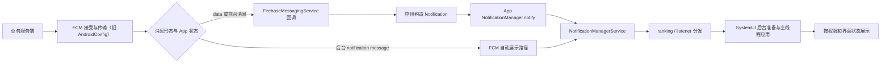

# 推送通知管线性能：FCM 投递、NMS 入队与 SystemUI 渲染

“推送慢”至少可能指五件事：业务服务端发出请求晚、FCM 传输晚、设备收到回调晚、应用发布通知晚，或 SystemUI 显示晚。FCM（Firebase Cloud Messaging）是消息传输服务，SystemUI 则负责通知抽屉、锁屏通知等系统界面。我们排查时面对的，就是这样一条横跨云端、Google Play services、应用进程、`system_server` 和 SystemUI 的链路，而公开 API 里没有一个能用同一时钟记录全部阶段，所以每个阶段都要用自己的时钟来观测。

> ⚠️ 校勘（2026-10-23）：旧 FCM 前后台表限定为 AndroidConfig；AndroidConfigV2 当前为 EAP，另列规则。固定 r1 的通知超时同到期值问题、异步执行与返回边界均按源码保留，不当作设备性能承诺。

> 源码基线：AOSP `android-17.0.0_r1`（Android 17，API 37）；内核 `android17-6.18-2026-06_r6`。

平台侧结论用固定版本的 NMS（NotificationManagerService，通知管理系统服务）、`RemoteViews` 和 SystemUI 源码核查；Google Play services 的传输与代理包含闭源组件，这部分按 Firebase 公开契约描述，开源 Messaging SDK 另按固定提交核对。下文以旧 `AndroidConfig` 与 `onMessageReceived()` 为主线，EAP `AndroidConfigV2` 单列说明——这属于消息配置的代际切换，本身不是一次 Android OS 版本切换。

## 先定义“到达”和“显示”

我们先把“到达”和“显示”拆成不同的端点。业务服务端拿到 FCM 成功响应，只说明消息已被 FCM 接受，还说明不了设备已经收到；设备 SDK 收到消息，也还说明不了通知已进入 NMS；即使 `NotificationManager.notify()` 已经返回，SystemUI 也可能尚未创建通知视图。用户最终能否看到这条通知，还要看通知权限、channel（通知渠道）、锁屏、勿扰模式和 SystemUI 状态。

<!-- gracker-diagram: ch08-06-01-legacy-pipeline -->


图：旧配置按前后台与消息形态分流；两种展示路径都需经 NMS 和 SystemUI，拒绝或系统状态可使通知不可见。

<details>
<summary>查看 Mermaid 源码</summary>



</details>

图中标出的“FCM 自动展示路径”，意思是应用无需在业务 `onMessageReceived()` 中构造通知，但各设备实现未必都绕开应用进程——高优先级 notification message 还可能由 Google Play services 代理展示。所以单凭应用进程当时是否存在，还推断不出消息类型或实际展示路径。

既然端点不同，工程指标就应使用不同名称：

<!-- gracker-diagram: ch08-06-02-arrival-is-not-visible -->


图：每个事件说明自己的层次；没有公开 App API 能把 FCM 接受、平台分发与用户可见合成同一端点。

| 时间点 | 含义 | 是否等于用户可见 |
|---|---|---|
| `fcm_accepted_at` | 服务端请求被 FCM 接受 | 否 |
| `sdk_callback_at` | 应用进入 `onMessageReceived()` 回调 | 否 |
| `notify_start/end` | 应用进入和离开同步 `notify()` 调用 | 否 |
| `nms_posted` | 平台已接受并分发 notification record（通知记录） | 否；普通应用没有直接回调 |
| `systemui_applied` | SystemUI 已 apply / reapply，即创建或复用通知视图 | 接近显示准备完成，仍受界面状态影响 |
| `impression` | Firebase 或产品定义的展示事件 | 取决于消息形态和采集能力 |

## FCM 消息形态与应用的参与方式

[FCM Android 接收文档](https://firebase.google.com/docs/cloud-messaging/android/receive-messages) 的下表适用于旧 `AndroidConfig`：

| payload（消息负载）与 App 状态 | 到达时的公开行为 | 应用能控制什么 |
|---|---|---|
| notification message，前台 | 调用 `onMessageReceived()` | 解析消息并决定是否发布通知 |
| notification message，后台 | FCM SDK 处理展示，不调用业务 `onMessageReceived()` | 用户点击后处理启动 Intent |
| data message，前台或后台 | 成功交付到此路径后调用 `onMessageReceived()` | 构造通知、更新数据或安排后续工作 |
| notification + data，后台 | FCM SDK 处理 notification，data 放入启动 Activity 的 Intent extras（附加参数） | 用户点击后读取 data |
| notification + data，前台 | 两部分都交给 `onMessageReceived()` | 由应用决定 UI 和数据处理 |

<!-- gracker-diagram: ch08-06-03-legacy-routing -->


图：旧 AndroidConfig 表区分前台 callback、后台自动通知和点击 Intent 数据；路由描述不等于必达承诺。

“后台 notification message 更快”是排查推送延迟时的常见直觉，我们把它放回链路里检验：这种消息确实跳过了应用的业务 callback，但展示仍要经过 FCM 设备端组件、NMS 和 SystemUI，代理展示、权限和设备状态都会改变实际路径。旧 data message 把处理和展示的控制权交给应用，代价是进程启动、`Application.onCreate()` 与通知构造的耗时可能计入等待；固定开源 SDK 的自动展示路径也可能下载并等待远端图片。所以单看“有没有执行业务 callback”，判断不了哪条更快。[源码](https://github.com/firebase/firebase-android-sdk/blob/dc0ce88130e7f9621506471af919054cb2453aae/firebase-messaging/src/main/java/com/google/firebase/messaging/DisplayNotification.java)

消息需要进入应用组件而进程还不存在时，Android 才会启动进程，并在相应进程中执行 `Application.onCreate()`、创建 `FirebaseMessagingService`；代理展示可以不启动 App。这里还要区分两种状态：进程被系统回收与用户 force-stop 不同，从“进程不存在”推不出这次推送必定会拉起进程。进程若处于 cached/frozen（缓存或冻结）状态，系统可能先将它解冻再继续工作。

<!-- gracker-diagram: ch08-06-04-process-start -->


图：需要应用执行时可能冷启动或解冻；代理可不启动 App，用户 force-stop 也不能等同于系统回收。

Android 没有为这些状态规定固定延迟，线上分析套用“缓存进程固定增加 100 ms”一类的常量会出错；我们该做的，是比较同一设备组在不同进程状态下的回调时间分布。

### AndroidConfigV2：EAP 另设路径

当前 [v2 迁移指南](https://firebase.google.com/docs/cloud-messaging/send/v2-api) 标为 EAP，客户端示例依赖 `firebase-messaging:26.1.0-eap01`，还需相应 Play services 支持，仅凭设备运行 Android 17 还断定不了它可用。请求仍可使用 `messages:send`，但消息中的配置改为 `android_v2`，这与 HTTP v1 接口名称是两个维度。

<!-- gracker-diagram: ch08-06-05-eap-version-dimensions -->


图：android_v2 配置、SDK EAP 与 Play services 支持共同决定路径；messages:send 名称或 Android 17 不证明已经迁移。

| 配置 | 处理入口与默认行为 |
|---|---|
| 旧 `AndroidConfig` | 沿用上表前后台分流及 normal / high |
| v2 `RemoteNotification` | 按通知意图及时调度；默认由 GMS Core 展示，前后台均不沿用旧表；`mutable_content=true` 才进入应用的 `onNotificationReceived()` 生成响应 |
| v2 `BackgroundSync` | 进入 `onBackgroundSyncReceived()`，面向可延迟的静默同步 |

<!-- gracker-diagram: ch08-06-06-eap-intents -->


图：RemoteNotification 默认自动展示，mutable 才让应用生成响应；BackgroundSync 面向可延迟同步，不沿用旧前后台表。

v2 不再用显式 priority 选择紧急程度，改按消息意图调度。mutable 回调返回 `NotificationResponse`；需要逐条发布时，`FcmNotificationManager` 只在本次回调内有效，完成后调用 `finished()`。当前预览文档给出的 20 秒处理超时、超时 fallback 与后台 suppress 限制都可能在 GA 前变化。应用未实现 v2 callback 时，迁移指南另有旧回调降级路径；埋点要记录配置类型、SDK 版本及实际入口，旧 `onMessageReceived()` 示例不能直接移名套用。

<!-- gracker-diagram: ch08-06-07-eap-manager-lifetime -->


图：FcmNotificationManager 的 postNow/cancelNow 有寿命和 deadline 检查，finished 或回调结束后不能继续后台使用。

## high priority 的传输语义与降级

优先级是 FCM 排查里最容易被高估的旋钮，我们先摆正它的位置：high priority 是给传输层看的调度提示。旧 `AndroidConfig` 的 Android 下行消息可设 normal（普通）或 high（高）优先级，v2 改按消息意图选择调度。设备进入 Doze（深度休眠节电状态）后，normal 消息可能被延迟；high 消息会尝试尽快交付，必要时唤醒休眠设备，并为应用提供有限的处理时间。网络离线、TTL（消息有效期）、设备限制和服务状态仍可能造成等待或丢弃。

<!-- gracker-diagram: ch08-06-08-high-normal -->


图：normal 可能因 Doze 延迟；high 尝试唤醒及时交付，但网络、有效期与设备限制仍影响结果。

[FCM priority 文档](https://firebase.google.com/docs/cloud-messaging/android-message-priority) 对高优先级还给出一组可验证规则：

- high 应用于时间敏感、面向用户的通知；
- FCM 会根据每个 App 实例最近 7 天的行为，决定是否把 high 降为 normal，或交给 Google Play services 代理展示；
- 单条消息可比较 `RemoteMessage.getOriginalPriority()` 与 `getPriority()`；
- 项目级趋势可从 FCM Aggregate Delivery Data API（聚合交付数据接口）读取 deprioritized（降级）和 proxy（代理展示）相关比例；
- 通知权限被关闭后，高优先级消息无法形成用户可见通知，也会增加降级风险。

<!-- gracker-diagram: ch08-06-09-priority-feedback -->


图：单消息比较原始与交付优先级；7 天行为、代理和聚合趋势不是 dumpsys deviceidle 能直接给出的判断。

`dumpsys deviceidle` 能确认设备是否处于 idle（空闲节电）状态、是否在白名单或临时豁免中，但它看到的范围到节电状态为止，单条消息的原始与交付优先级要从消息自身读取；实例级反馈与代理情况仍要结合相应聚合数据。所以我们排查高优先级降级时，先比较消息的原始优先级和交付优先级，再结合 FCM Data API 分析。

<!-- gracker-diagram: ch08-06-11-evidence-tools -->


图：deviceidle 说明节电与 allowlist 状态；优先级从消息读，可见性还要查权限、channel 与系统展示。

下列因素要分开统计：

| 因素 | 影响 | 可用证据 |
|---|---|---|
| 设备离线 | 消息留在 FCM，受 TTL 约束 | FCM Data API 的 delayed（延迟）/ dropped（丢弃）原因 |
| normal + Doze | 可能等到维护窗口或退出 Doze | 发送优先级、设备 idle 状态、聚合交付数据 |
| collapse key | 多条可折叠消息只保留一条代表项 | 服务端 payload 与 BigQuery 导出 |
| TTL 到期 | 过期消息不再投递 | 服务端 TTL 与 FCM 交付结果 |
| high 被降级 | 交付行为按 normal 处理 | original priority 与 delivered priority |
| Play services 代理 | notification 可由代理路径显示 | Proxy Notification Insights；普通 GA（Google Analytics）指标可能出现缺口 |
| 权限或 channel 被阻止 | 消息到设备但通知不可见 | `areNotificationsEnabled()`、channel importance、权限状态 |

<!-- gracker-diagram: ch08-06-10-offline-collapse-ttl -->


图：离线、normal+Doze、collapse 与 TTL 解释不同的传输行为；同一 key 的新消息可替换尚未交付旧消息。

## 旧回调的时间预算与后续工作

进入应用侧，先看 `onMessageReceived()` 这段代码能跑多久。Firebase 文档说明它在独立工作线程调用，建议只用数秒完成处理，high 通常比 normal 稍长；固定开源 SDK 的方法注释另写应在 20 秒内完成，但把它当作可以放心占满的端到端时限或性能预算并不合适。回调里适合做的事是校验少量字段、构造通知并立即发布；如果在这里发起额外网络请求、下载图片或跑长事务，回调结束后系统可能不再保证进程继续运行，通知可能因此延迟，甚至未能发布。

这些后续工作按交付优先级安排：

<!-- gracker-diagram: ch08-06-13-workmanager -->


图：短回调先用现有内容发布；额外网络或同步交给 WorkManager，紧邻 high callback 的 expedited 豁免有条件。

- high 且需要附加工作：在 callback 后立即安排 expedited WorkManager job（加急后台任务）；FCM 为紧邻 high callback 创建的这类任务提供短暂配额豁免。
- normal：安排普通 `WorkRequest`，接受系统根据资源和电量状态调度。
- 只为补充 App 内数据：可以先发布 payload 中已有的通知内容，再在后台同步。
- 必须长时间运行，且工作本身符合 FGS（Foreground Service，前台服务）使用场景：评估前台服务类型、权限和后台启动豁免。

Android 12（API 31）及以上、target 31+ 的后台启动 FGS 限制中，有一类豁免恰好属于交付后仍为高优先级的 FCM 消息。这项豁免持续时间很短，且只在交付优先级仍为 high 时成立，所以启动前我们要检查 `RemoteMessage.getPriority()`：若消息已经降级，调用 `startForegroundService()` 可能抛出 `ForegroundServiceStartNotAllowedException`。它也免不掉 FGS 类型、对应权限和 while-in-use 权限的限制，竞态中的启动失败要另行防范。当前限制的完整范围见 [后台启动 FGS 限制](https://developer.android.com/develop/background-work/services/fgs/restrictions-bg-start)。

<!-- gracker-diagram: ch08-06-14-fgs-not-universal -->


图：设备 API 31+ 且 target 31+ 才进入该后台启动限制；交付 high 也不免除类型、权限及 while-in-use 限制。

下面的旧 data message 代码骨架只记录应用能够直接观测的时间点，并在短回调内完成通知构造与发布：

```kotlin
override fun onMessageReceived(message: RemoteMessage) {
    val callbackStartNs = SystemClock.elapsedRealtimeNanos()
    var outcome = "notify_returned"
    Trace.beginSection("Push:onMessageReceived")
    try {
        val notification = trace("Push:build") {
            buildNotificationFromPayload(message.data)
        }
        trace("Push:notify") {
            notificationManager.notify(stableNotificationId(message), notification)
        }
    } catch (error: Exception) {
        outcome = failureFamily(error)
        throw error
    } finally {
        val callbackCostMs =
            (SystemClock.elapsedRealtimeNanos() - callbackStartNs) / 1_000_000
        Trace.endSection()
        PushMetrics.recordCallback(
            originalPriority = message.originalPriority,
            deliveredPriority = message.priority,
            outcome = outcome,
            callbackCostMs = callbackCostMs
        )
    }
}
```

这段骨架有几个细节要说明。`trace()` 指 AndroidX Tracing 的同名函数，用来在 Perfetto 中生成应用自定义区间；`buildNotificationFromPayload()` 内部不要发起网络请求，也不要从磁盘解码大图；`failureFamily()` 要把异常归入数量有限的类别。比较 `message.originalPriority` 和 `message.priority`，就能判断单条 high 消息是否被降级；三个 trace section 分别覆盖 callback 主体、通知构造，以及 Framework 预处理加同步 Binder 调用。`recordCallback()` 在外层 trace 结束后执行，整次方法因此还包含这段埋点开销——它必须短小且不抛异常。

<!-- gracker-diagram: ch08-06-12-callback-spans -->


图：Push:notify 包括 Framework 预处理和同步 IPC；recordCallback 在外层 trace 后，整次 callback 还包括这段开销。

## `notify()` 返回前后分别发生什么

`notify()` 这一步，我们先看应用进程内的同步工作。[`NotificationManager.java`](https://android.googlesource.com/platform/frameworks/base/+/android-17.0.0_r1/core/java/android/app/NotificationManager.java) 在 `notifyAsUser()` 中先执行 `fixNotification()`，再同步调用 `INotificationManager.enqueueNotificationWithTag()`；应用侧的同步工作包括补充 context 字段、校验 small icon（状态栏小图标）、执行 `reduceImageSizes()` 缩减图片，以及移除不必跨进程传输的内容。

<!-- gracker-diagram: ch08-06-15-notify-sync-work -->


图：notify 外层耗时包含字段补齐、icon 校验、图像缩减与 delivery 克隆，然后才到同步 Binder 和 NMS 检查。

`system_server` 中的 [`NotificationManagerService.java`](https://android.googlesource.com/platform/frameworks/base/+/android-17.0.0_r1/services/core/java/com/android/server/notification/NotificationManagerService.java) 在 Binder 入口继续执行：

<!-- gracker-diagram: ch08-06-17-nms-handler -->


图：接受后 Enqueue 还会处理旧记录、超时、分组与 assistant；Post 阶段再按策略发布和分发给 listener。

1. 校验调用 UID、包名、user 与 allowlist token（白名单授权令牌）；
2. 处理 FGS / UIJ policy；UIJ 是 user-initiated job，即用户发起的数据传输任务；
3. 查询 channel，创建 `NotificationRecord`；
4. 检查权限、数量、更新速率等拒绝条件；
5. 把 `EnqueueNotificationRunnable` 投递到 NMS Handler 队列。

上面五步走的是通知被接受时的路径，拒绝分支也可能不抛异常而直接返回。`EnqueueNotificationRunnable` 投递到 NMS Handler 之后，队列工作就可以与 Binder 返回并行，“先返回 App、再执行队列”的顺序并无保证；通知排序、listener（通知监听器）分发和 SystemUI 内容创建，都在 `notify()` 必须等待的范围之外。因此：

<!-- gracker-diagram: ch08-06-16-return-overlap -->


图：投递 Handler 是交接点，之后不保证严格先返回 App 再执行队列；notify 不等待 SystemUI 完成。

- `notify_call_ms` 覆盖 Framework 预处理、对象传输、Binder 等待和 NMS 入队前检查；
- `notify()` 很快返回，还证明不了通知已经显示；
- `notify()` 变慢时，检查调用线程、Parcel 内容、Binder 等待与 `system_server`；
- SystemUI 卡顿时，应用侧调用常常早已返回。

顺带一提，在 `BroadcastReceiver.onReceive()` 中发布已经构造好的通知是常见用法，不必一律回避；但接收器仍有执行时间限制，图片读取、数据库迁移或网络请求应移出同步 callback。FCM callback 即使运行在工作线程，处理时间同样有限。

## NMS 更新限速的判定

应用侧最容易撞上的平台闸门，是 NMS 的更新限速。`android-17.0.0_r1` 的 NMS 把默认值定为 5.0（`DEFAULT_MAX_NOTIFICATION_ENQUEUE_RATE = 5f`），并允许 `Settings.Global.MAX_NOTIFICATION_ENQUEUE_RATE` 覆盖；限速判断使用 [`RateEstimator.java`](https://android.googlesource.com/platform/frameworks/base/+/android-17.0.0_r1/core/java/android/service/notification/RateEstimator.java) 计算 EWMA（指数加权移动平均）到达率，而不是简单统计最近一秒内调用了多少次。

<!-- gracker-diagram: ch08-06-18-ewma-estimator -->


图：固定 r1 用 α=0.7 平滑到达间隔，再取倒数；默认阈值 5f 不表示简单每秒允许五次调用。

这项限速也不是每次 `notify()` 都会触发，我们要看它何时介入：`checkDisqualifyingFeatures()` 只对非系统、非已注册通知 listener 的包，在同时满足这些条件时检查 enqueue rate——已发布或待发布列表中有相同 key、前后 `progressState` 相同，且通知属于自动分组之外。

<!-- gracker-diagram: ch08-06-19-rate-gating -->


图：非系统 / 非 listener 包只有 previous 存在、progressState 相同且非自动分组时比较更新率；阈值相等不走大于分支。

这里的 progress 状态指底层字段：从 ongoing（进行中）变为 complete（完成）时不会命中检查，但只把标题改成“暂停”或“失败”，`getProgressState()` 未必跟着变——这项比较按 progress/max/indeterminate 字段计算，业务状态词当不成豁免凭证。超过阈值时，NMS 会记录 over-rate 并返回 false；调用方既收不到 posted callback（发布成功回调），也收不到异常。

<!-- gracker-diagram: ch08-06-20-progress-state -->


图：getProgressState 只按 progress、max、indeterminate 分 NONE/ONGOING/COMPLETE；业务文字变化不保证绕过更新限速。

同一份源码还限制普通包同一 user 的通知数，已发布和已入队项都计入；`getNotificationCount(pkg, userId, id, tag)` 只从已发布列表排除同 tag / ID 旧项，已入队列表仍逐项计数，普通路径上限为 50；FGS、UIJ 和部分聚合通知适用单独规则。更新速率限制和通知数量上限是两类问题，指标也要分别记录。

<!-- gracker-diagram: ch08-06-21-count-versus-rate -->


图：同包同 user 计入 posted 与 enqueued；仅 posted 排除同 tag/ID 旧项，入队项仍计数。数量规则与 EWMA 分开判断。

进度或指标通知可采用以下发布策略：

- 使用稳定的 tag / ID 更新同一条通知；
- 按有意义的进度变化与最长等待时间合并更新；
- 对中间值使用 `setOnlyAlertOnce(true)`，避免每次更新都打扰用户；
- 完成、失败、暂停等状态变化立即发布；
- 记录 attempted update（尝试更新）和业务状态，不把 `notify()` 返回当成“已显示确认”。

固定 500 ms 或 1 s 的更新间隔，只有在设备上测试之后才能定为产品节奏。平台使用 EWMA，OEM 也可以改变阈值；应用还要为同一包名下的其他通知留出更新余量。

<!-- gracker-diagram: ch08-06-22-coalesce-policy -->


图：发布节奏按状态意义和实测制定；onlyAlertOnce 控制重复提醒，不会跳过 NMS 或 View 更新成本。

### `timeoutAfter` 由 AlarmManager 驱动

我们再看 `timeoutAfter` 的实现：[`TimeToLiveHelper.java`](https://android.googlesource.com/platform/frameworks/base/+/android-17.0.0_r1/services/core/java/com/android/server/notification/TimeToLiveHelper.java) 以 elapsed realtime（不受墙钟调整影响的设备运行时间）保存超时项，并用 `AlarmManager.setExactAndAllowWhileIdle()` 安排最近一次到期处理。到期点在 NMS Handler 处理入队时计算；更新相同 key 会重新安排，timeout 为 0 会清除原超时项，主动取消也会移除。真正的 timeout 取消还有 FGS、UIJ 等标志豁免，把它当成“所有通知强制在精确时刻消失”的承诺靠不住。

`setTimeoutAfter()` 适合内容过时后就没有展示价值的通知，它和 FCM TTL 管的是两个阶段：FCM TTL 控制消息可以在传输层保留多久，notification timeout 控制已进入 NMS 的通知保留多久。两项配置位于不同阶段，要分别记录。

<!-- gracker-diagram: ch08-06-23-timeout-stages -->


图：FCM TTL 管尚未交付消息的保留；timeoutAfter 从 NMS 处理阶段管理已有通知，不能相互替代。

固定 r1 还有一个实现缺口：`TimeToLiveHelper` 的 `TreeSet` 比较器只比较到期毫秒，两个不同 key 若到期值完全相同，第二项可能加入集合失败，同一批通知未必都成功安排了超时；批量场景要核对设备版本和实际取消结果。

<!-- gracker-diagram: ch08-06-24-ttl-helper-and-collision -->


图：r1 helper 只按到期毫秒比较 TreeSet 项；不同 key 的同到期值可能冲突，批量超时须验证实际设备结果。

## RemoteViews 与 SystemUI 的真实成本

通知被 NMS 接受后，SystemUI 还会处理事件、过滤排序、内容绑定、布局与绘制；下面只拆 `RemoteViews` 相关的内容创建和更新成本。标准 notification style 同样会生成 `RemoteViews`，系统模板并没有一条完全绕开它的通用捷径：[`RemoteViews.java`](https://android.googlesource.com/platform/frameworks/base/+/android-17.0.0_r1/core/java/android/widget/RemoteViews.java) 保存 `ArrayList<Action> mActions`，跨进程时将其序列化进 Parcel；应用到 View 树时，再执行 inflate（创建视图）和各项 action（属性更新操作）。

<!-- gracker-diagram: ch08-06-25-remoteviews-actions -->


图：RemoteViews 保存布局描述与 action，跨 Binder 序列化后再创建和更新 View；系统模板不普遍绕过这套机制。

SystemUI 侧的 [`NotificationRowContentBinderImpl.kt`](https://android.googlesource.com/platform/frameworks/base/+/android-17.0.0_r1/packages/SystemUI/src/com/android/systemui/statusbar/notification/row/NotificationRowContentBinderImpl.kt) 用 inflation executor 准备内容、资源和可异步初始化的 action，再在主线程完成应用、回调和视图接入。要注意 `RemoteViews.AsyncApplyTask.onPostExecute()` 仍会执行 action，async 并没有把所有 View 更新都移出主线程，异步失败时还可能回退到同步 apply / reapply。复用是有条件的：新旧 `RemoteViews` 的 package 与 layout ID 相同、旧视图没有禁止复用的标记时，SystemUI 可以调用 `reapplyAsync()` 复用现有 View，否则会通过 `applyAsync()` 创建新 View。

<!-- gracker-diagram: ch08-06-26-apply-reapply -->


图：包名和 layout 相同且旧描述允许复用时可 reapply；async 仍有主线程 action 与错误回退，不能等同零成本。

性能成本主要来自这些内容特征：

| 特征 | App / Binder 侧 | SystemUI 侧 |
|---|---|---|
| 大 bitmap 或多张图片 | 缩放、复制、Parcel 体积 | preload（预加载）、解码、内存与绘制 |
| 深层自定义布局 | action 与资源描述更多 | inflate、measure、layout 成本更高 |
| 高频更新 | 多次同步 Binder 与 NMS 检查 | 反复 apply / reapply、排序和界面刷新 |
| 稳定系统模板 | 结构和 action 受平台控制 | 更容易保持稳定 layout ID 并尝试 reapply 复用 |
| style 或 layout 改变 | 传输完整的新描述 | 更可能重新 inflate |

`MediaStyle`、自定义 `RemoteViews` 和 `ProgressStyle` 之间，排不出一个适用于所有通知的固定耗时顺序——内容大小、图片、action 数量、是否成功复用以及 SystemUI 状态都会改变结果。所以做对比实验时，我们先固定 payload 和设备，再分别比较 `Push:build`、`Push:notify` 与 SystemUI inflation 耗时。

<!-- gracker-diagram: ch08-06-27-style-costs -->


图：比较 style 时固定设备与实际内容，并拆 App build/notify 和 SystemUI 阶段；不建立跨所有通知的固定速度排名。

### ProgressStyle、MetricStyle 与 Live Update

Android 16（API 36）的 `Notification.ProgressStyle` 和 Android 17（API 37）的 [`Notification.MetricStyle`](https://developer.android.com/develop/ui/views/notifications/metric-style) 都是系统模板。`MetricStyle` 最多展示三个 metric（数值指标），适合健身、计时和出行；普通业务数值变化仍需按需更新通知，NMS 限速继续适用。计时有一个重要例外：`Metric.TimeDifference` 可把零点交给系统 Chronometer 连续计时，App 无需每秒调用 `notify()`；暂停、继续或基准变化时再更新描述即可，metric 不必都按固定数字频繁重发。

<!-- gracker-diagram: ch08-06-28-metric-style -->


图：MetricStyle 最多渲染三个 metric；TimeDifference 可交给系统连续计时，无需每秒 notify，其他业务变化仍按需更新并受限速。

Live Update 是一种获得系统突出展示的资格，与具体某个 notification style 是两回事。当前 [Live Update 文档](https://developer.android.com/develop/ui/views/notifications/live-update) 要求通知使用标准 style、`BigTextStyle`、`CallStyle`、`ProgressStyle` 或 `MetricStyle`，声明 `POST_PROMOTED_NOTIFICATIONS`，请求 promoted ongoing（提升展示的持续通知），并满足 ongoing、content title、channel 等通用条件。

自定义内容 View、group summary（通知组摘要）、colorized=true 和 `IMPORTANCE_MIN` 不符合通用资格；用户和 OEM 还可以把这些通知降级，或者加上额外条件。

`MetricStyle` 文档允许 promoted 状态下用 metric / App 名补位标题；通用资格页则要求 content title。固定 r1 的 `hasTitle()` 对开启相应 flag 的 MetricStyle 有特殊分支，所以这里的例外有实现依据，不必判定为文档矛盾。

<!-- gracker-diagram: ch08-06-30-title-exception -->


图：通用页面要求 title，MetricStyle 专页允许 metric/App 名补位；r1 hasTitle 的 flag 分支解释这项例外。

在 API 37 上，我们应同时调用 `Notification.hasPromotableCharacteristics()` 和 `NotificationManager.canPostPromotedNotifications()`，分别核对内容特征与应用提升权限；两项都通过，也还不保证每次都被提升——最终 `FLAG_PROMOTED_ONGOING`、channel、用户与 OEM 条件要单独核对，只凭 style 推测不出来。

<!-- gracker-diagram: ch08-06-29-promotion-gates -->


图：hasPromotableCharacteristics 与 canPostPromotedNotifications 检查不同条件；最终 promoted 标志和用户/OEM 仍须确认。

Android 17 的 Semantic Coloring API 为安全、警示、危险和中性信息提供系统定义的语义色。它让不同系统界面上的颜色含义保持一致，但降低更新频率、控制图片成本这些事，还是要另外自己做。

<!-- gracker-diagram: ch08-06-31-semantic-coloring -->


图：API 37 的语义色让系统按含义展示状态；它不降低图片成本，也不增加 FCM、NMS 或渲染预算。

## channel importance 与传输优先级分别控制

展示层还有一组旋钮容易和优先级混淆，我们先分清楚。`NotificationChannel` importance（渠道重要程度）控制声音、震动、状态栏和 heads-up（横幅通知）等展示行为；它改变不了 FCM 传输优先级，也提高不了 App 发往 NMS 的 Binder 请求调度优先级。

<!-- gracker-diagram: ch08-06-32-three-priorities -->


图：提高 channel importance 影响打扰和可见性，不能加速 FCM 传输或提升应用 Binder 请求调度优先级。

Android 8（API 26）起，channel 创建后由用户掌控其行为，App 不能任意提高打扰级别；固定 API 契约还允许在用户未改过该 channel 设置时，通过重新创建降低 importance。名称和描述也可更新，按具体字段和用户锁定状态判断即可。

<!-- gracker-diagram: ch08-06-33-channel-mutation -->


图：用户掌控 channel 行为；App 不能任意提高 importance，固定 API 允许未被用户改动时条件性降低。

heads-up 通常需要 high importance，还会受到设备是否解锁、勿扰模式、用户设置和 OEM policy 的影响；它没有适用于所有设备的固定动画时长或驻留秒数。是否使用高 importance 由业务紧急程度决定，想靠它缩短 FCM 传输时间，这条路走不通。

Android 13（API 33）起，普通通知需要 `POST_NOTIFICATIONS` 运行时权限。用户拒绝后，非豁免通知不会出现在 notification drawer（通知抽屉）；FGS 仍要提供通知，但相关提示可能只出现在 Task Manager（活动应用管理界面）中。发送端若继续大量发送 high 消息，却形成不了用户可见通知，还可能触发 FCM 降级。

<!-- gracker-diagram: ch08-06-34-permission-visibility -->


图：API 33+ 普通通知受 POST_NOTIFICATIONS 约束；拒绝时 FGS 仍需通知，但提示可仅在 Task Manager 出现。

通知分组用于组织信息和控制重复提醒。`setGroup()` 并不保证减少 SystemUI 创建的 child row（子通知视图），也不会让 NMS 跳过每条通知的 ranking（排序与策略计算）。消息类场景可以用 `MessagingStyle`、稳定 ID、group summary 和 `setGroupAlertBehavior(GROUP_ALERT_SUMMARY)` 控制通知数量与重复提示；每个 child 仍应能独立表达内容。

<!-- gracker-diagram: ch08-06-35-group-rows -->


图：稳定 ID、摘要与 groupAlertBehavior 可减少数量或重复提醒；setGroup 本身不保证跳过每个 child 的 ranking 与 View。

## 端到端观测：每段使用自己的时钟

做端到端关联时，我们用同一个 `message_trace_id`（单条消息的关联 ID）把服务端和设备事件串起来；registration token（设备注册令牌）、完整 payload 和用户消息正文不要上传。发送 FCM 请求时可额外设置不含个人信息的 analytics label 或服务端批次字段，与 BigQuery 导出或 Aggregate Delivery Data（聚合交付数据）的分组维度对齐。analytics label 要用受控的低基数值，每条消息的 trace ID 各自当成一个新 label 的做法要避免。

<!-- gracker-diagram: ch08-06-36-clocks-and-identity -->


图：message_trace_id 用于业务关联；服务端和设备各算本地时长，跨时钟只在校准或误差可解释时比较。

聚合交付数据不能按单条 `message_trace_id` 反查设备链路。

| 阶段 | 推荐字段 | 时钟说明 |
|---|---|---|
| 服务端发送 | `fcm_request_start/end`、priority、TTL、collapse key、analytics label、FCM 响应 message ID | 服务端单调时钟计算请求耗时，墙钟用于跨系统粗略关联 |
| FCM 传输 | delivered、pending、dropped、delay reason、proxy / deprioritized ratio；启用 BigQuery 导出时的消息事件 | FCM 侧数据使用 Firebase / Google Play services 口径；聚合数据按批次或维度对齐，不是单条端侧 trace |
| SDK callback | `RemoteMessage.sentTime`、original / delivered priority、callback wall time | 只覆盖会进入 callback 的消息 |
| App 发布 | build、notify duration、process state bucket、permission / channel state | 设备内阶段使用 `elapsedRealtime` 单调时钟 |
| SystemUI | apply / reapply、row inflation、主线程和 inflation executor 状态 | 需要 Perfetto、平台日志或 userdebug 调试版本能力 |
| 用户行为 | impression、tap、dismiss | 必须说明事件来源和适用消息形态 |

读这些数据时先分清各自说明什么：FCM BigQuery 中的 `MESSAGE_DELIVERED` 表示消息已交给设备上的 FCM SDK，离“通知已经显示”还差后半程；Aggregate Delivery Data 经过抽样和聚合，并且延迟提供，适合观察比例和趋势，单设备 trace 还得单独做；代理 notification 在普通 FCM / GA 指标中可能形成缺口，要结合 Proxy Notification Insights 查看。

<!-- gracker-diagram: ch08-06-37-delivery-data-scope -->


图：BigQuery delivered 说明 SDK 收到；聚合比率适合趋势，不能反查单条 trace；代理与 impression 的采集覆盖须说明。

旧 AndroidConfig 的后台 notification message 不进入业务 `onMessageReceived()`，应用也就无法在消息到达时写入自定义 callback 埋点。若产品必须取得应用处理和自定义展示的证据，可以选择 data message，但应用要自行满足进程生命周期与后台执行约束；这项选择会同时影响可靠性、功耗和用户体验。

## Perfetto 关联查询与时间窗

下面的 SQL 用来列出前述三个应用自定义 trace section 及其所属进程、线程和耗时。查询结果只覆盖应用侧区间，还说明不了 SystemUI 已经完成显示：

```sql
SELECT
  s.id AS slice_id,
  p.upid,
  p.name AS process_name,
  t.utid,
  t.name AS thread_name,
  s.name,
  s.ts / 1e6 AS ts_ms,
  s.dur / 1e6 AS dur_ms
FROM slice AS s
JOIN thread_track AS tt ON s.track_id = tt.id
JOIN thread AS t ON tt.utid = t.utid
LEFT JOIN process AS p ON t.upid = p.upid
WHERE s.dur >= 0
  AND s.name IN (
  'Push:onMessageReceived',
  'Push:build',
  'Push:notify'
)
ORDER BY s.ts;
```

查询按照 `slice -> thread_track -> thread -> process` 逐层关联。如果把所有 FCM slice 与所有 SystemUI `inflate` slice 直接 join（连接），就会产生笛卡尔积——每条 FCM 记录都与每条 SystemUI 记录组合，这样算出的延迟在单条事件之间没有对应关系。

<!-- gracker-diagram: ch08-06-38-sql-joins -->


图：SQL 仅列出已闭合的应用 section；保留 slice_id/utid/upid，不能按同名线程或所有 inflate 记录做笛卡尔积关联。

Android 17 AOSP 的 SystemUI 提供 `NotificationContentInflater.AsyncInflationTask#doInBackground` trace section，覆盖后台内容准备，后续 apply / reapply 是另一阶段；另有异步任务区间 `NotificationRowContentBinderImpl.AsyncInflationTask` 和 apply 区间，它们都不能单独作为首次用户可见或屏幕实际呈现的端点。OEM 可以改变类名、线程名和 trace 埋点。实验室排查时，我们可在同一时间窗口观察：

<!-- gracker-diagram: ch08-06-39-systemui-trace-coverage -->


图：doInBackground 仅后台准备；其后的 apply/reapply、主线程接入和绘制另有阶段，单一区间不能证明用户已看到。

1. App 的 `Push:notify` 是否处于 Binder 等待；
2. `system_server` 是否在 NMS 入口或 Handler 队列等待；
3. SystemUI inflation executor、主线程和 RenderThread（渲染线程）是否繁忙；
4. 同一时间窗口是否伴随大量通知、图片解码、锁屏动画或 panel（通知面板）更新。

没有 notification key（通知唯一键）或平台日志时，这些现象只能说明时间上相关，单条通知的因果关系还没有建立。

<!-- gracker-diagram: ch08-06-40-causal-evidence -->


图：缺少 notification key 或平台事件关联时只能报告同窗繁忙；Binder 源码也不能证明 FCM 云端传输耗时。

## Android 17 平台与内核锚点

| 层级 | 固定入口 | 能验证的边界 |
|---|---|---|
| App API | [`NotificationManager.java`](https://android.googlesource.com/platform/frameworks/base/+/android-17.0.0_r1/core/java/android/app/NotificationManager.java) | `fixNotification()` 与同步 Binder 调用 |
| Notification 数据 | [`Notification.java`](https://android.googlesource.com/platform/frameworks/base/+/android-17.0.0_r1/core/java/android/app/Notification.java) | timeout、style、progress state 与 MetricStyle |
| NMS | [`NotificationManagerService.java`](https://android.googlesource.com/platform/frameworks/base/+/android-17.0.0_r1/services/core/java/com/android/server/notification/NotificationManagerService.java) | 校验、channel、限速、数量上限和异步入队 |
| 更新速率 | [`RateEstimator.java`](https://android.googlesource.com/platform/frameworks/base/+/android-17.0.0_r1/core/java/android/service/notification/RateEstimator.java) | EWMA 到达率计算 |
| 通知超时 | [`TimeToLiveHelper.java`](https://android.googlesource.com/platform/frameworks/base/+/android-17.0.0_r1/services/core/java/com/android/server/notification/TimeToLiveHelper.java) | elapsed realtime 与 AlarmManager |
| RemoteViews | [`RemoteViews.java`](https://android.googlesource.com/platform/frameworks/base/+/android-17.0.0_r1/core/java/android/widget/RemoteViews.java) | action、Parcel 序列化、apply / reapply |
| SystemUI | [`NotificationRowContentBinderImpl.kt`](https://android.googlesource.com/platform/frameworks/base/+/android-17.0.0_r1/packages/SystemUI/src/com/android/systemui/statusbar/notification/row/NotificationRowContentBinderImpl.kt) | 异步内容创建、缓存与复用 |
| GKI Binder | [`drivers/android/binder.c`](https://android.googlesource.com/kernel/common/+/android17-6.18-2026-06_r6/drivers/android/binder.c) | `BC_TRANSACTION` 到 `binder_transaction()` 的 IPC 传输 |

common kernel 的 Binder 代码能解释的，是 App、NMS 与 SystemUI 之间的 IPC 等待；FCM 云端接收、Google Play services 的优先级判断和通知代理都在 AOSP common kernel 之外，从 `binder.c` 推不出云端投递时延。

## 版本边界

| Android 版本 | 相关变化 |
|---|---|
| Android 12 / API 31 | 后台启动 FGS 受限；交付后仍为 high 的 FCM 消息是短暂豁免之一 |
| Android 13 / API 33 | `POST_NOTIFICATIONS` 运行时权限影响普通通知可见性 |
| Android 14 / API 34 | target 34+ 的 FGS 需要声明适用类型和对应权限 |
| Android 16 / API 36 | `Notification.ProgressStyle` 与 promoted ongoing / Live Update 能力 |
| Android 17 / API 37 | `Notification.MetricStyle`、Live Update Semantic Coloring；平台源码基线 `android-17.0.0_r1` |

FCM SDK、Google Play services 和 Android 平台版本要分别记录。即使设备都运行 Android 17，其 Firebase Messaging SDK 与 Play services 版本仍可能不同，`api_level` 一个字段代表不了三者。

<!-- gracker-diagram: ch08-06-41-layered-versions -->


图：API 31/33/34/36/37 描述平台能力；SDK、GMS 和 android/android_v2 配置独立，现场路径以实际入口为准。

## 小结

回头看整条链路，推送性能要按责任边界分析。FCM 负责在云端接受消息并向设备传输；应用在 data message 或前台路径中处理 callback；NMS 同步完成校验和入队前工作；SystemUI 随后异步创建或复用通知内容。`notify()` 返回、FCM 记录 `MESSAGE_DELIVERED` 和用户看到通知，是三个不同事件。

Android 17 的 NMS 使用可配置的 EWMA 限制更新速率，SystemUI 支持异步 apply / reapply `RemoteViews`，`MetricStyle` 与 Live Update 则增加了系统模板和突出展示资格。要让推送稳定及时，需要发送用户可见内容、合理设置 priority、缩短 callback、合并高频更新，并按阶段保留证据；固定毫秒常量和未公开的 Play services 内部行为，都当不成可靠依据。

## 交叉引用

- [§9.5 Notification 性能与 ANR](../ch09-anr/05-notification-performance-anr.md)：`notify()` 同步边界、NLS 回调和通知 ANR。
- [8.2 App 冷启动链路与 Binder Trace 分析](02-app-cold-start-binder-trace.md)：进程创建与 `Application.onCreate()`。
- [§25.3 WorkManager 实战](../../part5-app/ch25-power-size/03-wakelock-alarm-workmanager.md)：regular / expedited work 与后台调度。
- [§25.2 前台服务类型执行模型](../../part5-app/ch25-power-size/02-background-power-foreground-service.md)：FGS 类型、超时、Job 配额与恢复。
- [§4.3 Cached App Freezer](../../part1-fundamentals/ch04-memory/03-lmkd-freezer-memory-pressure.md)：缓存冻结与解冻边界。
- [§1.9 Binder IPC](../../part1-fundamentals/ch01-architecture/09-ipc-binder-performance.md)：同步 Binder 与线程等待。

## 参考资料

- [FCM Android 消息接收](https://firebase.google.com/docs/cloud-messaging/android/receive-messages)
- [FCM Android 消息优先级与降级](https://firebase.google.com/docs/cloud-messaging/android-message-priority)
- [FCM 交付数据口径](https://firebase.google.com/docs/cloud-messaging/understand-delivery)
- [Android 通知 channel](https://developer.android.com/develop/ui/views/notifications/channels)
- [Android 通知运行时权限](https://developer.android.com/develop/ui/views/notifications/notification-permission)
- [Android 17 MetricStyle](https://developer.android.com/develop/ui/views/notifications/metric-style)
- [Live Update 通知](https://developer.android.com/develop/ui/views/notifications/live-update)

- [AndroidConfigV2 EAP 迁移与处理契约](https://firebase.google.com/docs/cloud-messaging/send/v2-api)
- [固定开源 Firebase Messaging 自动展示实现](https://github.com/firebase/firebase-android-sdk/blob/dc0ce88130e7f9621506471af919054cb2453aae/firebase-messaging/src/main/java/com/google/firebase/messaging/DisplayNotification.java)
- [通知 channel 创建接口的条件性 importance 更新](https://android.googlesource.com/platform/frameworks/base/+/android-17.0.0_r1/core/java/android/app/NotificationManager.java)
