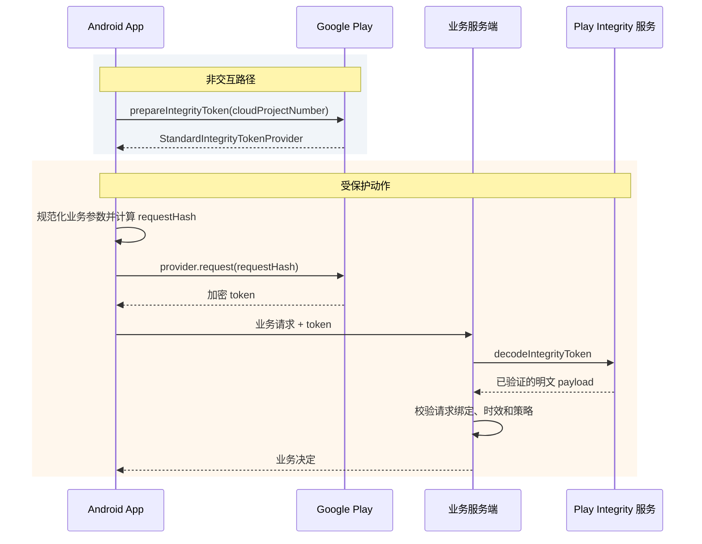
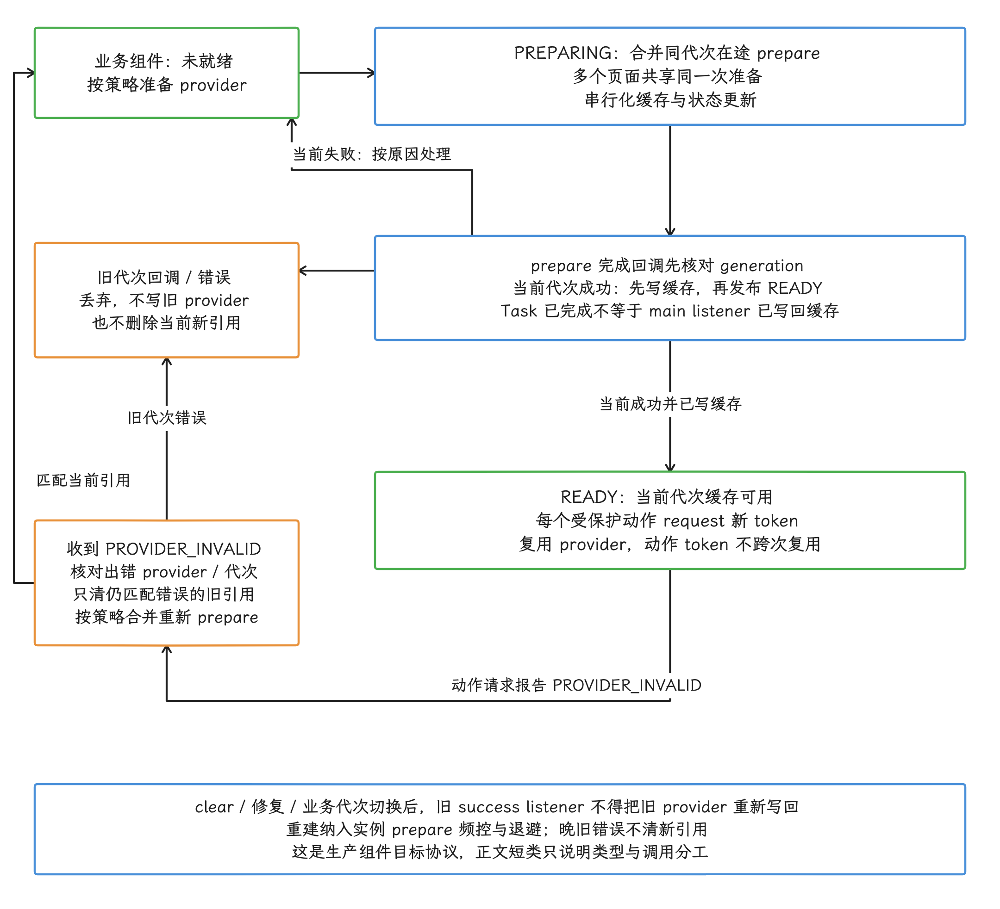
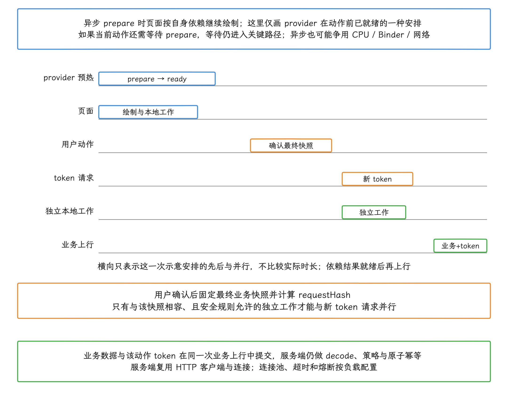
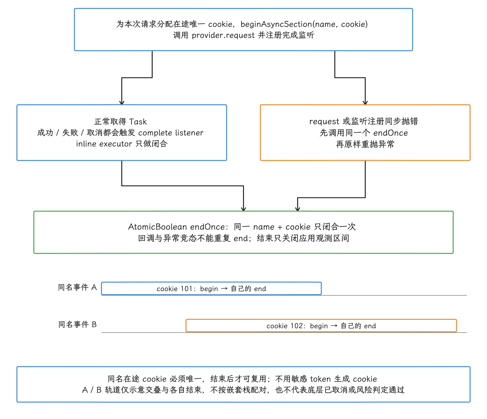

# Play Integrity API 性能与集成延迟

登录、支付提交、兑换、排行榜上报这类动作需要服务端处理，Play Integrity API 帮我们把好这一关：它向服务端提供应用完整性、Play 账号授权、设备环境和可选风险信号。API 返回的是一组 verdict（风险判定字段），“允许或拒绝”仍由服务端结合账号、交易和行为信息来决定。

<!-- gracker-diagram: ch08-07-01-signals-and-policy -->


图：API 给出判定信号；服务端仍须验证请求并作业务决定，授权这一步始终留在服务端手里。

这套校验也会拉长交互路径：客户端先向 Google Play 申请加密 token（完整性令牌），本文采用的常规路径是业务服务端再把 token 交给 Google 解密和验证；Classic 还有在安全服务端自行管理密钥并解密验证的选项，Standard 不支持该选项。其中 Standard 请求的 token provider 可以在受保护动作发生前先准备好，把这一段移出交互路径；其余阶段只能各自记录耗时。如果全程只记一个“Play Integrity 总耗时”，慢请求发生时，我们分不清问题出在客户端、接入网络、Google 解密接口还是业务服务端。


> 源码基线：AOSP `android-17.0.0_r1`；内核 `android17-6.18-2026-06_r6`；Play Integrity Android 库 `1.6.0`。库、Play Store / Play services 和服务端独立演进，行为按各自版本核对。

还有一个前提要先交代：Play Integrity 的判定实现在闭源的 Google Play 组件和 Google 服务端里，后文引用的 AOSP 与 kernel 源码位置，只用来解释这条路径上的 IPC、调度和网络承载；闭源组件的内部步骤，从这些源码里读不出来。


## 1. 接口定位

很多团队接触到 Play Integrity，是从 SafetyNet Attestation API 的弃用开始的：官方指定的替代接口就是 Play Integrity API。两者的客户端类型、token 格式、服务端验证接口和响应字段都不同，所以迁移时 SafetyNet 的 JWS（JSON Web Signature，带签名的 JSON 结构）解析器要一并换掉——Standard token 按不透明的加密结果交给 Google decode；Classic 的文档格式仍是 JWE 包裹 JWS，解析要按新的两层结构重写，旧的单层 JWS 解析流程处理不了这种格式。


它和 Key Attestation（密钥证明）解决的问题也不同，我们按各自负责的事情分开看：

- Play Integrity 返回 Google Play 对应用版本、Play 授权状态、设备环境和可选风险项的判定。
- Key Attestation 证明某把密钥及其生成环境的属性，常用于设备绑定密钥、签名或密钥交换；`PLAY_RECOGNIZED`、`LICENSED` 这类 Play 分发信号出自 Play Integrity，在缺 Play Store 的环境里，Key Attestation 也当不了它的替身。

两类信号是否叠加，取决于威胁模型，也就是业务需要防范哪些攻击；组合使用会增加客户端集成与服务端校验成本，按场景评估即可。


### 1.1 服务端会看到哪些主要判定

拿到解密后的 payload，我们先分开读两个独立字段：应用授权 `appLicensingVerdict` 与应用完整性 `appRecognitionVerdict`。两者独立取值，同一个请求可能一个字段已有明确结果，另一个仍是 `UNEVALUATED`（未评估）。

<!-- gracker-diagram: ch08-07-06-independent-verdicts -->


图：账号授权和应用识别是独立字段；业务账号登录状态也需要单独验证。

先看 `appLicensingVerdict`，它有下面三个值。这里的“授权”问的是当前 Play 账号是否拥有这款应用，与业务账号登录状态是两回事：

| 值 | 官方语义 | 业务解读边界 |
|---|---|---|
| `LICENSED` | 当前 Google Play 账号拥有此应用的授权，应用曾由 Google Play 安装或更新 | 不能单独证明设备安全，也不能替代业务账号登录 |
| `UNLICENSED` | 当前账号没有该应用授权，例如侧载或从其他商店取得应用 | 可引导用户通过官方修复对话框获取 Play 版本 |
| `UNEVALUATED` | 前置条件缺失，授权状态未被评估 | 不能当成 `UNLICENSED`，应保留“未知”语义 |

再看 `appRecognitionVerdict`：

| 值 | 官方语义 |
|---|---|
| `PLAY_RECOGNIZED` | 应用及签名证书与 Google Play 分发的版本匹配 |
| `UNRECOGNIZED_VERSION` | 证书或包名与 Google Play 记录不匹配 |
| `UNEVALUATED` | 应用完整性没有得到评估 |

`PLAY_RETAIL` 不在 `appLicensingVerdict` 的有效值里。`LICENSED` 表示账号的应用授权，并不保证当前安装包一定来自本次 Play 下载；官方注明部分旧设备会在卸载后保留授权，之后从其他渠道获得同一应用仍可能是 `LICENSED`。应结合应用识别和版本字段判断。[来源](https://developer.android.com/google/play/integrity/verdicts)


### 1.2 设备标签的分级与读取

接着我们读设备完整性这一层的 `deviceRecognitionVerdict`：它是一个标签数组，设备同时满足多级条件时可以返回多个标签。默认配置可返回 `MEETS_DEVICE_INTEGRITY`，设备符合相应条件时才会带上；业务还需要 `MEETS_BASIC_INTEGRITY` 或 `MEETS_STRONG_INTEGRITY` 时，要先在 Play Console 中选择接收。

| 标签 | Android 17 范围内的官方语义 |
|---|---|
| `MEETS_BASIC_INTEGRITY` | 通过基础系统完整性检查。bootloader（引导加载程序）可以锁定或解锁，启动状态可以是 verified 或 unverified，设备也可能没有通过 Google Play 认证；Android 13+ 仍要求证明的 root of trust 由 Google 提供 |
| `MEETS_DEVICE_INTEGRITY` | 运行于真实、通过认证的 Android 设备；Android 13 及以上还要求硬件支持的证据表明 bootloader 已锁定，并加载认证厂商镜像 |
| `MEETS_STRONG_INTEGRITY` | Android 13 及以上要求满足 `MEETS_DEVICE_INTEGRITY`，且 Android OS、vendor 等设备分区的安全更新都在最近一年内 |


这张表里有一条版本分界要注意：“近一年安全更新”是 Android 13 起才有的要求，Android 12 及以下的 `MEETS_STRONG_INTEGRITY` 只要求硬件支持的启动完整性证据。所以策略若覆盖旧系统，我们应同时读取可选的 `deviceAttributes.sdkVersion`，按设备 Android 版本解释这个标签的含义——把 Android 13 及以上的更新要求直接套到旧系统上，会得出错误结论。

Android 13+ 的可选 `MEETS_BASIC_INTEGRITY` / `MEETS_STRONG_INTEGRITY` 还要求请求应用具有 Play 授权；未授权时这两个标签会被省略，其他满足条件的标签仍可返回。没有任何标签时，`deviceRecognitionVerdict` 字段本身可被省略。`deviceAttributes.sdkVersion` 同样可能因未评估而缺失；空值按“未知”处理，设备系统版本要另找途径确认。[来源](https://developer.android.com/google/play/integrity/verdicts)

<!-- gracker-diagram: ch08-07-09-optional-label-gates -->


图：配置、授权与设备条件共同影响返回内容，必须区分未评估、字段缺失和实际策略不满足。

标签为空或字段缺失时，先区分未选择、前置条件不足和设备判定路径，再留出诊断余地：API hooking（运行时拦截或替换 API）、系统受损、未通过检查的模拟环境或技术故障都可能是原因，“设备已 root”只是其中一种解释。面向用户时应提供修复路径或较宽泛的环境提示；内部风险信号在对外文案里应停留在风险提示，避免写成已确认的入侵结论。


## 2. Standard 与 Classic 是两套调用方式

本次按 Android 库 `1.6.0` 核对类型；该系列从 1.5.0 起的 `minSdk` 为 23，本文讨论的 API 31–37 均在其范围内。官方 Standard 页面仍写 API 21+，实际接入时以所用库的发布说明为准，再确定最低平台值。[发布说明](https://developer.android.com/google/play/integrity/reference/com/google/android/play/core/release-notes)


两条路线怎么选，先看官方的当前建议：大多数应用使用 Standard 请求——先准备好一个可复用的 token provider，再为每个业务动作申请新 token。Classic 走的是另一条路，没有预先准备这一步，每次请求都现场重新计算判定，成本因此更高，适合少量、高价值、且强调本次计算新鲜度的动作。

| 维度 | Standard API | Classic API |
|---|---|---|
| 客户端入口 | `StandardIntegrityManager` | `IntegrityManager` |
| 请求前准备 | 需要异步 prepare provider（令牌提供器） | 不需要 provider |
| 业务绑定字段 | `requestHash`，最长 500 字节 | URL-safe、no-wrap Base64 `nonce` |
| 防重放 | Google Play 自动缓解 token 被重复提交 | 业务服务端维护唯一值和使用状态 |
| 官方延迟量级 | token 请求通常为数百毫秒 | 请求通常为数秒 |
| 每实例公开频控 | prepare 最多 5 次/分钟；token 没有公开的低频上限，但仍有防滥用限制 | token 最多 5 次/分钟 |
| 适用请求 | 可按需保护频繁的服务端动作 | 偶发的高价值或高敏感动作 |
| verdict 计算 | Google Play 在设备上缓存部分证明材料并加以保护 | 每次重新计算；应用不应缓存结果 |

表中的时间只是官方给出的量级，我们直接拿来当业务 SLA（服务等级目标）并不稳妥：设备负载、Play 组件版本、网络、Google 服务状态和业务服务部署位置都会影响尾延迟。“Standard 50–150 ms”“Classic 慢 3–5 倍”这类固定说法，也缺乏跨设备、跨地区成立的依据。


我们先把 Standard 请求拆成可单独测量的阶段，时序图里同时标出 provider 准备所在的非交互路径：

<!-- gracker-diagram: ch08-07-13-standard-sequence -->


图：预热可移出交互等待；token、请求验证和业务决定仍属于各自阶段。原 Mermaid 源码保留。

<details>
<summary>查看 Mermaid 源码</summary>



</details>

prepare 因为要访问服务端，通常需要数秒，多数请求在 10 秒内完成，所以适合在应用打开后异步启动。“异步”表示调用后无需在当前线程等结果，并不保证 CPU、Binder、网络与回调对启动毫无影响；首页先绘制、避免把完成结果设成放行条件，再用设备数据确认资源竞争。若等 prepare 完成再放行，这段等待就回到了交互路径上。


## 3. Standard API 的集成

### 3.1 prepare 与 provider 的生命周期

集成 Standard API 时，我们要先安排好两个生命周期不同的动作：

1. 用 Cloud project number（Google Cloud 项目编号）调用 `prepareIntegrityToken()`，得到保存在进程内存中的 `StandardIntegrityTokenProvider`。
2. 用户执行受保护动作时，计算该动作的 `requestHash`，再通过 provider 为这次动作申请一个新 token。


下面这段 Kotlin 代码展示两个阶段各自的类型分工：`prepare()` 更新 provider，`requestToken()` 只从已经准备好的 provider 申请 token。这是类型与调用分工示意。`@Volatile` 只保证引用的可见性，默认 success listener 在主线程排队；prepare 的底层 Task 完成时，`provider` 缓存可能尚未写回。并发 prepare 的乱序回调，以及 `clearProvider()` 后旧回调重新写入缓存，也都未被这个示例解决。生产组件应合并在途 prepare、串行化状态迁移并检查请求代次；给调用方的“已准备”信号应在当前代次缓存就绪后发出。[Task 契约](https://developers.google.com/android/reference/com/google/android/gms/tasks/Task)


```kotlin
class IntegrityTokenSource(
    context: Context,
    private val cloudProjectNumber: Long,
) {
    private val manager =
        IntegrityManagerFactory.createStandard(context.applicationContext)

    @Volatile
    private var provider:
        StandardIntegrityManager.StandardIntegrityTokenProvider? = null

    fun prepare():
        Task<StandardIntegrityManager.StandardIntegrityTokenProvider> {
        val request =
            StandardIntegrityManager.PrepareIntegrityTokenRequest.builder()
                .setCloudProjectNumber(cloudProjectNumber)
                .build()

        return manager.prepareIntegrityToken(request)
            .addOnSuccessListener { prepared ->
                provider = prepared
            }
    }

    fun requestToken(
        requestHash: String,
    ): Task<StandardIntegrityManager.StandardIntegrityToken> {
        val prepared = checkNotNull(provider) {
            "Integrity token provider is not ready"
        }
        val request =
            StandardIntegrityManager.StandardIntegrityTokenRequest.builder()
                .setRequestHash(requestHash)
                .build()

        return prepared.request(request)
    }

    fun clearProvider() {
        provider = null
    }
}
```

从这段代码的结构也能看出使用约束：`IntegrityTokenSource` 长期保存的只有 provider，token 每次动作都要重新申请。若请求返回 `INTEGRITY_TOKEN_PROVIDER_INVALID`，说明 provider 可能已经过期，或 Play Store 数据已被清除，此时应丢弃对应代次的旧引用并重新 prepare；晚到的旧请求错误，让它落在旧代次上即可，已经换新的 provider 继续服役。反过来，每个业务动作前都调一次 prepare，既增加延迟，也可能触及单个应用实例每分钟 5 次的 prepare 上限。

<!-- gracker-diagram: ed08-07-provider-generation-state -->


图：这是业务生产组件的目标协议，正文短类仅说明类型与调用分工。未就绪时按策略合并同代次prepare；状态/缓存更新串行化，当前成功回调先写缓存再发布READY，Task完成时main listener可能尚未执行。旧prepare结果、clear后的旧success都留在各自代次里，写回只对当前代次生效；PROVIDER_INVALID仅在引用和代次仍匹配时清理重建，晚旧错误由旧代次自行吸收。READY的provider供每个动作申请新token，重建仍遵守频控/退避，全部业务request必须串行的画法一并避免。

### 3.2 `requestHash` 与当前动作的绑定

`requestHash` 是业务请求内容的摘要，服务端靠它确认 token 对应当前处理的那次动作。公开 builder 将它列为推荐的可选字段；本文保护业务动作的流程要求提供并验证它——“API 允许省略”只说明接口层面宽容，内容绑定仍要由接入方自己完成。[API 契约](https://developer.android.com/google/play/integrity/reference/com/google/android/play/core/integrity/StandardIntegrityManager.StandardIntegrityTokenRequest.Builder)我们建议按下面的流程构造：

1. 定义稳定的请求规范化格式，使相同业务数据总能产生相同字节序列；明确字段顺序、空值、字符编码、金额单位和版本号。
2. 纳入所有会改变安全决定的字段，例如账号 ID、服务端下发的 action ID、订单 ID、金额、币种和动作类型。
3. 对规范化后的字节计算 SHA-256，再用约定的编码生成 `requestHash`。
4. 业务服务端按相同规则重新计算摘要，并与解密 payload 中的 `requestDetails.requestHash` 比较。比较要用常量时间实现，避免根据第一个不同字节的位置提前返回，减少时序侧信道。

<!-- gracker-diagram: ch08-07-18-hash-binding-pipeline -->


图：摘要把 token 绑定到一份请求；它不会代替请求合法性和业务权限检查。

下面的示例定义一份固定 `v1` 输入再计算哈希。这里 `String.length` 指 UTF-16 code unit 数：普通汉字通常为 1，补充平面字符如多数 emoji 为 2；它不是 UTF-8 字节数。服务端必须采用同一单位，输入限定为合法 Unicode，且双方明确是否做 Unicode 归一化。长度前缀只用于区分字段边界，不提供防重放能力。[String 契约](https://docs.oracle.com/en/java/javase/11/docs/api/java.base/java/lang/String.html)


```kotlin
fun integrityRequestHash(
    actionId: String,
    accountId: String,
    amountMinor: Long,
    currency: String,
): String {
    val canonical = buildString {
        append("v1\n")
        append(actionId.length).append(':').append(actionId).append('\n')
        append(accountId.length).append(':').append(accountId).append('\n')
        append(amountMinor).append('\n')
        append(currency.uppercase(Locale.ROOT))
    }.toByteArray(StandardCharsets.UTF_8)

    val digest = MessageDigest.getInstance("SHA-256").digest(canonical)
    return Base64.encodeToString(
        digest,
        Base64.URL_SAFE or Base64.NO_WRAP or Base64.NO_PADDING,
    )
}
```

服务端必须实现同一份 `v1` 规范，并把版本号纳入哈希输入。示例仅覆盖 action ID、账号、金额与币种；真实请求还须纳入所有影响授权的字段。计算后固定这份业务快照，token 必须和同一份请求一起提交；`requestHash` 一致不证明金额正确或账号有权操作，服务端仍须按可信订单与会话校验。示例里没有放姓名、手机号或原始 token 这类敏感数据，官方要求不要把敏感信息以明文写进 `requestHash`。还有一点容易漏掉：即使两个动作得到相同摘要，每次受保护动作也都要申请并提交自己的 token。

<!-- gracker-diagram: ch08-07-20-frozen-payload-and-authority -->


图：API 可选的 requestHash 在本业务流程中必须提供和验证；拿到 token 不代表内容已经安全绑定。

### 3.3 服务端校验顺序

客户端拿到的是加密 token，verdict 要等 Google 解密后才可见，所以这一层的校验发生在业务服务端。常规做法是让业务服务端用绑定了 Cloud project 的 service account（服务账号）访问以下端点：

```text
POST https://playintegrity.googleapis.com/v1/{packageName}:decodeIntegrityToken
```

这个端点返回已经由 Google 解密并验证的 payload。到这里只完成了 token 这一层的校验，接下来服务端还要依次检查：

- 先检查 `requestDetails.requestPackageName` 等于预期包名，再继续读各项判定；
- `requestHash` 或 Classic 的 `nonce` 与当前业务动作匹配；
- `timestampMillis` 位于服务端可信时钟定义的有效窗口内，同时处理允许的时钟偏差与异常未来时间；
- `appRecognitionVerdict`、`appLicensingVerdict` 和所需设备标签符合该动作的规则；
- 可选的 `deviceAttributes`、近期设备活动、应用访问风险或 Play Protect 信号是否参与本次策略；
- 该 action ID、订单或会话没有被业务系统重复消费，也就是业务操作具备幂等保护。


Standard token 自带 Google Play 的重放缓解：反复解密同一个 token 会导致设备及可选判定清空、应用识别和授权降为 `UNEVALUATED`；公开文档没有给出“恰好第二次”或固定计数阈值。这层保护只覆盖“同一 token 重复解密”；“同一笔订单换不同 token 提交两次”属于业务重放，幂等性和新鲜度仍要靠服务端自己把关。action ID 的消费检查与业务提交应有原子性，避免两个新 token 并发提交同一订单时都先查到“未消费”。

<!-- gracker-diagram: ch08-07-22-two-replay-scopes -->


图：自动缓解覆盖 token 重用；不同 token 的同一笔业务动作仍需服务端防重放。

服务账号密钥、Cloud access token 和 verdict 解析逻辑都要留在服务端。道理很直接：客户端进程本身就是被评估对象，攻击者可以篡改客户端输出，最终授权决定必须由服务端作出。

## 4. Classic 请求与 nonce

看完 Standard，再看 Classic 的入口：`IntegrityManagerFactory.create()`、`IntegrityTokenRequest` 和 `nonce`。nonce 是每次动作唯一、不可预测的值，负责把 token 绑定到这次请求并防止重放。Classic 没有 prepare 阶段，每次请求都重新计算 verdict，因此官方建议只用于偶发的高价值动作。

<!-- gracker-diagram: ch08-07-23-classic-request-flow -->


图：Classic 不做 provider 预热。一次性值与内容摘要共同覆盖重放和篡改，不能复用旧 token。

对照 Classic 的入口和返回类型，我们更容易把它与 Standard 的 prepare + request 两阶段调用区分开：

```kotlin
val integrityManager =
    IntegrityManagerFactory.create(applicationContext)

val request =
    IntegrityTokenRequest.builder()
        .setNonce(serverBoundNonce)
        .build()

integrityManager.requestIntegrityToken(request)
    .addOnSuccessListener { response ->
        sendBusinessRequest(response.token())
    }
    .addOnFailureListener { error ->
        recordClassicRequestFailure(error)
    }
```

通过 Google Play 分发的应用，只要 Cloud project 已在 Play Console 关联，请求中通常无需再设置 project number；只有官方列出的站外分发应用或 SDK 场景才需要按文档设置。`serverBoundNonce` 必须每次变化，硬编码常量直接违背这一要求。


Classic 的 nonce 身兼两职：防止业务字段被篡改，也防止旧请求被重放。构造时按下面的要求做：

- 优先由服务端安全随机生成至少 128 bit 的唯一值；复用 action / session ID 时，还须满足不可预测性、与当前动作绑定及服务端可验证，“不重复”本身到不了同等保护的强度；
- 把唯一值与当前业务字段放入规范化消息，再计算摘要；
- 按 URL-safe、no-wrap Base64 编码；推荐组合后的 SHA-256 摘要为 32 字节，无填充 Base64url 为 43 个 ASCII 字符，避免触碰长度边界；
- 服务端解密后重新计算摘要，并确认这个唯一值从未被消费；
- nonce 中不要直接或间接携带个人信息。


⚠️ 矛盾：当前 [Classic 指南](https://developer.android.com/google/play/integrity/classic) 用编码后 16–500 个字符描述 nonce，而[错误码文档](https://developer.android.com/google/play/integrity/error-codes) 用 Base64 前至少 16、少于 500 字节描述边界。两者单位不同；上面的 32 字节摘要 / 43 字符编码同时避开这两套边界，极限输入是否被接受，以实测和当前文档为准。


缓存 Classic verdict 或 token 会放大凭据被窃取和重放的风险。调用频率高到想复用结果时，就该重新评估是否改用 Standard；改用之后，每次动作仍单独申请 token。


## 5. 延迟该怎样拆

### 5.1 官方量级与容量估算

做容量规划时，我们手里最先有的一批数字是官方当前给出的量级：

- Standard prepare 通常为数秒，多数在 10 秒内；因为包含服务端请求，示例超时预算为 1 分钟。
- provider 准备完成后，Standard token 请求通常为数百毫秒。
- Classic 请求通常为数秒，多数在 10 秒内；官方同样给出覆盖长尾的 1 分钟超时示例。
- Google 服务端解密请求通常为几十毫秒，官方比较表标注 three-nines availability（99.9% 可用性）。

这些数字够我们做初始容量估算；要刻画本应用在目标国家、网络、机型和 Play 组件版本上的真实延迟，还得靠实测分位值。至于 Standard token 请求是否访问网络，公开信息只到这一步：设备侧会缓存部分证明材料，prepare 明确包含服务端访问，token 请求的刷新时机与方式则未公开，“完全不访问网络”的说法缺乏依据。


### 5.2 一次业务请求至少记录五段

一次业务请求的时间至少拆成下面五段，分别记录：

| 阶段 | 起止点 | 常见影响因素 |
|---|---|---|
| `provider_prepare` | 调用 prepare 到成功或失败 | 网络、Play 组件状态、设备负载 |
| `token_request` | 调用 provider.request 到 `Task` 完成 | provider 有效性、设备负载、Play 内部状态 |
| `app_to_backend` | 发出业务请求到服务端收到 | 接入网络、TLS、请求体大小 |
| `google_decode` | 服务端调用 decode 到收到 payload | 服务端出口网络、连接复用、Google 服务 |
| `policy_and_business` | payload 到达到业务响应 | JSON 处理、账号或交易查询、策略服务 |

客户端的单调时钟（如 `elapsedRealtime`）与服务端时钟没有共同起点，直接相减得不出单程上行。`app_to_backend` 拿不出跨端时钟对齐的证据时，就分别记各端时间和客户端往返等待，并注明单程值不可得；request ID 只用来关联请求，时钟校准要另想办法。[时钟契约](https://developer.android.com/reference/android/os/SystemClock)

<!-- gracker-diagram: ch08-07-29-five-measurement-scopes -->


图：轨道只表示阶段安排；客户端业务条包含等待和返回。单程上行需先解决跨端时钟对齐；总耗时与分位数按整段单独统计，各段直接相加得不出正确值。

客户端看到的总时间混着多个阶段，想定位 `google_decode` 这一段，我们要靠服务端自己的记录：分别记下 DNS 查询、建立连接、是否复用连接、请求等待和 HTTP 状态，并把一次请求的 trace ID（链路关联 ID）回传给客户端。


### 5.3 关键路径优化

登录、支付和游戏动作的关键路径，我们可以按下面这些安排来组织：

- 应用打开后异步 prepare provider，首页或登录页无需等它完成才开始绘制。
- provider 保存在进程内，由一个并发安全的组件集中管理，避免多个页面同时 prepare。
- 用户确认动作后再申请 token；provider 可以提前准备，业务 token 等动作发生时再申请。
- 在业务数据不会变化且安全规则允许时，token 请求可以与本地参数校验、凭据读取或 UI 动画并行。
- 把业务数据与 token 放进同一次业务上行，避免客户端先上传 token、等服务端确认后再上传业务请求。
- 服务端访问 Google 时应复用 HTTP 客户端和连接，并设置连接池容量、超时及熔断监控；熔断是在依赖持续失败时暂时停止继续请求，防止故障扩散。HTTP 客户端要全程复用。
- 分开观察冷启动后第一次 prepare、provider 重建、普通 Standard 请求与 Classic 请求。

<!-- gracker-diagram: ed08-07-prewarm-and-safe-parallelism -->


图：示意provider在动作前已就绪的一种安排，横向无实测比例。prepare可与页面绘制交叠，但仍可能争用资源；未就绪且当前动作等待它时，准备仍在关键路径。用户确认最终快照并计算requestHash后，新token只与不改变绑定内容且安全规则允许的独立工作并行；依赖就绪后业务和token同次上行，服务端验证和原子幂等不省略。服务端HTTP连接、预算与熔断按负载管理。

具体时机随场景调整：用户在支付页一般会停留一段时间，进入页面后就可以 prepare provider，订单金额和 action ID 等用户确认后再写入 `requestHash`；游戏可以在首个可交互界面出现后准备 provider，到匹配、兑换或成绩上报等受保护动作发生时再申请 token。


## 6. 超时、重试与业务处置

### 6.1 三类结果的区分

设计服务端策略时，我们至少区分下面三种结果：

1. **API 调用失败**：客户端没有拿到 token，或服务端调用 decode 接口失败。
2. **未评估或信息缺失**：decode 成功，但字段为 `UNEVALUATED`，或因配置、授权前提等没有返回所需信息；缺失原因需单独记录。
3. **不符合当前动作策略**：例如 `UNRECOGNIZED_VERSION`、`UNLICENSED`，或在核对模式、配置与前置条件后仍未满足所需设备标签。策略可以拒绝；标签缺失本身给不出攻击定性的答案，具体原因要靠单独记录的缺失信息分析。


三类结果各说各的事：网络错误说的是链路问题，设备完整性此时没有信息；`UNEVALUATED` 停在“未知”，与明确失败之间还有距离。反过来，支付、转账、密钥恢复等高价值动作遇到网络超时，默认处置要偏严，转入追加验证或限制额度都比直接放行合适。

服务端要按动作分别配置允许、追加验证、延迟处理、限制额度或拒绝等处置方式。

### 6.2 按错误类别重试

官方把错误分为可重试和不可自动重试两组：

| 类别 | 例子 | 处理 |
|---|---|---|
| 瞬态 | `NETWORK_ERROR`、`TOO_MANY_REQUESTS`、`GOOGLE_SERVER_UNAVAILABLE`、`CLIENT_TRANSIENT_ERROR`、内部错误 | 检查网络，采用有次数上限的指数退避，并加入随机抖动，避免大量客户端同时重试 |
| provider 失效 | `INTEGRITY_TOKEN_PROVIDER_INVALID` | 清除旧 provider，重新 prepare |
| 环境或配置 | `API_NOT_AVAILABLE`、`PLAY_STORE_NOT_FOUND`、Play 服务或 Play Store 版本过旧 | 停止自动重试，提示修复环境或检查控制台配置 |
| 可疑调用环境 | `APP_NOT_INSTALLED`、`APP_UID_MISMATCH` | 按完整性检查失败处理 |
| 参数错误 | nonce 长度、编码或 Cloud project number 错误 | 修复输入或发布配置；原样重试相同错误参数不会成功 |

<!-- gracker-diagram: ch08-07-34-retry-classification -->


图：CLIENT_TRANSIENT_ERROR 在 Classic 为 -17、Standard 为 -18；错误码必须与请求模式一并解释。

后台动作可以参考官方示例，从 5 秒开始指数退避，并以最大次数作为退出条件。前台交互则另有一套节奏，照搬 5、10、20 秒的等待序列会让用户在界面上空等；当前 UI 请求可以直接结束，重试交给下一次用户动作或后台任务。

初次失败后的三次重试仍报错时，官方建议按客户端未通过完整性检查处置；这属于风险处置的默认动作，设备是否真的受攻击，要靠后续排查确认。

<!-- gracker-diagram: ch08-07-35-retry-sequence -->


图：5、10、20 秒是后台退避示例，不是前台必须等待的节奏；三次重试后仍失败按风险失败处置，不诊断具体攻击。

超时值应依据本应用的延迟分布和风险预算设定。Standard prepare 与 Classic 请求的官方示例都允许约 1 分钟覆盖长尾，前台等待则按交互体验另定更紧的预算。我们应把三件事分开配置：UI 愿意等待多久、底层网络调用何时停止、服务端在无判定结果时怎样处置；塞进同一个硬编码的 `withTimeout(3000)`，会一起失去调整空间。`Task` 没有通用的公开 `cancel()`，Standard provider 的 `request()` 也不接收取消 token，所以结束 UI 等待或取消协程之后，Play 请求可能仍在后台执行；应用应隔离晚到的结果，把实际完成或未完成状态照常统计下来。[Task 契约](https://developers.google.com/android/reference/com/google/android/gms/tasks/Task)

<!-- gracker-diagram: ch08-07-36-ui-deadline-versus-task -->


图：结束 UI 等待或协程取消后，底层请求可能仍在执行；provider.request 目前没有 CancellationToken 参数，晚结果按业务代次隔离。

### 6.3 给用户可修复的出口

对用户侧可修复的问题，Play Integrity 提供 `GET_INTEGRITY`、`GET_STRONG_INTEGRITY`、`GET_LICENSED` 等 remediation dialog（修复对话框），可处理 Play 服务缺失或过旧、网络连接、应用未授权等部分问题。版本上有门槛：`GET_INTEGRITY` 和 `GET_STRONG_INTEGRITY` 需要 Play Integrity Android 库 1.5.0 或更高版本，`GET_LICENSED` 等 integrity dialogs 需要 1.3.0 或更高版本。verdict 问题通常由服务端解析后指示客户端展示；1.5.0+ 还支持用可修复的客户端异常作为 manager `showDialog()` 的输入，无 token 时也有适用路径。1.5.0 起应优先查 manager 上的新方法，token response 上的旧 `showDialog()` 已弃用。对话框关闭或返回响应码并不证明问题已解决，仍需重新校验；Standard 要先重新 warm up provider，再申请新 token。[来源](https://developer.android.com/google/play/integrity/remediation)

<!-- gracker-diagram: ch08-07-37-remediation-and-rewarm -->


图：1.5.0 的 manager 新方法支持异常入口；token response 的旧 showDialog 已弃用，修复不自动产生通过判定。

没有官方 Play Store 或 Play 服务的设备走不了这套 Google Play 判定。产品要明确各分发渠道支持哪些能力，并为相应用户设计独立的账号和风险策略；Key Attestation 能给出的只有密钥属性层面的证明，Play 授权或应用识别字段则超出它的能力范围。


## 7. 配额与流量模型

默认配额绑定到关联的 Cloud project number，客户端请求与服务端解密分别受限：

- token 请求每日 10,000 次，Classic 请求与 Standard prepare 共享；
- Google 服务端 token 解密每日 10,000 次，Standard 与 Classic 共享；
- Standard 单实例 prepare 最多 5 次/分钟；
- Classic 单实例 token 最多 5 次/分钟；
- Standard token 请求没有公开的低频上限，但高流量仍会受到未公开的防滥用限制。

<!-- gracker-diagram: ch08-07-39-separate-quota-buckets -->


图：两桶独立估算，普通 Standard token 的生成量走单独的账，加进 Classic + prepare 桶会把用量算错。

有一个容易忽略的细节：普通 Standard token 请求不计入文档所说的“Classic + prepare”每日 token 生成配额，但每个送到 Google 解密的 token 仍会消耗服务端解密配额。上线前，我们按日活用户数、每人受保护动作次数、重试率和峰值放大系数，分别估算客户端与服务端用量，并在 Cloud Console 设置告警。应用在 Play 分发时，申请提额还要求应用已在 Google Play 上架且 Cloud project 已关联；SDK 提供方走符合资格的 Play SDK Console 关联与申请路径。仅启用 Cloud API 不保证有提额或额外配置资格。再按对应流程提交申请，并逐步增加流量——突然放量容易触发限流。


## 8. 可观测性：应用侧的 Perfetto 视角

在 Perfetto 里，我们能看到的基本只有应用这一侧：Play Integrity 库和 Google Play 内部并未向应用公开稳定的 Perfetto slice。应用可以用异步 trace 标记 token 请求到完成观察点的等待，服务端阶段则依赖后端 tracing（分布式链路追踪）。

下面的代码为一次跨回调、可能跨线程的 Standard token 请求增加 Perfetto async slice，并用 `traceCookie` 配对开始和结束事件：

```kotlin
fun requestWithTrace(
    provider: StandardIntegrityManager.StandardIntegrityTokenProvider,
    requestHash: String,
    traceCookie: Int,
): Task<StandardIntegrityManager.StandardIntegrityToken> {
    val request =
        StandardIntegrityManager.StandardIntegrityTokenRequest.builder()
            .setRequestHash(requestHash)
            .build()
    val section = "play_integrity_standard_token"
    val ended = AtomicBoolean(false)
    fun endOnce() {
        if (ended.compareAndSet(false, true)) {
            Trace.endAsyncSection(section, traceCookie)
        }
    }

    Trace.beginAsyncSection(section, traceCookie)
    try {
        val task = provider.request(request)
        task.addOnCompleteListener(Executor { it.run() }) {
            endOnce()
        }
        return task
    } catch (error: Throwable) {
        endOnce()
        throw error
    }
}
```


示例需要导入 `java.util.concurrent.Executor` 与 `java.util.concurrent.atomic.AtomicBoolean`。`traceCookie` 由调用方分配，同名在途事件必须使用不同 cookie，结束时不能提前复用。[Trace 契约](https://android.googlesource.com/platform/frameworks/base/+/android-17.0.0_r1/core/java/android/os/Trace.java)

<!-- gracker-diagram: ed08-07-async-trace-lifecycle-and-cookies -->


图：单事件正常Task的成功/失败/取消或request/监听注册同步抛错都经过同一endOnce守卫；同步抛错先闭合再原样重抛，AtomicBoolean防止回调与异常竞态重复end。两个同名在途事件用不同cookie，A/B可以交叠并按自己的终态结束，不按嵌套栈配对；轨道仅示意，无实测刻度。cookie结束后才可复用且不用敏感token生成。闭合只表示结束应用观测，不证明底层取消、闭源精确完成或风险策略通过。

async slice 可以跨线程，覆盖从 `provider.request()` 调用前到完成监听器执行的单调时间区间，包含同步发起、运行与等待。默认 Task listener 在主线程排队；本例使用仅做闭合工作的 inline executor，减少这段排队，但它仍是“应用观察到完成”的时刻，不是闭源组件内部完成的精确时间。成功、失败和取消的 Task 都会触发 complete listener；同步抛错路径也会闭合并原样抛出，监听注册失败时的闭合不证明底层请求已停。它能回答的也就到这里：Google Play 内部用了哪个线程、Binder 或网络往返发生了几次，都超出它的测量范围。

<!-- gracker-diagram: ch08-07-42-completion-observation -->


图：示意轨道无实测刻度；inline listener 减少一次主线程分派等待，但终点仍是应用观察到完成的时刻。

客户端和服务端建议记录：

- 请求模式、库版本、Android SDK、应用版本和 Play 组件错误码；
- prepare、token、业务上行、decode、策略各阶段的成功率与 P50/P90/P99；重叠阶段独立记总耗时，不能把各阶段 P95 直接相加当总 P95；
- provider 失效及重建比例；
- 超时、主动取消、退避重试和限流次数；
- verdict 各类别占比；token、nonce、`requestHash` 原文和用户敏感数据要留在日志之外；
- 从 token 申请到服务端消费的年龄，以及 action ID 重复消费次数。


按网络类型、地区、机型和应用冷暖状态拆分数据，通常比一条总体 P95 更容易定位问题。再留一组对照——“不调用 Play Integrity 时的业务耗时”：数据库或账号服务变慢时，我们才有依据把责任从 Play Integrity 身上分清楚，避免误归因。


## 9. 源码边界与排查锚点

截至 `android-17.0.0_r1`，AOSP 里找不到 `StandardIntegrityManager`、verdict 计算或 Google decode 服务的实现——这部分在闭源的 Google Play 组件和 Google 服务端里。系统在这条路径上提供的是进程、包身份、Binder、网络和调度等通用能力；Google Play 组件怎样组织调用属于可更新的闭源实现，其缓存窗口、线程数或 IPC 次数，从 AOSP 源码行数里得不到答案。

排查通用机制时，我们可用的源码锚点是这三个：


- AOSP `android-17.0.0_r1` [`android.os.Binder`](https://android.googlesource.com/platform/frameworks/base/+/refs/tags/android-17.0.0_r1/core/java/android/os/Binder.java)：应用侧 Binder API、调用身份与阻塞调用语义。
- AOSP `android-17.0.0_r1` [`IPCThreadState.cpp`](https://android.googlesource.com/platform/frameworks/native/+/refs/tags/android-17.0.0_r1/libs/binder/IPCThreadState.cpp)：native Binder 命令写入、等待和响应处理。
- kernel `android17-6.18-2026-06_r6` [`drivers/android/binder.c`](https://android.googlesource.com/kernel/common/+/refs/tags/android17-6.18-2026-06_r6/drivers/android/binder.c)：Binder 驱动中的事务、等待队列与线程调度承载。

这些锚点能帮我们解释应用线程为何在同步 IPC 上等待、系统负载为何放大 IPC 尾延迟；某次 Integrity 请求固定发生两次 Binder 事务、Google Play 是否访问网络这类问题，则超出了它们的说明范围。排查设备上的异常时，用短期业务 request ID 把应用 trace、Play Integrity 错误码、网络记录和服务端 decode trace 串起来看；它是应用侧的关联线索，Play 组件的加密内部流量仍在应用视野之外，token 或 requestHash 原文也始终留在日志之外。


## 10. 检查清单

- 使用 Standard API 时，代码是否调用 `createStandard()`，并分离 prepare 与按动作申请 token？
- provider 是否在进程内集中管理，失效后能重新 prepare，且没有每次操作都 prepare？
- token 与 Classic verdict 是否不缓存、不跨动作复用？
- `requestHash` 或 nonce 是否绑定当前业务字段，服务端是否重算并校验？
- 服务端是否检查包名、timestamp、应用识别、授权、设备标签和业务幂等？
- 是否将 `UNEVALUATED`、请求错误和明确风险判定分开处理？
- 高价值动作是否避免网络错误后一律放行？
- Standard 与 Classic 的配额、重试和峰值是否进入容量评估？
- 客户端、业务服务端、Google decode 是否拥有可关联的分段耗时？
- 结论是否限制在公开文档和可观察数据范围内，没有猜测闭源 Play 组件的缓存时长或内部调用次数？


## 交叉引用

- [8.5 Keystore、Biometric 与 Credential 登录性能](05-keystore-biometric-credential-login.md)：设备密钥、Key Attestation、登录 UI 与服务端认证的职责划分。
- [8.6 推送通知管线性能](06-push-notification-pipeline-performance.md)：跨进程与服务端路径的分段观测方法。
- [12.1 Android 网络与 TLS 性能优化](../ch12-apk-network/01-android-network-tls-performance.md)：移动网络、连接复用、业务上行与 TLS 尾延迟。

## 参考资料

- [Android 库发布说明](https://developer.android.com/google/play/integrity/reference/com/google/android/play/core/release-notes)
- [Task 回调、执行器与完成语义](https://developers.google.com/android/reference/com/google/android/gms/tasks/Task)

- [Play Integrity API 概览](https://developer.android.com/google/play/integrity/overview)
- [发起 Standard API 请求](https://developer.android.com/google/play/integrity/standard)
- [发起 Classic API 请求](https://developer.android.com/google/play/integrity/classic)
- [Integrity verdict 字段与语义](https://developer.android.com/google/play/integrity/verdicts)
- [配置、SDK 与使用配额](https://developer.android.com/google/play/integrity/setup)
- [错误码与重试建议](https://developer.android.com/google/play/integrity/error-codes)
- [修复对话框](https://developer.android.com/google/play/integrity/remediation)
- [SafetyNet API 弃用说明](https://developer.android.com/privacy-and-security/safetynet)
