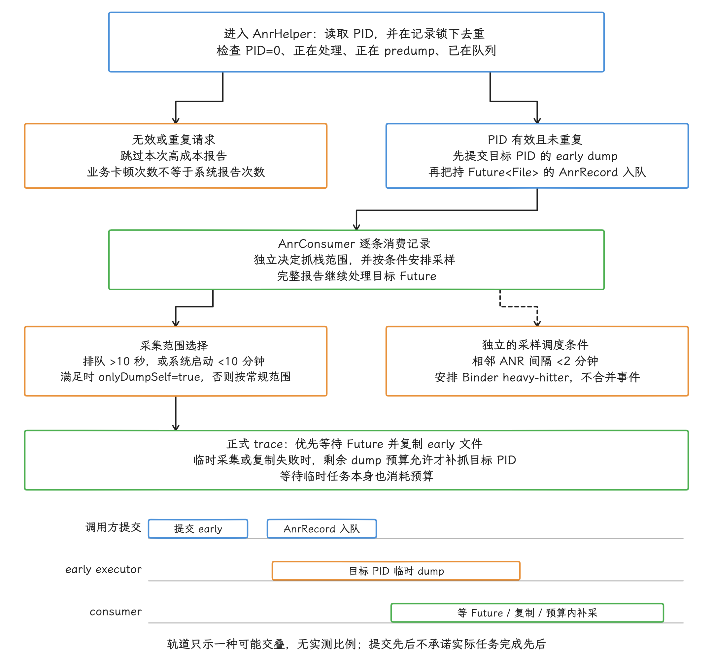
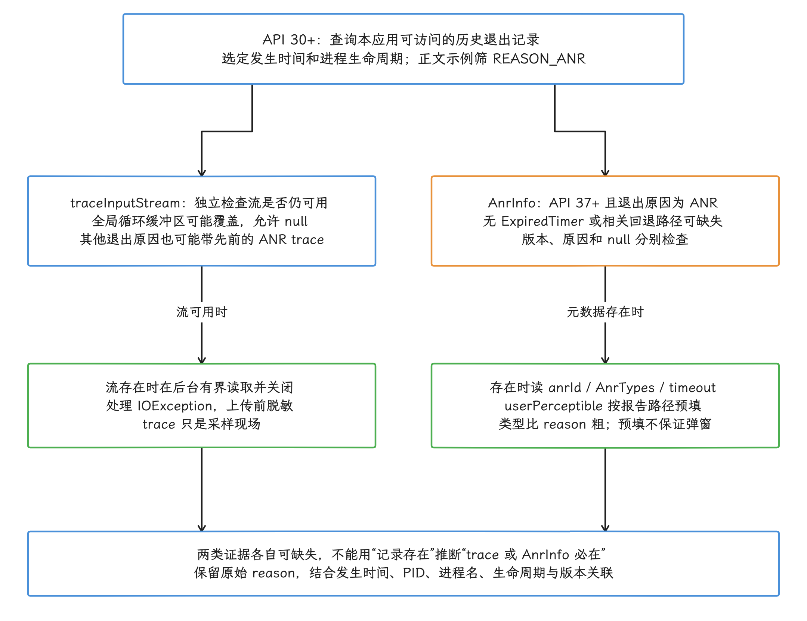
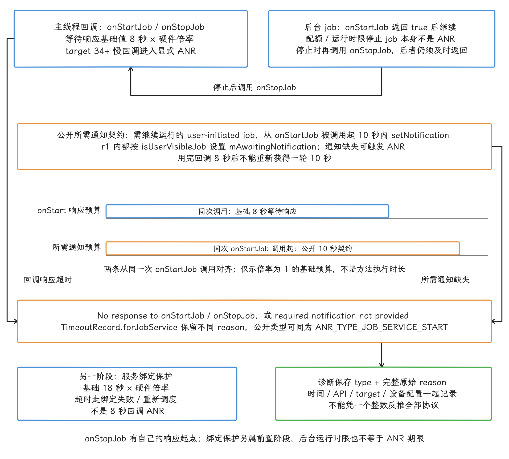

# ANR 机制、类型与触发条件

ANR 是系统替特定组件和交互设下的超时判定。分析一次 ANR，我们先确认责任组件、计时起点、截止时间和处理线程，再判断拖过期限的是工作过长、锁等待、IPC、I/O 还是调度。

## 超时责任、计时窗口与处置流程

### 从“用户等了多久”理解 ANR

用户不知道应用内部正在做数据库迁移、Binder 调用还是图片解码，他能感受到的只有触摸后没有反馈、页面停住，或刚打开的界面迟迟收不到按键。Android 要为这类关键响应设定期限，超时后还要留下足够的现场，供开发者追查。

ANR（Application Not Responding，应用无响应）机制因此负责三项工作：

1. 给输入、广播、服务等关键工作设定响应期限。
2. 期限耗尽时，从系统进程侧记录原因并采集现场。
3. 依据进程重要性、可见性和系统策略，终止进程或安排系统无响应界面。

这里有两个容易混淆的地方，我们先把它说清楚。

- ANR 只约束系统正在等待的工作。应用里某项操作耗时再长，只要一直处在受监控期限之外，时长本身触发不了 ANR。
- 主线程阻塞是最常见的原因，但系统检测的对象覆盖主线程之外：广播可以交给指定的 `Handler`，服务问题可能牵涉 Binder 线程、锁持有者或远端进程。判定标准只有一条：对应的工作有没有按协议按时完成。

所以我们分析 ANR 时，先问“是哪个系统期限耗尽、系统在等什么完成信号”，再问“哪条线程挡住了这个完成信号”。直接从主线程栈猜业务根因，很容易把采样瞬间看到的一幕，误当成此前几秒的完整过程。

<!-- gracker-diagram: ch09-01-01-deadline-contract -->


图：长操作、主线程卡顿和系统 ANR 是不同观察对象；图中的结论只针对这项受监控工作。

### ANR 处理的整体分层

对照 `android-17.0.0_r1` 的实现，应用 ANR 可以拆成四层。

| 层次 | 代表代码 | 职责 |
|---|---|---|
| 检测层 | `InputDispatcher`、`BroadcastQueueImpl`、`ActiveServices`、配置探测的 `ContentProviderClient` 等 | 建立期限，接收完成信号，发现超时；Provider 经 `ContentProviderHelper` 转报 |
| 语义层 | `TimeoutRecord` | 用统一对象保存超时类型、原因、触发时刻和采集延迟状态 |
| 编排层 | `AnrHelper` | 去重、尽早抓取目标进程栈，再将完整报告排队处理 |
| 记录与处置层 | `ProcessErrorStateRecord` | 写日志和统计、生成 trace、提交 DropBox（系统诊断条目仓库），再进入杀进程或界面策略 |

这样分层有两个好处：检测器最了解自己等的是什么协议，能写出“广播未完成”“输入窗口未响应”这类具体原因；堆栈、CPU 和 DropBox 的采集成本高，统一放到一条路径上，省得每种组件各实现一遍。

<!-- gracker-diagram: ch09-01-02-system-layers -->


图：这是 AMS 主路径的分层；各类 detector 保留独立的起点与完成条件。

#### 检测器关注完成协议

不同检测器等待的完成信号不同：

| 场景 | 系统开始等待 | 系统认定完成 |
|---|---|---|
| 输入派发 | 事件进入目标连接并等待确认，或系统等待焦点窗口出现 | 目标连接确认事件已处理，或焦点条件满足 |
| 广播接收 | 有序或受跟踪的 receiver 开始交付 | receiver 返回，或 `goAsync()` 得到的 `PendingResult` 调用 `finish()` |
| Service 执行 | AMS 在调度生命周期调用前登记 executing 状态并设置计时 | 应用通过 Framework 协议报告对应执行完成 |
| 前台服务启动 | `startForegroundService()` 建立前台化要求；内部在服务启动链中安排晋升计时 | 服务按要求调用 `startForeground()` |
| ContentProvider | 有权限的客户端配置探测，在远程调用前安排计时 | 远程调用结束并撤销该探测任务 |

输入派发的 AOSP 默认超时是 5 秒，设备还可能用 `ro.hw_timeout_multiplier`（硬件超时倍数） 这个硬件超时倍数，加上窗口级配置来调整。广播、Service 等期限也会随前后台状态、目标 SDK 和组件类型变化，具体数值见 [Input、Broadcast、Service 与 Provider 超时](#inputbroadcastservice-与-provider-超时) 一节。把所有 ANR 都概括成“主线程超过 5 秒”，就会盖住不同检测器各自的触发条件。


#### `TimeoutRecord` 统一表达超时

检测器确认超时后，会创建相应的 `TimeoutRecord`。下面的源码节选说明这个语义对象里有什么，无关的工厂方法已省略：

```java
private TimeoutRecord(int kind, String reason, long endUptimeMillis,
        boolean endTakenBeforeLocks) {
    mKind = kind;
    mReason = reason;
    mEndUptimeMillis = endUptimeMillis;
    mEndTakenBeforeLocks = endTakenBeforeLocks;
    mLatencyTracker = new AnrLatencyTracker(kind, endUptimeMillis);
}

public static TimeoutRecord forInputDispatchWindowUnresponsive(String reason) {
    return endingNow(TimeoutKind.INPUT_DISPATCH_WINDOW_UNRESPONSIVE, reason);
}

public static TimeoutRecord forContentProvider(String reason) {
    return endingApproximatelyNow(TimeoutKind.CONTENT_PROVIDER, reason);
}
```

`mEndUptimeMillis` 记录构造 `TimeoutRecord` 时取得的 uptime 时间；`endingNow()` 给出较准确的超时结束点，Provider 等使用的 `endingApproximatelyNow()` 则明确是近似结束点。`mEndTakenBeforeLocks` 标明取时点是否位于可能耗时的锁之前；精度仍要结合 `endingNow()` / `endingApproximatelyNow()` 和具体 detector 的调用点判断，不能只凭这个布尔值认定它等于计时器的精确到期点。有了这两个字段，即使 ANR 处理在后面排队，我们仍能区分“超时发生时间”和“报告开始处理时间”。平台还会把内部类型映射为公开的 `AnrTypes`，供结构化退出记录和预警信息使用。

<!-- gracker-diagram: ch09-01-04-timeout-timestamps -->


图：轨道仅表达先后；mEndUptimeMillis 是 uptime，与 UTC 时间戳属于两套计时。

### 四阶段流程：注册、执行、超时、处置

主流程可以用“注册超时 → 应用处理 → 超时触发 → 弹窗或杀进程”一句话概括，但每一步都有取消、重新核实或策略分支。

#### 阶段一：注册超时

检测器在工作开始时设置期限：`BroadcastQueueImpl`、`ActiveServices` 已经用上 `AnrTimer`，输入路径由 native `InputDispatcher` 维护连接等待队列和 ANR 跟踪器。计时器与待处理对象绑定，工作完成后，相应计时会被取消或丢弃。

注册动作通常包含以下信息：

- 负责完成工作的进程或窗口；
- 组件、Intent 或输入目标；
- 期限开始时间和时长；
- 到期时可写入报告的原因文本。

这也解释了应用自建的“主线程卡顿监控”为什么替代不了系统 ANR 统计：应用监控看得到 Looper 消息延迟，而 `system_server` 正在等哪一项协议完成、系统按窗口、进程和用户可见性怎样归因，都在它的视野之外。

<!-- gracker-diagram: ch09-01-05-complete-or-expire -->


图：Handler 消息和检测对象可能发生竞态；到期回调还要过重新核实这一关，才轮到生成报告。

#### 阶段二：应用执行并报告完成

大部分组件回调都跑在应用主线程上，所以主线程 I/O、长计算、同步 Binder、锁竞争和死锁最容易把期限拖过去。不过这个阶段还要检查，有没有别的线程挡住了完成信号：


- 主线程可能正在等待工作线程释放锁；
- 同步 Binder 的耗时由服务端线程和调度状态决定；
- `BroadcastReceiver.goAsync()` 会让广播在回调返回后继续保持未完成状态，直到 `PendingResult.finish()` 被调用；
- 使用自定义 `Handler` 的 receiver 可能在另一条 Looper 线程执行；
- 系统负载或 CPU 调度饥饿会让处于 Runnable 状态的线程长时间得不到 CPU。

“回调方法已经返回”未必代表系统协议已经完成：`goAsync()` 是典型例子，前台服务还要在期限内调用 `startForeground()`。排查时，我们要先找到相应检测器真正等待的那个完成信号。

#### 阶段三：期限耗尽

计时器到期后，检测器会再次核实目标是否仍在等待。工作已经完成、进程已经退出或对象已被替换的，旧超时直接丢弃。确认仍然超时后，检测器创建 `TimeoutRecord`，把目标进程交给 AMS（ActivityManagerService）。

输入路径还多一层责任归属判断：`InputDispatcher` 识别出“没有焦点窗口”或“目标连接未确认事件”后，经 `InputManagerCallback` 进入 WMS（WindowManagerService） 的 `AnrController`。`AnrController` 按 input token（输入连接标识）、窗口、Activity 和 PID 找到责任进程；焦点请求来自其他窗口时，也可能把超时归给那个窗口的进程。确认目标后，系统调用 AMS 的 `inputDispatchingTimedOut()`，进入 `AnrHelper`。

<!-- gracker-diagram: ch09-01-07-input-attribution -->


图：Input connection 与 no-focused-window 有不同的归因入口，责任进程以归因路径给出的结果为准。

这段路由告诉我们：日志里的责任进程由窗口和输入状态共同决定，未必是用户当时看到的前台 Activity 所在的进程。

#### 阶段四：采集并执行策略

进入 AMS 后，系统先采集容易随时间变化的诊断现场，再决定怎么处置。常见结果包括：

- 后台且不具备用户相关性的 silent ANR（不显示对话框的后台 ANR）：采集后直接杀进程；
- 可感知进程：记录 `NOT_RESPONDING` 状态并向系统 UI Handler 投递无响应界面；
- Window/Activity 控制器提前处理或要求终止；
- 调试、Instrumentation（测试框架控制）、关机或进程已死等状态下，跳过报告或改变处置。

所以超时之后的处置有多种走向，弹窗只是其中一条分支，厂商系统、调试状态、后台 ANR 设置和当前用户状态都会影响用户最终看到什么。反过来说，设备上从没弹过对话框，也可能已经发生过 ANR。

### AMS 主路径：`AnrHelper`

`AnrHelper` 让多个检测器快速交接：先尽早保存最容易变化的目标进程堆栈，再排队生成成本较高的完整报告。

#### 先去重

以下无效或重复的请求，会被直接拒绝：

- PID 为 0；
- 同一 PID 正在处理；
- 同一 PID 正在做早期临时 dump；
- 同一 PID 已在 ANR 队列中。

这一层挡住了同一进程同时生成多份高成本报告。所以日志里“业务层连续检测到多次卡顿”和“系统完整处理了多次 ANR”，本来就是两种不同的计数方式。


#### 尽早保存目标进程栈

一份完整的 ANR 报告，可能还要抓 `system_server`、持久进程、原生守护进程和 CPU 状态。等这些步骤都做完再去抓目标应用，主线程现场可能早就变了。所以 `AnrHelper` 先把目标 PID 的临时 dump（线程堆栈转储）交给独立线程池，再把 ANR 记录放进报告队列。

下面的源码节选展示“先提交 early dump，再把记录入队”的顺序：

```java
Future<File> firstPidDumpPromise = mEarlyDumpExecutor.submit(() -> {
    File tracesFile = StackTracesDumpHelper.dumpStackTracesTempFile(
            incomingPid, timeoutRecord.mLatencyTracker);
    mTempDumpedPids.remove(incomingPid);
    return tracesFile;
});

mAnrRecords.add(new AnrRecord(
        anrProcess, activityShortComponentName, aInfo,
        parentShortComponentName, parentProcess, aboveSystem,
        timeoutRecord, isContinuousAnr, firstPidDumpPromise));
```

`Future<File>` 代表还在执行或已完成的异步文件任务，会跟着 `AnrRecord` 进入消费线程。生成正式 trace 时，`StackTracesDumpHelper` 优先复制这份 early dump；临时采集或复制未成功时，会在剩余 dump 时间预算允许的情况下重新抓目标 PID。等待临时任务本身也会消耗预算，预算耗尽时补采就停在这一步。


#### 队列拥塞时缩小采集范围

`AnrConsumer` 逐条处理队列里的记录。若报告排队已超过 10 秒，或系统启动还不足 10 分钟，`onlyDumpSelf` 会被设为 `true`，系统只抓被归因的那个进程——大量并发 ANR 报告继续占用 CPU 和 I/O，只会把设备拖得更慢。

两次 ANR 间隔不足 2 分钟时，`AnrHelper` 会安排 Binder heavy-hitter（高频 Binder 调用方）自动采样，给报告补上调用热点线索。这个 2 分钟常量只管采样调度，不会自行合并两次事件；能否各自入队成报，仍受同 PID 去重、进程存活和后续处置条件约束。

<!-- gracker-diagram: ed09-01-helper-capture-and-load -->


图：AnrHelper在入口按PID跳过无效/重复请求，接受的请求先提交early dump再把持Future的记录入队；提交先后不保证任务完成先后。消费者独立安排采样，并按排队超过10秒或开机不足10分钟选择onlyDumpSelf等抓栈范围；相邻ANR不足2分钟用于Binder heavy-hitter调度，不是合并事件。正式trace优先等待并复制early文件，失败时只在剩余dump预算内补抓；轨道仅示一种可能交叠，不表示实测时长或采样阻塞报告。

单条 ANR 处理结束后，系统还可以发送 `ProfilingTrigger.TRIGGER_TYPE_ANR`。应用事先注册过系统触发式 profiling（性能剖析）的话，可能拿到覆盖一段时间的额外产物，注册方式与数据范围见 [15.7 ProfilingManager](../../part3-tools/ch15-other-tools/07-profiling-manager.md)。这类产物是补充材料，替代不了 ANR trace。

### AMS 主路径：`ProcessErrorStateRecord`

`ProcessErrorStateRecord.appNotResponding()` 把已经确认的超时转成一条可诊断、可处置的系统事件，同时留下统计记录。

#### 进入报告前的状态防护

系统正在关机、进程已有 ANR、进程正在崩溃、进程已被 ActivityManager 杀死或已经死亡时，AMS 会跳过普通报告；对标记为正在调试的应用，`appNotResponding()` 会在普通报告流程前直接返回。

通过检查后，系统在锁保护下把进程标记为 `notResponding`，挡住同一进程并发的重复报告，随后写入 `am_anr` EventLog，并尽快记下 Perfetto/Stats 触发点，方便把不同的诊断数据按时间对到一起。

<!-- gracker-diagram: ch09-01-11-report-state-guard -->


图：系统控制器另有 early 处理机会；图展示普通报告的状态保护。

#### 收集可关联的诊断材料

生成 ANR 报告时，系统会汇总这些材料：

- 超时原因、组件和 PID；
- 目标进程及选定关联进程的 Java/native 线程栈；
- 当前 CPU 使用和负载；
- PSI（Pressure Stall Information，资源压力停顿信息）；
- 目标进程内存摘要与 fs-verity 信息；
- CriticalEventLog、EventLog、statsd 和 Perfetto 标记；
- DropBox 报告与 `ApplicationExitInfo` 可回捞的 trace 片段。

下面的源码节选展示 EventLog 事件、trace 文件和 DropBox 条目都出自 `appNotResponding()` 这一次调用：


```java
EventLog.writeEvent(EventLogTags.AM_ANR, mApp.userId, pid,
        mApp.processName, mApp.info.flags, annotation);

File tracesFile = StackTracesDumpHelper.dumpStackTraces(
        firstPids, processCpuTracker, lastPids, nativePidsFuture,
        tracesFileException, firstPidEndOffset, annotation,
        criticalEventLog, extraHeaders, auxiliaryTaskExecutor,
        firstPidFilePromise, latencyTracker, timeoutRecord);

mService.addErrorToDropBox("anr", mApp, mApp.processName,
        activityShortComponentName, parentShortComponentName,
        parentPr, null, report.toString(), tracesFile, null,
        new Float(loadingProgress), incrementalMetrics, errorId,
        volatileDropboxEntriyStates);
```

三者各管一段：EventLog 提供事件索引，trace 保存线程现场，DropBox 汇总更完整的上下文。代码里的 `"anr"` 只是错误类型参数，AMS 会结合进程类别生成具体的 DropBox tag（条目分类名），所以排查时先看设备上实际的 tag，`data_app_anr` 只是常见取值之一。

#### 决定杀进程或展示界面

`WindowProcessController.appEarlyNotResponding()` 在普通材料采集前就给控制器一次处理机会；材料采集后还会调用 `appNotResponding()`。普通路径接着检查 `isSilentAnr()`：开发者选项里没开“显示所有 ANR”、进程又与当前用户界面无关时，系统按后台 ANR 把它杀掉。`system_server`、正在展示 Activity 的进程、SystemUI，以及有 top UI（顶层界面）或 overlay UI（覆盖层界面）的进程，算作用户相关进程，会保留更完整的现场。

可展示路径生成 `ProcessErrorStateInfo.NOT_RESPONDING`，并向 AMS UI Handler 发送 `SHOW_NOT_RESPONDING_UI_MSG`。界面真正显示之前，当前用户、系统控制器、延迟策略和设备定制都还可能改变结果。

<!-- gracker-diagram: ch09-01-13-silent-or-ui -->


图：发送 UI 消息之后，用户未必看得到弹窗；当前用户、延迟、控制器与设备策略仍可能改变结果。

### 应用 ANR 与 `system_server` Watchdog

应用 ANR 和 `system_server` Watchdog 都处理“长时间没有进展”，但保护对象和恢复方式差异很大。

| 维度 | 应用 ANR | `system_server` Watchdog |
|---|---|---|
| 保护对象 | 应用组件、输入窗口和应用进程 | `system_server` 的关键 Handler 与 Monitor |
| 检测者 | 输入、广播、服务、Provider 等子系统 | `Watchdog` 线程与 `HandlerChecker` |
| Android 17 默认期限 | 按场景配置；输入 AOSP 默认 5 秒 | 普通构建默认 60 秒，可由设置和硬件超时系数调整 |
| 中间信号 | Android 17 部分路径有 ANR warning/pre-ANR（正式超时前预警） | 期限的 1/4 进入 pre-watchdog；默认约 15 秒 |
| 主报告路径 | `AnrHelper` → `ProcessErrorStateRecord` | `Watchdog.run()` → `collectThreadDumps()` |
| 常见处置 | 后台杀进程或安排 ANR UI | 采集后杀掉 `system_server`，由系统重启；调试器和禁重启策略可阻止 |

Watchdog 把检查任务投递到 `system_server` 的关键 Looper，并执行注册的 Monitor（关键锁或组件健康检查）。检查任务迟迟完不成时，它会区分仍在等待、pre-watchdog 和 overdue（已经超过最终期限）三种状态。`PRE_WATCHDOG_TIMEOUT_RATIO` 是 4，所以默认 60 秒期限下，pre-watchdog 约在 15 秒触发；pre-watchdog 采集有一小时冷却限制，但完整超时仍可能在约 60 秒触发。

<!-- gracker-diagram: ch09-01-14-watchdog-deadline -->


图：图为默认常量下的概念阶段；没有按实际时长比例绘制。设置、硬件系数与线程特定期限会改变等待。

Watchdog 报告用 `pre_watchdog` 或 `watchdog` DropBox tag，并生成 `system_server` 及关键原生进程的堆栈。完整超时后，若没有调试器附着、系统允许重启、控制器也没有要求继续等待，Watchdog 就调用 `Process.killProcess(Process.myPid())` 终止 `system_server`，剩下的交给系统重启恢复。

应用 ANR 也可能由 `system_server` 卡顿间接引起。比如应用主线程在同步 Binder 里等 `system_server`，输入期限先耗尽，这时先记录的是应用 ANR；要等 `system_server` 的受监控线程也持续没有进展，Watchdog 才会独立触发。这两份报告我们要放到同一条时间线上看：前一份报告归在应用进程名下，问题也可能出在 `system_server` 一侧。

<!-- gracker-diagram: ch09-01-15-app-system-dependency -->


图：这是可能的依赖示例；应用 ANR 是否伴随 Watchdog、两份报告间隔多久，都因场景而异。

### 三类基础产物怎么配合

#### EventLog：回答“何时、谁、因为什么”

`am_anr` 这个 EventLog tag 编号是 30008，字段顺序为 user、PID、进程名、应用 flags 和 reason。reason 来自检测器构造的 `TimeoutRecord`，通常是我们判断 ANR 类型与等待对象最稳定的入口。

下面的两条命令分别从设备的 events 日志缓冲区和已导出的 bugreport 中查找 `am_anr` 索引：

```bash
adb shell logcat -b events -d -v threadtime | grep 'am_anr'
grep 'am_anr' bugreport.txt
```

events 缓冲区会循环覆盖旧记录，所以线上问题要尽早保存带时间戳的完整 bugreport 或平台侧记录。

#### ANR trace：回答“采样时线程在做什么”

`StackTracesDumpHelper` 会在 `/data/anr/` 下创建名为 `anr_yyyy-MM-dd-HH-mm-ss-SSS` 的文件，权限 `0600` 意味着只有文件所有者能读写。历史 bugreport 里仍会见到 `traces.txt` 这个名字，下文统一叫“ANR trace”。

普通第三方应用拿不到 `/data/anr` 的遍历权限。开发阶段可以从 bugreport 里取系统收集的 ANR 段；Android 11 / API 30 起，应用还能通过 `ActivityManager.getHistoricalProcessExitReasons()` 查询自己的历史退出记录，用 `ApplicationExitInfo.getTraceInputStream()` 读取系统保留的 trace。trace 放在容量有限的全局循环缓冲区里，可能已被后续记录覆盖，所以这个输入流允许返回 `null`。

下面的 Kotlin 片段应在后台执行器中运行，我们用它查找当前应用最近一次 ANR 退出记录，并在 trace 仍可用时读取文本内容。它只展示查询和关闭流的顺序；生产实现要在读取时就限制大小，并处理 `getTraceInputStream()` 可能抛出的 `IOException`，不要在主线程直接执行 `readText()`：

```kotlin
val activityManager = getSystemService(ActivityManager::class.java)
val exits = activityManager.getHistoricalProcessExitReasons(
    packageName,
    0,
    20,
)

val latestAnr = exits.firstOrNull {
    it.reason == ApplicationExitInfo.REASON_ANR
}

latestAnr?.traceInputStream?.bufferedReader()?.use { reader ->
    val traceText = reader.readText()
    uploadAfterRedaction(traceText)
}
```

这个 API 只返回本应用有权访问的历史信息，内容范围小于完整 bugreport。生产环境上传前要限制大小、做隐私审查并脱敏；trace 为 `null` 是允许出现的结果，别当成采集逻辑的异常。


Android 17 / API 37 又为 `ApplicationExitInfo` 增加了 `getAnrInfo()`。返回的 `ApplicationExitInfo.AnrInfo` 里有 ANR ID、`AnrTypes` 类型、系统等待时长和用户可感知标志，且只出现在 `REASON_ANR` 记录中。它有两条局限：输入派发这类路径没有 `AnrTimer.ExpiredTimer` 对象，timer 回退实现也可能缺这个对象，此时仍可能拿不到 `AnrInfo`，所以兼容代码要同时判断系统版本和空值。AOSP 在报告前用 `!isSilentAnr` 填充可感知标志，这只代表报告走了可感知路径，用户最终是否看到对话框，还要看后续 UI 策略。

<!-- gracker-diagram: ed09-01-exit-record-optional-evidence -->


图：API30+查询本应用可访问的历史退出记录，正文示例筛REASON_ANR。trace流受全局循环缓冲保留影响，可以为null，其他退出原因也可能携带此前ANR的trace；有流时后台有界读取、关闭、处理IOException并脱敏。API37+的ANR退出记录才可能有AnrInfo，未经过ExpiredTimer或相关回退路径仍可缺失，不能互推两类证据必然同时存在。结构化type/timeout与userPerceptible预填不替代原始reason，也不保证已显示弹窗；结合发生时间、进程名、PID与生命周期关联。

#### DropBox：回答“系统汇总了哪些上下文”

`ProcessErrorStateRecord` 把 ANR 摘要、资源压力、trace 文件和关联信息交给 `ActivityManagerService.addErrorToDropBox()`。最终 tag 跟进程类别有关，常见形式有 `data_app_anr`、`system_app_anr` 等，AOSP 与厂商构建之间可能存在差异。

下面的命令用于在具备相应调试权限的设备上先列出 DropBox 条目，再读取指定 tag 的内容：

```bash
adb shell dumpsys dropbox --file
adb shell dumpsys dropbox --print data_app_anr
```

先确认设备上实际存在的条目和 tag，再读目标内容，免得把示例里的 `data_app_anr` 当成所有 ANR 的固定名称。

#### 三者按时间关联

一份可靠的基础材料，至少要把下面三类信息对齐：


1. EventLog 的时间、PID、进程名和 reason；
2. trace 文件头中的 PID、时间与 subject；
3. DropBox 条目的 tag、时间和资源信息。

PID 会被后来的进程复用，应用进程也可能在 ANR 后重启。只按包名合并多份报告，会把不同的进程生命周期混在一起；关联时要把时间、PID、进程名和错误 ID 放在一起用。

### trace 是快照，根因常在快照之前

系统已经尽量早地抓目标进程栈，但采样仍发生在检测器确认超时之后，线程状态可能在超时与采样之间变化。常见情形有两类：

- 主线程在期限耗尽前执行了长任务，dump 时任务刚刚结束，堆栈已经回到 `nativePollOnce()` 等待下一条消息；
- 主线程 dump 时等待某把锁，持锁线程稍后释放，后续采样只留下普通业务帧。

所以主线程栈停在 `nativePollOnce()`，只说明采样那一刻在等消息；超时发生时它在做什么，要靠时间线还原。停在某个普通方法里，也只说明采样时在那里，整个超时时间未必都耗在这个方法上。官方 ANR 诊断文档同样把“采样过晚而显示 idle 的主线程聚类”列为难以直接采取行动的线索。

<!-- gracker-diagram: ch09-01-19-late-snapshot -->


图：轨道为解释采样滞后的可能情形，非实测刻度；单个栈顶只对应一个采样时刻，整段超时过程要另找材料。

排查时可以按下面的顺序推进：

1. 用 EventLog reason 确认检测类型和等待对象。
2. 用 trace 找阻塞关系、Binder 调用、锁持有者和线程状态。
3. 用 CPU、PSI 判断 CPU 是否饱和、线程是否长期得不到调度，以及是否存在内存或 I/O 压力。
4. 用 Perfetto 还原超时前几秒的调度、Binder、锁和主线程任务。
5. 结合版本、机型、进程生命周期和同一时段的系统日志，排除错误归因。

更完整的 trace 逐段阅读方法与系统/内核联合诊断见 [9.2 ANR 与 Kernel Trace 联合诊断](02-anr-kernel-trace-diagnosis.md)。

### Android 8 到 Android 17 的演进重点

这一节只保留会影响诊断方式的变化；源码内部重构未必改变应用可见的行为。

- **Android 8 / API 26**：后台执行限制改变了后台组件的运行条件。分析旧应用时，要把“组件能否在后台启动”和“组件启动后是否超时”分开。
- **Android 11 / API 30**：公开 `ApplicationExitInfo` 与 `getHistoricalProcessExitReasons()`，应用可以在下次启动后读取自身历史退出原因和仍可用的 ANR trace。`AnrHelper` 也已进入 AMS 的统一处理路径。
- **Android 14 / API 34**：面向目标 SDK 34 及以上的部分 `JobService` 回调超时会按明确 ANR 报告；广播派发进入现代队列实现，超时可依据进程状态调整。
- **Android 15 / API 35**：公开 `ProfilingManager` 的主动采集能力；AOSP Watchdog 已能在最终期限的 1/4 处执行 pre-watchdog 采集。
- **Android 16 / API 36**：公开 `ProfilingTrigger.TRIGGER_TYPE_ANR` 和系统触发式 profiling 注册能力，为 ANR 增加一份覆盖时间段的补充材料。
- **Android 17 / API 37**：`TimeoutRecord` 可映射公开 `AnrTypes`；`ApplicationExitInfo.getAnrInfo()` 提供结构化 ANR 元数据；`ActivityManager.registerAnrWarningListener()` 允许应用按尽力而为原则接收临近 ANR 期限的预警。详情见 [9.7 Android 17 ANR 预警与 Input pre-ANR](07-android17-anr-prewarning.md)。

这些版本变化的方向一致：各检测器保留自己的协议语义，AMS 统一组织报告；诊断材料从单次线程快照，扩展到结构化退出信息、早期预警和可选的时间段 profiling。传统 trace 仍是基础，但要和时间线、结构化信息放在一起解释。


### Google Play Console 的统计范围

按 2026-10-23 核对的官方文档，Android vitals 同时提供：

- **ANR rate**：每日活跃用户中经历任意 ANR 的比例；
- **user-perceived ANR rate**：每日活跃用户中经历至少一次用户可感知 ANR 的比例；当前只计入 `Input dispatching timed out`；
- **multiple ANR rate**：每日经历至少两次 ANR 的用户比例。

用户可感知 ANR 率属于 Google Play core vital（核心质量指标）。官方当前的不良行为阈值如下：

| 统计范围 | 阈值 |
|---|---:|
| 全部设备型号的每日活跃用户 | 0.47% |
| 单一手机型号的每日活跃用户 | 8% |

超过全局阈值，可能影响应用在所有设备上的可发现性；只在部分机型超过单机型阈值，也可能影响对应设备上的曝光并触发商店警告。阈值本身是可能调整的平台运营规则，发布准入检查要以 Play Console 和最新官方文档为准，别把表里的数值永久写死在监控代码里。

我们还要留意两边的统计分母：本地 APM（应用性能监控）常按会话、事件数或进程启动次数计算，Android vitals 按每日活跃用户计算，还要受来源设备、用户共享设置和隐私门槛影响。两边数值对不上是正常的，比较前先统一分母、时间窗口和“用户可感知”的定义。


### 工程检查表

设计监控或阅读一条 ANR 报告时，依次回答这些问题：

- 哪个检测器报的超时，reason 原文是什么？
- 系统等待的完成信号是什么，期限从哪个时刻开始？
- 被归因的 PID、进程名、窗口或组件是否一致？
- trace 与 EventLog 的时间差是多少，主线程状态是否可能已经变化？
- 主线程在运行、可运行、睡眠、Binder 等待还是锁等待？
- 若有等待关系，远端 Binder 线程或锁持有者在做什么？
- CPU、PSI、I/O 和系统服务是否显示设备级压力？
- 进程属于前台可感知 ANR、后台 silent ANR，还是 `system_server` Watchdog？
- 相同错误是否集中在特定 Android 版本、设备型号或目标 SDK？
- 修复是否真正缩短了检测器等待的那项工作，而不只是让采样时的栈顶换了位置？


## Input、Broadcast、Service 与 Provider 超时

处置流程是统一的，但各类 ANR 的计时入口和责任线程各不相同。拿到报告就套另一类型的阈值，分析会直接走偏，所以我们按类型把计时入口逐个过一遍。

### 先认超时契约，再看线程栈

ANR 报告里的 `Reason`，说的就是系统在等哪一个完成信号：Input 等应用确认输入事件处理完，Broadcast 等 receiver 完成，execute-service 等服务生命周期调用结束。不同类型可能留下相似的主线程栈，但计时起点、完成条件和责任进程都不一样。

拿到报告后可以依次回答三个问题：

1. 系统等待什么完成信号？
2. 计时从哪个动作开始，进程冷启动是否也占用这段时间？
3. 到期后，系统会调用 `appNotResponding()` 生成 ANR、直接移除进程，还是抛出远程服务异常？

这三个问题要排在“主线程卡在哪里”之前回答。类型判断错了，线程栈即使读对，也可能把回调、进程启动或远端 Provider 的责任归错位置。


常用类型可以先按下表定位。表里的数值是 AOSP 源码默认值，`Build.HW_TIMEOUT_MULTIPLIER`、DeviceConfig、广播 CPU 饥饿补偿和 OEM 配置都可能改变具体设备上的等待时长。

| 触发器 | Android 17 默认等待 | 系统等待的完成信号 | 常见 `Reason` 片段 |
|---|---:|---|---|
| Input connection | 5 秒 | 已分发事件得到完成确认 | `Input dispatching timed out`、`is not responding. Waited ... for ...` |
| No focused window | 5 秒 | 已聚焦应用出现可接收输入的窗口 | `does not have a focused window` |
| Broadcast | 10 秒或 60 秒；线程长期得不到 CPU 时，最多再延长一段同等时长 | `onReceive()` 返回，或 `PendingResult.finish()` | `Broadcast of Intent` |
| Execute service | 20 秒或 200 秒 | `onCreate()`、`onBind()`、`onStartCommand()` 等调度执行结束 | `executing service ... waited ...ms` |
| FGS 晋升 | 源码内部默认 30 秒，另有 10 秒 ANR 延迟；应用仍应遵循公开的数秒契约 | `startForegroundService()` 启动的服务调用 `startForeground()` | `did not then call Service.startForeground()` |
| `shortService` | 约 3 分钟；从系统超时点起再给默认 10 秒窗口 | `onTimeout(int, int)` 后停止服务 | `FOREGROUND_SERVICE_TYPE_SHORT_SERVICE did not stop` |
| Provider 远程调用 | 客户端配置 | 远程 Provider 调用返回 | `ContentProvider not responding` |
| `JobService` 回调 | 8 秒 | `onStartJob()` 或 `onStopJob()` 返回 | `No response to onStartJob` / `onStopJob` |

“Provider 在 10 秒内完成 publish”没有列进表里，是因为这类超时会被记成初始化失败并移除进程，不走 ANR 报告路径，后文有对应源码。

### Input ANR：输入连接和焦点窗口是两条路径

#### 默认 5 秒从哪里来

这只 5 秒计时器由 `InputDispatcher` 维护，它位于 native inputflinger（原生输入系统服务）。事件写入应用的 InputChannel（输入通道） 后，待确认的 `DispatchEntry` 会留在 connection 的 `waitQueue` 里；应用完成输入处理，通过 `InputEventReceiver.finishInputEvent()` 发回确认，该条目才离开等待队列。普通 View 事件通常由主线程处理，所以主线程阻塞是常见根因；不过检测器直接盯着的，是输入连接有没有按时确认事件。

下面的源码展示系统怎样从 5 秒基础值、硬件超时倍率和窗口级配置算出实际超时：

```cpp
// frameworks/native/services/inputflinger/dispatcher/InputDispatcher.cpp
const std::chrono::duration DEFAULT_INPUT_DISPATCHING_TIMEOUT = std::chrono::milliseconds(
        android::os::IInputConstants::UNMULTIPLIED_DEFAULT_DISPATCHING_TIMEOUT_MILLIS *
        HwTimeoutMultiplier());

std::chrono::nanoseconds InputDispatcher::getDispatchingTimeoutLocked(
        const std::shared_ptr<Connection>& connection) {
    if (connection->isFocusMonitor) {
        return mMonitorDispatchingTimeout;
    }
    const sp<WindowInfoHandle> window = mWindowInfos.findWindowHandle(connection->getToken());
    if (window != nullptr) {
        return window->getDispatchingTimeout(DEFAULT_INPUT_DISPATCHING_TIMEOUT);
    }
    return DEFAULT_INPUT_DISPATCHING_TIMEOUT;
}
```

`IInputConstants.UNMULTIPLIED_DEFAULT_DISPATCHING_TIMEOUT_MILLIS` 是 5000。默认 5 秒适用于没有单独配置的窗口和 input monitor（输入监视连接）；窗口也可以提供自己的 dispatching timeout，所以要以报告里的实际等待值为准，结合目标设备和窗口状态解读。

<!-- gracker-diagram: ch09-01-23-input-timeout-config -->


图：No-focused-window 还会读取 focused application 的期限；图展示 connection 的配置选择。

#### Connection ANR

`processAnrsLocked()` 从 `mAnrTracker` 取出已到期的 connection。进入 `onAnrLocked(connection)` 后，源码取 `waitQueue.front()`——队首最早的那条待确认事件——作为诊断线索，再用 `now() - oldestEntry.deliveryTime` 算它已经等了多久，其中 `deliveryTime`（投递时间）记录该事件的投递时刻。

源码注释还说明一个限制：oldest entry 是最好的排查线索，触发计时器到期的却可能是另一条事件——窗口超时配置在等待期间变化过的话，较新的事件反而可能更早到自己的期限。所以报告里的事件描述要当线索看，因果结论还要对照其他材料。

生成的 native reason 形如：

<!-- gracker-diagram: ch09-01-24-input-connection -->


图：报告取 waitQueue 队首作诊断线索；窗口期限配置变化时，它不一定是最先到期的那条事件。

`<input-channel> is not responding. Waited <N>ms for <event-description>`

随后 `processConnectionUnresponsiveLocked()` 把事件、持续时间和 connection token（输入连接标识） 交给 policy 层，由 WMS/AMS 构造 ANR 记录；`cancelEventsForAnrLocked()` 取消该 connection 上的后续事件，不再向已判定无响应的连接投递输入。

我们排查 connection ANR 时，要覆盖这些可能性：

- 主线程执行长任务、锁等待、Binder 同步调用或文件 I/O；
- 主线程消息队列积压，输入消息迟迟得不到处理；
- native input receiver 或自建 InputChannel 没有按协议完成事件；
- 线程长时间处于 Runnable（可运行但等待 CPU）状态；
- 系统端或跨进程依赖拖住主线程，触发点仍落在应用的输入窗口。

#### No focused window（实际接收输入的焦点窗口） ANR

InputDispatcher 已经知道 focused application（当前应获得焦点的应用） 是哪个应用，却等不到实际接收输入的 focused window 出现，这时会启动另一只计时器。到期 reason 是：

`<application> does not have a focused window`

这条记录指向窗口建立或焦点交接。常见的检查项包括：Activity 启动是否卡在 `bindApplication` / `Application.onCreate()`，首个窗口是否迟迟没加入 WMS，窗口切换期间 token 是否对应错误，显示切换或多窗口状态是否异常。no-focused-window 的意思是系统还在等一个能接收输入的窗口；按“点击事件处理超过 5 秒”去分析，往往会漏掉启动链上的问题。

<!-- gracker-diagram: ch09-01-25-no-focused-window -->


图：这里系统尚未把该输入交给合适窗口；reason 说的是焦点窗口缺位，与“点击回调已经执行五秒”是两回事。

### Broadcast ANR：判断依据是广播标志和完成回执

#### 10/60 秒与 10–20/60–120 秒

基础常量仍然是：

- 带 `Intent.FLAG_RECEIVER_FOREGROUND` 的广播使用 10 秒软超时；
- 其余受跟踪广播使用 60 秒软超时。

这里的“前台广播”指 Intent 带有前台接收标志，和接收进程当时处于前台还是后台是两回事。Android 14 起，官方诊断范围写成 10–20 秒和 60–120 秒，取决于 CPU 饥饿。Android 17 的 `BroadcastAnrTimer` 允许延期：native timer 首次到期时读取目标 PID 的 `/proc/<pid>/schedstat` 调度等待增量，最多补偿一次、上限等于原期限。这个计数只覆盖目标 PID 自身的调度等待，全部 Binder 工作线程的等待总和还在它的范围之外；native timer 不可用时回退到 Handler 定时消息，那条路径上同样没有这项延期计算。

下面的源码片段展示哪些广播会启动计时器，以及确认超时后怎样进入 ANR：

<!-- gracker-diagram: ch09-01-27-broadcast-cpu-extension -->


图：官方范围为10–20或60–120秒；概念长度非比例。Handler 回退路径缺少 native 延期计算；10秒档由前台广播标志决定，与进程前台状态无关。

```java
// frameworks/base/services/core/java/com/android/server/am/BroadcastQueueImpl.java
final boolean assumeDelivered = r.isAssumedDelivered(index);
if (mService.mProcessesReady && !r.timeoutExempt && !assumeDelivered) {
    queue.setTimeoutScheduled(true);
    final int softTimeoutMillis = (int) (r.isForeground() ? mFgConstants.TIMEOUT
            : mBgConstants.TIMEOUT);
    startDeliveryTimeoutLocked(queue, softTimeoutMillis);
}

// deliveryState == BroadcastRecord.DELIVERY_TIMEOUT
TimeoutRecord tr = TimeoutRecord.forBroadcastReceiver(
        r.intent, packageName, className);
mAnrTimer.accept(queue, tr);
mService.appNotResponding(queue.app, tr);
```

系统尚未完成启动，或广播带有 `timeoutExempt`（豁免超时）标记时，这只计时器不会启动；带 `assumeDelivered`（系统无需等待明确回执）标记的广播同样不启动。动态注册的无序 receiver 可能走 assumed-delivered 路径，所以一个 BroadcastReceiver 有没有 10/60 秒 ANR 计时器，要看它属于哪条路径。

<!-- gracker-diagram: ch09-01-26-broadcast-timer-gates -->


图：动态无序 receiver 且 resultTo 为 null 是 assumed-delivered 条件；其他外层协议仍可能触发 ANR。

#### `goAsync()` 与广播 deadline（截止时间）

同步 receiver 以 `onReceive()` 返回作为完成信号；调用 `goAsync()` 后，完成信号改为 `PendingResult.finish()`，但广播原有的 deadline 仍在继续计时。后台线程池拥塞、网络等待、锁竞争或漏调 `finish()`，都可能让同一个 deadline 到期。

<!-- gracker-diagram: ch09-01-28-goasync-deadline -->


图：示意正常 finish 先于到期；遗漏或迟到 finish 都可能导致同一广播超时。

进程冷启动也要分析，但要先确认广播计时实际何时启动。Android 17 的 `scheduleReceiverColdLocked()` 先请求拉起进程，`onApplicationAttachedLocked()` 再交给 warm dispatch，`dispatchReceivers()` 才启动接收计时。默认 `enable_wait_for_finish_attach_application=true` 时，AMS 要等应用执行完 Provider 初始化、`Application.onCreate()` 并回报 `finishAttachApplication()` 后，才进入这次广播交付；fork 和这些初始化步骤是否计入该 receiver 的 10/60 秒窗口，要看计时起点在哪里。关闭该配置时，交付可提前到初始化结束之前，剩余的主线程初始化与排队才会消耗广播期限。

⚠️ 矛盾：[官方诊断指南](https://developer.android.com/topic/performance/anrs/diagnose-and-fix-anrs#broadcast-receiver) 通用表述为“冷启动也计入广播超时”；[Android 17 固定源码](https://android.googlesource.com/platform/frameworks/base/+/android-17.0.0_r1/services/core/java/com/android/server/am/ActivityManagerService.java) 的默认 finish-attach 等待和现代队列计时点更细。诊断特定设备时，以其源码、配置和实际派发时间为准；照通用表述画一根覆盖全部启动阶段的 timer，会把计时范围画错。启动本身另有进程启动、Provider 发布和 bind-application 保护，可能产生其他失败或应用启动 ANR。

<!-- gracker-diagram: ch09-01-29-android17-finish-attach -->


图：概念顺序以 android-17.0.0_r1 默认配置为基线；旧版本或改过配置的设备要另行确认。

常见 `Reason` 以 `Broadcast of Intent` 开头，并携带 action、component（组件） 或 receiver 包名。诊断时同时记录：

- 是否设置 `FLAG_RECEIVER_FOREGROUND`；
- receiver 是在 manifest 中声明还是运行时注册，广播是否为 ordered（有序广播）；
- 是否调用 `goAsync()`，每条分支是否都能执行 `finish()`；
- 进程在接收前是否已经存在，CPU starvation（线程长期得不到 CPU）是否明显；
- `onReceive()` 之前是否经历长时间应用初始化。

### Execute-service ANR：20/200 秒取决于执行优先级

#### “前台 20 秒”的两种含义

AMS 向进程调度 service lifecycle transaction（服务生命周期事务）后，会把该服务加入 executing set（正在执行的服务集合），`ActiveServices.scheduleServiceTimeoutLocked()` 再根据 `ProcessServiceRecord.isExecServicesFg()` 选择 20 秒或 200 秒。这里的“前台”指这次服务执行采用较高优先级，和“服务已经晋升为 Foreground Service”是两回事，FGS 类型也推不出它。

下面的常量给出默认执行时限，以及两者的 10 倍关系：

```java
// frameworks/base/services/core/java/com/android/server/am/ActivityManagerConstants.java
private static final long DEFAULT_SERVICE_TIMEOUT =
        20 * 1000 * Build.HW_TIMEOUT_MULTIPLIER;
private static final long DEFAULT_SERVICE_BACKGROUND_TIMEOUT =
        DEFAULT_SERVICE_TIMEOUT * 10;

long SERVICE_TIMEOUT = DEFAULT_SERVICE_TIMEOUT;
long SERVICE_BACKGROUND_TIMEOUT = DEFAULT_SERVICE_BACKGROUND_TIMEOUT;
```

源码只是把默认值写进运行时字段，设备配置和硬件倍率仍可能改变实际数值。所以报告里的 `waited ...ms`，比我们记忆里的固定秒数更可靠。

计时覆盖 `onCreate()`、`onBind()`、`onStartCommand()` 等生命周期调用的投递、主线程排队和执行，起点在系统登记 executing 状态处，早于回调真正开始。Android 17 默认等 `finishAttachApplication()` 后才启动待处理服务，所以 fork、Provider 初始化和 `Application.onCreate()` 通常位于这只执行 timer 之前；关闭等待配置时，尚未结束的初始化可能进入排队等待。整个冷启动时长机械地算进 20/200 秒，得到的窗口是错的。`TimeoutRecord.forServiceExec()` 生成的 reason 形如：

<!-- gracker-diagram: ch09-01-30-service-execution -->


图：同进程多个服务共用执行状态与检查；默认等待 finish-attach 时，整个冷启动不属于这只执行 timer。

`executing service <short-instance-name>, waited <N>ms`

同一进程可以同时执行多个 Service，而计时器把责任归到进程一级，所以要结合 executing service 列表、transaction 记录、业务日志和 trace 里的主线程栈，确认到底是哪一次生命周期调用没有完成。

### 前台服务附近有三种不同的超时结果

前台服务相关的报错常被统称成“FGS ANR”，但不同路径的计时起点和最终结果各不相同，至少要区分以下三种情况。


#### `startForegroundService()` 后没有及时晋升

调用 `startForegroundService()` 后，系统会给这个服务设置 `fgRequired`，要求它尽快调用 `startForeground()` 并发布合规通知。官方 ANR 概览给出的应用侧时限是 5 秒，FGS 排障页表述为“几秒内”；而 AOSP Android 17 的内部实现默认使用下面两个值：

- `DEFAULT_SERVICE_START_FOREGROUND_TIMEOUT_MS = 30 * 1000`；
- `DEFAULT_SERVICE_START_FOREGROUND_ANR_DELAY_MS = 10 * 1000`。

这两个内部值可以被 DeviceConfig 改写，应用侧计时要以公开的数秒契约为准，内部值用来解释设备日志里看到的行为。`serviceForegroundTimeout()` 生成：

`Context.startForegroundService() did not then call Service.startForeground(): <ServiceRecord>`

这个方法会先停掉服务，并在源码默认的 10 秒后投递 `SERVICE_FOREGROUND_TIMEOUT_ANR_MSG`；另一条服务拆除路径投递 `SERVICE_FOREGROUND_CRASH_MSG`，由 `serviceForegroundCrash()` 创建 `ForegroundServiceDidNotStartInTimeException`。设备日志里可能看到 ANR，也可能看到这项远程服务异常，排查时都要回到 `startForeground()` 晋升契约上来。

<!-- gracker-diagram: ch09-01-32-fgs-promotion -->


图：内部默认晋升timer30秒、ANR消息延迟10秒均可配置；公开契约仍是数秒内晋升，应用侧按公开要求安排调用时机。

应用应该在 `onCreate()` 或 `onStartCommand()` 的早期，把最小可用的通知准备好并调用 `startForeground()`；数据库迁移、网络请求、账号刷新和大文件扫描放到晋升之后。等异步结果回来才晋升，服务就更容易压过期限。

#### `shortService` 超时后未停止：ANR

Android 14 引入 `FOREGROUND_SERVICE_TYPE_SHORT_SERVICE`，给约三分钟内能结束的短任务用；到 Android 17，默认时限就是 3 分钟。

到期后，系统调用 `Service.onTimeout(int startId, int fgsType)`；单参数 `onTimeout(int startId)` 的语义为兼容 API 34 保留，面向 Android 15+ 的实现只需覆盖双参数回调。系统把 ANR 的绝对到期点设为 shortService 起点 + 3 分钟 + 默认 10 秒；应用主线程迟迟没执行到 `onTimeout()`，也不会重新获得完整的 10 秒。服务到该点仍未停止的话，`onShortFgsAnrTimeout()` 会构造下面的 reason 并调用 `appNotResponding()`：

<!-- gracker-diagram: ch09-01-33-shortservice-grace -->


图：期限按步骤示意，非比例；API34单参数、API35+双参数回调都可适配，关键是及时停止服务。

`A foreground service of FOREGROUND_SERVICE_TYPE_SHORT_SERVICE did not stop within a timeout: <component>`

`onTimeout(int, int)` 里只做能在明确时间内完成的清理，并尽快调用 `stopSelf()` 或 `stopService()`；在回调里继续等原任务完成，会把额外的清理窗口也耗光。

#### `dataSync` / `mediaProcessing` 超时后未停止：崩溃

对 targetSdk 35+，Android 15 开始限制这两类前台服务在应用处于后台时的累计运行时间；到 Android 17，默认值各为 6 小时。统计按 UID 和 FGS 类型分别维护，两个类型各有自己的 `TimeLimitedFgsInfo`，互不共享 6 小时额度；24 小时统计窗口到期会重置用量，用户把应用带到前台也会刷新可用时间的计算起点。

额度耗尽时，系统向应用投递 `Service.onTimeout(int startId, int fgsType)`，并从系统安排超时回调后开始默认 10 秒清理窗口；主线程排队和回调本身也会消耗这段时间，起算点在系统安排回调那一刻，而非回调返回。服务仍未停止，`onFgsCrashTimeout()` 就通过 `ForegroundServiceDidNotStopInTimeException` 让进程崩溃。这条路径绕开了 `appNotResponding()`，ANR 类型统计里应当排除它。

<!-- gracker-diagram: ch09-01-34-limited-fgs-runtime -->


图：24小时窗口及用户前台交互会影响额度重置；额度按 UID 和 FGS 类型统计，crash 与 ANR 在图中分开呈现。

| FGS 场景 | 到期回调 | 未在宽限期内处理的 Android 17 结果 |
|---|---|---|
| 未完成 `startForeground()` 晋升 | 无 `Service.onTimeout()` | ANR 延迟路径或 `ForegroundServiceDidNotStartInTimeException` |
| `shortService` 约 3 分钟 | `Service.onTimeout(int, int)` | ANR |
| `dataSync` 累计 6 小时 | `Service.onTimeout(int, int)` | `ForegroundServiceDidNotStopInTimeException` 崩溃 |
| `mediaProcessing` 累计 6 小时 | `Service.onTimeout(int, int)` | `ForegroundServiceDidNotStopInTimeException` 崩溃 |

### ContentProvider：发布保护与调用 ANR 要分开

#### 10 秒 publish timeout 属于初始化失败保护

应用启动且存在正在等待发布的 Provider 时，AMS 会在 attach 阶段、发送 `bindApplication()` 前安排发布保护，等待应用发布相应 Provider；没有 Provider 在等发布的启动，就与这只 timer 无关。`ContentResolver.CONTENT_PROVIDER_PUBLISH_TIMEOUT_MILLIS` 默认为 10 秒再乘硬件超时倍率。`android-17.0.0_r1` 的 `ActivityThread.handleBindApplication()` 先创建 `Application`，再安装并发布 Provider，最后调用 `Application.onCreate()`。发布前的应用创建、类加载和 Provider `onCreate()` 会消耗这段等待时间；正常启动顺序中的 `Application.onCreate()` 在发布之后执行，落在发布期限之外。

下面两段源码分别给出默认超时值，以及超时后以初始化失败原因移除进程的动作：

```java
// frameworks/base/core/java/android/content/ContentResolver.java
public static final int CONTENT_PROVIDER_PUBLISH_TIMEOUT_MILLIS =
        10 * 1000 * Build.HW_TIMEOUT_MULTIPLIER;

// frameworks/base/services/core/java/com/android/server/am/ContentProviderHelper.java
void processContentProviderPublishTimedOutLocked(ProcessRecord app) {
    cleanupAppInLaunchingProvidersLocked(app, true);
    mService.mProcessList.removeProcessLocked(app, false, true,
            ApplicationExitInfo.REASON_INITIALIZATION_FAILURE,
            ApplicationExitInfo.SUBREASON_UNKNOWN,
            "timeout publishing content providers");
}
```

处理函数清理掉 launching provider（仍在等待发布的 Provider），以 `REASON_INITIALIZATION_FAILURE` 移除进程，全程绕开 `TimeoutRecord` 和 `AnrHelper.appNotResponding()`。所以 Provider 在 10 秒内没有 publish，走的是初始化失败，和 ContentProvider ANR 是两条路径。

<!-- gracker-diagram: ch09-01-35-provider-publish -->


图：这条保护没有构造 TimeoutRecord 或交 AnrHelper；它会影响调用方，却不属于显式 Provider 调用 ANR。

这类问题照样可能阻塞调用方或启动流程。排查时可以先搜 `timeout publishing content providers`，再检查发布前的应用创建、Provider `onCreate()`、自动初始化 SDK 和类加载开销；ANR 报表通常不会把它归进 Provider ANR。

#### Provider 调用 ANR 需要显式探测

Provider ANR 的入口来自 `ContentProviderClient.setDetectNotResponding(timeoutMillis)`。这个接口属于 `@SystemApi`，还要求 `REMOVE_TASKS` 权限，普通第三方应用没办法给任意 `ContentResolver.query()` 配上系统级的 Provider ANR 探测。

配置了探测之后，`ContentProviderClient.beforeRemote()` 会在远程调用前安排定时任务；调用到期仍未返回，客户端经 `ContentResolver.appNotRespondingViaProvider()` 通知 AMS，`ContentProviderHelper.appNotRespondingViaProvider()` 随即创建：

`TimeoutRecord.forContentProvider("ContentProvider not responding")`

之后目标 Provider 进程进入 `AnrHelper`。这条路径的超时值来自客户端配置，所有 Provider 调用共用的固定 10 秒 ANR 阈值并不存在。

<!-- gracker-diagram: ch09-01-36-provider-call-detector -->


图：图展示固定期限模式；Android17还有取消相关探测配置。普通主线程 query 也可能因外层 Input 期限超时而归为调用方 Input ANR。

普通应用在主线程跑一个很慢的 `query()`，照样可能触发 ANR，但类型通常由外层契约决定：主线程等 Provider 超过输入期限，报告就归为 Input ANR。Provider 端 Binder 线程池耗尽也可能拖慢多个调用方，这是导致其他 ANR 的因果链；把所有慢 Provider 调用都标成 Provider ANR，就归错类了。

Provider 的四条超时路径和案例分析见 [9.6 ContentProvider 超时与 ANR 四路径](06-contentprovider-timeout-anr.md)。

### JobService：8 秒回调限制与 job 运行时限分开计算

`JobService.onStartJob()` 和 `onStopJob()` 都在应用主线程执行。`JobServiceContext` 位于 JobScheduler APEX（可独立更新的系统模块）：

`frameworks/base/apex/jobscheduler/service/java/com/android/server/job/JobServiceContext.java`

以下源码片段给出回调、服务绑定和通知三种不同的等待值：

```java
private static final long OP_BIND_TIMEOUT_MILLIS =
        18 * 1000 * Build.HW_TIMEOUT_MULTIPLIER;
private static final long OP_TIMEOUT_MILLIS =
        8 * 1000 * Build.HW_TIMEOUT_MULTIPLIER;
private static final long NOTIFICATION_TIMEOUT_MILLIS =
        10_000L * Build.HW_TIMEOUT_MULTIPLIER;

@ChangeId
@EnabledAfter(targetSdkVersion = Build.VERSION_CODES.TIRAMISU)
static final long ANR_PRE_UDC_APIS_ON_SLOW_RESPONSES = 258236856L;
```

`@EnabledAfter(TIRAMISU)` 表示这项兼容性变更对 targetSdk 34+ 的应用启用，慢 `onStartJob()` / `onStopJob()` 会进入显式 ANR。`handleOpTimeoutLocked()` 生成 `No response to onStartJob` 或 `No response to onStopJob`，再通过 `ActivityManagerInternal.appNotResponding()` 上报。18 秒 bind timeout 走的是服务绑定失败和重新调度，属于另一条路径，与 JobService ANR 阈值分开记。

三条时间线应分别阅读：

<!-- gracker-diagram: ed09-01-job-deadlines-and-coarse-type -->


图：r1内部回调8秒、绑定18秒、通知10秒常量均乘硬件超时倍率；图中两条仅在倍率为1时比较基础预算，不代表方法实际执行时长。公开需继续运行的user-initiated job通知契约从onStartJob被调用起10秒，不能等8秒回调返回后重新计10秒；内部还依据isUserVisibleJob/mAwaitingNotification判断。onStopJob有自己的响应起点，target34+慢响应走显式ANR；job运行配额/时限停止与绑定失败重调度分别处理。onStart/onStop响应超时及所需通知缺失可以同映射ANR_TYPE_JOB_SERVICE_START，仍必须保存完整原始reason和设备配置。

- **回调 ANR**：`onStartJob()` 或 `onStopJob()` 超过默认 8 秒仍未返回；
- **job 运行超时**：`onStartJob()` 已返回 `true`，JobScheduler 之后因配额或执行时限停止 job 并调用 `onStopJob()`；停止 job 本身不构成 ANR，但 `onStopJob()` 仍要在回调期限内返回；
- **通知超时**：公开 API 要求 `JobParameters.isUserInitiatedJob()` 为 `true` 且继续运行的 job，从 `onStartJob()` 被调用起 10 秒内调用 `setNotification()`，这 10 秒从调用那一刻连续计时，用满回调的 8 秒后再重新起算属于误读；Android 17 内部以 `JobStatus.isUserVisibleJob()` 设置 `mAwaitingNotification`。超时 reason 为 `required notification not provided`，并触发 ANR。

耗时工作应该在 `onStartJob()` 里迅速交给有并发上限的执行器，然后返回 `true`；任务完成时调用 `jobFinished()`，收到 `onStopJob()` 后快速取消或标记后台工作，再返回要不要重新调度。在回调里等 Future、执行线程 `join` 或同步 Binder，都是在直接消耗 8 秒窗口。

### 公开分类 `AnrTypes`

平台在 `frameworks/base/core/java/android/app/AnrTypes.java` 里给出公开分类常量。这项能力受 feature flag（功能开关）控制，OEM 也可能保留额外的私有 detector（检测器）。`AnrTypes` 适合统一平台分类，信息比原始 `Reason` 和 `TimeoutRecord` 粗，逐案分析仍以后两者为准。

| 值 | 常量 | 含义 |
|---:|---|---|
| 0 | `ANR_TYPE_OTHER` | 其他或无法归类 |
| 1 | `ANR_TYPE_INPUT_DISPATCH_NO_FOCUSED_WINDOW` | 输入期间没有焦点窗口 |
| 2 | `ANR_TYPE_INPUT_DISPATCH` | 输入连接无响应 |
| 3 | `ANR_TYPE_BROADCAST_OF_INTENT` | 广播处理超时 |
| 4 | `ANR_TYPE_START_FOREGROUND_SERVICE` | 前台服务晋升超时 |
| 5 | `ANR_TYPE_EXECUTE_SERVICE` | Service 执行超时 |
| 6 | `ANR_TYPE_CONTENT_PROVIDER_NOT_RESPONDING` | Provider 远程调用无响应 |
| 7 | `ANR_TYPE_APP_TRIGGERED` | 应用主动触发 |
| 8 | `ANR_TYPE_FOREGROUND_SHORT_SERVICE_TIMEOUT` | `shortService` 超时 |
| 9 | `ANR_TYPE_JOB_SERVICE_START` | JobService 启动回调超时 |
| 10 | `ANR_TYPE_APPLICATION_START` | 应用启动超时 |

枚举名里的 `JOB_SERVICE_START` 比底层 reason 更粗：`TimeoutRecord.forJobService()` 也能承载 `onStopJob` 或通知超时的 reason，所以分析工具要保留原始 reason。只存一个整数枚举，后面就分不出这些情况了。


### 如何从设备记录识别类型

#### Logcat 和 bugreport

`ActivityManager` 文本日志可能被裁剪过，取证入口更适合用 events buffer 里的 `am_anr` 和 bugreport。下面的命令先收集普通设备就能拿到的日志与 bugreport，再列出只有调试构建能直接读取的 `/data/anr` 路径：

```bash
# 普通 user、userdebug、eng 构建均可尝试
adb shell logcat -b events -d -v threadtime | grep am_anr
adb bugreport bugreport.zip

# 仅 userdebug / eng 且 adbd 允许 root 时读取原始 /data/anr
adb root
adb shell ls -lt /data/anr
adb pull /data/anr ./anr-traces
```

普通量产 user 构建通常既不让 `adb root`，也读不了 `/data/anr`，这时就用 bugreport、Play Console、OEM 平台或 `ApplicationExitInfo` 提供的退出记录。收集后先把发生时间、进程、`Reason`、目标 component 和等待时长记下来，再分析线程栈。

#### `Reason` 到检查方向

| `Reason` 线索 | 优先检查 |
|---|---|
| `Input dispatching timed out` | main Looper、输入 connection、焦点窗口、CPU 调度 |
| `does not have a focused window` | Activity 启动、首窗添加、焦点 token、显示切换 |
| `Broadcast of Intent` | action、广播 flags、进程冷启动、`goAsync()` 与 `finish()` |
| `executing service` | executing service 列表、生命周期方法、冷启动 |
| `did not then call Service.startForeground()` | 晋升调用位置、通知构建、启动链阻塞 |
| `FOREGROUND_SERVICE_TYPE_SHORT_SERVICE did not stop` | `onTimeout()`、停止调用、清理耗时 |
| `ContentProvider not responding` | detector 配置、authority（Provider 标识）、Provider 进程 Binder 和主线程 |
| `No response to onStartJob/onStopJob` | JobService 主线程回调 |
| `required notification not provided` | user-initiated job 的公开通知契约、内部 user-visible 状态 |

Logcat 文案可能被 AMS 再次包装，整行文字与表格片段之间允许有包装差异，按片段对照即可。把 `TimeoutRecord` kind、`ApplicationExitInfo` 子原因和原始 reason 放在一起用，分类会更可靠。


### Perfetto 中能确认什么

Perfetto 回答的是“超时窗口内线程和 CPU 在做什么”；ANR 类型仍由系统 detector 和 `Reason` 决定，trace 负责把窗口内的行为还原出来。

对 Input ANR，我们检查主线程从事件 delivery 到 timeout 之间处于 Running、Runnable、Sleeping 还是 Binder 等待，再关联 input、sched、binder 和 frame timeline。主线程长时间 Runnable，说明有工作可运行却得不到 CPU；长时间 Sleeping，就继续查 futex（用户空间锁的内核等待点）、Binder 或 I/O 的唤醒来源。

对 Broadcast、Service 和 JobService，要围绕系统调度 transaction 和应用回调开始点对齐时间；冷启动样本则把 process start、`bindApplication`、Provider 初始化、finish-attach 与回调执行放到同一条时间线上，再用真实 timer 起点裁出受监控窗口；端到端启动延迟和单个组件的超时时长是两个量。只看 ANR 时刻的栈，容易漏掉此前已经结束的启动耗时。

对 Provider 远程调用，要关联 caller（调用方） 的 Binder transaction、Provider 进程的 binder thread 和主线程。caller 在等的时候，Provider 可能正在主线程干活、在 Binder 线程池排队、等锁，或发起下游 Binder 调用——完整调用链要把多条线程的状态拼在一起看。

<!-- gracker-diagram: ch09-01-40-perfetto-dependency -->


图：这是可能的因果链示意；ANR 类型由 detector 与 reason 确定，Perfetto 负责解释窗口内的状态。

### 版本演进：只保留会影响判断的变化

各版本中会改变超时判断的变化如下。

- **Android 8.0 / API 26**：引入 `startForegroundService()` 与及时调用 `startForeground()` 的契约。
- **Android 12 / API 31**：后台启动前台服务受到更严格限制，晋升超时的 `ForegroundServiceDidNotStartInTimeException` 成为常见诊断信号。
- **Android 14 / API 34**：广播诊断文档加入 CPU starvation 补偿窗口；引入 `shortService` 及其超时回调；targetSdk 34+ 的慢 `JobService` 回调进入显式 ANR。
- **Android 15 / API 35**：targetSdk 35+ 的 `dataSync`、`mediaProcessing` 采用后台累计 6 小时限制，并通过 `Service.onTimeout(int, int)` 给出停止机会；未停止的结果是远程服务异常崩溃。
- **Android 17 / API 37**：源码基线为 `android-17.0.0_r1`，Broadcast 使用 `BroadcastQueueImpl`、`BroadcastAnrTimer` 和通用 `AnrTimer`；平台给出 `AnrTypes` 分类，并可为部分 ANR timer 接入预警回调。各 detector 的完成信号，仍要逐类判断。

版本号只说明平台能力。DeviceConfig、compat change（兼容性变更开关）、targetSdk、广播 flags 和厂商修改都会影响具体设备的行为，所以分析报告还要记下 build fingerprint（系统构建指纹）、API level、targetSdk 和原始超时值。


### 排查清单

- 从 `Reason` 确定 detector，并保留完整原文。
- 记录计时开始点、到期点和系统等待的完成信号。
- 查明组件 timer 的实际起点与 finish-attach 配置，再判断哪些初始化步骤进入 Broadcast、Service 或 Provider 的等待窗口。
- Broadcast 记录 `FLAG_RECEIVER_FOREGROUND`、注册方式、ordered 状态和 `goAsync()` 完成路径。
- Service 区分 execute-service、FGS 晋升、`shortService` 和限时 FGS。
- Provider 区分 publish 初始化失败、显式 Provider detector 和调用方派生的 Input ANR。
- JobService 区分 8 秒回调、job 运行时限、18 秒 bind timeout 和通知要求。
- 线程栈解释采样时刻，Perfetto 补充一段时间范围；还要用日志、调度事件和 Binder 链补齐时间线。
- 报告阈值时写明“源码默认值”或“设备观测值”，不要把可配置常量当成 SDK 保证。

## 参考资料

- Android 17 AOSP：
  - [`TimeoutRecord.java`](https://android.googlesource.com/platform/frameworks/base/+/android-17.0.0_r1/core/java/com/android/internal/os/TimeoutRecord.java)
  - [`AnrHelper.java`](https://android.googlesource.com/platform/frameworks/base/+/android-17.0.0_r1/services/core/java/com/android/server/am/AnrHelper.java)
  - [`ProcessErrorStateRecord.java`](https://android.googlesource.com/platform/frameworks/base/+/android-17.0.0_r1/services/core/java/com/android/server/am/ProcessErrorStateRecord.java)
  - [`StackTracesDumpHelper.java`](https://android.googlesource.com/platform/frameworks/base/+/android-17.0.0_r1/services/core/java/com/android/server/am/StackTracesDumpHelper.java)
  - [`BroadcastQueueImpl.java`](https://android.googlesource.com/platform/frameworks/base/+/android-17.0.0_r1/services/core/java/com/android/server/am/BroadcastQueueImpl.java)
  - [`ActiveServices.java`](https://android.googlesource.com/platform/frameworks/base/+/android-17.0.0_r1/services/core/java/com/android/server/am/ActiveServices.java)
  - [`ActivityThread.java`](https://android.googlesource.com/platform/frameworks/base/+/android-17.0.0_r1/core/java/android/app/ActivityThread.java)
  - [`ContentProviderHelper.java`](https://android.googlesource.com/platform/frameworks/base/+/android-17.0.0_r1/services/core/java/com/android/server/am/ContentProviderHelper.java)
  - [`JobServiceContext.java`](https://android.googlesource.com/platform/frameworks/base/+/android-17.0.0_r1/apex/jobscheduler/service/java/com/android/server/job/JobServiceContext.java)
  - [`AnrController.java`](https://android.googlesource.com/platform/frameworks/base/+/android-17.0.0_r1/services/core/java/com/android/server/wm/AnrController.java)
  - [`Watchdog.java`](https://android.googlesource.com/platform/frameworks/base/+/android-17.0.0_r1/services/core/java/com/android/server/Watchdog.java)
  - [`InputDispatcher.cpp`](https://android.googlesource.com/platform/frameworks/native/+/android-17.0.0_r1/services/inputflinger/dispatcher/InputDispatcher.cpp)
  - [`IInputConstants.aidl`](https://android.googlesource.com/platform/frameworks/native/+/android-17.0.0_r1/libs/input/android/os/IInputConstants.aidl)
- Android Developers：
  - [ANR 概览](https://developer.android.com/topic/performance/vitals/anr)
  - [Android vitals ANR 指标与阈值](https://developer.android.com/google/play/vitals/anr)
  - [Diagnose and fix ANRs](https://developer.android.com/topic/performance/anrs/diagnose-and-fix-anrs)
  - [Foreground service timeout behavior](https://developer.android.com/develop/background-work/services/fgs/timeout)
  - [`JobService` API reference](https://developer.android.com/reference/android/app/job/JobService)
  - [`ActivityManager.registerAnrWarningListener()`](https://developer.android.com/reference/android/app/ActivityManager#registerAnrWarningListener(java.util.concurrent.Executor,java.util.function.Consumer%3Candroid.app.AnrWarningResult%3E))
  - [`ApplicationExitInfo`](https://developer.android.com/reference/android/app/ApplicationExitInfo)
  - [`ActivityManager.getHistoricalProcessExitReasons()`](https://developer.android.com/reference/android/app/ActivityManager#getHistoricalProcessExitReasons(java.lang.String,int,int))
- AOSP 调试文档：
  - [Read bug reports：ANRs and deadlocks](https://source.android.com/docs/core/tests/debug/read-bug-reports#anrs_and_deadlocks)
