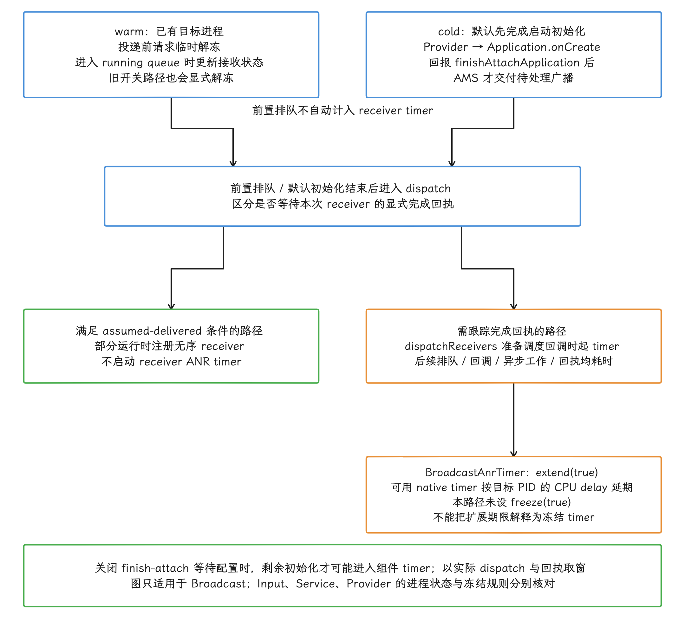
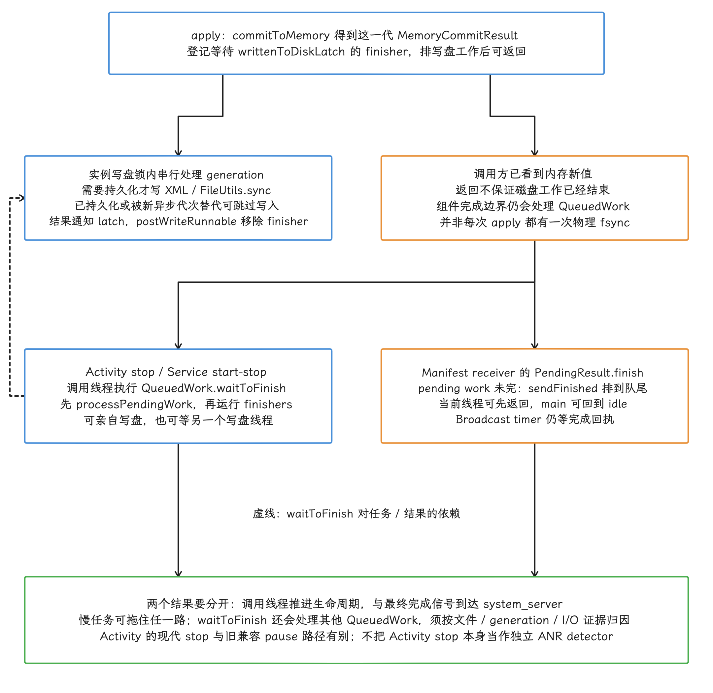
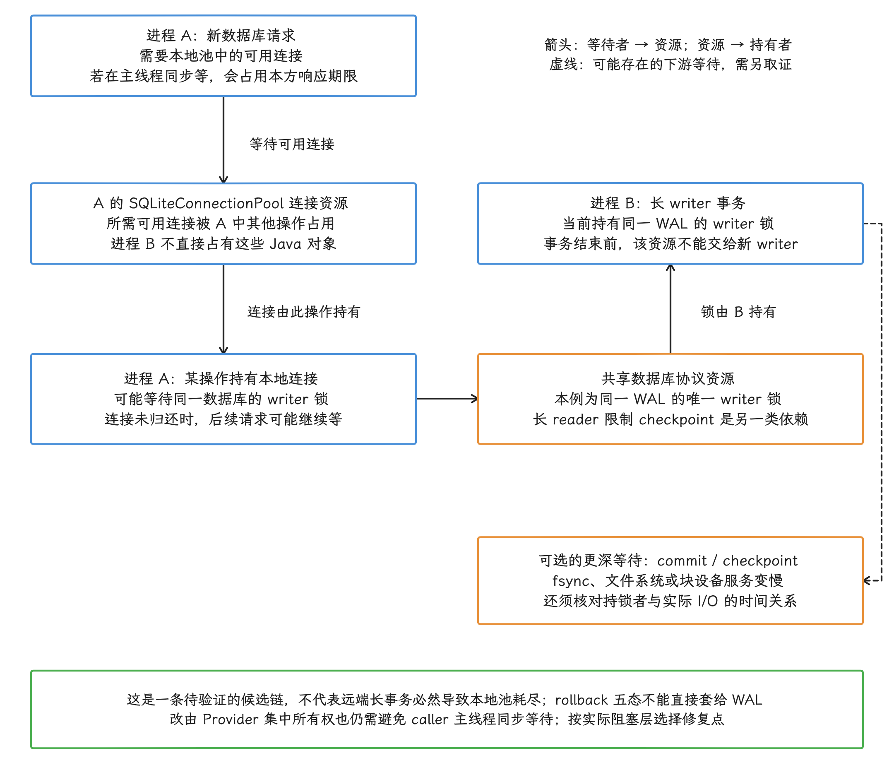

# 特殊与跨边界 ANR

[§9.1 ANR 类型与触发条件](01-anr-mechanism-types-triggers.md) 和 [§9.2 ANR 分析方法](02-anr-kernel-trace-diagnosis.md) 说明了 detector（负责启动计时并判定超时的系统检测器）、时间点和证据等级，下面沿用这些定义，把它们用到几类容易被误判的场景上。

> 源码基线：AOSP `android-17.0.0_r1`；内核 `android17-6.18-2026-06_r6`。设备可能使用其他内核分支或带厂商改动，以目标设备源码、DeviceConfig 与 trace 为准。

## “特殊”指的是证据跨了边界

ANR 仍由 Input、Broadcast、Service、ContentProvider、Job 等 detector 按各自期限判定。本章讨论的场景有一个共同点：触发超时的进程与占用时间的资源拥有者，可能分属不同线程、进程，甚至不同内核子系统。我们排查时要抓的，正是这种错位。

常见跨边界关系包括：

- 主线程已经进入 Runnable（具备运行条件）状态，CPU 时间却被同一 cpuset（允许任务运行的一组 CPU）内的其他线程占用；
- 调用方主线程等待 Binder reply（同步事务的回复），耗时工作位于服务端或更深的嵌套调用；
- `SharedPreferences.apply()` 已返回，组件完成信号仍被尚未写完的数据拖住；
- Provider 初始化发生在应用冷启动早期，超时却表现为输入、广播或调用方 ANR；
- GC、reclaim（内存页回收）、page fault（缺页异常）和低频 CPU 同时消耗主线程的时间预算；
- SQLite 调用卡在连接池、事务、checkpoint（WAL 检查点回写）或文件系统中的某一层。

调查别停在“系统问题”还是“应用问题”这样的定性上。每个结论都应写清 detector、等待者、资源拥有者、时间区间和可实施的修复点——定性是这些信息齐了之后的结果。


## CPU 饥饿、I/O 等待与 freezer

这一节处理三种容易混淆的状态：CPU 饥饿、不可中断等待、freezer 冻结。不可中断等待可能涉及 I/O、回收、驱动或内核锁；三者的证据与判定条件需要分别核对。

### 判断 CPU 饥饿，先看主线程是否长期 Runnable

主线程长时间停在 Runnable，而 Running（正在 CPU 上执行）占比很低，说明它已具备运行条件，只是没有及时拿到 CPU。整机 CPU 利用率、Load 或某个进程的占比，描述的都是运行环境；要下结论，我们还是要回到目标线程自己的调度证据上。

在 Perfetto 里沿唤醒事件逐项确认：

1. 主线程何时从睡眠或等待变为 Runnable；
2. wakeup-to-run（从被唤醒到获得 CPU）延迟多长；
3. 延迟期间，同一个 CPU、同一 cpuset 上运行了哪些线程；
4. 目标线程的 nice（普通调度优先级）、调度组、uclamp（CPU 性能需求上下限）与 CPU affinity（可运行 CPU 范围）是否符合预期；
5. CPU frequency（频率）、idle（空闲状态）和 thermal throttling（温控降频）是否降低了可用算力。

多核总利用率没到 100%，局部饥饿照样可能发生：空闲核可能不在目标 cpuset、频率很低，或者任务受 affinity 限制。反过来，即使所有核都很忙，更高优先级和调度组仍可能让主线程及时拿到运行机会。

<!-- gracker-diagram: ch09-03-02-runnable-starvation -->


图：饥饿要由目标线程调度时间线支持；Load 与整机CPU百分比只提供环境线索。

### 判断 `D` 状态需要等待位置与同期事件

6.18 内核中的 `TASK_UNINTERRUPTIBLE` 会在常见工具里显示为 `D`。它表示不可中断等待，文件系统、驱动、内核锁或内存回收等路径都可能涉及这种状态；具体原因要查等待位置、内核栈和同期事件。普通 futex 等待通常使用 `TASK_INTERRUPTIBLE | TASK_FREEZABLE`，应按 `S` 分析；freezer 另有独立的 `TASK_FROZEN`，把二者直接列成 `D` 的同义原因就归错类了。参见 [futex 等待实现](https://android.googlesource.com/kernel/common/+/android17-6.18-2026-06_r6/kernel/futex/waitwake.c) 与 [任务状态](https://android.googlesource.com/kernel/common/+/android17-6.18-2026-06_r6/include/linux/sched.h)。


要把 `D` 归到 I/O，我们至少要凑齐一组相互支持的信号：

- 目标线程的 kernel callstack（内核调用栈）落在文件系统、块设备或具体驱动的等待路径；
- 同一时间段存在 block I/O（块设备读写）、`fsync()`、major fault（需要从存储载入页面的缺页）或 I/O PSI 增量；PSI（Pressure Stall Information）记录资源压力导致任务等待的时间；
- 请求提交、设备服务和线程唤醒在时间线上能够对齐。

`loadavg`（系统平均负载）把 Runnable 与不可中断等待任务都计入。所以 8 核设备的 Load 为 16，不能直接换算成“CPU 使用 200%”；Load 与 CPU 时间占比是不同的量。要区分可运行任务和不可中断等待，并判断后者是否涉及 I/O，还得看各线程的状态与等待路径。


### freezer 要用冻结状态确认

要证明 Cached Apps Freezer（缓存应用冻结机制）确实冻结了目标进程，单凭 `D` 状态或栈中的 `__refrigerator` 函数还不够。6.18 内核有独立的 `TASK_FROZEN` 状态；cgroup v2 在 `cgroup.freeze` 完成后会把 `cgroup.events` 中的 `frozen` 置为 `1`。Android 系统侧还会记录 freeze/unfreeze reason（冻结或解冻原因），这三处才是我们要核对的冻结证据。

Broadcast 路径对 freezer 有明确处理，可以对照四条规则：

- `BroadcastQueueImpl` 发现目标是 warm process（已经存在、无需冷启动的进程）时，会在投递前请求临时解冻；
- 进程进入 running broadcast queue（正在执行的广播队列）时，系统通过 process state controller 更新接收状态，旧开关路径也会显式解冻；
- `BroadcastAnrTimer` 使用 `AnrTimer.Args().extend(true)`，允许根据软超时窗口内测得的 CPU delay 延长等待；
- 当前核对版本没有为这个 timer 配置 `freeze(true)`，因此不能套用其他计时器的冻结规则。

这些规则只约束 Broadcast；Input、execute-service、Provider 和应用自建 Binder 协议各有自己的冻结与进程状态路径。写报告时，我们应同时给出目标 PID 的冻结区间、unfreeze reason、receiver（广播接收器）调度时间和 ANR timer 起点。


## 广播洪峰：排队延迟与 receiver ANR 要分开

### 按进程组织的广播队列

广播这一侧的组织方式，从 `BroadcastQueueImpl` 看起：它为每个目标进程维护一个 `BroadcastProcessQueue`，再按优先级、可运行时间和全局并行度选择要执行的队列。

普通广播默认可同时运行的进程队列数在低内存设备上为 2，其他设备上为 4，DeviceConfig（系统可动态调整的配置）可以改写该值。系统还限制单个 running process queue 连续投递的 active broadcast（当前活跃广播）数量，以便其他进程获得调度机会。


按进程组织队列以后，下面几点仍然成立：

- 同一进程默认仍由主线程顺序处理 receiver callback（接收器回调）；
- ordered broadcast（有序广播）和需要返回 result 的投递仍有前后完成依赖；
- `goAsync()` 之后，`PendingResult.finish()` 仍是本次交付的完成信号；
- 某些运行时注册的无序 receiver 可以走 assumed-delivered（系统投递后即视为完成）路径，不启动 receiver ANR timer。

受跟踪的 receiver ANR timer 在 `dispatchReceivers()` 准备向 warm process 调度回调时启动。此前的系统排队不自动计入该 receiver 的 10/60 秒基准期限；投递之后，主线程或自定义 Handler 的排队、回调、异步工作和完成回执才开始消耗期限。

默认 `enable_wait_for_finish_attach_application=true` 时，冷启动应用先完成 Provider 初始化和 `Application.onCreate()`，回报 `finishAttachApplication()`，AMS 才交付待处理广播与服务；关闭该配置时，尚未完成的初始化才可能进入组件 timer。CPU 饥饿补偿还取决于 native timer 是否可用，所以设备上的实测总时长要按 timer 配置解释，基准期限只是基准。

⚠️ 矛盾：[官方 ANR 诊断指南](https://developer.android.com/topic/performance/anrs/diagnose-and-fix-anrs#broadcast-receiver) 将冷启动概括为广播期限的一部分；[Android 17 AMS](https://android.googlesource.com/platform/frameworks/base/+/android-17.0.0_r1/services/core/java/com/android/server/am/ActivityManagerService.java) 的默认 finish-attach 等待与现代队列起算点更细。判断具体设备时应使用其配置和实际 dispatch 时间。

<!-- gracker-diagram: ed09-03-broadcast-readiness-and-timer -->


图：warm投递前请求临时解冻，running queue更新接收状态；cold在r1默认等待配置下先完成Provider与Application初始化并回报finishAttachApplication，再交付待处理广播。前置系统排队不自动计入receiver的10/60秒基准期限。dispatch还按是否跟踪显式回执分流：满足assumed-delivered的部分运行时注册无序投递不启动receiver timer；需跟踪路径从dispatchReceivers准备调度回调起消耗期限。native计时可用时extend按目标PID的CPU delay延期，本timer未设freeze(true)。关闭finish-attach等待时剩余初始化可能进入组件期限，官方通用描述与固定默认差异按正文核对；Input/Service/Provider不能外推同一冻结规则。

### 洪峰为何仍会产生一组 ANR

大量广播可以同时制造三种压力：


- system_server 排队和进程启动增加，用户可见动作整体变晚；
- 多个接收进程同时执行初始化、Binder、数据库和文件写入，争用 CPU 与 I/O；
- receiver 自己的 worker pool（工作线程池）、`QueuedWork` 或对端服务已被前一批工作占满。

因此，同一时间段出现多条 `Broadcast of Intent`，只说明事件集中发生。要把结论写成“广播洪峰导致连锁 ANR”，我们还要证明发送速率或 pending queue（待处理队列）持续上升、各 receiver 的计时区间重叠，并且它们争用同一项资源。

排查时保留以下时间点：

| 时间点 | 说明 |
|---|---|
| 入队 | 广播进入 system_server 队列 |
| 进程启动 | 冷进程开始启动、attach（连接 `system_server`）完成 |
| 调度 receiver | ANR timer 可能在此启动 |
| `onReceive()` 开始/返回 | 同步 receiver 的执行区间 |
| `goAsync()` / `finish()` | 异步 receiver 的生命周期 |
| `finishReceiver()` 到达 system_server | 平台收到完成回执 |

若主线程 trace 停在 `nativePollOnce`，我们接着检查自定义 Handler、`goAsync()` worker 和 `QueuedWork`。耗时的广播工作可能位于其他线程，所以主线程采样时空闲与 Broadcast ANR 可以同时成立。

<!-- gracker-diagram: ch09-03-09-async-receiver-completion -->


图：图为一条可能路径；Manifest receiver待处理工作可延迟sendFinished，运行时注册receiver规则需另核对。

### 修复方向

- 合并应用内部的高频事件，避免用全局广播传递可直接调用的进程内状态；
- receiver 只解析必要字段，并快速安排能在明确时限内结束的工作；
- `goAsync()` 使用限制并发数和队列长度的专用执行器，每条路径都在 `finally` 中完成 `PendingResult`；
- 长任务交给 JobScheduler、WorkManager 或前台服务，并遵守对应的后台执行规则；
- 监控 sender UID（发送方身份）、广播 action、待处理数量、冷启动数、receiver 执行耗时和完成回执延迟。

扩大线程池可能让 CPU、Binder 或数据库竞争更严重。动手之前先确认：排队来自容量不足，还是任务本身在等待不可用资源。


## Provider 初始化：三个超时出口

### Provider 早于 `Application.onCreate()`

`ActivityThread.handleBindApplication()` 的顺序是：先创建 `Application` 对象，再调用 `installContentProviders()` 安装清单中声明的 Provider，之后才通过 `Instrumentation.callApplicationOnCreate()` 执行 `Application.onCreate()`。

Provider 的 `attachInfo()` 会进入其 `onCreate()`，所以清单注册的 Provider 会在应用冷启动的主线程早期完成初始化。

<!-- gracker-diagram: ch09-03-11-provider-startup-order -->


图：Provider初始化发生在应用早期；不要混淆Application对象构造与Application.onCreate回调。

这段初始化占住主线程的时间，可能从三个出口表现出来：

1. **No-focused-window 或 Input ANR**：Activity 因 Provider 初始化过久而迟迟没有建立首个可聚焦窗口，或主线程无法处理输入。
2. **启动保护或后续组件 ANR**：默认先等初始化及 `finishAttachApplication()`，再派发待处理 receiver/Service，Provider 初始化通常落在这些组件的执行 timer 之外；初始化本身另受启动与发布保护。只有关闭等待配置、其他线程并发依赖 Provider，或交付后继续进行慢工作时，才可能阻塞对应的组件完成期限。
3. **调用方派生 ANR**：另一个应用在主线程同步获取或调用该 Provider，等待目标进程发布 Provider 并回复，最终耗尽调用方自己的输入期限。

系统只在存在等待发布的 launching provider 时，才从 attach 阶段安排 Provider publish guard，默认 10 秒再乘硬件超时倍率，声明了 Provider 的进程并不会每次启动都挂上这只 timer。到期仍未完成发布时，系统以 `REASON_INITIALIZATION_FAILURE`（初始化失败）移除进程，这条处理路径不生成 Provider ANR。

远程调用是否受这类探测，取决于客户端是否配置 `ContentProviderClient.setDetectNotResponding()`。它是带 `@SystemApi` 和 `REMOVE_TASKS` 权限要求的特权接口，普通第三方应用无法把它当作公开 SDK 的 CRUD 超时保证；客户端探测到期后才报告远端 Provider 无响应。三条路径的 reason（系统记录的原因字段）和被归责进程各不相同，详见 [§9.1 的 Provider 边界](01-anr-mechanism-types-triggers.md#contentprovider发布保护与调用-anr-要分开)。


### 诊断 Provider 冷启动

诊断时，我们至少在时间线上对齐：

- 目标进程 fork（创建进程）、attach（连接 `system_server`）与 `bindApplication`；
- 各 Provider 的 `attachInfo()` / `onCreate()`；
- `Application.onCreate()`；
- Provider publish；
- 调用方获取 Provider、执行 query/call 与收到 Binder reply 的时间；
- 首窗或 receiver/Service 的超时期限。

若目标进程在 Provider publish guard 到期时被移除，调用方可能收到 provider acquisition failure（获取 Provider 失败），目标进程不会因此留下 ANR；调用方主线程若仍在等待或重试，随后仍可能发生自己的 Input ANR。


### App Startup 能解决哪部分

Jetpack App Startup 让多个初始化组件共享一个 `InitializationProvider`，并用 `Initializer.dependencies()` 声明依赖顺序。通过 manifest 注册的 initializer（初始化器）仍在 Provider 初始化阶段执行；共享 Provider 可以减少多个 Provider 实例化与初始化发现相关开销，但收益要测量；各 Initializer 的实际初始化工作不会因合并自动消失。

收益来自两点：

- 减少多个独立 Provider 的实例化和重复发现成本；
- 对启动不必需的组件关闭自动初始化，在业务需要时用 `AppInitializer` 懒加载。

第三方 SDK 自带 Provider 时，要检查 manifest merge（清单合并）结果，并按 SDK 文档关闭自动初始化。直接删除 Provider 可能破坏 SDK 的初始化约定。


## `SharedPreferences.apply()`：返回快，完成信号仍会等待

### apply 的写入链

`apply()` 先通过 `commitToMemory()` 更新内存状态，再把 `writeToDiskRunnable` 放入 `QueuedWork`，同时注册一个等待 `writtenToDiskLatch` 的 finisher（收尾任务）。下面的源码摘要片段说明内存提交结果、finisher 与写盘任务三者的关系：

```java
final MemoryCommitResult mcr = commitToMemory();
final Runnable awaitCommit = () -> {
    try {
        mcr.writtenToDiskLatch.await();
    } catch (InterruptedException ignored) {
    }
};

QueuedWork.addFinisher(awaitCommit);

Runnable postWriteRunnable = () -> {
    awaitCommit.run();
    QueuedWork.removeFinisher(awaitCommit);
};

enqueueDiskWrite(mcr, postWriteRunnable);
```

`apply()` 返回时，新的内存值已经可见，磁盘写入却可能仍未结束——这正是它“返回快”却仍会拖住组件完成信号的原因。`enqueueDiskWrite()` 用实例级写盘锁串行处理结果：需要持久化时才写 XML、调用 `FileUtils.sync()` 并通知结果；已有文件且 generation 已持久化或被更新的异步 generation 替代时，可能直接跳过物理写入。存储拥塞、文件过大或频繁修改仍可能拖慢组件完成回执。


### 不同组件边界有两种等待方式

这些等待发生在不同的组件边界，需要逐条区分：

- **Activity stop**：现代应用在 `handleStopActivity()` 的主线程调用 `QueuedWork.waitToFinish()`；pre-Honeycomb（Android 3.0 之前）的兼容路径在 pause 阶段调用。
- **Service start/stop**：`handleServiceArgs()` 与 `handleStopService()` 在向 AMS（ActivityManagerService）报告执行完成前调用 `waitToFinish()`。
- **Manifest receiver**：`PendingResult.finish()` 发现仍有 pending work（待处理任务）时，把 `sendFinished()` 排到 `QueuedWork` 队尾，避免阻塞当前线程；Broadcast ANR timer 会继续等待完成回执。

`QueuedWork.waitToFinish()` 会在调用线程执行 `processPendingWork()`，随后逐个运行 finisher。因此我们看到的现象是：Activity/Service 主线程既可能亲自执行尚未开始的写盘 runnable，也可能等待另一个线程已经开始的写盘任务。

Broadcast 路径中，主线程可能已经回到 `nativePollOnce`，但完成回执仍排在慢写盘任务之后。

<!-- gracker-diagram: ed09-03-apply-to-component-completion -->


图：apply的内存可见与磁盘结果分开：对应MemoryCommitResult的finisher等writtenToDiskLatch，实例锁串行处理写盘，已持久化或被更新异步generation替代时可跳过物理写入，结果通知与postWriteRunnable收尾仍需完成。现代Activity stop与Service start/stop的调用线程先processPendingWork再运行finishers，可以亲自执行尚未开始的写盘，也可以等其他线程；旧Activity兼容pause路径另核对。Manifest receiver发现pending work时把sendFinished排到QueuedWork队尾，当前线程可返回但Broadcast仍等回执。虚线表示waitToFinish对任务/结果的依赖；QueuedWork不只含SP任务，不能凭栈独自归因。Activity stop不是独立detector，须按原始reason和实际期限解释影响。

### 如何确认

确认时，我们把以下证据放到同一时间窗：

- ANR 原因字段是 Broadcast、execute-service 还是 Input；
- `apply()` 的调用次数、文件名和待写 generation（每次内存提交对应的版本号）；
- `QueuedWork.waitToFinish()`、`PendingResult.finish()`、`awaitCommit` 的栈或 Perfetto slice（带起止时间的事件片段）；
- queued-work-looper 的 `writeToFile()`、`fsync()` 与调度状态；
- I/O 延迟、I/O PSI、reclaim 和存储错误在同一窗口内的变化。

单看 `apply()` 调用说明不了问题：被后续修改合并的中间 generation 可能从未落盘。单看 `waitToFinish()` 也一样，`QueuedWork` 里还可能排着其他框架任务。归因要靠上面整组证据。


### 修复

- 把一次业务状态的多个键合并到同一个 Editor；
- 避免把大集合、JSON 或高频计数写进 XML；
- 让非关键状态延后到交互期限之外；
- 用 Jetpack DataStore 承载适合异步、事务化更新的偏好数据，并设计迁移与读取时机；
- 结构化、大体量或需要查询的数据使用 Room 等数据库；
- 在 userdebug 或测试构建中启用 StrictMode，并记录从 `apply()` 到写盘完成的耗时。

把 `apply()` 换成 `commit()` 会让调用线程同步等待提交结果：队列原本为空时可能在当前线程写盘，否则可能等待已经排队的写入。I/O 和完成边界的风险未必因此消失；放在主线程通常更危险。


## Binder 循环等待与线程池耗尽

### 用资源等待图描述死锁

看到“A 调 B，B 回调 A”，先别急着下死锁结论。Binder 支持嵌套同步事务和一定程度的重入，也就是处理线程可以在等待期间承接特定回调；回调还可能由 Binder 线程池中的其他线程处理。我们要确认的是具体线程和资源之间的互等关系是否闭合，并排除超时、取消等退出路径——单个 Binder 栈或 A→B→A 的调用形状都撑不起这个结论。

即使没有采到循环，漏唤醒、资源泄漏或未采完整的依赖仍可能造成长期挂起。下面是一个明确跨线程的例子：

1. A 的线程 A0 持有锁 L，发起同步事务到 B；
2. B 的处理线程 B0 把任务交给 B1，并同步等待 B1 的结果；
3. B1 不在原嵌套事务栈上，另发同步回调到 A 的线程 A1；A1 请求由 A0 持有的 L；
4. 若没有超时、取消等出口，就形成 A0→B0→B1→A1→L→A0 的循环等待。

直接嵌套的同步回调可能被驱动定向回原调用线程；同一线程重新获取可重入 Java monitor 不会仅因这一点死锁。上例特意引入 B1 与不同的 A1，避免把安全重入画成必然死锁。参见 [Binder 嵌套目标线程选择](https://android.googlesource.com/kernel/common/+/android17-6.18-2026-06_r6/drivers/android/binder.c)。

<!-- gracker-diagram: ch09-03-19-cross-thread-deadlock -->


图：箭头含等待边及锁到持有者的分配边；示例假定没有超时或取消出口。

另一种循环来自有限线程槽位：A 的 Binder workers 都在等待 B，而 B 从独立工作线程发出的回调无法沿原事务栈重入，只能等待 A 中可服务的线程；这些回调又阻止 B 释放处理槽位。要确认死锁，还须核对实际可服务线程、驱动增线程请求及退出机制；看到一组嵌套同步调用占满线程时，也要先把 Binder 的定向重入规则核对完。

<!-- gracker-diagram: ch09-03-20-nested-reentry -->


图：A→B→A的调用形状不足以判死锁；必须从实际TID和资源拥有关系确认。

### “默认 15”的含义

libbinder 的 `ProcessState.cpp` 把 `DEFAULT_MAX_BINDER_THREADS` 设为 15，并通过 `BINDER_SET_MAX_THREADS` 告诉驱动最多可以按需请求多少个线程。进程还可能显式加入 thread pool（线程池）、修改上限或采用系统进程专用配置，所以 15 条 Binder 栈本身说明不了线程池已耗尽，判定要结合显式加入情况和进程配置。


诊断时记录：

- 每个同步 transaction（事务）的调用方/接收方 PID、TID 与 code；
- Binder worker 的 Running、Runnable、锁等待和嵌套事务；
- 驱动是否请求新线程、进程是否已经启动线程池；
- one-way（异步 Binder 事务）队列是否拥塞；
- 调用前持有哪些应用锁，回调需要哪些执行器或主线程状态。

### 设计约束

- 持有跨模块锁时，不调用延迟上限未知的同步 IPC；
- Binder 服务实现不在持锁区调用客户回调；
- 回调需要主线程时采用限制并发数、队列长度和等待时间的异步协议，并处理生命周期与取消；
- `oneway` 只省去调用方等待 reply 的过程，事务仍会排队并占用内核 buffer（缓冲区），容量依旧有限；
- 记录服务端耗时、并发数和队列长度，并在过载时拒绝或延后非关键工作。


扩大 Binder thread pool 可能延后饱和，也可能增加锁、CPU 和内存竞争；优先消除的还是循环等待和无界扇出（一次请求触发数量不受限的并发调用）。


## GC、reclaim 与 LMKD 的叠加

### GC 要拆成暂停、分配等待和 CPU 竞争

分析 ANR 窗口里的 GC，先把 collector 认清楚。从历史演进看，Android 8 的 ART 默认转向 Concurrent Copying（并发复制），Android 10 起 CC 支持分代收集；Android 17 固定源码同时含 CC 与 Concurrent Mark Compact（CMC，并发标记整理）等分支，`gUseReadBarrier` 与 `gUseUserfaultfd` 对应不同 collector，诊断时应记录目标进程实际的 collector 名称和配置。并发收集仍有暂停；time to suspend（等线程到达可暂停点）已包含在相应 GC pause 统计中，直接读统计即可。

⚠️ 矛盾：[GC 调试文档](https://source.android.com/docs/core/runtime/gc-debug) 仍以 CC/CMS 说明默认计划；[Android 17 Heap 源码](https://android.googlesource.com/platform/art/+/android-17.0.0_r1/runtime/gc/heap.cc) 已有 CMC 与 CC 的配置分支。文档历史默认不能替代当前进程的实际 collector。


一次 ANR 时间窗内还可能出现：

<!-- gracker-diagram: ch09-03-25-gc-time-components -->


图：条带仅示意一种阶段关系；并非每种collector、每轮GC都具有固定暂停次数或比例。

- 主线程等待正在进行的 GC；
- 分配慢路径触发 `kGcCauseForAlloc`；
- native allocation 压力触发 `kGcCauseForNativeAlloc`；
- GC 并发线程消耗 CPU，主线程 Runnable 等待变长；
- 分配速度高，GC 间隔缩短但每轮回收收益低；
- 大对象、fragmentation（内存碎片）或 collector transition（回收器切换）改变收集成本。

`Heap::GrowForUtilization()` 会依据回收后存活字节、target utilization（目标堆利用率）和 growth limit（堆增长上限）等信息，更新 `target_footprint_`（目标堆大小）与 `concurrent_start_bytes_`（启动并发 GC 的字节阈值）。“堆到 50% 就 GC”的跨设备通用规则并不存在，GC 风暴也没有固定的次数或耗时定义，判断要看该进程自己的这些阈值。


这时我们读取该进程自己的 GC performance dump 和 Perfetto：

- 各 collector（回收器）的 pause histogram（暂停时长分布）、time to suspend（等待线程暂停的时间）、总 GC 时间与吞吐；
- GC cause（触发原因）、young/full（年轻代/全堆）类型、回收前后字节数；
- 主线程每次暂停及暂停之间的 Running/Runnable；
- `HeapTaskDaemon` 和 GC 线程的 CPU 消耗；
- 分配热点和对象存活率。

官方文档中的 1.83 ms 来自特定示例设备的一组 Young CC 数据，Android 平台层面并没有这样的通用阈值。


### 系统内存压力是另一条链

可用内存不足时，系统可能启动 kswapd（后台内存回收线程）、direct reclaim（由申请内存的线程直接回收）、compaction（内存规整）、zram/swap I/O（压缩内存或交换区读写）和 major fault。这些活动会增加 CPU 与 I/O 压力，使 GC 和应用分配变慢。

LMKD（Low Memory Killer Daemon，低内存终止守护进程）会根据压力与进程优先级选择终止进程，通常通过结束后台进程缓解压力；至于存活进程随后会不会发生磁盘缺页，要看它自己的页访问证据。


归因需要同时观察：

- memory/io PSI 在 ANR 窗口内的增量；
- direct reclaim、compaction、kswapd 与 swap/zram；
- major fault、存储读取和目标页来源；
- lmkd kill 的时间、被杀进程和目标应用 adj（进程回收优先级分值）；
- 应用 Java/native heap（Java 堆和 native 堆）、分配速率与 GC pause。

如果主线程主要卡在自身高频分配和 GC，我们的修复点就在对象生命周期与分配热点；若多个进程同时受 reclaim 和调度影响，应把系统内存压力列为主因或放大因素，同时保留应用侧可移除的主线程工作。


## 前台服务附近的四条结果

FGS（Foreground Service，前台服务）日志经常与 ANR 同时出现，但四条规则的结果各不相同，边界如下：

| 场景 | Android 17 计时或入口 | 结果 |
|---|---|---|
| `startForegroundService()` 后未及时 `startForeground()` | 公开契约要求几秒内完成，ANR 概览给出 5 秒；源码默认内部 timeout 为 30 秒，另有 10 秒 ANR delay，均可配置 | ANR 延迟路径或 `ForegroundServiceDidNotStartInTimeException` |
| 后台不满足豁免却启动 FGS | 启动入口检查 | `ForegroundServiceStartNotAllowedException`，不是 ANR |
| `shortService` 到期未停止 | 默认到期点为本轮起点 + 3 分钟，ANR 点为该起点 + 3 分钟 + 10 秒；迟到的 `onTimeout(int, int)` 不重新获得 10 秒 | ANR |
| targetSdk 35+ 的 `dataSync` / `mediaProcessing` 用尽后台额度仍未停止 | 按 UID 与类型共享 24 小时统计中的默认 6 小时额度；系统安排 `onTimeout(int, int)` 后另发默认 10 秒 crash 消息，排队也消耗这段清理期 | `ForegroundServiceDidNotStopInTimeException` 崩溃 |

源码里的内部 30 秒配置解释的是设备侧行为，SDK 文档要求应用遵守的 5 秒约束依然有效。DeviceConfig、HW timeout multiplier（硬件超时倍数）、targetSdk 和 compat change（按目标版本启用的兼容性变更）可能改变设备行为，报告应记录原始原因字段与实际观测时长。


服务 transaction 交付后的主线程排队、数据库迁移或同步 I/O 都可能延迟晋升或停止。若要把 `bindApplication`、Provider 初始化算进同一期限，须先核对 finish-attach 配置及具体 timer：默认待处理服务执行 timer 通常晚于这些初始化步骤，FGS 晋升与启动保护则是另外的时钟。修复时先构造最小合规通知并及时调用 `startForeground()`，再启动耗时工作；收到 `onTimeout()` 后只执行限制时长的清理，并尽快停止服务。

<!-- gracker-diagram: ch09-03-31-short-fgs-absolute -->


图：标出公式而非伪造实测比例；到点仍须系统重核服务状态，已停止或类型改变可避免该结果。

完整 detector 和源码路径见 [§9.1 的 FGS 分类](01-anr-mechanism-types-triggers.md#前台服务附近有三种不同的超时结果)。

<!-- gracker-diagram: ch09-03-32-limited-fgs-quota -->


图：targetSdk与兼容开关会影响适用范围；限时FGS的DidNotStopInTime是崩溃路径，不能算作ANR。

## SQLite：连接池、WAL、checkpoint 与 I/O

数据库这一侧的等待往往叠了好几层：框架连接池、WAL 锁、checkpoint、存储 I/O。我们逐层拆开看。

### 先确认 journal mode（日志模式）

Rollback journal（回滚日志）的 `UNLOCKED/SHARED/RESERVED/PENDING/EXCLUSIVE` 五种锁状态，描述的是回滚模式下的加锁；WAL（Write-Ahead Logging，预写日志）换了一套协调方式——共享内存中的 read mark（读者位置标记），加上写入、checkpoint（检查点回写）、recovery（恢复）等锁：

- 多个 reader（读事务）可以按各自的 end mark（快照末尾位置）读取一致快照；
- 同一 WAL 同时只有一个 writer（写事务）；
- checkpoint 可以与 reader 并行，但不能越过仍被 reader 使用的 end mark；
- 长 reader 可能限制 checkpoint 的推进或 WAL 复用；当持续写入越过其所需快照边界时，WAL 可能继续增长。

<!-- gracker-diagram: ch09-03-34-wal-reader-checkpoint -->


图：这是机制阶段示意；WAL通常允许reader与writer并发，但同一WAL同时只有一个writer，也仍可能返回BUSY。

Android framework 还通过 `SQLiteConnectionPool` 管理数据库连接。主线程可能等待可用连接、唯一 writer 或应用 Java 锁，也可能进入 `fsync()`、checkpoint 或文件系统等待。把所有栈都归为“文件锁”，修复位置就丢了——我们关心的恰恰是它卡在哪一层。


### 多进程场景

多进程直接打开同一数据库时，writer、reader 和 checkpoint 分布在不同进程。一个后台进程持有长事务，主进程可能经历：

- 本进程连接被已有任务占用，新请求在本地 `SQLiteConnectionPool` 等待；远端事务不会直接占据这组 Java 连接对象，但可能让持有本地连接的操作等待数据库锁；
- 新 writer 等待当前 writer；
- 长 reader 阻止 checkpoint 前进；
- WAL 变大增加读取和恢复成本；
- commit（事务提交）或 checkpoint 的同步写入遇到存储压力。

ContentProvider 可以把跨进程数据库访问集中到一个所有者进程，但调用方若在主线程同步查询，慢 Provider 仍会转化为 Binder 等待。Room 默认禁止主线程数据库访问，`allowMainThreadQueries()` 会拆掉这层保护。

<!-- gracker-diagram: ed09-03-local-pool-and-remote-writer -->


图：仅示WAL长writer的一条候选依赖。箭头中等待者指向所需资源、资源指向当前持有者：A新请求等本地所需连接，连接由A操作持有，该操作可能等B事务持有的同一WAL writer锁；B并不直接占用A的Java连接对象，远端长事务也不必然耗尽本地池。B提交等操作还可能等fsync/文件系统/块设备，虚线须用实际时间与调用证据验证。长reader限制checkpoint见前文独立图，rollback五态不能套给WAL；改为Provider单所有者后，caller仍须避免主线程同步等待。

### 16 KB 内核页与 SQLite 页的层级

Android 15 起，AOSP 支持采用 16 KB 内存页的设备，Android 17 继续支持。内核 page size（内存页大小）、文件系统 block size（块大小）、SQLite `PRAGMA page_size`（数据库页大小）和 WAL frame size（日志帧大小）属于不同层级，其中 WAL frame 由 24 字节帧头加一页数据库内容组成，跟着 SQLite 页大小走。16 KB 内核页不会自动把既有数据库页改成 16 KB，“checkpoint 固定放大四倍”的平台规律也不存在。参见 [WAL 文件格式](https://www.sqlite.org/fileformat.html#walformat)。


下面的命令用于记录设备与数据库的现场配置：

```bash
target_pid=12345  # 替换为要检查的真实 PID
adb shell getconf PAGE_SIZE
adb shell "grep -m 1 KernelPageSize /proc/${target_pid}/smaps"

sqlite3 app.db 'PRAGMA page_size;'
sqlite3 app.db 'PRAGMA journal_mode;'
sqlite3 app.db 'PRAGMA wal_autocheckpoint;'
sqlite3 app.db 'PRAGMA synchronous;'
```

`getconf PAGE_SIZE` 用于确认设备基础内存页大小；`smaps` 需要相应读取权限，且这里 `-m 1` 只查看首个匹配映射的 KernelPageSize，全部 VMA（虚拟内存区域）的页配置是否一致还要再核对。PRAGMA 查询用于确认数据库层设置；本地 `sqlite3 app.db` 需要可访问的一致数据库环境，复制时分离了 WAL 的裸文件算不上完整现场。

还要测量 WAL 大小、checkpoint 返回值与耗时、connection wait（等待连接）、数据库返回 busy/locked 的次数和块设备延迟。凑齐这些指标仍不足以认定 16 KB 兼容性是根因；还须证明页配置相关行为如何延长目标线程的关键依赖并导致超时，再用受控对照验证。


### 修复顺序

1. 移除主线程上的数据库访问；
2. 缩短事务，避免在事务内执行网络、Binder 或大对象转换；
3. 核对 WAL 是否启用、是否存在 attached database 等并发限制；
4. 找出长 reader、唯一 writer 和 checkpoint 的时间关系；
5. 仅在工作负载测试表明有效时，调整 autocheckpoint（自动触发检查点的页数阈值）或同步策略；
6. 多进程数据库建立单一所有者或明确的进程间访问协议。

`beginTransactionNonExclusive()` 在 WAL 下可以提高读写并发，但它不能让两个 writer 同时提交，也不能解决长事务和 I/O 拥塞。


## 快速判断表

| 采样现象 | 容易误写的结论 | 下一份证据 |
|---|---|---|
| 主线程 `nativePollOnce` | 应用无责任 | detector、采样延迟、工作线程、`QueuedWork` |
| 主线程 Runnable 很长 | CPU 已经 100% | wakeup-to-run、cpuset、频率、竞争线程 |
| 主线程 `D` | 磁盘慢或进程冻结 | kernel callstack、block I/O、cgroup frozen |
| `BinderProxy.transact` | 对端服务有 bug | Binder 事务流、对端线程、嵌套调用 |
| 15 个 Binder worker | 线程池一定满 | 驱动请求、进程是否显式加入线程池、进程配置、等待图 |
| `QueuedWork.waitToFinish` | `apply()` 一定写盘慢 | 待处理任务类型、`writeToFile()`、`fsync()` |
| Provider `onCreate()` 慢 | Provider ANR | 原始原因字段、publish guard、调用方超时期限 |
| GC slice 密集 | GC 是唯一根因 | 暂停时长、time to suspend、分配与 sched 调度事件 |
| Load 很高 | 所有 CPU 核已满 | sched 调度事件、CPU idle/frequency、`D` 状态任务 |
| WAL 文件很大 | writer 挡住所有 reader | reader end mark、checkpoint、数据库连接池 |


## 版本演进

- **Android 8 / API 26**：加入 `startForegroundService()`；ART 默认垃圾回收器切换到 Concurrent Copying。
- **Android 10 / API 29**：Concurrent Copying 支持分代收集。
- **Android 12 / API 31**：后台启动 FGS 的入口限制趋严，使用 `ForegroundServiceStartNotAllowedException` 表达拒绝。
- **Android 14 / API 34**：Broadcast timeout 可按 CPU starvation 延长；加入 `shortService` 与超时回调。
- **Android 15 / API 35**：AOSP 支持 16 KB 内存页设备；targetSdk 35+ 的 `dataSync`、`mediaProcessing` 进入限时 FGS 规则。
- **Android 17 / API 37**：本章结论已按 `BroadcastQueueImpl`、`BroadcastAnrTimer`、Android 17 `ActivityThread`/`QueuedWork`、ART heap 和 6.18 内核状态核对。

历史变化可以帮助解释旧设备日志，现场结论仍要按 build fingerprint（系统构建标识）、targetSdk、DeviceConfig 和原始原因字段校准。


## 与其他章节的关系

- [§1.9 Binder IPC](../../part1-fundamentals/ch01-architecture/09-ipc-binder-performance.md)：同步事务、重入与线程池。
- [§1.15 ContentProvider](../../part1-fundamentals/ch01-architecture/15-content-provider.md)：安装、发布和跨进程调用。
- [§4.2 ART 内存](../../part1-fundamentals/ch04-memory/02-art-heap-gc-maintenance.md)：GC、堆增长与分配路径。
- [§4.3 LMK](../../part1-fundamentals/ch04-memory/03-lmkd-freezer-memory-pressure.md)：内存压力与进程牺牲策略。
- [§6.2 I/O 调度](../../part1-fundamentals/ch06-storage/02-filesystem-io-scheduling.md)：block I/O 与存储延迟。
- [§9.4 ANR 案例集](04-case-studies.md)：跨层证据在完整案例中的使用。

## 参考资料

Android 17 平台源码：

- [ActivityThread：Provider、组件边界与 QueuedWork](https://android.googlesource.com/platform/frameworks/base/+/refs/tags/android-17.0.0_r1/core/java/android/app/ActivityThread.java)
- [SharedPreferencesImpl：apply 与写盘](https://android.googlesource.com/platform/frameworks/base/+/refs/tags/android-17.0.0_r1/core/java/android/app/SharedPreferencesImpl.java)
- [QueuedWork：pending work 与 finisher](https://android.googlesource.com/platform/frameworks/base/+/refs/tags/android-17.0.0_r1/core/java/android/app/QueuedWork.java)
- [BroadcastReceiver：PendingResult.finish](https://android.googlesource.com/platform/frameworks/base/+/refs/tags/android-17.0.0_r1/core/java/android/content/BroadcastReceiver.java)
- [ContentProviderHelper：Provider publish guard 与 Provider ANR](https://android.googlesource.com/platform/frameworks/base/+/refs/tags/android-17.0.0_r1/services/core/java/com/android/server/am/ContentProviderHelper.java)
- [ContentProviderClient：setDetectNotResponding](https://android.googlesource.com/platform/frameworks/base/+/refs/tags/android-17.0.0_r1/core/java/android/content/ContentProviderClient.java)
- [BroadcastConstants：广播并发、active 数量与超时配置](https://android.googlesource.com/platform/frameworks/base/+/refs/tags/android-17.0.0_r1/services/core/java/com/android/server/am/BroadcastConstants.java)
- [BroadcastQueueImpl](https://android.googlesource.com/platform/frameworks/base/+/refs/tags/android-17.0.0_r1/services/core/java/com/android/server/am/BroadcastQueueImpl.java)
- [BroadcastProcessQueue](https://android.googlesource.com/platform/frameworks/base/+/refs/tags/android-17.0.0_r1/services/core/java/com/android/server/am/BroadcastProcessQueue.java)
- [ActivityManagerConstants：FGS timeout 与 DeviceConfig 默认值](https://android.googlesource.com/platform/frameworks/base/+/refs/tags/android-17.0.0_r1/services/core/java/com/android/server/am/ActivityManagerConstants.java)
- [ActiveServices：execute-service 与 FGS timeout](https://android.googlesource.com/platform/frameworks/base/+/refs/tags/android-17.0.0_r1/services/core/java/com/android/server/am/ActiveServices.java)
- [ProcessState：Binder thread-pool 配置](https://android.googlesource.com/platform/frameworks/native/+/refs/tags/android-17.0.0_r1/libs/binder/ProcessState.cpp)
- [ART Heap](https://android.googlesource.com/platform/art/+/refs/tags/android-17.0.0_r1/runtime/gc/heap.cc)
- [ART GC causes](https://android.googlesource.com/platform/art/+/refs/tags/android-17.0.0_r1/runtime/gc/gc_cause.h)
- [SQLiteDatabase](https://android.googlesource.com/platform/frameworks/base/+/refs/tags/android-17.0.0_r1/core/java/android/database/sqlite/SQLiteDatabase.java)
- [SQLiteConnectionPool](https://android.googlesource.com/platform/frameworks/base/+/refs/tags/android-17.0.0_r1/core/java/android/database/sqlite/SQLiteConnectionPool.java)

内核与公开文档：

- [Android Common Kernel 6.18：task state](https://android.googlesource.com/kernel/common/+/refs/tags/android17-6.18-2026-06_r6/include/linux/sched.h)
- [Android Common Kernel 6.18：PSI](https://android.googlesource.com/kernel/common/+/refs/tags/android17-6.18-2026-06_r6/Documentation/accounting/psi.rst)
- [Android Common Kernel 6.18：cgroup v2 freezer](https://android.googlesource.com/kernel/common/+/refs/tags/android17-6.18-2026-06_r6/Documentation/admin-guide/cgroup-v2.rst)
- [Android Developers：诊断和修复 ANR](https://developer.android.com/topic/performance/anrs/diagnose-and-fix-anrs)
- [Android Developers：App Startup](https://developer.android.com/topic/libraries/app-startup)
- [Android Developers：DataStore](https://developer.android.com/topic/libraries/architecture/datastore)
- [Android Developers：FGS timeout](https://developer.android.com/develop/background-work/services/fgs/timeout)
- [Android Developers：排查 FGS](https://developer.android.com/develop/background-work/services/fgs/troubleshooting)
- [Android Developers：支持 16 KB page size](https://developer.android.com/guide/practices/page-sizes)
- [AOSP：ART GC 调试](https://source.android.com/docs/core/runtime/gc-debug)
- [SQLite：WAL](https://www.sqlite.org/wal.html)
- [SQLite：rollback journal locking](https://www.sqlite.org/lockingv3.html)
- [高爷：Android App ANR 分析系列](https://www.androidperformance.com/2025/02/08/Android-ANR-02-How-to-analysis-ANR/)
