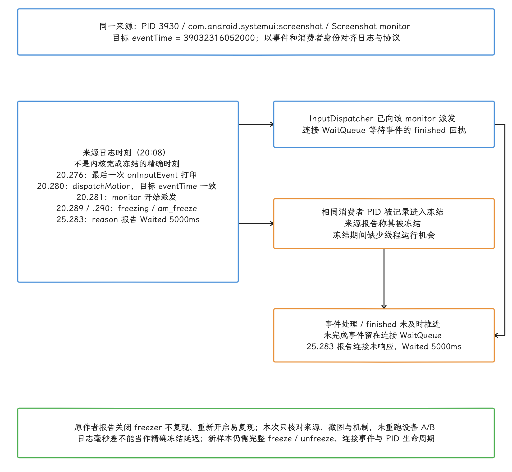
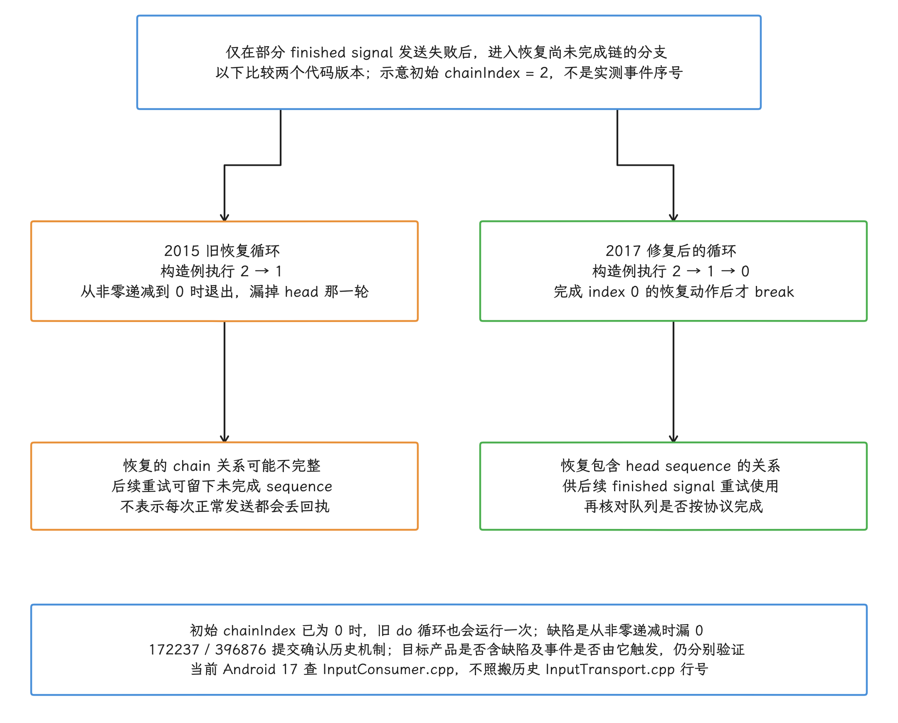
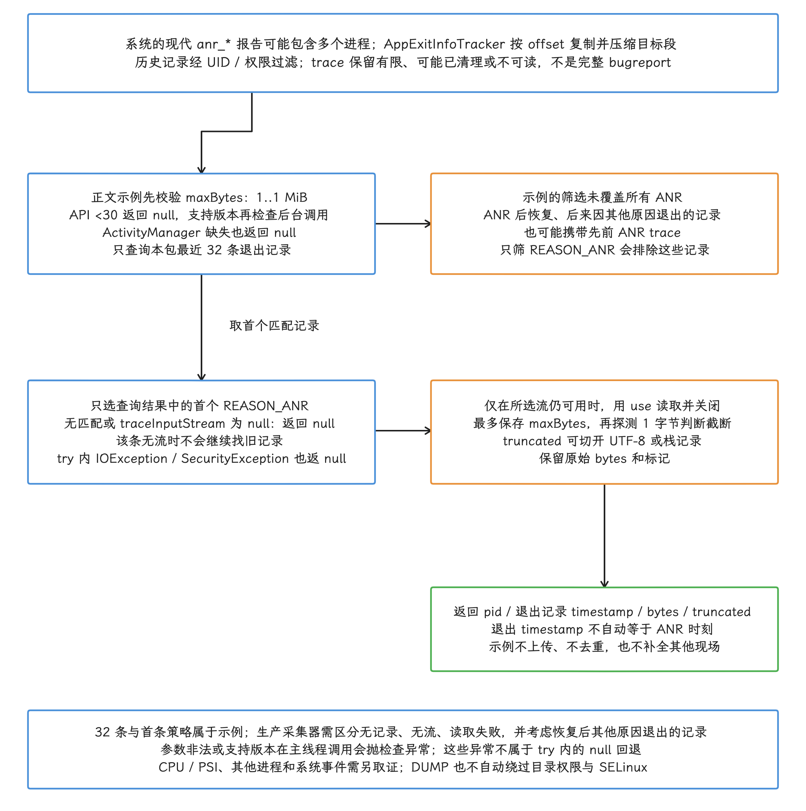

# ANR 诊断案例集

相关基础定义见 §9.1（ANR 机制、类型与触发条件）、§9.2（ANR 与 Kernel Trace 联合诊断）和 §9.3（特殊与跨边界 ANR）。

## 先给证据分级

案例分析最容易犯的错误，是在时间线上找到一个可疑点，便把它写成根因。所以下面每个案例，我们都先标明结论的证据强度：

| 等级 | 判定条件 | 文中措辞 |
|---|---|---|
| 已确认 | 日志、trace、源码语义，加上复现或 A/B 验证，能够组成因果链；A/B 验证指只改变一个条件，对比问题是否随之出现或消失 | 根因已确认 |
| 强推断 | 多项证据指向同一方向，仍缺少一段直接证据 | 高概率相关因素 |
| 未闭合 | 只找到相关日志、异常负载或静态堆栈，时间或对象无法对齐，因果链仍有缺口 | 保留线索，继续取证 |


以下依据五组来源报告、一个教学构造的锁顺序示例，以及一个有 AOSP 提交记录支撑的历史平台缺陷展开。案例日志是整理摘录，省略字段不代表完整原始记录；案例 6 的包名、时刻、锁地址和代码均为教学构造。来源报告的结论与本次独立核验范围分别注明。原材料隐藏了完整 build fingerprint，不能仅凭日志年代或栈行号确认设备 Android 版本。

| 案例 | ANR 表象 | 结论强度 | 能学到什么 |
|---|---|---|---|
| 1 | Launcher 没有焦点窗口 | 强推断 | 怎样结合 PSI、iowait 和主线程 native 栈判断系统压力 |
| 2 | Gesture Monitor 连接超时 | 未闭合 | 怎样识别时间错位和错误归因 |
| 3 | `QueuedWork.waitToFinish()` | 截图路径已确认，线程归因待补齐 | `apply()`、组件收尾和 SharedPreferences（SP）初次加载的边界 |
| 4 | 被冻结进程持有输入连接 | 来源报告已确认，本次核对文字与截图 | freezer 日志、输入连接与 A/B 验证 |
| 5 | 目标进程启动超时后无焦点 | 强推断 | `am_process_start_timeout` 的源码含义 |
| 6 | Service 执行期间两锁互等 | 已确认于示例 | 锁图、修复边界与 Binder 资源环 |
| 7 | finished signal（输入事件完成信号）丢失导致队列积压 | 平台缺陷已确认 | 怎样用日志、源码演进和系统镜像 A/B 判断 App 是否应当负责 |

## 案例 1：高内存与 I/O 压力下的无焦点窗口 ANR

### ANR 信息

原材料包含 MTK 相关服务日志，完整设备构建信息已隐去；用户看到 Launcher 偶发无响应。我们先看 event log（系统事件日志），它确认了 ANR 类型和被记录为事件主体的进程：

```text
04-07 03:13:49.417 1444 8816 I am_anr : [0,2135,com.android.launcher,
 751550021, Input dispatching timed out
 (Application does not have a focused window)]
```

这条记录表示 InputDispatcher 等待可接收输入的焦点窗口超时。主线程当时是否在执行慢代码、焦点为什么消失，单凭这条日志还回答不了，我们把这两个问题留给后面的取证。

### 主线程栈的读法

原始 trace 在 `03:13:49.397` 抓取。下面保留了判断线程状态所需的 native 调用链：

```text
"main" prio=5 tid=1 Native
 | state=S schedstat=( 10985995408825 3939822638104 29985904 )
 native: #00 pc 0009013c libc.so (syscall+28)
 native: #01 pc 0022cfac libart.so
   (art::ConditionVariable::WaitHoldingLocks+140)
 native: ... JNI CallObjectMethod ...
 native: ... android::NativeDisplayEventReceiver::dispatchVsync ...
 at android.os.MessageQueue.nativePollOnce(Native method)
```

Java 栈顶显示 `nativePollOnce`，native 栈却还位于 VSync（垂直同步信号） 回调的返回路径，并在 ART 条件变量上等待。两组栈放在一起，“主线程空闲”这个读法就太粗了：`WaitHoldingLocks` 只说明线程此刻在等条件变量，要判断有没有发生 GC，还得看 GC cause（触发原因）、暂停日志，或 Perfetto 中对应 ART slice（带起止时间的事件片段） 的起止时间。


### 压力证据

ANR 报告里的 PSI 和 load（系统平均负载） 数据如下：

```text
Load: 56.48 / 30.74 / 22.68
----- Output from /proc/pressure/memory -----
some avg10=82.71 avg60=58.68 avg300=20.55
full avg10=51.17 avg60=34.93 avg300=12.29
----- Output from /proc/pressure/io -----
some avg10=85.37 avg60=63.13 avg300=23.13
full avg10=38.46 avg60=20.76 avg300=7.13
```

三个 load 值依次对应 1、5、15 分钟，所以 1 分钟 load 是 `56.48`。PSI（Pressure Stall Information，资源压力停顿信息）的 `some` 表示至少有任务因该资源停顿的时间占比，memory/I/O 的 `full` 表示所有非 idle（非空闲）任务同时停顿的时间占比；avg10/60/300 是近期平滑趋势，不是该 ANR 前固定窗口的逐秒精确占比。来源中这些 PSI 行在 `03:13:57.910` 输出，而 CPU 统计窗口为 `03:13:39.965–03:13:49.418`，不要把两者当成同一采样区间。

<!-- gracker-diagram: ch09-04-04-pressure-time-windows -->


图：时点按原始报告核对；图保留采集延迟，不把统计窗口、趋势与瞬时栈拼成同一条精确区间。

同一份报告还给出了 CPU 构成：

```text
80% 84/kswapd0: 0% user + 80% kernel
55% 1444/system_server: 26% user + 29% kernel
21% 3976/com.ss.android.ugc.aweme: 3.8% user + 17% kernel
99% TOTAL: 14% user + 36% kernel + 43% iowait + 3% irq + 1.8% softirq
```

`kswapd0`（内核后台内存回收线程）活跃、major fault（需要从存储载入页面的缺页） 频出，再加上 memory PSI、I/O PSI 和 `43% iowait`，几组数据同时出现，足以确认设备正承受严重的内存与存储压力。

上面是省略日志前缀及 faults 字段的摘录，TOTAL 和各项按来源的显示精度保留，不强行补齐成精确的 100%。`iowait` 是 CPU 时间记账中的 I/O 等待相关项，不是 CPU 正在执行 I/O 指令的比例，也不能换算成某个线程的 I/O 耗时；内核文档还说明多核下这一统计有局限。load 包含可运行和不可中断等待的任务，不能用“load 除以 CPU 核数”替代 CPU 使用率。


### 根因结论

**结论强度：强推断。** 系统压力是该次无响应的高概率相关因素，现有数据支持设备承受显著资源压力，但目标线程的调度等待、I/O 完成延迟仍需相应事件直接量化。要把“系统压力导致无焦点窗口”坐实成根因，还缺三段材料：焦点从哪个窗口转移、目标窗口为何未建立，以及 ANR 前后的 WindowManager/InputDispatcher 时间线。


若要补齐根因，需要按同一时钟收集：

- `input_focus`、窗口转场和目标 Activity 启动事件；
- Perfetto 的 `sched`（线程调度）、`ftrace/print`（内核 trace 标记）、block I/O（块设备读写）、reclaim（内存页回收）与 ART 数据源；
- Launcher 主线程从进入 VSync 回调到返回的完整 slice；
- ANR 前后进程的 `D` 状态、major fault 和设备存储延迟。

### 修复方向

系统团队应先定位压力来源：匿名页（没有文件作为后备存储的内存页）增长、文件页反复回收和载入、频繁 major fault、写回拥塞，以及低速存储或某个进程的突发 I/O。

应用团队应移除主线程上的文件访问、大对象分配和高频数据库写入，并在压测中复现相近的 PSI 区间。调整 I/O 优先级或 WAL checkpoint（检查点回写）参数，必须以设备、数据库页大小和写入模型的测量结果为依据，本案例给不出固定阈值。

这个案例留下一个实用提醒：`nativePollOnce` 只是单个采样点的 Java 入口，结合 native 栈、调度历史和系统压力，我们才能判断采样时主线程正在空闲、退出回调，还是等待资源。

## 案例 2：Gesture Monitor 连接超时，但 Notifier 证据时间错位

### ANR 信息

来源记录中的 Launcher 收到下面的 Input ANR（完整构建版本未公开）：

```text
07-20 15:01:37.293 1385 20230 I am_anr : [0,3450,com.android.launcher,
 Input dispatching timed out
 ([Gesture Monitor] swipe-up (server) is not responding.
 Waited 5001ms for MotionEvent)]
```

`Gesture Monitor` 是手势监听连接名称的一部分，括号内的完整字符串来自 InputChannel（输入通道）名称，后缀的写法还和版本有关：AOSP Android 14 的 `InputChannel::openInputChannelPair()` 会把 `(server)` 和 `(client)` 附加到两端名称，Android 17 的同名函数则保留调用者传入的名称。无论后缀来自平台还是厂商分支，作用都只是区分通道端点；消费者在哪个进程、责任归谁，要靠后面的取证步骤回答。我们单凭后缀里的 server 字样，指认不了 `system_server` 这样的进程。

<!-- gracker-diagram: ch09-04-06-channel-owner -->


图：Android14创建pair时附加端点后缀，17同名函数保留传入name；产品实现仍需按目标源码验证。

### 时间线对齐

原材料里还有一条 `system_server` 主线程的慢消息：

```text
07-20 15:00:45.316 1385 1385 W Looper :
 Slow dispatch took 10578ms main
 h=com.android.server.power.Notifier$NotifierHandler
```

`Slow dispatch took 10578ms` 在回调返回后输出，`15:00:45.316` 接近结束时刻；在日志时钟一致且没有跳变的假设下，开始时刻约为 `15:00:34.738`。慢消息结束与 `15:01:37.293` 的 am_anr 记录相差 `51.977` 秒，无法直接解释后一次输入超时。精确 detector 区间应以同一连接条目的单调时钟 deliveryTime/timeoutTime 重建，不能只用 am_anr 的墙钟减 5 秒认定。

<!-- gracker-diagram: ch09-04-07-notifier-clock-gap -->


图：51.977秒是两条墙钟日志的差；精确输入deadline须用该connection条目的单调时钟重建。

trace 头的时间也必须纳入比对：

```text
----- pid 3450 at 2024-07-20 15:00:45.488 -----
```

这份 Launcher trace 与 Notifier 慢消息时间相近，比 ANR 早约 52 秒；`15:01:32` 至 `15:01:37` 之间 Launcher、连接消费者或 system_server 各自在做什么，它覆盖不到。

ANR 报告覆盖 `15:01:27.683` 至 `15:01:37.233` 的 CPU 窗口，`system_server` 达到 `215%`，全局 CPU 约为 `64%`，同时存在 memory、CPU 和 I/O PSI。`215%` 表示多个线程合计的算力超过一个 CPU 核，值得继续追查；`system_server` 主线程有没有被阻塞，要把占用细分到线程才能回答。


### 根因结论

**结论强度：未闭合。** 可以确认 `[Gesture Monitor] swipe-up` 输入连接没有及时完成事件，也可以确认 `system_server` 在 ANR 窗口内 CPU 占用较高；但 Notifier 日志和 trace 都停在约 52 秒前，与本次超时之间还缺一段直接证据。

下一轮取证，我们要完成四项对齐：


1. 从 `dumpsys input` 找到该 InputChannel 对应的 connection（连接对象）、窗口句柄、PID 和 monitor（输入事件观察者） 类型。
2. 抓取 ANR 5 秒窗口内该 PID 的 Java/native trace，以及所有 `system_server` 线程的 Perfetto slice。
3. 检查 WaitQueue（已经派发、尚未收到完成通知的输入事件队列）中最老事件的序号、派发时间、超时时间和完成回调。
4. 把高 CPU 占用细分到线程，确认消耗来自 `system_server` 主线程、Binder 线程、GC 线程还是其他 native 线程。

### 修复方向

修复对象取决于补充证据。若连接消费者线程被长任务占用，应把任务移出该线程或缩短临界区；若输入 monitor 已经失去有效消费者，应修复注册和销毁时序；若 `system_server` 被调度或 I/O 延迟拖住，则继续定位压力源。至于 `Notifier`，现有材料还支撑不了对它的修改决策。

这个案例展示了一次应当撤回的归因：日志内容很可疑，时间却对不上。ANR 分析里，时钟和对象身份优先于关键词相似度。

## 案例 3：SharedPreferences 写入在组件收尾阶段阻塞主线程

### ANR 信息

> ⚠️ 矛盾校正：旧文把未能在原图核对的 `main/WAIT`、pause 调用和行号拼成了一份线上栈。本次改为原文实际截图的整理摘录，不据此认定主线程 Activity 切换 ANR。

来源的一张截图包含以下路径，中间未列出的帧用 `...` 表示：

```text
at java.io.FileDescriptor.sync(Native method)
at android.os.FileUtils.fsync(FileUtils.java:184)
at android.app.SharedPreferencesImpl.writeToFile(SharedPreferencesImpl.java:752)
...
at android.app.QueuedWork.processPendingWork(QueuedWork.java:258)
at android.app.QueuedWork.waitToFinish(QueuedWork.java:172)
at android.app.ActivityThread.handleServiceArgs(ActivityThread.java:4166)
...
at android.os.HandlerThread.run(HandlerThread.java:65)
```

截图支持 SP 写盘、fsync 与 `waitToFinish()` 的调用关系，但末端为 HandlerThread，且包含业务插桩帧，不能只凭 `handleServiceArgs` 方法名把它认定为主线程。原文另展示了 pause 兼容分支源码；它不是这张栈图中的调用。


### Android 17 的调用位置

以 `android-17.0.0_r1` 为核对版本，组件收尾与 `QueuedWork` 的关系如下：

| 组件路径 | Android 17 行为 |
|---|---|
| `ActivityThread.handlePauseActivity()` | 仅 pre-Honeycomb（Android 3.0 之前）兼容路径调用 `waitToFinish()` |
| `ActivityThread.handleStopActivity()` | 非 pre-Honeycomb 路径在 stop 处理后调用 `waitToFinish()`；条件取决于 targetSdk 兼容判断 |
| `handleServiceArgs()`、`handleStopService()` | Service 回调完成后调用 `waitToFinish()` |
| manifest Receiver 的 `PendingResult.finish()` | `TYPE_COMPONENT` 且 `hasPendingWork()` 为真时，用普通 `QueuedWork.queue(r, false)` 任务延后 `sendFinished()`；没有调用 `addFinisher()` |


`SharedPreferencesImpl.apply()` 会先更新内存，再创建写盘任务和 finisher。Android 17 的 `QueuedWork.waitToFinish()` 会在当前调用线程执行尚未处理的 work（任务），随后等待并运行所有 finisher。于是，原本排给 `queued-work-looper` HandlerThread 的写入，可能在组件收尾点变成主线程上的同步操作。

<!-- gracker-diagram: ch09-04-12-sp-work-finisher -->


图：这是机制示意，条长不是设备时长；异步返回不保证组件收尾无同步等待，也不保证每次generation都物理写盘。

### 两种等待的区别

诊断时我们要区分两个栈：

<!-- gracker-diagram: ch09-04-13-sp-two-waits -->


图：不同等待入口要求不同证据；仅看到waitToFinish不自动证明任务来自SP。

- `QueuedWork.waitToFinish()` 指向全进程共享的待完成任务，常见来源是 `apply()`，也可能来自其他框架代码；
- `SharedPreferencesImpl.awaitLoadedLocked()` 表示该 SharedPreferences 实例仍在读取和解析文件，属于初次加载或加载未完成。

看到前者，我们应继续寻找 `SharedPreferencesImpl$EditorImpl`、`enqueueDiskWrite()`、`writeToFile()`、`fsync()` 或 block I/O 证据；看到后者，则应检查文件大小、XML 解析、备份文件恢复和调用时机。两种等待各自通向不同的根因。

### 根因结论

**结论强度：截图中的同步写盘路径已确认，线上 ANR 归因待补齐。** 截图同时出现 `waitToFinish()`、SP `writeToFile()` 与 fsync，足以确认该调用路径正在执行 SP 写盘；仍需线程头、完整事件时刻和 I/O 区间，才能判断它是否阻塞 ANR 所依赖的主线程或完成协议。一般样本若只有 `waitToFinish()`，还需排除其他 QueuedWork 使用者。

`apply()` 返回前更新内存，持久化完成可晚于返回；实例初次加载未完成时，编辑入口仍可能等加载。`commit()` 会等待结果，队列空闲时可在当前线程写盘，否则入队后等 latch；简单替换会把同步等待带到调用点，并不保证生命周期卡顿消失，实际影响取决于调用线程、时机与工作负载。

### 修复方案

- 合并同一时段的多次编辑，避免每修改一个 key 就单独调用 `apply()`；
- 控制单个 XML 的键数量和序列化体积，清理不再使用的大 value（值）；
- 避免在 Activity stop、Service 回调收尾和 Receiver 完成前集中触发持久化；
- 为写文件和 `fsync()` 采集耗时，按设备与存储状态分布分析长尾；
- 对需要事务、结构化数据或稳定异步 API 的场景，评估 Preferences DataStore、Proto DataStore 或数据库；
- 预加载只能把首次读取成本提前，使用前要测量启动路径和内存代价；
- 不要反射修改 `QueuedWork`、清空 finisher 或绕过组件完成通知，这会破坏持久化和框架时序。

修复验收时，我们要越过平均写入耗时去看长尾：在应用退后台、Service 完成、广播密集和低速存储压力下，确认主线程等待的 P95/P99 与 ANR 数量同时下降。P95/P99 表示 95%/99% 的样本不超过该耗时，用来观察少数慢样本是否改善。


## 案例 4：Cached Apps Freezer 冻结了输入连接消费者

### ANR 信息

原作者复现手势操作时，WindowManager 报告（完整系统构建未公开）：

```text
02-18 20:08:25.283 WindowManager:
 ANR in input window owned by pid=3930.
 Reason: Input dispatching timed out
 ([Gesture Monitor] Screenshot 0 (server) is not responding.
 Waited 5000ms for MotionEvent)
```

Cached Apps Freezer 是 Android 冻结缓存进程、减少其资源消耗的机制。分析这种 ANR 时，我们要沿 InputChannel 找到真正接收事件的消费者 PID；被记录为事件主体的前台应用只是登记信息，说明不了谁在消费事件。

### 时间线与 A/B 结果相互印证

> ⚠️ 矛盾校正：旧文把 `20.276` 的最后一次接收日志当作目标事件的派发，并把 `20.289` 的 freezing 日志写成 am_freeze。下表按来源截图逐项还原；日志时刻不等于内核实际完成冻结的精确瞬间。

| 日志时刻（20:08） | 来源截图中的证据 |
|---|---|
| 20.276 | PID 3930 的最后一次 `Screenshot 0 onInputEvent` 打印 |
| 20.280 | `dispatchMotion`，eventTime=`39032316052000`，与 reason 中相同 |
| 20.281 | Screenshot monitor 的 `prepareDispatchCycle` / `startDispatchCycle` |
| 20.289 | `ActivityManager: freezing 3930 com.android.systemui:screenshot` |
| 20.290 | `am_freeze: [3930,com.android.systemui:screenshot]` |
| 25.283 | 该 monitor 未响应，reason 报告 Waited 5000ms |


来源文字报告：关闭 freezer 后不能复现，重新开启后容易复现，每次 ANR 前可见 screenshot 冻结日志。本次核对了原文与上述截图，没有重新运行该设备的 A/B，也没有拿到完整日志文件与单调时钟 trace。因此不把几个日志的毫秒差直接写成精确“冻结延迟”。


### 根因结论

**结论强度：来源报告已确认；本次独立核验限于原文、截图和机制。** 原作者据同 PID 的输入、冻结日志及 freezer 开关实验，将该系统分支的问题归因于输入消费者被冻结。冻结期间线程缺少运行机会，能够解释完成回执无法及时返回。

<!-- gracker-diagram: ed09-04-freezer-event-and-finish -->


图：同一来源PID3930、Screenshot monitor与eventTime39032316052000用于关联：20.276只是最后一次onInputEvent打印，20.280/.281才是目标派发；20.289/.290分别是freezing/am_freeze日志，不能当内核精确冻结完成时刻或换算冻结延迟。图将已派发事件等待finished与消费者冻结影响运行机会两项关系连接到WaitQueue未完成和25.283的Waited5000ms报告，没有画成dispatch导致freezing。原作者报告开关freezer的A/B结果；本次只核对原文、截图与机制，未重新设备实验。新样本仍须完整冻结/解冻、连接事件和PID生命周期。

这一产品结论不能外推到所有 Android/OEM 系统；新样本仍需检查完整冻结/解冻区间、connection 与 PID 生命周期、未完成事件及对照实验。

在 Android 17 源码里，event log tag 仍明确记录 `am_freeze` 和 `am_unfreeze`，字段是 PID 与进程名。复核新平台时，还应同时记录 freeze/unfreeze reason（冻结或解冻原因）、目标 cgroup（控制组） 状态、输入连接身份和 event ID，防止 PID 复用或旧事件干扰判断。

### 修复方案

系统修复需要围绕对象生命周期展开：


- 持有活跃输入 monitor、存在未完成 WaitQueue 事件或关键 SystemUI 会话的进程，应排除在可冻结状态之外；
- monitor 销毁时先停止派发并清理连接，再允许进程降级与冻结；
- 若产品设计允许按输入活动解冻，应验证解冻到线程恢复运行的时延能覆盖输入超时预算；
- 加入回归用例：事件派发后立刻触发进程状态迁移，检查 WaitQueue 能否完成或被有序取消。

应用侧缺少稳定规避这类系统冻结的手段，我们能提前准备的是诊断脚本：按时间和 PID 自动关联 `am_freeze`、`am_unfreeze` 与 InputDispatcher reason。

## 案例 5：目标进程未完成 attach，焦点恢复也没有完成

### ANR 信息

用户从 Launcher 点击拨号器后，Launcher 收到无焦点窗口 ANR：

```text
05-30 12:15:49.544 am_anr : [0,2758,com.android.launcher,
 Input dispatching timed out
 (Application does not have a focused window)]
```

该 reason 由 InputDispatcher 的 focused application（当前应获得焦点的应用）超时路径生成：系统已经选定目标应用，等待期间却一直没有出现可接收输入的 focused window（焦点窗口）。

### 用 event log 还原启动与焦点

关键事件按时间排列如下：

```text
05-30 12:15:25.131 am_proc_start:
  [0,8341,10150,com.google.android.dialer]
05-30 12:15:25.138 input_focus:
  [Focus leaving ... com.android.launcher (server), reason=NO_WINDOW]
05-30 12:15:35.143 am_process_start_timeout:
  [0,8341,10150,com.google.android.dialer]
05-30 12:15:35.153 am_kill:
  [0,8341,com.google.android.dialer,-10000,start timeout]
05-30 12:15:49.544 am_anr:
  [0,2758,com.android.launcher,... Application does not have a focused window]
```

系统在 `12:15:25` 创建 Dialer 进程并让焦点离开 Launcher。约 10 秒后，Dialer 因 process start timeout 被杀；再过约 14.4 秒，日志记录 Launcher 的无焦点窗口 ANR；这些离散日志本身不能证明中间焦点持续缺失，也未给出整个阶段的 focused application 身份。

<!-- gracker-diagram: ch09-04-19-start-event-sequence -->


图：两段间隔分别约10秒与14.4秒；focused application身份及进程被杀后的恢复过程仍待WindowManager证据。

### Android 17 源码怎样定义 start timeout

在 `android-17.0.0_r1` 中，`ProcessList` 启动进程后安排 `PROC_START_TIMEOUT_MSG`。应用进程通过 Binder attach（向系统注册）到 `ActivityManagerService`；AMS 接受 attach 并发出 `bindApplication` 等处理后，会移除这条 timeout 消息；普通路径仅在进程尚未 attach 时安排它，wrapper 路径还有不同预算。计时一旦到期，系统就以 `ApplicationExitInfo.REASON_INITIALIZATION_FAILURE` 和 `start timeout` 终止进程。

因此，`am_process_start_timeout` 表示新进程迟迟没有 attach 到 AMS（ActivityManagerService）。这个阶段早于 `ActivityThread.handleBindApplication()` 和应用的 `Application.onCreate()`，拿这条日志去指认 `Application.onCreate()` 初始化过慢，是把顺序看反了。

<!-- gracker-diagram: ch09-04-20-attach-java-boundary -->


图：两进程可并行推进；若启动结果处理时已attach，ProcessList可不安装该timer。AMS发出bind后移除启动timer，应用初始化可与其后续处理交叠；start timeout不能直接指认Application.onCreate。

### 根因结论

**结论强度：强推断。** Dialer 未完成 attach 与焦点窗口长期缺失处在同一条启动链上，焦点回退未完成是 Launcher 后续 Input ANR 的直接前置条件。Dialer 为何没有 attach 仍未查明，焦点为何在进程被杀后没有恢复也缺少 WindowManager 转场记录。


Dialer attach 失败时，我们要检查 attach 之前的这些环节：

- zygote fork（由 Zygote 创建应用进程）的返回结果；
- 进程是否进入 `D` 状态，以及调度延迟；
- native runtime 启动、seccomp/SELinux 安全策略拒绝和崩溃信号；
- Binder attach（向系统注册并建立连接） 事务。

这不证明进程从未运行 Java：`RuntimeInit`、`ActivityThread.main()` 都在正常 attach 之前。它说明 AMS 未完成有效 attach/启动握手，不能直接据此归因随后 `handleBindApplication()` 中的 `Application.onCreate()`。

### 修复方案

进程侧修复取决于 attach 前的阻塞点。系统侧应在目标进程 start timeout 或启动事务取消时，撤销对应的 focused application 和 transition（窗口转场）状态，并让上一个可见窗口重新参与焦点计算。回归测试要同时断言四件事：

- 新进程未 attach 时会按预算终止；
- 启动 Activity 与转场记录被正确清理；
- 原窗口或错误界面重新取得输入焦点；
- InputDispatcher 中不存在已经失去对应进程或窗口的 focused application 记录。

排查“Application does not have a focused window”时，Launcher 的静态 trace 常常信息很少，我们更依赖 `input_focus`、Activity 启动、进程 attach 和窗口可见性这几条时间线。

## 案例 6：两把锁构成的 Service ANR

### 样本性质与 ANR 信息

本案例的 event log、时间、锁地址、类名及代码均为教学构造，不是原始线上事件。原料中的真实死锁是另一个 Launcher/Binder 回调样本；此处只借两锁模型演示分析方法。下面的规范化示例 reason 表示 Service 执行超时：

```text
09-12 14:37:22.815 1000 2451 I am_anr : [0,18932,com.example.app,
 852340012, executing service com.example.app.sync.SyncService]
```

Service 的超时预算由 AMS 记录的 Service 执行状态决定。常见的 20 秒前台预算要看 `isExecServicesFg()` 等系统状态，我们单凭“这是个前台服务”或某个回调名判不出来；超时落在 `onCreate()`、`onStartCommand()`、`onBind()` 还是销毁路径，reason 本身也给不出区分，同样要靠调用栈回答。

### 从两份线程栈画出等待环

主线程栈显示它持有 `DataManager` 锁，正在等待 `DatabaseHelper`：

```text
"main" prio=5 tid=1 BLOCKED
 | waiting to lock <0x0f3c2a81> (a DatabaseHelper)
 | held by thread "SyncWorker-2"
 at DatabaseHelper.write(DatabaseHelper.java:80)
 at DataManager.flushCache(DataManager.java:187)
 - locked <0x0a1b7d43> (a DataManager)
 at SyncService.onBind(SyncService.java:45)
```

从主线程栈能读出两条边：等待边 `main → DatabaseHelper`，主线程正在申请 `DatabaseHelper` 锁；持有边 `DataManager → main`，它手里的 `DataManager` 锁还没放。

后台线程栈给出了相反方向：

```text
"SyncWorker-2" prio=5 tid=23 BLOCKED
 | waiting to lock <0x0a1b7d43> (a DataManager)
 | held by thread "main"
 at DataManager.buildCursor(DataManager.java:205)
 at DatabaseHelper.query(DatabaseHelper.java:92)
 - locked <0x0f3c2a81> (a DatabaseHelper)
 at SyncWorker.syncContacts(SyncWorker.java:134)
```

后台线程的等待边是 `SyncWorker-2 → DataManager`，持有边是 `DatabaseHelper → SyncWorker-2`。若同一一致快照中的锁对象身份与持有关系可信，四条边组成不可自解的锁等待环；本图只确认构造模型。在真实 ART dump 中，还需注意线程逐个采集的时差，并检查后续采样或跟踪是否仍支持该环。

<!-- gracker-diagram: ch09-04-22-lock-cycle -->


图：教学构造：实线箭头按“申请者→锁→持有者”连接，形成main与worker互等；地址、线程和日志均非真实线上样本。

### 代码路径

主线程路径在持有 `DataManager` monitor（`synchronized` 使用的对象锁）时跨类调用：

```java
public synchronized void flushCache() {
    databaseHelper.write(cache);
}
```

方法级 `synchronized` 让 `databaseHelper.write()` 整段调用都处于 `DataManager` 锁内。

后台路径在持有 `DatabaseHelper` monitor 时回调：

```java
public synchronized Cursor query(String table, String selection) {
    RawData data = readLocked(table, selection);
    return dataManager.buildCursor(data);
}
```

本模型假定 `write()` 也同步于同一个 DatabaseHelper 实例，`buildCursor()` 同步于同一个 DataManager 实例；满足这些对象身份与并发到达条件后，两条路径以相反顺序获取同一对锁：`DataManager`→`DatabaseHelper` 与 `DatabaseHelper`→`DataManager`。

### 根因与修复

**结论强度：已确认于构造模型。** 两个线程分别持有一把锁且实际等待对方持有的另一把锁，才构成循环等待；仅在代码中出现相反获取顺序，只能证明死锁风险。


优先修复跨锁调用。下面的结构把受保护数据复制到局部变量，释放内部锁后再调用另一个对象：

```java
public Cursor query(String table, String selection) {
    RawData snapshot;
    synchronized (this) {
        snapshot = copyForTransfer(readLocked(table, selection));
    }
    return dataManager.buildCursor(snapshot);
}
```

这是业务接口伪代码：`copyForTransfer()` 需实现为按业务语义复制、可安全转交的快照，不能只复制外层引用。示例继续使用该 DatabaseHelper 的 `this` monitor，释放后才进入 DataManager；其他数据库路径也必须遵守同一保护规则，且 `readLocked/copyForTransfer` 内不能再回调 DataManager。如此才移除本例的反向嵌套边，并保持数据一致性。

<!-- gracker-diagram: ch09-04-24-lock-release-snapshot -->


图：这是消除本例反向嵌套边的结构示意；复制函数、其他数据库路径和一致性规则必须由业务实现。

项目还应维护可执行的锁规则：

- 为跨模块锁定义固定层级，所有路径都按同一顺序获取锁；
- 禁止在锁内执行 Binder、文件 I/O、来源不受控的回调，或等待 Future（异步任务的结果）；
- trace 中记录锁地址、持有线程和等待线程，自动检测有向环；
- 用 Error Prone、SpotBugs 或自定义静态检查，标记持锁期间的跨类调用；
- `tryLock(timeout)` 只适合业务允许取消或降级的路径，算不上通用的死锁修复方法。

### Binder 场景的同类问题

跨进程死锁通常同时包含 Java 锁、同步 Binder 调用和线程池资源。典型的循环等待如下：

1. 进程 A 主线程持有锁 L，同步调用进程 B；
2. B 的事务线程把任务交给独立 worker，并等待该 worker 完成；
3. B worker 同步调用 A，调用由 A 的另一个 Binder 线程处理，该线程等待锁 L；
4. A 主线程等 B、B 事务线程等 worker、worker 等 A 回调、回调线程等 L，闭合等待环。

这里特意加入独立 worker。直接同一同步事务链的 A→B→A 嵌套调用，可由 Binder 驱动定向回到原 A 调用线程；Java monitor 允许同线程重入，因此不能仅凭“回调 A”就断言它一定落到另一个 A 线程并死锁。

<!-- gracker-diagram: ch09-04-25-binder-reentry -->


图：独立worker切断原同步事务栈关系；具体分配仍按实际事务和线程证据核对。

即便还有空闲 Binder 线程，这个锁等待循环也不会自行解除。另一种形态是所有处理线程都被嵌套事务或外部等待占用，新回调分配不到执行线程。

Android 17 的 `ProcessState.cpp` 定义 `DEFAULT_MAX_BINDER_THREADS = 15`，并把它作为 Binder driver（内核驱动） 可以请求的默认最大线程数。线程要不要主动加入线程池、已经启动了多少线程、Binder 实现细节，都会影响我们在进程里观察到的线程总数。


`15` 是可请求的默认上限，实际线程数会随上面这些因素浮动；“再留一个线程”也换不来免死锁的保证。诊断时我们要画出事务方向、同步或异步属性、线程状态、锁持有关系，以及 executor 或线程池的容量。

## 案例 7：InputTransport finished signal 的历史平台缺陷

最后一个案例来自一个公开的旧版 Android 游戏：它的 InputDispatcher 等待队列持续堆积，ANR reason 如下：

```text
Input dispatching timed out
(Waiting to send non-key event because the touched window has not finished
processing certain input events that were delivered to it over 500.0ms ago.
Wait queue length: 27. Wait queue head age: 5504.1ms.)
```

这段 reason 说明派发端当时看到 27 个未完成事件；主线程慢还是平台缺陷，它自己回答不了。案例报告称 Looper 历史中没有持续到超时期限的长消息，并通过动态 input 日志把排查范围缩小到 `InputTransport.cpp`，这部分因为原始 bugreport 与 trace 未公开，只能作为次级证据。

AOSP Gerrit 给出了更强的源码证据：


1. 2015 年 change `172237` 为适配 integer sanitizer（整数运算错误检测器），重写了若干 unsigned decrement loop（无符号整数递减循环）；
2. 2017 年 change `396876` 明确修复 `sendFinishedSignal` 的逻辑错误；
3. 补丁修复的是发送部分 finished signal 出错后的 chain 重建：旧循环从非零 chainIndex 递减到 0 时提前结束，漏掉 head sequence（队首序号）这一轮；后续重试因恢复链不完整，可能留下未完成序号。并非每次正常发送都会丢回执。

<!-- gracker-diagram: ed09-04-finished-recovery-loop -->


图：只有部分finished signal发送失败后的恢复尚未完成链分支涉及这处历史缺陷，并非每次正常发送丢回执。图以构造chainIndex=2比较两个版本：2015旧循环执行2→1，从非零递减到0时漏head那一轮；2017修复执行2→1→0再退出。初始索引已为0时旧do也运行一次，不能笼统说一概漏0。172237/396876提交证明历史缺陷机制，产品是否含该代码、具体事件是否由此触发仍需镜像、sequence/finish日志和系统A/B分别验证；当前r1查询InputConsumer.cpp，不套旧InputTransport行号。

**结论强度：平台缺陷已确认，具体产品事件为强推断。** AOSP 提交足以确认历史代码缺陷及其机制；产品日志与这一机制吻合，只是缺少完整原始现场，“每个事件都对应缺陷代码”这一步还走不到。Android 17 的 InputChannel 代码已拆分；当前消费与完成信号应查 `InputConsumer.cpp`，不能再按旧 `InputTransport.cpp` 的行号套补丁。历史修复与目标产品是否含缺陷，需要分别核对提交和目标源码。


这个案例给出一套平台归因方法，我们可以照着走：先从 reason 确认存在未完成事件，再检查 App 侧是否有足以耗尽期限的长任务；随后用 sequence（序号）/finish 动态日志缩小范围，以源码补丁解释队列为何不下降；最后在修补前后的系统镜像上运行同一输入压力测试。走完这些验证，才能区分“系统把 ANR 记在哪个应用名下”和“问题实际产生在哪一层”。

## 如何用 InputDispatcher WaitQueue 分析以上案例

前面几个案例反复回到同一个问题：连接上还有哪些事件没有完成。InputDispatcher 为每个 connection（输入连接） 维护 `waitQueue`，其中保存已经派发、尚未收到完成通知的事件，源码为此提供两组观测入口：

<!-- gracker-diagram: ch09-04-30-input-queue-protocol -->


图：连接条目与消费者处理回调不是一一等同；事件合并和不同期限会影响观察，不能用队列长度直接判根因。

- `dumpsys input` 输出 connection 的 `status`、`responsive`、`isFocusMonitor`、`WaitQueue: length=` 以及队列条目；
- atrace counter（时间线计数器） `iq` 表示 inbound queue（入站队列），`oq:<channel>` 表示每个连接的 outbound queue（待派发队列），`wq:<channel>` 表示每个连接的 wait queue。

`isConnectionResponsive()` 会遍历 `waitQueue`，检查事件的 `timeoutTime`（超时时刻） 是否已经过去。生成连接 ANR reason 时，`onAnrLocked()` 会读取队首条目用于诊断；源码注释也提醒，超时预算发生变化后，队首条目未必是触发当前超时判断的那一个。

<!-- gracker-diagram: ch09-04-31-deadline-not-head -->


图：这是源码注释允许的机制示例，没有伪造设备时间值；isConnectionResponsive遍历所有waitQueue条目。

所以，队列长度只描述积压数量：


- 单个条目可能是一项长时间未完成的事件，也可能刚进入等待；
- 多个条目可能来自消费者处理速度不足、不同事件类型、MOVE 事件合并或超时预算变化；
- 从 `length=1` 跳到“单个主线程长任务”，或从长队列跳到“系统负载过高”，中间都还缺一段证据。

排查时我们要读取每个条目的 event type（事件类型）、sequence、delivery time（派发时间）、timeout time 和 connection 身份，再与主线程/Binder 线程 trace、`wq/oq` counter、调度 slice 和进程冻结事件对齐。公开 AOSP 里并没有名为 `android.input.input_event_waiting_duration` 的固定 Perfetto track（时间线轨道），采集配置不要依赖这个名字。

## 一套可复用的案例复盘顺序

把上面七个案例的取证动作收拢，我们可以整理出一套按序执行的复盘流程：

1. 从 `am_anr` 和 reason 确认 detector（触发超时判定的系统检测器）、被记录为事件主体的进程与输入连接名称。
2. 校验 trace 头时间、ANR 时间、CPU 统计窗口和日志时钟来源。
3. 阅读主线程 Java/native 栈，并继续追踪锁持有者、Binder 对端或 I/O 对象。
4. 用 PSI、CPU、调度、reclaim 和 block I/O 判断系统是否削弱了线程运行机会。
5. 对 Input ANR 补齐 focused application/window、connection、WaitQueue 和消费者 PID。
6. 对进程状态变化补齐 start、attach、kill、freeze、unfreeze 与 PID 生命周期。
7. 把结论写成证据链；缺少的环节保留为待取证项，不用猜测补全。

§9.2 介绍通用采集流程。复盘时，每一条日志都要同时回答“什么时候”“属于谁”“源码里代表什么”。


## 线上 ANR 聚合实践

### 官方退出信息的覆盖范围

线上聚合的第一步是拿到 ANR 现场：Android 11（API 30）加入 `ActivityManager.getHistoricalProcessExitReasons()`，普通应用可以查询自身历史退出记录，找到 `ApplicationExitInfo.REASON_ANR` 后再调用 `getTraceInputStream()`。这个流可能为 `null`，保留时长和数量也受系统实现与存储状态影响。


现代平台通常按 `/data/anr/anr_*` 保存报告，不应把旧版固定 `traces.txt` 当作通用路径。在 Android 17 的这条保存链中，AppExitInfoTracker 按给定起止偏移复制并压缩目标段；不能把公开流当完整 bugreport，也不能保证包含其他进程或 CPU/PSI/event log。`DUMP` 可授权跨 UID 查询这类接口，但不自动绕过 `/data/anr` 的文件权限和 SELinux。ANR 后恢复、后来因其他原因退出的记录也可能附带 ANR trace；只筛 `REASON_ANR` 会漏掉这类情况。


采集器可以按下面的公开 API 入口筛选 ANR：

```kotlin
import android.app.ActivityManager
import android.app.ApplicationExitInfo
import android.content.Context
import android.os.Build
import android.os.Looper
import java.io.ByteArrayOutputStream
import java.io.IOException

data class AnrTraceSample(
    val pid: Int,
    val timestamp: Long,
    val bytes: ByteArray,
    val truncated: Boolean
)

// 从后台线程调用；只读取最近一条 REASON_ANR 的可用流，不负责上传。
fun readLatestAnrTrace(context: Context, maxBytes: Int = 512 * 1024): AnrTraceSample? {
    require(maxBytes in 1..(1024 * 1024))
    if (Build.VERSION.SDK_INT < 30) return null
    check(Looper.myLooper() != Looper.getMainLooper())
    val am = context.getSystemService(ActivityManager::class.java) ?: return null
    return try {
        val anr = am.getHistoricalProcessExitReasons(context.packageName, 0, 32)
            .firstOrNull { it.reason == ApplicationExitInfo.REASON_ANR } ?: return null
        anr.traceInputStream?.use { stream ->
            val out = ByteArrayOutputStream()
            val buffer = ByteArray(8192)
            while (out.size() < maxBytes) {
                val n = stream.read(buffer, 0, minOf(buffer.size, maxBytes - out.size()))
                if (n < 0) break
                out.write(buffer, 0, n)
            }
            val truncated = out.size() == maxBytes && stream.read() != -1
            AnrTraceSample(anr.pid, anr.timestamp, out.toByteArray(), truncated)
        }
    } catch (_: IOException) {
        null
    } catch (_: SecurityException) {
        null
    }
}
```

这段代码只读取查询返回的最近 32 条中首个 `REASON_ANR` 样本；若它缺少 trace，就返回 null，不继续回退。返回数据最多 maxBytes，另探测 1 字节判断截断；截断可能切开 UTF-8 或栈记录边界，应保留 bytes 与标记。它没有网络上传、去重或完整 ANR 覆盖；生产实现需区分无记录、无流和读取失败，并处理后续其他原因退出仍附带 ANR trace 的情况。

<!-- gracker-diagram: ed09-04-exit-trace-selection-and-bounds -->


图：系统trace目标段、UID/权限与保留限制不因示例而改变；其他reason退出记录也可能携带此前恢复ANR的trace。正文Kotlin示例先require maxBytes在1..1MiB，API<30返null，支持版本再check后台线程，ActivityManager缺失返null；32条与首个REASON_ANR仅是示例策略，该条流为null不会继续回退旧记录。try内IOException/SecurityException返回null，参数或主线程检查异常不在此回退内。use读取最多保存maxBytes，再探1字节判断截断并关闭，返回pid、退出记录timestamp、原始bytes与truncated；timestamp非精确ANR时刻，截断可切UTF8/栈边界。生产需区分缺失/失败、补其他退出原因与CPU/PSI等证据，上传和去重另设计；DUMP不自动绕过目录与SELinux。

### 主线程历史

ANR 瞬时 trace 采到的状态可能是 `nativePollOnce`、锁等待，也可能是耗时工作已经返回之后的状态。要看清 ANR 之前主线程在做什么，我们可以用公开的 `Looper.setMessageLogging(Printer)` 记录主线程消息的开始和结束。这个接口要在消息分发的热路径上执行，会带来额外开销；输出里也未必有同步屏障（用于暂时阻止同步消息执行的队列标记）、native 回调和每个耗时来源。`Looper.Observer` 属于隐藏接口，绕过 Hidden API 限制后部署到普通应用的做法要避免。


历史窗口应按内存预算和目标 ANR 类型配置，并用覆盖最旧记录的环形缓冲区保存。固定“过去 10 秒”只是一种工程选择；Input、前台 Service、后台 Service 和广播的超时预算不同。可记录 Printer 实际暴露的目标/回调文本、开始/结束时间和采集版本，并在回调内额外取线程 CPU 时间以估算该分发的 CPU 消耗。Printer 不直接提供消息入队时间或 Message.when；队列延迟要在受控发送端额外埋点，不能从两条 Printer 日志自动恢复。native poll 回调和未到达结束打印的区间，也需要其他数据源补齐。

<!-- gracker-diagram: ch09-04-38-ring-history -->


图：这是采集覆盖示意；异常退出、丢日志和仍在分发均可造成不成对记录，需要额外状态判断。

### 聚合键

只按 Handler 类名与 message code（消息编号） 聚合，容易把不同原因混在一起。归一化是把容易随样本变化的部分转换为稳定特征，我们可以采用以下维度：

- ANR detector 与 reason 模板；
- 首个应用栈帧、等待锁类型或 Binder 接口；
- 主线程前一条超长消息；
- 应用版本、Android 版本、设备/SoC（片上系统） 和进程状态；
- CPU/PSI 压力桶（按压力数值划分的区间）、采样相对 ANR 的时间偏移；
- focused-window、process-start、freeze 等特征。

“簇”指被归入同一组的相似 ANR。聚合结果应保留若干原始样本供人工复核；簇的数量大，只说明样本相似，每个样本是否共享同一根因，要看证据完整度——完整度本身应作为簇内字段参与排序。


## 检查清单


- [ ] trace 时间覆盖 ANR 的超时窗口，没有拿旧 trace 解释新事件
- [ ] InputChannel 的 `(server)`/`(client)` 只作为端点名称解析
- [ ] PSI `some`/`full`、load 1/5/15 分钟顺序没有写反
- [ ] `nativePollOnce` 结合 native 栈和调度数据解释
- [ ] `QueuedWork.waitToFinish()` 与 `awaitLoadedLocked()` 分开归因
- [ ] `am_process_start_timeout` 没有归到 `Application.onCreate()`
- [ ] freezer 结论包含 PID、事件、冻结时刻和验证实验
- [ ] 锁等待图包含持有边与等待边，能检查是否成环
- [ ] WaitQueue 读取条目时序，没有用长度直接判根因
- [ ] `ApplicationExitInfo` trace 按可空、有限、目标进程范围处理

## 参考资料

### AOSP 源码核对版本与历史对照片段

- [InputDispatcher.cpp：连接响应、WaitQueue、ANR reason 与 atrace counter](https://android.googlesource.com/platform/frameworks/native/+/android-17.0.0_r1/services/inputflinger/dispatcher/InputDispatcher.cpp)
- [InputTransport.cpp（Android 17）：InputChannel pair 创建与共享 name](https://android.googlesource.com/platform/frameworks/native/+/android-17.0.0_r1/libs/input/InputTransport.cpp)
- [InputTransport.cpp（Android 14）：InputChannel pair 的 server/client 后缀](https://android.googlesource.com/platform/frameworks/native/+/android-14.0.0_r1/libs/input/InputTransport.cpp)
- [ActivityThread.java：Activity、Service 与 QueuedWork 收尾位置](https://android.googlesource.com/platform/frameworks/base/+/android-17.0.0_r1/core/java/android/app/ActivityThread.java)
- [QueuedWork.java：待完成工作、finisher 与 waitToFinish](https://android.googlesource.com/platform/frameworks/base/+/android-17.0.0_r1/core/java/android/app/QueuedWork.java)
- [SharedPreferencesImpl.java：apply、加载等待与文件写入](https://android.googlesource.com/platform/frameworks/base/+/android-17.0.0_r1/core/java/android/app/SharedPreferencesImpl.java)
- [ProcessList.java：进程启动超时消息](https://android.googlesource.com/platform/frameworks/base/+/android-17.0.0_r1/services/core/java/com/android/server/am/ProcessList.java)
- [ActivityManagerService.java：attachApplication 与 start timeout 处理](https://android.googlesource.com/platform/frameworks/base/+/android-17.0.0_r1/services/core/java/com/android/server/am/ActivityManagerService.java)
- [ProcessState.cpp：Binder 默认最大线程请求值](https://android.googlesource.com/platform/frameworks/native/+/android-17.0.0_r1/libs/binder/ProcessState.cpp)
- [InputTransport.cpp：finished signal](https://android.googlesource.com/platform/frameworks/native/+/android-17.0.0_r1/libs/input/InputTransport.cpp)
- [EventLogTags.logtags：freeze/unfreeze event 定义](https://android.googlesource.com/platform/frameworks/base/+/android-17.0.0_r1/services/core/java/com/android/server/am/EventLogTags.logtags)

### 案例来源与平台文档

- [ANR 实例分析：启动应用失败](https://mp.weixin.qq.com/s?__biz=MzI0NDUxNTQ2NA==&mid=2247483907)
- [ANR 实例分析：Input dispatching timed out](https://mp.weixin.qq.com/s?__biz=MzI0NDUxNTQ2NA==&mid=2247483912)
- [ANR 实例分析：负载过高](https://mp.weixin.qq.com/s?__biz=MzI0NDUxNTQ2NA==&mid=2247483930)
- [今日头条 ANR 优化实践：告别 SharedPreference 等待](https://mp.weixin.qq.com/s/kfF83UmsGM5w43rDCH544g)
- [疑难 ANR 原因分析：冻结导致](https://mp.weixin.qq.com/s?__biz=MzkzOTQ4NDUyNg==&mid=2247489094)
- [Android Developers：诊断 ANR](https://developer.android.com/topic/performance/vitals/anr)
- [AOSP Gerrit 172237：2015 unsigned loop 重构](https://android-review.googlesource.com/c/platform/frameworks/native/+/172237)
- [AOSP Gerrit 396876：2017 sendFinishedSignal 修复](https://android-review.googlesource.com/c/platform/frameworks/native/+/396876)

- [原文归档：高负载案例](https://cubox.pro/web/card/7268874429562620817)
- [原文归档：输入连接时间错位](https://cubox.pro/web/card/7268874366346068426)
- [原文归档：SP 截图与旧版分析](https://cubox.pro/web/card/7137173316791436542)
- [原文归档：freezer 复现、日志截图与开关实验](https://cubox.pro/web/card/7292787177056898019)
- [原文归档：启动失败样本](https://cubox.pro/web/card/7268874345382937912)
- [原文归档：真实 Launcher/Binder 死锁，与本章构造例分别阅读](https://cubox.pro/web/card/7268874408918255944)
- [原文归档：历史 InputTransport 案例](https://cubox.pro/web/card/7313928111836364935)
- [ApplicationExitInfo：trace 可空、恢复后其他退出原因也可附带 trace](https://android.googlesource.com/platform/frameworks/base/+/android-17.0.0_r1/core/java/android/app/ApplicationExitInfo.java)
- [AppExitInfoTracker：按偏移复制压缩目标 trace](https://android.googlesource.com/platform/frameworks/base/+/android-17.0.0_r1/services/core/java/com/android/server/am/AppExitInfoTracker.java)
- [Looper：慢 dispatch 输出时点与 Printer 字段](https://android.googlesource.com/platform/frameworks/base/+/android-17.0.0_r1/core/java/android/os/Looper.java)
- [InputConsumer：Android 17 的完成信号链重建，保留 index 0](https://android.googlesource.com/platform/frameworks/native/+/android-17.0.0_r1/libs/input/InputConsumer.cpp)
