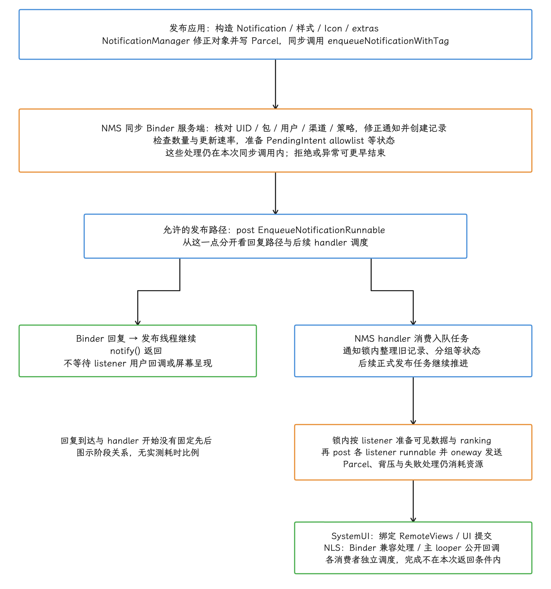
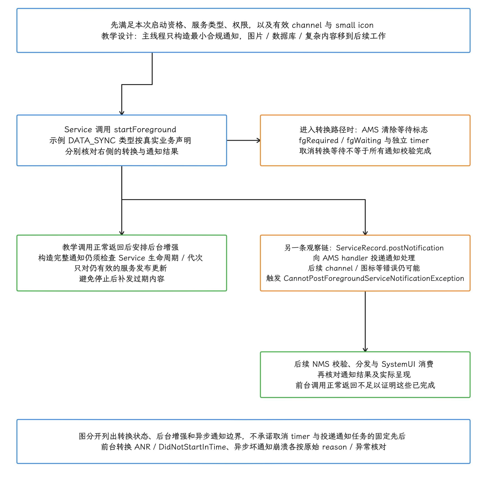
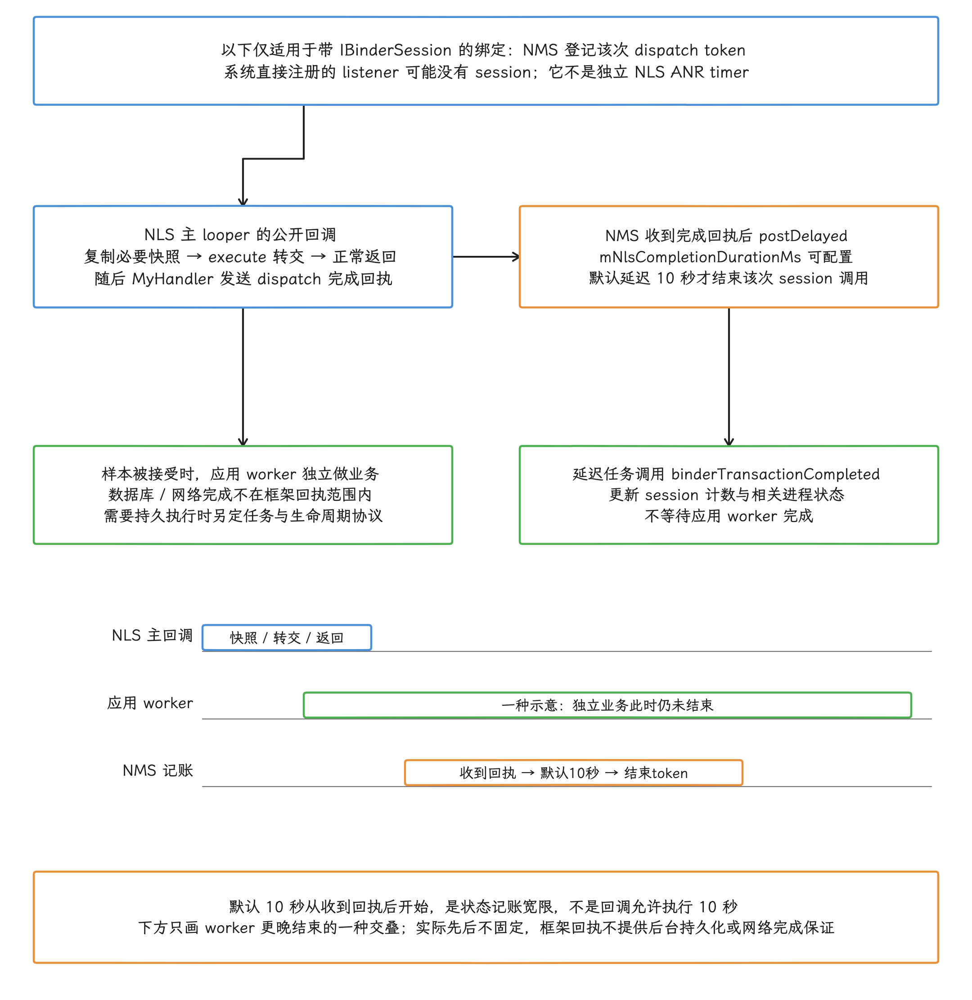
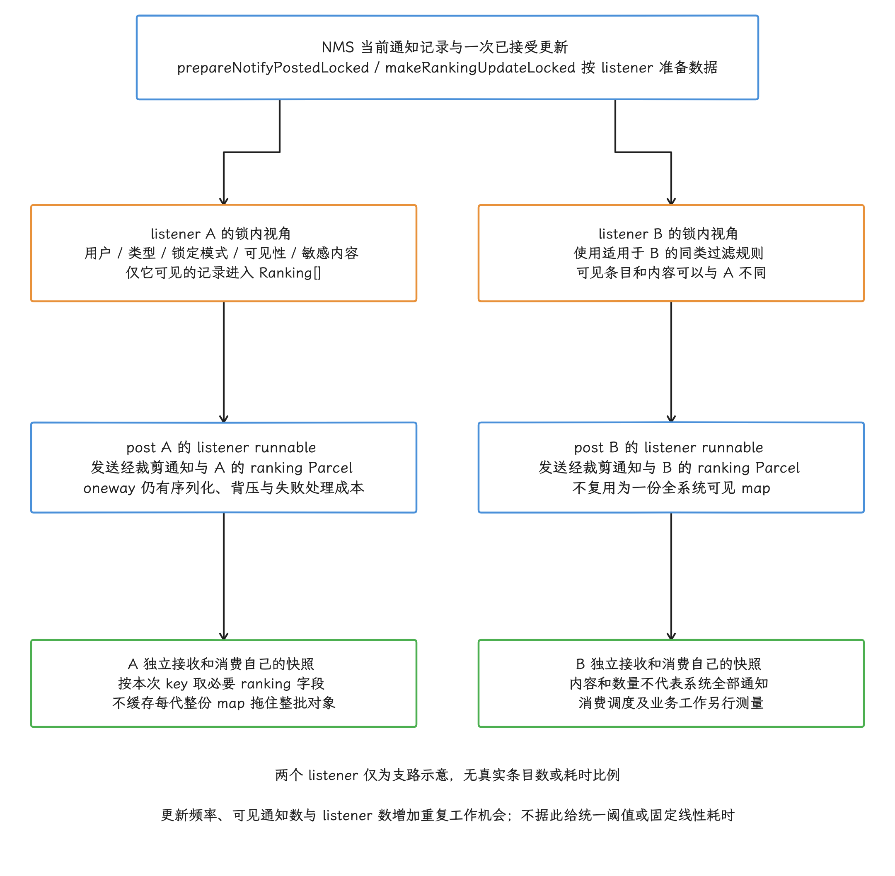

# Notification 性能与 ANR

通知发布要跨越应用构建、Binder 调用、系统服务处理、`RemoteViews` 加载和监听器分发，链路上任何一处阻塞，最后都可能表现为主线程超时。所以拿到一份通知 ANR 记录时，我们先按调用方向和线程归属把链路还原出来，再看阻塞落在哪一环；NotificationManagerService 只是其中一站。

## 为什么 Notification 会引发 ANR

「通知导致 ANR」背后至少有四条执行链：它们处理同一份 Notification 数据，却运行在不同进程，线程与超时检测器也各不相同。先约定两个缩写：NMS 是 `NotificationManagerService`，负责系统侧的通知管理；NLS 是 `NotificationListenerService`，供获得授权的监听器接收通知事件。

| 执行链 | 同步边界 | 可能出现的故障 |
|---|---|---|
| 发布应用调用 `notify()` | 构造对象、写入 Parcel（Binder 序列化容器）、同步 Binder、NMS 同步处理段 | 发布应用主线程 Input ANR、Binder 长等待 |
| NMS 异步入队与分发 | `system_server` 的 notification handler（消息处理线程）、锁和 CPU | 通知积压、`system_server` 延迟，极端情况下还需检查 Watchdog（系统服务存活监视器）证据 |
| SystemUI 消费并渲染 | SystemUI 创建/复用视图、加载图片和主线程提交界面 | 通知延迟显示、面板卡顿；有输入事件时可能形成 SystemUI Input ANR |
| NLS 接收回调 | 监听器的 Binder stub（接收跨进程调用的入口）把消息转给主线程 `MyHandler` | 监听器回调积压；进程持有窗口且输入超时时可能形成自己的 Input ANR |


前台服务还有一条相邻的超时：调用 `startForegroundService()` 之后，服务要是在期限内没有完成 `Service.startForeground()`，AMS（ActivityManagerService）的 `serviceForegroundTimeout()` 会为该服务构造 timeout record（超时记录）、停止仍在等待的服务，并延迟派发 `SERVICE_FOREGROUND_TIMEOUT_ANR_MSG`；`serviceForegroundCrash()` 则用 `ForegroundServiceDidNotStartInTimeException` 报告崩溃路径。

复杂通知经常吃掉这段时间预算，所以诊断报告仍会把它和通知性能放在一起讨论；归类时按前台服务转换超时单独记。

## 通知发布流程与 ANR 触发点

这一节顺着一次 `notify()` 调用走：先看返回前做了哪些工作，再交代前台服务转换这条相邻的超时。

### `notify()` 返回前做了哪些工作

`NotificationManager.notify()` 最终调用的是 `INotificationManager.enqueueNotificationWithTag()`。这个 AIDL（Android 接口定义语言）方法没有声明 `oneway`，所以它是一次同步 Binder 调用：调用线程要等 `system_server` 返回才继续往下走。

按 `android-17.0.0_r1` 的源码，这次调用可以拆成六段来看：


1. 应用构造 `Notification`、样式、`RemoteViews`、`Icon` 和 extras（附加字段）。
2. `NotificationManager` 执行兼容性修正，并把对象写入 Binder Parcel。
3. NMS 校验调用 UID、包名、用户、受限类别、通知渠道和前台服务策略。
4. NMS 修正通知、创建 `StatusBarNotification` / `NotificationRecord`，再检查通知数量和更新速率。
5. NMS 为 PendingIntent 设置临时 allowlist（允许后台启动等受限操作的名单）等状态，然后把 `EnqueueNotificationRunnable` post（投递）到 handler。
6. 允许的发布路径在投递后进入返回流程，不再等待 handler 后续的入队、正式发布、listener 回调与 SystemUI 呈现；这些工作与 Binder 返回可以交叠，我们画链路图时按交叠关系画，别画成严格串行。

下面的源码片段标出同步 Binder 入口和异步分界：

```java
// frameworks/base/core/java/android/app/NotificationManager.java
service.enqueueNotificationWithTag(
        targetPackage, sender, tag, id,
        fixNotification(notification),
        mContext.getUser().getIdentifier());

// frameworks/base/services/core/java/com/android/server/notification/NotificationManagerService.java
mHandler.post(new EnqueueNotificationRunnable(
        userId, r, isAppForeground, isAppProvided, tracker));
return true;
```

普通同步发布路径中，NMS 投递 handler 前的处理都在这次 Binder 服务端调用内，工作量远多于“权限校验后立刻入队”；投递后的任务可能在客户端收到返回之前就已经开跑。`INotificationListener.aidl` 声明为 `oneway interface`，所以 listener 回调和 SystemUI 显示通知都不在发布者这次调用的返回路径上，各走各的调度。

<!-- gracker-diagram: ed09-05-notify-prefix-and-fanout -->


图：固定r1普通允许发布路径中，应用构造、NotificationManager修正/Parcel和NMS身份/渠道/策略、记录构造/配额、PendingIntent准备都在post之前的同步调用链内；拒绝或异常可提前结束。post EnqueueNotificationRunnable后，Binder回复到达与handler开始没有固定先后，发布者不等待用户回调或上屏。handler入队之后还有正式发布、锁内各listener可见数据/ranking准备、各runnable和oneway投递；oneway仍有序列化/背压/失败成本，SystemUI和NLS各自继续调度。图为关系而非耗时比例，不把入队当呈现。

发布应用主线程停在 `notify()` 时，我们接着判断耗时落在哪一侧：


- `notif.build` trace 区间很长：应用在读取文件、缩放图片、创建大量 action 或组装 extras；
- Binder transaction 前的 Running（正在 CPU 上执行）时间很长：Parcel 写入、bitmap 转共享内存或应用侧修正较重；
- 同步 Binder wait 很长：NMS 同步段、`system_server` Binder 线程、内部锁或被调用服务较慢；
- `notify()` 很快返回但用户晚看到：转查 NMS handler 与 SystemUI 消费链。

### 前台服务转换超时

AMS 会给要求转为前台的 Service 安排一个独立 timer（计时器），服务完成 `startForeground()` 之后，这段等待才取消。所以图片下载、磁盘读图、数据库查询和复杂布局，都要挪出这段主线程路径。

下面是 Service 上下文中的两阶段教学片段：预先创建有效 channel，并满足清单中的服务类型、权限与当前启动资格后，先用最小通知调用前台转换，再在后台生成增强内容。`DATA_SYNC` 仅代表示例业务类型：


```java
Notification stub = new Notification.Builder(this, CHANNEL_ID)
        .setSmallIcon(R.drawable.ic_stat)
        .setContentTitle("服务启动中")
        .build();
ServiceCompat.startForeground(this, ID, stub, FOREGROUND_SERVICE_TYPE_DATA_SYNC);

backgroundExecutor.execute(() -> {
    Notification full = buildFullNotification();
    notificationManager.notify(ID, full);
});
```

前台转换、通知校验和屏幕呈现是三个不同阶段。AMS 在转换路径上清除 `fgRequired/fgWaiting` 并取消前台转换 timer；`ServiceRecord.postNotification()` 则向 AMS handler 投递通知处理，之后仍可能因渠道或图标等错误走 `CannotPostForegroundServiceNotificationException` 崩溃路径。所以不能只凭 `startForeground()` 正常返回断言前台状态已经接受、全部校验通过或通知已上屏；转换状态、等待标志和后续通知结果要分别确认。增强通知也要检查任务代次和 Service 生命周期，避免停止后补发过期内容。

<!-- gracker-diagram: ed09-05-fgs-minimal-and-later-outcomes -->


图：最小合规前台通知仍先满足channel/图标、真实服务类型、权限和启动资格；DATA_SYNC仅教学类型。正常教学调用返回后再后台构造增强内容，生产要按Service生命周期和任务代次防止过期补发。AMS转换路径清fgRequired/fgWaiting和取消独立timer，与ServiceRecord向AMS handler投递通知处理是不同观察点；图不承诺二者内部固定先后。后续channel/图标等错误仍可触发CannotPostForegroundServiceNotificationException，NMS/消费者再决定更晚结果与呈现；仅凭调用正常返回不能判全部接受/校验/上屏。转换ANR、DidNotStartInTime和异步坏通知崩溃按各自原因分别核对。

故障日志含 `Context.startForegroundService() did not then call Service.startForeground()`、`ForegroundServiceDidNotStartInTimeException` 或 service foreground timeout ANR 时，按前台转换超时处理。同一窗口内若还有输入 ANR 或普通 Service 执行 ANR，就分别保留时间线、分别归因。

## NotificationManagerService 内部机制

NMS 内部按“Binder 线程做校验和入队准备、handler 在锁内做处理”分工。排查 `system_server` 侧延迟时，我们先分清工作落在哪一侧。

### Binder 线程与 handler 各自负责什么

NMS Binder 线程负责检查调用身份、渠道和策略，修正对象，并完成配额检查和入队准备。`EnqueueNotificationRunnable` 进入 handler 后，NMS 才在通知锁保护下处理旧记录、分组、排序、提醒效果、URI 权限和 listener 通知。


源码里的线程名和 Trace section 会随平台分支调整，所以我们诊断时直接从执行上下文逐项确认：

- 发布线程处于 Running、Runnable（具备运行条件但尚未获得 CPU）还是 Binder sleep（等待 Binder 回复）；
- 同一 Binder transaction 的服务端线程何时开始、何时返回；
- NMS handler 是否获得 CPU，是否长时间持有 `mNotificationLock`；
- SystemUI 与每个 NLS 的 Binder 接收线程、主线程消息何时运行。

### 通知排序与分发的开销

`NotificationListeners.prepareNotifyPostedLocked()` 会遍历已注册 listener，按用户、可见性、敏感信息与版本规则准备各自的数据。`makeRankingUpdateLocked(info)` 遍历当前通知列表，只把该 listener 可见的记录写进 `NotificationRankingUpdate`（通知排序与状态快照）。这项工作在通知锁内完成，每个 listener 得到的 map（映射表）可能不同。

准备完成后，NMS 把 listener runnable 投递到 handler，再调用 `oneway` Binder 接口。异步省掉的只是“等客户端执行完”这一段，下面这些成本仍由 `system_server` 承担：

- 为 listener 过滤、裁剪或脱敏 `StatusBarNotification`；
- 构造该 listener 可见通知的 ranking 数组；
- 把通知与 ranking update 写入 Binder Parcel；
- 处理 Binder driver 背压（接收端来不及处理时发送端受限）、失败与 listener 生命周期。

通知总数、listener 数量和更新频率，共同决定 fan-out（一次更新向多个监听器分发）的成本；要量化它，还是在目标场景里用 Perfetto 实测，固定的“通知超过多少条”阈值给不了这个答案。


### 通知限流策略

更新速率限制位于 `checkDisqualifyingFeatures()`：它按应用包统计 enqueue rate（入队速率），channel（通知渠道）不单独计数。默认配置值是 `DEFAULT_MAX_NOTIFICATION_ENQUEUE_RATE = 5f`，系统可以从 `Settings.Global.MAX_NOTIFICATION_ENQUEUE_RATE` 覆盖，所以 `5` 只是默认值，按可被系统调整来设计。

下面摘录 `android-17.0.0_r1` 的更新速率分支；其外层只对非 system/phone/android 通知、且不是已注册 listener 包的发布者执行该配额检查：

<!-- gracker-diagram: ch09-05-09-rate-gates -->


图：任一条件不成立只会跳过这段速率检查；权限、渠道、数量等校验仍然有效。

```java
NotificationRecord previous = findPreviousNotificationLocked(r.getKey());
if (previous != null
        && previous.getNotification().getProgressState()
                == r.getNotification().getProgressState()
        && !isAutogroup) {
    final float appEnqueueRate = mUsageStats.getAppEnqueueRate(pkg);
    if (appEnqueueRate > mMaxPackageEnqueueRate) {
        return false;
    }
}
```

在该外层适用范围内，首次发布还没有 `previous`，走不到这段更新速率检查；新旧 progress state 不同或 `isAutogroup` 为真也会跳过这一分支——跳过的只是速率检查，渠道、权限与数量等其他校验仍然有效，照样可能拒绝。状态取自 progress/max/indeterminate extras，进度数值的每次变化未必都构成一次状态转换。


适用分支超限时，NMS 返回 `false`，并按日志时间间隔的限制记录 `Shedding <notification-key>`；一条日志对应一次丢弃，日志里搜不到，也说明不了没有发生限流。速率由 `NotificationUsageStats` / `RateEstimator` 估算：拿已接受的入队事件去更新到达间隔的指数加权估计，它与“每个整秒精确准许五次”的计数器是两回事。外部 AIDL 返回类型是 `void`，发布应用通常收不到异常或失败回调，所以界面上进度值可能直接跳跃。限流本身不会触发 ANR，它的作用是阻止高频更新继续推高 NMS 与消费者的负载。

<!-- gracker-diagram: ch09-05-11-rate-estimator -->


图：数值来自固定源码内部实现，不是应用发布频率契约；速率限制本身不是ANR detector。

同一方法还限制普通应用保留的未完成通知数量；前台服务、user-initiated job（由用户主动发起的任务）和聚合组各有例外。速率配额、数量配额和 channel 限制是三个概念，排查时分开核对。


## RemoteViews 的性能开销

`RemoteViews` 是通知跨进程展示的载体。先弄清它传输的到底是什么，再看布局、reapply 和图片把成本加在哪几段。

### 传输的是布局标识和 action

`RemoteViews` 保存布局标识、应用信息、action（要在远端视图上执行的操作）和 bitmap/collection cache（图片与集合数据缓存）。它会被写入 Parcel；消费者收到后再创建或复用 View 树。

同步 `apply()` 路径可用下面的伪代码表达；`...` 表示省略参数，这份伪代码只作示意，别当源码编译：

```java
private View apply(Context context, ViewGroup parent, ...) {
    RemoteViews rvToApply = getRemoteViewsToApply(context, size);
    View result = inflateView(context, rvToApply, directParent, ...);
    rvToApply.performApply(result, rootParent, params);
    return result;
}
```

`writeToParcel()` 会写入 bitmap cache、应用信息、layout ID 和逐个 action。`mActions` 是内存字段，Parcel 中保存的是 action count（数量）、tag（类型标记）和各 action 数据，名为 `mActions` 的 Parcel 字段并不存在。

<!-- gracker-diagram: ch09-05-13-rv-transport -->


图：传输的是布局描述及操作数据，不是发布端已构建的整棵View树；mActions不是Parcel字段名。

### 布局复杂度与 SystemUI 的工作量

自定义布局可能把成本加在两端：发布端要构造 action 并写入 Parcel；SystemUI 侧创建或复用 View、应用 action，再由实际窗口 UI 线程做测量、布局和绘制。正常通知的异步绑定在 `@NotifInflation` worker 与 UI 回调之间交接：RemoteViews 的部分准备在 worker，剩余 action 与完成回调落在其 Context 的主 looper，同步 fallback 又会加重 UI 回调耗时。读 trace 时把绑定拆成 worker 段和回调段分别算；整段记成主线程同步 `apply()`，或凭窗口线程 flag 断定回调已全部迁移，都会误判。

<!-- gracker-diagram: ch09-05-14-rv-async -->


图：阶段可交叠且不是实测比例；窗口线程归属需按目标build确认，把所有绑定都算成main同步apply会误判。

工程上我们优先用 `BigTextStyle`、`BigPictureStyle`、`MessagingStyle`、`ProgressStyle` 或 `MetricStyle` 等系统样式。标准样式同样走框架生成的 `RemoteViews` 渲染，布局和 action 由系统控制、适配更一致；`RemoteViews` 本身的处理开销则依然在。

### RemoteViews 的 reapply 机制

SystemUI 会先检查复用条件，通过后才调用 `reapply()` / `reapplyAsync()`。固定版本 `canReapplyRemoteView(newView, oldView)` 在二者非空时比较非空包名、layout ID，并要求旧对象未带 `FLAG_REAPPLY_DISALLOWED`；新对象这一侧则跳过了同一 flag 检查。预检查通过后，RemoteViews 还要对多布局、View ID 等条件做校验，执行中仍可能失败并回退——预检查通过只代表“可以尝试 reapply”，离必然成功还隔着后面的校验。

<!-- gracker-diagram: ch09-05-15-rv-reapply-guard -->


图：固定canReapplyRemoteView还有双方皆null的判等分支；可尝试复用只到预检查为止，成功与否与action成本另算。

`reapply()` 跳过的是根布局 inflate，新对象中的 action 仍要逐个执行。频繁更新进度时，把模板和布局标识保持不变，有助于满足复用预检查；是否实际复用仍取决于其余条件和执行结果。`setText`、`setImageViewBitmap` 等 action 的成本照样发生。我们在目标 build（系统构建版本）的 SystemUI trace 里，对 inflate、async apply、reapply 和主线程提交分别测量。

### 图片通知的开销落在三段

图片型通知的成本分布在三个位置：


1. 应用侧取图、缩放和构造通知对象；
2. 通过 Parcel、共享内存和 Binder FD（文件描述符）传输；
3. SystemUI 侧加载、apply、布局与渲染。

三种 `Icon` 输入的成本模型不同：


- `createWithResource()` 传包名与资源 ID，消费者按资源解析，适合应用内稳定资源；
- `createWithContentUri()` 传 URI 字符串，消费者稍后打开并解码，需要 URI 在通知存活期间可读；
- `createWithBitmap()` 在 `Icon.writeToParcel()` 中调用 `Bitmap.asShared()`。`Icon` 首次需要转换时缓存 `asShared()` 的结果；Bitmap 仅在 ashmem 支持、不可变，并且 gainmap 无需替换时返回自身，其余情况会创建共享副本，也可能转换失败。

共享内存可以省掉把每个像素当普通 Parcel 数据复制这一步；首次 `asShared()`、FD 管理、接收端对象创建和 GPU 上传，这些开销仍然在。

<!-- gracker-diagram: ch09-05-18-bitmap-shared -->


图：gainmap需要替换时，bitmap已共享还不足以断言返回自身；共享化之外，整条通知路径仍有其他拷贝成本。

AOSP 并未规定通知 bitmap 必须用 `ARGB_8888`；我们按图像内容选合适格式，并在发布前把图缩放到实际需要的尺寸。

## NotificationListenerService 与性能

这一节站在监听器应用一边看性能：回调跑在哪个线程、回调里该做什么、完成回执覆盖到哪一步。

### NLS 回调的线程模型

`NotificationListenerService.attachBaseContext()` 用 `getMainLooper()` 创建 `MyHandler`。在固定版本的 posted 入口，Binder stub 先做旧客户端兼容处理——包括可能的图标加载、RemoteViews 补建与 people 转换——再在锁内应用 ranking 更新并投递消息；公开 `onNotificationPosted()` 随后在这个主 looper 上执行。也就是说，Binder 接收端做的事比“空转交接”多，兼容处理成本我们要单独采集。

<!-- gracker-diagram: ch09-05-19-nls-thread-model -->


图：兼容工作只对旧客户端执行；Binder接收段与主线程回调段需要分别测量。

下面的实现把数据库、网络和分析都留在主线程，容易让后续通知回调与应用 UI 消息排队：

```java
public class MyNotificationListener extends NotificationListenerService {
    @Override
    public void onNotificationPosted(
            StatusBarNotification sbn,
            RankingMap rankingMap) {
        saveToDatabase(sbn);
        uploadToServer(sbn);
        analyzeNotification(sbn);
    }
}
```

这段代码既延长本次回调的执行时间，也推迟后续主线程消息，最先表现出来的可能是后续回调与主线程消息积压。要把积压定成 Input ANR，还得有本次等待中的输入连接，再配上对应的输入事件、连接身份和 detector 到期证据；光有 NLS 长回调还不够。其他组件的超时，也按各自的证据核对。

<!-- gracker-diagram: ch09-05-20-nls-backlog -->


图：图只说明队列依赖，不给出虚构延迟；NLS长任务本身说明不了本次Input ANR成立。

### 回调中的快照与转交

NLS 回调的参数来自系统状态，转给后台任务前应复制所需字段，定义好队列容量、覆盖和去重策略。下面的示例用一个 worker 按接受顺序处理允许丢弃的分析样本，并设置有界等待队列；这里的容量 64 由示例选择，不是本章核对的 Android 通知机制给出的系统阈值。示例需要导入 `java.util.concurrent` 中的对应类型和 `android.util.Log`，业务 DTO 与分析方法由应用自己提供：

```java
public class MyNotificationListener extends NotificationListenerService {
    // 教学容量；业务需按内存和事件滞后预算配置。
    private final ThreadPoolExecutor worker = new ThreadPoolExecutor(
            1, 1, 0L, TimeUnit.MILLISECONDS,
            new ArrayBlockingQueue<>(64),
            new ThreadPoolExecutor.AbortPolicy());

    @Override
    public void onNotificationPosted(
            StatusBarNotification sbn,
            RankingMap rankingMap) {
        NotificationSnapshot snapshot =
                NotificationSnapshot.copyRequiredFields(sbn, rankingMap);
        try {
            worker.execute(() -> persistAndAnalyze(snapshot));
        } catch (RejectedExecutionException rejected) {
            // 本例只用于允许丢弃的分析样本；不在主线程回退执行。
            Log.w("NlsWorker", "Sample dropped: queue full or service stopped");
        }
    }

    @Override
    public void onDestroy() {
        worker.shutdownNow();
        super.onDestroy();
    }
}
```

`NotificationSnapshot` 是应用自定义 DTO（只承载数据的对象）。复制时只取业务需要的 key、package、post time（发布时间）、文本摘要和当前通知的 ranking；图片、完整 extras、历史 `RankingMap` 与大 `RemoteViews` 默认都留在后台队列之外。本例在队列满或已关闭时丢弃样本，销毁时取消排队并中断运行任务；业务工作要响应中断，`shutdownNow()` 返回时运行中的任务可能还在收尾。业务若必须保留移除和最终状态，要另行实现按 key 合并、持久化或重新同步协议——这个分析示例按设计就允许丢样本，当不了无损事件通道。

<!-- gracker-diagram: ch09-05-21-nls-bounded-worker -->


图：64是教学容量；该示例允许丢弃，不提供移除或最终状态无损保证，业务需另行实现合并/持久化/重同步。


### 回调完成回执与进程冻结

对带 `IBinderSession` 的绑定，系统还跟踪 dispatch token。NLS 的 MyHandler 在公开回调正常返回后发送完成回执；NMS 收到回执，再按可配置的 `mNlsCompletionDurationMs` 延迟关闭 session 中该次调用，默认延迟 10 秒。这 10 秒是回调完成之后的状态记账宽限；把它读成“回调允许执行 10 秒”的 NLS ANR timer 是误读。


这个 session 与允许冻结的绑定及进程状态更新相关，系统直接注册的 listener 可能就没有它。把工作交给自己的 executor 之后，公开回调已经返回，框架的完成回执也只覆盖到回调返回这一刻，后台持久化或网络请求的完成情况都在回执范围之外。需要持久执行保证的业务，必须使用相应的任务与生命周期协议。

<!-- gracker-diagram: ed09-05-session-ack-and-independent-worker -->


图：仅带IBinderSession的绑定按dispatch token跟踪，系统直接注册可能无session。NLS公开回调正常返回后MyHandler发完成回执，NMS收到后按可配置mNlsCompletionDurationMs延迟结束这次session调用，默认10秒，更新计数和相关进程状态；这不是回调允许执行10秒的独立ANR timer。图中的应用worker仅示被执行器接受的样本，拒绝处理见前述教学代码。worker可以早于或晚于session任务结束，轨道只画较晚的一种无实测比例交叠；框架回执不等待数据库/网络，不提供普通executor的持久执行保证。

### RankingMap 的成本与可见性

每次 posted callback（通知已发布回调）携带的是该 listener 当前可见通知的 ranking map。NMS 会按 listener 过滤用户、通知类型、锁定模式与敏感内容，再构造 `Ranking[]`。因此：

<!-- gracker-diagram: ed09-05-per-listener-ranking-fanout -->


图：A/B仅为两个listener的支路示意，非设备条目数或数量上限。NMS锁内按各自用户、类型、锁定模式、可见性与敏感内容规则构造Ranking数组，再post各自runnable并oneway发送通知和ranking Parcel；每份map只是该listener当前可见快照，集合与内容可以不同，不能当系统全部通知。消费者按本次key提取必要ranking，缓存每代整份map会延长整批对象存活。频率、可见通知数与listener数增加工作量机会，仍不能推出统一阈值或固定线性耗时；序列化、背压/失败和消费阶段分别实测。

- map 只包含该 listener 可见的通知，其他记录不进入这份 map；不能据此把它当作系统全部通知；
- 不同 listener 的条目数和内容可能不同；
- 构造和 Parcel 成本随可见通知数量与 listener 数量增长；
- 应用缓存旧 map，会拖住整批 ranking 对象的释放。

如果业务只关心本次 `sbn.getKey()`，在回调里调用 `rankingMap.getRanking(key, reusableRanking)` 取出需要的字段就够了；“以后也许会用”而留下的每一代 map，代价就是上一条说的拖住释放。

## 通知与 ANR 的典型模式

下面六个模式对应前文各条链路的常见故障形态。对照时先确认证据落在哪条链，再按该模式的顺序取证。

### 模式一：发布应用主线程卡在同步 Binder

trace 停在 `NotificationManager.notify*()`、`BinderProxy.transactNative()` 或 Parcel/bitmap 路径上。取证要同时覆盖应用 slice 和对应的 `system_server` Binder 线程；发布若发生在主线程，长等待可能叠加输入事件，进而触发应用 Input ANR。


### 模式二：前台服务转换超时

日志含 `ForegroundServiceDidNotStartInTimeException`、前台转换 timeout record 或 service foreground timeout ANR。排查时沿着 Service 回调入口到 `startForeground()` 之间的所有同步工作看一遍：先提交最小合规通知，再构造增强内容。

### 模式三：NLS 主线程回调积压

监听器自己的主线程栈落在数据库、JSON、锁或网络等待上。要定成 Input ANR，还需证明该进程存在等待中的输入事件；拿不出这项证据时，结论就写成 NLS 主线程长任务和回调积压。


### 模式四：高频 update 被限流丢弃

下载、导航、计时和指标通知反复更新同一个 key：应用反复构造对象，NMS 反复检查并向各监听器分发；同一 progress state（进度状态）内的 update 还可能在没有回调通知应用的情况下被丢弃。更新频率按用户可见变化、允许信息滞后的最长时间和最终状态发布要求来设计，发布点跟着用户可见变化走，别跟着每个底层采样点走。


### 模式五：SystemUI 渲染长任务

发布线程很快返回，通知显示却明显延后；Perfetto 显示 SystemUI 在 apply、图片加载、布局或主线程提交上耗时。若通知面板正接收触摸事件，SystemUI 主线程长任务还可能形成它自己的 Input ANR。


### 模式六：渠道创建进入首次关键启动路径

`createNotificationChannel()` 与 `notify()` 都会进入 NMS。固定 channel 可以幂等创建（重复执行不会改变最终结果），放在可控的初始化阶段完成；首次启动前台服务时，大量 channel 迁移、图片读取和通知发布都压进这一段，等于给前台转换窗口加负载。必需 channel 要提前就绪；为省启动耗时把它延后，首个通知会因 channel 缺失被拒绝。


## Android 17 通知性能变更

### 版本边界

| 版本 | 已确认变化 | 性能诊断含义 |
|---|---|---|
| Android 12（API 31） | 支持范围的基线；NMS 已有通知数量与更新速率保护 | 不把这些保护误写成 Android 17 新增 |
| Android 13（API 33） | `POST_NOTIFICATIONS` 成为 runtime permission（运行时权限） | 发布前处理授权状态；它不改变已获授权通知的 NMS 同步边界 |
| Android 16（API 36） | `Notification.ProgressStyle` 与 promoted ongoing / Live Update API | 进度场景可使用系统样式；是否获得 Live Update 的显著展示位置需要另行判断 |
| Android 17（API 37） | `Notification.MetricStyle`、Metric value 类型、Semantic Coloring | 指标场景新增系统样式，语义颜色由状态栏等系统 surface（展示区域）解释 |


“后台 NLS 统一按包限频”的说法，目前没有 Android 17 一手证据支持，本章未采用。

### ProgressStyle 与 Live Update 是两个概念

`ProgressStyle` 描述通知内容；Live Update 讲的是另一件事：系统把 ongoing（持续进行中）通知提升为 promoted ongoing、放到更显眼的 surface。提升要满足 manifest permission（清单声明的权限）、channel importance（渠道重要性）、样式和用户设置等条件，OEM 还可以追加资格规则。

当前官方指南列出 Standard、`BigTextStyle`、`CallStyle`、`ProgressStyle`、`MetricStyle` 等可申请样式，并要求 ongoing、请求提升、相应权限及其他展示资格。固定源码还排除 group summary、自定义视图和 colorized 请求，并检查 channel importance 大于 MIN、非 bundle channel；MetricStyle 的标题资格可由指标提供，显式 `contentTitle` 并非一概必需。内容资格只是第一关：最终是否提升、展示位置是否固定，还看用户——用户可以降级或移除；执行优先级和性能收益要另行验证，从这里推导不出来。

<!-- gracker-diagram: ch09-05-32-live-eligibility -->


图：ProgressStyle是内容样式，Live Update是提升展示；固定源码的禁止阈值是MIN而非LOW，提升也不带来确定的性能收益。

> ⚠️ 矛盾：本章引用的旧研究摘要把 ProgressStyle 与自动提升混在一起，并把 LOW importance 写为禁止条件；当前源码检查的是 `importance <= MIN`，且提升还受权限、用户与产品规则约束。原始摘要保留，本章按固定源码和当前指南说明。

### MetricStyle 与 Semantic Coloring

`Notification.MetricStyle` 在 API 37 加入，展开状态最多展示三个指标。每个 `Notification.Metric` 包含 label（标签）和一种 `MetricValue`；系统提供整数、浮点、日期、时间、时间差和文本等 value 类型。被提升为 Live Update 时，critical metric（关键指标）可能用于状态栏 chip（胶囊形提示区域）。

下面的 API 37 示例创建一个单指标系统样式：

```java
if (Build.VERSION.SDK_INT >= 37) {
    Notification.Metric steps = new Notification.Metric(
            new Notification.Metric.FixedInt(1979),
            "步数");
    Notification notification =
            new Notification.Builder(context, CHANNEL_ID)
                    .setSmallIcon(R.drawable.ic_stat)
                    .setContentTitle("今日活动")
                    .setStyle(new Notification.MetricStyle()
                            .addMetric(steps))
                    .build();
}
```

`MetricStyle` 至少要包含一个 metric（指标），否则 `build()` 会抛出 `IllegalArgumentException`。源码只绑定前三个 metric，多出来的条目进不了展开布局，所以我们在构造前就把列表限制为三个。


Android 17 的 semantic style 常量包括 `UNSPECIFIED`、`INFO`、`SAFE`、`CAUTION` 和 `DANGER`。它们表达信息、安全、警示与危险等语义，颜色由系统 surface 挑选；应用想用这几个值直接指定绿、红、蓝，是行不通的。源码只在满足 feature flag（功能开关）、promoted ongoing 和非 unspecified 等条件时，才给 metric value 应用语义色。


`getProgressState()` 读取的是进度 extras，MetricStyle 指标列表不在它的读取范围内。只更新指标、未另外设置进度 extras 时，状态通常保持 NONE；新旧状态相同且符合外层条件的更新，仍可进入包级速率检查——系统样式本身没有配额豁免这条通道。

## 在 Perfetto 中诊断通知 ANR

平台内部 slice（带起止时间的事件片段）和线程名会随 build 改变，拿它们当固定标记并不稳。应用自己的 Trace section（自定义 trace 区间）则可以稳定标记通知构造、同步发布、前台转换和 NLS 回调；我们以这些 section 为起点，再结合 Binder 与调度数据，追系统侧的耗时。

### 应用侧标记

下面的 Kotlin 代码把构造与发布分成两个 section，并确保异常时关闭 section：

```kotlin
val notification = try {
    Trace.beginSection("notif.build")
    buildNotification()
} finally {
    Trace.endSection()
}
try {
    Trace.beginSection("notif.notify")
    notificationManager.notify(ID, notification)
} finally {
    Trace.endSection()
}

override fun onNotificationPosted(
    sbn: StatusBarNotification,
    rankingMap: RankingMap
) {
    try {
        Trace.beginSection("nls.callback")
        handOffSnapshot(sbn, rankingMap)
    } finally {
        Trace.endSection()
    }
}
```

`notif.build` 衡量应用构造耗时，`notif.notify` 覆盖 Parcel 与同步 Binder，`nls.callback` 里只放快照和入队；前台服务可以另加 `notif.startForeground`。


### 最小采集配置

下面的 textproto（Perfetto 文本配置格式）请求约 30 秒的采集会话并使用 64 MiB 环形缓冲，包含目标应用 atrace、Binder 与调度事件；覆盖时长仍受事件量、覆盖写和丢包影响：

```textproto
buffers: {
  size_kb: 65536
  fill_policy: RING_BUFFER
}
data_sources: {
  config {
    name: "linux.ftrace"
    ftrace_config {
      atrace_apps: "your.package"
      atrace_categories: "am"
      atrace_categories: "binder_driver"
      atrace_categories: "gfx"
      atrace_categories: "view"
      atrace_categories: "wm"
      ftrace_events: "sched/sched_switch"
      ftrace_events: "sched/sched_wakeup"
      ftrace_events: "sched/sched_waking"
    }
  }
}
duration_ms: 30000
```

<!-- gracker-diagram: ch09-05-37-buffer-window -->


图：图只说明可能的覆盖关系；不声称该配置一定丢失多少秒，也不把duration当成保证留存时长。

这里的 30 秒只是采集时长的设定值；实际能保留多久历史，受事件量、覆盖写和丢包影响，故障前因有没有被覆盖，要看目标 detector、触发前数据与 buffer 实际的丢失/覆盖情况。`atrace_apps` 当前只选了目标应用；想观察 SystemUI 的 APP-tag 自定义 section 或其他系统 tag，就按目标构建追加相应进程和类别，并在结果里确认确实采到了，别默认它们已经进来。


### 查询应用 section

下面的 Perfetto SQL 按耗时列出应用自定义 Trace section：

```sql
SELECT
  process.upid,
  process.pid,
  process.name AS process_name,
  thread.utid,
  thread.tid,
  thread.name  AS thread_name,
  slice.id AS slice_id,
  slice.ts,
  slice.name,
  slice.dur / 1000000.0 AS dur_ms
FROM slice
JOIN thread_track ON slice.track_id = thread_track.id
JOIN thread ON thread_track.utid = thread.utid
JOIN process ON thread.upid = process.upid
WHERE slice.dur >= 0
  AND slice.name IN (
  'notif.build',
  'notif.notify',
  'notif.startForeground',
  'nls.callback'
)
ORDER BY slice.dur DESC;
```

本查询只列出已结束的 section，保留零时长而排除 `dur=-1` 的未结束项；跨进程可能使用同名 section，要用 upid/utid、PID/TID 和时间确认对象。墙钟时长里混着执行、调度等待和阻塞，CPU 时间要另查。结果里没列出的未结束异常区间，按 §9.2 的观测窗口裁剪继续分析；它们只是还没结束，卡不卡要继续看才知道。

<!-- gracker-diagram: ch09-05-38-sql-identity -->


图：同名section可能来自不同进程或线程；查询只是耗时排序入口，跨进程关联要靠upid/utid与时间。


### 查询主线程状态

下面的查询列出目标进程主线程已结束、持续超过 1 毫秒的状态片段；`is_main_thread` 不依赖线程恰好命名为 main，实际进程实例仍须按 upid/PID 核对：

```sql
SELECT
  process.upid,
  process.pid,
  process.name AS process_name,
  thread.utid,
  thread.tid,
  thread.name  AS thread_name,
  thread_state.ts,
  thread_state.state,
  thread_state.blocked_function,
  thread_state.dur / 1000000.0 AS dur_ms
FROM thread_state
JOIN thread USING (utid)
JOIN process USING (upid)
WHERE process.name = 'your.package'
  AND thread.is_main_thread = 1
  AND thread_state.dur > 1000000
ORDER BY thread_state.dur DESC;
```

长时间 Running 表示本进程正在执行 CPU 工作；`R` 表示线程已经可以运行，却还未获得 CPU；线程睡眠且 blocked function（阻塞位置）落在 Binder 路径时，我们就顺着去找对应的 `system_server` transaction。线程状态给出的是排查方向，具体代码仍要用 slice 与调用栈确认。


### 三条链分别核对

- 发布链：`notif.notify`、Binder client/server、NMS 同步段返回；
- 分发链：NMS handler、通知锁、ranking 构造与 listener Binder 调用；
- 消费链：SystemUI/NLS Binder 接收、主线程消息、RemoteViews 或业务回调。


核对时以应用自定义 section、Binder transaction、PID/TID 和时间范围为基准；`notif-handler`、`enqueueNotificationInternal` 这类私有 slice 名，在不同 build 上可能存在，也可能并不存在。

### 使用 dumpsys 辅助诊断

下面的命令保存 NMS 当前状态，并从 system log 搜索被限流丢弃的更新记录：

```bash
adb shell dumpsys notification
adb logcat -b system -d | grep -E \
  'Package enqueue rate|Shedding .* package='
```

`dumpsys` 适合确认当前活跃记录、listener、channel 与策略状态；某次超速更新有没有被丢弃，以 NMS 日志和 trace 时间线为准。快照若采在故障之后，已经移除的通知和短暂积压可能已经看不到了；Shedding 日志还受输出节流与日志保留限制；搜索结果为空时，继续结合 trace、状态和可用统计核对。若所采数据没有覆盖拒绝分支，结论应保留缺口，不能保证仅凭 trace 就能判明每次丢弃。


## 与其他机制的关系

- **§9.1 Service ANR 与超时**：区分 Service 执行 ANR 和前台转换异常。
- **§1.9 Binder IPC 与性能**：`notify()` 的同步返回、listener 的 oneway 回调和 Binder 背压属于不同事务。
- **§6.3 SharedPreferences/DataStore**：NLS 主线程中的 `commit()` 或加载等待会直接延长回调。
- **§1.15 ContentProvider**：URI 图标和 NLS 查询都可能触发 Provider 访问与冷启动。
- **§14.5 Perfetto SQL**：用 Binder、slice 与 thread_state 还原跨进程时间线。

## 常见问题与误区

### 「通知 ANR 只发生在使用 NotificationListenerService 的 App」

发布应用、SystemUI 和带 UI 的监听器，都可能因各自主线程阻塞而触发 Input ANR，范围比“用 NLS 的 App”大得多。NLS dispatch completion 的默认 10 秒，是回调完成后延迟更新 Binder session 的记账宽限，把它读成独立的“通知 ANR timer”就错了。前台转换超时在本章固定源码中有 ANR 及崩溃相关路径，另有异步坏通知崩溃；统计时按原始 reason/异常和 detector 分开，ANR 归 ANR、崩溃归崩溃。

### 「`notify()` 是异步的，不会阻塞主线程」

入口是同步 Binder。应用线程要等 NMS 完成入队前的校验、修正、记录构造和配额检查，一直执行到 `mHandler.post()` 之后才返回；它等的只是这一段，SystemUI 上屏与 NLS 用户回调的完成都在这次等待之外。

### 「更新被限流时会抛异常」

超速 update 在 NMS 内部返回 `false` 并写系统日志，外部 `enqueueNotificationWithTag()` 的返回值里看不到这次拒绝，应用通常只会看到某次进度没有展示。要可靠发布最终状态，靠的是降低更新频率、并在状态转换时明确发出终态通知；不能把捕获异常重试当作识别这次速率拒绝的机制；其他权限、参数或策略错误仍可能有自己的异常路径。

### 「自定义通知布局比标准模板性能更好」

标准模板同样会生成 `RemoteViews`，差别在于布局、尺寸和 action 集合由系统维护，通常更容易保持布局标识不变。自定义布局究竟更慢还是更快，要测量后才有结论；层级、action、图片与复用失败，每一项都可能加开销。Live Update 禁止 `customContentView` 是展示资格规则，属于另一码事，别拿它当性能基准测试结论。

### 「Icon 构造方式对性能没影响」

resource、URI 和 bitmap 的成本分别落在资源解析、延迟读取与解码、共享内存复制上。bitmap 预先缩放；URI 的授权要覆盖通知存活期；resource 要保证接收端能解析对应包和资源。三者怎么选，看图片来源、更新频率和目标尺寸；适用于所有来源的统一性能排序，这里是给不出来的。


## 参考资料

### Android 17 / API 37 源码

- [NotificationManager.java：应用侧 notify 入口](https://android.googlesource.com/platform/frameworks/base/+/android-17.0.0_r1/core/java/android/app/NotificationManager.java)
- [INotificationManager.aidl：同步 enqueue 接口](https://android.googlesource.com/platform/frameworks/base/+/android-17.0.0_r1/core/java/android/app/INotificationManager.aidl)
- [NotificationManagerService.java：同步入队、配额、排序与 listener 分发](https://android.googlesource.com/platform/frameworks/base/+/android-17.0.0_r1/services/core/java/com/android/server/notification/NotificationManagerService.java)
- [NotificationListenerService.java：主线程 Handler 与 RankingMap](https://android.googlesource.com/platform/frameworks/base/+/android-17.0.0_r1/core/java/android/service/notification/NotificationListenerService.java)
- [INotificationListener.aidl：oneway listener 回调](https://android.googlesource.com/platform/frameworks/base/+/android-17.0.0_r1/core/java/android/service/notification/INotificationListener.aidl)
- [Notification.java：ProgressStyle、MetricStyle 与 progress state](https://android.googlesource.com/platform/frameworks/base/+/android-17.0.0_r1/core/java/android/app/Notification.java)
- [RemoteViews.java：Parcel、apply 与 reapply](https://android.googlesource.com/platform/frameworks/base/+/android-17.0.0_r1/core/java/android/widget/RemoteViews.java)
- [Icon.java：resource、URI 与 bitmap Parcel 路径](https://android.googlesource.com/platform/frameworks/base/+/android-17.0.0_r1/graphics/java/android/graphics/drawable/Icon.java)
- [ActiveServices.java：前台服务转换 timeout](https://android.googlesource.com/platform/frameworks/base/+/android-17.0.0_r1/services/core/java/com/android/server/am/ActiveServices.java)
- [ActivityManagerService.java：前台服务 timeout / crash 消息分发](https://android.googlesource.com/platform/frameworks/base/+/android-17.0.0_r1/services/core/java/com/android/server/am/ActivityManagerService.java)

### 官方文档

- [通知开发指南](https://developer.android.com/develop/ui/views/notifications)
- [通知 runtime permission](https://developer.android.com/develop/ui/views/notifications/notification-permission)
- [前台服务超时排查](https://developer.android.com/develop/background-work/services/fgs/troubleshooting)
- [Android 16 ProgressStyle](https://developer.android.com/about/versions/16/features/progress-centric-notifications)
- [Android 17 MetricStyle 指南](https://developer.android.com/develop/ui/views/notifications/metric-style)
- [Live Update 资格与 surface](https://developer.android.com/develop/ui/views/notifications/live-update)
- [Android 17 Semantic Coloring](https://developer.android.com/about/versions/17/features#live-update-semantic-color)
- [ANR 诊断指南](https://developer.android.com/topic/performance/vitals/anr)

- [SystemUI 通知内容绑定与 reapply 条件](https://android.googlesource.com/platform/frameworks/base/+/android-17.0.0_r1/packages/SystemUI/src/com/android/systemui/statusbar/notification/row/NotificationRowContentBinderImpl.kt)
- [NotifInflation 后台 Looper 与执行器](https://android.googlesource.com/platform/frameworks/base/+/android-17.0.0_r1/packages/SystemUI/src/com/android/systemui/util/concurrency/SysUIConcurrencyModule.kt)
- [Bitmap.asShared 与 gainmap 条件](https://android.googlesource.com/platform/frameworks/base/+/android-17.0.0_r1/graphics/java/android/graphics/Bitmap.java)
- [通知接受事件与估算速率](https://android.googlesource.com/platform/frameworks/base/+/android-17.0.0_r1/services/core/java/com/android/server/notification/NotificationUsageStats.java)
- [入队速率指数加权估计](https://android.googlesource.com/platform/frameworks/base/+/android-17.0.0_r1/core/java/android/service/notification/RateEstimator.java)
- [允许冻结的服务绑定 session](https://android.googlesource.com/platform/frameworks/base/+/android-17.0.0_r1/services/core/java/com/android/server/am/psc/ProcessStateController.java)
- [Binder session 调用计数与进程状态更新](https://android.googlesource.com/platform/frameworks/base/+/android-17.0.0_r1/services/core/java/com/android/server/am/psc/BinderSession.java)
- [前台服务通知的异步发布与坏通知结果](https://android.googlesource.com/platform/frameworks/base/+/android-17.0.0_r1/services/core/java/com/android/server/am/ServiceRecord.java)
- [Perfetto 会话时长与环形缓冲语义](https://android.googlesource.com/platform/external/perfetto/+/android-17.0.0_r1/protos/perfetto/config/trace_config.proto)
- [atrace Binder 类别映射](https://android.googlesource.com/platform/frameworks/native/+/android-17.0.0_r1/cmds/atrace/atrace.cpp)
- [Perfetto SQL 表与身份字段](https://perfetto.dev/docs/analysis/sql-tables)
