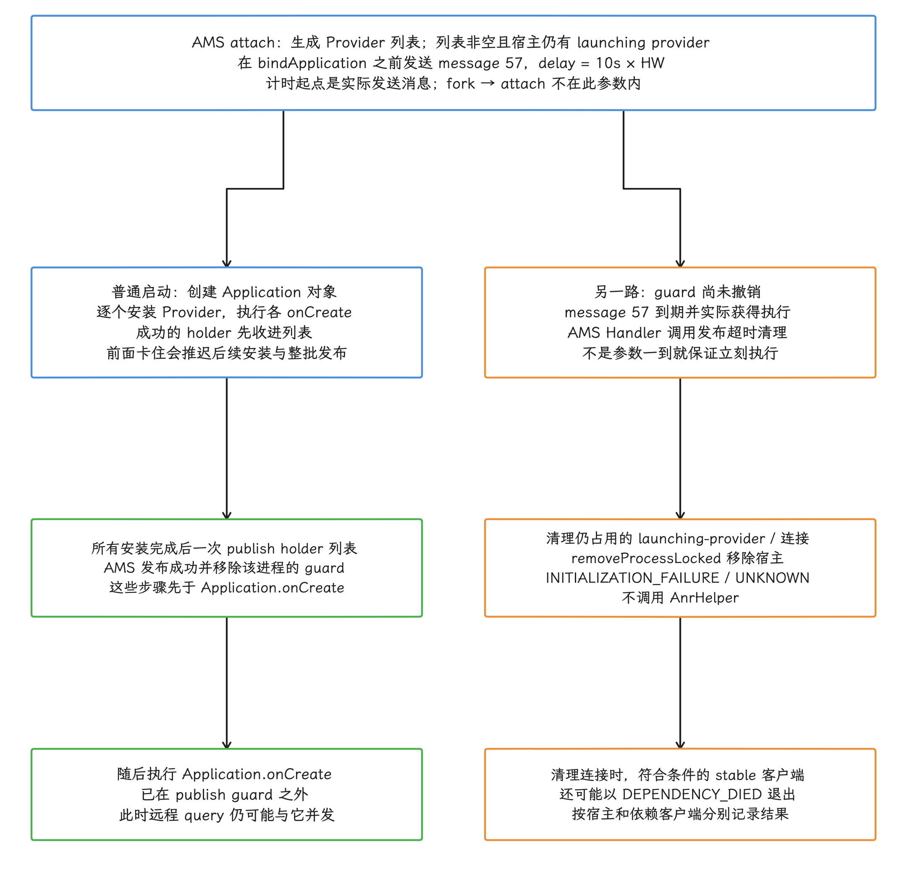
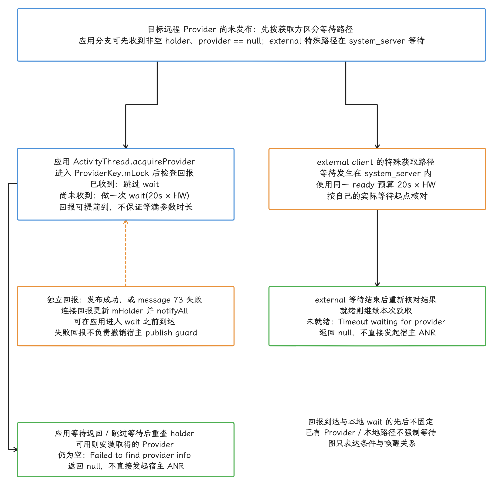
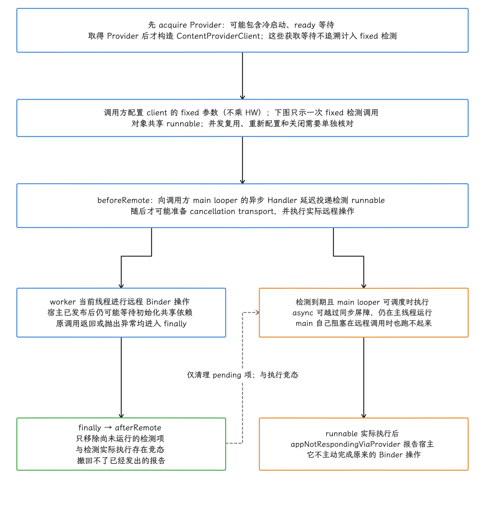
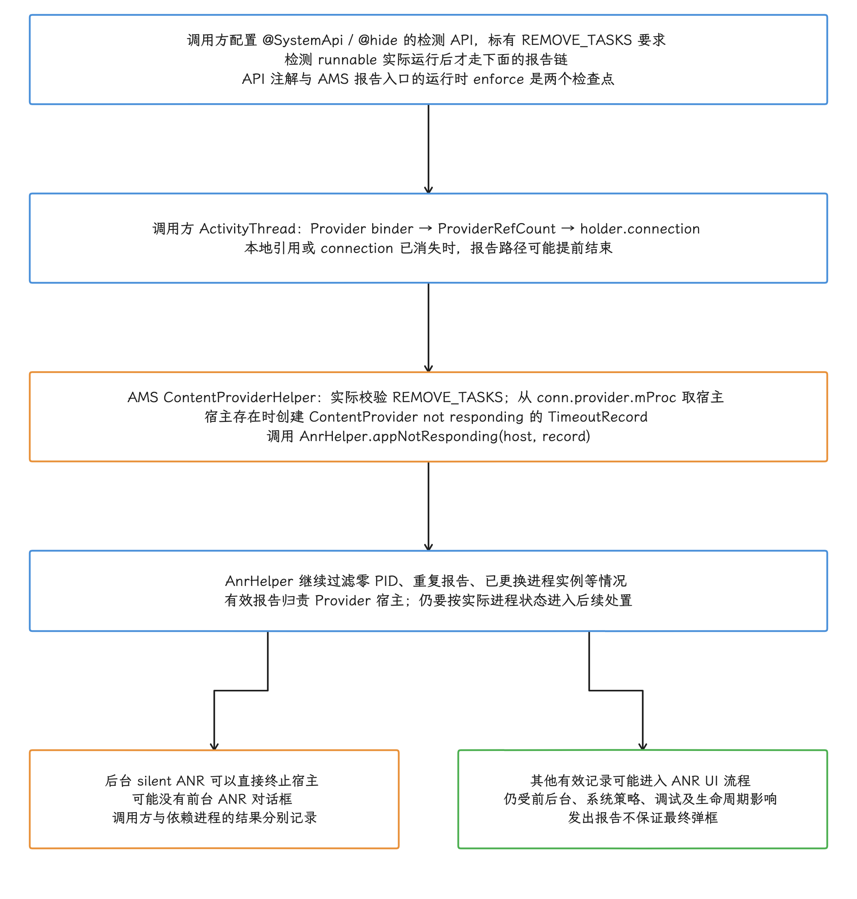
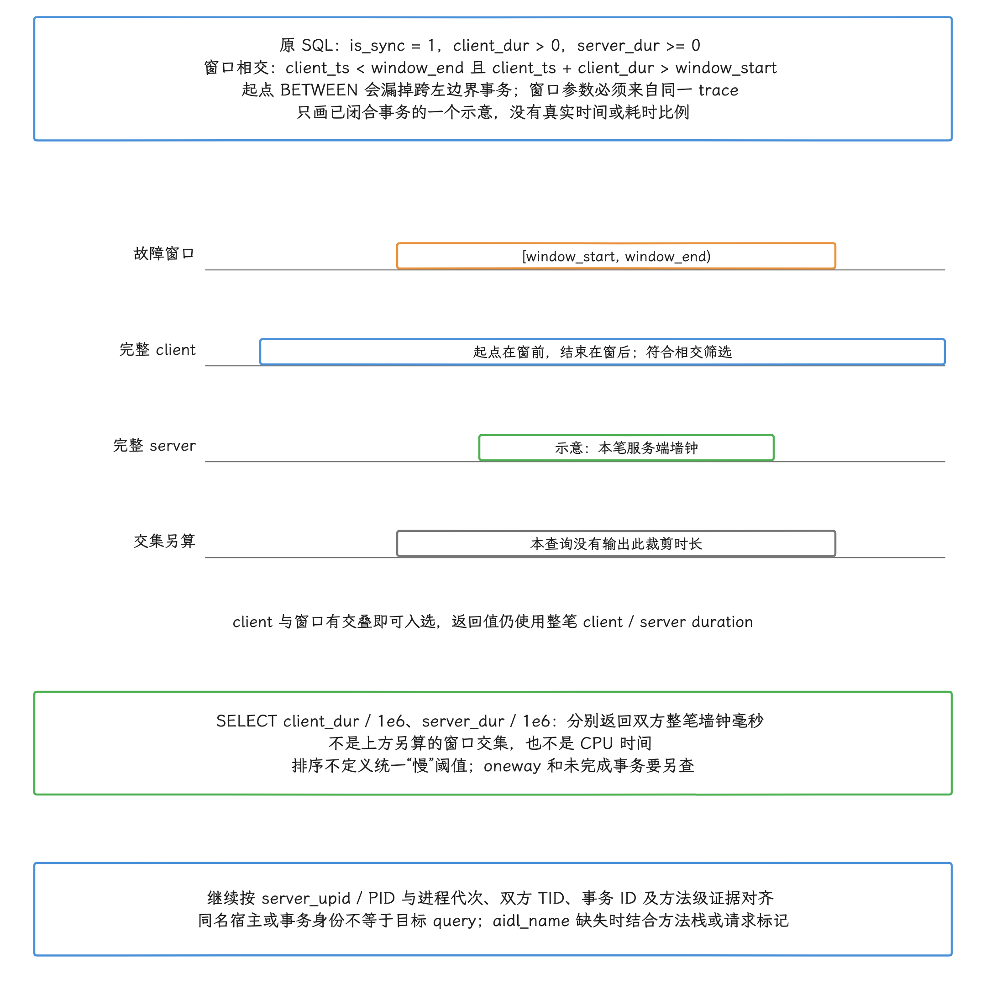

# ContentProvider 超时与 ANR 四路径

ContentProvider 相关卡死至少涉及四条超时路径，其中只有一条会直接对 Provider 宿主进程发起 ANR 处理：

1. 已 attach（连接到 `system_server`）的进程没有按期发布 Provider：系统以初始化失败为由移除宿主进程。
2. 获取方等待 Provider ready（完成发布）到期：系统结束本次获取或唤醒等待者。
3. `ContentResolver` 等待异步回调到期：调用返回空结果或进入错误处理。
4. 特权调用方启用 `ContentProviderClient.setDetectNotResponding()`，远程调用超过调用方配置的期限：Provider 宿主进入 `AnrHelper` 的 ANR 处理流程。

“Publish 超时”和“ContentProvider not responding”这两条日志都带 ContentProvider 字样，光看字面分不清处理对象。我们排查时先把触发入口定下来，再顺着入口去看 Provider 的 `onCreate()`、Binder 线程或数据库栈——四条路径的处理对象、计时起点和退出原因各不相同。


> 源码基线：AOSP `android-17.0.0_r1`。

ContentProvider 的发布、引用计数和 Binder Transport 结构见 [§1.15 ContentProvider 性能与优化](../../part1-fundamentals/ch01-architecture/15-content-provider.md)；通用 ANR 分析流程见 [§9.2 ANR 分析方法](02-anr-kernel-trace-diagnosis.md)。

## 1. 四个常量，四种语义

四个常量都定义在 `ContentResolver`，但生效层次各不相同：有的挂在 AMS Handler（ActivityManagerService 的消息处理器）的延迟消息上，有的只是应用侧单次等待的参数；到期动作也不一样——四条预算里没有一条直接产生 ANR，能做到这一点的只有表里第五行的 call detector。

我们先用一段源码确认四个预算之间的计算关系：

```java
public static final int CONTENT_PROVIDER_PUBLISH_TIMEOUT_MILLIS =
        10 * 1000 * Build.HW_TIMEOUT_MULTIPLIER;

public static final int CONTENT_PROVIDER_READY_TIMEOUT_MILLIS =
        CONTENT_PROVIDER_PUBLISH_TIMEOUT_MILLIS
        + 10 * 1000 * Build.HW_TIMEOUT_MULTIPLIER;

private static final int CONTENT_PROVIDER_TIMEOUT_MILLIS =
        3 * 1000 * Build.HW_TIMEOUT_MULTIPLIER;

private static final int REMOTE_CONTENT_PROVIDER_TIMEOUT_MILLIS =
        CONTENT_PROVIDER_READY_TIMEOUT_MILLIS
        + CONTENT_PROVIDER_TIMEOUT_MILLIS;
```

默认倍率为 1 时，它们依次是 10 秒、20 秒、3 秒和 23 秒。这里的“预算”指延迟消息或单次等待使用的参数，`HW` 是 `HW_TIMEOUT_MULTIPLIER` 的缩写。Handler 到期后的实际执行还受队列、调度和 uptime 时钟影响；`wait()` 也可能被回调、打断或虚假唤醒提前结束。所以我们把这些值当作各阶段的等待参数就好，要估一次调用的总墙钟耗时，队列和调度还要另外算进去。

| 预算 | 起点与等待对象 | 到期动作 | 会直接进入 `AnrHelper` |
|---|---|---|---|
| publish，`10s × HW` | Provider 宿主 attach 后，等待该进程发布 launching providers（正在启动的 Provider） | 以 `REASON_INITIALIZATION_FAILURE` 移除宿主进程 | 否 |
| ready，`20s × HW` | 获取方等待正在启动的 Provider 发布 | 向当前等待连接回报发布失败；未取得 Provider 的获取返回 `null` | 否 |
| connected callback，`3s × HW` | 已连接 Provider 的 `getTypeAsync()`、`canonicalizeAsync()` 等回调 | 结束等待并按调用点返回或抛错 | 否 |
| remote callback，`23s × HW` | 经 `system_server` 获取 MIME type 等异步结果 | 结束等待，并由调用点返回空结果或错误 | 否 |
| call detector（调用卡死检测器），调用方配置 | `ContentProviderClient` 的一次远程操作 | 对 Provider 宿主发起 `ContentProvider not responding` ANR | 是 |


四个固定预算和 call detector 相互独立，各管各的计时。还有一种情况容易看混：调用方在主线程等待 Provider ready 时，先到期的可能是它自己的输入期限，此时发生的是调用方的输入 ANR，ANR subject（被记录为事件主体的进程）仍是调用方进程；Provider 宿主的责任，要等我们把路径分清之后再谈。

## 2. `HW_TIMEOUT_MULTIPLIER` 的边界

上一节的四个固定预算都乘这个倍率。它的定义是：

```java
public static final int HW_TIMEOUT_MULTIPLIER =
        SystemProperties.getInt("ro.hw_timeout_multiplier", 1);
```

它是整数，默认值为 1。源码注释写明，它是给速度远低于真机的软件模拟器准备的，真机和硬件加速虚拟设备保持默认即可。这段 r1 实现没有按 Android Performance Class（设备性能等级）自动换算，也没有定义统一的 1.5 倍档位。

我们可以在测试设备上直接读这个属性：

```bash
adb shell getprop ro.hw_timeout_multiplier
```

空值按 `Build` 中的默认值 1 解释；若输出 2，publish、ready、connected callback 和 remote callback 就分别变成 20、40、6、46 秒。


## 3. Publish guard：初始化失败清进程

我们按计时起点、批量发布、到期动作和取证四步，把这条路径走一遍。

### 3.1 计时从 attach 开始

AMS 启动承载 Provider 的进程后，先把对应的 `ContentProviderRecord` 放入 `mLaunchingProviders`。接下来 `ActivityManagerService.attachApplicationLocked()` 处理 attach：系统为该进程生成 Provider 列表，列表非空、该进程又仍在 launching-provider 集合中，才会在 `bindApplication()` 之前发送一条延迟消息：


- message：`CONTENT_PROVIDER_PUBLISH_TIMEOUT_MSG`；
- `what`：57；
- delay：`CONTENT_PROVIDER_PUBLISH_TIMEOUT_MILLIS`；
- `obj`：宿主 `ProcessRecord`。

这个 10 秒参数从 attach 处理内实际发送该消息的位置开始计时，Zygote fork（由 Zygote 创建应用进程）到 attach 之前的时间都算在参数之外；attach 的入口日志只能证明流程开始了，精确的 timer 安装时刻以消息发送位置为准。参数覆盖的是 attach 之后的 `bindApplication` 准备、Application 实例创建、Provider 安装及各 Provider 的 `onCreate()`。

普通、非 restricted-backup 启动且有 Provider 列表时，`ActivityThread.handleBindApplication()` 的顺序如下：

1. 创建 Application 对象；
2. `installContentProviders()` 顺序安装 Provider，并调用每个 Provider 的 `onCreate()`；
3. `publishContentProviders()` 把 holder 列表交给 AMS；
4. 随后才调用 `Application.onCreate()`。

所以一次普通启动里，Provider 全部发布成功之后，AMS 已移除该进程的 publish guard（发布保护计时器），随后执行的 `Application.onCreate()` 都在这段预算之外；更早的 Application 类加载、构造、attach 和 bind 初始化仍可能消耗这段预算。另外，Provider 已发布后，远程 query 可能与尚未结束的 `Application.onCreate()` 并发，这部分时间会计入远程调用等待。

<!-- gracker-diagram: ed09-06-publish-guard-lifecycle -->


图：普通非restricted-backup且有Provider列表的启动中，AMS在attach处理内确认非空列表且仍有launching provider后，在bindApplication前发送message57；10s×HW从发送处计时，fork到attach不在参数内，Handler实际执行还受uptime/队列/调度影响。成功路径先创建Application对象、逐个安装/onCreate、收齐holder后一次publish，成功发布并移除guard后才执行Application.onCreate；实际安装顺序不承诺清单文本顺序。App.onCreate虽在publish预算外，仍可与已发布Provider的远程query并发。另一后继只在guard尚未撤销且消息实际执行时清理launching/连接并移除宿主，reason为INITIALIZATION_FAILURE、subreason为UNKNOWN，不走AnrHelper；符合条件的stable依赖客户端可能另以DEPENDENCY_DIED退出。

### 3.2 多个 Provider 共用一次 publish

`installContentProviders()` 逐个安装清单中的 Provider，把成功安装的 holder（包含 Provider 及连接信息的容器）收进列表，最后调用一次 `IActivityManager.publishContentProviders()`。于是整批 Provider 共用一次发布机会：排在前面任何一个 `onCreate()` 卡住，后面的 Provider 就装不下去，整批 holder 也发布不出去。


常见阻塞点包括：


- Provider `onCreate()` 中同步打开或迁移数据库；
- 文件锁、进程锁或跨进程 Binder 循环等待；
- 主线程文件 I/O、资源解压和 page fault（缺页异常）；
- SDK 自动初始化器之间的依赖或递归获取 Provider；
- 等待一个尚未启动的业务 executor（执行器）、Future（异步结果）或 CountDownLatch（计数等待器）。

网络请求要留在 `onCreate()` 之外：即使某台设备上的网络栈很快，外部时延和失败重试也会超出 Provider 发布期限能容纳的范围。

### 3.3 到期动作

message 57 到期后，AMS 调用 `ContentProviderHelper.processContentProviderPublishTimedOutLocked()`，它要做的事情是：


1. 清理该进程仍占用的 launching-provider（正在启动）状态；
2. 调用 `removeProcessLocked()`；
3. exit reason（退出主原因）记为 `ApplicationExitInfo.REASON_INITIALIZATION_FAILURE`；
4. subreason（细分原因）使用 `SUBREASON_UNKNOWN`；
5. 描述为 `timeout publishing content providers`。

这条发布超时路径只做清理：`mAnrHelper.appNotResponding()` 不会被调用，也不会直接生成 `ContentProvider not responding` ANR 或进入它的对话框流程。清理 Provider 连接时，符合条件的 stable 依赖客户端还可能以 `REASON_DEPENDENCY_DIED` 被终止，这属于依赖进程终止，记录上与客户端 ANR 是两类结果。进程退出后是否有用户可见界面，取决于前台状态和上层启动场景。

### 3.4 如何取证

应用下次启动后，我们可以查询自己的历史退出原因。下面的 Kotlin 代码只筛选初始化失败候选记录；这个 reason 还可能来自其他初始化失败，认定 publish timeout 还要结合后续的交叉信息：

```kotlin
val activityManager =
    context.getSystemService(ActivityManager::class.java)

val initializationFailures =
    activityManager.getHistoricalProcessExitReasons(
        context.packageName,
        0,
        32
    ).filter {
        it.reason == ApplicationExitInfo.REASON_INITIALIZATION_FAILURE
    }

initializationFailures.forEach { exit ->
    Log.i(
        "ProviderExit",
        "process=${exit.processName}, time=${exit.timestamp}, " +
            "description=${exit.description}"
    )
}
```

`description` 属于诊断信息，格式可能变化。识别 publish timeout 时，把同一时段的 `ActivityManager` 日志、Provider authority（唯一标识 Provider 的名称）、进程 attach 和 `bindApplication` trace 放在一起看。


## 4. Ready timeout：获取失败，不是 Provider ANR

当调用方请求一个尚未发布的远程 Provider 时，AMS 可以先返回 `provider == null` 的 `ContentProviderHolder`。`ActivityThread.acquireProvider()` 在 holder 非空、provider 为空且走远程路径时，进入 `ProviderKey.mLock`；发布回报尚未收到，就用 `CONTENT_PROVIDER_READY_TIMEOUT_MILLIS` 做一次 `wait()`，随后重新检查 holder。已经存在的 Provider 和本地路径会跳过这次等待；进入等待分支要求 AMS 返回的 holder 非空、其中 provider 为空，且尚未收到发布回报。20 秒乘 HW 是这一次 wait 的参数，回报也可能先到或提前唤醒，不能画成固定等待时长。


system_server 同时为该 `ContentProviderRecord` 安排 `WAIT_FOR_CONTENT_PROVIDER_TIMEOUT_MSG`：

- `what`：73；
- delay：`20s × HW_TIMEOUT_MULTIPLIER`；
- 到期：`onProviderPublishStatusLocked(false)`，经连接向仍在等待的客户端回报发布失败；它不负责移除宿主的 publish guard。

应用侧等待结束后若 holder 仍为空，`acquireProvider()` 记录 `Failed to find provider info` 并返回 `null`；shell 等 external client（外部调用方）的特殊路径则在 `system_server` 内等待同一 ready 预算，到期后写入 `Timeout waiting for provider`，同样返回 `null`。

<!-- gracker-diagram: ed09-06-ready-client-handshake -->


图：应用支路仅展开AMS返回非空holder而provider为空的远程获取；已有Provider和本地路径不强制走此wait，不把这个提前返回holder的条件套给external。应用进入ProviderKey.mLock先检查发布回报，已收到可跳过wait，否则做一次20s×HW等待，再重查holder决定继续安装或记录Failed to find provider info并返回null。发布成功或message73失败回报可早于wait，更新mHolder并notifyAll，图中向上的虚线是独立回报关系，不是固定先等后回；回报不移除宿主publish guard。external特殊路径在system_server内等待同一ready预算，失败记Timeout waiting for provider并返回null。两路均不因本次获取失败直接发起宿主ANR；它们与message73、publish guard各自起点见后续独立时钟图。

Ready 参数比 publish 参数多 `10s × HW`，源码只要求前者更长。两条消息与应用的本地 wait 各自安装、各自计时，进程启动、消息队列和调度都会推迟实际处理，我们按时间线核对两条到期动作的先后即可，发布超时清理未必先于 ready wait 发生。Ready 失败回报本身也只做回报，等待方和 Provider 宿主都不会因此进入 `AnrHelper`。

<!-- gracker-diagram: ch09-06-11-independent-deadlines -->


图：条长不表示固定比例；较晚attach、队列或调度延迟均可能改变实际到期处理先后。

这里还有一个同时运行的计时器：调用方在 UI 线程同步执行 `ContentResolver.query()` 时，ready timeout 尚未到达，输入事件、Service 或 Broadcast 的期限可能先到，发生的是调用方 ANR，栈中常见 `ActivityThread.acquireProvider()`、`Object.wait()` 或 AMS Binder 调用。我们把这类栈归因为“调用方主线程同步等待 Provider 发布”，与 call detector 触发的 Provider ANR 分开记录。

<!-- gracker-diagram: ch09-06-13-caller-anr -->


图：两个等待同时存在不证明哪一个必先触发；按输入连接、组件回执、PID与时间核对detector。

## 5. Async callback timeout：结果降级

`CONTENT_PROVIDER_TIMEOUT_MILLIS` 对应表里的 connected callback，管的是已取得 Provider 之后的短异步回调，例如：

- `getTypeAsync()`；
- `canonicalizeAsync()`；
- `uncanonicalizeAsync()`。

`REMOTE_CONTENT_PROVIDER_TIMEOUT_MILLIS` 对应表里的 remote callback，用于通过 ActivityManager 异步获取远程 MIME type 等结果，预算在 ready timeout 之上再加 3 秒回调等待。


`ResultListener.waitForResult()` 在尚未完成时做一次带 timeout 的等待；超时还没等到结果，通常读到 `null`，回调记录的异常再由各调用点传播或捕获。`getType()` 会捕获并降级多类异常，`canonicalize()` / `uncanonicalize()` 的异常处理不同。这段等待不会主动取消远端操作，也没有调用 `appNotRespondingViaProvider()`。3 秒或 23 秒只覆盖这一段等待，前面的 Provider 获取、请求发送和调度另有耗时；trace 中出现这类等待，只能说明调用方曾进入等待阶段；正常回调、打断或虚假唤醒都可能让它提前结束。是否确实等到预算、结果是否缺失，以及宿主是否异常，还要结合回调状态、日志和其他证据判断。

<!-- gracker-diagram: ch09-06-15-callback-result -->


图：图不承诺恰好等待3或23秒；获取Provider、请求发送和调度可能增加完整调用耗时。

## 6. Call hang detector：由特权调用方开启

detector 由特权调用方开启，我们依次看它的权限与计时方式、AMS 的归责路径，以及取消感知变体。

### 6.1 API 权限与计时方式

`ContentProviderClient.setDetectNotResponding(long)` 是 `@SystemApi`、`@hide`，并要求 `android.permission.REMOVE_TASKS`；对普通 SDK 应用来说，它算不上公开的 CRUD（增、删、改、查）通用 timeout API。期限由调用方传入，`HW_TIMEOUT_MULTIPLIER` 在这里不起作用；向 AMS 报告时，`ContentProviderHelper.appNotRespondingViaProvider()` 还会检查 `REMOVE_TASKS`——注解标在 API 上，权限校验发生在报告入口，这两件事我们分开看。


启用后，`ContentProviderClient` 的远程方法经 `execute()` 包装：


1. `beforeRemote()` 把 `NotRespondingRunnable` 延迟投递到调用方进程的 main looper（主线程消息循环）；
2. 当前线程执行 Binder 调用；
3. 远程操作正常返回或抛出异常后，`finally` 中的 `afterRemote()` 移除尚未执行的检测 runnable；
4. runnable 到期执行时，调用 `ContentResolver.appNotRespondingViaProvider()`。

`NotRespondingRunnable` 通过 main looper 的异步 `Handler` 投递；async 允许越过同步屏障，任务仍在主线程上执行。这就带来一个约束：主线程自己阻塞在远程调用里时，detector 同样跑不起来，此时调用方是否 ANR，取决于它的输入或组件期限。所以系统组件要让 main looper 保持可调度，并把被监控调用放到 worker（工作线程）执行。


固定检测的起点在 `beforeRemote()` 投递处；可取消操作随后还会准备远端 cancellation transport，再执行实际操作。注意 `ContentProviderClient` 的检测 runnable 是客户端对象的共享字段，多个并发调用未必各有独立的 timer；同一个 client 的并发使用、重新配置与关闭，要按接口约束和目标源码核对。

> ⚠️ 矛盾：官方诊断页把 Provider 查询的冷启动概括为 ANR 预算的一部分，并将配置者表述为 Provider；本版本 setter 与 timer 位于调用方 client。`acquireContentProviderClient()` 先获取 Provider、再创建 client，因此获取 client 前的 ready wait 不会自动纳入随后 `beforeRemote()` 的固定期限。冷启动仍可能通过发布后尚未结束的初始化或共享依赖影响远程调用，诊断应分段计时。

<!-- gracker-diagram: ed09-06-fixed-detector-lifecycle -->


图：只示一次启用fixed且main可调度的调用，取消感知分支另见后图。acquireContentProviderClient先获取Provider再构造client，所以此前cold/ready等待不追溯计入随后beforeRemote固定参数；发布后尚未结束的初始化或共享依赖仍可影响远程操作。beforeRemote先把共享检测runnable延迟投递到main异步Handler，可取消操作随后还可能准备transport再实际调用。worker远程操作返回或抛错都经finally afterRemote移除pending检测；虚线表示与检测执行竞态，已经发出的报告撤不回。async只越过同步屏障，main自己阻塞在远程调用时检测也跑不起来；调用方ANR仍由自己的deadline判断。参数由调用方配置、不乘HW且不保证硬墙钟执行，同client并发、重新配置和关闭需另审；宿主报告不主动结束原Binder。

### 6.2 AMS 如何找到被归责进程

`ActivityThread.appNotRespondingViaProvider()` 沿着 Provider binder 找到本进程持有的 `ProviderRefCount`（引用计数记录），再把 holder 中的 connection（跨进程连接）传给 AMS。`ContentProviderHelper.appNotRespondingViaProvider()` 随后执行：


1. 校验调用方具有 `REMOVE_TASKS`；
2. 从 `ContentProviderConnection` 取出 `conn.provider.mProc`；
3. 创建 reason（超时原因）为 `ContentProvider not responding` 的 `TimeoutRecord`；
4. 调用 `mAnrHelper.appNotResponding(host, timeoutRecord)`。

这条报告路径归责的目标是 Provider 宿主；发起报告并不会主动结束调用方的原 Binder 操作，报告与调用返回仍可能竞态。Provider 引用已消失、connection 为空或宿主记录不存在时，前面的路径可能就此不再报告；`AnrHelper` 还会过滤零 PID、重复或已换进程实例的记录。后续处置看前台、后台和系统设置：后台 silent ANR（不显示前台 ANR 对话框的处理）可以直接终止进程，前台记录则可能进入 ANR UI——会不会弹框，要按当时的场景写。

<!-- gracker-diagram: ed09-06-privileged-host-report -->


图：API标注SystemApi/hide及REMOVE_TASKS要求，实际权限enforce在ContentProviderHelper的报告入口，不能把注解当setter入口已经校验。runnable实际运行发报告后，调用方从Provider binder找到ProviderRefCount及holder.connection，AMS经conn.provider.mProc定位宿主并创建ContentProvider not responding TimeoutRecord交AnrHelper；引用/connection/宿主可能已消失，AnrHelper还过滤零PID、重复与进程实例变化。有效报告归责宿主，后台silent ANR可以直接终止而无前台对话框，其他记录可能进入UI，具体按状态/系统策略/调试/生命周期核对。报告不主动完成原Binder操作，报告时原调用也可能已经返回；调用方和稳定依赖进程结果分别记录。

### 6.3 Android 17 的 cancellation-aware（取消感知）变体

Android 17 源码还包含受 feature flag（功能开关）控制的 `setDetectNotRespondingOnCancel(fixed, onCancel)`：

- 未传入 `CancellationSignal`，或 on-cancel timeout 未启用时，使用已启用的 fixed timeout；仅有可取消方法签名并不够。
- 传入非空 signal 且 on-cancel timeout 启用时，不再投递该次调用的 fixed 检测。
- 包装 signal 的 listener 先调用 `innerSignal.cancel()`，返回后才把 on-cancel 检测投递到 main handler；它不保证从外部 `cancel()` 入口就开始精确倒计时。
- 检测 runnable 实际运行后，走同一宿主 ANR 报告路径；报告一旦执行，`afterRemote()` 也撤不回它。

<!-- gracker-diagram: ch09-06-22-cancel-choice -->


图：fixed参数也必须大于0才有对应检测；示意不把没有取消信号的操作画成自动无限等待。

<!-- gracker-diagram: ch09-06-23-cancel-order -->


图：起点不是外部cancel入口的硬保证；ICancellationSignal.cancel为oneway，取消传播与真正停止仍由远端协作完成。

旧的 `setDetectNotResponding(fixed)` 在对应 flag 启用时委托给新方法，并把 on-cancel timeout 设为 0，从而保留固定期限语义。另有 `CallNotCancelledRunnable` 诊断任务，默认延迟 6 小时，只写错误日志，不调用宿主 ANR 报告；它与 on-cancel 检测共享配置和清理流程，但不是第三个杀进程期限。系统应用要核对目标 build 的 flag、实际传入 signal 和配置，只看 API 37 还不够。


## 7. 诊断决策表

| 证据 | 对应路径 | 被处理对象 | 下一步 |
|---|---|---|---|
| exit reason 为 `INITIALIZATION_FAILURE`，描述含 publish timeout | publish guard | Provider 宿主 | 看 attach→publish、各 `onCreate()` |
| `Failed to find provider info` 或 `Timeout waiting for provider` | ready wait | 本次获取 | 看进程启动、publish status 与调用线程 |
| 调用返回 `null`，窗口约 3/23 秒 | async callback wait | 本次 API 调用 | 看 callback 是否回送、是否有 `RemoteException` |
| ANR subject 为 `ContentProvider not responding` | call detector | Provider 宿主 | 看 detector 配置方、Binder call 与宿主线程 |
| 调用方 ANR，栈在 `acquireProvider()` | 调用方其他 deadline | 调用方 | 查主线程同步获取与对应 ANR 类型 |
| 同期 Binder 线程全忙，目标 query 尚无开始证据 | 线程池饱和候选；仍需确认是否启用 detector | Provider 宿主及等待调用方 | 先确认 trace 覆盖，再追事务队列、嵌套同步调用与各线程占用 |

这张表里的日志字符串来自 Android 17 AOSP，厂商可能修改文案；退出原因、ANR reason、PID 和源码路径比单条日志更稳定，我们交叉核对时以后者为准。


## 8. Perfetto 怎么看

拿到 trace 之后，切入点按路径选：publish 路径先看宿主的启动段，call hang 路径先看宿主的 Binder 线程，入口字符串最后再做交叉核对。

### 8.1 Publish 路径

采集至少包含：

- `am`、`binder_driver`、`sched`、`freq`；
- 目标进程的 atrace app category（应用自定义 trace 标记）；
- `linux.process_stats`（进程与线程信息）；
- 按需加入 disk、reclaim（内存页回收）和 CPU sampling（定期采样调用栈）。

我们先在 Provider 宿主主线程上定位 `bindApplication`，再展开到 Provider 类名、`installProvider` 或 `onCreate()`。下面的 SQL 用于列出目标进程中与启动和 Provider 相关的 thread slice（带起止时间的线程事件片段）：


```sql
SELECT
  process.upid,
  process.pid,
  process.name AS process_name,
  thread.utid,
  thread.tid,
  thread.name AS thread_name,
  slice.id AS slice_id,
  slice.ts,
  slice.dur / 1e6 AS dur_ms,
  slice.name
FROM slice
JOIN thread_track ON slice.track_id = thread_track.id
JOIN thread USING (utid)
JOIN process USING (upid)
WHERE process.name = 'com.example.provider'
  AND slice.dur >= 0
  AND (
    slice.name GLOB '*bindApplication*'
    OR slice.name GLOB '*Provider*'
    OR slice.name GLOB '*provider*'
  )
ORDER BY slice.ts;
```

本查询保留已结束及零时长区间，排除 `dur=-1` 未结束项；要分析仍在挂起的区间，按 §9.2 的观测窗口裁剪。包名和 section 名只是检索入口，实例身份要靠 upid/utid、PID/TID 与时段确认，名称过滤也可能命中无关代码。用户未给每个 Provider 打标时，结果可能只有 framework（系统框架）阶段，此时用调度、CPU sampling、文件事件与启动日志补足；空白区间要用这些来源解释，凭它猜耗时没有依据。


### 8.2 Call hang 路径

Call detector 的有效报告进入标准 ANR 处理流程。相应信息开关开启、`anrInfo` 非空且 trace 采到 `debug.anr` 类别时，我们可以搜索 `ANR Detected`。这个 instant（瞬时事件）携带 pid、anrId、errorId、anrTimeoutMs 等字段，Provider reason 要另外关联：按身份和时间对上报告中的 `ContentProvider not responding`，再确定分类，instant 名字本身给不出这个信息。分析重点在 Provider 宿主：


- main 线程是否仍在 `Application.onCreate()`；
- Binder 线程是否进入 `ContentProvider$Transport.query/insert/call`；
- 目标 Binder 线程在 Running（正在执行）、R（等待 CPU）、S（可中断睡眠）、D（不可中断睡眠）中各持续多久；
- 是否等待数据库锁、文件 I/O、另一个 Binder 服务或主线程；
- 全部 Binder 线程是否被同步事务占满。


主机侧 Perfetto 工具支持 Binder 标准查询库时，下面的查询按总墙钟耗时排列目标宿主已结束的同步调用，并纳入与半开窗口相交的事务。示例时间戳必须替换为同一 trace 的故障窗口；本查询没有设置统一的“慢”阈值，需按接口约定和具体场景判断：

```sql
INCLUDE PERFETTO MODULE android.binder;

WITH params AS (
  SELECT
    123000000000 AS window_start,
    143000000000 AS window_end
)
SELECT
  binder_txn_id,
  binder_reply_id,
  client_upid,
  client_pid,
  client_utid,
  client_tid,
  client_process,
  client_thread,
  server_upid,
  server_pid,
  server_utid,
  server_tid,
  server_process,
  server_thread,
  client_ts,
  server_ts,
  client_dur / 1e6 AS client_wall_ms,
  server_dur / 1e6 AS server_wall_ms,
  aidl_name
FROM android_binder_txns
CROSS JOIN params
WHERE server_process = 'com.example.provider'
  AND is_sync = 1
  AND client_dur > 0
  AND server_dur >= 0
  AND client_ts < params.window_end
  AND client_ts + client_dur > params.window_start
ORDER BY client_dur DESC;
```

<!-- gracker-diagram: ed09-06-binder-window-and-whole-duration -->


图：同坐标轨道仅示一个已闭合同步事务，client跨窗口两端而server位于其内，没有实测时间或耗时比例。原SQL用is_sync=1、client_dur>0、server_dur>=0及client_ts<window_end、client_ts+client_dur>window_start筛选，server零时长允许；仅按起点BETWEEN会漏跨左事务。返回client_dur/server_dur是双方整笔墙钟毫秒，第四轨道窗口交集要另算，CPU时间也另查，排序未定义统一慢阈值。oneway/未完成事务排除，示例时间戳需替换为同trace故障窗口；继续按server_upid/PID代次、双方TID和事务ID对齐，并结合方法栈或请求标记确认目标query，不能用同名宿主或事务身份代替方法级证据。

查询返回整笔已结束事务的 client/server（调用方/服务端）墙钟时长，窗口内裁剪时长和 CPU 时间都要另行计算；同名宿主可能有多个进程实例，应继续按 server_upid/PID 筛定。oneway 与未完成事务被排除在外，它们的积压情况要换别的查询确认。`aidl_name` 能否解析出 `IContentProvider` 方法，取决于 trace 与解析器；方法名缺失时，仍可用事务 ID、双方 PID/TID、调度和栈追踪关联事务；认定它就是目标 query，还需要对应方法栈、请求标记或其他方法级证据，事务身份和宿主进程名本身不说明调用了哪个方法。


### 8.3 `am_anr` 字符串 SQL 的局限

`am_proc_died`、`am_anr` 会不会以 slice 名出现，受 atrace、EventLog 导入、Perfetto parser（解析器）和厂商实现影响；只用 `slice.name LIKE '%am_anr%'` 同时完成事件发现和原因判断，很容易漏报或误报。

更稳定的入口是：


1. `ApplicationExitInfo` 或系统 EventLog 确认退出类型；
2. Android 17 的 `ANR Detected` instant 与 ANR reason 确认 call detector；
3. PID、process start/attach/publish 时序确认宿主；
4. Binder flow（跨线程事务关联）和线程状态解释耗时。

## 9. 修复策略

修复也分两条走：publish 侧让发布按时完成，call 侧让远程调用尽快返回、线程池保持可用。

### 9.1 Publish 超时

- 记录每个 Provider `onCreate()` 的开始、结束和 authority，定位这一批 Provider 中最早卡住的位置。
- 把数据库 migration（结构迁移）、全量索引、网络和大文件扫描移出 publish 路径。
- 必须延迟初始化的资源要定义线程安全的就绪状态；若只把初始化挪到后台，首个 query 仍同步等它完成，延迟只会转移到远程调用阶段。
- 检查 Provider 之间的相互查询、文件锁和 SDK 初始化依赖，避免启动阶段形成循环等待。
- 为独立进程 Provider 单独测量 attach→publish；把 Provider 放到独立进程可隔离主进程的这部分初始化成本，但远程 Provider 自己的 publish guard 仍会计时；其他跨进程依赖成本需另外测量。


Jetpack App Startup 通过一个 `InitializationProvider` 发现多个 initializer（初始化器）。在 applicationContext 可用的常见路径，它的 `onCreate()` 调用 `discoverAndInitialize()`，依赖先递归初始化，再同步执行各 initializer 的 `create()`；applicationContext 为空的特定情况会延后初始化。该常见路径中的依赖发现和 create 仍在 publish 路径上同步执行，合并组件数量并不会自动把它们移到后台；耗时过长的 initializer、错误依赖图和同步 I/O 仍会阻塞整批 publish。“每合并一个 Provider 固定节省若干毫秒”这类跨设备承诺，我们不给。


### 9.2 Provider call hang（远程调用卡死）

- query 先缩小 projection（返回列）、selection（筛选条件）和返回行数，避免在 Binder 线程扫描数量不受限制的数据。
- 把数据库 migration 与 query 分开，明确数据库锁的持有范围。
- 不在 Provider Binder 线程中同步等待主线程；主线程也不要反向等待同一 Binder 线程。
- 限制嵌套同步 Binder，保留线程池处理新请求的能力。
- 支持 `CancellationSignal` 的操作应及时传播到数据库、文件或下游服务。
- 系统调用方配置 detector 时，要保证 main looper 能运行检测 runnable，并把阈值与接口约定、取消语义和误杀成本一起评估。


普通应用要把远程 Provider 调用移出 UI 完成期限，并为 cancellation 与业务结果定义过期协议。业务 timeout 可以让界面停止等结果，已经进入的同步 Binder 却仍在执行——取消是协作请求，还需 Provider、数据库和下游操作响应。反射调用 hidden API（隐藏接口）这条路既不稳定，也会卡在权限校验上；`setDetectNotResponding()` 的作用是让系统对远端宿主发起 ANR，与普通 Future timeout（只结束本地等待的超时）是两种工具，我们选型时要分清。


## 10. 版本结论

截至 Android 17 / API 37：


- publish guard 固定为 `10s × HW_TIMEOUT_MULTIPLIER`，入口是 AMS message 57；
- ready wait 固定为 `20s × HW_TIMEOUT_MULTIPLIER`，AMS message 73 和 `ActivityThread` 等待共同处理发布结果；
- connected/remote callback 预算为 `3s × HW` 和 `23s × HW`，到期不自动触发 ANR；
- `setDetectNotResponding()` 属于受权限保护的 System API，期限由调用方设置；
- cancellation-aware detector 受 Android 17 feature flag 控制；
- Provider ANR 的宿主处置沿 `ContentProviderHelper → AnrHelper → ProcessErrorStateRecord` 执行，后台记录可能没有对话框。

遇到 ContentProvider 相关故障时，我们先把“发布、等待 ready、异步 callback、call detector”四条路径分开，再讨论优化。10 秒常量或一行 `ContentProvider` 日志能给出的判断依据很有限——被处理的是调用方还是 Provider 宿主，要靠上面的路径核对才能确定。

## 参考资料

- [Android Developers：Content provider not responding](https://developer.android.com/topic/performance/anrs/diagnose-and-fix-anrs#content-provider-not-responding)
- [AOSP android-17.0.0_r1：ContentResolver](https://android.googlesource.com/platform/frameworks/base/+/refs/tags/android-17.0.0_r1/core/java/android/content/ContentResolver.java)
- [AOSP android-17.0.0_r1：ContentProviderClient](https://android.googlesource.com/platform/frameworks/base/+/refs/tags/android-17.0.0_r1/core/java/android/content/ContentProviderClient.java)
- [AOSP android-17.0.0_r1：ActivityThread](https://android.googlesource.com/platform/frameworks/base/+/refs/tags/android-17.0.0_r1/core/java/android/app/ActivityThread.java)
- [AOSP android-17.0.0_r1：ContextImpl.ApplicationContentResolver](https://android.googlesource.com/platform/frameworks/base/+/refs/tags/android-17.0.0_r1/core/java/android/app/ContextImpl.java)
- [AOSP android-17.0.0_r1：ContentProviderHelper](https://android.googlesource.com/platform/frameworks/base/+/refs/tags/android-17.0.0_r1/services/core/java/com/android/server/am/ContentProviderHelper.java)
- [AOSP android-17.0.0_r1：ActivityManagerService](https://android.googlesource.com/platform/frameworks/base/+/refs/tags/android-17.0.0_r1/services/core/java/com/android/server/am/ActivityManagerService.java)
- [AOSP android-17.0.0_r1：ProcessErrorStateRecord](https://android.googlesource.com/platform/frameworks/base/+/refs/tags/android-17.0.0_r1/services/core/java/com/android/server/am/ProcessErrorStateRecord.java)
- [AOSP android-17.0.0_r1：TimeoutRecord.forContentProvider](https://android.googlesource.com/platform/frameworks/base/+/refs/tags/android-17.0.0_r1/core/java/com/android/internal/os/TimeoutRecord.java)
- [AOSP android-17.0.0_r1：Build.HW_TIMEOUT_MULTIPLIER](https://android.googlesource.com/platform/frameworks/base/+/refs/tags/android-17.0.0_r1/core/java/android/os/Build.java)
- [AOSP android-17.0.0_r1：PerfettoCategories.ANR_CATEGORY](https://android.googlesource.com/platform/frameworks/base/+/refs/tags/android-17.0.0_r1/core/java/android/os/PerfettoCategories.java)
- [§9.1 ANR 类型与触发条件](01-anr-mechanism-types-triggers.md)
- [§9.2 ANR 分析方法](02-anr-kernel-trace-diagnosis.md)
- [§9.2 ANR 与 Kernel Trace 联合诊断](02-anr-kernel-trace-diagnosis.md)

- [ContentProvider.java：本次核对的实现边界](https://android.googlesource.com/platform/frameworks/base/+/android-17.0.0_r1/core/java/android/content/ContentProvider.java)
- [ContentProviderNative.java：本次核对的实现边界](https://android.googlesource.com/platform/frameworks/base/+/android-17.0.0_r1/core/java/android/content/ContentProviderNative.java)
- [ContentProviderRecord.java：本次核对的实现边界](https://android.googlesource.com/platform/frameworks/base/+/android-17.0.0_r1/services/core/java/com/android/server/am/ContentProviderRecord.java)
- [AnrHelper.java：本次核对的实现边界](https://android.googlesource.com/platform/frameworks/base/+/android-17.0.0_r1/services/core/java/com/android/server/am/AnrHelper.java)
- [Handler.java：本次核对的实现边界](https://android.googlesource.com/platform/frameworks/base/+/android-17.0.0_r1/core/java/android/os/Handler.java)
- [CancellationSignal.java：本次核对的实现边界](https://android.googlesource.com/platform/frameworks/base/+/android-17.0.0_r1/core/java/android/os/CancellationSignal.java)
- [ICancellationSignal.aidl：本次核对的实现边界](https://android.googlesource.com/platform/frameworks/base/+/android-17.0.0_r1/core/java/android/os/ICancellationSignal.aidl)
- [InitializationProvider.java：本次核对的实现边界](https://android.googlesource.com/platform/frameworks/support/+/35d8f1dda494fcd09f52177d9dd54bc65f9929de/startup/startup-runtime/src/main/java/androidx/startup/InitializationProvider.java)
- [AppInitializer.java：本次核对的实现边界](https://android.googlesource.com/platform/frameworks/support/+/35d8f1dda494fcd09f52177d9dd54bc65f9929de/startup/startup-runtime/src/main/java/androidx/startup/AppInitializer.java)
- [binder.sql：本次核对的实现边界](https://android.googlesource.com/platform/external/perfetto/+/android-17.0.0_r1/src/trace_processor/perfetto_sql/stdlib/android/binder.sql)
- [Perfetto SQL 身份、线程与 slice 表](https://perfetto.dev/docs/analysis/sql-tables)
