# Android 17 ANR 预警与 Input pre-ANR

Android 17 / API 37 增加了公开的 ANR warning（预警） API。应用可以向 `ActivityManager` 注册 listener（监听器），在部分 ANR 检测路径接近 deadline（完成期限）时收到 `AnrWarningResult`。

> 源码基线：本章平台实现以 AOSP `android-17.0.0_r1` 为核对版本。

用这个信号之前，我们先记住三件事：

- warning 只表示“某个计时条件已进入预警点”，此时系统还没有宣告 ANR；
- warning 之后走不走得到 ANR，取决于阻塞条件是否在 deadline 前恢复；
- 回调按 best-effort（尽力而为）方式投递，系统可能来不及调用，任务也可能还在 executor（执行器） 里排队，deadline 就先到了。

原计时器照常走，warning 不会让它暂停或延长。所以这个信号适合记录轻量状态，并把 warning 与事后退出记录关联起来；全线程 dump、同步写盘或网络上传这类重活，留给别的时机做。

<!-- gracker-diagram: ch09-07-01-warning-outcomes -->


图：预警不是已发生ANR；没有匹配退出记录也不能单独证明恢复。

ANR 的 timeout 与报告流程见 [9.1 ANR 机制、类型与触发条件](01-anr-mechanism-types-triggers.md)，线程转储和 Perfetto 联合分析见 [§9.2 ANR 与 Kernel Trace 联合诊断](02-anr-kernel-trace-diagnosis.md)。

这条 warning 信号分两层：应用可见的公开回调，以及 Input pre-ANR 路径里 InputDispatcher、WMS 和 AMS 产生并转发预警的过程。

## 公开回调、类型与交付约束

### 1. 公开 API 在 `android.app`

我们先把应用直接接触的类型认一遍，它们都放在 `android.app` 里：

| API | 作用 |
|---|---|
| `AnrTypes` | 结构化 ANR 类型常量 |
| `AnrWarningResult` | warning 的 Parcelable（可跨 Binder 序列化）载荷 |
| `ActivityManager.registerAnrWarningListener()` | 注册 executor 与 listener |
| `ActivityManager.unregisterAnrWarningListener()` | 用同一个 listener 对象注销 |


`IAnrWarningCallback.aidl` 是 ActivityManager 与 AMS（ActivityManagerService）之间的 hidden（隐藏） Binder 接口，应用不需要直接实现它。同一个 `ActivityManager` 实例首次注册 listener 时会创建 Binder stub（接收系统跨进程调用的入口），该实例后续 listener 共用这个 callback。映射和 callback 是实例字段；`ContextImpl` 的服务缓存也按 Context 实例保存，不能把它扩大成整个进程只存在一个 callback。注册、注销应保留同一 `ActivityManager` 与 listener 实例。

<!-- gracker-diagram: ch09-07-03-instance-scope -->


图：应用侧映射是实例字段；系统侧按注册calling UID归组，两种作用域不能混成一个。

这些 API 都在 API 37 加入，接入时要做的事情也清楚：使用 API 37 SDK 编译，并在运行时检查设备版本；`targetSdkVersion >= 37` 在公开文档里没有这条要求。`android-17.0.0_r1` 源码还保留 `@FlaggedApi` 注解：`AnrTypes` 与 `ApplicationExitInfo.AnrInfo` 对应 `Flags.FLAG_INCLUDE_ANR_INFO`，warning callback 相关类与注册方法对应 `Flags.FLAG_ENABLE_ANR_WARNING_CALLBACK`。所以在 AOSP 派生或厂商调试 build（系统构建版本） 上做兼容性验证时，要把源码 flag 状态和运行平台版本一起核对。

### 2. `AnrTypes` 的完整枚举

`AnrTypes` 使用 `@IntDef`，也就是由注解约束取值范围的一组整数常量，按 int 传值使用，Java/Kotlin `enum` 的写法在这里用不上。Android 17 定义了 11 个常量：

| 值 | 常量 | 含义 |
|---:|---|---|
| 0 | `ANR_TYPE_OTHER` | 无法归入其他类型 |
| 1 | `ANR_TYPE_INPUT_DISPATCH_NO_FOCUSED_WINDOW` | 输入派发期间没有 focused window（焦点窗口） |
| 2 | `ANR_TYPE_INPUT_DISPATCH` | 输入事件响应超时 |
| 3 | `ANR_TYPE_BROADCAST_OF_INTENT` | BroadcastReceiver 处理超时 |
| 4 | `ANR_TYPE_START_FOREGROUND_SERVICE` | 前台服务没有按期进入 foreground（前台状态） |
| 5 | `ANR_TYPE_EXECUTE_SERVICE` | Service `onCreate`、`onStartCommand` 或 `onBind` 执行超时 |
| 6 | `ANR_TYPE_CONTENT_PROVIDER_NOT_RESPONDING` | 已连接 ContentProvider 的受监控调用超时 |
| 7 | `ANR_TYPE_APP_TRIGGERED` | 应用主动请求触发 ANR |
| 8 | `ANR_TYPE_FOREGROUND_SHORT_SERVICE_TIMEOUT` | short service 没有按期响应 `onTimeout()` |
| 9 | `ANR_TYPE_JOB_SERVICE_START` | JobService 启动响应超时 |
| 10 | `ANR_TYPE_APPLICATION_START` | 应用启动超时 |

这些常量还用于 `ApplicationExitInfo.AnrInfo`。类型集合覆盖 ANR 分类；至于每一种类型是否都已经接入 warning producer（产生预警的系统路径），要看下一小节核对的实现清单。


#### 2.1 枚举覆盖与预警覆盖要分开

类型常量齐全，只是 API 层面的承诺。要判断哪些类型真的会发出 warning，我们得回到已核对的 `android-17.0.0_r1` 实现。明确发出 warning 的路径有：

| warning producer | `AnrTypes` | 预警点 |
|---|---|---|
| InputDispatcher 等待 focused window | `INPUT_DISPATCH_NO_FOCUSED_WINDOW` | 剩余窗口取 timeout 一半与平台默认 pre-ANR window（预警窗口）中的较长者 |
| Broadcast delivery timer | `BROADCAST_OF_INTENT` | `BroadcastAnrTimer` 运行到 50% split point |
| Service execution timer | `EXECUTE_SERVICE` | `AnrTimer` 运行到 50% split point（计时分割点） |
| short FGS timer | `FOREGROUND_SHORT_SERVICE_TIMEOUT` | `onTimeout()` 通知后启动的剩余 ANR 宽限计时运行到 50% split point |
| start-foreground timer | `START_FOREGROUND_SERVICE` | `AnrTimer` 运行到 50% split point |


InputDispatcher 的 `processPreAnrsLocked()` 在该 tag（源码版本） 中只调用了 `processNoFocusedWindowPreAnrLocked()`，普通 input connection（输入连接） timeout（输入连接超时）也就没有沿这段代码发送 warning。ContentProvider call detector、JobService、application start 和 app-triggered ANR 都有对应常量，但常量只是 API 层面的名字，系统是否真的投递过 warning，要看 producer 实现。

warning 覆盖还受 feature flag（功能开关）与计时器实现影响。统计时应分别保留“最终 ANR 无已记录 warning”“有恢复证据的 warning”和“尚未匹配的 warning”。listener 记录量还受注册、排队和丢弃策略影响，不能直接充当全量 ANR 分母。

### 3. `AnrWarningResult` 只有五项数据

载荷字段在源码和公开 API 中已经确定，我们按 getter 逐个过一遍：

| getter | 语义 |
|---|---|
| `getAnrId()` | 该类型下的 ANR event id（事件标识） |
| `getAnrType()` | `AnrTypes` 中的类型值 |
| `getConsumedMillis()` | producer 回报的已消耗时长，基于 uptime/monotonic，不是绝对时间戳；采样点可能早于 Java 构造与应用接收 |
| `getTimeoutMillis()` | producer 填入的 timeout 时长；与 consumed 的具体起点及最终扩展规则需按路径核对 |
| `getDescription()` | 短诊断描述，格式不稳定 |

载荷里找不到 PID、UID、包名、进程名、组件对象、线程栈、锁状态或 Binder 队列深度。`description` 可能包含 Service component（组件名） 等提示，但 API 明确声明格式可变：拿它做人工分析或辅助聚类可以，要解析成稳定协议就靠不住了。


`anrId` 只保证“在每个 `anrType` 内唯一”。所以设计持久化 key（记录键）时，我们至少使用 `(anrType, anrId)`，再带上用户、应用版本、设备 boot/session（本次开机或应用会话）和本地进程名，免得跨重启或多进程的数据混在一起。


### 4. 注册与注销

下面的 Kotlin 示例用专用单线程 executor 把 warning 复制成小型内存记录，不在回调里遍历全部线程或访问网络：

```kotlin
@RequiresApi(37)
class AnrWarningRecorder(context: Context) : Closeable {
    private val activityManager =
        context.applicationContext.getSystemService(ActivityManager::class.java)
    private val accepting = AtomicBoolean(false)
    private var registered = false
    private var closed = false

    private val executor = ThreadPoolExecutor(
        1, 1, 0L, TimeUnit.MILLISECONDS,
        ArrayBlockingQueue<Runnable>(16),
        ThreadFactory { task -> Thread(task, "anr-warning-recorder") },
        ThreadPoolExecutor.DiscardPolicy()
    )
    private val lastWarning = AtomicReference<WarningSnapshot?>()
    private val listener = Consumer<AnrWarningResult> { result ->
        if (accepting.get()) {
            lastWarning.set(
                WarningSnapshot(
                    type = result.anrType,
                    id = result.anrId,
                    consumedMs = result.consumedMillis,
                    timeoutMs = result.timeoutMillis,
                    description = result.description,
                    callbackUptimeMs = SystemClock.uptimeMillis(),
                    receiverProcess = Application.getProcessName()
                )
            )
        }
    }

    @Synchronized
    fun start() {
        check(!closed)
        if (registered) return
        accepting.set(true)
        try {
            activityManager.registerAnrWarningListener(executor, listener)
            registered = true
        } catch (failure: RuntimeException) {
            accepting.set(false)
            try {
                activityManager.unregisterAnrWarningListener(listener)
            } catch (cleanup: RuntimeException) {
                failure.addSuppressed(cleanup)
            }
            throw failure
        }
    }

    fun latest(): WarningSnapshot? = lastWarning.get()

    @Synchronized
    override fun close() {
        if (closed) return
        closed = true
        accepting.set(false)
        try {
            if (registered) activityManager.unregisterAnrWarningListener(listener)
        } finally {
            registered = false
            executor.shutdownNow()
        }
    }

    data class WarningSnapshot(
        val type: Int,
        val id: Int,
        val consumedMs: Long,
        val timeoutMs: Long,
        val description: String,
        val callbackUptimeMs: Long,
        val receiverProcess: String
    )
}
```

`WarningSnapshot` 是示例自定义的不可变类型；只保留最后一条内存快照，进程退出就会丢失，尚不能完成下节所说的跨启动关联。调用方须在 `SDK_INT >= 37` 的分支内创建和使用此类，并处理平台 API 不可用或注册异常。容量 16 是示例取舍，不是系统阈值：队列满或已关闭时静默丢弃，统计必须允许漏样本。


若 recorder 与进程同寿命，可在 `Application` 初始化时长期保留；短生命周期持有者使用同一实例调用 `close()`。注销不撤回已提交任务，`shutdownNow()` 也不保证中断已执行的回调；接受开关只是减少关闭后的记录，已开始的短任务仍可能完成。需要跨启动诊断时，应另设计经过开销验证的有界持久化流程。


executor 怎么选？官方文档要求避开应用主线程：主线程可能正是被监视的阻塞线程，把回调再次排到主线程会失去预警机会。容易排满的业务线程池同样不适合。

<!-- gracker-diagram: ed09-07-recorder -->
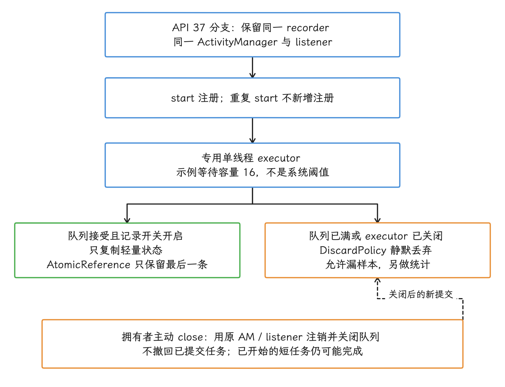

图：把注册、执行与关闭放在同一视图；close 由拥有者触发，不是每个 callback 结束后自动执行。

### 5. 系统如何投递

#### 5.1 应用进程内

每个 `ActivityManager` 实例维护自己的 `Consumer<AnrWarningResult> → Executor` 映射：

1. 该实例的第一个 listener 注册时，向 AMS 注册一个 `IAnrWarningCallback`；
2. AMS 经 oneway Binder 调用 `onAnrImminent(result)`；这表示可能接近 ANR，仍是尽力投递；
3. 该 `ActivityManager` 实例遍历自己的 listener，将任务交给各自 executor；
4. 多个 listener 的通知及实际执行顺序没有保证；
5. 该实例最后一个 listener 移除时，向 AMS 注销其 Binder callback。


在同一 `ActivityManager` 实例上重复注册同一个 listener，不会新增记录或替换原 executor；注销未注册的 listener 直接返回。`dispatchAnrWarning()` 在遍历处没有捕获 executor 的拒绝异常，应用要避免把已经关闭、会抛异常的 executor 留在映射中；示例的丢弃策略只是在容量或关闭边界静默漏样本。


#### 5.2 system_server 内

投递走的是 `AnrWarningController`。它按 calling UID（注册方的应用身份）保存 callback 列表，并为每个 Binder callback 注册 death recipient（进程死亡通知）。producer 调用 `ActivityManagerService.notifyAnrWarning()` 时，AMS 先用 `anrId` 获取或创建 error id，再交给 controller，由它依次执行：


1. 若该 UID 有 callback，发出 `debug.anr` category 的 `AnrWarningDetected` Perfetto instant（瞬时事件）；
2. 构造 `AnrWarningResult`；
3. 通过 oneway AIDL（无需等待接收方返回的异步 Binder 调用）通知该 UID 下的每个已注册进程；
4. 记录 ANR warning API 的统计事件。

注册范围由 calling UID 决定，应用只能收到自己 UID 的 warning。

#### 5.3 多进程应用会收到重复通知

AMS 的 callback 表按 UID 分组。一个包的主进程和 `:remote` 进程都注册 listener 后，同一 UID 的 warning 会投递到两个进程，而载荷中没有目标 PID。


所以多进程应用要做的核对相应简单：

- 在记录中加入 `Application.getProcessName()`；
- 以 `(type, id, boot/session)` 去重上传；
- 预先决定由哪个进程持久化；
- 收到回调的进程未必是发生阻塞的进程，归因时另找依据。

同一个 UID 下装有多个包时也一样：warning API 没有提供 package selector，按包筛选做不到。

<!-- gracker-diagram: ed09-07-uid-delivery -->
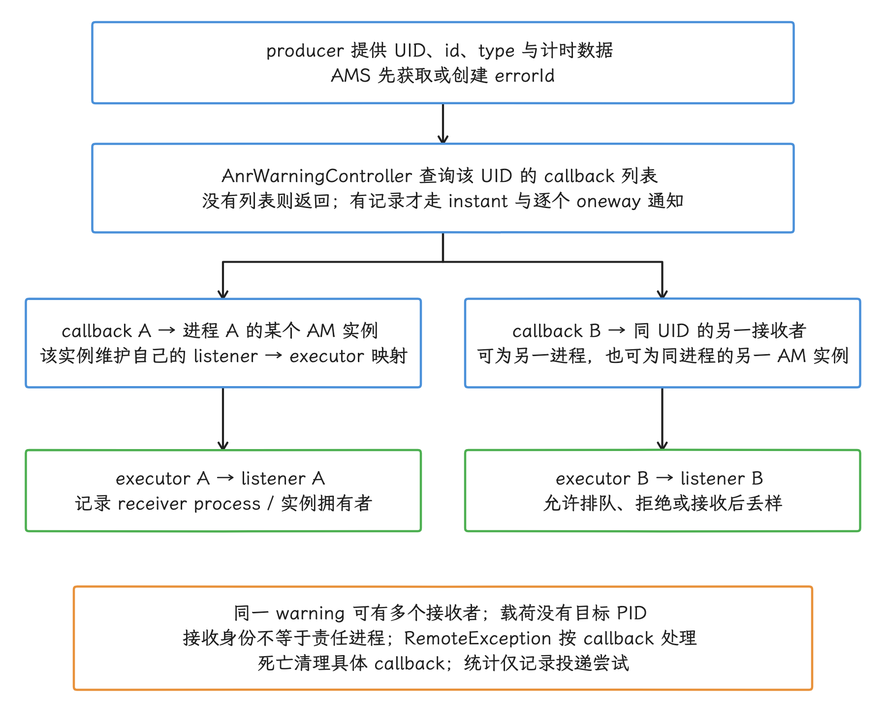

图：把 system_server 的 UID 分发与应用内 AM 实例、listener、executor 的分派合为一条链。

### 6. warning 的预定时点与实际交付


标准 ANR 路径在 detector 报告后才请求其 early dump 与完整转储；取样时现场可能已经变化。warning 的预定触发点更早，但实际交付可能延迟。下图表示两种互斥结果：条件及时恢复，或最终进入 timeout 路径；已发出的 warning 不会被撤回：

```text
计时器开始
    │
    ├── warning split point
    │      └── AMS → onAnrImminent() → app executor
    │
    ├── 阻塞解除：timer cancel，本次不产生 ANR
    │
    └── deadline 到期：进入对应 timeout/ANR 处理
```

图中的 app executor 任务可能晚于 Binder 回调执行。`getConsumedMillis()` 来自 producer 计时回报的采样值，可能早于 Java 构造载荷的时刻；`callbackUptimeMs` 是应用代码开始处理的本地时间。consumed 是时长，callbackUptime 是绝对 uptime，二者不能直接相减得到投递延迟或 warning 的绝对生成时间。

#### 6.1 Service timer

`AnrTimer.Args.anrWarning(true)` 会在 native timer 中加入 50% split point。到点后，`AnrTimer` 把 `timerId`、关联对象和 elapsed time（已经经过的时间） 送回相应 Handler，再由 `ActiveServices` 生成 type、timeout 和 description。

<!-- gracker-diagram: ed09-07-service-timer -->
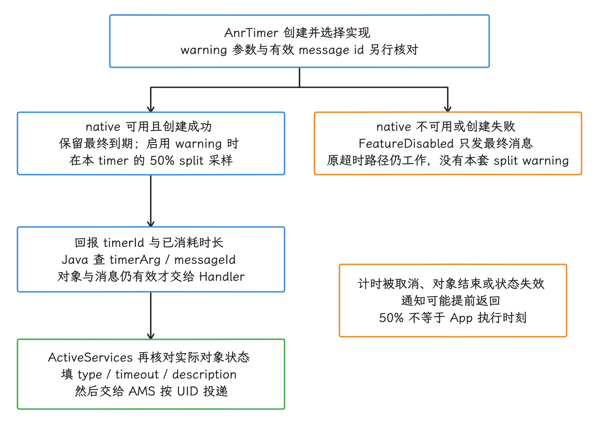

图：在一个分支图中说明 split warning 如何产生、哪些检查会跳过，以及 native 失败时为何只有最终超时。

50% 是 native timer 的预定 split point，通知还要经过 Java Handler、producer 状态检查、Binder 与 app executor。原生计时不可用而降级为 `FeatureDisabled` 时，只投递最终超时消息，没有这套 split warning；即使已排队，producer 也可能因计时对象已结束而返回。系统延迟可能让 warning 晚于 deadline 才处理。


也不要直接用 `timeout-consumed` 当作统一的剩余时间：short FGS 的 timer 在 `onTimeout()` 通知后按剩余宽限启动，warning 的 consumed 来自这段 timer，timeout 却由 `getAnrTime()-getStartTime()` 计算；Broadcast 的可扩展 timer 也可能改变最终到期时长。字段须结合具体 producer 的起点、配置和扩展解释。

<!-- gracker-diagram: ch09-07-17-short-fgs-bases -->


图：条长只表示基准关系；两字段不宜直接相减当作App实际剩余时间，延迟还需另外核对。

#### 6.2 No-focused-window input

InputDispatcher 为 no-focused-window（没有焦点窗口）状态维护独立的 pre-ANR 标记，并从 deadline 反推 warning 时刻，预警窗口的取值见后文“pre-ANR 时间公式”。状态恢复、focused application（当前应获得焦点的应用）改变或已经出现 focused window 时，最终 ANR 可以取消。


该实现路径使用 `ANR_TYPE_INPUT_DISPATCH_NO_FOCUSED_WINDOW`，单凭这一条路径，推不出全部输入派发超时的覆盖情况。

### 7. warning 与最终 ANR 如何关联

Android 17 为 `ApplicationExitInfo` 增加了 `getAnrInfo()`。当退出原因为 `REASON_ANR` 且系统保留结构化信息时，`ApplicationExitInfo.AnrInfo` 提供：

- `getAnrId()`；
- `getAnrType()`；
- `getTimeoutMillis()`；
- `isUserPerceptible()`。

同一 producer 计时确实进入对应 ANR 且结构化信息被保留时，warning id 可与 `ApplicationExitInfo.AnrInfo` 关联。下面代码只枚举当前可见的最近 32 条退出记录并打印候选 `(type,id)`，没有读取持久化 warning，也没有完成 boot/session、进程身份及时间范围的实际匹配：

```kotlin
if (Build.VERSION.SDK_INT >= 37) {
    val activityManager =
        context.getSystemService(ActivityManager::class.java)

    val anrExits =
        activityManager.getHistoricalProcessExitReasons(
            context.packageName,
            0,
            32
        ).filter { it.reason == ApplicationExitInfo.REASON_ANR }

    anrExits.forEach { exit ->
        val info = exit.anrInfo ?: return@forEach
        val key = "${info.anrType}:${info.anrId}"
        Log.i(
            "AnrCorrelation",
            "key=$key timeout=${info.timeoutMillis} " +
                "userPerceptible=${info.isUserPerceptible}"
        )
    }
}
```


同一次等待在最终 detector 检查前恢复，可以没有对应 ANR；但“没有匹配退出记录”本身只应标为 unmatched（未匹配）。历史条数与保留窗口、进程继续存活、重启、结构化信息缺失、跨 UID 改归责和本地 warning 丢样，都可能造成关联缺口。反过来，有 ANR exit 而没有已记录 warning，也可能是 producer 未覆盖、开关关闭、尚未注册、投递或 executor 未执行；不能单凭缺失记录推断恢复或系统没有预警。

<!-- gracker-diagram: ed09-07-warning-match -->
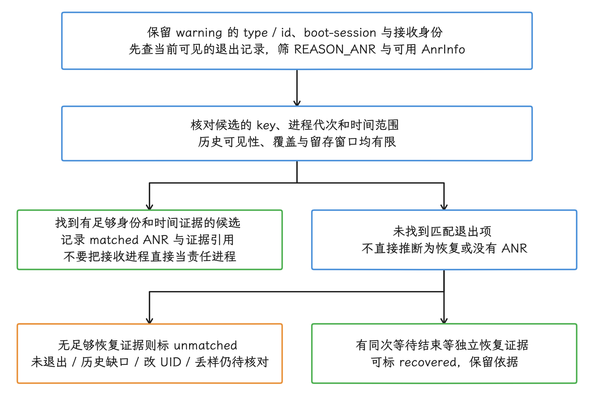

图：合并退出候选的查找和 matched / recovered / unmatched 分类，明确“没有匹配”不等于“已恢复”。

`isUserPerceptible()` 表示系统记录的用户可感知性。把它读成“进程一定展示了某种固定样式的对话框”就过了；后台 silent ANR 与设备 UI 策略，仍由最终 ANR 处理流程决定。

### 8. 回调里适合记录什么

高价值且成本可控的数据包括：


- `(anrType, anrId)`、consumed/timeout；
- callback 的 uptime（开机时长） 与 wall clock（日期时间）；
- 当前 receiver process（接收回调的进程）；
- 当前 Activity、业务阶段、最近一次输入或生命周期事件；
- 已经维护在内存中的主线程消息、Binder 调用和锁等待 breadcrumbs（最近事件轨迹）；
- 内存压力、thermal 等已有快照的索引。

下面这些动作风险较高：

- `Thread.getAllStackTraces()` 对全部线程做临时转储；
- 同步写大文件、压缩或执行数据库 transaction（事务）；
- 直接发网络请求；
- 主线程 `runOnUiThread()` 并等待结果；
- 临时启动完整 heap dump（堆转储）、长时间 CPU profile 或高频 trace。

想在回调里读 Binder 驱动队列深度或枚举 JVM 中的全部锁持有关系，公开 API 做不到。需要这些信息时，应在平时维护开销较低的 breadcrumbs，或依赖系统 Perfetto snapshot（快照）与 ANR trace。

### 9. 与 ProfilingManager 的关系

Android 16（API 36）的 `ProfilingTrigger.TRIGGER_TYPE_ANR` 会在系统识别 ANR 时，请求一份正在后台运行的 system trace 快照。Android 17 的 `ProfilingManager` 可以内部注册 warning listener，把该 listener 实际执行的时刻写进 trace；这个时间不是 Native producer 的精确生成时刻。该 helper 检查以下条件：

- 通过 `registerForAllProfilingResults()` 提供的 executor；
- 已注册 `TRIGGER_TYPE_ANR` 或 all triggers（所有触发类型）。

`android-17.0.0_r1` 中，内部注册由 `registerAnrWarningListenerIfNeeded()` 完成；它会在 `registerForAllProfilingResults()` 和 `addProfilingTriggers()` 路径后检查上述条件。`addAllProfilingTriggers()` 会记录 all triggers 状态，但该方法自身没有立即调用这个 helper。

<!-- gracker-diagram: ch09-07-22-profiling-order -->


图：图表示r1调用顺序；服务不可用或注册失败时可提前返回，不把调用一次API画成已具备内部标记。

若只依赖 all triggers 来获得内部 warning trace 标记，保守顺序是先设置 all triggers，再注册全局 profiling result listener；或者直接通过 `addProfilingTriggers()` 注册 `TRIGGER_TYPE_ANR`。

注册的 listener 会写入一个短 trace section（自定义 trace 区间）：

```text
ANR Warning ANR-Id: <id> consumedMs= <value> timeoutMs=<value>
```

这段标记提供内部 listener 的执行时间与 ANR id，并用于帮助 redactor 保留应用相关 slice；标记本身没有 anrType，需另行关联载荷。只有 helper 的条件和注册顺序满足、回调执行且 trace 采到应用 section 时，才可能看到它。全局结果 listener 的注销也不等同于立即撤销内部 warning listener：r1 的 remove ANR trigger / clear triggers 路径另有清理动作。

<!-- gracker-diagram: ch09-07-23-profiling-marker -->


图：应用内部标记没有anrType，执行时间也不是Native生成的精确时刻；产物与标记都允许缺席。

warning listener 本身不会启动系统 trace，也补不回注册前的历史。`TRIGGER_TYPE_ANR` 是否返回产物，仍受后台 trace、buffer（缓冲区）、系统限流和设备配置影响。

在 warning 回调里临时调用 `requestProfiling()`，赶在 deadline 前产出结果的把握也不大。需要 prehistory（预警前历史）的诊断，应依靠系统环形 trace、平时记录的 breadcrumbs，或预先开启且经过开销验证的采集。

### 10. 与 Perfetto 对齐

`AnrWarningController` 在目标 UID 已经注册 callback 时发出：

- category：`debug.anr`；
- instant name：`AnrWarningDetected`；
- args（事件参数）：`anrId`、`errorId`、`anrTimeoutMs`、`consumedTimeMs`。

上面的 warning instant 不含 anrType 或 PID，要靠载荷、producer 与日志补足。最终 `ANR Detected` instant 还要求 `includeAnrInfo` 开启并成功构造非空 AnrInfo；它增加 PID，但同样没有 type/reason 字段。抓取还需采到 `debug.anr` Track Event category，详细配置见 [§9.2](02-anr-kernel-trace-diagnosis.md#3-android-17-中可用的数据源)。


分析时，我们可按下面的时间关系核对：


1. `AnrWarningDetected`；
2. 应用自定义 warning breadcrumb（时间线标记）；
3. `ANR Detected`；
4. early dump（优先线程转储）与完整 ANR trace；
5. 最终退出或恢复事件。

只有 warning instant 而缺少最终 instant 时，同时核对恢复证据、最终 ANR 日志、AnrInfo 条件、trace 采集范围和缓冲是否完整，不能仅凭缺失标记认定恢复。应用 breadcrumb 缺失而系统 instant 存在时，再查 Binder、具体 ActivityManager 实例的注册、executor 排队/丢弃及进程存活。

### 11. `description` 与类型的使用方式

`anrType` 适合做稳定分组，`description` 适合保留原文供人工查看。存储模型可以包含以下字段：

| 字段 | 用途 |
|---|---|
| `warning_key` | type + id + boot/session，用于唯一标识记录 |
| `type` | 稳定分类 |
| `description_raw` | 原始提示，不作为协议解析 |
| `consumed_ms` / `timeout_ms` | 计时进度 |
| `system_warning_uptime_estimate` | 仅在独立测得或限定投递延迟时估算并记录误差；否则留空 |
| `receiver_process` | 说明哪个进程接收 |
| `matched_exit` | 是否匹配到最终 `ApplicationExitInfo.AnrInfo` |
| `evidence_refs` | trace、breadcrumb、日志文件的索引 |


warning 可提示耗时压力，但应按 producer 的预警点、执行延迟与恢复证据解释。反复出现有明确恢复证据的样本，值得核对该阶段耗时；自定义短 timeout 可让 no-focus warning 在首次检查就满足，也不能一概把所有 warning 解释为已经消耗一半期限。

### 12. 常见误解


#### 收到 warning 就一定会 ANR

计时对象可以在 deadline 前完成，producer 会取消 timer。记录中应把 warning 标为“可能发生 ANR 的事件”，已发生 ANR 要以最终判定为准。

#### 所有 `AnrTypes` 都会触发 listener

类型集合比 Android 17 当前 producer 覆盖范围更广。统计平台要按实际收到的 type 记录覆盖率。

#### listener 收到 warning 的进程就是目标进程

AMS 按 UID 分发。同 UID 的多个已注册进程都可能收到同一 warning。

#### warning 载荷带线程栈和组件

载荷只有 id、type、consumed、timeout 和 description。组件可能出现在不稳定的 description 中。

#### 回调能给 ANR deadline 续时

原计时器继续运行。回调耗时不会改变 timeout。

#### `targetSdkVersion` 决定能否注册

公开 API 的版本门槛是运行平台 API 37；官方签名没有 target SDK 条件。feature flag 和设备实现仍可能影响 warning producer。

### 13. 接入检查表


- 用 API 37 SDK 编译，并用 `SDK_INT >= 37` 保护调用；
- executor 与主线程、容易排满的业务线程池隔离；
- 保存同一个 listener 实例用于注销；
- 记录 `(type, id)`，加入 boot/session 和 receiver process；
- 回调只复制轻量内存状态；
- 多进程按 UID 投递语义去重；
- warning 与 `ApplicationExitInfo.AnrInfo` 双向匹配；
- 分别统计有恢复证据的 warning、matched ANR、unmatched warning 和没有已记录 warning 的最终 ANR；
- 对 description 只做原文保留或容错聚类；
- 在目标 build 上验证 feature flag、覆盖类型和剩余窗口。

### 公开预警 API 的版本与实现边界

API 37 把 ANR 类型、预警载荷和 listener 注册放进了公开 API：它在 deadline 前提供 best-effort（尽力而为、不保证到达） 信号，也让 warning id 能与事后的 `ApplicationExitInfo.AnrInfo` 对齐。系统 ANR trace 仍是主线，类型覆盖也要按前文的 producer 清单来读：Android 17 的全部 ANR 类型并没有都在其中。

这项能力适合补充已有监控：平时维护轻量 breadcrumbs，收到 warning 时复制一份小型状态快照，ANR 后再与 system trace 和退出记录合并。

## InputDispatcher 到 AMS 的预警路径

应用接入方式明确后，我们还要沿 native producer、WMS 和 AMS 调用关系确认预警何时产生，以及它与正式 ANR deadline 的区别。先明确 InputDispatcher 的 pre-ANR（ANR 到期前预警）覆盖范围：

- InputDispatcher pre-ANR 目前只覆盖 **no focused window（没有焦点窗口）**；
- 已有窗口迟迟不确认输入事件的 **window unresponsive（窗口无响应）** 路径没有对应的 producer；
- pre-ANR 受 feature flag 控制，是到期前按 best-effort 方式投递的 warning；
- 正式 ANR 仍由原 deadline、WMS（WindowManagerService）责任判断，以及 AMS/AnrHelper 处理流程决定。

所以，“输入 ANR 都会在 50% 处收到预警”“收到预警的进程一定成为 ANR 责任方”这两句话，到这里都不成立。

### 1. 两类输入 ANR 要分开

InputDispatcher 处理的两类超时都表现为“输入没有按期完成”，但计时对象不同。

| 路径 | 计时对象与条件 | r1 pre-ANR |
|---|---|---|
| no focused window | 有 focused application、无 focused window，并出现需要焦点目标的事件；状态为 `mNoFocusedWindowAnrState`，到期对象是 InputApplicationHandle | 有，需开启 producer flag |
| window unresponsive | 窗口或 input monitor 的 connection 已派发事件，wait queue 长时间未完成；`mAnrTracker` 记录 deadline，连接保存 `Connection.waitQueue` | 当前这条 helper 没有覆盖 |

<!-- gracker-diagram: ch09-07-29-two-input-detectors -->


图：只有左分支经本次no-focus pre-ANR helper；两种正式超时仍各自存在。

#### 1.1 no focused window

先看 no focused window 这一路。`findFocusedWindowTargetLocked()` 只有在事件需要焦点目标时才启动这次倒计时，源码注释以 KeyEvent 为例：若 focused application 和 focused window 都为空，事件直接失败；若窗口已存在，则走正常派发。

状态首次建立时保存：


- 输入事件的 `eventTime`（发生时间） 与 `eventId`（事件标识）；
- 当前 focused application；
- `timeoutEndTime`；
- 本次实际 `timeoutDuration`（超时时长）；
- `notifiedPreAnr = false`。

实际 timeout 来自 `focusedApplicationHandle->getDispatchingTimeout(DEFAULT_INPUT_DISPATCHING_TIMEOUT)`，因此每次都按 5 秒算并不成立。应用焦点改变、窗口出现或其他重置条件发生时，InputDispatcher 会清除这次等待。

<!-- gracker-diagram: ed09-07-focus-lifecycle -->
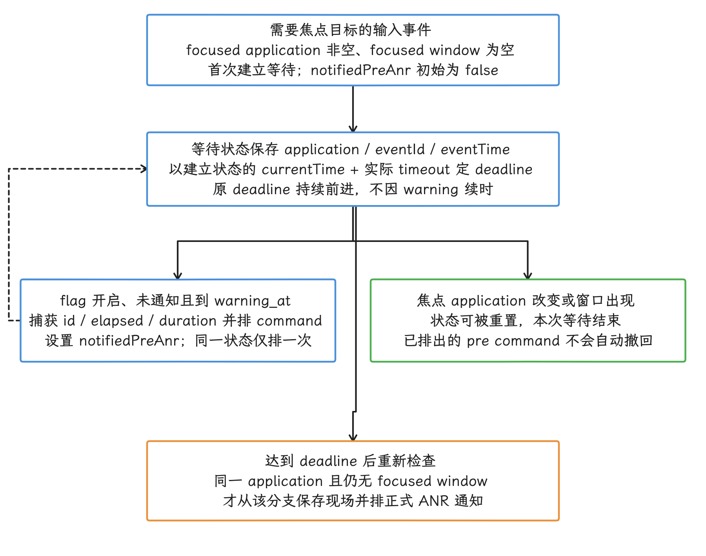

图：用一张状态图连接 no-focus 等待的建立、一次预警、条件恢复与正式到期，避免四图反复介绍同一状态。

#### 1.2 window unresponsive

窗口建立 connection 后，InputDispatcher 把等待确认的 `DispatchEntry`（一次事件派发记录）放进 wait queue，并用 `mAnrTracker` 快速找到最近的 deadline。到期后，它取 connection wait queue 中最老的事件来构造诊断 reason（原因描述）。

源码特意说明：最老事件未必就是最早达到 deadline 的事件，因为窗口 timeout 可能变化；但应用通常按顺序处理输入，用最老事件解释现场更有诊断价值。因此，reason 中的 event 与精确触发 deadline 的 entry（队列项） 可能不是同一条记录。


### 2. `dispatchOnce()` 里的两次检查

再看 dispatcher loop 本身。每次循环末尾都会计算下一次唤醒时刻，相关源码结构如下：

```cpp
nextWakeupTime = std::min({
        nextWakeupTime,
        processPreAnrsLocked(),
        processAnrsLocked()
});
```

这里的一次迭代不是 UI frame。两个检查在持有 dispatcher lock 时依次执行；它们只把 policy 通知排进 command queue，command 会在后续运行并在调用 policy 时暂时释放该锁。若本轮已晚于 deadline，pre 与正式 ANR 可在同一轮都被排队；不能把“pre 检查在前”画成 App 一定先完成回调。返回值用于决定下一次 pollOnce 唤醒。

<!-- gracker-diagram: ch09-07-32-dispatcher-queue -->


图：若检查已晚于deadline，两条通知可在同轮排队；函数调用顺序不保证App先完成warning回调。

`processPreAnrsLocked()` 当前只有一个具体分支：

```cpp
nsecs_t InputDispatcher::processPreAnrsLocked() {
    if (!mAnrWarningCallbackInputDispatcherEnabled) {
        return LLONG_MAX;
    }
    return std::min(
            nsecs_t{LLONG_MAX},
            processNoFocusedWindowPreAnrLocked());
}
```

这段实现为未来增加其他 pre-ANR 类型保留了入口，但 `android-17.0.0_r1` 没有 window-unresponsive pre-ANR helper（辅助函数）。`mAnrWarningCallbackInputDispatcherEnabled` 的初始值来自 `enable_anr_warning_callback_input_dispatcher` flag。

### 3. pre-ANR 时间公式

no-focused-window 的 warning 时刻由下面的公式决定：

```text
pre_window = max(actual_timeout / 2, 2000 ms × HwTimeoutMultiplier)
warning_at = timeout_end - pre_window
consumed   = actual_timeout - (timeout_end - now)
```

`IInputConstants.aidl` 把最小 pre-ANR window 定为 **2000 ms**，这个值还没有乘硬件系数。默认 dispatch timeout 是 **5000 ms**。两项 fallback（默认备用） 常量都会乘 `HwTimeoutMultiplier()`，该值来自产品配置属性 `ro.hw_timeout_multiplier`。

`max` 取两者中较长者，用来把预定 warning 点向前移动；2000 ms × HW 是计算参数，不是留给应用诊断的最短时间承诺。实际检查、command 执行、WMS、Binder 和 executor 的延迟都可能耗尽这个窗口，短 timeout 还可能让 warning_at 早于 timer 的建立时刻。

以 `HwTimeoutMultiplier = 1` 为例：

| 实际 timeout | `timeout / 2` | 最小 pre window | warning 已消耗时间 |
|---:|---:|---:|---:|
| 5000 ms | 2500 ms | 2000 ms | 2500 ms |
| 3000 ms | 1500 ms | 2000 ms | 1000 ms |
| 1000 ms | 500 ms | 2000 ms | 首次检查时立即满足 |


默认 5 秒路径恰好在一半附近发出 warning。自定义 timeout 较短时，warning 的触发点会早于 50% 进度；若计算出的 `warning_at` 已经过去，InputDispatcher 会立即排队通知。

`notifiedPreAnr` 保证同一 `mNoFocusedWindowAnrState` 只排队一次。状态被重置后，新事件可以开始新的预警周期。


### 4. pre-ANR 会直接到达公开 warning API

旧资料常把 Native pre-ANR 和 `ActivityManager.registerAnrWarningListener()` 写成两套无关机制。Android 17 源码给出了直接调用关系，其中 JNI（Java Native Interface）负责连接 native 与 Java 层。

预警的主链是 `InputDispatcher command → NativeInputManager JNI → InputManagerService → InputManagerCallback → WMS AnrController → AMS → AnrWarningController`。WMS 可选追踪与向原 Activity UID 发出 warning 是两项动作，均须保留各自条件。


这里要区分两个 flag。Native producer 由 `enable_anr_warning_callback_input_dispatcher` 控制；Java 公开接入也带 `@FlaggedApi(Flags.FLAG_ENABLE_ANR_WARNING_CALLBACK)`，覆盖 `ActivityManager.registerAnrWarningListener()`、`unregisterAnrWarningListener()` 和 `AnrWarningResult`。因此，平台集成时要分别确认 InputDispatcher producer 与 framework API 暴露状态；App 端即使用 API 37 编译，也要把 API/flag 不可用、无 warning 投递作为正常分支。

<!-- gracker-diagram: ch09-07-37-flags -->


图：图中的分行是同一个Native flag名称；API37不是这些路径在每个派生build都工作且交付的证明。

`AnrTypes` 和 `ApplicationExitInfo.AnrInfo` 又由 `FLAG_INCLUDE_ANR_INFO` 标注。Android 17 `AnrTypes` 共 11 个取值（含 `ANR_TYPE_OTHER`），但这条 no-focused-window producer 只发送 `ANR_TYPE_INPUT_DISPATCH_NO_FOCUSED_WINDOW`。

`AnrController.notifyPreAppUnresponsive()` 先解析 `InputApplicationHandle` 对应的 Activity。Activity 不存在、已经 stopped（停止） 或没有进程时，部分动作会被跳过。存在进程时，AMS warning 使用以下数据：


- UID：候选 Activity 所属应用的身份编号；
- `anrId`：Native 输入事件 id；
- type：`ANR_TYPE_INPUT_DISPATCH_NO_FOCUSED_WINDOW`；
- consumed time：InputDispatcher 计算的已消耗时间；
- timeout：本次实际 timeout；
- description：Android 17 该调用点传空字符串。

`AnrWarningController` 再向该 UID 下已经注册 listener 的进程投递。warning payload 没有目标 PID 或 Activity token；多进程去重可用 `(type,id,boot/session)` 并保留 receiver process、身份与时间证据。这个 key 用于关联，不会自动识别真正阻塞或最终被归责的进程。

公开 API、类型清单和载荷字段见本章前文“公开回调、类型与交付约束”。

<!-- gracker-diagram: ed09-07-input-bridge -->
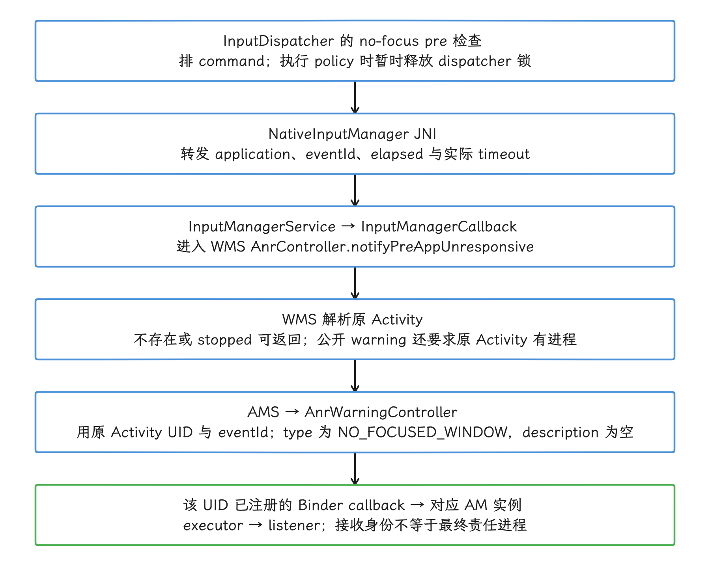

图：合并 Native 与 Java 两段桥接链；JNI、WMS 和按 UID 分发均保留。

### 5. warning 时可选的 Long Method Trace

WMS 的 `enableInputDispatcherLongMethodTracing` flag 开启时，pre-ANR 还会尝试调用 `LongMethodTracer.trigger(pid, 3000)`。`LongMethodTracer` 自身又受 `com.android.server.utils` 的 `longMethodTrace` flag 控制，因此只有两个开关都启用时，系统才会尝试这项诊断，结果仍不保证成功。


目标 PID 的选择有两种：

1. WMS 取得当前 input focus target，计算 `uptimeMillis - mInputFocusRequestTimeMillis`；这个 focus request age 达到相应 dispatch timeout 时，把该 target 选为候选，而不是直接测量它实际持有焦点多久；
2. 没有这样的 focus target（焦点目标） 时，使用缺少 focused window 的 Activity 进程。

`LongMethodTracer` 通过基于信号的 native 机制请求固定时长的方法追踪。类注释写明，若目标进程在 tracing window（追踪窗口） 内或之后发生 ANR，采集信息会进入 ANR report。触发返回 `false`、进程退出或 flag 关闭，都可能导致产物缺失。

warning callback 与 Long Method Trace 是相互独立的动作：应用收到 callback 时，追踪可能尚未成功；追踪成功时，应用也可能还没注册 listener。

<!-- gracker-diagram: ed09-07-wms-two-actions -->
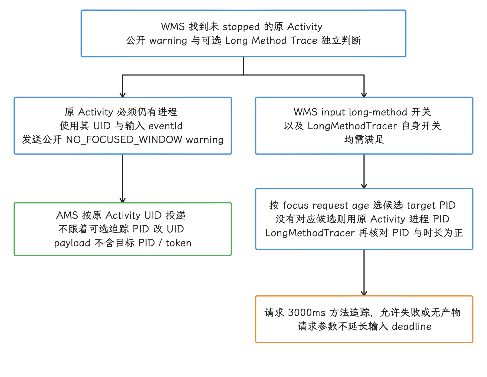

图：在一张图中分开两个可独立成功或缺席的动作：warning 用原 UID，追踪可选另一 PID。

### 6. 到期路径仍有两条

#### 6.1 no focused window 到期

`processAnrsLocked()` 发现当前时间达到 `mNoFocusedWindowAnrState.timeoutEndTime` 后，会重新检查：


- 当前 focused application 是否仍为等待中的 application；
- focused window 是否仍为空。

条件仍成立才调用 `onAnrLocked(application)`。随后 Native policy 回调携带 `eventId`、原事件 `eventTime` 和配置 timeout 进入 Java。

#### 6.2 window unresponsive 到期

`mAnrTracker.firstTimeout()` 到期后，InputDispatcher 会执行以下步骤：

1. 取得对应 connection；
2. 标记 `connection->responsive = false`；
3. 从 tracker 移除 token，避免继续为这条连接安排唤醒；
4. 在 `onAnrLocked(connection)` 中确认 wait queue 仍不为空；
5. 保存 `mLastAnrState`；
6. 将 policy 通知排队，并通过 `cancelEventsForAnrLocked()` 尝试合成该连接的输入取消事件；它不在这里断开连接，也不是撤回已经报告的 ANR。

<!-- gracker-diagram: ed09-07-connection-expiry -->
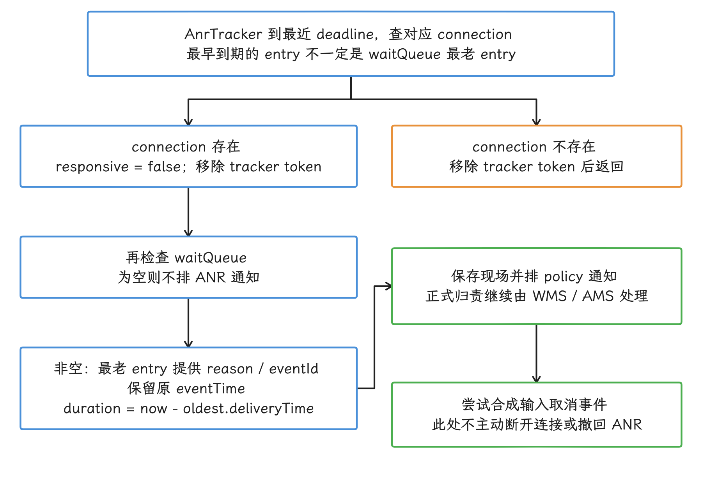

图：把连接到期的动作链与“触发 deadline 的事件”和“诊断最老事件”的差别放在同一流程中。

这一路没有经过 `processNoFocusedWindowPreAnrLocked()`，所以 API 37 input warning 在这里是指望不上的。

### 7. 正式回调如何进入 AMS

两条到期路径都经过 NativeInputManager JNI 回到 `InputManagerService`：

| Java 入口 | `TimeoutRecord` kind | 附带对象 |
|---|---|---|
| `notifyNoFocusedWindowAnr()` | `INPUT_DISPATCH_NO_FOCUSED_WINDOW` | application handle |
| `notifyWindowUnresponsive()` | `INPUT_DISPATCH_WINDOW_UNRESPONSIVE` | input token、可选 PID、reason |


`InputManagerService.timeoutMessage()` 还会用 `SurfaceControl.getStalledTransactionInfo(pid)` 检查关联 surface（图形缓冲区提交目标） 是否因 unsignaled fence（尚未发出完成信号的图形同步栅栏） 卡住。命中时，reason 会补充 layer（图层）、buffer id 和 frame number，提示可能存在 GPU hang（GPU 长时间没有完成工作）。这些信息仍只是诊断上下文，WMS/AMS 还要继续解析责任进程。

<!-- gracker-diagram: ch09-07-43-fence-context -->


图：no-focus调用传空PID，不能把这项补充画成每条输入超时都执行的GPU检查。

### 8. `TimeoutRecord` 与 `ExpiredTimer` 的准确关系

`includeAnrInfo` flag 开启时，两条正式输入 ANR 路径会执行：

```java
AnrTimer.ExpiredTimer expiredTimer =
        new AnrTimer.ExpiredTimer(
                eventId,
                eventTimeNs / 1_000_000,
                timeoutDurationMs);
timeoutRecord.setExpiredTimer(expiredTimer);
```

这里复用了 `AnrTimer.ExpiredTimer` 作为只承载三个字段的数据对象：


- `mTimerId`：输入 event id；
- `mStartMs`：输入 event time 转为毫秒；
- `mDurationMs`：本次传入的 timeout duration。

输入 deadline 仍由 InputDispatcher 的 `mNoFocusedWindowAnrState` 或 `mAnrTracker` 驱动，Java `AnrTimer` 没有为它启动 native timer。

两条路径传入的 duration 也各有算法：

- no focused window 传入配置的 timeout threshold（超时阈值）；
- window unresponsive 传入最老 entry 自 `deliveryTime` 起至 `onAnrLocked()` 的等待时长，并保留该 entry 原始 `eventTime` 作为 start 字段。

no-focus 的 deadline 从建立等待状态的 `currentTime` 计算，ExpiredTimer 却保存原输入 eventTime；两者可能不同。window 分支的 start 与 duration 也不是同一起点，不能用 `mStartMs + mDurationMs` 还原精确 detector deadline，更不能把所有 AnrInfo timeout 都读成固定配置值。

<!-- gracker-diagram: ch09-07-45-timestamp-bases -->


图：两种detector条带是对照，不表示同一事件必同时走两条路径；不能用start+duration伪造精确deadline。

后续 `ProcessErrorStateRecord.createAnrInfo()` 读取这个对象，生成 API 37 `ApplicationExitInfo.AnrInfo`。`includeAnrInfo` 关闭时不影响 ANR 检测，只会失去这份结构化关联数据。

### 9. WMS 归因可能改变责任进程

no-focused-window warning 会先投给候选 Activity UID。到期后，`AnrController.notifyAppUnresponsive()` 还会查看当前 input focus（输入焦点）。

若当前 focus target 的 focus request age（等待焦点请求的时间）已经达到其 dispatch timeout，WMS 会尝试把正式 window-unresponsive 责任交给该 focus target；否则仍按原 Activity 处理。pre-ANR 的可选 long method trace 也用相同规则挑选候选 PID。


这就带来一个平台关联上的错位：


- warning 的 `(type, id)` 属于原 Activity UID；
- 正式 ANR 可能归到另一个 PID/UID；
- 同 UID 内可尝试用 `ApplicationExitInfo.AnrInfo` 加身份、会话与时间证据关联，仍允许记录缺失；
- 跨 UID 改归因时，普通 App 端读不到另一方退出历史。

系统/OEM 平台应保留 event id、原 application token、focus target 和责任判断过程。普通应用的 APM 应先把缺乏匹配证据的 warning 标成 unmatched；有独立证据时再标 recovered 或 possible-reattribution。不要由缺少退出记录直接判断恢复，也不要强行归给接收回调的进程。

<!-- gracker-diagram: ed09-07-attribution -->
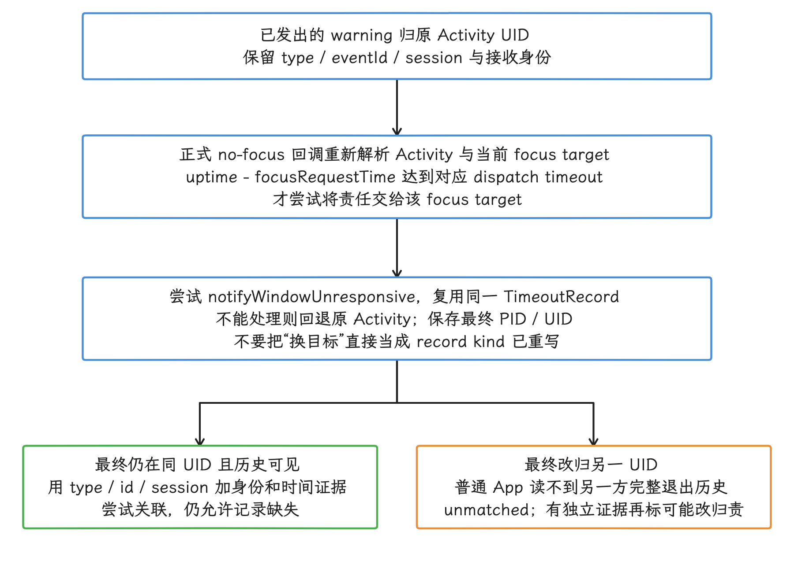

图：把 WMS 的候选选择、回退与 App 侧关联缺口放在同一条责任变化链中。

### 10. AMS 与 AnrHelper

WMS 解析出 Activity 或 PID 后，调用 `ActivityManagerInternal.inputDispatchingTimedOut()`。AMS：


- 要求调用方具有 `FILTER_EVENTS`；
- 按 PID 查 `ProcessRecord`；
- 调试中的进程不进入标准 ANR；
- active instrumentation（正在控制该应用的测试或调试框架）会收到取消结果；
- 其他有效进程交给 `mAnrHelper.appNotResponding()`。

普通 persistent process（常驻系统进程）没有“天然跳过输入 ANR”的通用分支。是否显示 UI、是否静默终止进程、栈转储范围和 DropBox（系统诊断报告存储）处理，会在后续的 `ProcessErrorStateRecord` 处理中决定。

这部分完整时序见 [9.1 ANR 机制、类型与触发条件](01-anr-mechanism-types-triggers.md)；线程转储与报告入口见 [9.2 ANR 与 Kernel Trace 联合诊断](02-anr-kernel-trace-diagnosis.md)。

### 11. 一条正确的时序

在实际 timeout 恰为 5 秒、HW=1、相关 flag 开启且调度及时的示意中，T0 指建立本次等待状态的时刻，原输入事件的 eventTime 可能更早：


```text
T0       发现 focused application 存在，但 focused window 为空
T0+2.5s  InputDispatcher 预定检查并排队 pre-ANR
          └─ 后续 command → WMS → AMS → Binder → executor
              WMS 可选请求 3s Long Method Trace；各段可能延迟
T0+5.0s  InputDispatcher 重新检查 application 与 window
          └─ 条件仍成立才进入正式 ANR 归因
T0+5.0s+ WMS / AMS / AnrHelper 处理栈、报告、UI 或 kill
```

实际时间可能偏离上面的理想值，误差主要来自四处：

- dispatcher 或 `system_server` 调度延迟；
- JNI、WMS global lock 和 Binder 回调耗时；
- App listener executor 排队；
- 自定义 timeout 值和硬件乘数。

若系统在 `warning_at` 之后才得到运行机会，pre-warning 与正式 ANR 可能非常接近。公开回调只有“尽力早于 deadline”的承诺，没有“至少剩余 N 毫秒”的 SLA（服务级别保证）。


<!-- gracker-diagram: ed09-07-timeliness -->
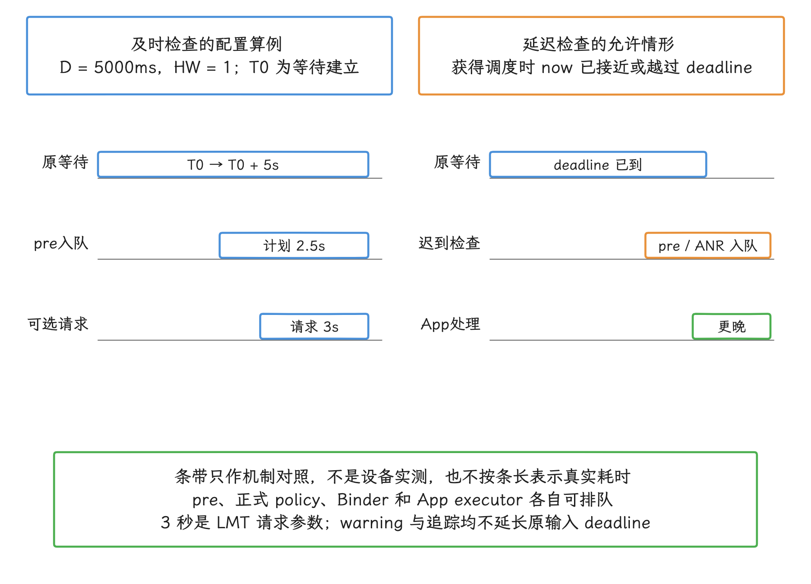

图：把正常算例和迟到检查并排对照：有预定点，不代表 App 能得到固定长度的诊断窗口。

### 12. `2s / 5s / 10s` 各自的计时对象

pre-ANR 代码附近还有两个常量：

- `SLOW_EVENT_PROCESSING_WARNING_TIMEOUT = 2s`；
- `STALE_EVENT_TIMEOUT = 10s × HwTimeoutMultiplier()`。

它们和 5 秒 dispatch timeout 排不成“2 秒预警、5 秒 ANR、10 秒丢弃”的统一状态机，因为这些计时监视的对象各不相同：

<!-- gracker-diagram: ch09-07-51-timeout-objects -->


图：这些常量不构成2秒预警、5秒ANR、10秒丢弃的统一状态机；先确认每条路径监视的对象。

- slow-event warning 用于记录事件处理过慢的日志；
- pre-ANR 的 2 秒指 deadline 前最小剩余 window；
- stale-event timeout 判断进入 dispatcher 的事件是否已经陈旧；
- 正式 dispatch timeout 可来自 window/application 配置，不固定为 5 秒。

名称相近，计时对象各异。

### 13. Trace 与日志如何对齐

系统在这些位置留下 trace 标记：

- Native policy JNI 回调使用 `ATRACE_CALL()`；
- WMS pre 路径使用 `notifyPreAppUnresponsive()` trace section；
- `LongMethodTracer.trigger()` 使用 ActivityManager trace tag；
- AMS 正式路径使用 `inputDispatchingTimedOut()`；
- 有目标 callback 时，`AnrWarningController` 还会发出带 id 的 Perfetto instant。

我们在 trace 里按以下顺序对齐：


1. 从 payload / 本地记录找 `(anrType,anrId)` 和 callback uptime，再与不带 type 的系统 instant 按 id、时段及 producer 关联；
2. 找 WMS `notifyPreAppUnresponsive()` 和可选的 long-method trace（长方法追踪）；
3. 检查 T0 到 deadline 期间 focused application/window 的变化；
4. 找 `inputDispatchingTimedOut()` 与 ANR report 的 ErrorId（错误标识）；
5. 用 main thread（主线程）、Binder、fence、CPU 和 I/O 时间轴判断为何窗口没有出现。

Perfetto 不会自动生成固定的 `/data/anr` 产物。需要预先配置持续 trace、triggered trace（按事件触发的 trace）或 Profiling trigger，详见 [9.2 ANR 与 Kernel Trace 联合诊断](02-anr-kernel-trace-diagnosis.md)。

<!-- gracker-diagram: ed09-07-evidence -->
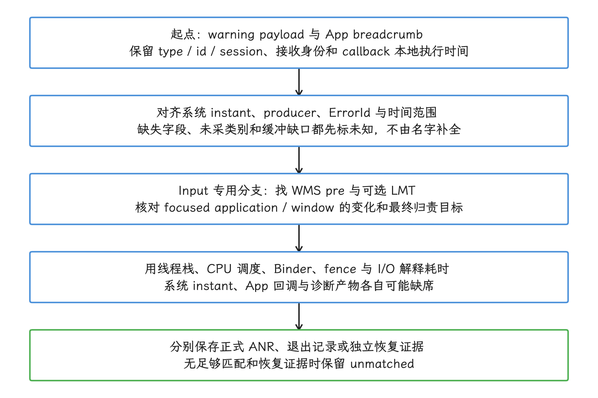

图：用一条取证流程连接通用 key 与 Input 特有线索，避免两套步骤重复铺陈。

### 14. 工程接入建议


#### 普通 App

- 用 API 37 SDK 编译，用 `SDK_INT >= 37` 保护 warning listener，并把 API/flag 不可用当成正常分支；
- listener 使用独立 executor，只复制小型内存快照；
- 用 `(type, id, boot/session)` 去重多进程回调；
- 记录 callback 到达时间；要还原 Native warning 的精确时刻，还需要投递延迟；
- 下次启动读取 `ApplicationExitInfo.AnrInfo`，允许 warning 无 exit、exit 无 warning；
- 保留 Activity、页面和启动阶段的 breadcrumbs，帮助解释 no-focused-window。

#### 系统与 OEM

- 分别验证 input warning、long method tracing 和 `includeAnrInfo` 三组 flag；
- 在事件日志中保存 original activity（最初 Activity）、focus target 和最终 blamed target（被归责目标）；
- 记录 warning 生成、AMS 投递、listener 接收的三段延迟；
- 测试自定义 dispatch timeout、硬件乘数和锁竞争；
- 对 trace 失败、PID 已退出和跨 UID 改归因保留明确状态。

#### 测试用例

至少覆盖：

- Activity 已成为 focused application，但延迟添加窗口；
- 窗口在 warning 后、deadline 前出现；
- focused application 在倒计时期间切换；
- focus request age 达到对应 timeout，并核对候选 focus target 与最终责任是否改判；
- 已有窗口不确认输入事件，确认不会收到 no-focus warning；
- warning listener 多进程重复；
- flag 分别关闭；
- deadline 前 `system_server` 被 CPU 或锁延迟；
- `ApplicationExitInfo.AnrInfo` 存在与缺失两条分支。

### Input pre-ANR 的版本与实现边界

| 平台 | 已核对结论 |
|---|---|
| AOSP Android 14/15/16 的各自 `android-N.0.0_r1` | 本次在这三份 InputDispatcher.cpp 中检索，均无 `processPreAnrsLocked()` 与 `processNoFocusedWindowPreAnrLocked()`；此结论不覆盖所有厂商分支与后续补丁 |
| Android 17 / API 37 | 增加 InputDispatcher no-focus pre-ANR、公开 warning 投递、可选 long method tracing 与 input `AnrInfo` 载荷 |


输入 timeout、WMS 归因和 ANR 主路径在更早版本已经存在；Android 17 的 pre-warning 行为，倒推回 Android 14—16 是套不上的。

> ⚠️ 矛盾：r1 个别源码注释把 callback 复用写成进程级、把保存的 eventTime 写成等待起点，并用“持有焦点时长”概括候选判断。实际执行分别是 ActivityManager 实例字段、输入事件时间赋值，以及 `uptime - mInputFocusRequestTimeMillis`。`AnrInfo.isUserPerceptible()` 的注释提到对话框，但此处构造值来自 `!isSilentAnr`，不能倒推 UI 必已展示。本文按具体字段和赋值解释，保留这些注释与实现的差异。

## 结论

Android 17 为 no-focused-window 输入 ANR 增加了一次 deadline 前的观测机会：

1. InputDispatcher 根据实际 timeout 计算 warning_at；
2. warning 经 JNI 和 WMS 直接进入 AMS 的公开 warning 流程；
3. WMS 可按 flag 触发 3 秒 Long Method Trace；
4. deadline 到期后重新检查焦点状态，再决定正式 ANR；
5. `TimeoutRecord` 携带 input event id，支持后续 `ApplicationExitInfo.AnrInfo` 关联。

window-unresponsive pre-warning 仍在这套机制之外，callback 领先 deadline 的时长也没有固定保证。诊断系统应把 warning、可选 trace、正式责任判断和退出记录当成四份各自可能缺席的材料。


## 相关章节

- [9.1 ANR 机制、类型与触发条件](01-anr-mechanism-types-triggers.md)：各类 detector、deadline 与正式 ANR 处理。
- [9.2 ANR 与 Kernel Trace 联合诊断](02-anr-kernel-trace-diagnosis.md)：warning、线程转储和 Perfetto 时间线的联合取证。
- [26.2 崩溃与 ANR 监控](../../part5-app/ch26-observability/02-crash-anr-monitoring.md)：线上聚合、恢复率与最终 ANR 关联。

## 参考资料

### 公开预警 API

- [Android Developers：ActivityManager.registerAnrWarningListener](https://developer.android.com/reference/android/app/ActivityManager#registerAnrWarningListener(java.util.concurrent.Executor,%20java.util.function.Consumer))
- [Android Developers：AnrWarningResult](https://developer.android.com/reference/android/app/AnrWarningResult)
- [Android Developers：AnrTypes](https://developer.android.com/reference/android/app/AnrTypes)
- [Android Developers：ApplicationExitInfo.getAnrInfo](https://developer.android.com/reference/android/app/ApplicationExitInfo#getAnrInfo())
- [AOSP android-17.0.0_r1：ActivityManager warning API](https://android.googlesource.com/platform/frameworks/base/+/refs/tags/android-17.0.0_r1/core/java/android/app/ActivityManager.java)
- [AOSP android-17.0.0_r1：AnrTypes](https://android.googlesource.com/platform/frameworks/base/+/refs/tags/android-17.0.0_r1/core/java/android/app/AnrTypes.java)
- [AOSP android-17.0.0_r1：AnrWarningResult](https://android.googlesource.com/platform/frameworks/base/+/refs/tags/android-17.0.0_r1/core/java/android/app/AnrWarningResult.java)
- [AOSP android-17.0.0_r1：IAnrWarningCallback](https://android.googlesource.com/platform/frameworks/base/+/refs/tags/android-17.0.0_r1/core/java/android/app/IAnrWarningCallback.aidl)
- [AOSP android-17.0.0_r1：AnrWarningController](https://android.googlesource.com/platform/frameworks/base/+/refs/tags/android-17.0.0_r1/services/core/java/com/android/server/am/AnrWarningController.java)
- [AOSP android-17.0.0_r1：AnrTimer](https://android.googlesource.com/platform/frameworks/base/+/refs/tags/android-17.0.0_r1/services/core/java/com/android/server/utils/AnrTimer.java)
- [AOSP android-17.0.0_r1：ActiveServices warning producers](https://android.googlesource.com/platform/frameworks/base/+/refs/tags/android-17.0.0_r1/services/core/java/com/android/server/am/ActiveServices.java)
- [AOSP android-17.0.0_r1：BroadcastQueueImpl warning producer](https://android.googlesource.com/platform/frameworks/base/+/refs/tags/android-17.0.0_r1/services/core/java/com/android/server/am/BroadcastQueueImpl.java)
- [AOSP android-17.0.0_r1：ProfilingManager](https://android.googlesource.com/platform/packages/modules/Profiling/+/refs/tags/android-17.0.0_r1/framework/java/android/os/ProfilingManager.java)

### Input pre-ANR 路径

- [AOSP `InputDispatcher.cpp`（android-17.0.0_r1）](https://android.googlesource.com/platform/frameworks/native/+/refs/tags/android-17.0.0_r1/services/inputflinger/dispatcher/InputDispatcher.cpp)
- [AOSP `InputDispatcher.h`（android-17.0.0_r1）](https://android.googlesource.com/platform/frameworks/native/+/refs/tags/android-17.0.0_r1/services/inputflinger/dispatcher/InputDispatcher.h)
- [AOSP `InputDispatcherPolicyInterface.h`（android-17.0.0_r1）](https://android.googlesource.com/platform/frameworks/native/+/refs/tags/android-17.0.0_r1/services/inputflinger/dispatcher/include/InputDispatcherPolicyInterface.h)
- [AOSP `IInputConstants.aidl`（android-17.0.0_r1）](https://android.googlesource.com/platform/frameworks/native/+/refs/tags/android-17.0.0_r1/libs/input/android/os/IInputConstants.aidl)
- [AOSP NativeInputManager JNI（android-17.0.0_r1）](https://android.googlesource.com/platform/frameworks/base/+/refs/tags/android-17.0.0_r1/services/core/jni/com_android_server_input_InputManagerService.cpp)
- [AOSP `InputManagerService.java`（android-17.0.0_r1）](https://android.googlesource.com/platform/frameworks/base/+/refs/tags/android-17.0.0_r1/services/core/java/com/android/server/input/InputManagerService.java)
- [AOSP WMS `InputManagerCallback.java`（android-17.0.0_r1）](https://android.googlesource.com/platform/frameworks/base/+/refs/tags/android-17.0.0_r1/services/core/java/com/android/server/wm/InputManagerCallback.java)
- [AOSP WMS `AnrController.java`（android-17.0.0_r1）](https://android.googlesource.com/platform/frameworks/base/+/refs/tags/android-17.0.0_r1/services/core/java/com/android/server/wm/AnrController.java)
- [AOSP `ActivityManagerService.java`（android-17.0.0_r1）](https://android.googlesource.com/platform/frameworks/base/+/refs/tags/android-17.0.0_r1/services/core/java/com/android/server/am/ActivityManagerService.java)
- [AOSP `ApplicationExitInfo.java`（android-17.0.0_r1）](https://android.googlesource.com/platform/frameworks/base/+/refs/tags/android-17.0.0_r1/core/java/android/app/ApplicationExitInfo.java)
- [AOSP `TimeoutRecord.java`（android-17.0.0_r1）](https://android.googlesource.com/platform/frameworks/base/+/refs/tags/android-17.0.0_r1/core/java/com/android/internal/os/TimeoutRecord.java)
- [AOSP `LongMethodTracer.java`（android-17.0.0_r1）](https://android.googlesource.com/platform/frameworks/base/+/refs/tags/android-17.0.0_r1/services/core/java/com/android/server/utils/LongMethodTracer.java)

- [ContextImpl.java：本次核对的实现边界](https://android.googlesource.com/platform/frameworks/base/+/android-17.0.0_r1/core/java/android/app/ContextImpl.java)
- [SystemServiceRegistry.java：本次核对的实现边界](https://android.googlesource.com/platform/frameworks/base/+/android-17.0.0_r1/core/java/android/app/SystemServiceRegistry.java)
- [com_android_server_utils_AnrTimer.cpp：本次核对的实现边界](https://android.googlesource.com/platform/frameworks/base/+/android-17.0.0_r1/services/core/jni/com_android_server_utils_AnrTimer.cpp)
- [properties.h：本次核对的实现边界](https://android.googlesource.com/platform/system/libbase/+/android-17.0.0_r1/include/android-base/properties.h)
- [AOSP 14 r1 InputDispatcher 对照](https://android.googlesource.com/platform/frameworks/native/+/android-14.0.0_r1/services/inputflinger/dispatcher/InputDispatcher.cpp)
- [AOSP 15 r1 InputDispatcher 对照](https://android.googlesource.com/platform/frameworks/native/+/android-15.0.0_r1/services/inputflinger/dispatcher/InputDispatcher.cpp)
- [AOSP 16 r1 InputDispatcher 对照](https://android.googlesource.com/platform/frameworks/native/+/android-16.0.0_r1/services/inputflinger/dispatcher/InputDispatcher.cpp)

- [JDK 11 ThreadPoolExecutor：示例队列与关闭语义](https://docs.oracle.com/en/java/javase/11/docs/api/java.base/java/util/concurrent/ThreadPoolExecutor.html)
- [JDK 11 ExecutorService：示例队列与关闭语义](https://docs.oracle.com/en/java/javase/11/docs/api/java.base/java/util/concurrent/ExecutorService.html)
