# App 内存分析与案例

一条内存曲线能提供多少信息，取决于它统计的是哪块内存。Java heap（ART 管理的 Java/Kotlin 对象堆）、native（原生分配） allocator（C/C++ 默认内存分配器）、RSS、PSS、SwapPss、DMA-BUF（设备间共享缓冲区）和 GPU private memory（GPU 私有分配）观察的对象各不相同，数值又常来自不同采样时刻，直接相加就可能失真。


> 源码基线：AOSP `android-17.0.0_r1`；内核 `android17-6.18-2026-06_r6`（Android 17 / API 37）。涉及 PSI（Pressure Stall Information，压力停顿信息）的内核实现以该内核标签为准。

本文前半部分给出分析顺序：先确定指标，再定位内存域，随后用对应工具寻找 owner（内存持有者或归属方） 和生命周期；后半部分用四个公开案例走同一条路径。

## 内存域、基线与增长分类

拿到一条上涨的内存曲线，我们要做的第一件事是确定它属于哪种内存，然后采集可比的快照，再按域选择工具。本节按这个顺序展开：指标含义、快照方法、Java/Kotlin heap、native heap、图形内存、基线与系统压力。

### 1. 先确定问题属于哪种内存

#### 1.1 常用指标的含义

我们先看每个指标到底在统计什么。下表列出常用指标的数据来源、它们各自回答的问题，以及最容易踩的坑：

| 指标 | 主要来源 | 回答的问题 | 容易误用的地方 |
|---|---|---|---|
| Java heap used | ART / `Runtime` / heap dump | 当前 Java/Kotlin 对象占用与引用关系 | 当成整个进程内存 |
| Java heap max | `Runtime.maxMemory()`、`getMemoryClass()` | Java heap 的增长预算 | 与 PSS 或 Graphics 直接相除 |
| Native allocated | bionic allocator / `Debug.getNativeHeapAllocatedSize()` | 分配器仍记为已分配的字节 | 当成 native RSS |
| RSS（Resident Set Size，驻留集大小） | `/proc/<pid>/status`、smaps | 当前驻留在物理内存中的共享页与私有页总和 | 汇总多个进程时重复计算共享页 |
| PSS（Proportional Set Size，按比例分摊集） | smaps / smaps_rollup | 驻留页按内核共享计数分摊；同一进程重复映射与大页近似会影响计数 | 当成硬上限或 LMKD 唯一依据 |
| USS（Unique Set Size，独占集大小） | Private Clean + Private Dirty | 当前进程独占的页面 | 忽略 swap、GPU private 与未映射 DMA-BUF |
| SwapPss | smaps | 按共享计数分摊的换出页面；不等于 ZRAM 压缩后的物理字节数 | 与 resident PSS（仍驻留部分）使用不同采样时刻相加 |
| Graphics / memtrack | `IMemtrack` 与厂商 HAL（硬件抽象层） | smaps 难以覆盖的图形、GL 和 GPU 私有内存 | 假定所有设备记账完整一致 |

<!-- gracker-diagram: ch10-01-02-shared-page-accounting -->
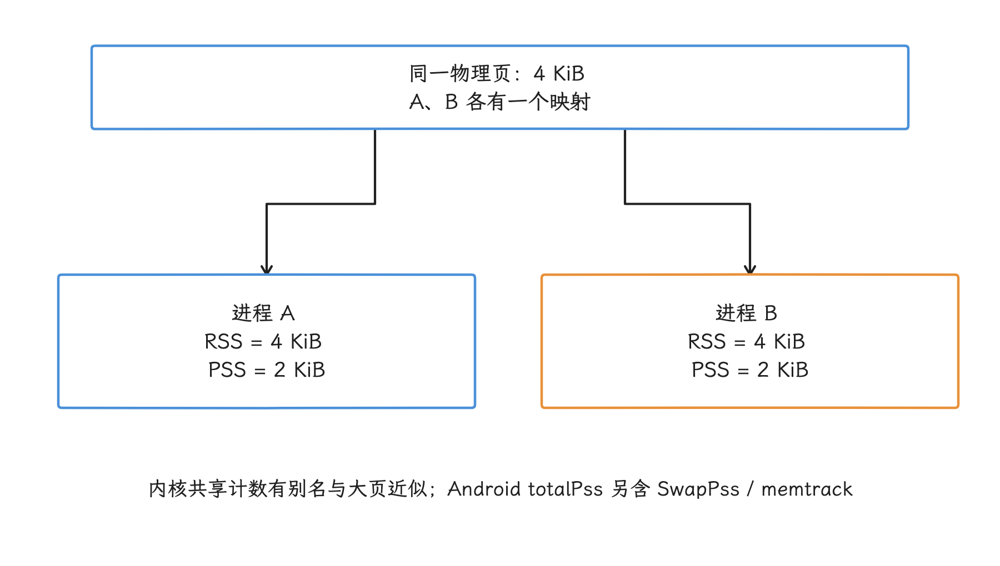

图：教学算例：一张已驻留的 4 KiB 普通页，由两个进程各映射一次。RSS 各记 4 KiB，PSS 各分摊 2 KiB；这不是测量数据。

选取时可以记住一条：PSS 适合比较包含共享映射的进程内存占用，RSS 适合低成本观察驻留变化。两者都受共享库、文件页、ZRAM（内存压缩交换设备）、进程状态和采样时刻影响。

`ActivityManager.getMemoryClass()` 与 `getLargeMemoryClass()` 返回 MB，描述 Dalvik/ART heap 的近似预算；PSS 以 kB 报告，还包含 Java heap 之外的原生分配、代码页、线程栈、图形内存和系统共享页分摊。单位与统计范围都不同的两个数字之间，算不出一个“PSS 使用率”。

#### 1.2 `Debug.MemoryInfo` 的字段与读法

`Debug.MemoryInfo` 把统计分成 dalvik、native、other 三个域，另通过公开的 `getMemoryStats()` 提供 App Summary，单位为 kB。摘要里的 `summary.java-heap` 是 `dalvikPrivateDirty + OTHER_ART` 的 private 部分，`summary.native-heap` 是 `nativePrivateDirty`；它们与 `Runtime` 对象堆用量、allocator 已分配字节回答的问题不同。`getTotalPss()` 还汇入受支持的 memtrack 统计及 SwapPss，不能再加一次 Graphics 或 SwapPss，也不能直接当作 Linux smaps 的 resident Pss。


使用这些字段时，有几件事要先记牢：

- `getTotalPss()` 包含 swapped-out PSS，即按比例分摊的已换出页面；
- r1 内部 `getTotalUss()` 由各域 Private Clean 与 Private Dirty 相加，但该方法标为 `@hide`；普通 SDK 可分别读取公开的 private clean/dirty 总量，不能直接调用隐藏方法；
- `getMemoryStats()` 提供 App Summary 分类；r1 的 `summary.total-swap` 实际调用 `getTotalSwappedOut()`，不能把这个 key 自动当作 SwapPss；具体 getter 的执行路径比概括性注释更精确；
- `Debug.getMemoryInfo()` 直接读取本进程底层统计，源码注明可能看不到部分受保护的 graphics 分配；
- 普通应用使用 `ActivityManager.getProcessMemoryInfo()` 时，Android 10 / API 29 起受调用 UID 限制；平台特权与跨用户权限另有条件。r1 对未获准查询的 PID 仍保留一个默认值条目，不能把返回数组长度或零值当作采样成功。高频调用通常返回服务端缓存，shell/root 发起的 instrumentation 另有例外。

<!-- gracker-diagram: ch10-01-04-am-memory-access -->
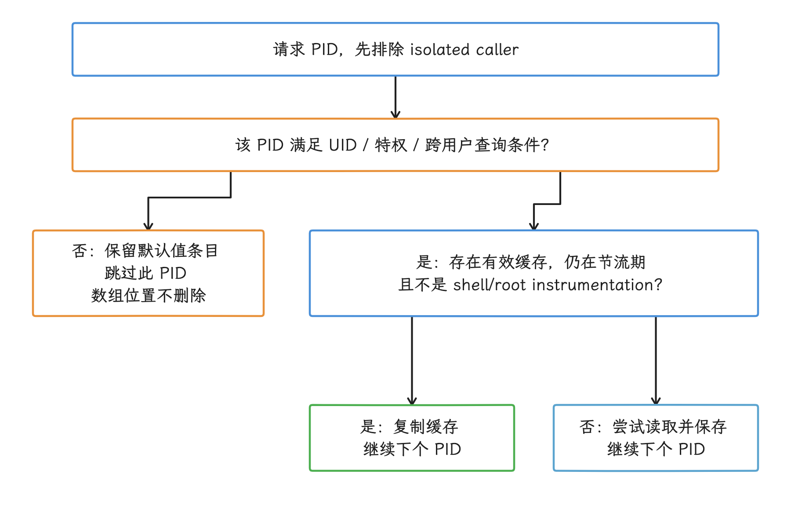

图：r1 保留每个请求 PID 的结果位置；普通应用不能依靠非空数组或零值判断已经取得新采样。

源码核对：

- [`Debug.java`](https://android.googlesource.com/platform/frameworks/base/+/refs/tags/android-17.0.0_r1/core/java/android/os/Debug.java)
- [`ActivityManager.java`](https://android.googlesource.com/platform/frameworks/base/+/refs/tags/android-17.0.0_r1/core/java/android/app/ActivityManager.java#5115)

### 2. 建立第一份内存快照

指标确定后，我们要采集同一实验阶段的进程摘要、内存页大小和进程状态，可以用下面几条命令：

```bash
adb shell dumpsys meminfo -d com.example.app
adb shell getconf PAGE_SIZE
adb shell 'pid=$(pidof -s com.example.app); [ -n "$pid" ] && grep -E "VmRSS|RssAnon|RssFile|RssShmem|VmSwap|Threads" "/proc/$pid/status"'
adb shell dumpsys SurfaceFlinger --list
```

`dumpsys meminfo` 的详细列会随平台和厂商实现变化，报告中应保存原始输出。`/proc/<pid>/status` 的 `VmRSS` 是低成本估计，`libmeminfo` 源码注明它不如 smaps（逐映射内存统计）精确。SurfaceFlinger layer（图层） 列表只用于核对可见图形对象，要拿每个图层的 GPU 内存，还需要后续的图形工具。

应用内要拿一次本进程快照，可以用公开的 `ActivityManager` API：

```kotlin
data class AppMemorySnapshot(
    val observedUptimeMs: Long,
    val androidTotalPssKb: Int?,
    val javaSummaryKb: Int?,
    val nativeSummaryKb: Int?,
    val graphicsSummaryKb: Int?,
    val javaUsedBytes: Long,
    val javaMaxBytes: Long,
    val nativeAllocatedBytes: Long,
)

fun captureAppMemory(
    activityManager: ActivityManager,
): AppMemorySnapshot {
    val info = try {
        activityManager.getProcessMemoryInfo(intArrayOf(Process.myPid()))
            .singleOrNull()
    } catch (_: RuntimeException) {
        null
    }
    val stats = info?.memoryStats.orEmpty()
    val runtime = Runtime.getRuntime()

    return AppMemorySnapshot(
        observedUptimeMs = SystemClock.uptimeMillis(),
        androidTotalPssKb = info?.totalPss,
        javaSummaryKb = stats["summary.java-heap"]?.toIntOrNull(),
        nativeSummaryKb = stats["summary.native-heap"]?.toIntOrNull(),
        graphicsSummaryKb = stats["summary.graphics"]?.toIntOrNull(),
        javaUsedBytes = runtime.totalMemory() - runtime.freeMemory(),
        javaMaxBytes = runtime.maxMemory(),
        nativeAllocatedBytes = Debug.getNativeHeapAllocatedSize(),
    )
}
```

示例需导入 `android.app.ActivityManager` 与 `android.os.Debug/Process/SystemClock`，适用于本文 API 26+ 范围。查询失败或键缺失为 `null`，系统返回的零值保留原样；它仍可能表示无有效数据。`observedUptimeMs` 只是本地观察时间，不能充当服务端缓存的实际采样时间。AM 摘要、`Runtime` 与 native allocator 也不是原子快照。把调用放在实验步骤边界或低频诊断任务，避开每帧回调和紧循环。


### 3. Java/Kotlin heap：用引用关系证明泄漏

如果增长落在 Java/Kotlin heap，我们要找的是引用关系。Heap dump 记录某一时刻托管堆的对象与引用信息，具体 GC、过滤和可达性处理取决于采集及分析工具，它能回答对象由谁引用、哪个对象支配一片子图；native `mmap`（原生内存映射）、GPU allocation（GPU 分配） 或系统为何杀进程，就要换工具了。

#### 3.1 三个必须分清的概念

- **Shallow Size（对象自身大小）**：对象自身在 managed heap（由 ART 管理的堆）中占用的字节，不含被引用对象；
- **Retained Size（对象不可达后可一并回收的估算大小）**：对象不可达后，预计可随它一起回收的受支配对象总量；
- **GC Root path**：对象通向 GC Root 的引用路径；GC Root 是垃圾回收器判定对象仍可达的起点，例如活跃线程、JNI global reference（JNI 全局引用）、类对象、系统类或活跃栈。

<!-- gracker-diagram: ch10-01-06-references-and-dominators -->
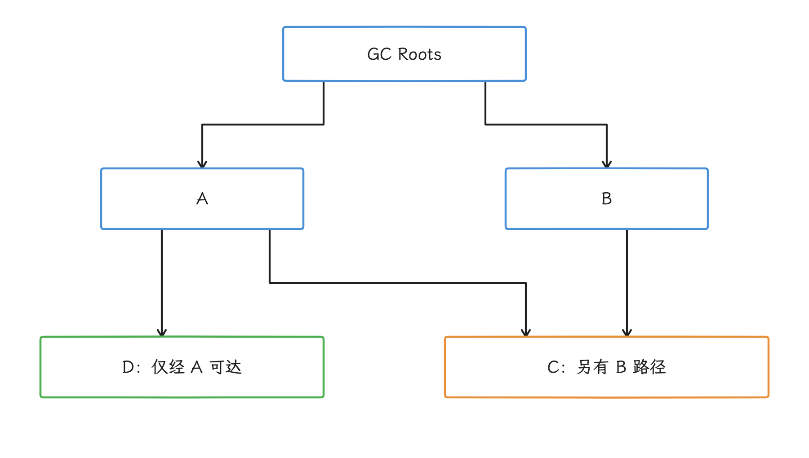

图：教学对象图：A、B 都能到 C，只有 A 能到 D。A 不独占支配 C；支配树的边也不必是原始引用边。

对象头、对齐、压缩引用和 ART 实现都会改变 shallow size，“两个 `int` 字段固定占多少字节”这类推算，跨设备时靠不住。

#### 3.2 可复现的泄漏检查

一次可复现的检查按下面七步走：

1. 固定初始页面和进程状态；
2. 执行同一生命周期动作多轮，例如进入页面、返回、旋转或替换 Fragment View；
3. 等待异步任务和已知动画结束；
4. 采集 heap dump；
5. 查找应已销毁的 Activity、Fragment View、Compose state（Compose 状态对象）、listener、callback 或 cache entry（缓存条目）；
6. 沿 GC Root path 找到生命周期更长的持有者；
7. 修复后重复同一脚本，并比较实例数和 retained graph（保留关系图）。

dump 里单个 Activity 仍存活未必是泄漏：系统、输入法、动画和异步消息都可能短期持有引用。认定泄漏要同时看到两件事——“对象已经越过预期生命周期”，以及“引用链在稳定状态仍存在”。


Android 8.0 / API 26 及以上，普通软件 Bitmap 的像素位于 native heap；`Config.HARDWARE` 的像素则由图形内存支持。Java heap 中的 `Bitmap` 对象仍是追踪归属关系的入口，Android Studio heap dump 也可能在 Native Size 列显示关联的原生内存。只看 Java shallow size 会低估图片成本。

<!-- gracker-diagram: ch10-01-08-bitmap-two-pixel-domains -->
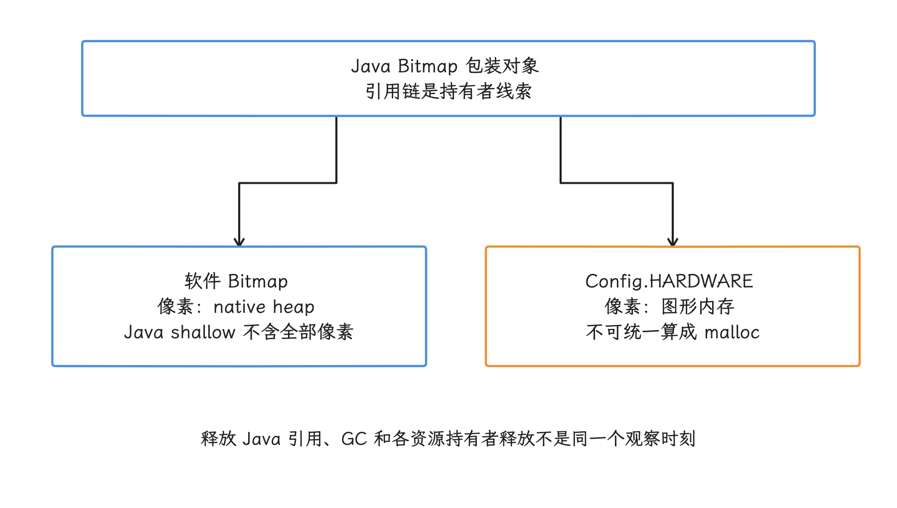

图：API 26+ 的软件像素与 HARDWARE 像素分属不同域；Java 包装对象仍可帮助追踪持有者，Native Size 的可见性也取决于工具。

来源：[Android Studio Heap Dump 指南](https://developer.android.com/studio/profile/capture-heap-dump)

#### 3.3 分配 churn 与 retained leak（对象保留型泄漏）

曲线升高可能来自两种不同的机制，我们要先分开它们：对象创建速度很高、GC 后能回落，属于 allocation churn（大量短命对象造成的频繁分配）；对象沿异常引用链长期存活，属于 retained leak。两者的定位工具不同：


- churn：记录 Java/Kotlin allocation callstack（分配调用栈）、GC 和帧时间；
- leak：使用 heap dump、dominator tree 与 GC root；
- 大数组或 Bitmap：同时核对 native size 和图片缓存策略；
- JNI global reference：结合 ART heap 与 native 调用栈检查持有者。

### 4. Native heap 的两类问题：分配归因与非法访问

#### 4.1 heapprofd 用于分配调用栈

heapprofd 在 Android 10 及以上跟踪 `malloc/free`、`new/delete` 分配，并用抽样记录降低目标进程开销。user build（日常发布版本的系统镜像） 只能分析声明为 `profileable` 或 `debuggable` 的 App。

下面的命令使用 Perfetto 仓库中的推荐脚本，按进程名启动 native heap profiling：

```bash
tools/heap_profile android -n com.example.app
```

以进程名启动时，已经运行的匹配进程和后续启动的匹配进程都可进入采样；需要启动期证据时，应先启动 profiler（分析器），再启动 App。多进程应用还要分别确认 `com.example.app:worker` 等进程名。结束采集后，在 Perfetto UI 中打开生成目录里的 `raw-trace` 原始轨迹文件。

四个常用视图回答不同问题：

| 视图 | 含义 |
|---|---|
| Unreleased malloc size | 采集窗口内已分配但尚未 `free` 的估算字节数 |
| Unreleased malloc count | 采集窗口内尚未 `free` 的估算分配次数 |
| Total malloc size | 窗口内全部分配的估算字节数，包含已经 `free` 的分配 |
| Total malloc count | 窗口内全部估算分配次数，包含已经 `free` 的分配 |


heapprofd 默认观测开始采样后的分配；启动前分配，以及绕过被跟踪 allocator 的直接 `mmap`、graphics buffer 和 GPU private allocation，通常不在该 native malloc profile 的覆盖范围。它也支持另行配置 ART allocation profiling，不能把两种模式混成一个结果。buffer overrun 会令会话提前结束，不能把实际覆盖缺口当作没有分配；采样间隔、符号与进程启动方式也要随结果保存。

<!-- gracker-diagram: ed10-01-native-profile-window-counters -->
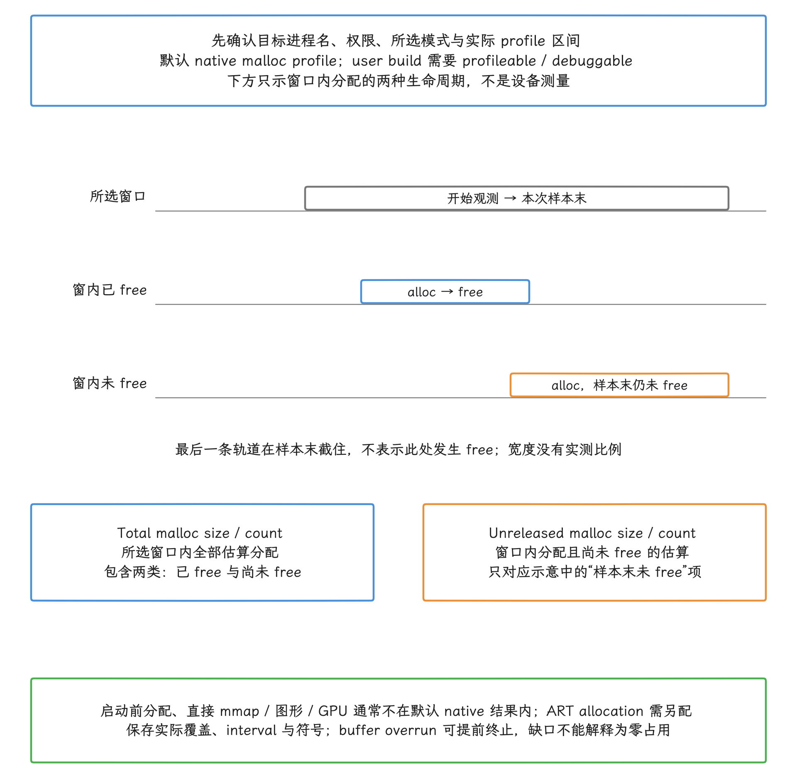

图：默认native malloc profile先核对目标进程名、profileable/debuggable权限与实际区间；需要启动期证据时先启动profiler再启动目标，多进程分别确认。轨道仅示被观测窗口内分配的两种生命周期，无实测时长比例；已free项计入Total而不留Unreleased，样本末尚未free项计入二者，末条在样本末截住不表示发生free。size/count都是采样估算，Unreleased不是全进程所有历史live bytes，更不是RSS。启动前分配、直接mmap、图形与GPU通常不在默认结果内；ART allocation另行配置。保存实际窗口、interval与符号，buffer overrun提前终止造成的缺口不能解释为零占用。

来源：[Perfetto Native Heap Profiler](https://perfetto.dev/docs/data-sources/native-heap-profiler)

#### 4.2 三层统计的覆盖范围

把 heapprofd、allocator 统计和 resident memory 并列看：它们按不同对象、时间和状态记账，不能画成严格包含的三个集合：


```text
heapprofd
  采样到的 malloc/new 请求与 free

malloc_info / allocator statistics
  allocator 管理的 arena、cache 与仍持有的页面

Native Heap RSS / PSS
  已驻留页面，并受 page size、碎片、共享、swap 与采样时刻影响
```

即使统一成字节并对齐观察区间，`Native Heap RSS - heapprofd unreleased bytes` 也不能直接命名为碎片。采样估算、启动前分配、allocator cache、对齐、页内空洞、换出/驻留变化和分类差异都会影响两边；直接 `mmap` 还需核对是否被该工具归入 Native Heap。heapprofd 的存活分配量甚至可能大于该分类的 RSS，差值没有通用的正负含义。


#### 4.3 用 `wrap.sh` 启用 malloc debug

普通 App 开发者应通过 debuggable APK 的 `wrap.sh` 启用 malloc debug。下面的脚本记录 native allocation backtrace（原生分配调用栈）：

```sh
#!/system/bin/sh
LIBC_DEBUG_MALLOC_OPTIONS=backtrace logwrapper "$@"
```

`wrap.sh` 仅适用于 API 27 及以上的 debuggable App，会改变进程启动与分配开销，生产包里没有它的位置。r1 的 `libc.debug.malloc.program` 按 `strstr(getprogname(), program)` 过滤，不是按 PackageManager 查询包名；非空 `LIBC_DEBUG_MALLOC_OPTIONS` 会覆盖这一属性选择分支。App 应按可调试 APK 的 `wrap.sh` 启动路径确认生效，不能仅凭填写包名判断已启用。

<!-- gracker-diagram: ch10-01-14-wrap-startup -->
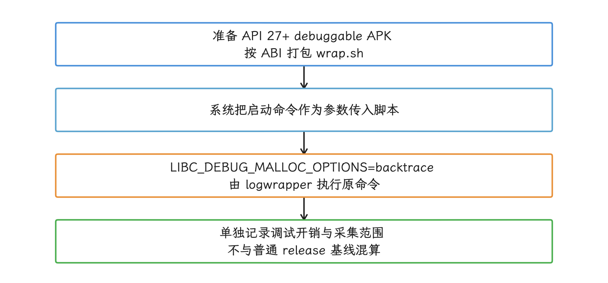

图：wrap.sh 改变目标 App 的启动与分配行为。它是受控诊断入口，命令通过 "$@" 保留参数边界。

来源：[NDK wrap.sh 指南](https://developer.android.com/ndk/guides/wrap-script)

#### 4.4 HWASan、GWP-ASan 与 heapprofd 的职责

| 工具 | 主要目标 | 适用方式 |
|---|---|---|
| heapprofd | 找分配调用栈、增长和 churn | profileable/debuggable App 或平台调试 |
| HWASan | 捕获 C/C++ 越界、use-after-free（释放后使用）和 double free（重复释放） | ARM64 测试构建；Android 14+ 可用 App `wrap.sh` |
| GWP-ASan | 抽样发现 heap use-after-free / overflow（堆越界） | Android 11+ 支持；Android 14+ 默认采用 Recoverable（可恢复）模式策略 |
| Malloc debug | guard（保护区）、backtrace、fill（填充值）等分配器调试 | debuggable App 或 root/userdebug |


ASan 仍可用于旧设备，但当前 NDK 指南已将它列为停止主动支持的方案，能使用 HWASan 时优先 HWASan。Sanitizer（内存错误检测器）会显著改变运行时间和内存开销，其测试数据与普通 release 构建的基线要分开对待。

来源：[NDK 内存错误调试与缓解](https://developer.android.com/ndk/guides/memory-debug)

### 5. Graphics、DMA-BUF 与 Bitmap

增长落在图形内存时，我们要换一套接口做归属分析。AIDL `IMemtrack` 用来报告 smaps 难以完整追踪的设备相关内存；这里的 memtrack 是厂商 HAL 提供的设备内存记账接口，接口契约明确区分：

- `GRAPHICS + FLAG_SMAPS_UNACCOUNTED`：CPU/GPU 映射的 DMA-BUF PSS，并去除两组映射的重叠；
- `GL + FLAG_SMAPS_UNACCOUNTED`：指定 PID 的 GPU 私有分配；
- `pid = 0, type = GL`：系统级 GPU private memory；
- `OTHER + FLAG_SMAPS_UNACCOUNTED`：其他未进入 smaps 的设备内存。


HAL 必须避免不同 memtrack type（记账类别） 重复记账；至于某项查询设备是否支持、驱动能否把内存准确归属到 PID，仍由产品实现决定。由这份契约可以推出几条实用的判断规则：

- `dumpsys meminfo` 的 Graphics 为 0，与设备没有 GPU 内存是两回事；
- Graphics 上升时，owner 要到 Java heap dump 之外去找；
- SurfaceView、TextureView、ImageReader、MediaCodec、Camera 和 Vulkan 可能拥有不同的 buffer/layer（图层） 生命周期；
- Java `Bitmap` 引用释放后，还要等待图片库、GPU cache（GPU 缓存） 和 renderer（渲染器） 分别完成各自的释放流程。


源码核对：[`IMemtrack.aidl`](https://android.googlesource.com/platform/hardware/interfaces/+/refs/tags/android-17.0.0_r1/memtrack/aidl/android/hardware/memtrack/IMemtrack.aidl)

GPU 专项工具与 layer/buffer 追踪见 10.4 节；本节只把 Graphics 从 Java/Native heap 的口径里分出来。

### 6. 建立可比较的基线

内存数字只有在可比的条件下才有意义。一份基线至少绑定以下维度：

| 维度 | 需要记录的值 |
|---|---|
| App | versionCode、build type（构建类型）、ABI、进程名 |
| 系统 | 设备型号、build fingerprint（系统构建指纹）、Android/API、page size |
| 场景 | 入口、操作脚本、循环次数、前后台状态 |
| 时间 | 进程启动后时长、采样点、采样工具 |
| 负载 | 账号数据量、图片规格、列表长度、网络响应 |
| 指标 | Java used/max、Native allocated、PSS、RSS、SwapPss、Graphics |

一份实用的采样脚本可以设置这些采样点：

1. 冷启动首屏稳定；
2. 目标页面第一次进入；
3. 相同操作完成固定轮数；
4. 返回初始页面并等待异步释放；
5. 进入后台；
6. 进程重新回到前台。


采样齐了，我们按分布和形态来判断：

- 每轮结束后的 retained set（回收后仍保留的对象集合）持续增长：分析持有者与引用链；
- Java used 上下波动但稳定回落：更接近正常 GC 或 churn；
- Native allocated 上升：用 heapprofd 找调用栈；
- PSS/RSS 上升而 Java/Native allocated 稳定：检查 `mmap`、代码页、线程栈、图形内存、DMA-BUF 和 allocator residency（分配器持有的驻留页面）；
- 前台高、后台回落：可能来自可回收缓存或图形资源生命周期；
- 进程退出：读取 `ApplicationExitInfo`，不要只用末条内存曲线推断原因。

阈值应来自同设备族、同场景的历史分布和产品风险预算。固定写成“PSS 增长 5% 即回归”或“Java heap 超过 85% 就 dump”会在不同设备、页面和数据量上制造误报。

#### 6.1 4 KB 与 16 KB page size 分组

Android 15 起，设备可以使用 16 KB page size（内存页大小）。页大小会影响 ELF（二进制文件格式） 对齐、`mmap`、allocator page span（分配器跨越的页面范围） 和驻留内存的计量单位。同一 APK 在 4 KB 与 16 KB 设备上的 PSS/RSS 基线可能不同。

基线处理规则：

- 记录 `getconf PAGE_SIZE`；
- 4 KB 与 16 KB 设备分组统计；
- 不用一个固定百分比从 16 KB 数据“还原”4 KB；
- native library 兼容性与内存回归分别判断；
- 同组内仍需固定系统构建版本、ABI 与输入数据。


官方文档中给出的总体内存变化来自特定测量集合，直接拿来当每个 App 的校正系数并不可靠。

来源：[16 KB page size 支持指南](https://developer.android.com/guide/practices/page-sizes)

#### 6.2 用回落条件区分缓存、积压与泄漏

持续增长实验要比普通峰值测试多两个采样点：执行业务释放动作后的状态，以及主动收缩可重建资源后的状态。随后用同一输入再跑一轮，观察波峰、波谷和增长斜率是否重复。只在峰值抓一次 `dumpsys meminfo`，区分不了工作集扩大、缓存保留和生命周期错误。

| 增长来源 | 释放或收缩动作 | 仍需补充的证据 |
| --- | --- | --- |
| 业务 live set（仍在使用的数据集合） | 关闭页面、清空数据集或结束会话 | 对象类型、条目数、字节预算与业务容量是否同步变化 |
| 无上限缓存或队列积压 | 执行缓存裁剪、消费完队列或取消任务 | 缓存 owner、队列长度、命中收益和积压产生速度 |
| Java/Kotlin 对象泄漏 | 结束对象的业务生命周期并等待异步清理 | heap dump 中稳定存在的 GC Root 强引用路径，见上文第 3.2 节 |
| Native 未释放分配 | 关闭会话或执行配对释放 | heapprofd 的 live allocation 差分与符号化调用栈 |
| allocator 保留 | 确认 live allocation 已下降 | allocator 统计、`smaps` 与匿名驻留页；RSS 不立即回落不能单独命名为泄漏 |
| 直接 `mmap`、文件页或线程栈 | 关闭映射、结束线程并再次采样 | mapping 名称、创建者、线程数量和退出条件 |
| Surface、Image、Codec 或 DMA-BUF | 关闭资源并等待 consumer 释放引用 | 图形内存、layer/buffer 生命周期与相关进程的变化 |
| WebView 工作集 | 销毁实例并分别观察宿主与 renderer 进程 | provider 版本、renderer 生命周期、代码页、缓存与图形内存 |


缓存需要一份可执行的协议，“内存高时清一点”这类口头约定靠不住。至少要记录五项：

- 任何输入下的 hard limit（硬上限）；
- 页面不可见或进入后台后的 shrink target（收缩目标）；
- 统一计量单位；
- 负责创建和裁剪的 owner；
- size/hit/miss/eviction/rebuild cost（大小、命中、未命中、淘汰和重建成本）。

`ActivityManager.getMemoryClass()` 只描述 ART 堆的近似上限，整个进程的缓存预算要另外评估。

`LruCache.sizeOf()` 决定预算单位，`maxSize` 必须使用相同单位。条目离开 `LruCache` 后，Adapter、View、任务或其他集合仍可能保存引用，缓存计数下降时对象未必已经回收。`entryRemoved()` 距通用的 Bitmap `recycle()` 开关还差一个条件：所有权协议能证明没有其他使用者。满足这个条件，才可在淘汰回调中主动销毁资源。

<!-- gracker-diagram: ed10-01-cache-and-resource-owners -->
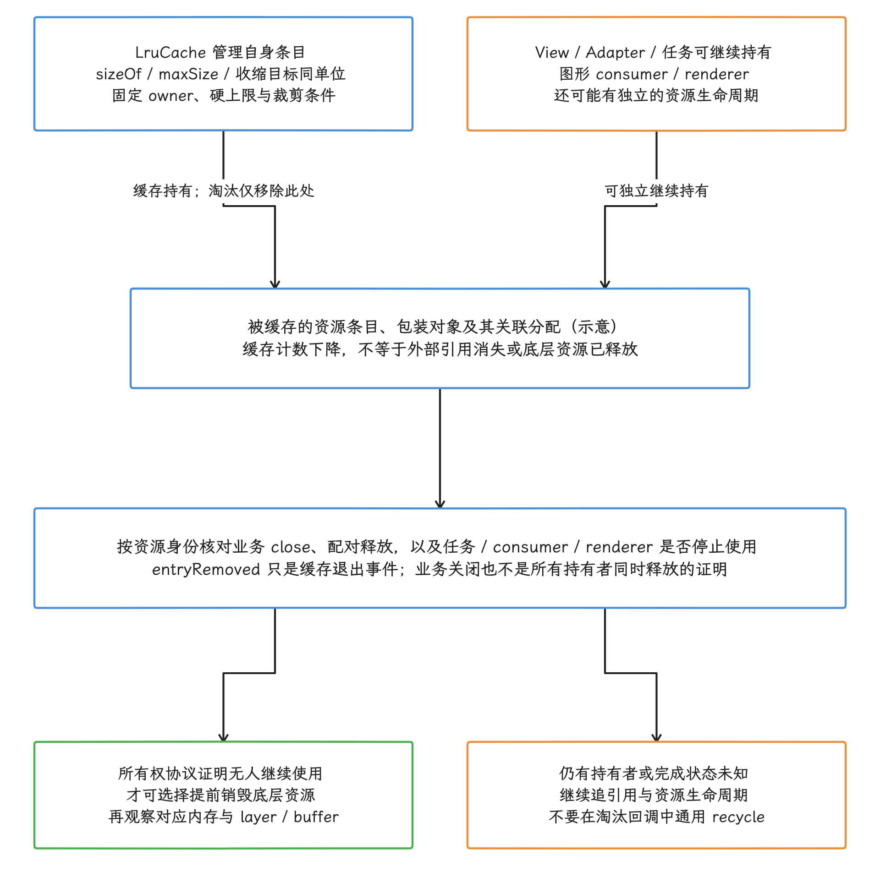

图：上半画一个被缓存资源的持有关系示意，下半核对释放条件；并非所有资源都有同一Java包装或consumer。LruCache的sizeOf/maxSize/收缩目标同单位、owner与裁剪条件明确，硬上限只约束cache自身。淘汰只移除cache这一处持有，View/Adapter/任务或图形consumer/renderer仍可按各自协议继续使用；业务close、GC、管线完成和指标回落不是同一时刻。按资源身份追每个持有者和配对释放；只有所有权协议证明没有其他使用者才可选择提前销毁，entryRemoved不是通用Bitmap.recycle开关。随后以layer/buffer/memtrack/映射等对应观测确认，不把缓存计数下降当总内存有界或立即回收证明。

长时间运行的音乐、导航、IM、RTC 等场景还要把运行时长纳入基线。环形缓冲区、历史数据、图片、地图瓦片、字幕和模型缓存分别设上限；音视频会话中的 Codec、Surface、Image 和原生 session 由同一个持有者成对关闭。每轮业务结束后比较的是 live set 本身，“进程仍在运行”算不上验收结果。

### 7. 系统内存压力与 LMKD

有些增长的根源在系统一侧：内存压力之下，系统会主动回收进程。`lmkd` 可通过 PSI 事件感知 memory stall（内存压力造成的任务停顿），据此决定是否回收进程；判断依据还包括 watermark（可用内存水位）、swap、workingset refault/thrashing（工作集页面频繁换入引起的抖动）、reclaim（页面回收） 状态和产品属性。候选进程按 `oom_score_adj` 的保护级别扫描；`kill_heaviest_task` 配置或扫描进入可感知进程等保护级别分支时，会改为比较同一 adj 档的较大进程；这与单纯按 PSS 全局排序不同。

<!-- gracker-diagram: ch10-01-22-lmkd-decision -->
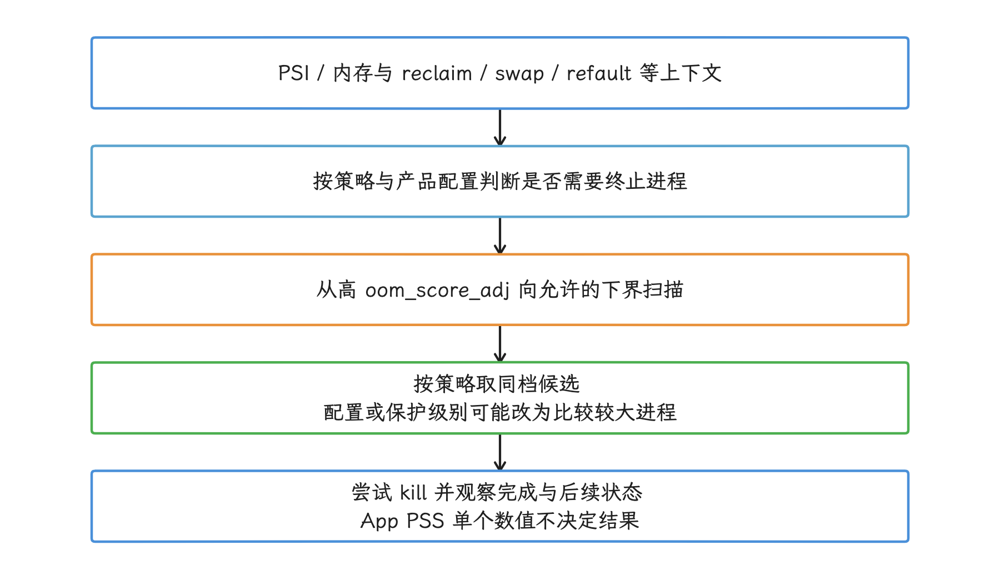

图：r1 扫描顺序和同档选择各有条件，不能仅凭 PSS 高推断下一个 victim。

由此可以推出几条判断规则：

- App PSS 高，下一次未必被杀；
- 前台/可感知进程与 cached 进程的保护级别不同；
- victim（被选中回收的进程）不只由 PSS 决定；
- LMKD kill、kernel OOM、crash、ANR 和用户 force-stop 是不同退出原因；
- 设备厂商可调整 lmkd 属性与内存策略。

源码核对：

- [`lmkd.cpp`](https://android.googlesource.com/platform/system/memory/lmkd/+/refs/tags/android-17.0.0_r1/lmkd.cpp)
- [`psi.c`](https://android.googlesource.com/kernel/common/+/refs/tags/android17-6.18-2026-06_r6/kernel/sched/psi.c)

#### 7.1 libpsi 与 PSI 事件通道

`libpsi` 位于 `system/memory/lmkd/libpsi`。头文件把资源限定为 `PSI_MEMORY`、`PSI_IO`、`PSI_CPU`，并暴露 `PSI_SOME` / `PSI_FULL`、`psi_stats` 以及 monitor/parse 函数；库本身没有 victim 选择、`oom_score_adj` 扫描或 kill policy（查杀策略）。`lmkd` 调用 `init_psi_monitor(..., psi_window_size_ms * US_PER_MS)` 时没有显式传 `resource`，因此使用头文件默认值 `PSI_MEMORY`。[已验证: system/memory/lmkd/libpsi/include/psi/psi.h@android-17.0.0_r1#25][已验证: system/memory/lmkd/lmkd.cpp@android-17.0.0_r1#3435][来源: https://juejin.cn/post/7677254638325727242]

`init_psi_monitor()` 会先校验资源类型，再以 `O_WRONLY | O_CLOEXEC` 打开 `/proc/pressure/<resource>`，写入 `"some|full threshold_us window_us"`，成功后直接返回这个 fd。内核写入路径把 trigger（触发器） 绑定到该打开文件；同一个 fd 再写第二个 trigger 会以 `-EBUSY` 拒绝。因此这个 fd 是“何时有压力”的事件通道，不是读取 `avg10/avg60/avg300/total` 的统计通道。[已验证: system/memory/lmkd/libpsi/psi.cpp@android-17.0.0_r1#36][已验证: kernel/sched/psi.c@android17-6.18-2026-06_r6#1569][来源: https://juejin.cn/post/7677254638325727242]

`register_psi_monitor()` 只用 `EPOLLPRI` 挂入 epoll，并把调用方传入的 `void* data` 放进 `epev.data.ptr`。内核 `psi_trigger_poll()` 在 trigger 的 `event` 标志从 1 被 `cmpxchg` 消费时加上 `EPOLLPRI`。其基础返回值包含 `DEFAULT_POLLMASK`，所以 `EPOLLIN` 可能一直就绪，不能用来区分新压力事件，还可能形成空转；应监听并识别 `EPOLLPRI`，同时处理错误和关闭。[已验证: system/memory/lmkd/libpsi/psi.cpp@android-17.0.0_r1#86][已验证: kernel/sched/psi.c@android17-6.18-2026-06_r6#1489][来源: https://juejin.cn/post/7677254638325727242]


统计读取走另一组 fd：`psi_parse_mem()`、`psi_parse_io()`、`psi_parse_cpu()` 使用 `reread_file()` 读取 `/proc/pressure/*` 文本，`parse_psi_line()` 解析 `some/full avg10=... total=...`，其中 CPU 只解析 `some` 行。排查 `lmkd` 时，我们把 trigger 唤醒、统计快照和后续 kill decision（查杀决策） 分开看。[已验证: system/memory/lmkd/lmkd.cpp@android-17.0.0_r1#2093][已验证: system/memory/lmkd/libpsi/psi.cpp@android-17.0.0_r1#109][来源: https://juejin.cn/post/7677254638325727242]

<!-- gracker-diagram: ed10-01-psi-event-stat-and-poll -->
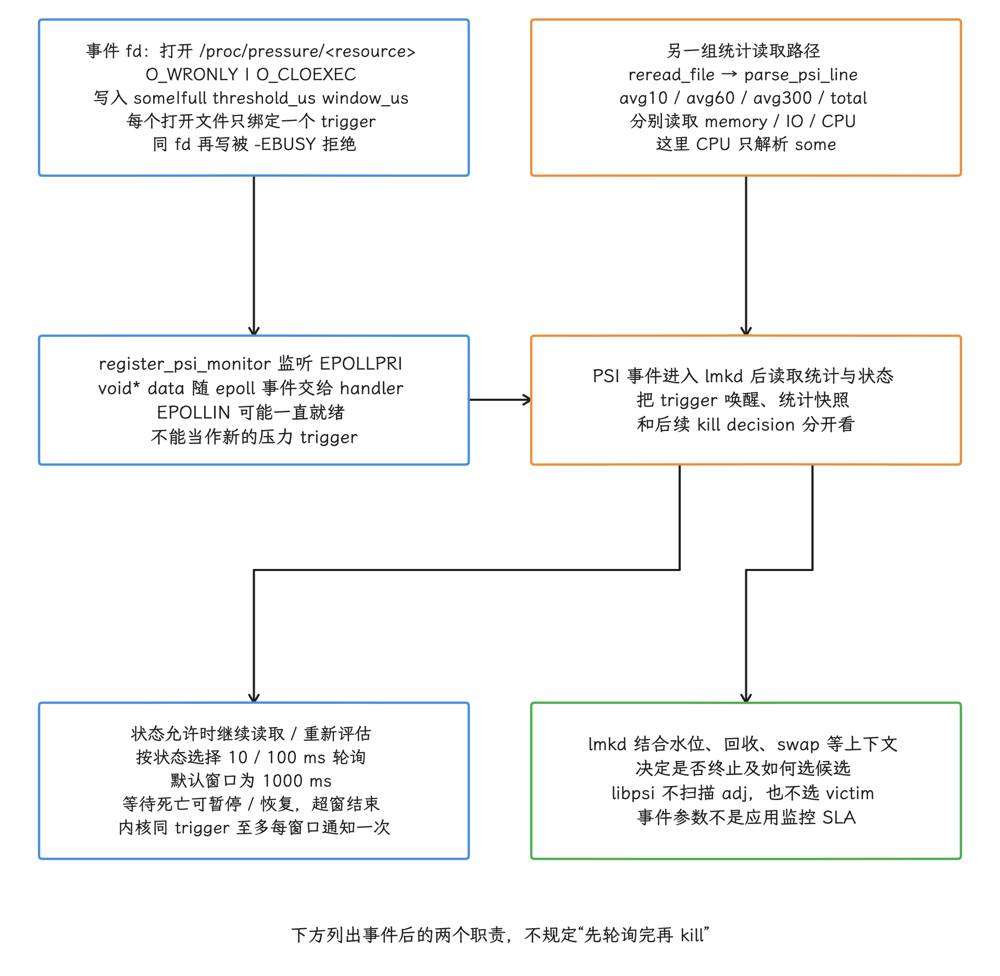

图：固定r1的libpsi事件fd用O_WRONLY|O_CLOEXEC打开pressure文件并写some/full trigger，一个打开文件只绑定一个，第二次写被EBUSY拒绝。EPOLLPRI指示trigger事件，EPOLLIN可能持续就绪，不能当新事件；void*data交给调用者handler。统计走另一组reread/parse路径读avg10/60/300与total，CPU在此只解析some。事件后lmkd可按状态用10/100ms间隔继续读取并重新评估，默认窗口1000ms，等待死亡可暂停/恢复，超窗结束；内核同trigger至多每窗口通知一次。图下方是后续两个职责，未规定轮询窗口结束后才kill；是否kill、按adj选谁还需水位/回收/swap等策略上下文，libpsi本身不选择victim，参数不是应用SLA。内核参数合法性与权限另见后图。

内核侧参数边界也要按目标内核核对：common kernel `android17-6.18-2026-06_r6` 拒绝 `window_us == 0` 或超过 10s，拒绝 `threshold_us == 0` 或 threshold 大于 window；源码中的 `privileged` 取决于打开文件的凭据是否具有 `CAP_SYS_RESOURCE`，或是否编译启用 `CONFIG_DEFAULT_SECURITY_SELINUX`；只有 `!privileged` 分支要求 window 为 2s 的倍数。此实现判断不替代 procfs/SELinux 对写入本身的访问控制。`lmkd` 的默认 PSI 窗口为 1000 ms，并在 PSI 事件后按 10/100 ms 间隔轮询一个窗口，因为同一 trigger 在内核中至多每个窗口通知一次。其他内核分支或博客中的窗口下限，不要直接写成 Android 17 通用结论。[已验证: kernel/sched/psi.c@android17-6.18-2026-06_r6#1336][已验证: kernel/sched/psi.c@android17-6.18-2026-06_r6#509][已验证: system/memory/lmkd/lmkd.cpp@android-17.0.0_r1#118][来源: https://juejin.cn/post/7677254638325727242]

<!-- gracker-diagram: ch10-01-24-psi-trigger-gates -->
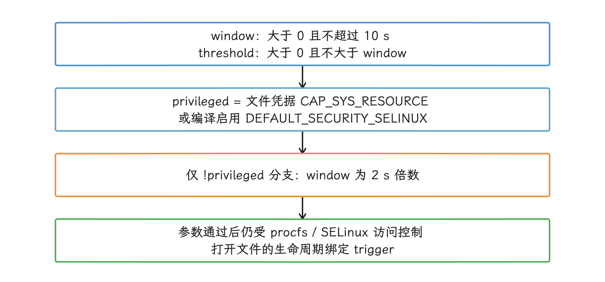

图：参数合法性、源码内部 privileged 判断与访问权限是不同条件，不能从一个条件推出普通应用一定能注册。

#### 7.2 用 `ApplicationExitInfo` 补齐进程退出上下文

下面的代码读取当前包最近的退出记录：

```kotlin
if (Build.VERSION.SDK_INT >= Build.VERSION_CODES.R) {
    val exitRecords = activityManager.getHistoricalProcessExitReasons(
        context.packageName,
        0,
        16,
    )

    for (record in exitRecords) {
        Log.i(
            "ExitMemory",
            "reason=${record.reason}, importance=${record.importance}, " +
                "pssKb=${record.pss}, rssKb=${record.rss}, " +
                "timestamp=${record.timestamp}",
        )
    }
}
```

`getPss()` 与 `getRss()` 是系统上一次采样值，单位 kB；进程在采样前退出时可能为 0，该值与退出瞬间的内存是两回事。普通应用可结合公开的 `reason`、importance、描述、可用 trace 和自定义 state summary；r1 的 `getSubReason()` 标为 `@hide`，细分原因需在有权限的平台报告或调试证据中查看。


应用还可以在低频业务状态切换时写入最多 128 bytes 的非敏感摘要：

```kotlin
if (Build.VERSION.SDK_INT >= Build.VERSION_CODES.R) {
    val state = "screen=checkout;phase=confirm"
        .toByteArray(StandardCharsets.UTF_8)
    activityManager.setProcessStateSummary(state)
}
```

该 API 的调用频率可能受系统限制，过度调用会抛出 `RuntimeException`。摘要只用于退出分析，恢复 UI 用不上；账号、订单、位置等敏感信息不要写入。

<!-- gracker-diagram: ed10-01-exit-context-and-old-sample -->
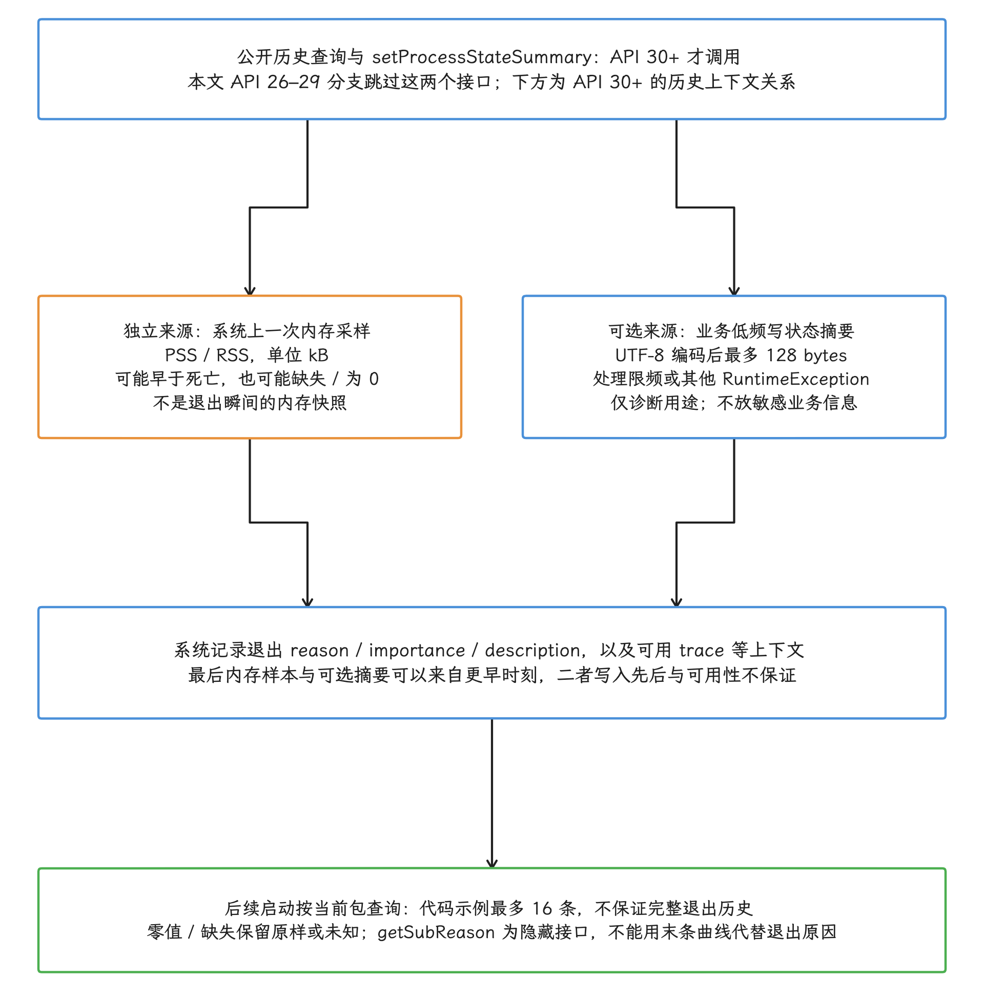

图：图中箭头表示历史上下文的数据来源，不表示采样导致退出或要求两种来源都存在。公开历史查询/状态摘要API30+，本文26–29跳过相应调用；API门槛不表示系统内存采样本身到API30才存在。系统PSS/RSS是上一次采样、单位kB，可早于死亡且可缺失或为0；可选状态摘要由业务低频写入，UTF8编码后最多128bytes，可能限频抛RuntimeException，仅用于诊断而非恢复UI，不放敏感内容。采样和摘要写入不承诺先后。后续启动代码按当前包最多请求16条历史，不能保证完整历史；公开reason/importance/description/可用trace用于原因分析，getSubReason为隐藏接口，缺失产物保留未知，不能用末次曲线推出死亡原因。

源码核对：[`ApplicationExitInfo.java`](https://android.googlesource.com/platform/frameworks/base/+/refs/tags/android-17.0.0_r1/core/java/android/app/ApplicationExitInfo.java#912)

### 8. 线上监控的采集范围

常规线上遥测使用轻量摘要。heap dump、malloc debug 和 sanitizer 的启动条件、额外停顿与内存成本要单独评估；它们不应成为普通告警的无条件同步动作。按配置采样的 Hprof 方案和受系统策略约束的 ProfilingManager 是另一条诊断路径，不能由常规遥测直接保证产物。轻量记录包括：


- 进程、页面/场景枚举和前后台状态；
- Java used/max；
- 低频采集本进程的 PSS/RSS 与摘要分类；
- native allocated；
- page size、ABI、device/build、App 版本；
- trim callback（内存回收提示回调）、退出原因和最近的非敏感状态摘要；
- OOM、native crash 与 LMKD 相关的聚合事件。

采样时机根据业务选择：

- 场景进入和退出；
- 固定生命周期节点；
- 内存增长速度异常时增加一份低成本快照；
- 进程下次启动时读取历史退出记录；
- 实验组与基线组使用相同采样策略。

采样本身会排队、读取 procfs（`/proc` 进程信息文件系统）或调用 Binder，所以周期由设备开销实验确定，不使用通用的“30—60 秒”。`getProcessMemoryInfo()` 的系统缓存也使更短周期未必产生新数据。

隐私与稳定性要求：

- 不上传 heap 内容、对象字符串、文件路径、图片或业务 payload（载荷数据）；
- state summary 使用枚举或短 ID，不写用户标识；
- 采样失败返回 unknown，不循环重试；
- 单位写进字段名；
- 多进程分别记录 PID、进程名和角色；
- OOM 前末次样本只当上下文，死亡瞬间的证据要从别处找。

### 9. 按现象选工具

我们把前几节的内容汇总成一张表：在 trace 或监控里看到某类现象时，下一步该用什么工具、需要证明什么。

| 现象 | 下一步工具 | 需要证明的事 |
|---|---|---|
| Java used 与实例数持续增长 | Heap dump / dominator / GC root | 哪个长生命周期持有者保留对象 |
| Java used 回落但 GC 很密 | ART allocation profiling / Perfetto | 哪些调用栈制造 churn |
| Native allocated 持续增长 | heapprofd | 哪些 malloc/new 调用栈未释放 |
| Native RSS 高于 allocator 统计 | smaps、malloc_info、mmap trace | 缓存、碎片、直接映射或 swap 哪项成立 |
| Graphics 增长 | memtrack、SurfaceFlinger layer、GPU 专项工具 | 哪个 Surface、buffer 或 GPU 资源持有者未释放 |
| PSS/RSS 增长但 heap 稳定 | meminfo 分类、threads、maps、graphics | 增量属于 code、stack、mmap、共享页还是设备内存 |
| 进程消失 | `ApplicationExitInfo`、系统日志、LMKD 事件 | 退出原因、保护级别与上次采样上下文 |
| Native 非法访问 | HWASan / GWP-ASan / Malloc debug | 越界、use-after-free 或 double free 的访问栈 |


### 10. 交付前检查表

- [ ] 每个指标都标明单位、来源、进程和采样时刻。
- [ ] PSS 没有与 `memoryClass` 或 `largeMemoryClass` 计算比例。
- [ ] Java heap、native allocator、resident pages 和 Graphics 分开。
- [ ] Heap dump 结论包含预期生命周期与 GC root。
- [ ] heapprofd 结论注明采样窗口、interval（采样间隔）、符号和未覆盖的 `mmap`/graphics。
- [ ] Native RSS 与 heapprofd 的差值没有直接写成碎片。
- [ ] malloc debug 只用于 debuggable/root 受控环境。
- [ ] API 26+ 的软件 Bitmap 像素按 native 归属分析，HARDWARE Bitmap 另查图形内存。
- [ ] memtrack 缺失或为 0 时，没有断言 GPU 内存为 0。
- [ ] 4 KB 与 16 KB page size 使用不同基线分组。
- [ ] LMKD 判断包含 PSI、reclaim、swap/thrashing、adj 与设备配置。
- [ ] `ApplicationExitInfo` 的 PSS/RSS 被标为上次采样。
- [ ] 线上数据不含 heap 内容和敏感业务信息。

---

## 从异常曲线到分配责任

基线模型负责提出假设；增长到底来自泄漏、缓存、抖动、图形资源还是系统共享内存，要靠案例里的证据来回答。

这一节复核四个公开案例。每个数字都来自原文所述环境，用于还原取证过程，不宜直接写进其他产品的阈值或收益目标；平台与内核机制的核对基线见本文开头，旧设备案例保留原系统、ABI 和驱动条件。

| 案例 | 主要内存域 | 决定性证据 | 原文公布的结果 |
| --- | --- | --- | --- |
| 低内存导致冷启动退化 | 系统回收、文件页、I/O | 主线程 D 状态（不可中断睡眠）时长、`kswapd0`、进程终止与重启记录 | 原文未公布参数调整后的 A/B 数据 |
| 线上 Hprof 归因 Java OOM | Java 堆 | dominator tree（支配树）、Retained Size、GC Root 路径 | Helo 与美篇均有双月数据，口径见案例二 |
| PowerVR `renderD128` 映射增长 | GPU 用户态驱动、虚拟地址空间 | `syscall(__NR_mmap2)`、`KEGLGetPoolBuffers`、buffer pool（缓冲池）阈值 | 受影响机型实验的 OOM 崩溃率下降近 50% |
| MemoryThrashing 差分采样 | 原案例为 iOS Objective-C 对象 | 连续样本间的 alloc/dealloc（分配/释放）与存活实例差值 | 发布时处于测试环境监控，未公布线上 OOM 降幅 |

### 案例一：低内存导致冷启动等待 Block I/O

#### 现象与数据

我们先看现象。历史文章对比了低内存与正常内存下的冷启动 trace。按原图线程摘要逐行核对，Running 分别为 **682.137 ms** 和 **624.278 ms**；把全部 D 类状态统一相加，分别是 **783.385 ms** 与 **139.417 ms**。D 表示不可中断睡眠，只有带 Block I/O 标注的行同时带有该类等待线索，不能把所有 D 都直接写成磁盘读。正常截图顶部的启动框选约为 1.223 s。

> ⚠️ 矛盾：原文用约 750/130 ms 概括 D 状态，且低内存 Running 另一处写成约 600 ms，与截图不完全一致。这里按截图全部 D 行重算：低内存为 619.033 + 28.417 + 131.776 + 4.159；正常为 106.320 + 32.428 + 0.669，单位均为 ms。两张线程摘要的选择范围分别为 2053.451/1227.232 ms，与顶部框选的 2.044/1.223 s 略有差别，不能混作同一比例轴。


这些数字只描述该次 trace。单看总启动耗时，很容易把问题归到主线程代码；线程状态给出了另一条线索：额外时间主要用于等待内核和存储路径。

#### 证据怎样形成完整链条

要把诊断做实，需要把四类证据对齐在同一条时间轴上：

1. 在 Perfetto 中圈出启动区间，比较主线程 Running、Runnable（可运行但在等待 CPU）、Sleeping 与 D 状态。
2. 展开 D 状态对应的内核调用栈，确认是否等待文件页、块设备或文件系统锁。
3. 在同一时间窗检查 `kswapd0`、内存回收 tracepoint（跟踪点）、`meminfo`、`vmstat`、swap/ZRAM 和 PSI。
4. 检查 `lmkd` 与 ActivityManager 事件，确认同一进程是否在短时间内反复被终止，又被业务或系统重新启动。

`mm/vmscan.c` 中的回收路径解释了 `kswapd` 与直接回收的执行位置，`include/trace/events/vmscan.h` 提供回收 tracepoint 定义。`lmkd.cpp` 使用 PSI 监视器感知 stall（资源停顿），并结合进程重要性和内存状态选择要终止的进程。两部分应按时间、进程和请求身份核对；回收繁忙、D 状态和终止记录共现只提供相关性，仍需缺页、回收或 I/O 等待链证明压力如何进入这次启动的关键路径。历史原文中的 QQ 终止—重启记录来自另一段 Monkey 场景，日志写的是 `am_kill`、`empty #3`，不能补写成此次启动的 LMKD kill 证据。

#### 根因判断

原文给出了下面的机制解释；把它用于新报告时，应逐段补证：

<!-- gracker-diagram: ch10-01-31-case-pressure-causality -->
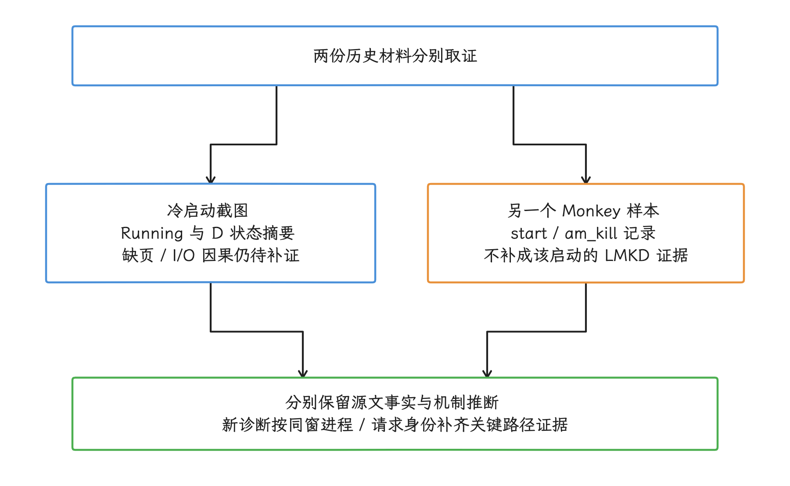

图：回收、D 等待和进程终止共现只是线索。把原文不同样本分离，再补齐这次关键路径的因果证据。

- `[推断]` 低内存可能增加回收与文件页驱逐，需要同窗水位、回收和 refault/缺页记录。
- `[推断]` 若启动依赖的 odex、资源或配置页需从存储补入，等待可能进入关键路径；需调用栈与请求时序佐证，D 状态本身不能确定读了哪个文件。
- `[来源事实]` 另一段 Monkey 记录中有缓存进程反复终止和重启。其资源开销可以作为后续假设，但不能直接合入这次冷启动的因果链。

主线程与 `kswapd0` 同核运行可能增加竞争，但一次 trace 中的同核现象还不足以证明调度策略存在缺陷。分析报告应分别列出“trace 直接观察到的事实”和“基于内核机制的解释”。

#### 修复与验证

原文给出了调高 `extra_free_kbytes`（额外预留空闲内存）等历史建议。照搬到当前产品并不合适：内核回收参数、ZRAM、存储延迟、PSI 阈值和 `lmkd` 策略互相影响，单项调大也可能带来更多后台回收或更高的进程重启率。

系统侧修复应以同场景 A/B 为准：

- 对比压力前后的 PSI `some/full`、direct reclaim（分配线程同步回收）、`kswapd` CPU、major fault（需要从存储读取的缺页）和块 I/O 延迟。
- 核对 `lmkd` 每次选择的进程、释放量及后续重启，减少没有实际回收收益的终止—重启循环。
- 分设备内存档位校准回收、ZRAM 与杀进程策略，并用前台帧时间、启动耗时和后台存活率共同验收。


App 侧可在 `TRIM_MEMORY_UI_HIDDEN` 或 `TRIM_MEMORY_BACKGROUND` 到来时释放可重建缓存。Android 14（API 34）起，`TRIM_MEMORY_RUNNING_*`、`MODERATE`、`COMPLETE` 不再投递；Android 15（API 35）又将相关常量标为 deprecated。旧 trim level 推断不出实时系统压力，大规模清理也应移出每次回调的同步路径。


复用这个案例时，状态比较采用上述同口径的 D 类总量 783.385/139.417 ms，并保留截图选择范围。参数调整后的量化结果原文未公布，不补写 A/B 收益。

### 案例二：用线上 Hprof 找到 Java OOM 的持有者

#### 现象

Java OOM 常落在 Bitmap 分配、字符串构造或数组扩容等位置。该位置只表示本次分配失败，回答不了“此前的堆被谁长期占用”。字节跳动 Client Infra 的公开案例采用线上 Hprof（Java 堆快照格式），把分析对象从崩溃点转向对象持有关系。

#### 采集与分析

公开方案由客户端采集、服务端恢复与自动分析组成：


- 原方案默认在 Java OOM 时 dump，另提供可配置高水位的 fork 子进程 dump；这是两条历史实现路径。fork/ART 状态协调、写时复制和子进程清理都带来约束，不能把它当作当前普通 SDK 保证无停顿、低额外内存的通用能力。
- Tailor（该方案的 Hprof 裁剪工具）在 native 层移除字符串内容、Bitmap 像素等分析无需保留的数据。原文公布的头条样本平均文件大小从 355 MB 降至 44 MB。
- 服务端重建引用图和支配树，计算 Shallow Size、Retained Size 与 GC Root 路径，再按泄漏类、持有业务代码或大对象类聚合。
- 混淆后的类名和引用路径经 Retrace（根据映射文件恢复原始符号）还原，问题才能分派给代码所有者。

<!-- gracker-diagram: ed10-01-historical-hprof-acquisition-and-analysis -->
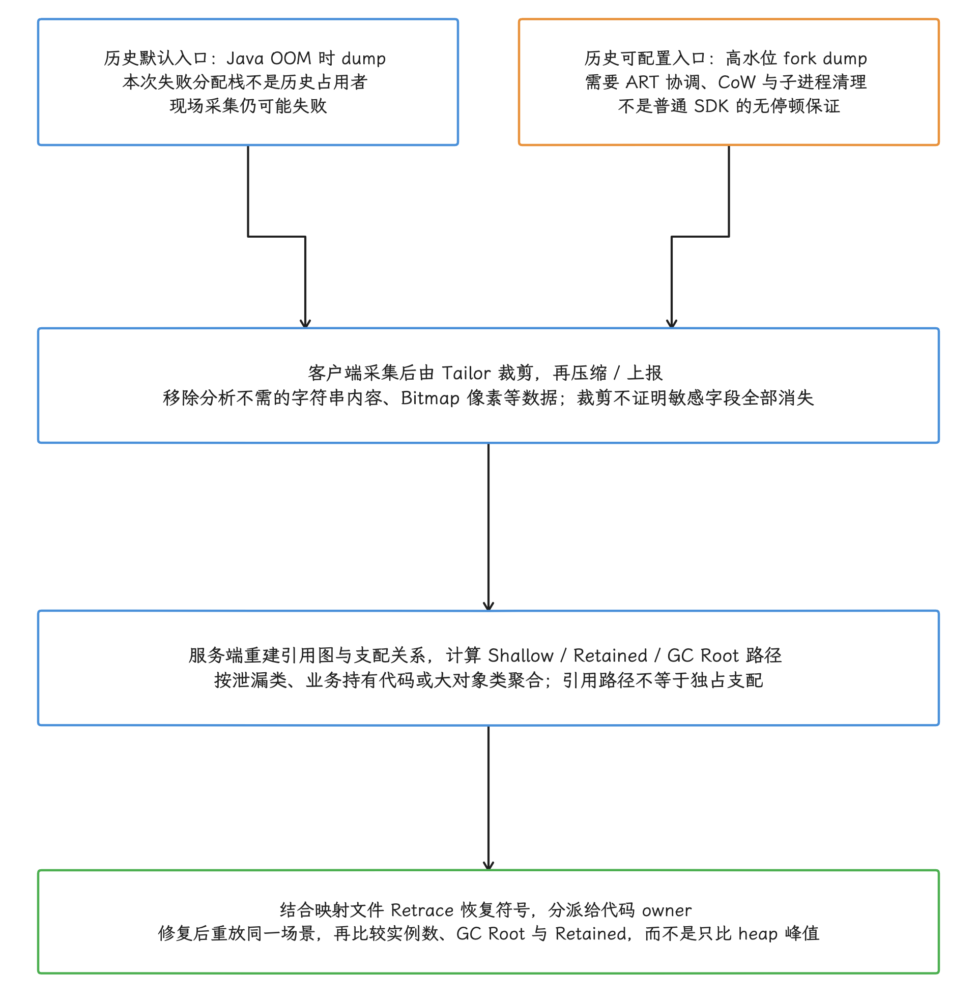

图：仅复述Client Infra历史方案：默认Java OOM现场dump与可配置高水位fork是两入口，成功后汇入Tailor裁剪/压缩上报及服务端分析；OOM现场可失败，fork需要ART状态协调、CoW及子进程清理，不能当作普通SDK无停顿/低额外内存保证。裁剪字符串内容和Bitmap像素等分析不需数据，不证明隐私风险全部消除；355MB到44MB只是原文头条样本平均文件大小。服务端重建引用/支配关系，计算Shallow/Retained/GC Root并聚合，引用路径不是独占支配，更不能按引用数分摊Retained。结合映射文件Retrace后回到代码owner，修复重放同一场景核对实例数、Root与Retained，失败分配栈或单个heap峰值都不能代替历史持有关系。

线上 Hprof 可能包含账号、文本和业务对象。采集前要有用户授权与合规评审，上传链路需要加密、限流、访问审计和过期删除。裁掉字符串内容后，仍可能有漏网的敏感字段。

#### 根因证据

原文展示的按类聚合样本中，`ArticleCell` 有 364 个实例，原文将聚合大小称为总 Retained Size；截图顶栏标的是“对象大小 **51.29 MiB**”，展开项显示其中 280 个有 `MainActivity` 相关引用路径。这个聚合值不表示 51.29 MiB 全部由 `MainActivity` 独占支配，仍应逐组核对支配关系与其他 GC Root 路径。这组数字把排查点从 OOM 栈移到 `MainActivity` 的引用所有权。


修复动作要服从引用语义：

- 页面退出后仍被任务、监听器或容器持有时，取消任务、解除注册并清理页面所有者。
- 数量符合业务需求但 Retained Size 过大时，减少单对象负载或限制集合容量。
- 缓存需要保留时，明确容量、失效条件与低内存行为；`WeakHashMap` 只弱持有 key，代替不了缓存策略。
- Android 8.0（API 26）起，软件 Bitmap 像素位于 native heap，HARDWARE 像素另属图形内存。生命周期正常的 Bitmap 通常交给 GC 与 `NativeAllocationRegistry`（Java 对象关联原生分配的运行时登记机制）管理；不要把批量调用 `Bitmap.recycle()` 写成通用修复。显式提前回收还可能让仍在绘制的调用方访问已释放像素。

修复后应重放同一场景并再次 dump，验证实例数量、GC Root 路径与 Retained Size 同时下降。只看 Java heap 的峰值下降，分不清引用修复、采样时机变化和 GC 调度差异。

#### 原文结果与 Android 17 增量

原文公布了两组产品数据：

- Helo 在一个双月内处理了 80% 以上的 Java OOM 问题，次日留存增长 2% 以上。
- 美篇在一个双月内 Java OOM 降低 80%，用户卡顿率也下降 80%。

这些是来源文章中的平台客户数据，任意 App 接入 Hprof 后能得到多少收益，从这些数字推导不出来；完整实验设计与收益归属，原文也未披露。

`ProfilingTrigger.TRIGGER_TYPE_OOM` 可在 OOM 时请求 Java heap dump。App 安装自定义 `UncaughtExceptionHandler` 后，仍须调用默认 handler，否则 OOM trigger（触发器） 不会生效。`TRIGGER_TYPE_ANOMALY` 可由系统异常检测触发相应 artifact（诊断文件）。两类触发均需版本、功能 flag、注册与系统策略支持；部分 anomaly 在同一 UID 多包注册时还可能没有产物。即使 API 可用，触发也不保证获得文件；它们只补充采集入口，引用图、隐私处理、聚合和修复验证仍由诊断系统完成。

<!-- gracker-diagram: ch10-01-37-profiling-trigger-gates -->
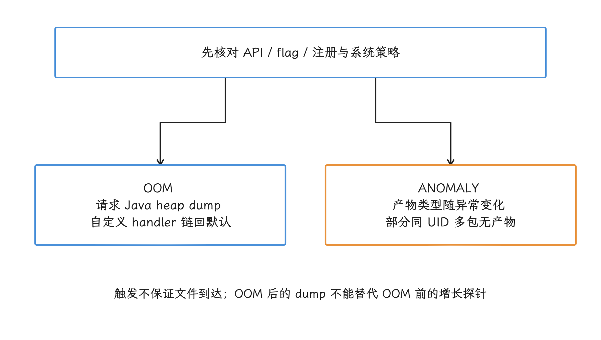

图：API 37 提供的 trigger 仍受 flag、注册、限流和系统策略约束。OOM 自定义异常处理器需链回默认处理器；部分 anomaly 还有同 UID 多包限制。

### 案例三：PowerVR buffer pool 长期保留 `renderD128` 映射

#### 环境与复现

原案例集中在华为 Android 10、联发科芯片、PowerVR GPU 与 32 位 `armeabi-v7a` 进程，少量样本覆盖 Android 8.1、9、11 和 12。OOM 发生时，GPU render node（渲染设备节点）`/dev/dri/renderD128` 的映射接近 1 GB，32 位进程的虚拟地址空间被大量占用。

团队在华为畅享 10e（Android 10）做了对照实验：新增 10 个普通背景 View 时映射无明显变化；给新增 View 设置 `alpha=0.5` 后，每个 View 对应的 `renderD128` 虚拟映射约增加 26,214,400 bytes，即 25 MiB（原文简称 25M）。这是特定设备、驱动和复现工程的数据，外推到其他 GPU 缺乏依据。

#### 从缺失的 Hook 记录找到映射入口

常见 `mmap`、`mmap64`、`mremap`、`__mmap2` Hook（运行时拦截）没有记录到这批映射，`ioctl` 记录也无法解释增长。继续反汇编 vendor（厂商） 库后，团队发现 `libsrv_um.so` 直接调用 `syscall`，系统调用号对应 32 位 ARM 的 `mmap2`。

随后只拦截 `libsrv_um.so` 与 `gralloc.mt6765.so` 对 `syscall` 的调用，映射记录出现。这个证据修正了“映射完全发生在内核驱动内部”的早期猜测：PowerVR 用户态库绕过了 libc 的 `mmap` 符号，直接进入系统调用。


调用栈继续指向 `libIMGegl.so` 的 `KEGLGetPoolBuffers`。一次增长会连续调用五次 `PVRSRVAcquireCPUMapping`，五类 buffer 合计约 25 MB，与 View 实验的增量吻合。绘制结束时，`KEGLReleasePoolBuffers` 只把 buffer 标为空闲，没有对应调用 `PVRSRVReleaseCPUMapping`。原文在 EGL surface / `CanvasContext` 销毁相关调用栈中观察到延迟释放，并将该案例归类为 buffer pool 长期保留。存在释放路径本身并不能排除生命周期泄漏；还要确认预期生命周期内是否实际执行释放、引用是否归零，以及新分配是否有上限。

<!-- gracker-diagram: ed10-01-powervr-entry-and-pool-lifetime -->
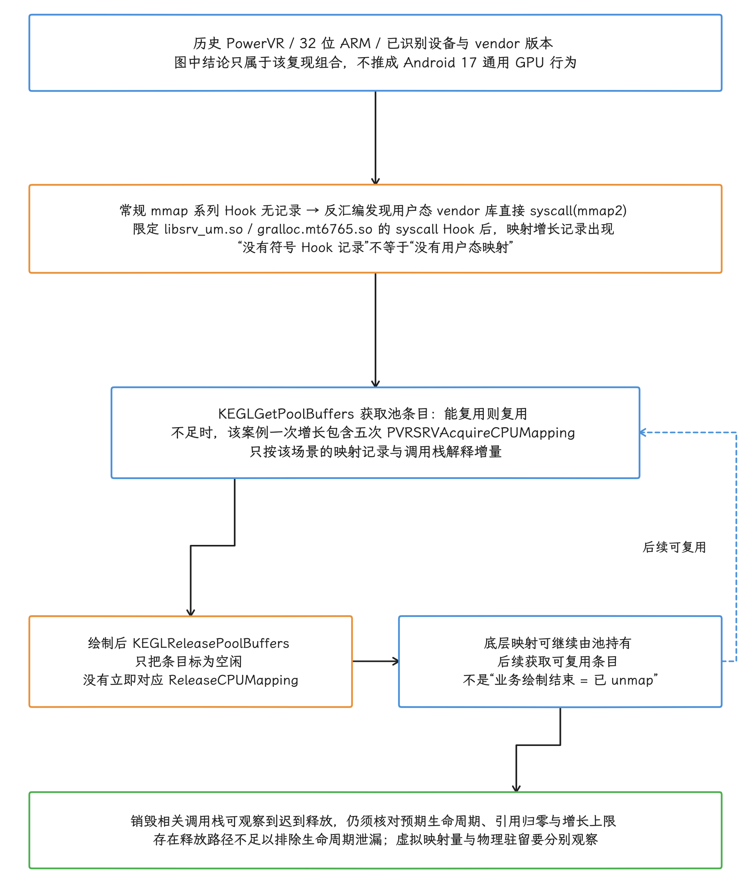

图：历史已识别PowerVR/ARM32设备和vendor版本中，常规mmap系列符号Hook没看到记录；反汇编发现libsrv_um.so直接syscall进入mmap2，限定libsrv_um.so/gralloc.mt6765.so入口后记录对应增长。因此缺Hook记录不能推出映射全部在内核内部。调用栈到KEGLGetPoolBuffers，可复用条目则复用，不足时该案例一次增长含五次AcquireCPUMapping；View复现的约25MiB增量是特定设备映射量，不是通用每View/RSS/物理成本。绘制后ReleasePoolBuffers只标idle而非立即ReleaseCPUMapping，虚线表示后续可复用。EGL surface/CanvasContext销毁相关调用栈可见迟到释放，仍需验证预期生命周期、引用归零与增长上限，存在释放路径不自动排除泄漏；Android17自动layer路径不能证明此旧pool行为仍存在。

#### 根因与历史修复

反汇编显示 pool 为每类 buffer 设置 `buffer_limits`。测试设备原值为 50，三组日志中的虚拟映射峰值分别为：阈值 50 时 1,318,281,216 bytes，20 时 531,849,216 bytes，10 时 269,705,216 bytes。原文以约 1.3G、530M、269M 概括；这些是该复现工程的映射量，不是 RSS 或通用的 GPU 物理内存预算。团队针对已识别的 vendor 版本修改该阈值。来源文章公布的受影响机型实验中，OOM 崩溃率下降近 50%，观察期间未再因 `renderD128` 问题阻断版本发布。


这是针对非公开 vendor 实现的历史干预，不宜当作通用 App 方案。其他厂商、驱动版本或进程位数可能使用完全不同的 pool 数据结构；错误 Hook 私有函数也可能破坏正在使用的 GPU 资源。

产品侧更稳妥的处理顺序是：

- 先按设备型号、SoC、GPU、OS、驱动与 ABI 聚类，确认问题是否只出现在少量设备组合中。
- 监控 `/proc/self/maps` 或 smaps 中 `renderD128` 映射，区分虚拟地址耗尽与物理驻留增长。
- 在受影响设备上减少使用能够稳定触发映射增长的渲染组合，必要时仅对这些设备降低动画或复杂效果。
- 推进 64 位进程可缓解 32 位地址空间耗尽，但不会减少 buffer 的物理内存成本。
- 将复现工程、映射增长曲线和 vendor 调用栈交给 SoC、GPU 或 ROM 厂商修复。


#### Android 17 源码中的对应路径

r1 的 `promotedToLayer()` 先要求 `LayerType::None` 且 `fitsOnLayer()`，随后检查 functor、image filter、stretch 或 alpha 混合等原因。alpha 分支要求 `!MathUtils::isZero(alpha)`、`alpha < 1` 且 overlapping rendering；它只是多个入口之一。`pushLayerUpdate()` 还会检查可渲染性与尺寸，再创建、更新或销毁图层。该源码能解释 alpha 组合为何可能进入额外的图层路径，证明不了 Android 10 的 PowerVR pool 行为仍存在于 Android 17。

<!-- gracker-diagram: ch10-01-41-hwui-promotion-gates -->
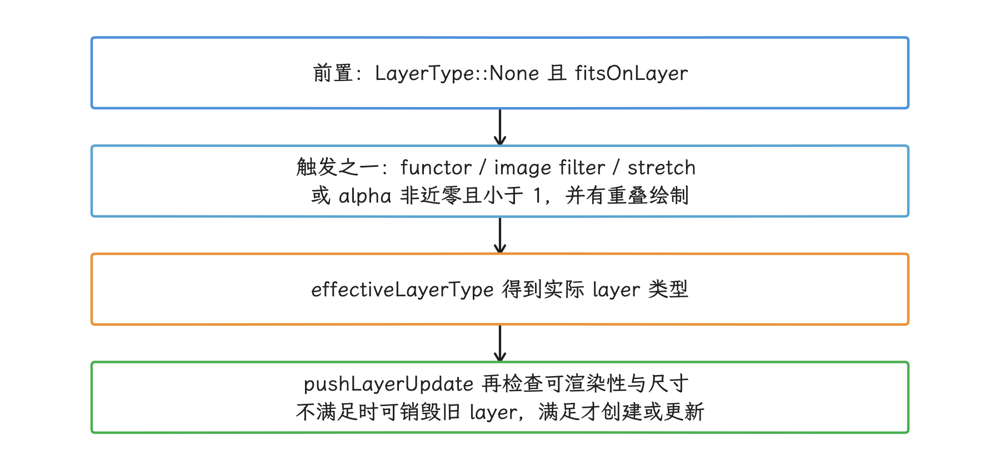

图：r1 的 alpha 只是一条触发分支，前置尺寸和后续有效性检查仍存在。这段源码不能证明旧 PowerVR pool 问题延续至新版本。

`hasOverlappingRendering()` 返回 `false` 只适合内容没有重叠混合的自定义 View。错误返回可能改变视觉结果。`LAYER_TYPE_NONE` 同样关不掉 alpha 引起的自动图层提升。渲染优化应以 Frame Timeline（帧时间线）、GPU 内存和画面对比共同验收。

### 案例四：保留 MemoryThrashing 的差分思路与平台边界

#### 原案例的 iOS 背景

MemoryThrashing 原文来自抖音直播 iOS 团队。实现通过 Objective-C Runtime Hook（运行时拦截）`alloc`、`dealloc`，统计各 Class 的分配、释放和存活实例数；它没有使用 Android 的 `Runtime.totalMemory()`、Java heap 或 ART 分配接口。


工具按多个时间点采样，对相邻样本做对象数量差分，定位两类异常：

- **驻留堆积**：原文样本在两个采样周期之间新增 234,024 个对象，样本末仍有 238,800 个 `LivexxxBigDataRead` 实例，截图记录 11,462,400 bytes，约 10.93 MiB。
- **临时对象洪峰**：开播特效识别人脸后频繁创建轮廓模型；小于 5 秒的采样周期内，原文称临时对象增量峰值约 60,000、累计分配超过百万次；展示的三个累计分配计数为 32,616、73,979、134,731，后两者之差是 60,752 次分配。该差值不是仍存活对象的净增长，百万次为原文另一项概括，不能从这三行截图直接算出。

<!-- gracker-diagram: ed10-01-oc-allocation-and-live-differences -->
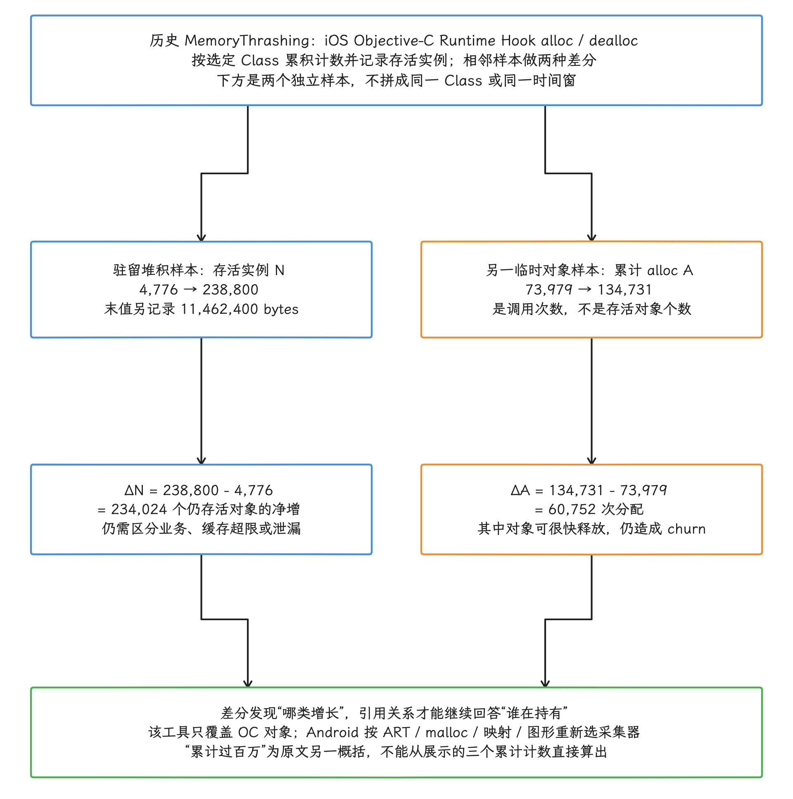

图：历史iOS工具Hook OC alloc/dealloc并按Class采样，两支是两个独立样本，不拼同一Class/时间窗。左侧存活从4776到238800净增234024个，末值11462400bytes；右侧相邻累计alloc从73979到134731增加60752次，期间对象可已释放，不能称仍存活60752个。原图另有累计32616，三行不直接推出累计百万，百万为原文另一概括。净存活增长仍需区分业务/缓存/泄漏，差分指出类而不回答持有者，继续查引用关系。工具只覆盖OC对象并可影响方法缓存，Android按ART/malloc/映射/图形另选采集器；原文发布时为测试部署，未提供线上OOM收益。

第二类对象可能很快释放，却会增加 CPU 与 allocator 压力；第一类需要继续查询引用关系，区分业务保留、缓存超限和泄漏。对象数量差分只能告诉工程师“哪类对象增长”，要回答“谁在持有”，还需要引用关系数据。

原文明确列出限制：只覆盖 Objective-C 对象、分析不了多个内存区域、没有完整引用图，Hook 还会影响方法缓存。文章发布时工具已部署到测试环境，线上部署仍在规划中，因此没有可引用的线上 OOM 降幅或定位耗时改善数据。

#### Android 上如何复用

Android 侧可保留“连续样本差分 + 异常时加深采集”的设计，采集器必须按内存域选择：

| 内存域 | 轻量信号 | 深入证据 |
| --- | --- | --- |
| Java/Kotlin 对象 | heap 使用量、GC 次数与停顿、受控场景的对象分配样本 | Java heap dump、实例数差分、GC Root 路径 |
| Native malloc | RSS/PSS 分类、`anon:libc_malloc`、分配速率 | heapprofd 调用栈与分配生命周期 |
| 图形缓冲区 | DMA-BUF、GPU 驱动映射、Surface 数量 | `dmabuf_dump`、smaps、Perfetto graphics 轨道、厂商工具 |
| 文件映射与线程栈 | maps 分类、线程数、地址空间余量 | smaps、线程创建栈、映射调用栈 |


业务探针（埋入业务流程的轻量采样代码）只采集总 PSS 时，Java 临时对象、native buffer 与 GPU 映射会混在一条曲线上。更可靠的报警条件由“场景 + 内存域 + 增长速率 + 回落情况”组成，阈值应来自设备档位和同场景分位数；来源不明的时间与容量数值，一律不用。

Android 15（API 35）提供 app-driven（由 App 主动请求的）`ProfilingManager.requestProfiling()`。Android 16（API 36）加入触发器注册。Android 17（API 37）增加 OOM、anomaly（异常） 和 cold-start（冷启动） 等 trigger。OOM trigger 发生在 OOM 时，用于申请 Java heap dump，替代不了 OOM 前的突增探针。采集结果受限流和系统策略约束，线上设计仍要处理“触发后没有 artifact”的情况。

当差分指出某一类实例异常增长时，再采集 heap dump 或 allocation profile；当增长落在 native 或 graphics 域时，切换到 heapprofd、smaps 或图形工具。这样可以保留 MemoryThrashing 的低成本发现能力，同时避免把 iOS Runtime 实现误写成 Android 方案。

### 四个案例共同说明什么

#### OOM 栈与历史占用的分工

OOM 栈记录失败的分配点。要说明此前的内存由谁占用，还需查看 Java Hprof 的 Retained Size、native 分配调用栈、GPU 映射来源和进程地址空间分布。

#### 内存上涨曲线的机制分类

Java 引用泄漏、短命对象洪峰、malloc 堆积、GPU pool、文件映射和系统回收压力需要不同证据。我们的入口都一样：先用 `dumpsys meminfo`、smaps 和 Perfetto 建立内存域分类，再进入专用工具。


#### 发布数字的实验上下文

80%、近 50%、355 MB 到 44 MB 都是来源文章在特定产品、周期或设备上的数据。引用这些数字时，应同时写明产品、周期、设备或指标口径。缺少结果数据的案例保持空白结论，比补一个“明显改善”更可靠。

#### 驱动与 ROM 问题的设备聚类

当问题集中在一个 SoC、GPU、OS 与 ABI 组合时，设备聚类结果本身就是证据。通用代码修改可能扩大需要回归测试的范围；针对少量设备复现、定向规避和厂商修复更适合此类故障。

### 复盘清单

- 现象对应 Java heap、native heap、graphics、mmap、线程栈还是整机压力？
- 效果数字来自本项目实验、公开案例，还是尚未验证的预期？
- 低内存 trace 是否同时包含线程状态、回收、PSI、I/O 与 `lmkd` 事件？
- Hprof 是否记录 Retained Size、GC Root 路径、版本和场景？
- 32 位 OOM 是否同时检查了地址空间余量与 RSS？
- vendor 故障是否按设备、SoC、GPU、驱动、OS 和 ABI 聚类？
- 突增探针是否按内存域采样，并为缺失 artifact 设计回退路径？
- 修复后是否重放同一场景，比较同口径的峰值、回落速度、帧时间和崩溃率？

### 延伸阅读

- [4.1 Android 与 Linux 内存管理全景](../../part1-fundamentals/ch04-memory/01-android-linux-memory-overview.md)：统计口径、物理页与回收机制。
- [4.2 ART Heap、GC 与后台维护调度](../../part1-fundamentals/ch04-memory/02-art-heap-gc-maintenance.md)：Java 堆、GC 与存活对象的关系。
- [4.3 lmkd、Cached App Freezer 与内存压力治理](../../part1-fundamentals/ch04-memory/03-lmkd-freezer-memory-pressure.md)：系统压力、进程优先级与后台状态。
- [23.2 内存泄漏检测与治理](../../part5-app/ch23-memory-practice/02-memory-leak-governance.md)：引用链与生命周期修复。
- [14.1 Perfetto 入门、Trace 抓取与可靠性](../../part3-tools/ch14-perfetto/01-perfetto-intro-capture-reliability.md)：采集配置、数据源与 trace 完整性。

### 相关章节

- **10.1 本文**：内存域分类、基线、持续增长、`dumpsys meminfo`、smaps、Perfetto 与 heapprofd。
- [23.2 内存泄漏检测与治理](../../part5-app/ch23-memory-practice/02-memory-leak-governance.md)：引用所有权、GC Root 与生命周期修复。
- **10.2 低内存对系统性能的影响**：回收、PSI、`lmkd`、ZRAM 与前台性能。
- **10.3 内存抖动与频繁 GC**：分配速率、GC 停顿和短命对象。
- **10.4 GPU 与图形内存统计、归因与诊断**：DMA-BUF、GPU 映射与图形缓冲区。
- **4.3 Low Memory Killer**：Android 17 userspace `lmkd` 路径。
- **7.2 典型场景分析**：从线程状态和关键路径解释卡顿。

## 参考资料

- [Android 中的卡顿丢帧原因概述——低内存篇](https://www.androidperformance.com/2019/09/18/Android-Jank-Due-To-Low-Memory/)
- [Android-PSI 详解：libpsi 源码解析](https://juejin.cn/post/7677254638325727242)
- [字节跳动应用性能监控帮助客户 Java OOM 崩溃率下降 80%](https://mp.weixin.qq.com/s?__biz=Mzg2NTYyMjYxNg==&mid=2247486007&idx=1)
- [抖音 renderD128 系统级疑难 OOM 分析与解决](https://mp.weixin.qq.com/s?__biz=MzI1MzYzMjE0MQ==&mid=2247514363&idx=1)
- [MemoryThrashing：抖音直播解决内存抖动实践](https://mp.weixin.qq.com/s?__biz=MzI1MzYzMjE0MQ==&mid=2247496677)
- [Android Developers：内存管理概览](https://developer.android.com/topic/performance/memory-overview)
- [Android Developers：ProfilingManager](https://developer.android.com/reference/android/os/ProfilingManager)
- [Android Developers：ProfilingTrigger](https://developer.android.com/reference/android/os/ProfilingTrigger)
- [Perfetto：heapprofd](https://perfetto.dev/docs/data-sources/native-heap-profiler)
- [AOSP `ComponentCallbacks2.java`（android-17.0.0_r1）](https://android.googlesource.com/platform/frameworks/base/+/refs/tags/android-17.0.0_r1/core/java/android/content/ComponentCallbacks2.java)
- [AOSP `RenderProperties.h`（android-17.0.0_r1）](https://android.googlesource.com/platform/frameworks/base/+/refs/tags/android-17.0.0_r1/libs/hwui/RenderProperties.h)
- [AOSP `RenderNode.cpp`（android-17.0.0_r1）](https://android.googlesource.com/platform/frameworks/base/+/refs/tags/android-17.0.0_r1/libs/hwui/RenderNode.cpp)
- [AOSP `ProfilingTrigger.java`（android-17.0.0_r1）](https://android.googlesource.com/platform/packages/modules/Profiling/+/refs/tags/android-17.0.0_r1/framework/java/android/os/ProfilingTrigger.java)
- [AOSP `lmkd.cpp`（android-17.0.0_r1）](https://android.googlesource.com/platform/system/memory/lmkd/+/refs/tags/android-17.0.0_r1/lmkd.cpp)
- [AOSP `libpsi/psi.cpp`（android-17.0.0_r1）](https://android.googlesource.com/platform/system/memory/lmkd/+/refs/tags/android-17.0.0_r1/libpsi/psi.cpp)
- [AOSP `libpsi/include/psi/psi.h`（android-17.0.0_r1）](https://android.googlesource.com/platform/system/memory/lmkd/+/refs/tags/android-17.0.0_r1/libpsi/include/psi/psi.h)
- [Android Common Kernel `mm/vmscan.c`（android17-6.18-2026-06_r6）](https://android.googlesource.com/kernel/common/+/refs/tags/android17-6.18-2026-06_r6/mm/vmscan.c)
- [Android Common Kernel `vmscan.h` tracepoints（android17-6.18-2026-06_r6）](https://android.googlesource.com/kernel/common/+/refs/tags/android17-6.18-2026-06_r6/include/trace/events/vmscan.h)
- [Eclipse MAT：Shallow 与 Retained Heap](https://help.eclipse.org/latest/topic/org.eclipse.mat.ui.help/concepts/shallowretainedheap.html)
- [Eclipse MAT：Dominator Tree](https://help.eclipse.org/latest/topic/org.eclipse.mat.ui.help/concepts/dominatortree.html)
- [固定内核：procfs 与 smaps 口径](https://android.googlesource.com/kernel/common/+/refs/tags/android17-6.18-2026-06_r6/Documentation/filesystems/proc.rst)
- [固定内核：smaps_account 的共享计数](https://android.googlesource.com/kernel/common/+/refs/tags/android17-6.18-2026-06_r6/fs/proc/task_mmu.c)
- [r1：AM 内存查询的权限与缓存](https://android.googlesource.com/platform/frameworks/base/+/refs/tags/android-17.0.0_r1/services/core/java/com/android/server/am/ActivityManagerService.java)
- [r1：malloc 调试属性与环境变量选择](https://android.googlesource.com/platform/bionic/+/android-17.0.0_r1/libc/bionic/malloc_common_dynamic.cpp)
- [r1：Bitmap.HARDWARE 与图形内存](https://android.googlesource.com/platform/frameworks/base/+/android-17.0.0_r1/graphics/java/android/graphics/Bitmap.java)
- [NDK：HWASan](https://developer.android.com/ndk/guides/hwasan)
- [NDK：GWP-ASan](https://developer.android.com/ndk/guides/gwp-asan)
