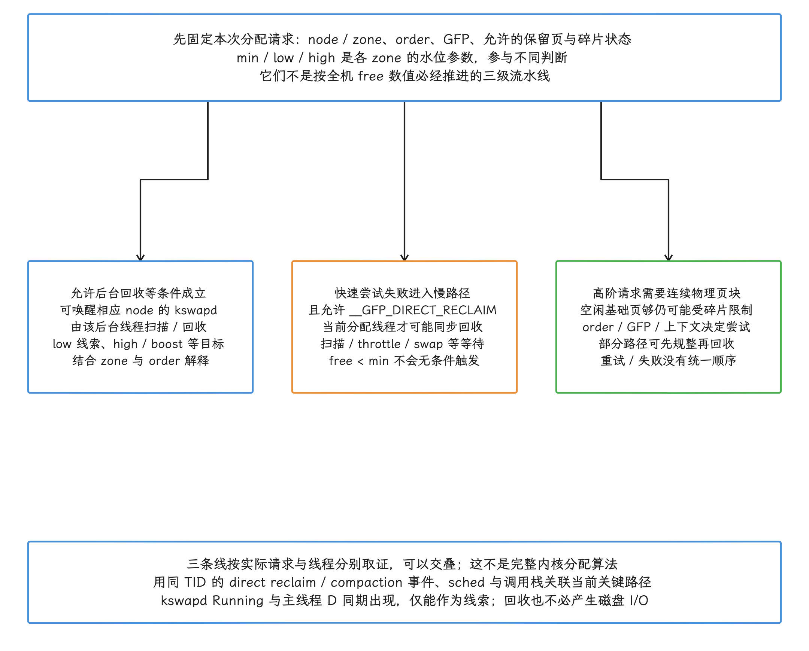
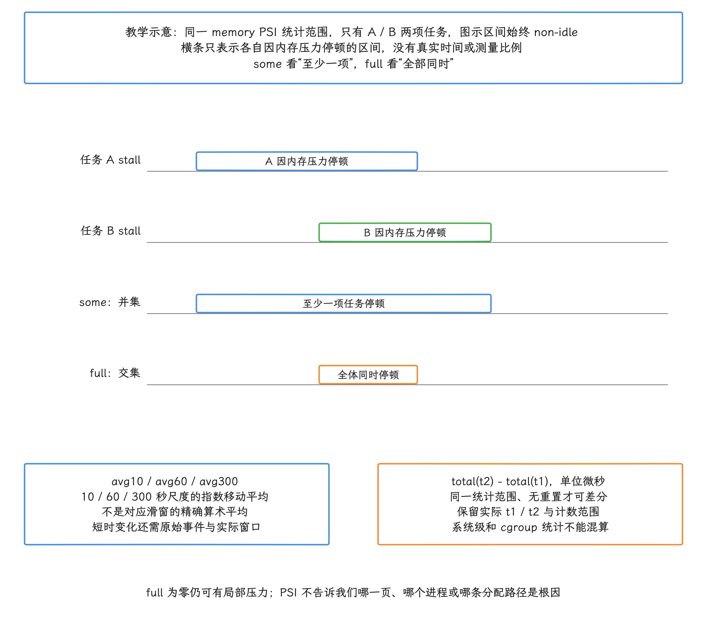
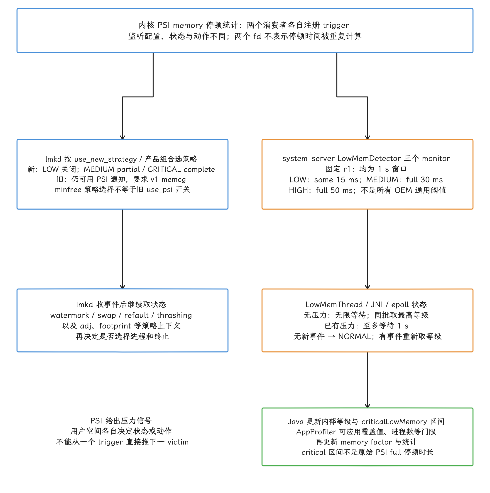
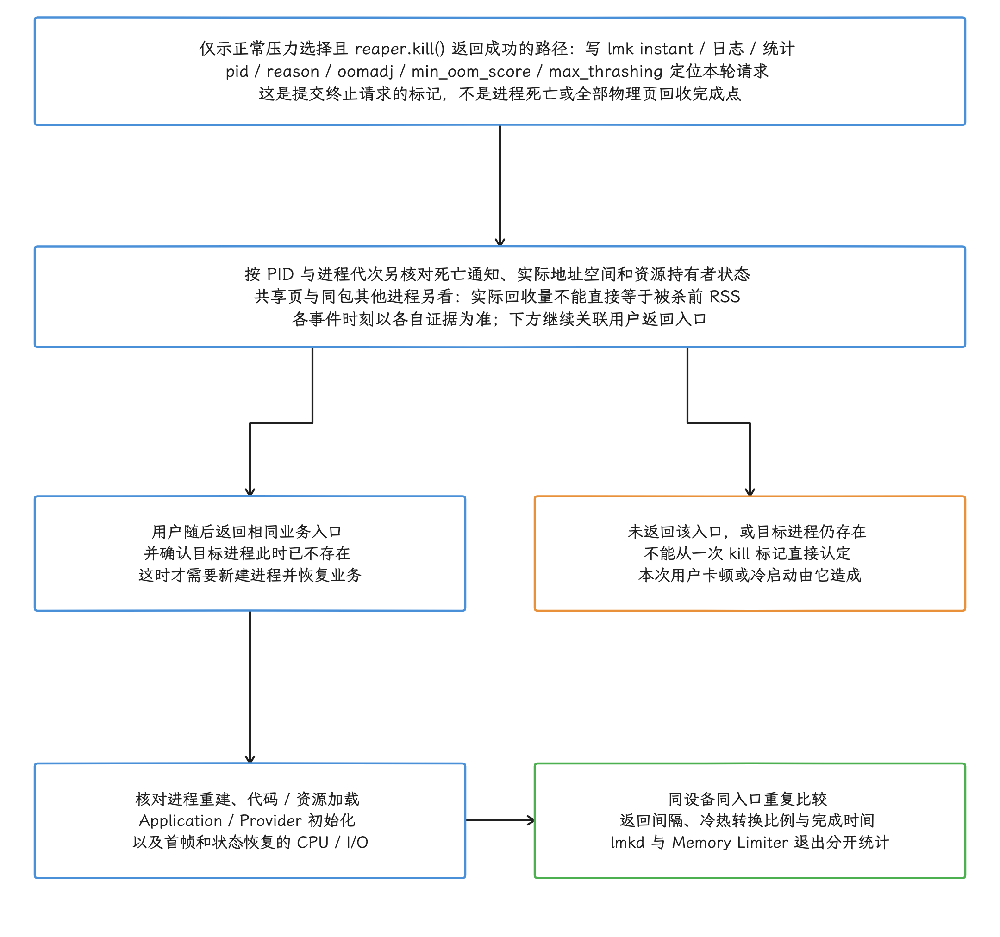
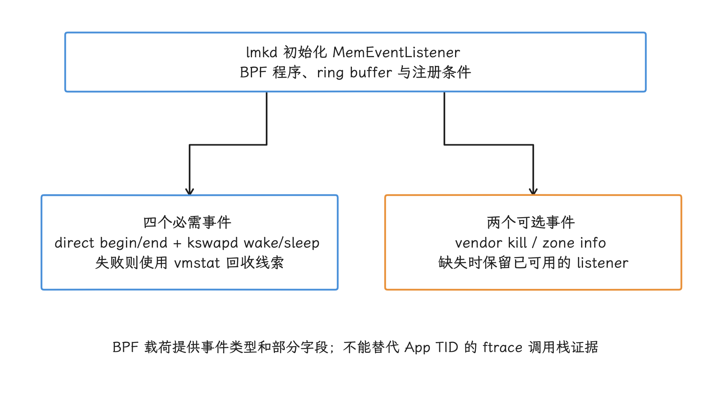
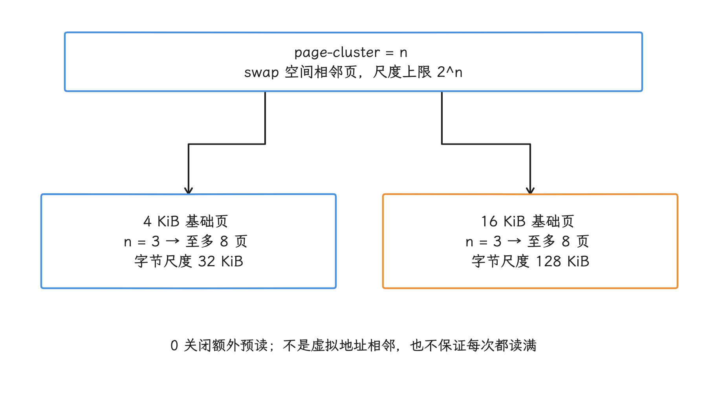
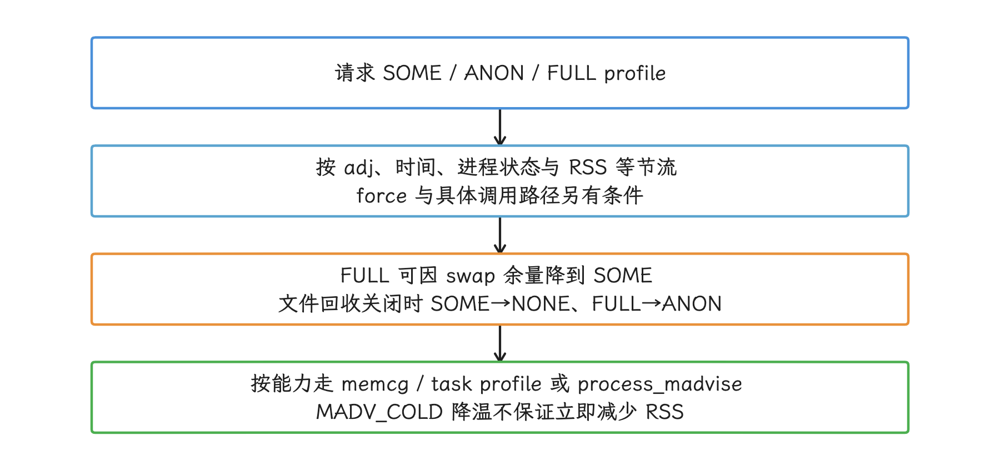
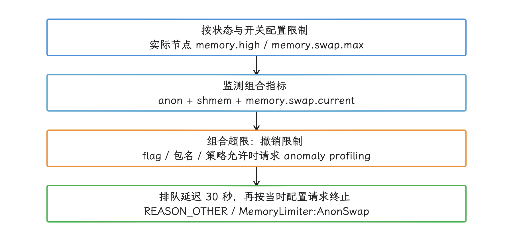
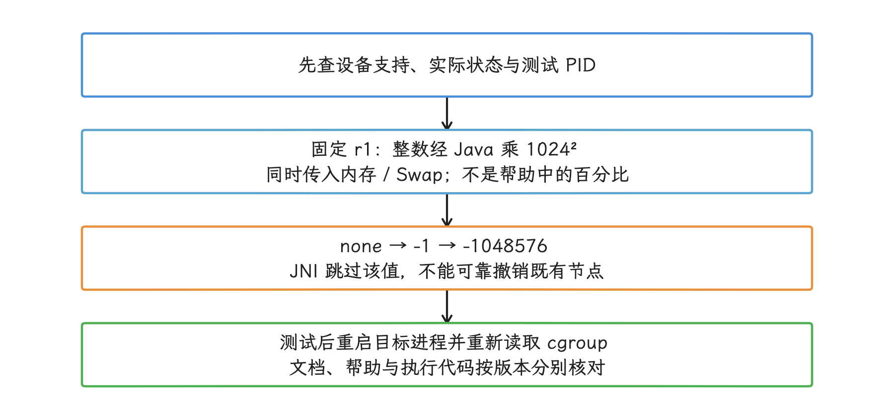

# 低内存对系统性能的影响

低内存带来的性能损失没有固定顺序。系统可能回收 clean file page（未修改的文件页）、把匿名页换入 ZRAM（内存中的压缩交换设备）、让分配线程进入 direct reclaim（同步直接回收），也可能终止 cached process（缓存进程）；Android 17 的 Memory Limiter 还会约束异常进程。这些路径各自消耗 CPU、I/O、内存带宽或启动时间。我们要确认的，就是同一段 Trace 里究竟是哪一条在起作用，办法是核对事件先后和因果关系。

> 源码基线：AOSP `android-17.0.0_r1`，适用 Android 10（API 29）至 Android 17（API 37）；回收、水位线、PSI、ZRAM 与页规整的内核源码按 `android17-6.18-2026-06_r6` 核对。


## 1. 从分配失败到回收

### 1.1 Zone 水位线与 kswapd

内存回收的起点在分配侧。Linux 把物理内存划分为多个 zone（内存区域），每个 zone 各自维护 `min`、`low`、`high` 等 watermark（水位阈值）。分配路径发现水位或碎片条件不满足、且允许 `__GFP_KSWAPD_RECLAIM` 等条件成立时，可尝试唤醒对应 NUMA node（内存节点）的 `kswapd` 后台回收线程；`mm/vmscan.c` 里的 `balance_pgdat()` 负责扫描和回收，回收完再尝试休眠。水位还参与分配快速路径、保留页和高阶分配的判断，空闲页有多少只是其中一项。

这条唤醒规则受多个条件影响：


- 分配请求的 order（连续页块阶数）、GFP flags（内核分配约束）、允许使用的 zone 与保留页各不相同。
- per-CPU page list（每 CPU 页缓存）、watermark boost（水位临时增量）、碎片和 compaction（内存规整）会改变分配慢路径。
- `kswapd0` 短暂运行属于正常回收；持续扫描、扫描收益低或频繁 wake/sleep 才值得追查。

对应的 6.18 内核源码位置：

- `mm/page_alloc.c`：watermark 检查、分配慢路径与 `wakeup_kswapd()`。
- `mm/vmscan.c`：`balance_pgdat()`、`shrink_node()` 与 direct reclaim。
- `include/trace/events/vmscan.h`：kswapd、direct reclaim 和 LRU 扫描 tracepoint。

### 1.2 Direct reclaim

分配请求在快速路径上失败，同时又允许 `__GFP_DIRECT_RECLAIM` 时，发起分配的线程可能同步进入回收。空闲页低于 `min` 并不会无条件触发这条路径，分配 order、zone、reserve（保留页）、memcg（内存控制组）与 GFP 语义都会影响这个判断。


Direct reclaim 占用的是当前线程自己的执行时间。线程可能在 CPU 上扫描页面，也可能因 throttle（限速）、swap 或 I/O 等待进入不可中断睡眠。我们在 trace 里看到主线程处于 `D` 状态时，先别急着归因到内存回收：用 `sched_switch`、blocked reason（阻塞原因）或内核调用栈确认它到底在等什么，再下结论。

### 1.3 回收成本来自哪里

不同页面的代价不同：

| 被处理的内存 | 回收动作 | 后续成本 |
| --- | --- | --- |
| clean file page | 丢弃页 | 再访问时可能 refault（页面被回收后很快再次访问）并读取文件 |
| dirty file page（已修改的文件页） | 需要完成回写才可丢弃；本轮也可能跳过或等待 | 写回、等待与存储竞争 |
| anonymous page（匿名页） | 换出到 ZRAM 或其他 swap | 压缩 CPU、swap-in（换入）解压与延迟 |
| slab / 内核缓存 | shrinker（内核缓存回收器）回收 | 由具体子系统决定 |
| 高阶物理页需求 | compaction / retry（规整后重试） | 页迁移、扫描与分配延迟 |


高阶分配还可能先尝试 compaction 再进 direct reclaim；失败之后是重试、规整、OOM 还是返回失败，由 GFP / order 条件决定，这里不存在一条所有分配都会经历的固定流水线。

<!-- gracker-diagram: ed10-02-allocation-and-reclaim-conditions -->


图：固定6.18内核的条件/线程关系示意，不是完整page_alloc控制流。先按node/zone、order、GFP、reserve与碎片核对请求，各zone min/low/high参与不同判断，不构成全机free三级流水线。后台回收需允许等条件才可唤醒对应node的kswapd；快速尝试失败且GFP/上下文允许后，当前分配线程才可能同步direct reclaim。高阶需求还要连续块，基础页足够仍可受碎片限制，部分路径先compaction，后续reclaim/retry/失败不能固定排序。三机制可以交叠，用同TID事件、sched与调用栈追当前关键路径；kswapd Running与main D共现仅是线索，D也可能来自Binder/文件系统/fence等等待，回收不保证产生磁盘I/O。

Direct reclaim 会不会产生存储 I/O，取决于被处理的是什么页：clean file page 可以直接丢弃，匿名页在常见 Android 配置中可进入 ZRAM；设备若启用 ZRAM writeback（回写），部分数据也可能进入 backing device（后备存储设备）。所以我们分析时要把 vmscan、block I/O、ZRAM、refault 和线程状态放在一起看。

## 2. PSI 怎样描述系统停顿

Pressure Stall Information（PSI，资源压力停顿信息）统计的是任务因 CPU、memory 或 I/O 资源不足而停顿的时间。memory PSI 里，我们关注这些字段：


- `some`：时间窗内至少有一个非 idle（非空闲）任务因内存压力停顿。
- `full`：时间窗内所有非 idle 任务同时因内存压力停顿。
- `avg10`、`avg60`、`avg300`：以 10、60、300 秒为尺度的指数移动平均百分比，不是对应窗口的精确算术平均。
- `total`：累计停顿时间，单位为微秒。

`full` 为零说明不了系统没有内存压力：只要仍有其他任务能运行，压力可能只反映在 `some`。PSI 也指不出是哪一页、哪个进程或哪条分配路径造成停顿，这部分要结合回收与进程数据一起分析。

这几条命令分别读取当前 PSI、vmstat、ZRAM 与进程退出记录：

```bash
adb shell cat /proc/pressure/memory
adb shell cat /proc/vmstat
adb shell cat /proc/swaps
adb shell dumpsys activity exit-info com.example.app
```

`/proc/pressure/memory` 是系统级累计与平均信息，`vmstat` 需要用两个时间点做差分。要确认进程死亡原因，去看退出记录；当前 PSI 读数只反映当下，回溯某次退出要靠退出记录。

<!-- gracker-diagram: ed10-02-psi-task-sets-and-time-views -->


图：轨道只作教学：同一memory资源/统计范围仅A/B两项任务且全段non-idle，没有测量值或真实时长比例。some是至少一项任务因内存压力停顿的时间并集，full是全部非idle任务同时停顿的交集；full为零仍可有some或严重局部延迟。avg10/60/300为10/60/300秒尺度指数移动平均，不是精确滑窗算术平均；total以微秒累计，在同一计数范围且无重置时用两次读数差分，并保留实际t1/t2。系统级和cgroup范围不混算；PSI不提供具体页/进程/分配根因，当前读数不能反推过去某次退出，需同窗回收、线程和进程证据。

## 3. Android 17 的两个 PSI 消费者

### 3.1 lmkd

lmkd（low memory killer daemon，低内存终止守护进程）初始化 PSI monitors（压力事件监听器）时，默认配置采用新策略；`use_new_strategy` 属性及 low-RAM / `use_minfree_levels` 组合仍会影响选择，旧策略仅支持 v1 memcg。我们以新策略为准看它怎么分级：LOW 档关闭，MEDIUM 映射到可配置的 partial stall（部分任务停顿），CRITICAL 映射到可配置的 complete stall（所有非空闲任务停顿）。收到 PSI 事件后，lmkd 还会读取 zone watermark、swap、working-set refault / thrashing（工作集页面频繁换入造成的抖动）、进程 `oom_score_adj`（进程受保护级别）与 footprint（内存占用），再决定是否选择进程。


`use_minfree_levels` 在 Android 17 影响的是 kill strategy（终止进程策略）。旧版那套 `ro.lmk.use_psi=false` 的理解在这里已经对不上：Android 17 源码里这个 PSI 开关的旧用法已经没有了。

排查 lmkd 选择目标时，我们以事件证据为准：

- 被杀 PID、UID 与进程名。
- 目标 `oom_score_adj` 与本轮 `min_oom_score`（本轮允许选择的最低 OOM 分值）。
- kill reason（终止原因）、thrashing 数据。
- RSS、anon RSS、swap、DMA-BUF PSS/RSS。

杀进程的 adj 界限没有全设备通用的定值：进程状态、设备属性、OEM 策略和当时压力都会改变候选范围。

Android 17 在 `reaper.kill()` 返回成功后调用 `ATRACE_INSTANT_FOR_TRACK()`，description 格式为 `lmk,pid,reason,oomadj,min_oom_score,max_thrashing`；正常压力选择路径还写入 `lowmemorykiller` 日志与统计。这个 instant 标记的是提交终止请求的时刻，进程是否真正退出、物理页是否回收完，要另找证据。现代设备上排查，我们优先读这个 userspace instant（用户空间瞬时事件）、logcat/statsd 和 `ApplicationExitInfo`；legacy（旧式）`lowmemorykiller/lowmemory_kill` 内核事件可能根本不存在，别把它当依赖。


### 3.2 system_server 的 LowMemDetector

`LowMemDetector` 是 system_server 内部的另一条 PSI 路径。Android 17 的 Native 实现注册三个 monitor：

| 内部等级 | PSI 类型 | AOSP Android 17 窗口与 stall |
| --- | --- | --- |
| LOW | `PSI_SOME` | 1 s 窗口内 15 ms |
| MEDIUM | `PSI_FULL` | 1 s 窗口内 30 ms |
| HIGH | `PSI_FULL` | 1 s 窗口内 50 ms |

这些窗口和 stall 数值是 `android-17.0.0_r1` 的 Framework 常量，拿到 OEM 分支上只当参考值，各分支可能设自己的性能阈值。Java 的 LowMemThread 调用 JNI，通过 epoll 等待事件；同批事件取最高等级。已有压力时以 1 秒超时继续等待，无新事件则返回 NORMAL；无压力时无限等待。`criticalLowMemory` slice 标记的是这套检测器处于 CRITICAL 的区间，和原始 PSI full 停顿时长要分开看。ActivityManager 读取该状态后还可能使用覆盖值和进程数量等门限，再更新 memory factor 与进程统计。


LowMemDetector 与 lmkd 读取的是同一个 PSI 子系统，只是监听配置和动作不同：前者属于 system_server 状态管理，后者负责内存压力下的进程选择与终止。所以看到两个监听 fd（文件描述符），不表示 PSI 被重复计算。

<!-- gracker-diagram: ed10-02-psi-consumers-and-detector-state -->


图：两个消费者各自注册trigger，监听数不意味着PSI停顿重复记账。固定r1 lmkd按use_new_strategy和low-RAM/minfree等产品组合选策略：新策略LOW关闭、MEDIUM partial stall/CRITICAL complete stall，旧策略仍用PSI且仅支持v1memcg；minfree不是已不存在的旧use_psi开关。收到事件还需watermark/swap/refault/thrashing/adj/footprint等上下文才决定是否选进程。LowMemDetector则用三个1s固定framework窗口：some15ms、full30ms、full50ms；同批取最高，无压力无限等待，已有压力至多等1s，无新事件回NORMAL。Java状态和criticalLowMemory区间还经AppProfiler覆盖值/进程数门限更新memory factor；critical slice不是raw full停顿时长，这些阈值也不是全部OEM性能阈值。

## 4. lmkd kill 怎样转化为用户性能损失

cached process 退出后会释放它的地址空间与资源引用；实际能收回多少物理内存，取决于共享页、其他资源持有者与回收时机，跟被杀前 RSS 是两回事。用户再次访问且对应进程已不存在时，系统需要重新创建进程，加载代码与资源，初始化 Application / ContentProvider，并按入口恢复 Activity 和业务状态。这笔代价随包体、I/O、初始化工作、编译状态和系统压力浮动，一个固定毫秒数概括不了它。

评估低内存的产品影响时，我们至少要关联这几项：

<!-- gracker-diagram: ed10-02-kill-submission-to-return-evidence -->


图：仅正常压力选择且reaper.kill返回成功的r1路径写lmk instant及相应日志统计，失败或hook已处理有别的分支。instant记录pid/reason/oomadj/min_oom_score/max_thrashing，是提交请求标记，不能当实际死亡或全部物理页回收完成点。图中箭头表示证据关联，不规定实际死亡一定晚于instant；按PID/进程代次另对死亡通知和资源持有者状态，共享页与同包其他进程另看，回收量不直接等于kill前RSS。只有实际用户返回同一入口且目标进程此时不存在，才关联重建进程、代码/资源、Application/Provider、首帧及状态恢复CPU/I/O，并同设备同入口比较返回间隔/冷热转换比例/完成时间，无通用毫秒数。lmkd REASON_LOW_MEMORY与Limiter REASON_OTHER/MemoryLimiter:AnonSwap分开统计。

1. lmkd kill 时间与原因。
2. 用户返回该 App 的时间间隔。
3. warm/hot resume（温启动或热恢复）变成 cold start（冷启动）的比例。
4. 冷启动 CPU、I/O、首帧与状态恢复。
5. 同一进程是否在短时间内反复启动和退出。

`ApplicationExitInfo.REASON_LOW_MEMORY` 可帮助识别低内存退出。Android 17 Memory Limiter 的退出使用 `REASON_OTHER`，description 含 `MemoryLimiter:AnonSwap`，统计时要把这一类和普通 lmkd kill 分开。

## 5. 全局低内存与 ART GC

ART GC 的频率主要由 App 的 allocation rate（分配速率）、live set（仍存活对象集合）、heap target（堆目标大小）、collector（垃圾收集器）和进程状态决定。全局 PSI 升高，还说明不了前台 App 已切换到某种更重 GC；要下这个判断，得分别核对 GC 原因、收集器与执行片段。下面这些现象可能同时出现，我们要分别证明：

- App 自身分配率高、live heap 接近目标，GC slice（GC 轨迹片段）变密。
- kswapd、ZRAM 或 compaction 消耗 CPU，GC 并发线程获得的 CPU 时间减少。
- 分配线程进入 direct reclaim，allocation stall 与 GC pause 出现在相邻时间窗。
- cached process 被 Framework compact（压减进程驻留内存）或 freeze（冻结调度），属于进程驻留优化，和 ART 的 Java heap GC 分属两套机制。

60 Hz 一帧约 16.67 ms，120 Hz 一帧约 8.33 ms，刷新率越高，可供 GC pause、调度延迟和回收干扰使用的余量越小，能容忍的停顿也越短。是否掉帧仍要按实际 FrameTimeline（帧时间线）、GC slice 和调度时间判断，通用的 GC 毫秒阈值在这里立不住。

如果 GC 密度上升而 PSI、vmscan 和 kswapd 平稳，问题更可能来自 App allocation churn。若 PSI 和 direct reclaim 上升而 GC 不变，瓶颈可能位于系统回收或 I/O。两组信号重叠时，再检查 CPU 竞争和分配线程调用栈。


## 6. Android 17 中 `memevents` 与旧 `mm_events`

这两个名字容易混淆，指向的东西不同：

- `libmemevents`：Android 17 的 BPF（内核可编程观测机制）memory event 库。lmkd 的 `MemEventListener` 要求 direct reclaim begin/end 与 kswapd wake/sleep 注册成功；vendor kill 和 zone info 更新是可选事件。listener 不可用、必需事件或 epoll 注册失败时，回退到 vmstat（内核虚拟内存统计）；可选事件缺失时整个 listener 还能继续用。
- Perfetto `mm_events` service：旧版本中用于常驻启用 `kmem_activity` trigger 的脚本和 probe（探针）。

<!-- gracker-diagram: ch10-02-14-memevents-gates -->


图：固定 r1 要求四个回收事件及 ring buffer/epoll 可用；vendor kill 与 zone info 事件缺失不会单独迫使 listener 整体回退。

在 `android-17.0.0_r1` 的 Perfetto `tools/`、`src/traced/probes/` 与 `test/configs/` 目录中，已经找不到旧 `mm_events` 工具、`kmem_activity_trigger` probe 及相应配置入口。所以在 Android 17 上排查时，别默认 `persist.mm_events.enabled`、`/vendor/etc/mm_events.cfg` 或 `mem.mm_events` SQL view（查询视图）存在，先核验再使用。OEM 或旧系统可能保留自己的版本，同样要从设备镜像和 trace schema（轨迹数据结构）核验。

我们在 Android 17 上排查时，通用的证据来源仍是 vmscan / compaction ftrace（内核函数跟踪事件）、PSI、vmstat、lmkd userspace event、进程统计和 App trace。


## 7. 用 Perfetto 还原压力时间窗

### 7.1 需要观察的事件

| 信号 | 能回答的问题 |
| --- | --- |
| `mm_vmscan_kswapd_wake/sleep` | 后台回收何时开始和结束 |
| `mm_vmscan_direct_reclaim_begin/end` | 哪个线程同步回收、持续多久 |
| `mm_vmscan_lru_shrink_inactive` | 扫描与回收的规模 |
| `mm_compaction_begin/end` | 页规整窗口与连续页块 order |
| PSI some/full | 系统停顿程度 |
| sched state / blocked reason | 目标线程正在运行、等待 CPU 或处于 D 状态 |
| ART GC slice | App GC 类型与时序 |
| lmkd instant / log | 谁被 kill、原因和候选边界 |
| process stats | 进程创建、退出与 RSS 变化 |

复现低内存问题，可以从下面这份配置起步；buffer（轨迹缓冲区）和时长属于采集参数，按复现窗口调整。

```protobuf
buffers {
  size_kb: 65536
  fill_policy: RING_BUFFER
}
duration_ms: 30000

data_sources {
  config {
    name: "linux.ftrace"
    ftrace_config {
      ftrace_events: "sched/sched_switch"
      ftrace_events: "sched/sched_wakeup"
      ftrace_events: "vmscan/mm_vmscan_kswapd_wake"
      ftrace_events: "vmscan/mm_vmscan_kswapd_sleep"
      ftrace_events: "vmscan/mm_vmscan_direct_reclaim_begin"
      ftrace_events: "vmscan/mm_vmscan_direct_reclaim_end"
      ftrace_events: "vmscan/mm_vmscan_lru_shrink_inactive"
      ftrace_events: "compaction/mm_compaction_begin"
      ftrace_events: "compaction/mm_compaction_end"
      atrace_categories: "am"
      atrace_categories: "dalvik"
      atrace_categories: "memreclaim"
    }
  }
}

data_sources {
  config {
    name: "linux.process_stats"
    process_stats_config {
      scan_all_processes_on_start: true
      proc_stats_poll_ms: 1000
    }
  }
}

data_sources {
  config {
    name: "linux.sys_stats"
    sys_stats_config {
      meminfo_period_ms: 1000
      vmstat_period_ms: 1000
      stat_period_ms: 1000
      psi_period_ms: 1000
    }
  }
}

data_sources {
  config {
    name: "android.surfaceflinger.frametimeline"
  }
}
```

Android 17 的 `atrace.cpp` 明确定义了 `memreclaim` category（轨迹类别），它启用 direct reclaim、kswapd 和可选 lowmemorykiller 事件组；上面这份配置同时显式列出 vmscan 事件，便于在设备裁剪类别时核对。进程计数按 1 秒轮询，可能漏掉短峰值；FrameTimeline 数据源需要设备支持。这份起始配置也覆盖不了所有信号：要判断块 I/O、ZRAM 内部工作或内核阻塞栈，还得按目标设备补充相应事件/计数器。录制前我们要先确认 tracefs（内核跟踪文件系统）里存在这些事件，缺少可选事件时按设备能力删减。


### 7.2 阅读顺序

1. 在卡顿、启动或 kill 附近划定时间窗。
2. 看 PSI some/full 与 vmstat 差分，确认是否有系统级停顿。
3. 看 kswapd 与 direct reclaim，区分后台回收和分配线程同步回收。
4. 看 sched state、block I/O（块设备 I/O）与 ZRAM，识别 CPU 扫描、压缩、swap 或存储等待。
5. 看 GC slice 与 FrameTimeline，确认 App 自身分配是否叠加影响。
6. 看 lmkd instant、日志和进程生命周期，确认回收后的启动代价。

“kswapd Running + 主线程 D 状态”共现，仍证明不了主线程因内存回收而阻塞。我们把主线程和回收关联起来，靠的是 direct reclaim event 或调用栈，同时还要排除 Binder、文件系统、GPU fence（GPU 同步栅栏）和其他不可中断等待。


## 8. 系统侧调优的手段与评估

### 8.1 ZRAM

ZRAM 用 RAM 保存压缩后的 swap page（交换页），提高匿名页的存储密度，同时占用物理内存和压缩/解压 CPU；部分设备还启用 writeback 或 recompression（重新压缩）。ZRAM 大小、压缩比、算法和 swappiness（交换倾向参数），都找不出一组跨设备通用的取值。


下列节点保存交换与 ZRAM 的配置和运行统计：

```bash
adb shell cat /proc/swaps
adb shell cat /sys/block/zram0/mm_stat
adb shell cat /sys/block/zram0/comp_algorithm
adb shell cat /sys/block/zram0/recomp_algorithm
adb shell cat /proc/sys/vm/swappiness
adb shell cat /proc/sys/vm/page-cluster
```

节点是否存在取决于内核配置。`mm_stat` 可查看原始数据、压缩后数据、内存总量和页面状态；算法列表用方括号标出当前选择。`page-cluster = n` 给出一次 swap 预读的页数上限尺度 `2^n`，`0` 关闭额外预读；这里的相邻指 swap 空间，不是虚拟或物理地址相邻。同样的 `n` 在 16 KiB 设备上对应的字节上限是 4 KiB 设备的四倍，实际每次读多少，还要看访问模式和可用页等条件。是否调整仍要看 swap-in 命中、解压 CPU、PSI 和 App 切换时延。

<!-- gracker-diagram: ch10-02-19-swap-readahead-scale -->


图：教学算例：n=3 对应至多 8 页的尺度，4 KiB 与 16 KiB 基础页分别是 32 KiB 和 128 KiB。实际预读量可能更少。

评估 ZRAM 改动要同时比较：


- `pswpin` / `pswpout`（累计换入/换出页数）、ZRAM 占用和压缩效率。
- memory PSI、direct reclaim 和 kswapd 时间。
- swap-in 后的启动、页面恢复和交互延迟。
- 压缩线程 CPU 与功耗。
- lmkd kill、refault 和 cached App 存活。

只提高压缩比可能增加 CPU；`disksize` 表示的是逻辑设备容量，把它设大，不等同于立即预分配等量 RAM；真正填入更多数据时，压缩池、不可压缩页和元数据才会占用物理内存。参数应按 SoC、RAM 档位和负载测试。

### 8.2 MGLRU

Multi-Gen LRU（MGLRU，多代最近最少使用）用 generation（代）记录页面访问热度，回收时优先选择较老的一代。Android 17 的 6.18 内核包含该路径，但设备是否启用要读取 `/sys/kernel/mm/lru_gen/enabled` 并核对配置。

评估 MGLRU，我们要看开关之外的数据：比较 refault、scan/steal（扫描页数/成功回收页数）、direct reclaim、PSI、swap 与冷启动回访。`enabled` 的 bitmask（位掩码）控制的是 MGLRU 主开关、叶/非叶页表访问位批量清理等组件，别把它读成 generation 编号；可用组件受内核与硬件能力限制，同一个十六进制值换台设备含义就可能不同。


### 8.3 Cached App Optimizer

Android 17 的 `CachedAppOptimizer` 同时包含 cached app compaction（缓存进程内存压减）与 freezer（进程冻结）逻辑。compaction profile 有 `SOME`（file）、`ANON` 和 `FULL`（file + anon），系统会根据 RSS、时间、swap 余量和配置决定是否执行或降级。

<!-- gracker-diagram: ch10-02-22-cached-compaction-resolution -->


图：固定 r1 的请求 profile 不保证原样执行。策略筛选、降级、能力与页面状态都要核对，再比较实际 RSS 和回访成本。

cached app compaction 经 `process_madvise` 或受支持的 memcg/task profile 请求压减驻留成本。`MADV_COLD` 主要把页降温，并不保证立刻降低 RSS；`MADV_PAGEOUT` 则尝试回收/换出，实际效果受页面和权限条件限制。它们保留业务对象的语义，对仍被持有的对象泄漏无能为力。Freezer 暂停 cached process 的调度，解冻时还要处理 Binder、文件锁和任务积压；它和物理页规整、ART GC 属于不同机制。


### 8.4 cgroup、Task Profiles 与 Android 17 Memory Limiter

Android 的 cgroup（控制组）抽象和 Task Profiles（任务资源配置）负责进程分组与资源策略，PSI 度量 stall（资源停顿），lmkd 在压力下选择进程。这三项职责各自独立，我们排查时要当成三件事分别核对。

Android 17 还在部分设备启用 App Memory Limiter。Framework 按进程状态选择配置，JNI 实际写入的是 cgroup `memory.high` 与 `memory.swap.max`；Swap 项还受开关控制。Java 侧 `swapHigh` 的命名和部分 `memory.swap.high` 注释，都跟实际写入的节点对不上。

r1 监控的组合指标是 `memory.stat` 中的 anon + shmem，再加 `memory.swap.current`，和 PSS、RSS 或 Java heap 的统计范围互不相同。组合指标超过配置后会撤销该进程的限制，并在 flag、包名和系统策略允许时请求 anomaly profiling；随后排队等待 30 秒再请求终止，实际执行还受禁杀配置、AMS 状态与消息调度影响。这条 Injector 路径只把 PID 传给 `killPids()`，没有用入参 UID 再核对一遍进程身份。退出记录使用 `REASON_OTHER`，description 含 `MemoryLimiter:AnonSwap`，与 lmkd 的系统压力终止分开统计。

<!-- gracker-diagram: ch10-02-24-memory-limiter-real-path -->


图：组合指标不是 PSS、RSS 或 Java heap。profiling 与终止都有条件；30 秒是固定 r1 的消息延迟，不是实际退出时刻保证。

下列命令用于检查设备是否支持该机制，也可以在测试设备上验证受限场景：

```bash
adb shell am memory-limiter status
app_pid=12345  # 换成可重启测试进程的真实 PID
adb shell am memory-limiter manual "$app_pid" 30
```

命令在未启用 Memory Limiter 的设备上没有效果。这里的 `30` 在固定 r1 中经 Java 乘以 `1024 * 1024`，作为内存与 Swap 两项的 MiB 输入；帮助文字仍写 PERCENT，但执行代码没有做百分比换算。`manual … none` 先解析成 `-1`，再乘成 `-1048576`，JNI 对该值跳过节点写入，靠它撤销现有限制并不可靠；`max` 也不被这份 shell 解析器接受。测试后应重启目标进程，并读取其实际 cgroup 节点确认。当前官方文档可能描述后续修订，行为以固定 r1 的执行代码为准。手动值只用来验证恢复流程，别拿它推导产品阈值。

<!-- gracker-diagram: ch10-02-25-manual-limit-version-trap -->


图：固定 r1 的 max 也不被 shell 解析器接受。手动值只验证恢复流程，不能当作产品阈值。

## 9. App 与低 RAM 产品适配

我们先看两个查询接口：`ActivityManager.isLowRamDevice()` 表示设备使用 low-RAM（低内存设备）产品配置，判断依据是这套配置，“RAM 小于等于某个 GB 数”的经验线靠不住。`getMemoryClass()` 只描述 ART heap 的近似预算，进程 PSS 上限要单独查。


App 可以按产品档位调整：

- 图片解码尺寸、内存缓存与预取窗口。
- 列表、地图瓦片、消息和模型的内存页数。
- WebView、Codec、Camera、Surface 与后台进程的并发数量。
- 非必要 SDK 与进程的初始化时机。
- 冷启动状态恢复和 cached process 被 kill 后的数据加载。

Android Go Edition 是一组面向低内存设备的产品配置与系统应用策略，光看物理 RAM 判断不出来。测试范围应覆盖真实 Go / low-RAM 设备、普通 4 KB 与 16 KB page size 设备，以及启用和未启用 Android 17 Memory Limiter 的产品。

### 9.1 `onTrimMemory()`

Android 17 App 侧稳定可用的状态提示包括 `TRIM_MEMORY_UI_HIDDEN` 与 `TRIM_MEMORY_BACKGROUND`。`TRIM_MEMORY_RUNNING_*`、`MODERATE`、`COMPLETE` 自 API 34 起不再投递，并在 API 35 标为 deprecated。

App 应在 UI 隐藏和进入后台状态时缩减可重新生成的缓存、停止预取并关闭界面资源。这个回调既不带 PSI 数值，也顶替不了 hard memory budget（内存硬上限）；主动 `System.gc()` 释放不了仍被引用的对象，还会干扰正常调度。


## 10. 诊断表

| 现象 | 需要验证 | 常见方向 |
| --- | --- | --- |
| kswapd 活跃，direct reclaim 少 | 后台 scan/steal、refault、ZRAM CPU | 工作集、文件页、MGLRU、ZRAM |
| App 线程出现 direct reclaim | GFP 调用栈、持续时间、回收结果 | 减少峰值分配、预分配、系统余量 |
| memory PSI full 升高 | sched、I/O、vmscan、并发任务 | 系统级停顿来源 |
| lmkd kill 后冷启动增加 | kill reason、`oom_score_adj`、返回间隔 | 降低后台内存占用、状态恢复 |
| GC slice 变密，PSI 平稳 | allocation rate、live heap | App churn、对象生命周期 |
| PSI 与 GC 同时升高 | CPU 竞争、分配线程、FrameTimeline | App 分配与系统压力分别处理 |
| ZRAM 使用高且切回慢 | pswpin/out、解压 CPU、page-cluster | 容量、算法、预读与工作集 |
| Android 17 `MemoryLimiter:AnonSwap` | exit-info、anomaly profile（异常诊断数据）、进程状态 | 单进程预算、泄漏、恢复 |


## 版本边界

- Android 10 起，userspace lmkd 的 PSI 路径成为现代 Android 的主要实现方向。
- Android 14（API 34）起，App 不再收到旧的运行时压力 trim levels。
- Android 15（API 35）起，AOSP 支持 16 KB page size 设备；内存基线要按 page size 分组。
- Android 17（API 37）的 lmkd 直接初始化 PSI monitors，并优先使用 BPF `libmemevents` 观察回收事件，失败时回退到 vmstat。
- Android 17 在部分设备启用 App Memory Limiter；最高版本边界为 Android 17。
- 内核机制以 `android17-6.18-2026-06_r6` 的 vmscan、PSI、ZRAM、MGLRU 与 compaction 为准。

## 检查清单


- 是否把 kswapd、direct reclaim、PSI 与 lmkd 当作不同证据？
- D 状态（不可中断睡眠）是否有 blocked reason、调用栈或 direct reclaim event 支撑？
- clean file reclaim、ZRAM、dirty writeback 与 refault 是否分开？
- lmkd kill 是否记录 PID、adj、reason、RSS、swap 与 DMA-BUF？
- GC 变密是否有 App allocation rate 与 live heap 证据？
- 是否误用 Android 17 已删除的 Perfetto `mm_events` service？
- ZRAM 与 MGLRU 参数是否经过同设备 A/B 对照测试，而非套用固定值？
- cached app compaction、freezer、ART GC 与物理页 compaction 是否分开？
- Android 17 退出记录是否区分 lmkd 与 `MemoryLimiter:AnonSwap`？
- 低 RAM 档位是否来自产品配置和实机，而非固定 GB 线？

## 与其他章节的关系

- [4.1 Android 与 Linux 内存管理全景](../../part1-fundamentals/ch04-memory/01-android-linux-memory-overview.md)：进程内存口径，以及 watermark、reclaim、swap 与 compaction 等系统物理页机制。
- [§4.3 Low Memory Killer](../../part1-fundamentals/ch04-memory/03-lmkd-freezer-memory-pressure.md)：lmkd 选择策略与进程优先级。
- [§4.4 App 内存优化](../../part1-fundamentals/ch04-memory/04-app-memory-optimization.md)：App hard budget、trim 与资源生命周期。
- [10.1 App 内存分析与案例](01-app-memory-analysis-cases.md)：PSS、RSS、Graphics、heap 与退出信息。
- [§10.3 内存抖动与频繁 GC](03-memory-churn.md)：allocation rate、GC 与帧时间。

## 参考资料

- [AOSP `lmkd.cpp`（android-17.0.0_r1）](https://android.googlesource.com/platform/system/memory/lmkd/+/refs/tags/android-17.0.0_r1/lmkd.cpp)
- [AOSP `libmemevents`（android-17.0.0_r1）](https://android.googlesource.com/platform/system/memory/libmeminfo/+/refs/tags/android-17.0.0_r1/libmemevents/)
- [AOSP `LowMemDetector.java`（android-17.0.0_r1）](https://android.googlesource.com/platform/frameworks/base/+/refs/tags/android-17.0.0_r1/services/core/java/com/android/server/am/LowMemDetector.java)
- [AOSP `LowMemDetector.cpp`（android-17.0.0_r1）](https://android.googlesource.com/platform/frameworks/base/+/refs/tags/android-17.0.0_r1/services/core/jni/com_android_server_am_LowMemDetector.cpp)
- [AOSP `CachedAppOptimizer.java`（android-17.0.0_r1）](https://android.googlesource.com/platform/frameworks/base/+/refs/tags/android-17.0.0_r1/services/core/java/com/android/server/am/CachedAppOptimizer.java)
- [AOSP `MemoryLimiter.java`（android-17.0.0_r1）](https://android.googlesource.com/platform/frameworks/base/+/refs/tags/android-17.0.0_r1/services/core/java/com/android/server/am/MemoryLimiter.java)
- [AOSP `atrace.cpp`（android-17.0.0_r1）](https://android.googlesource.com/platform/frameworks/native/+/refs/tags/android-17.0.0_r1/cmds/atrace/atrace.cpp)
- [Kernel `mm/page_alloc.c`（android17-6.18-2026-06_r6）](https://android.googlesource.com/kernel/common/+/refs/tags/android17-6.18-2026-06_r6/mm/page_alloc.c)
- [Kernel `mm/vmscan.c`（android17-6.18-2026-06_r6）](https://android.googlesource.com/kernel/common/+/refs/tags/android17-6.18-2026-06_r6/mm/vmscan.c)
- [Kernel vmscan tracepoints（android17-6.18-2026-06_r6）](https://android.googlesource.com/kernel/common/+/refs/tags/android17-6.18-2026-06_r6/include/trace/events/vmscan.h)
- [Kernel PSI documentation](https://docs.kernel.org/accounting/psi.html)
- [Kernel ZRAM documentation](https://docs.kernel.org/admin-guide/blockdev/zram.html)
- [Kernel Multi-Gen LRU documentation](https://docs.kernel.org/admin-guide/mm/multigen_lru.html)
- [Android lmkd documentation](https://source.android.com/docs/core/perf/lmkd)
- [Android cgroups and Task Profiles](https://source.android.com/docs/core/perf/cgroups)
- [Perfetto memory counters](https://perfetto.dev/docs/data-sources/memory-counters)
- [Android 17 App memory limits](https://developer.android.com/about/versions/17/behavior-changes-all#app-memory-limits)
- [Android `ComponentCallbacks2`](https://developer.android.com/reference/android/content/ComponentCallbacks2)
- [AOSP MemoryLimiter JNI（固定 r1，实际节点与组合指标）](https://android.googlesource.com/platform/frameworks/base/+/refs/tags/android-17.0.0_r1/services/core/jni/com_android_server_am_MemoryLimiter.cpp)
- [AOSP MemoryLimiter shell 解析（固定 r1）](https://android.googlesource.com/platform/frameworks/base/+/refs/tags/android-17.0.0_r1/services/core/java/com/android/server/am/ActivityManagerShellCommand.java)
- [Kernel VM sysctl（固定 6.18，page-cluster 与 swappiness）](https://android.googlesource.com/kernel/common/+/refs/tags/android17-6.18-2026-06_r6/Documentation/admin-guide/sysctl/vm.rst)
- [Perfetto ProcessStatsConfig（固定 r1）](https://android.googlesource.com/platform/external/perfetto/+/refs/tags/android-17.0.0_r1/protos/perfetto/config/process_stats/process_stats_config.proto)
