# 内存抖动与频繁 GC

内存抖动（allocation churn）描述高频分配与回收，不等同于内存泄漏。泄漏对象超过预期生命周期仍被引用；持续累积时，GC 后的堆基线可能上升，单个泄漏或有界泄漏也可能表现为平台。抖动对象通常很快失去引用，堆曲线反复上升和回落。两种现象也可能同时存在，例如一个页面既在每帧创建临时对象，又把少量对象留在错误的生命周期里。


一次 GC 事件也不能直接判定卡顿。诊断要证明三件事：目标场景的分配速率异常、GC 或分配等待与慢帧时间重叠、减少热点分配后同场景指标改善。热点分配指在目标时间窗中反复出现，或累计字节数较高的分配调用栈。抖动和泄漏要分开取证：前者看时间窗内的分配速率与调用栈，后者看 GC 之后仍然存活的对象数量和引用关系。


## 从分配到慢帧发生了什么

### 分配快，不代表分配免费

ART 给小对象留了一条线程本地快路径。TLAB（Thread-Local Allocation Buffer，线程本地分配缓冲区）让线程在自己的缓冲区里推进分配指针，不必每次分配都去抢堆的全局锁。快路径受收集器和 `use_tlab` 配置共同控制：固定 r1 的 CC 在开启 TLAB 时选择 RegionTLAB，关闭时选择 Region；CMC 分别选择 TLAB 或 BumpPointer。大对象空间、插桩和慢路径还有各自条件，不能把所有分配画成一次线程本地指针移动。

<!-- gracker-diagram: ch10-03-03-tlab-pointer -->
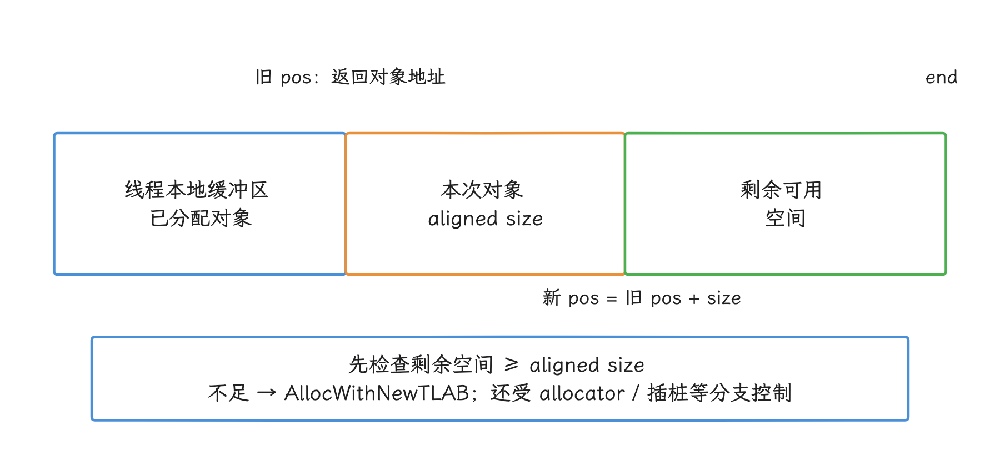

图：TLAB 可容纳该次对象时，线程返回原 pos 并推进指针；空间不足需要申请新 TLAB。这里只画启用 TLAB 后的局部路径。

对象仍有后续成本：

- TLAB 或 RegionTLAB（按堆区域划分的 TLAB）用尽后需要补充空间。
- 分配要计入标记、扫描和回收的工作量；活对象越多，收集器需要处理的引用越多。
- 大对象或突发分配更容易离开最轻的分配路径。
- 回收线程会消耗 CPU 和内存带宽，与 UI 线程、RenderThread（渲染线程）竞争。
- 可分配空间不足时，发起分配的线程可能等待 GC 完成。


120 Hz 屏幕的理论帧间隔约为 8.33 ms。GC 暂停、分配等待或 CPU 竞争只要落在已经接近预算的那一帧上，就可能产生 missed frame（未按时呈现的帧）。暂停时间没有跨设备通用常量，不能用“某类 GC 固定耗时几毫秒”代替 trace 证据。

<!-- gracker-diagram: ch10-03-05-gc-frame-timeline -->
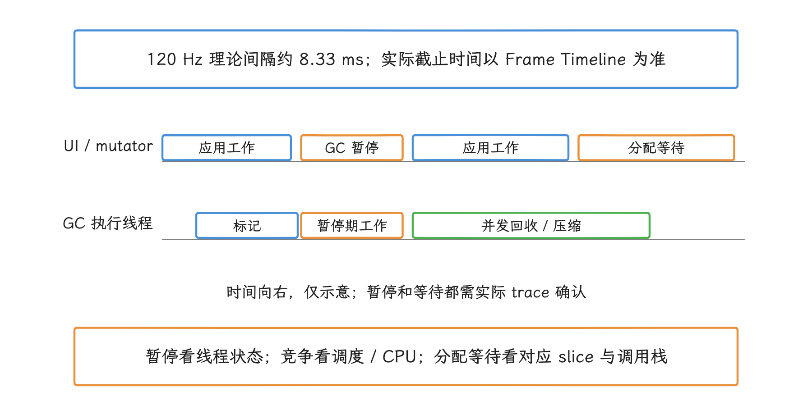

图：示意轨道分别标出 mutator 暂停、并发 GC 的资源竞争与分配等待；不表示它们每次都同时发生，条宽不代表测量时长。

### Android 17 的 CMC 源码边界

Android 17 的 `collector_type.h` 把 `kCollectorTypeCMC` 定义为 **Concurrent mark-compact**。`heap.cc` 在 `gUseUserfaultfd` 为真时校验前台收集器为 CMC、后台收集器为 CMCBackground；启用 generational GC（分代垃圾回收）时，还会创建负责年轻代的 `YoungMarkCompact`。`runtime.cc` 选择 generational GC 时，同时检查 collector 能力、`-Xgc` 选项和 `ShouldUseGenerationalGC()`。


这几处源码说明 Android 17 具备 CMC 与 generational CMC 路径。源码中存在 `YoungMarkCompact`，不代表每台 Android 17 设备、每个进程都使用同一运行参数：OEM 配置、ART Mainline 模块和进程选项仍可能影响选择。判断手上的设备实际走了哪条路径，要看 ART 启动日志里的 collector 描述。

<!-- gracker-diagram: ed10-03-cmc-config-and-process-evidence -->
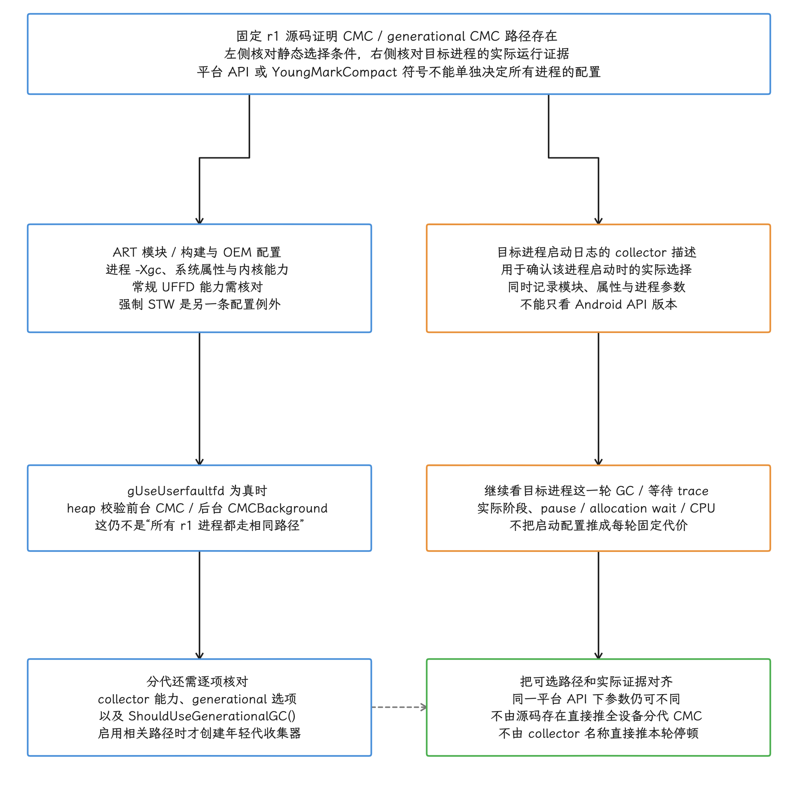

图：固定r1配置/证据关系示意，不是完整ART启动算法。左侧核对ART模块、构建/OEM、进程-Xgc、属性和内核能力；gUseUserfaultfd为真时heap校验CMC/CMCBackground，分代还需collector能力、generational选项及ShouldUseGenerationalGC，强制STW是另一路例外。右侧独立看目标进程启动collector描述，再看这一轮GC/等待trace的实际阶段、pause、allocation wait和CPU。源码存在YoungMarkCompact或平台API相同，不保证每个进程启用分代CMC，也不能由启动collector名称推每轮固定停顿；静态条件需和目标进程运行证据对齐。

常规 UFFD 路径在 `mark_compact.cc` 中检查 `UFFD_FEATURE_SIGBUS` 与 `MREMAP_DONTUNMAP`；显式 GC 选项、系统属性、内核能力和强制 STW 压缩选项都会影响选择。`SigbusHandler()` 只处理符合条件的故障：检查信号原因、压缩状态与地址范围后，按页推进处理；并不是所有对象访问都会触发 SIGBUS，也不是任意 SIGBUS 都能被 ART 接管。kernel 侧按 `android17-6.18-2026-06_r6` 的 `fs/userfaultfd.c` 与 `mm/mremap.c` 核对。

<!-- gracker-diagram: ch10-03-08-uffd-fault -->
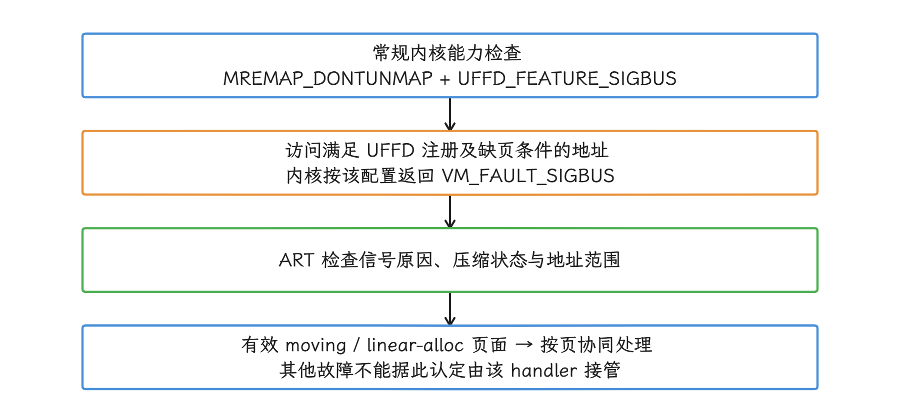

图：只画常规 SIGBUS/UFFD 机制；强制 STW 是独立配置例外。并非所有对象访问都会触发故障，也不是每轮 GC 都进入压缩。

`RunPhases()` 包含并发标记、MarkingPause、回收与压缩准备；需要压缩时还执行线程根翻转暂停，之后仅在 UFFD 有效时进入并发 `CompactionPhase()`。某轮可以不压缩，强制 STW 是另一条配置路径。这些机制缩小部分 mutator（执行应用代码的线程）停顿范围，不会消除 GC 工作量。应用持续制造短命对象时，年轻代回收、CPU 占用和 allocation stall（分配等待）仍然需要测量。

<!-- gracker-diagram: ch10-03-09-cmc-phases -->
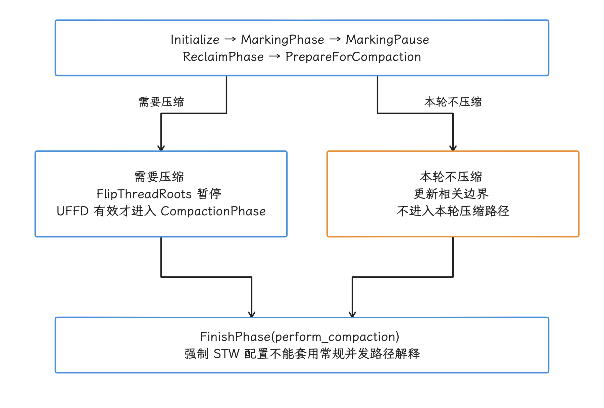

图：阶段名按固定 r1 RunPhases 核对。标记暂停和根翻转暂停仍存在，不捏造每轮固定时长或所有阶段必经关系。

## 识别抖动、泄漏与正常波动

| 现象 | 常见曲线 | 优先证据 | 主要处理方向 |
| --- | --- | --- | --- |
| 短命对象抖动 | 分配量快速增长，GC 后大幅回落 | allocation call stack（分配调用栈）、GC 时间、慢帧重叠 | 降低分配次数或单次大小 |
| 引用泄漏 | 多轮 GC 后存活基线持续上升 | heap dump、Retained Size、GC Root | 修正引用所有权 |
| 缓存或对象池增长 | 上升后停在容量上限 | 容量、命中率、逐出记录 | 校准容量和失效策略 |
| 大对象突发 | 单次或少数分配拉高曲线 | 分配大小、调用栈、业务事件 | 复用 buffer、分块或移出关键路径 |
| 正常预热 | 启动阶段增长，随后稳定 | 类加载、资源初始化、后续稳态 | 通常不改，保留基线 |

读这张表先按曲线形态归类，再拿对应的证据确认。“锯齿形”只是线索：若每次 GC 后基线也在上升，需要同时排查存活对象；若分配很高但帧时间、CPU 和 GC 等待没有退化，优化优先级可以后移。


## 用证据定位

### Android Studio：记录 Java/Kotlin 分配

Android Studio 的 “Track Memory Consumption (Java/Kotlin Allocations)” 可以显示分配类型、大小、线程、调用栈和释放时间。这项 allocation recording 要求 `debuggable` 构建，只有 `profileable` 不足以启用该功能。完整记录本身会减慢高分配应用；官方工具提供 sampled（抽样）模式降低影响。

一次有效的录制应满足：

1. 在可重复的用户动作前开始录制。
2. 只保留足以覆盖该动作的时间窗。
3. 分别按 Allocations、Allocation Size 与 Total Count 排序。
4. 回到调用栈，确认对象来自业务路径、profiler（分析器）自身或框架预热。
5. 修复后在同设备、同构建类型、同数据集下复测。

分析 churn 时关注时间窗内累计分配次数与字节数。Studio 的 `Total Count = Allocations - Deallocations`，`Remaining Size = Allocations Size - Deallocations Size`，口径限定在所选记录区间，不能直接当作进程完整存活堆清点。分析泄漏还要用 heap dump 检查跨越预期生命周期的存活对象和引用关系。

<!-- gracker-diagram: ch10-03-11-studio-columns -->
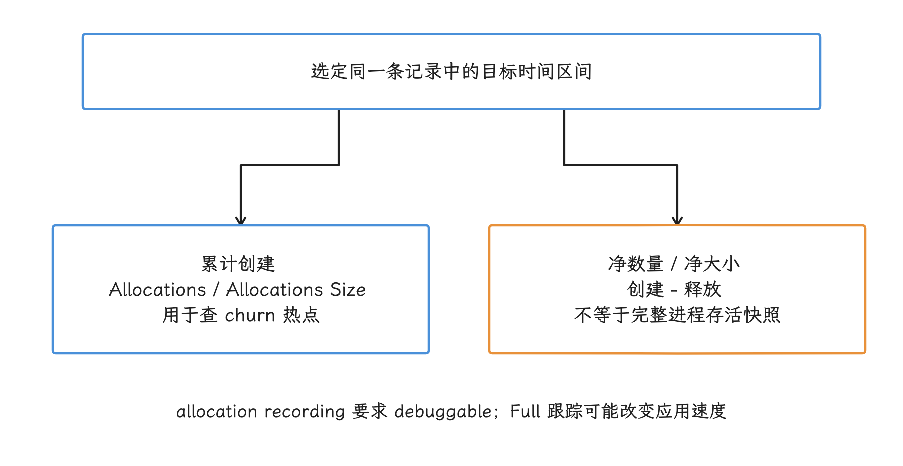

图：所选区间的创建减释放用于解读这次录制；它不自动包含录制外的全部存活对象，引用关系仍由 heap dump 取证。

### Perfetto heapprofd：调用栈采样

heapprofd 从 Android 10 起支持 native malloc/free 分配调用栈采样，覆盖通过对应 allocator 的 `new/delete`；其他自定义分配器需要相应 heap 集成。Android 12 起可把 heap 指定为 `com.android.art`，采样 Java allocation call stack。ART allocation profile 只记录对象创建位置，不提供对象删除时间或完整引用图；分析存活对象的引用关系需要 heap dump。


下面两条命令按 AOSP `android-17.0.0_r1` 所含 Perfetto `tools/heap_profile` 脚本核对；需先取得相应 Perfetto checkout，并从其根目录执行。不同版本先检查 `--help`。

```bash
# Native malloc/free allocation profile
tools/heap_profile android -n com.example.app

# Java allocation profile（Android 12+）
tools/heap_profile android -n com.example.app --heaps com.android.art
```

user build（日常发布版本的系统镜像）只允许分析 manifest 标记为 `debuggable` 或 `profileable` 的 App。


读 Java profile 先看清两个数字的含义：`Total allocation size` 和 `Total allocation count` 是根据采样估计的累计创建字节数与次数，即使对象稍后已经回收，也不能把它们当作当前存活堆大小。运行中附加之前、Zygote 中的分配及未覆盖的 allocator 不会自动补入。分配突发还可能让共享缓冲区溢出，Perfetto 会提前结束 profile，此时需要提高 sampling interval（采样间隔）或按官方建议调整缓冲区。

<!-- gracker-diagram: ed10-03-profile-modes-and-art-creation-window -->
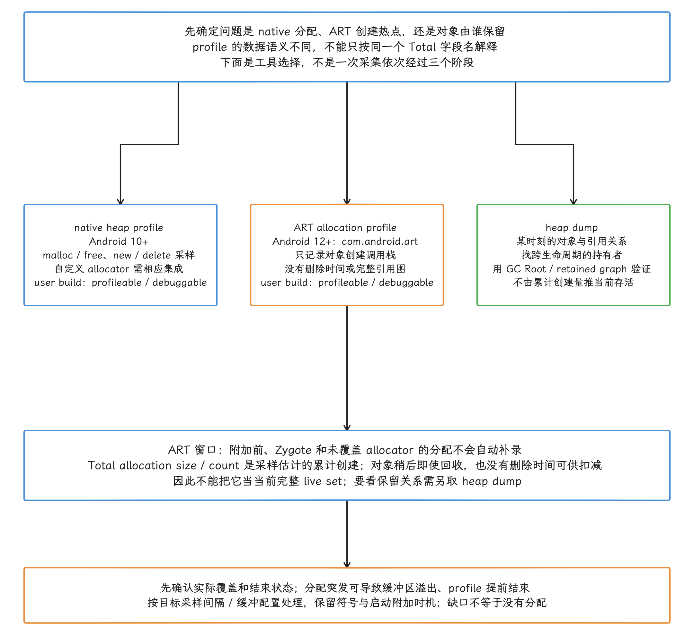

图：三个分支是工具选择而非采集阶段。Android10+ native profile采样对应allocator的malloc/free及new/delete，自定义allocator需集成；Android12+ com.android.art只记录对象创建调用栈；heap dump提供某时刻对象引用用于持有分析。user-build采样目标需profileable或debuggable，Studio Java/Kotlin allocation recording另要求debuggable。图下半仅展开ART：附加前、Zygote及未覆盖allocator不会自动补录，Total allocation size/count是累计创建估算，窗口对象即使后来回收也没有删除时间可扣，不能当当前live set或完整引用图。先确认真实覆盖/结束状态，突发溢出可能提前结束，按sampling interval/缓冲配置处理并保存符号和启动时机；缺口不等零分配，Java/native像素/graphics仍按域区分。

### Perfetto：把分配、GC 和帧放进同一窗口

系统 trace 至少应包含调度、频率、Frame Timeline 与 ART/应用 trace。分析顺序如下：

1. 从 missed frame 或业务事件确定时间窗。
2. 检查 UI 线程是否暂停、处于 Runnable（可运行但在等待 CPU）状态，或正在等待分配。
3. 对齐 GC slice、`HeapTaskDaemon` 活动和 CPU 频率。
4. 用 allocation profile 找到同一场景的高频调用栈。
5. 排除锁竞争、I/O、Binder、thermal throttling（温控限频）等同时发生的原因。

`HeapTaskDaemon`（ART 堆任务线程）活跃且附近出现慢帧，只能说明两者时间相近。还要结合线程状态、GC slice（GC 轨迹片段）和修复前后对照，才能判断因果关系。


### 不要在 App 中复制 `GcWatcher`

Android 17 的 `BinderInternal.GcWatcher` 仍通过 `WeakReference` 与 `finalize()` 感知 GC，并向 framework 内部 watcher（观察者）分发回调。`BinderInternal` 属于隐藏 API，finalization（终结处理）的执行时间也没有确定性。应用不应复制这种模式做线上 GC 计数，更不应把 watcher 的 `finalize()` 当作每次 GC 的精确通知。

<!-- gracker-diagram: ch10-03-16-gcwatcher -->
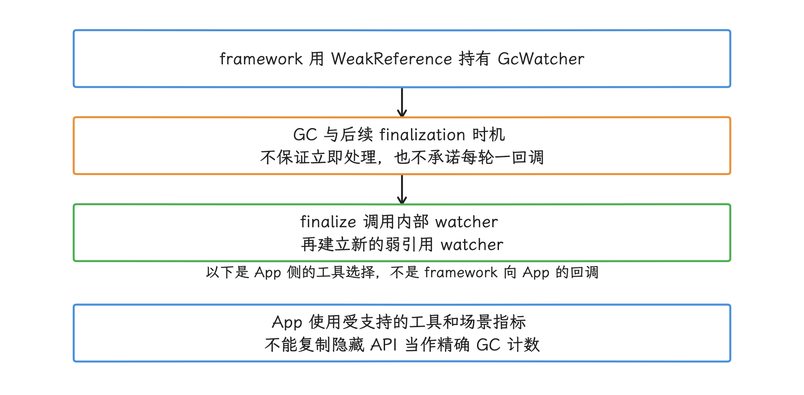

图：按 BinderInternal 固定 r1 的 finalize / watcher / rearm 逻辑说明边界；不把内部实现包装成可用的 App GC 通知协议。

开发期使用 Android Studio、Perfetto 和 ART 日志；线上只保留经过开销评估的场景指标。Android 17 的 `ProfilingManager` 可提供受系统控制的 profile artifact（分析产物），但同样不构成实时 GC 回调 API。

## 常见分配热点

拿到 allocation profile 之后，可以先按下面几类位置找候选。

### `onDraw()`、布局和动画回调

每帧回调会让同一处分配随帧数重复执行。`Paint`、`Path`、`Rect`、数组、Lambda 和临时集合都应通过 allocation profile（分配记录）验证，不能只按代码外观猜测。

下面的示例用于说明如何把可复用的绘制状态移出 `onDraw()`。

```kotlin
class MeterView @JvmOverloads constructor(
    context: Context,
    attrs: AttributeSet? = null,
) : View(context, attrs) {
    private val barPaint = Paint(Paint.ANTI_ALIAS_FLAG).apply {
        color = Color.RED
    }
    private val barBounds = RectF()

    override fun onDraw(canvas: Canvas) {
        barBounds.set(0f, 0f, width.toFloat(), height.toFloat())
        canvas.drawRect(barBounds, barPaint)
    }
}
```

`Paint` 与 `RectF` 只在 View 创建时分配，帧回调只更新字段。若绘制状态会跨线程使用，复用对象还要满足线程所有权要求。

<!-- gracker-diagram: ch10-03-17-view-reuse -->
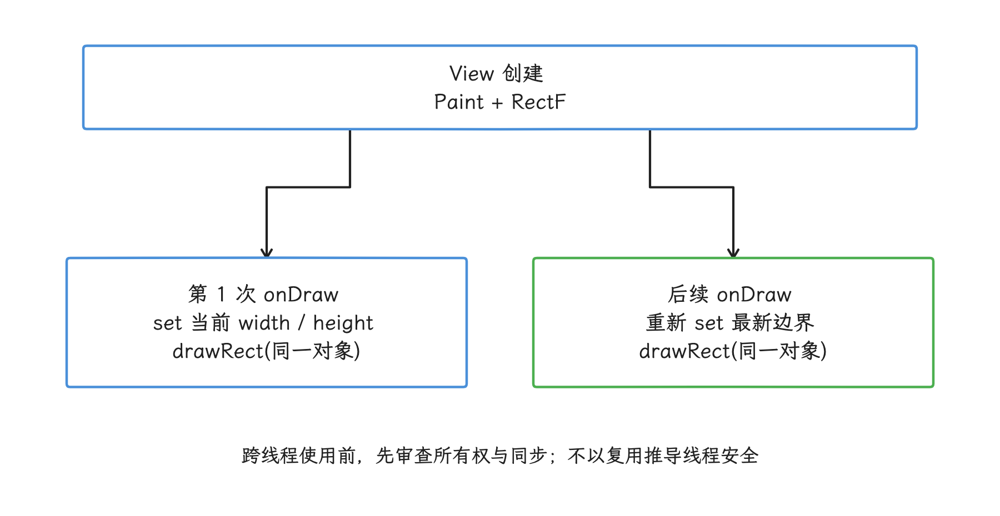

图：示例每个 View 创建一组 Paint 和 RectF；各帧更新同一个 RectF，再传给 Canvas。这里只减少显式绘制状态的重建，不能代表整帧零分配。

### 循环、列表绑定与流式转换

循环内部创建集合、正则、格式化器或中间 DTO（数据传输对象），会让分配次数随元素数增加。Kotlin collection pipeline（集合操作链）也可能创建中间集合；Sequence 能减少部分中间集合，但它有迭代器和间接调用成本，短小集合未必受益。

修复时先问三个问题：

- 中间结果是否必须保存？
- 容器能否移到循环外并通过 `clear()` 复用？
- 能否提供预估容量，减少数组扩容与复制？

复用容器前要确认调用不会把容器引用保存到异步任务或返回值中。误用同一实例会引入数据覆盖和并发错误。


### 字符串与日志

循环中的 `result += item` 会反复生成新的 String 内容。日志参数在调用前就会求值；等日志方法内部再判断开关，参数已经构造完成。

下面的示例把多次不可变字符串拼接改成使用同一个 builder（可变构建器）完成。

```kotlin
fun joinNames(items: List<String>): String = buildString {
    items.forEachIndexed { index, item ->
        if (index > 0) append(", ")
        append(item)
    }
}
```

返回 String 本身仍会分配；这段代码减少的是循环内重复复制。高频日志可在调用点检查日志级别，或使用接收 Lambda 的延迟日志 API，确保禁用日志时不构造文本。


### 装箱

泛型集合、可空原始类型和接口调用可能把 `Int`、`Long` 等原始值包装成对象，这个过程叫装箱。JVM 对部分数值有 wrapper cache（包装对象缓存），编译器也可能消除一些临时对象，因此不能断言每次装箱都会产生新对象。是否值得处理，取决于它在 allocation profile 里出现的频率和字节数。

在已确认的热点中可评估以下替代：

| 当前结构 | 候选结构 |
| --- | --- |
| `HashMap<Int, T>` | `SparseArray<T>` |
| `HashMap<Int, Int>` | `SparseIntArray` |
| `HashMap<Int, Long>` | `SparseLongArray` |
| `HashMap<Long, T>` | `LongSparseArray<T>` |
| `List<Int>` 的密集数值计算 | `IntArray` |

`SparseArray` 使用排序后的原始类型 key 数组，能省去 key 装箱；它与哈希表的查找、插入特征不同。选哪种结构要在真实数据规模和更新模式下用 benchmark（基准测试）决定，不能按“元素超过某个数量”设置统一切换点。

<!-- gracker-diagram: ch10-03-20-boxing-containers -->
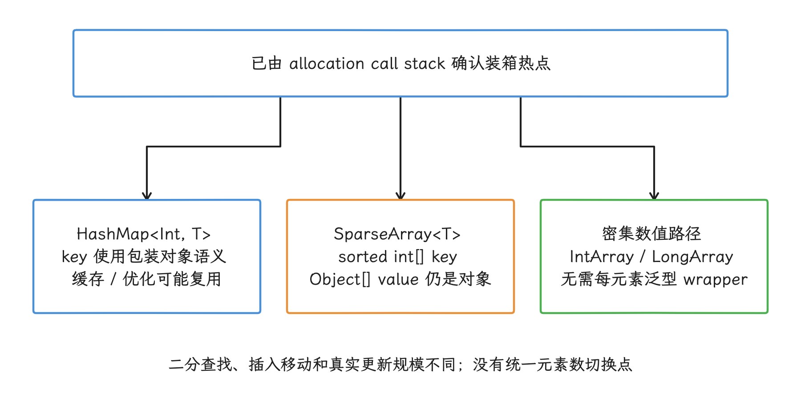

图：SparseArray 的 int key 与原始类型数组可减少特定装箱；values 的对象表示与查找更新代价仍要分别看。缓存或编译器优化也可能避免新 wrapper。

### 大型 buffer 与图像

相机、编解码、Bitmap 和序列化常产生大数组或 native buffer。这类问题的 Java 对象数可能不高，allocation bytes（累计分配字节数）却很大，只看对象数会漏掉它。优化方向包括固定数量的 buffer 轮转、按目标尺寸解码、分块处理和遵守库的 buffer pool（缓冲池）所有权。


Android 8.0（API 26）起，普通软件 Bitmap 的像素位于 native heap；`Bitmap.Config.HARDWARE` 的像素保存在图形内存中，不能统一归入 malloc/native heap。图片库管理的 Bitmap 应归还给库自己的池；业务代码不要在未知调用方仍可能使用 Bitmap 时提前 `recycle()`。


## 优化策略

### 优先删除分配

收益最高且风险较低的改动通常是：

- 把逐帧创建的绘制对象变为 View 或 renderer（渲染器）的成员。
- 移除不必要的中间集合和 DTO。
- 给已知规模的数组、集合、builder（构建器）设置合理初始容量。
- 让相机、音视频与网络 buffer 按清晰所有权复用。
- 关闭的日志在调用点跳过字符串与参数构造。
- 密集数值路径使用原始类型数组，减少泛型装箱。

预分配会把成本移到更早的时间，并增加对象存活期。启动路径已经紧张或对象很少使用时，预分配可能让结果变差；应在目标场景基准中评估。

<!-- gracker-diagram: ch10-03-23-preallocation -->
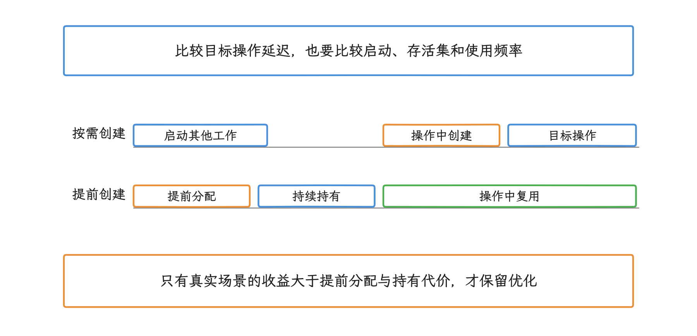

图：两条示意轨道比较成本落点。预分配可能改善目标操作，也可能拖慢启动并扩大存活集；这里没有推定净收益或测量时长。

### 对象池是受约束的优化

Android framework 的池化也有版本条件。固定 r1 的 `Message.obtain()` 仅在 `MessageQueue.getUseConcurrent()` 为假时尝试全局池；并发队列路径直接创建新 Message，`recycleUnchecked()` 只清理引用并标记使用状态。`MotionEvent.obtain()/recycle()` 仍有自身的 recycler。不要据 API 名称假定总会命中池，也不要替 framework 提前归还仍在使用的对象。业务对象只有满足以下条件时才适合放入对象池：

<!-- gracker-diagram: ch10-03-24-framework-pool-branches -->
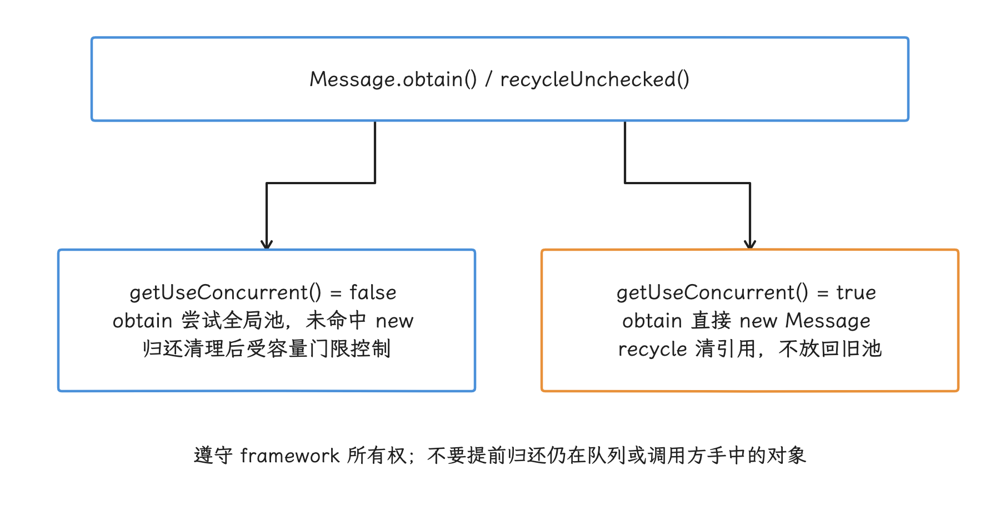

图：固定 r1 的 Message 池受 MessageQueue.getUseConcurrent() 控制。MotionEvent 有独立 recycler，不能据 obtain 名称推断所有模式都池化。

- profiler 已确认分配点占据显著成本；
- 对象构造或 backing storage（底层存储）成本较高；
- 同时在用的实例数有稳定上限；
- `acquire/release`（获取/归还）所有权能被审查；
- 每个字段都能可靠重置；
- 池命中率、容量与内存占用可观测。

池会延长对象存活期，也可能增加同步、清理和泄漏风险。小型不可变对象或构造成本很低的对象，通常交给 ART 更合适。池大小不能照搬 16、32 等经验数字，应由并发峰值和命中率决定。

<!-- gracker-diagram: ed10-03-buffer-pool-return-and-reset -->
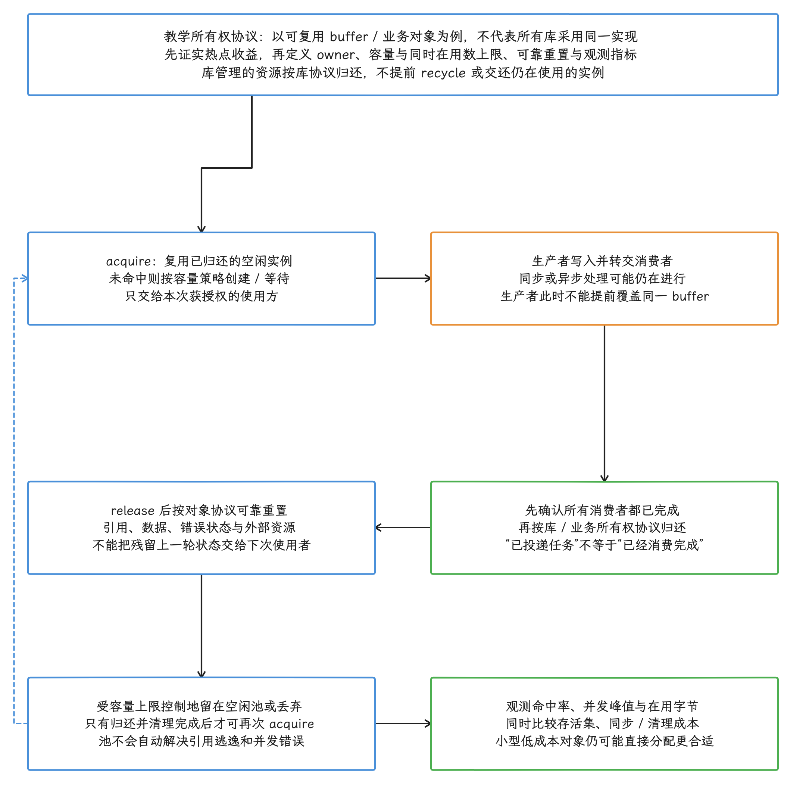

图：以buffer为例的业务所有权协议，不假定所有库同实现，也不是建议所有对象池化。先用profiler确认热点和收益，定义owner、容量及同时在用数上限、可靠重置与观测。acquire只复用已归还空闲实例，未命中按业务容量策略创建/等待，不默认把等待放主线程。生产者交接后不能覆盖；同步或异步消费者实际全部完成才能归还，投递任务不是完成。release后按类型协议重置引用、数据、错误与外部资源，再按容量留空闲池或丢弃；虚线表示完成归还/清理后可下一次acquire。持续观察命中率、并发峰值、在用字节、存活集、同步/清理成本，池会延长持有且可能增锁或泄漏，小对象仍可能直接分配更合适；库资源按库协议归还，不提前recycle。

### 不调用 `System.gc()` 治理抖动

`System.gc()` 只是向虚拟机提出 GC 请求，既不保证立即执行，也不消除分配源。主动请求可能让回收落在用户操作期间。测试工具可在明确目的下触发 GC；产品代码应修正分配速率、生命周期和容量。


## Kotlin value class 的边界

`@JvmInline value class` 在 JVM 上可用底层值表示，适合给原始类型增加类型安全，但能省下的 wrapper（包装对象）只覆盖部分路径。下面的类型在直接参数和局部变量路径上通常可用 `long` 表示。

```kotlin
@JvmInline
value class UserId(val raw: Long)
```

Kotlin 官方文档说明，泛型、接口和可空使用可能要求 wrapper。对这里底层为 `Long` 的 `UserId`，`List<UserId>`、传给泛型函数或 `UserId?` 都存在装箱路径；只有类型实际实现了某个接口，才谈得上以该接口传递时的装箱。上面的 `UserId` 并未实现 `Comparable<UserId>`，不能直接传给该类型的参数。value class 是减少特定路径装箱的工具，不会自动让泛型集合变成原始类型存储；高频数值处理仍可评估 `LongArray`。

<!-- gracker-diagram: ch10-03-27-valueclass-representation -->
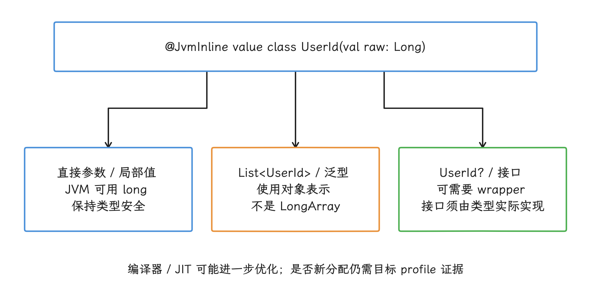

图：对本文 Long 底层 UserId，直接路径可使用 long，泛型和 nullable 有 wrapper 路径；接口传递必须先满足实际实现该接口的类型关系。

## Jetpack Compose 中的分配

以本文核验的 Compose Runtime 1.12.0-rc01 为例，默认 GapComposer 使用 SlotTable 保存组合结构，配合 RecomposeScope（重组作用域）与 snapshot state（快照状态）。LinkTable/LinkComposer 从 1.11 起属于实验路径；该制品的 `ComposeRuntimeFlags.isLinkBufferComposerEnabled` 默认值为 `false`，还受构建期 flag/R8 规则影响。不能把 SlotTable 与 LinkTable 画成每个 composition 必然依次经过的两张表。结构本身会占用内存；业务更常见的 churn 来自重组时重复执行的构造代码、不断变化的参数身份和不必要的状态派生。

<!-- gracker-diagram: ch10-03-28-compose-engines -->
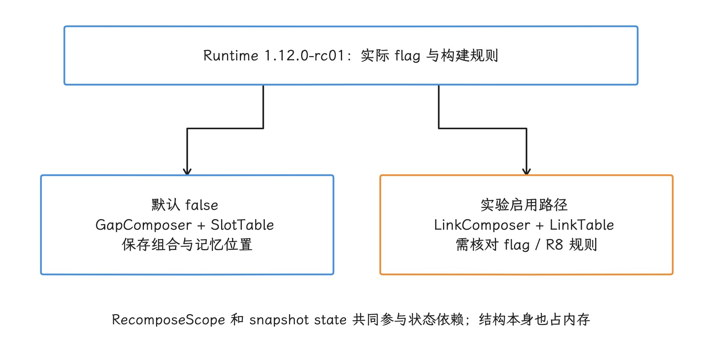

图：固定核验 RC 的实验 flag 默认 false，默认使用 GapComposer / SlotTable；LinkComposer / LinkTable 是可选择的实验路径，不能串成必经两级。

### `remember` 解决的是重组期重建

在 composable（可组合函数）中直接创建集合、格式化器或状态对象，这段代码每次重新执行都会创建新实例。需要跨重组保存的对象可用 `remember(keys)` 缓存，并让 key 精确描述对象何时失效。

下面的示例让 formatter 只在 locale 改变时重建。

```kotlin
@Composable
fun PriceText(
    price: BigDecimal,
    locale: Locale,
) {
    val formatter = remember(locale) {
        NumberFormat.getCurrencyInstance(locale)
    }
    Text(formatter.format(price))
}
```

`remember(locale)` 在该调用位置仍被组合保留且 key 按 `==` 未变时复用 formatter；移出 composition 后重新进入，会重新创建，也不跨进程保存。`formatter.format(price)` 在函数体执行时仍要运行，通常会产生结果字符串，缓存 formatter 不等于消除全部分配。NumberFormat 是可变对象，也要遵守线程所有权。

<!-- gracker-diagram: ch10-03-29-remember-lifetime -->
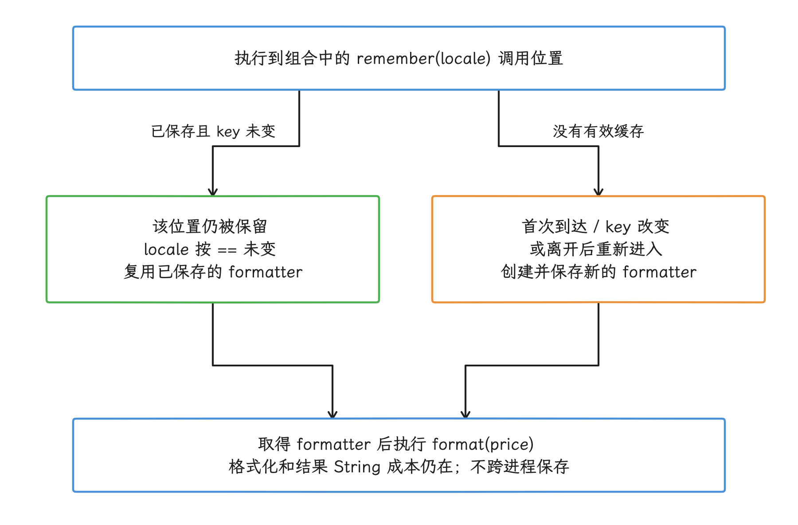

图：缓存的是 formatter 实例。只有组保留且 key 未变才复用，不能把 remember 画成持久缓存或整段函数永不执行。

`remember` 会延长对象的存活时间，不适合缓存无限增长的数据。key 过于频繁变化时，缓存会反复失效；key 缺失时，又可能读到与新输入不匹配的旧对象。

### strong skipping 减少无效重组

Kotlin 2.0.20 起，Compose compiler 默认启用 strong skipping（强跳过模式）。可重启 composable 默认具备跳过资格，`@NonSkippableComposable` 可退出；不可重启函数不会因此变为可跳过。unstable 参数按 `===` 比较，stable 参数按 `equals()` 比较。参数相等仍不保证跳过：作用域读取的 state 发生有效变化、首次插入或其他强制重组条件，都可能要求执行。


编译器也会记忆 composable 内捕获值的 Lambda：捕获不稳定值按身份比较，稳定值按 `equals()` 比较；`@DontMemoize` 可退出。这与手写 `remember(keys)` 对所有 key 使用 `==` 的规则不同。应检查实际编译配置和报告。

<!-- gracker-diagram: ed10-03-strong-skip-and-lambda-rules -->
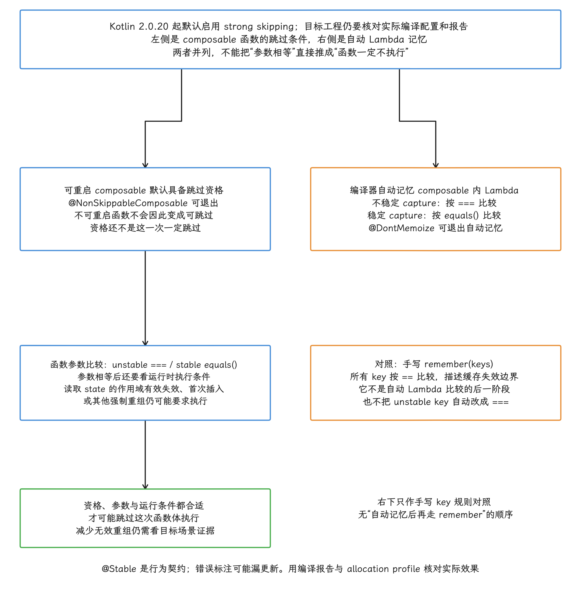

图：Kotlin2.0.20起默认strong skipping，目标工程仍核对编译配置/报告。左支函数资格：restartable默认可跳过，NonSkippable可退出，不可重启不因此变可跳过；参数unstable按===、stable按equals，参数相等仍可被读取state有效失效、首次插入或强制重组要求执行，资格/参数/运行条件合适才可能跳过函数体。右支为并列自动Lambda记忆：不稳定capture===、稳定equals，DontMemoize退出。右下手写remember所有key==仅作独立规则对照，没有从自动Lambda到它的执行箭头，不把unstable手写key改按身份比较。Stable是行为契约，误标可漏UI更新，实际分配与重组效果继续由编译报告和目标allocation profile确认。

不要为了跳过重组随意添加 `@Stable`。它是一份行为契约：公开属性变化必须能被 Compose 感知，`equals()` 也要满足约定。错误标注可能让 UI 漏掉更新。可通过 Compose compiler reports（编译器报告）检查稳定性推断，再优化频繁重组的节点。

### `derivedStateOf` 有适用条件

`derivedStateOf` 适合输入变化频率高、输出变化频率低的场景，例如滚动位置持续变化，而按钮只关心“是否离开列表顶部”。它本身有维护依赖和计算状态的成本；减少下游重组不等于依赖不再更新或派生值不再重算。无 policy 的重载与显式 SnapshotMutationPolicy 重载有不同的等价性约定，实际下游是否失效还取决于观察者。若两个输入每次变化都要求更新拼接结果，直接计算通常更简单。

<!-- gracker-diagram: ch10-03-32-derived-state -->
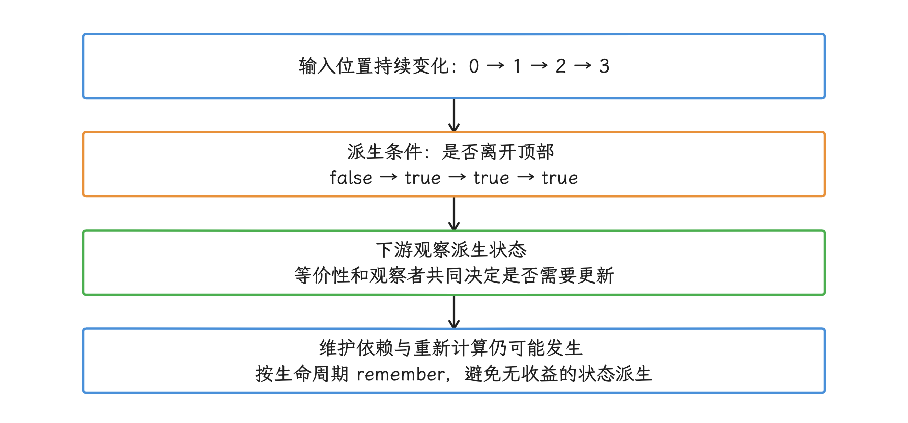

图：逻辑值序列只是示例。derivedStateOf 不承诺永不重算；有无 mutation policy 的重载与观察者等价判断需分别解释。

Compose 官方示例把 `derivedStateOf` 放在 `remember` 中。Compose Runtime 1.12.0-beta01 修复了一个潜在保留问题：未正确 remember 的 derived state（派生状态）在 forward write（前向写入）路径上可能被 composition 持有到销毁。该修复包含在 2026-07-29 的 1.12.0-rc01，以及后续 1.12.0 稳定版（2026-08-12）与 1.12.1（2026-09-09；相对 1.12.0 无改动）。本文以 RC 制品作机制核验，不把 RC 当作当前最新或统一生产升级目标。

### 原始类型 state

计数器等状态可使用 `mutableIntStateOf()`、`mutableLongStateOf()` 等原始类型 state API，并通过 `intValue`、`longValue` 访问，减少 `MutableState<Int>` 在 JVM 路径上的装箱机会。仍需用 allocation profile 验证热点；UI 状态读写频率和重组范围通常比单个 wrapper 更值得先看。

<!-- gracker-diagram: ch10-03-33-primitive-state -->
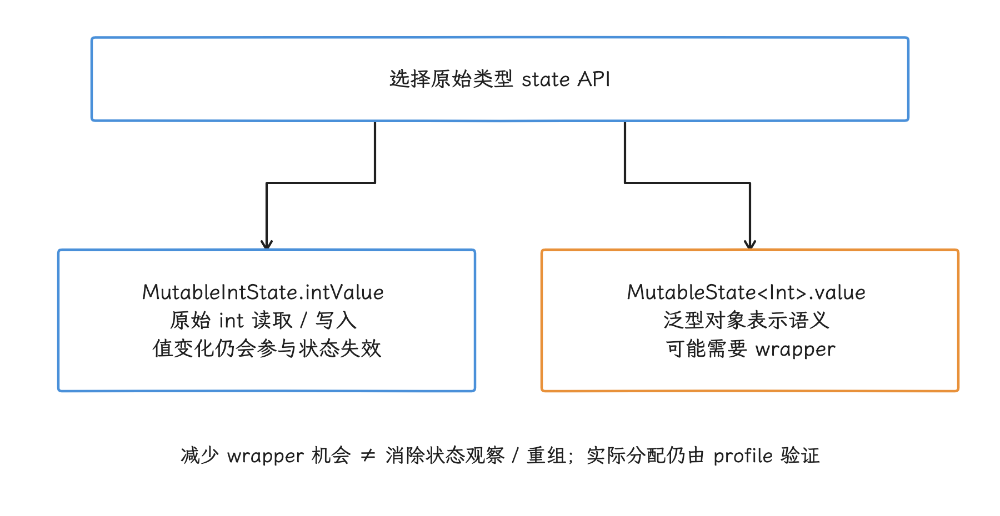

图：MutableIntState 以原始 int 存值并提供 intValue；通过泛型 value 桥接访问仍有装箱语义。优化后也要验证重组范围。

### Compose 与 Android 17 的版本关系

Compose 通过 AndroidX 发布，不跟 platform API 一一绑定。⚠ 这里有一处证据差异：1.12.0-alpha01 发布说明写了 compileSdk 37 与最低 AGP（Android Gradle Plugin）9.2.0；但本次下载的 `runtime-android:1.12.0-rc01` AAR 中，`aar-metadata.properties` 声明的是 `minCompileSdk=34`、`minAndroidGradlePluginVersion=8.1.1`，对应 Gradle module 的 Android 变体也指向该 AAR。不能仅凭 alpha 发布说明替所有 RC 消费者断言统一最低工具链；实际工程要核对解析到的制品、其他依赖和构建结果。库自身 compileSdk、消费者最低构建要求、设备运行 API 和 ART collector 是不同维度，不能据此推断 Android 17 专属的 SlotTable、LinkTable 或 Lazy list GC 行为。


## 验证优化

优化前后使用同一套脚本和数据：

| 维度 | 建议指标 |
| --- | --- |
| 分配 | 每次业务操作的 allocation count、allocation bytes、热点调用栈占比 |
| GC | 事件次数、暂停区间、blocking GC/allocation wait、GC 线程 CPU |
| 帧 | Frame Timeline 的 missed frame、帧时长分位数 |
| 资源 | Java heap、native heap、graphics、RSS/PSS 与 CPU 频率 |
| 正确性 | 对象池状态、并发、画面、数据一致性和生命周期 |

只比较峰值 heap，容易漏掉“总分配量下降但存活集上升”这种组合。反过来只比较 GC 次数，结果又会受 heap 上限、收集器和设备配置影响。目标场景的分配、GC、帧时间与正确性同时验收，结论才可复用。


## 排查清单

- 高分配发生在启动、滚动、动画、相机、编解码还是后台任务？
- 对象是短命、长期存活，还是被缓存/池持有？
- 排序依据是 allocation count、bytes 还是 live objects？
- 慢帧时间窗内是否存在 GC pause、allocation wait 或 GC CPU 竞争？
- profiler 自身是否改变了应用速度或内存分类？
- `onDraw()`、循环和日志是否仍有可移出的对象构造？
- 装箱是否经过 allocation call stack 证实？
- 对象池是否有容量、重置、所有权和并发规则？
- Compose 的 `remember` key、参数身份和重组范围是否符合预期？
- 修复后是否在相同构建、设备、数据和操作脚本下复测？

## 与其他章节的关系

- **4.2 ART 虚拟机内存管理**：CC、CMC、TLAB、RegionTLAB 与 GC 日志。
- **7.1/7.2 卡顿分析**：Frame Timeline、线程状态与 CPU 竞争。
- [10.1 App 内存分析与案例](01-app-memory-analysis-cases.md)：Java、native、graphics 与 mmap 的分类工具，缓存、pool、碎片和虚拟地址空间的增长诊断，以及 MemoryThrashing 的平台边界与差分采样。
- [23.2 内存泄漏检测与治理](../../part5-app/ch23-memory-practice/02-memory-leak-governance.md)：存活对象、GC Root 与引用所有权。
- **10.2 低内存影响**：进程内 GC 与整机回收压力的区别。

## 参考资料

- [Android Studio：Record Java/Kotlin allocations](https://developer.android.com/studio/profile/record-java-kotlin-allocations)
- [Android Developers：Manage your app's memory](https://developer.android.com/topic/performance/memory/manage-app-memory)
- [AOSP：Debug ART garbage collection](https://source.android.com/docs/core/runtime/gc-debug)
- [Perfetto：Callstack-based allocation profiling](https://perfetto.dev/docs/data-sources/native-heap-profiler)
- [AOSP `collector_type.h`（android-17.0.0_r1）](https://android.googlesource.com/platform/art/+/refs/tags/android-17.0.0_r1/runtime/gc/collector_type.h)
- [AOSP `runtime.cc`（android-17.0.0_r1）](https://android.googlesource.com/platform/art/+/refs/tags/android-17.0.0_r1/runtime/runtime.cc)
- [AOSP `heap.cc`（android-17.0.0_r1）](https://android.googlesource.com/platform/art/+/refs/tags/android-17.0.0_r1/runtime/gc/heap.cc)
- [AOSP `mark_compact.cc`（android-17.0.0_r1）](https://android.googlesource.com/platform/art/+/refs/tags/android-17.0.0_r1/runtime/gc/collector/mark_compact.cc)
- [AOSP `region_space.cc`（android-17.0.0_r1）](https://android.googlesource.com/platform/art/+/refs/tags/android-17.0.0_r1/runtime/gc/space/region_space.cc)
- [AOSP `BinderInternal.java`（android-17.0.0_r1）](https://android.googlesource.com/platform/frameworks/base/+/refs/tags/android-17.0.0_r1/core/java/com/android/internal/os/BinderInternal.java)
- [Android Common Kernel `fs/userfaultfd.c`（android17-6.18-2026-06_r6）](https://android.googlesource.com/kernel/common/+/refs/tags/android17-6.18-2026-06_r6/fs/userfaultfd.c)
- [Android Common Kernel `mm/mremap.c`（android17-6.18-2026-06_r6）](https://android.googlesource.com/kernel/common/+/refs/tags/android17-6.18-2026-06_r6/mm/mremap.c)
- [Android Developers：SparseArray](https://developer.android.com/reference/android/util/SparseArray)
- [Kotlin：Inline value classes](https://kotlinlang.org/docs/inline-classes.html)
- [Compose：Strong skipping mode](https://developer.android.com/develop/ui/compose/performance/stability/strongskipping)
- [Compose：Performance best practices](https://developer.android.com/develop/ui/compose/performance/bestpractices)
- [Compose Runtime：MutableIntState](https://developer.android.com/reference/kotlin/androidx/compose/runtime/MutableIntState)
- [Compose Runtime release notes](https://developer.android.com/jetpack/androidx/releases/compose-runtime)

- [AOSP `heap-inl.h`（android-17.0.0_r1）](https://android.googlesource.com/platform/art/+/refs/tags/android-17.0.0_r1/runtime/gc/heap-inl.h)
- [AOSP `Message.java`（android-17.0.0_r1）](https://android.googlesource.com/platform/frameworks/base/+/refs/tags/android-17.0.0_r1/core/java/android/os/Message.java)
- [AOSP `MotionEvent.java`（android-17.0.0_r1）](https://android.googlesource.com/platform/frameworks/base/+/refs/tags/android-17.0.0_r1/core/java/android/view/MotionEvent.java)
- [Perfetto `tools/heap_profile`（android-17.0.0_r1）](https://android.googlesource.com/platform/external/perfetto/+/refs/tags/android-17.0.0_r1/tools/heap_profile)
- [Compose 1.12.0-rc01 Android 发布源码 JAR](https://dl.google.com/dl/android/maven2/androidx/compose/runtime/runtime-android/1.12.0-rc01/runtime-android-1.12.0-rc01-sources.jar)
- [Compose 1.12.0-rc01 AAR](https://dl.google.com/dl/android/maven2/androidx/compose/runtime/runtime-android/1.12.0-rc01/runtime-android-1.12.0-rc01.aar)
- [Compose 1.12.0-rc01 Gradle module](https://dl.google.com/dl/android/maven2/androidx/compose/runtime/runtime-android/1.12.0-rc01/runtime-android-1.12.0-rc01.module)
- [Android Developers：Managing Bitmap Memory](https://developer.android.com/topic/performance/graphics/manage-memory)
