# GPU 与图形内存统计、归因与诊断

图形内存的问题，我们手里没有单一的数字可以一次回答：`dumpsys meminfo` 按进程 PSS（按引用者比例分摊共享页）和 memtrack（厂商图形内存记账接口）分类，`dumpsys gpu --gpumem` 读取驱动上报的 GPU 地址空间总量，DMA-BUF 描述设备间共享的 buffer，Vulkan tracker 记录 API 级分配事件。它们可能同时覆盖同一块资源，也可能各自漏掉一部分。


排查图形内存增长时，我们先给每个数字补上四项限定：采集接口、设备与系统 build（构建版本）、被归因的进程、资源是否共享。这四项里缺了任何一项，`Graphics = 120 MB` 就说不清物理内存有多少，也证明不了应用在泄漏。

## 1. 先区分资源，再选择计数器

### 1.1 两类常见图形分配

`GraphicBuffer` / `HardwareBuffer` 由 Gralloc（图形缓冲区分配器）创建，通常以 DMA-BUF 文件描述符跨进程和硬件模块共享。producer（生产者）、SurfaceFlinger、显示控制器、相机、视频编解码器与 GPU 可以引用同一个 buffer；它是否映射到 CPU 地址空间、GPU 地址空间或两者，取决于 usage（用途标志）、mapper（映射接口）和驱动。


GPU 驱动还会管理 API 私有资源，例如纹理、render target（渲染目标）、Vulkan device memory（设备内存）、命令与内部缓存。这类资源可能没有可供应用检查的 DMA-BUF fd（文件描述符），也可能采用厂商专用分配器。

我们在 AOSP 里找不到统一的用户态“显存分配器”或“显存碎片整理器”；格式布局、heap、映射和回收策略由 Gralloc HAL（硬件抽象层）与 GPU 驱动决定。

一张逻辑图片也可能沿不同路径出现：

- 软件 Bitmap 的像素位于 native heap，首次硬件绘制还可能建立 GPU 纹理缓存；
- `Bitmap.Config.HARDWARE` 的像素放在图形内存中，Bitmap 对象仍由 Java 引用链控制生命周期；
- 相机或视频帧常由 Gralloc buffer 组成，多个 Surface 各有自己的 BufferQueue；
- Vulkan 应用可显式申请 `VkDeviceMemory`，再把 image 或 buffer 绑定到该内存。

这些资源只按 Java 对象数量去换算，两头都会出问题：一个对象可能没有独立 backing allocation（底层内存分配），多个对象也可能共享同一个 DMA-BUF。


### 1.2 同一资源在不同工具里的视角

同一块资源，换一个工具就换一个视角，我们先对照每个工具各自能回答什么：

| 工具或指标 | 主要回答的问题 | 不能直接回答的问题 |
|---|---|---|
| `dumpsys meminfo` | 进程的 smaps（逐映射内存统计）分类与 memtrack 补充归因 | 系统中唯一物理 buffer 总量、分配调用栈 |
| `dumpsys gpu --gpumem` | 驱动上报的全局及各 PID GPU-addressable（GPU 可寻址）总量 | 资源类型、创建位置、DMA-BUF 唯一物理占用 |
| `/proc/PID/fdinfo/FD` | 某进程仍持有的 DMA-BUF fd 及 size/exporter（导出方） | 没有 fd 的 GPU 私有资源、由别处持有的引用 |
| `/sys/kernel/dmabuf/buffers` | 系统中每个 DMA-BUF inode（内核文件对象标识）的 size/exporter | 实际驻留物理页清点、创建调用栈与阻止释放的完整引用 |
| Perfetto GPU memory | GPU 总量随时间的变化及进程归因 | 单个纹理名称、完整分配栈 |
| Vulkan memory tracker / AGI（Android GPU Inspector） | Vulkan API 分配、绑定及单帧资源 | 非 Vulkan 路径的全部系统图形内存 |
| ART heap dump / allocation profile / native heap profile | heap dump 查 Java 引用；allocation profile 查其覆盖范围内的创建栈 | allocation profile 不给完整保留引用图，也不清点全部 GPU backing 字节数 |

所以不同工具的数字要分开读：进程 GPU 总量可能把跨进程 import（导入的共享资源）重复计入，memtrack 则要求按 PSS 规则处理共享、排除类型间重叠，直接相加有重复计入的风险。


## 2. `dumpsys meminfo`：Graphics 摘要由什么组成

### 2.1 详细行里的三个来源

我们先保存一份应用的完整进程明细：

```bash
adb shell dumpsys meminfo com.example.gallery
```

多进程应用会出现多个 PID，我们逐个保存结果。App Summary 里的 `Graphics` 来自 Framework 侧的重新聚合，已不是 memtrack `GRAPHICS` 类型的原样输出。

这层聚合发生在 `Debug.MemoryInfo.getSummaryGraphics()`：它把三类的 `getOtherPrivate()` 字段相加，即各类 private clean + private dirty：


1. `Gfx dev`：libmeminfo 从 smaps 按映射名称识别的设备项；固定 r1 的这处分支匹配 `kgsl-3d0`，不是全部 GPU 厂商设备映射的统一总表；
2. `EGL mtrack`：memtrack `GRAPHICS` 中尚未被 smaps 统计的记录；
3. `GL mtrack`：memtrack `GL` 中尚未被 smaps 统计的记录。

这里要看清字段的承载方式：`android_os_Debug.cpp` 把 libmemtrack 返回的 PSS 值（转换为 KiB 后）同时写进对应行的 `pss`、`privateDirty` 和 `rss`。mtrack 行里这几列是同一份上报值的 Framework 表示，读成三份独立测量就错了；backing 页是否物理私有，privateDirty 这个列名也回答不了。固定 r1 的 libmemtrack 只按类型和 flag 求和，没有再按进程数替 HAL 做一次 PSS 分摊。


详细表里还可能出现 `Other mtrack`，它来自 memtrack 的 `MULTIMEDIA`、`CAMERA` 与 `OTHER` 分类，App Summary 的 `Graphics` 项不含它。旧工具或 OEM 定制输出的标签可能不同，所以分析报告要保存原始文本。

### 2.2 `SMAPS_UNACCOUNTED` 的设计目的

再看聚合的另一半：`android_os_Debug.cpp` 调用以下三个 libmemtrack 聚合函数：

- `memtrack_proc_graphics_pss()`
- `memtrack_proc_gl_pss()`
- `memtrack_proc_other_pss()`

这三个函数只累加带 `MemtrackRecord.FLAG_SMAPS_UNACCOUNTED` 的记录。这个标志标记的是 smaps 还没计入的内存，用来避免 `Debug.MemoryInfo` 把同一映射统计两遍。

`IMemtrack.aidl` 对类别给出了更具体的要求：

<!-- gracker-diagram: ed10-04-memtrack-to-graphics-summary -->
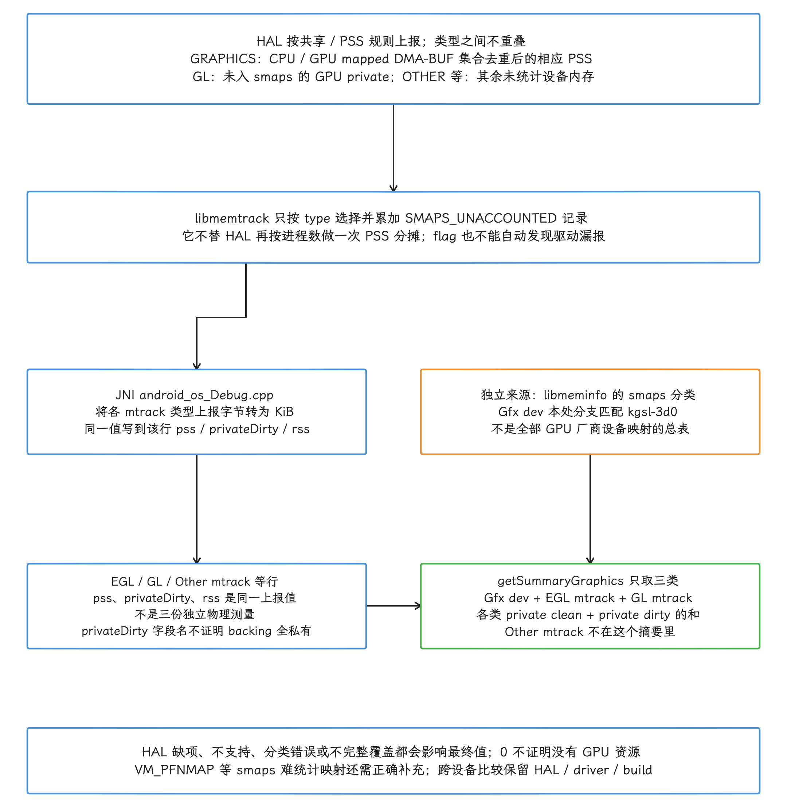

图：固定r1数据流：HAL负责共享/PSS、类型不重叠及GRAPHICS中CPU/GPU mapped DMA-BUF集合去重；GL补GPUprivate，OTHER等补其余未统计设备内存。libmemtrack仅按type和SMAPS_UNACCOUNTED求和，不再替HAL按进程分摊。JNI把每类上报字节转KiB，同写该行pss/privateDirty/rss，不能把三列当三份测量或由privateDirty推backing全私有。独立smaps Gfxdev这处分支只匹配kgsl-3d0，非跨GPU总表；getSummaryGraphics把Gfxdev/EGLmtrack/GLmtrack三类private clean+dirty相加，Othermtrack不入摘要。flag不自动发现驱动漏报，HAL缺项/不支持/分类错误会影响结果，0不等无资源，VM_PFNMAP等需正确补充，跨设备保留HAL/driver/build。

- `GRAPHICS + SMAPS_UNACCOUNTED` 报告该 PID 的 CPU-mapped 与 GPU-mapped（映射到 CPU/GPU 地址空间的）DMA-BUF PSS，并去掉两个集合的交集；
- `GL + SMAPS_UNACCOUNTED` 报告该 PID 未被 smaps 统计的 GPU private allocation（GPU 私有分配）；
- `OTHER + SMAPS_UNACCOUNTED` 报告剩余的未统计设备内存；
- `VM_PFNMAP`（按物理页帧号建立的特殊映射）在 smaps 中可能得到 0 RSS/PSS，也属于 memtrack 要补充的范围。

HAL 实现若缺项或不支持某种 type，相应行就可能为 0 或缺失。看到 0，含义只是该接口没有返回可计入值；进程是否还有 GPU 资源，要靠其他观测点判断。跨设备比较前要确认 memtrack HAL、GPU 驱动和 build 一致。

### 2.3 PSS、GPU 映射总量与唯一 buffer 容量

三个数字回答的问题并不相同：

- PSS 尝试把共享资源按引用者分摊，回答进程该分到多少共享成本；
- `gpu_mem_total` 描述驱动认为某 PID 映射到 GPU 地址空间的总量，回答该进程的 GPU 地址空间目前覆盖多少内存；
- `/sys/kernel/dmabuf/buffers` 按 inode 列出唯一 DMA-BUF，回答系统当前存在哪些唯一共享 buffer。

同一 DMA-BUF 被两个进程导入 GPU 时，各 PID 上报量可能重复覆盖这块资源，所以求所有 PID 的 `gpu_mem_total` 之和，代替不了同一 GPU 的 `pid = 0` 记录。inode 去重得到的是 DMA-BUF 对象容量汇总，每个字节是否驻留、不同对象的 backing 页是否重叠，它都回答不了，与 App Summary `Graphics` 之间也做不了等式校验。全局 `pid = 0` 本身仍是驱动上报口径。

<!-- gracker-diagram: ed10-04-shared-buffer-accounting-views -->
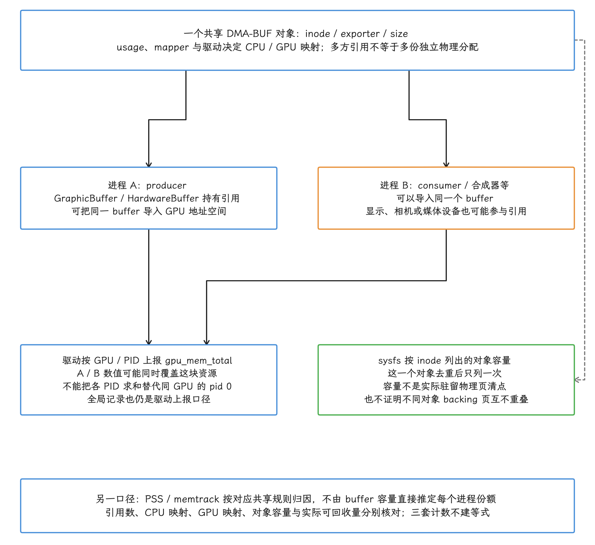

图：只示一个DMA-BUF被producer、consumer/合成器及设备多方引用，usage/mapper/driver决定CPU/GPU映射集合，它们不必相同。各PID GPU-addressable总量可同时覆盖该资源，不能求和替同GPU pid0全局记录，后者也仍是驱动口径。sysfs按inode去重只列一次对象容量，不证明各字节已驻留或不同对象backing页互不重叠。PSS/memtrack按对应HAL共享规则归因，不从容量直接除进程数推PSS，也不与Graphics或GPU总量建等式。图中虚线是同一对象另一视角，不是资源额外复制。

## 3. GpuService：从 tracepoint 到快照

### 3.1 `dumpsys gpu --gpumem`

Android Common Kernel 的 `gpu_mem/gpu_mem_total` tracepoint（跟踪点）要求 GPU 驱动在 allocate、free、import、unimport（分配、释放、导入、取消导入）改变 GPU-addressable 总量时发出更新。事件字段包含 `gpu_id`、`pid` 和当前 size；`pid = 0` 表示全局总量，正 PID 表示进程总量。

Android 17 的 GpuService 把 eBPF 程序挂到该 tracepoint，并维护以 `(gpu_id, pid)` 为 key 的 BPF map（内核中的键值表）。固定 r1 的 `gpuMem.c` 最多保留 1024 个 key，收到 size 为 0 的事件会删除对应条目；非零事件更新现有值或尝试插入。所以 map 里缺少某个 PID 条目，和读到明确的 0，是两种状态。map 保存的是已收到事件的最新值，并不主动向驱动重新清点；初始化状态、驱动上报、容量与更新成功情况都影响覆盖。`dump()` 逐项读取，遍历期间仍可能更新，各条目的取值时刻彼此错开，整个输出算不上原子快照：


```bash
adb shell dumpsys gpu --gpumem
```

输出中的 `Global total` 与各项 `Proc PID total` 是字节数；同一 GPU 缺少 pid 0 条目时显示 `Global total: N/A`。初始化失败、map 为空、条目缺失和实际收到的 size 0 事件，含义各不相同。读取中途若失败，也可能只输出此前已遍历到的部分；所以拿到输出后，我们保存错误文本，并用驱动支持、同窗口 ftrace、重复采样和资源操作交叉确认完整性。

<!-- gracker-diagram: ed10-04-bpf-updates-and-missing-values -->
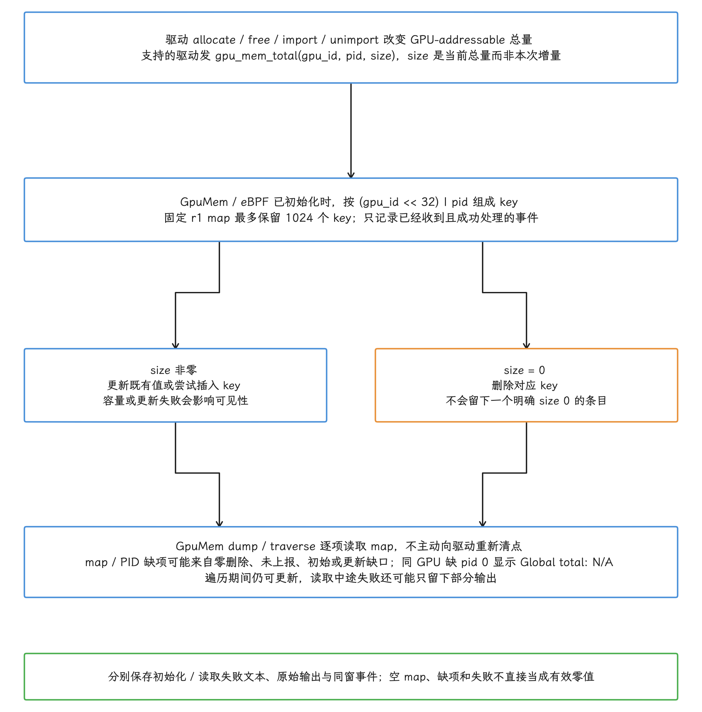

图：驱动tracepoint size是当前GPU-addressable总量，不是这次alloc差值。固定r1按(gpu_id<<32)|pid记录，最多1024keys，非零更新/尝试插入，size0删除key，因此没有条目不等读到显式0。初始化、驱动上报、容量或更新成功影响覆盖；map仅保存已收最新值，不向驱动重新清点。dump逐项读可与更新交叠、非原子，中途失败可留部分输出，同GPU缺pid0显示Global total:N/A。空map/PID缺项可能由零删除、未上报/初始/更新缺口造成，初始化/读取失败另保存错误文本，与同窗事件和资源操作交叉核对，命令完成不是完整性证明。

这条命令适合回答“增长集中在哪个 PID”。它手里没有 allocation ID（分配标识）、格式、调用栈或资源名称，驱动内部碎片也照不出来。定位创建点，还要依赖 API 级 tracker、应用埋点或厂商工具。

### 3.2 Perfetto 的初始值与增量

`GpuMemTracer` 注册 `android.gpu.memory` 数据源。trace 启动后，工作线程遍历 BPF map 并写入 `GpuMemTotalEvent`；每个条目分别取 `systemTime()`，标记 MONOTONIC 时钟。所以我们拿到的是遍历期间的一组初始值，各 GPU/PID 的取值时刻彼此错开；后续变化由另外配置的 `gpu_mem/gpu_mem_total` ftrace 事件提供，仍需检查可用性、丢失和时间覆盖。


要同时拿到初始快照和后续变化，我们把两个数据源都配上：

```protobuf
data_sources {
  config {
    name: "android.gpu.memory"
  }
}

data_sources {
  config {
    name: "linux.ftrace"
    ftrace_config {
      ftrace_events: "gpu_mem/gpu_mem_total"
    }
  }
}
```

只开 ftrace 时，trace 开始前已存在且采集期间不变化的资源缺少基线；只开 `android.gpu.memory` 时，只得到启动后的遍历值。两者都依赖相应驱动 tracepoint，快照还依赖 GpuMem/BPF 已初始化。上面的片段只是数据源部分，要放进含 buffer 与持续时间等配置的完整 TraceConfig 才能执行。

<!-- gracker-diagram: ed10-04-initial-traversal-and-ftrace-coverage -->
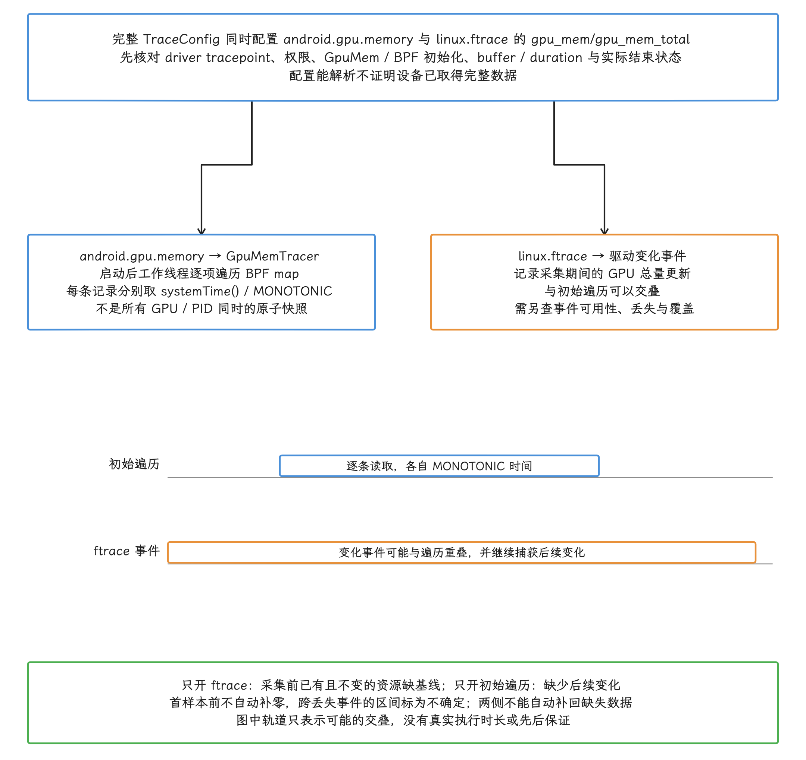

图：完整TraceConfig同时包含android.gpu.memory和linux.ftrace gpu_mem/gpu_mem_total，并核对tracepoint/权限、BPF初始化、buffer/duration与丢失/结束状态；正文片段不是独立可执行全配置。GpuMemTracer启动后工作线程逐项遍历BPF map，每条分别systemTime并标MONOTONIC，非所有GPU/PID同一原子瞬间。独立ftrace负责变化，可以和遍历交叠；轨道仅示可能关系、无真实时长比例或先后保证。仅ftrace缺采集前既有不变资源基线，仅初始遍历缺后续变化；首样本前不补零，跨丢事件区间不确定，两侧不能自动补回缺口。

`android.gpu.memory` 标准库可提供按进程的区间 counter，但本文核验的固定 r1 表 `android_gpu_memory_per_process` 只输出 ts/dur/upid/gpu_memory，没有保留 GPU 维度。多 GPU 时这些行分属不同 GPU，直接相加、或当作同一条进程曲线，都会算错。所以我们改从 GPU 轨道取值，保留 `gpu_id` 和 `track_id`，并在每条轨道内计算持续时间：


```sql
WITH gpu_counters AS (
  SELECT c.ts, c.track_id, c.value,
    CAST(EXTRACT_ARG(t.dimension_arg_set_id, 'gpu') AS INT) AS gpu_id,
    CAST(EXTRACT_ARG(t.dimension_arg_set_id, 'upid') AS INT) AS upid
  FROM counter AS c
  JOIN track AS t ON t.id = c.track_id
  WHERE t.type = 'process_gpu_memory'
), intervals AS (
  SELECT *,
    COALESCE(LEAD(ts) OVER (PARTITION BY track_id ORDER BY ts), trace_end()) - ts AS dur
  FROM gpu_counters
)
SELECT g.ts, g.dur, g.gpu_id, g.track_id, p.pid,
  p.name AS process_name, g.value / 1048576.0 AS gpu_memory_mib
FROM intervals AS g
JOIN process AS p USING (upid)
WHERE g.gpu_id IS NOT NULL
ORDER BY g.ts, g.gpu_id, p.pid;
```

⚠ 工具版本差异：同一份主机合成双 GPU trace，r1 启动脚本附带的 Perfetto v54.0 会把同 PID 的两个 GPU 样本放入同轨道；本次使用的 v58.2 能保留独立 GPU 轨道，以上查询已在它上面验证。v54.0 缺失 GPU 维度时，本查询因 `gpu_id IS NOT NULL` 条件一行都不返回——这说的是解析器丢了维度，设备的 GPU 内存状况要看解析器和原始 trace；导入时丢掉的维度，SQL 也补不回来。

<!-- gracker-diagram: ed10-04-parser-gpu-dimensions-and-sql -->
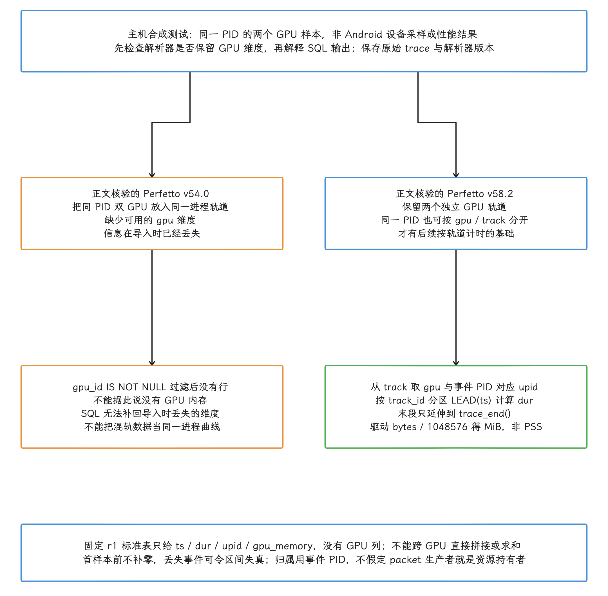

图：仅正文主机合成双GPU同PID测试：v54.0混为一进程轨且缺GPU维度，v58.2保留独立GPU轨，不是Android设备采集或性能结果。修订SQL过滤gpu_id非空，缺维度输入不返行不等无GPU内存，SQL不能恢复导入丢失信息。固定r1标准表只有ts/dur/upid/gpu_memory而无GPU列，所以从track.dimension_arg_set_id取gpu/upid，在track_id内LEAD算dur，末段只到trace_end；驱动bytes除1048576为MiB非PSS，ts/dur纳秒。首样本前不补零，丢事件区间可失真，归属用事件PID对应upid，不以packet生产者当资源owner。设备支持/权限/初始化/丢失仍另核对，保存解析器和原始trace。

读结果时先分清：MiB 是驱动上报量除以 1048576，与 PSS 是两种统计。ts/dur 为纳秒；末段只延伸至 trace 结束，首样本之前不会自动补零，跨丢失事件的区间也可能失真。JOIN 使用事件中的 PID 所对应的 upid 认定归属，发出 packet 的进程在这里没有决定权。设备采集仍要检查 tracepoint、权限、初始化和丢失。

### 3.3 其他 GPU 数据源各有用途

- `gpu.counters` 采集厂商定义的硬件 counter；含义、单位与支持范围依设备而变，频率等指标也可能来自 ftrace。实际注册名还可能带 `.adreno` 等后缀，采集配置需要精确匹配已注册的数据源名。
- `gpu.renderstages` 提供 graphics/compute submission（图形与计算提交）的执行阶段和时长，不保证存在名为“texture upload”的统一 stage。
- `vulkan.memory_tracker` 记录 Vulkan 的 driver/device memory allocation 与 bind（绑定）事件，适合观察 Vulkan 资源生命周期；它不覆盖 OpenGL、HWUI、Camera 和 SurfaceFlinger 的全部资源。
- 部分旧版或厂商内核还导出 DMA heap allocation/free tracepoint；`android17-6.18-2026-06_r6` 这个通用基线里找不到一条可移植的 `dmabuf_heap/dma_heap_stat` 事件，采集配置应以目标设备的 `available_events` 为准。


`dumpsys gfxinfo` 关注帧时间、HWUI 状态和渲染统计，可以与内存时间线对齐；通用 GPU 内存总账仍要用前面 GpuMem/Perfetto 的数据源。

## 4. Kernel 6.18 的 DMA-BUF 观测入口

### 4.1 进程 fd：谁还持有共享 buffer

标准 Linux 接口位于 `/proc/PID/fdinfo/FD`。DMA-BUF fd 会额外输出 `size`、`count`、`exp_name`，有名称时还会输出 `name`。

查示例应用当前持有哪些 DMA-BUF fd，遍历它的 fdinfo：

```bash
adb shell '
pids=$(pidof com.example.gallery)
if [ -z "$pids" ]; then
  echo "no matching process" >&2
  exit 1
fi
for pid in $pids; do
  case "$pid" in *[!0-9]*|"") continue ;; esac
  for info in /proc/$pid/fdinfo/*; do
    [ -r "$info" ] || continue
    if grep -q "^exp_name:" "$info"; then
      printf "pid=%s fd=%s\n" "$pid" "${info##*/}"
      grep -E "^(ino|size|count|exp_name|name):" "$info"
    fi
  done
done
'
```

`size` 是 buffer 容量，`count` 是 dma-buf file 引用计数（固定内核会减去这次 procfs 读取的临时引用），持有进程数、GPU 映射数、可回收比例它都回答不了。`exp_name` 是 exporter；`ino` 可在同次观测窗口内与 sysfs inode 关联。进程列表、fd 和引用计数都在变化，PID/inode 经历释放重用后就换了身份，当不了永久标识。权限不足、进程退出、fd 转交和没有匹配 buffer 都可能使输出缺失，应保留错误与采样起止时间。


Linux 侧的通用入口就到 fdinfo 为止，`/proc/PID/dmabuf` 这样的通用文件并不存在；设备私有节点即使存在，也只是单台设备的行为，够不上 Android 平台保证。

### 4.2 全局 sysfs：系统里有哪些唯一 DMA-BUF

在 `CONFIG_DMABUF_SYSFS_STATS` 开启时，`/sys/kernel/dmabuf/buffers/<inode>/` 提供 `size` 与 `exporter_name`。我们按 inode 生成一份快照：

```bash
adb shell '
root=/sys/kernel/dmabuf/buffers
if [ ! -d "$root" ] || [ ! -r "$root" ]; then
  echo "DMA-BUF sysfs unavailable or unreadable" >&2
  exit 1
fi
for entry in "$root"/*; do
  [ -d "$entry" ] || continue
  inode=${entry##*/}
  size=$(cat "$entry/size") || continue
  exporter=$(cat "$entry/exporter_name") || continue
  printf "%s %s %s\n" "$inode" "$size" "$exporter"
done
'
```

sysfs（内核对象信息文件系统）在该配置和访问权限成立时列出当前已登记的 DMA-BUF 对象容量，适合按 inode 去重和按 exporter 聚合。遍历与两个属性读取之间都可能有对象创建、释放，脚本会跳过读取失败的项，所以输出只当一次尽力快照看，谈不上完全原子、无遗漏。创建调用栈它存不下来；同窗口将 inode 与进程 fd 对上，证明的是观测时的持有线索，最初的业务创建点要另外定位。Android user build 还可能限制 shell 读取。

<!-- gracker-diagram: ed10-04-fdinfo-and-sysfs-inode-correlation -->
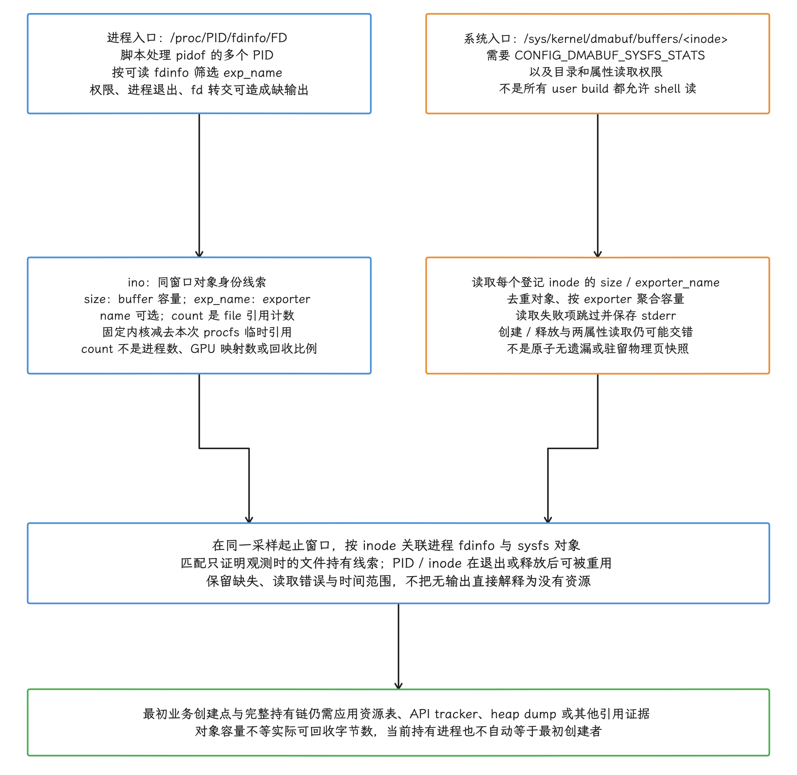

图：进程脚本处理多个pidof结果并筛可读fdinfo，ino是同窗对象线索，size容量、exp_name导出方、name可选；count为dma-buf file引用计数，固定内核扣本次procfs临时引用，非进程数/GPU映射数/回收比例。sysfs需CONFIG_DMABUF_SYSFS_STATS和权限，按登记inode读size/exporter、去重聚合，失败项跳过留stderr，遍历和两属性读取可遇创建/释放，不是原子无遗漏或物理驻留快照。同采样起止窗按inode关联只证明观测时文件持有，PID/inode可释放重用，权限/退出/fd交接/无匹配均可缺输出。最初创建点与完整持有链另靠资源表/APItracker/heapdump等，不能把当前持有者当创建者或把capacity当可回收量。

### 4.3 debugfs：实验室设备上的全局调试视图

实验室设备已 root 且挂载 debugfs 时，可以直接读全局列表：

```bash
adb shell su 0 cat /sys/kernel/debug/dma_buf/bufinfo
```

debugfs（内核调试文件系统）是实验室接口，生产环境别依赖它，格式也不承诺稳定。厂商 GPU 节点同样受驱动、内核版本和 SELinux 约束；报告应记录设备路径与原始输出，避免把 Adreno、Mali、PowerVR 的私有路径互相套用。


## 5. 从增长曲线定位资源持有者

### 5.1 先辨认缓存、延迟释放与泄漏

图形资源释放常受三类延迟影响：

<!-- gracker-diagram: ch10-04-19-deferred-release -->
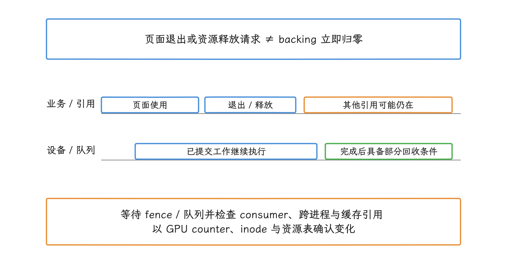

图：示意队列任务完成与引用清理可能延后于页面退出。缓存平台、异步释放和泄漏需要多轮同状态比较，不能靠一次 System.gc 判断归零。

- GPU command 尚未完成，driver 要等待 fence signal（同步栅栏发出完成信号）后才回收 backing memory；
- BufferQueue 的 producer、consumer（消费者）或 SurfaceFlinger 仍持有 slot（缓冲槽位）；
- 图片库、HWUI 或图形 API 保留高水位缓存，复用后不继续增长。

我们按三种形态来区分：预热后数值保持稳定、不再上升，通常符合有上限缓存；每轮相同操作后基线持续上移，更像持有者引用或资源销毁不完整；退出页面后短时不降，就把 fence 和 queue drain（队列中剩余任务处理完毕）的时间放进采样窗口。一次 `System.gc()` 说明不了图形资源应立即归零。

### 5.2 可复查的诊断实验

建议按同一套脚本保存下列数据：

1. 记录设备型号、Android build、GPU driver、kernel page size 和 app 版本。
2. 冷启动后等待页面稳定，采集 `meminfo`、`--gpumem`、DMA-BUF inode 快照和 Perfetto 基线。
3. 用固定数据集执行同一段页面、相机、视频或渲染操作。
4. 每轮在相同 UI 状态采样，并给 GPU fence 与异步销毁留下可观察区间。
5. 比较进程 GPU 总量、唯一 DMA-BUF、EGL/GL mtrack 与 Java/native 持有者数量。
6. 找到最早开始增长的指标，再选择 Bitmap、Surface、GL/Vulkan 或厂商工具继续定位。

报告要保存原始值与差值。只有 App Summary 的 `Graphics` 一个数字的话，Gfx dev、EGL mtrack 和 GL mtrack 就分不开了。


### 5.3 Java 与 native profile 能发现什么

查仍被引用的 `Bitmap`、`Drawable`、`Surface`、`SurfaceTexture`、`ImageReader`、`Image`、`HardwareBuffer` 及业务缓存，用 ART heap dump；定位覆盖到的 wrapper、命令构建对象与 allocator 分配栈，用 native heap profile，但它本身不提供完整保留引用图。

这里的 native heapprofd 默认 heap 覆盖 `malloc` 家族的分配，其他 allocator 需相应 heap 集成；ART allocation profiling 使用另行注册的 `com.android.art` heap。Gralloc DMA-BUF 与 GPU driver private allocation 不受普通 malloc hook 管理，heap profile 里的 wrapper 字节数也顶不了 GPU backing size。我们先用分配栈找到创建候选，再用 heap dump、应用所有权记录或资源表追查仍持有的对象，最后与 GPU/DMA-BUF 指标对齐；走到这一步之前，分配栈只是线索，资源是否仍存活还定不下来。


### 5.4 16 KB kernel page 的精确边界

`android17-6.18-2026-06_r6` 的 `dma_heap_buffer_alloc()` 使用 `__PAGE_ALIGN(len)`，DMA heap allocation 的起止按 kernel page（内核页）对齐。16 KB kernel page 下，小 allocation 尾部向上取整后的额外字节数上限更高。

<!-- gracker-diagram: ch10-04-22-page-rounding -->
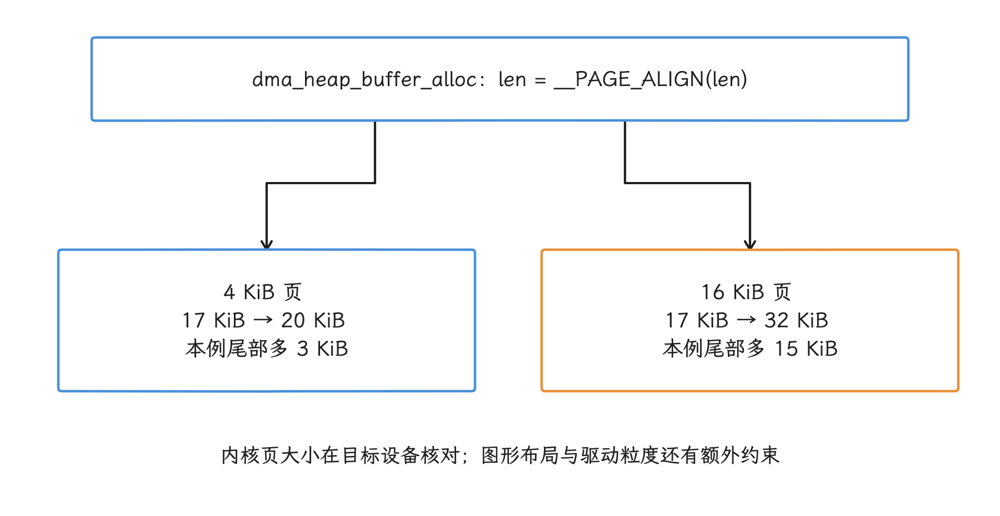

图：示意数学例子：同为 17 KiB 请求，按 4 KiB 页取整得到 20 KiB，按 16 KiB 页得到 32 KiB；只验证页取整，不冒充实际 Gralloc 分配或固定增长率。

拿这条规则去推一个统一的“图形内存增加百分比”，是推不出来的：Gralloc 的 stride（行跨度）、plane（图像分量平面）、格式、压缩、tiling（分块布局）、secure heap（受保护内存区域）和驱动页表粒度，带来的差异都可能超过尾部 page rounding（按页向上取整）。比较 4 KB 与 16 KB build 时，我们以 DMA-BUF inode size 和 GPU counter 实测为准，再按 allocation 尺寸分布解释差异。


## 6. 资源类型与修复方向

### 6.1 Hardware Bitmap

`Bitmap.Config.HARDWARE` 在 API 26 引入，像素存放在 graphic memory（图形内存）中，Bitmap 不可变。它能避免每次绘制都从软件像素上传纹理，但会占用图形资源，并限制像素读写和部分 Canvas 操作。


现代 Android 上，`Bitmap.recycle()` 当不了 Hardware Bitmap 的常规释放协议，常规路径是解除引用：Java/native、View、Canvas、RenderThread 与缓存中的使用关系解除之后，backing resource 才具备相应回收条件；Java 引用消失后立即归零，系统没有这个承诺。`recycle()` 文档提醒避免对曾用于 View 或仍可能被其他地方引用的 Bitmap 手工回收。文档中 `invalidate()` 后还需一次 draw pass 的具体例子属于 `reconfigure()` 的使用前提，离开这个前提，它就只是个具体例子，成不了任意 Bitmap 都能安全 recycle 的通用同步协议。

<!-- gracker-diagram: ed10-04-hardware-bitmap-owners-and-release -->
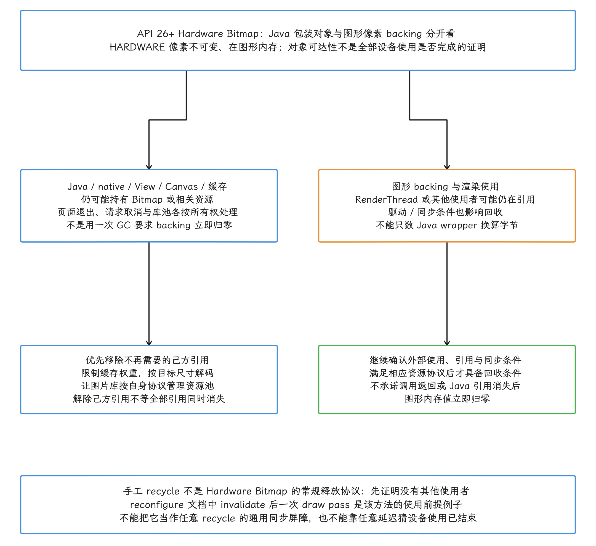

图：API26+ HARDWARE像素immutable且在图形内存，Java包装/业务引用与backing设备使用分别核对。正常处理优先按显示尺寸解码、限制缓存、解除己方页面/请求/缓存引用并遵守图片库池协议；View/Canvas/RenderThread/native/其他使用者和驱动同步条件仍可延后回收，Java引用消失/一次GC/调用返回均不保证图形值即时归零。手工recycle不是HardwareBitmap常规释放协议，必须先证明没有其他使用者。reconfigure文档invalidate后一次drawpass是该方法前提例子，图下方只作独立语义注解，不表示正常释放后必须执行reconfigure，更不是任意recycle通用同步屏障；不靠固定延迟猜设备使用结束。

图片页面的优先动作是按显示尺寸解码、限制内存缓存权重、在页面和请求取消时移除引用，并让 Glide/Coil 等图片库管理其资源池。`prepareToDraw()` 从 API 24 起可发起尚未上传 Bitmap 的异步 RenderThread 上传，把部分工作移到首次绘制之前；它不等上传完成，帧时间或驻留内存的改善也没有承诺。修改像素后还可能重新上传。

<!-- gracker-diagram: ch10-04-26-prepare-upload -->
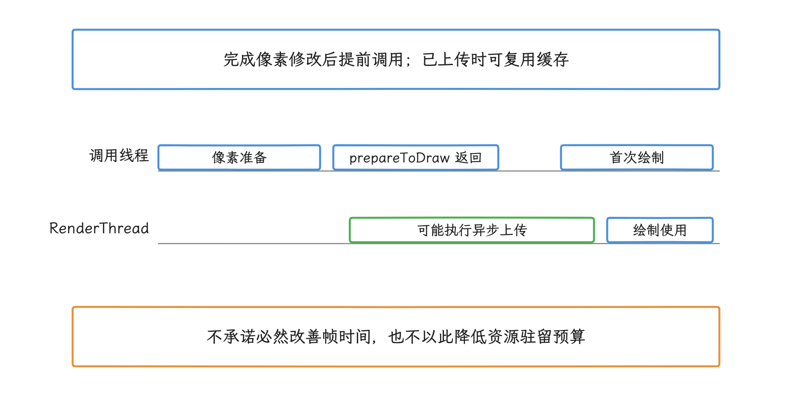

图：API 24 起 prepareToDraw 可异步触发 RenderThread 上传；函数返回不代表上传完成，像素修改后还可能需要重传。轨道只示一种可能调度，不保证上传在首次绘制前完成，也不提供性能测量或驻留内存下降保证。

### 6.2 Surface、BufferQueue 与媒体资源

应用自己创建的 `Surface`、`SurfaceTexture`、`ImageReader`、`Image`、`MediaCodec` 和相机 session 要按 API 生命周期关闭。`ImageReader.acquire*()` 得到的每个 `Image` 都需要及时 `close()`；未关闭的 Image 会占用 `maxImages` 配额和对应 buffer。


Surface 销毁后，buffer 还可能由 consumer 或 fence 持有。看到内存值延迟下降，我们就同时核对 `onSurfaceTextureDestroyed()` 的返回值与释放责任、codec stop/release、camera session close、GPU counter 和实际引用。TextureView 回调返回 `true` 时由其释放 SurfaceTexture；返回 `false` 则调用方负责释放。`Surface.release()` 只解除本地对服务端 Surface 的引用；`SurfaceTexture.release()` 后仍被其他客户端或 GL 引用的 buffer 也可能继续分配。

<!-- gracker-diagram: ch10-04-28-texture-callback -->
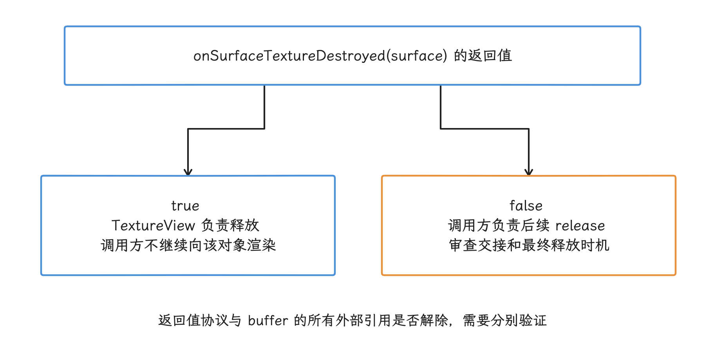

图：销毁回调返回 true 时由 TextureView 释放 SurfaceTexture；返回 false 时调用方保留责任。SurfaceTexture.release 后仍可能有外部 buffer 引用。

“三缓冲”在 BufferQueue 这里有前提，适用于所有 producer/consumer 的固定结论给不出来：可用 slot 与同时分配的 buffer 数由 max dequeued（生产者最多取出的槽位）、min undequeued（必须留在队列中的最少槽位）、max acquired（消费者最多持有的槽位）、异步模式和 producer 行为共同决定。每个 buffer 的逻辑 payload（有效像素数据）可用 `width × height × bytesPerPixel` 粗估，真实 allocation 还要看 stride、plane、格式、压缩和对齐。

<!-- gracker-diagram: ch10-04-29-bufferqueue-count -->
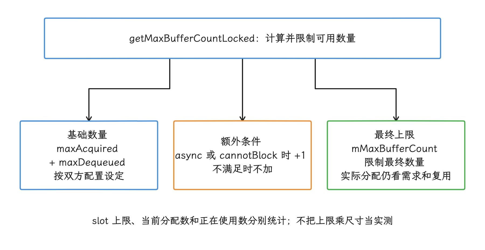

图：固定 r1 的上限由 maxAcquired、maxDequeued、async/cannotBlock 与 mMaxBufferCount 共同限制；这不是所有场景固定分配三块 buffer 的结论。

### 6.3 OpenGL ES 与 Vulkan

销毁 GL ES 资源时，我们按对象类型分别核对：纹理、buffer 和 renderbuffer 可由同一 share group 中的 context 共享；FBO（framebuffer object）属于 context 的非共享容器，附件纹理可以共享，把 FBO 本身也当作共享对象就弄错了类型。按对应 `glDelete*` 删除名称后，其他 context 的绑定或容器附件仍可能持有底层对象；引用未解除、使用未完成，都会拖住回收。

<!-- gracker-diagram: ch10-04-30-gl-objects -->
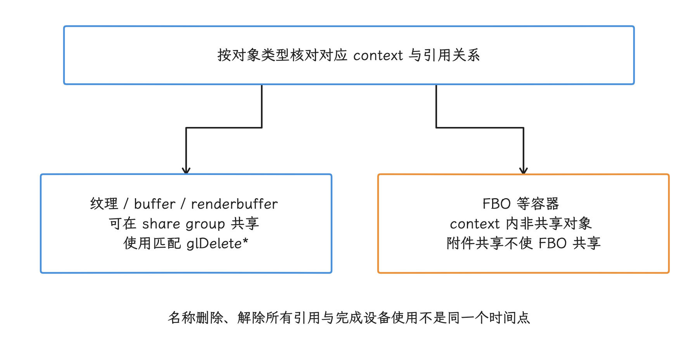

图：GL ES3.2 允许纹理、buffer、renderbuffer 等共享，FBO 是不共享容器。删除名称后，其他绑定或容器附件还可能持有底层对象。

EGL Surface 走独立的 `eglDestroySurface(display, surface)` 协议；若仍是某线程的 current surface，会延后到不再 current 时销毁，pbuffer 的纹理绑定还有额外释放条件。它在前面的 GL share-group 对象清单之外。

<!-- gracker-diagram: ch10-04-31-egl-surface -->
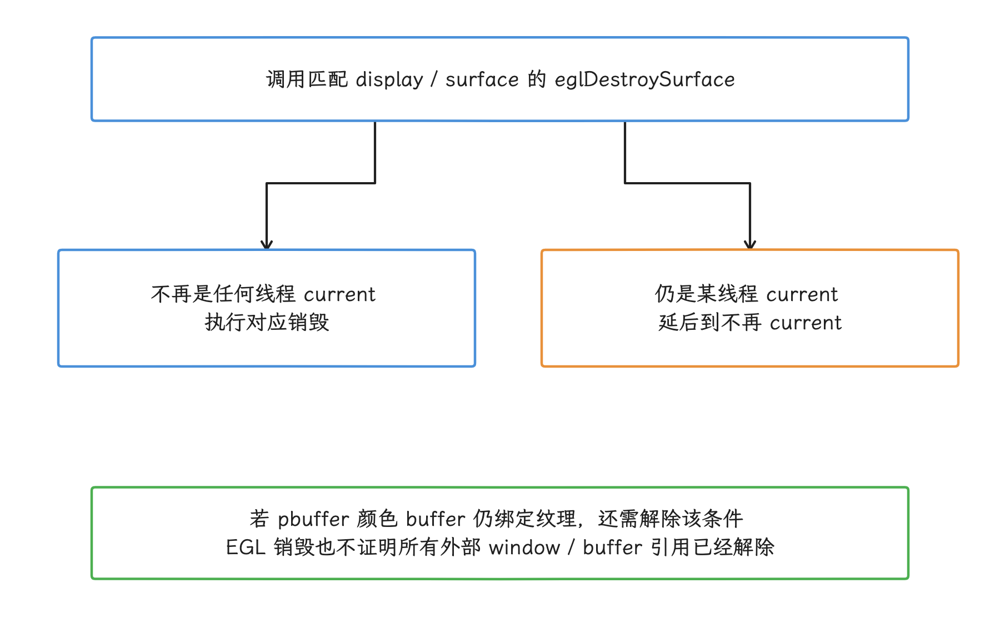

图：流程中的条件描述 EGL API 语义，不承诺所有 driver backing 或跨进程资源在调用返回时归零。

Vulkan 这边要把 object 与 bound memory（绑定到对象的设备内存）分开管理：销毁 `VkImage` 并不会隐式完成所有 `vkFreeMemory()`，suballocation（从大块内存中切出的子分配）还要交还给应用 allocator。释放前必须满足 Vulkan 生命周期与同步规则。诊断构建可用 validation layer（校验层）、`vulkan.memory_tracker` 和 AGI frame profile 核对 allocation/bind/free。

<!-- gracker-diagram: ch10-04-32-vulkan-lifetime -->
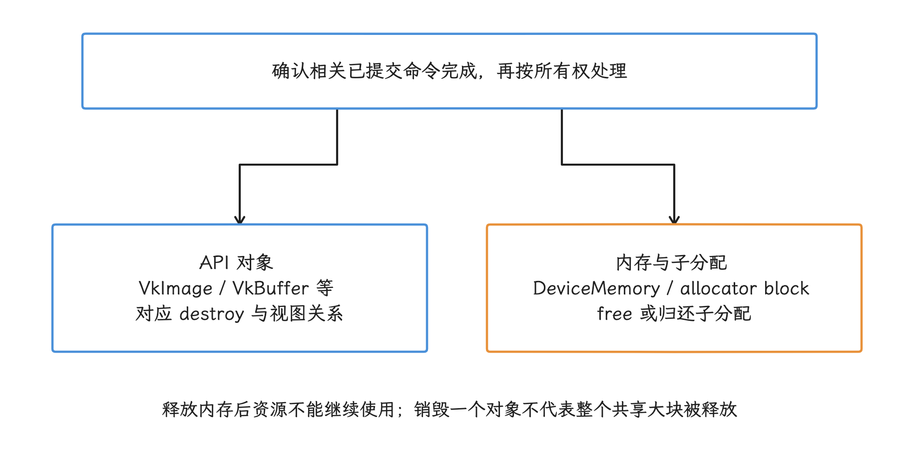

图：销毁 VkImage 与释放 VkDeviceMemory 是不同操作；子分配还需归还应用 allocator。两者都要满足已提交使用完成、引用与同步规则。

资源销毁时一概插入 `vkDeviceWaitIdle()` 并不划算：它等待该逻辑设备所有队列的工作完成，可能排空流水线。我们按实际依赖用 fence 等机制确认相关使用完成，再处理对象与内存；少数确实需要整设备空闲的阶段另行评估。

<!-- gracker-diagram: ch10-04-33-wait-idle -->
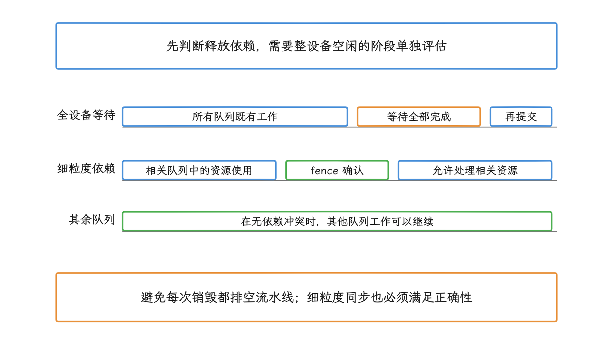

图：wait-idle 会等待逻辑设备所有队列；按依赖用 fence 可只等待相关使用完成。以下仅示意等待粒度，不构造测量时长或通用性能收益。

RenderScript 已在 API 31 废弃。维护历史代码时仍需销毁 `Allocation` 等对象，新项目应迁移到当前图形、计算或媒体 API。

### 6.4 SurfaceView 与 TextureView

`SurfaceView` 由独立 Surface layer 提供内容，系统有机会交给 Hardware Composer（硬件合成器）；`TextureView` 把 SurfaceTexture 内容作为 View 层级的一部分由 HWUI 采样，需要硬件加速窗口，软件渲染时不绘制内容。它支持 View 的 alpha、旋转和裁剪，但具体能力随版本在变——SurfaceView 在 Android U 起也支持相应 alpha 能力，“永远只属于 TextureView”的能力表给不出来。路径不同可能增加采样与合成工作。

<!-- gracker-diagram: ch10-04-34-view-composition -->
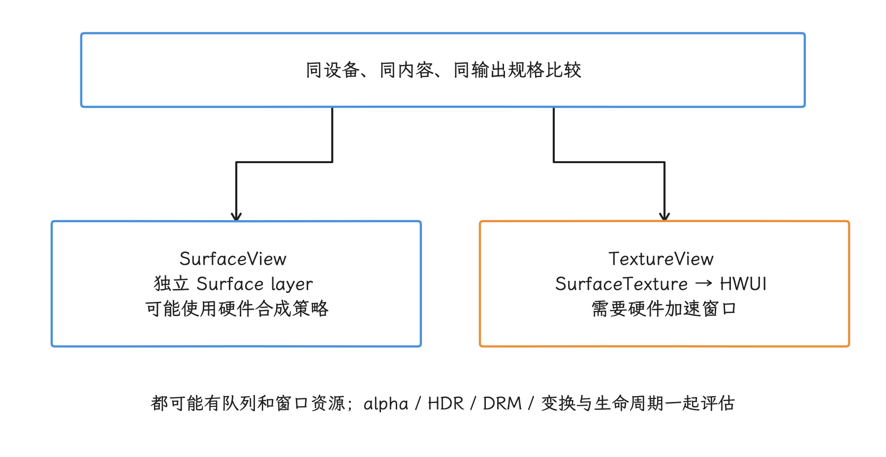

图：SurfaceView 可由合成策略交给 HWC；TextureView 在硬件加速 View 路径采样内容。能力与 overlay 资格受版本和内容限制，不能只按组件名比较内存。

内存上，“TextureView 一定更大”这种固定排序给不出来：SurfaceView 自己也有 BufferQueue，TextureView 所在应用窗口也需要 window buffers，总量由分辨率、格式、queue 深度、overlay 资格（能否直接交给硬件合成器）和内容路径共同决定。相机和视频页面，我们在同一设备上比较进程 GPU counter、DMA-BUF inode 与帧时间，再结合变换、HDR、DRM 和生命周期需求选择。

## 7. Game、Camera 与 AR 的预算方法

游戏的纹理、render target、depth/stencil（深度/模板缓冲）、swapchain image（交换链图像）、staging buffer（传输暂存缓冲区）与 allocator block（分配器管理的大块内存）都要纳入预算。


引擎的 texture streaming（纹理流式加载）或 Vulkan suballocator 改变的是资源管理方式，driver fragmentation（驱动内部碎片）对 AOSP 依旧不可见。AGI frame profile 可以查看单帧的纹理、shader、render target 和 RAM/GPU memory；系统级趋势仍要用 Perfetto 或 `--gpumem`。

Camera2 / CameraX 的每路输出 Surface 都可能维护独立 buffer 集合。预览、录制、分析、JPEG/RAW 同时开启时，应按每路分辨率、格式、`maxImages` 和 queue 行为计算，并确认分析线程及时关闭 Image。只按相机传感器分辨率乘一个 buffer 数，多个 plane、stride 和各 consumer 的独立队列都会漏掉。

<!-- gracker-diagram: ch10-04-36-camera-budget -->
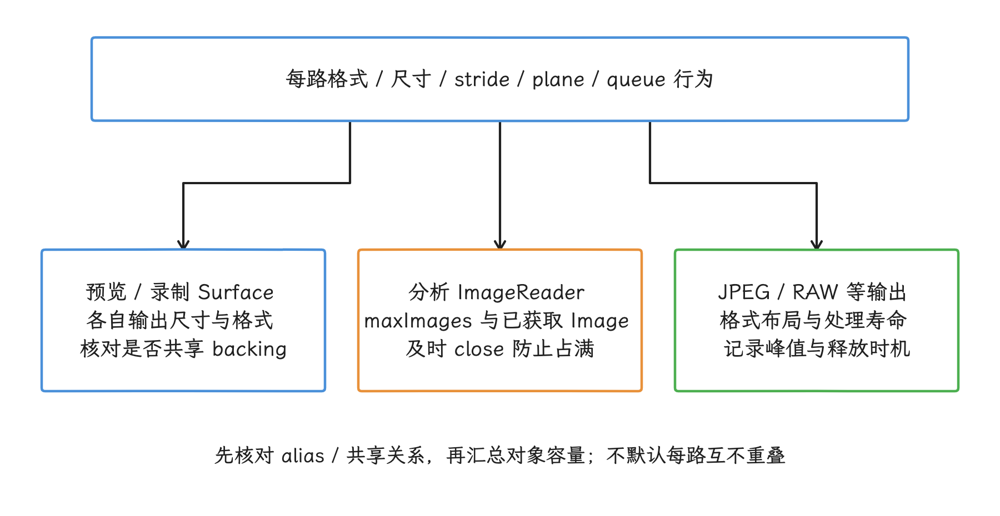

图：预览、录制、分析与 JPEG/RAW 的输出路径可能有不同 buffer 集合；不能只用传感器分辨率乘一个固定数量推导全部容量。

AR 场景还包含相机输入、环境纹理、depth（深度数据）、mesh（网格）、点云与 render target。切换 session 后若 GPU 总量和 DMA-BUF inode 都持续增加，我们同时查 session 持有者、Surface/Image 生命周期和引擎资源表，把 Java heap 之外的路径也纳入排查。


## 8. 观测链的局限与发布检查

AOSP 图形内存链提供的观测点，到这里可以串起来了：

- memtrack 为 `dumpsys meminfo` 补充 smaps 看不到的进程图形内存；
- GpuMem 用 eBPF map 保存驱动 `gpu_mem_total` 的全局与进程总量；
- GpuMemTracer 给 Perfetto 提供 trace 启动时的初始快照；
- ftrace 记录 trace 期间的 GPU 总量变化；
- kernel DMA-BUF sysfs/debugfs/fdinfo 描述共享 buffer。

跨厂商统一的 allocation call stack（分配调用栈）、资源名或碎片率，这条链给不出来；应用可调用的 GPU 内存 compact（规整）API，AOSP 同样没有。需要精确到纹理、VkImage 或厂商 heap 时，我们改用应用资源注册表、AGI、Vulkan tracker 或目标 GPU 的官方工具。


发布前至少确认：


- 指标名称、单位、设备 build、GPU driver 与采样时间写进报告。
- `Graphics` 摘要与 `EGL mtrack`、`GL mtrack`、`Gfx dev` 没有混写。
- `--gpumem` 支持已验证，0 与“不支持”能够区分。
- Perfetto 同时具备基线和增量，保存解析器版本；多 GPU 查询保留 GPU/轨道维度并检查旧解析器丢失。
- DMA-BUF 按 inode 去重，进程 fd 总和没有冒充系统唯一物理量。
- Hardware Bitmap 通过引用与缓存策略释放，没有依赖随意 `recycle()`。
- Image、Surface、SurfaceTexture、codec、camera session 都有明确负责 close/release 的持有者。
- GL/Vulkan 资源销毁满足 context、share group、queue 和 fence 生命周期。
- 4 KB / 16 KB 差异来自同一 workload（工作负载）实测，没有套用固定增长比例。
- 高水位缓存、GPU 延迟释放和持续泄漏已经用多轮时间线区分。

## 参考资料

- [Android 17 `IMemtrack.aidl`](https://android.googlesource.com/platform/hardware/interfaces/+/refs/tags/android-17.0.0_r1/memtrack/aidl/android/hardware/memtrack/IMemtrack.aidl)
- [Android 17 `android_os_Debug.cpp`](https://android.googlesource.com/platform/frameworks/base/+/refs/tags/android-17.0.0_r1/core/jni/android_os_Debug.cpp)
- [Android 17 `Debug.MemoryInfo`](https://android.googlesource.com/platform/frameworks/base/+/refs/tags/android-17.0.0_r1/core/java/android/os/Debug.java)
- [Android 17 `GpuService.cpp`](https://android.googlesource.com/platform/frameworks/native/+/refs/tags/android-17.0.0_r1/services/gpuservice/GpuService.cpp)
- [Android 17 `GpuMem.cpp`](https://android.googlesource.com/platform/frameworks/native/+/refs/tags/android-17.0.0_r1/services/gpuservice/gpumem/GpuMem.cpp)
- [Android 17 `GpuMemTracer.cpp`](https://android.googlesource.com/platform/frameworks/native/+/refs/tags/android-17.0.0_r1/services/gpuservice/tracing/GpuMemTracer.cpp)
- [Android 17 `BufferQueueCore.cpp`](https://android.googlesource.com/platform/frameworks/native/+/refs/tags/android-17.0.0_r1/libs/gui/BufferQueueCore.cpp)
- [Kernel `android17-6.18-2026-06_r6` `gpu_mem.h`](https://android.googlesource.com/kernel/common/+/refs/tags/android17-6.18-2026-06_r6/include/trace/events/gpu_mem.h)
- [Kernel `android17-6.18-2026-06_r6` `dma-heap.c`](https://android.googlesource.com/kernel/common/+/refs/tags/android17-6.18-2026-06_r6/drivers/dma-buf/dma-heap.c)
- [Linux DMA-BUF 文档](https://docs.kernel.org/driver-api/dma-buf.html)
- [Perfetto GPU 数据源](https://perfetto.dev/docs/data-sources/gpu)
- [Perfetto `android.gpu.memory`](https://perfetto.dev/docs/analysis/stdlib-docs#androidgpu-memory)
- [Bitmap API](https://developer.android.com/reference/android/graphics/Bitmap)
- [Bitmap.Config API](https://developer.android.com/reference/android/graphics/Bitmap.Config)
- [TextureView API](https://developer.android.com/reference/android/view/TextureView)
- [Android GPU Inspector](https://developer.android.com/agi)

- [Android17 gpuMem.c](https://android.googlesource.com/platform/frameworks/native/+/refs/tags/android-17.0.0_r1/services/gpuservice/bpfprogs/gpuMem.c)
- [Android17 libmemtrack](https://android.googlesource.com/platform/system/memory/libmemtrack/+/refs/tags/android-17.0.0_r1/memtrack.cpp)
- [Android17 libmeminfo](https://android.googlesource.com/platform/system/memory/libmeminfo/+/refs/tags/android-17.0.0_r1/androidprocheaps.cpp)
- [Perfetto固定r1 memory.sql](https://android.googlesource.com/platform/external/perfetto/+/refs/tags/android-17.0.0_r1/src/trace_processor/perfetto_sql/stdlib/android/gpu/memory.sql)
- [Perfetto固定r1 GPU parser](https://android.googlesource.com/platform/external/perfetto/+/refs/tags/android-17.0.0_r1/src/trace_processor/importers/proto/gpu_event_parser.cc)
- [OpenGL ES3.2规格 §2.6、§5](https://registry.khronos.org/OpenGL/specs/es/3.2/es_spec_3.2.pdf)
- [EGL eglDestroySurface](https://registry.khronos.org/EGL/sdk/docs/man/html/eglDestroySurface.xhtml)
- [Vulkan vkFreeMemory](https://docs.vulkan.org/refpages/latest/refpages/source/vkFreeMemory.html)
- [Vulkan wait-idle示例](https://docs.vulkan.org/samples/latest/samples/performance/wait_idle/README.html)
- [SurfaceTexture](https://developer.android.com/reference/android/graphics/SurfaceTexture)
- [Surface](https://developer.android.com/reference/android/view/Surface)
- [ImageReader](https://developer.android.com/reference/android/media/ImageReader)
- [16KB page sizes](https://developer.android.com/guide/practices/page-sizes)

- [Perfetto heapprofd 与 ART allocation profiling](https://perfetto.dev/docs/data-sources/native-heap-profiler)
