# GPU 与图形内存统计、归因与诊断

Android 没有一个能回答全部图形内存问题的数字。`dumpsys meminfo` 按进程 PSS（按引用者比例分摊共享页）和 memtrack（厂商图形内存记账接口）分类，`dumpsys gpu --gpumem` 读取驱动上报的 GPU 地址空间总量，DMA-BUF 描述设备间共享的 buffer，Vulkan tracker 记录 API 级分配事件。它们可能同时覆盖同一块资源，也可能各自漏掉一部分。

<!-- gracker-diagram: ch10-04-01-counter-questions -->
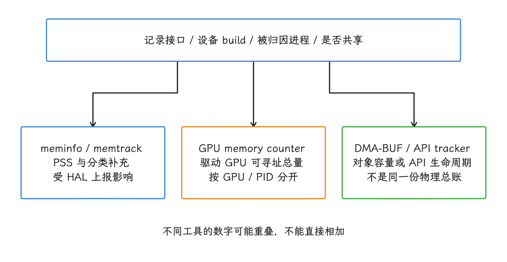

图：同一资源可以进入多套计数，覆盖范围也可能不同。先记录采集接口、build、进程和共享关系，再解释增长。

排查图形内存增长时，先给每个数字补上四项限定：采集接口、设备与系统 build（构建版本）、被归因的进程、资源是否共享。少了这些限定，`Graphics = 120 MB` 既说不清物理内存有多少，也证明不了应用在泄漏。

## 1. 先区分资源，再选择计数器

### 1.1 两类常见图形分配

`GraphicBuffer` / `HardwareBuffer` 由 Gralloc（图形缓冲区分配器）创建，通常以 DMA-BUF 文件描述符跨进程和硬件模块共享。producer（生产者）、SurfaceFlinger、显示控制器、相机、视频编解码器与 GPU 可以引用同一个 buffer；它是否映射到 CPU 地址空间、GPU 地址空间或两者，取决于 usage（用途标志）、mapper（映射接口）和驱动。

<!-- gracker-diagram: ch10-04-02-shared-buffer -->
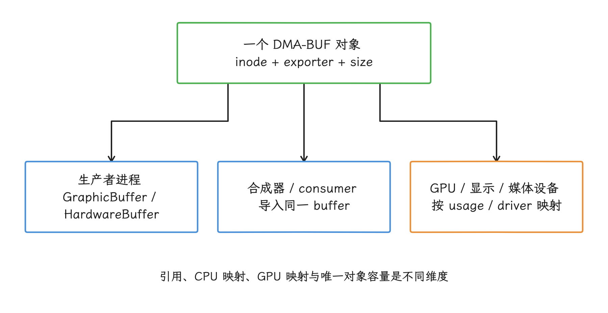

图：示意同一 DMA-BUF 被生产者、合成器和设备共同引用；对象共享不代表多份独立物理分配，也不保证 CPU 与 GPU 映射集合相同。

GPU 驱动还会管理 API 私有资源，例如纹理、render target（渲染目标）、Vulkan device memory（设备内存）、命令与内部缓存。这类资源可能没有可供应用检查的 DMA-BUF fd（文件描述符），也可能采用厂商专用分配器。

AOSP 没有统一的用户态“显存分配器”或“显存碎片整理器”；格式布局、heap、映射和回收策略由 Gralloc HAL（硬件抽象层）与 GPU 驱动决定。

一张逻辑图片也可能沿不同路径出现：

- 软件 Bitmap 的像素位于 native heap，首次硬件绘制还可能建立 GPU 纹理缓存；
- `Bitmap.Config.HARDWARE` 的像素放在图形内存中，Bitmap 对象仍由 Java 引用链控制生命周期；
- 相机或视频帧常由 Gralloc buffer 组成，多个 Surface 各有自己的 BufferQueue；
- Vulkan 应用可显式申请 `VkDeviceMemory`，再把 image 或 buffer 绑定到该内存。

这些资源不能只按 Java 对象数量换算。一个对象可能没有独立 backing allocation（底层内存分配），多个对象也可能共享同一个 DMA-BUF。

<!-- gracker-diagram: ch10-04-03-resource-paths -->
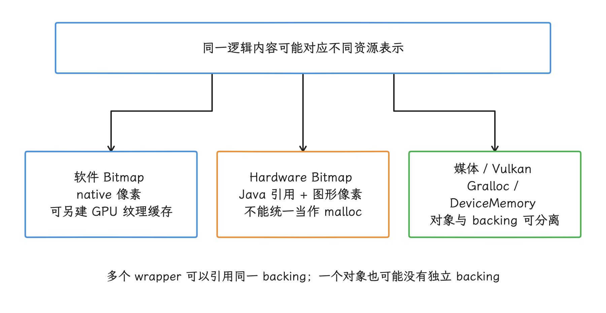

图：Java 对象数不能换算全部图形字节数。软件像素、硬件 Bitmap 与媒体/Vulkan 资源需要按实际 backing 路径查证。

### 1.2 同一资源在不同工具里的视角

| 工具或指标 | 主要回答的问题 | 不能直接回答的问题 |
|---|---|---|
| `dumpsys meminfo` | 进程的 smaps（逐映射内存统计）分类与 memtrack 补充归因 | 系统中唯一物理 buffer 总量、分配调用栈 |
| `dumpsys gpu --gpumem` | 驱动上报的全局及各 PID GPU-addressable（GPU 可寻址）总量 | 资源类型、创建位置、DMA-BUF 唯一物理占用 |
| `/proc/PID/fdinfo/FD` | 某进程仍持有的 DMA-BUF fd 及 size/exporter（导出方） | 没有 fd 的 GPU 私有资源、由别处持有的引用 |
| `/sys/kernel/dmabuf/buffers` | 系统中每个 DMA-BUF inode（内核文件对象标识）的 size/exporter | 实际驻留物理页清点、创建调用栈与阻止释放的完整引用 |
| Perfetto GPU memory | GPU 总量随时间的变化及进程归因 | 单个纹理名称、完整分配栈 |
| Vulkan memory tracker / AGI（Android GPU Inspector） | Vulkan API 分配、绑定及单帧资源 | 非 Vulkan 路径的全部系统图形内存 |
| ART heap dump / allocation profile / native heap profile | heap dump 查 Java 引用；allocation profile 查其覆盖范围内的创建栈 | allocation profile 不给完整保留引用图，也不清点全部 GPU backing 字节数 |

不同工具的数字不能直接相加。进程 GPU 总量可能把跨进程 import（导入的共享资源）重复计入，memtrack 则要求按 PSS 规则处理共享、排除类型间重叠。

<!-- gracker-diagram: ch10-04-04-tool-selection -->
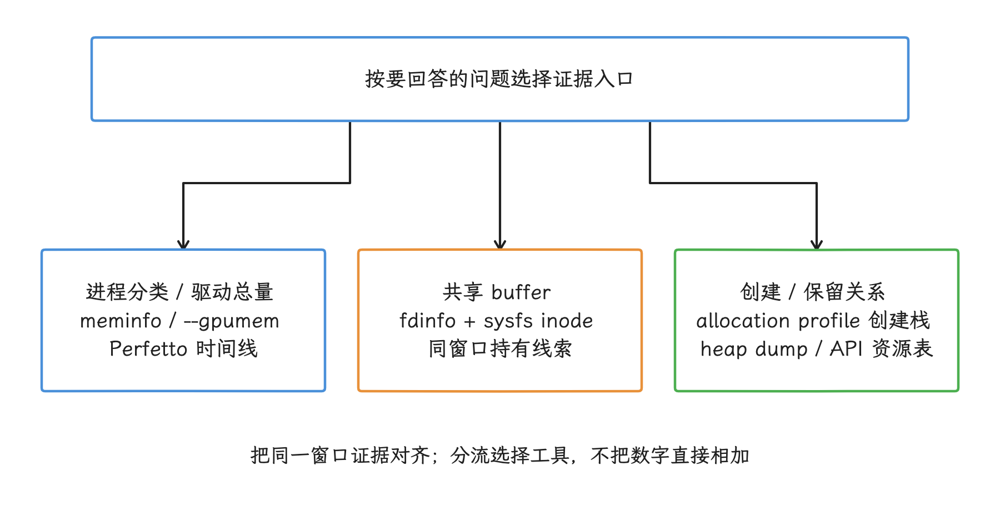

图：工具选择按问题分流，不表示每个场景必须依次运行所有工具。采样创建栈不能代替存活引用图。

## 2. `dumpsys meminfo`：Graphics 摘要由什么组成

### 2.1 Android 17 的详细行

先保存一份应用的完整进程明细：

```bash
adb shell dumpsys meminfo com.example.gallery
```

多进程应用会出现多个 PID，应逐个保存结果。App Summary 里的 `Graphics` 并非 memtrack `GRAPHICS` 类型的原样输出。

Android 17 的 `Debug.MemoryInfo.getSummaryGraphics()` 把三类的 `getOtherPrivate()` 字段相加，即各类 private clean + private dirty：

<!-- gracker-diagram: ch10-04-05-graphics-sum -->
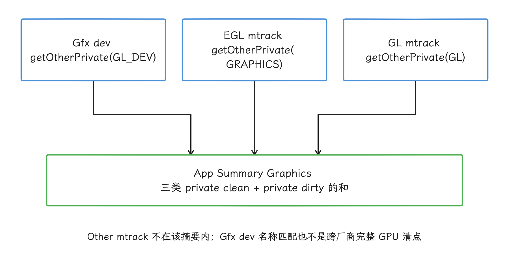

图：固定 r1 的 Graphics 摘要使用三个分类的 private clean + private dirty；mtrack 的填值方式需继续看 JNI，字段名不证明 backing 全部物理私有。

1. `Gfx dev`：libmeminfo 从 smaps 按映射名称识别的设备项；固定 r1 的这处分支匹配 `kgsl-3d0`，不是全部 GPU 厂商设备映射的统一总表；
2. `EGL mtrack`：memtrack `GRAPHICS` 中尚未被 smaps 统计的记录；
3. `GL mtrack`：memtrack `GL` 中尚未被 smaps 统计的记录。

需要注意字段承载方式：`android_os_Debug.cpp` 把 libmemtrack 返回的 PSS 值（转换为 KiB 后）同时写进对应行的 `pss`、`privateDirty` 和 `rss`。因此 mtrack 行中的这些列是同一上报值的 Framework 表示，不能当成三份独立测量，更不能由 privateDirty 列名断言所有 backing 页物理私有。固定 r1 的 libmemtrack 只按类型和 flag 求和，没有再按进程数替 HAL 做一次 PSS 分摊。

<!-- gracker-diagram: ch10-04-06-memtrack-fields -->
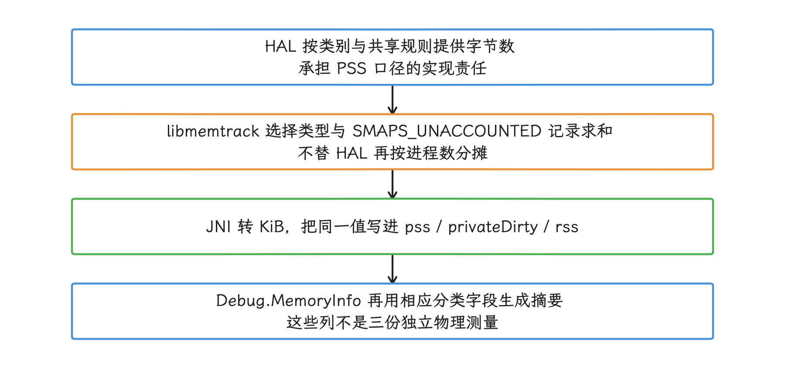

图：固定源码链按 HAL → libmemtrack → JNI → Java 核对。HAL 缺失、错误分类或不完整覆盖会影响最终结果。

详细表里还可能出现 `Other mtrack`，它来自 memtrack 的 `MULTIMEDIA`、`CAMERA` 与 `OTHER` 分类，不属于 App Summary 的 `Graphics` 项。旧工具或 OEM 定制输出的标签可能不同，分析报告应保存原始文本。

### 2.2 `SMAPS_UNACCOUNTED` 的设计目的

Android 17 的 `android_os_Debug.cpp` 调用以下三个 libmemtrack 聚合函数：

- `memtrack_proc_graphics_pss()`
- `memtrack_proc_gl_pss()`
- `memtrack_proc_other_pss()`

它们只累加带 `MemtrackRecord.FLAG_SMAPS_UNACCOUNTED` 的记录。该标志表示相应内存尚未由 smaps 计入，可避免 `Debug.MemoryInfo` 重复统计同一映射。

`IMemtrack.aidl` 对类别给出了更具体的要求：

<!-- gracker-diagram: ch10-04-07-unaccounted-types -->
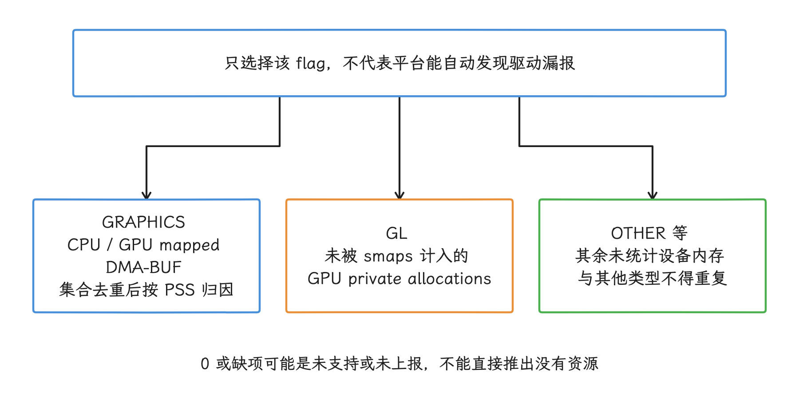

图：HAL 要避免类型重叠，GRAPHICS 的 CPU/GPU DMA-BUF 集合也要去交集。VM_PFNMAP 等 smaps 无法统计的映射需要相应补充。

- `GRAPHICS + SMAPS_UNACCOUNTED` 报告该 PID 的 CPU-mapped 与 GPU-mapped（映射到 CPU/GPU 地址空间的）DMA-BUF PSS，并去掉两个集合的交集；
- `GL + SMAPS_UNACCOUNTED` 报告该 PID 未被 smaps 统计的 GPU private allocation（GPU 私有分配）；
- `OTHER + SMAPS_UNACCOUNTED` 报告剩余的未统计设备内存；
- `VM_PFNMAP`（按物理页帧号建立的特殊映射）在 smaps 中可能得到 0 RSS/PSS，也属于 memtrack 要补充的范围。

HAL 实现若缺项或不支持某种 type，相应行就可能为 0 或缺失。0 只代表该接口没有返回可计入值，不能据此断言进程没有 GPU 资源。跨设备比较前要确认 memtrack HAL、GPU 驱动和 build 一致。

### 2.3 PSS、GPU 映射总量与唯一 buffer 容量

三个数字回答的问题并不相同：

- PSS 尝试把共享资源按引用者分摊，回答进程该分到多少共享成本；
- `gpu_mem_total` 描述驱动认为某 PID 映射到 GPU 地址空间的总量，回答该进程的 GPU 地址空间目前覆盖多少内存；
- `/sys/kernel/dmabuf/buffers` 按 inode 列出唯一 DMA-BUF，回答系统当前存在哪些唯一共享 buffer。

同一 DMA-BUF 被两个进程导入 GPU 时，各 PID 上报量可能重复覆盖该资源；不要用所有 PID 的 `gpu_mem_total` 求和代替同一 GPU 的 `pid = 0` 记录。inode 去重得到的是 DMA-BUF 对象容量汇总，不能据此证明每个字节都已驻留，或不同对象的 backing 页完全不重叠。它也不能与 App Summary `Graphics` 做等式校验；全局 `pid = 0` 本身仍是驱动上报口径。

<!-- gracker-diagram: ch10-04-08-three-capacities -->
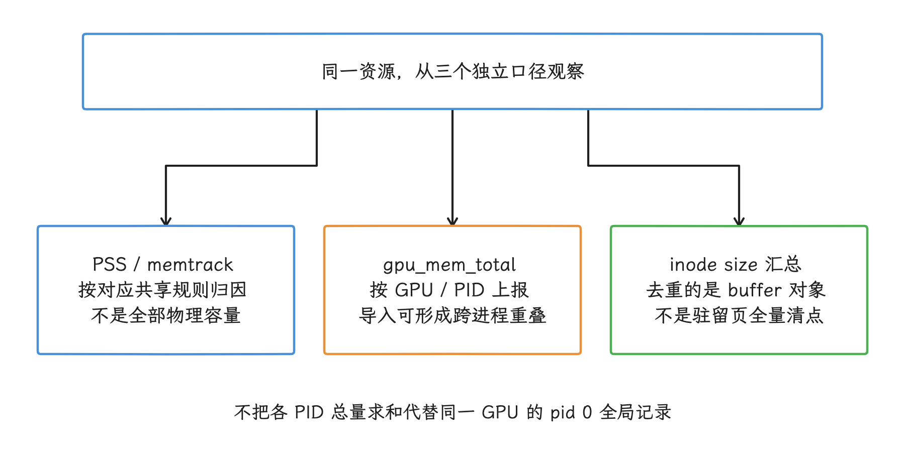

图：PSS 分摊、驱动 GPU-addressable 总量和 DMA-BUF 对象容量回答不同问题。inode 去重不等于物理驻留页去重，也不能与 Graphics 建等式。

## 3. Android 17 GpuService：从 tracepoint 到快照

### 3.1 `dumpsys gpu --gpumem`

Android Common Kernel 的 `gpu_mem/gpu_mem_total` tracepoint（跟踪点）要求 GPU 驱动在 allocate、free、import、unimport（分配、释放、导入、取消导入）改变 GPU-addressable 总量时发出更新。事件字段包含 `gpu_id`、`pid` 和当前 size；`pid = 0` 表示全局总量，正 PID 表示进程总量。

Android 17 的 GpuService 把 eBPF 程序挂到该 tracepoint，并维护以 `(gpu_id, pid)` 为 key 的 BPF map（内核中的键值表）。固定 r1 的 `gpuMem.c` 最多保留 1024 个 key，收到 size 为 0 的事件会删除对应条目；非零事件更新现有值或尝试插入。因此缺少某个 PID 条目不等于读到了一个明确的 0。map 保存的是已收到事件的最新值，不会主动向驱动重新清点；初始化状态、驱动上报、容量与更新成功情况都影响覆盖。`dump()` 逐项读取，遍历期间仍可能更新，并非所有条目完全同一时刻的原子快照：

<!-- gracker-diagram: ch10-04-09-bpf-update -->
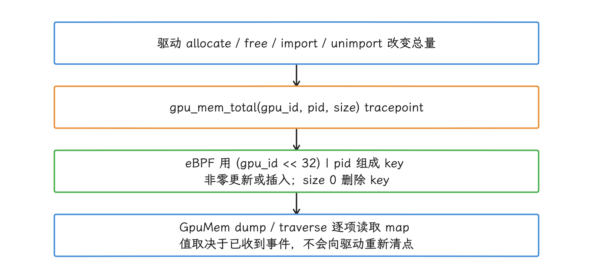

图：图只表示已实现相应 tracepoint 的驱动路径。map 容量、初始化、事件与读取状态都会影响可见性。

```bash
adb shell dumpsys gpu --gpumem
```

输出中的 `Global total` 与各项 `Proc PID total` 是字节数；同一 GPU 缺少 pid 0 条目时显示 `Global total: N/A`。初始化失败、map 为空、条目缺失和实际收到的 size 0 事件含义不同。读取中途若失败，也可能只输出此前已遍历到的部分；命令不是完整性证明。应保存错误文本，并用驱动支持、同窗口 ftrace、重复采样和资源操作交叉确认。

<!-- gracker-diagram: ch10-04-10-bpf-data-quality -->
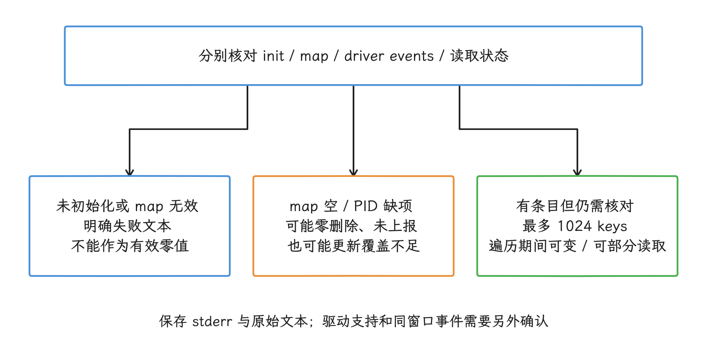

图：零事件会删除 key；缺少全局条目时可显示 N/A。读取中途失败还可能留下部分输出，不能把命令成功退出当成完整性证明。

这条命令适合回答“增长集中在哪个 PID”。它没有 allocation ID（分配标识）、格式、调用栈或资源名称，也不能展示驱动内部碎片。定位创建点还要依赖 API 级 tracker、应用埋点或厂商工具。

### 3.2 Perfetto 的初始值与增量

Android 17 的 `GpuMemTracer` 注册 `android.gpu.memory` 数据源。trace 启动后，工作线程遍历 BPF map 并写入 `GpuMemTotalEvent`；每个条目分别取 `systemTime()`，标记 MONOTONIC 时钟。因此这是遍历期间的一组初始值，不是所有 GPU/PID 在同一原子瞬间的快照。后续变化由另外配置的 `gpu_mem/gpu_mem_total` ftrace 事件提供，仍需检查可用性、丢失和时间覆盖。

<!-- gracker-diagram: ch10-04-11-snapshot-stream -->
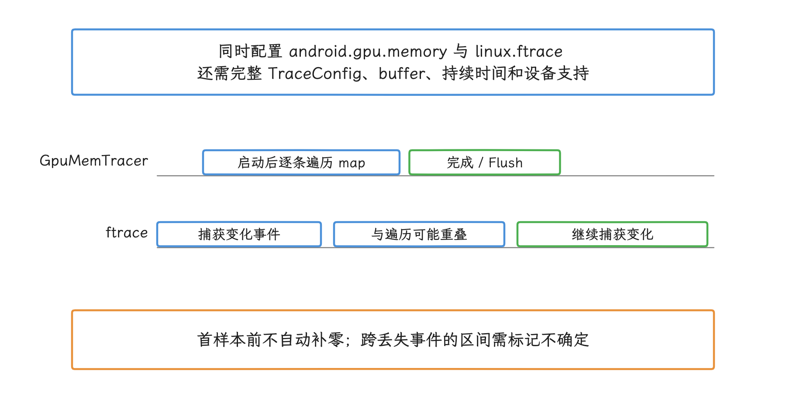

图：快照线程在启动后逐项遍历，各条目有自己的 MONOTONIC 时间；持续变化来自另一份 ftrace 配置。两者都不能自动补回丢失数据。

要同时拿到初始快照和后续变化，两个数据源都要配：

```protobuf
data_sources {
  config {
    name: "android.gpu.memory"
  }
}

data_sources {
  config {
    name: "linux.ftrace"
    ftrace_config {
      ftrace_events: "gpu_mem/gpu_mem_total"
    }
  }
}
```

只开 ftrace 时，trace 开始前已存在且采集期间不变化的资源缺少基线；只开 `android.gpu.memory` 时，只得到启动后的遍历值。两者都依赖相应驱动 tracepoint，快照还依赖 GpuMem/BPF 已初始化。上面的片段还要放进含 buffer 与持续时间等配置的完整 TraceConfig；不是可直接执行的完整采集命令。

<!-- gracker-diagram: ch10-04-12-configuration-gates -->
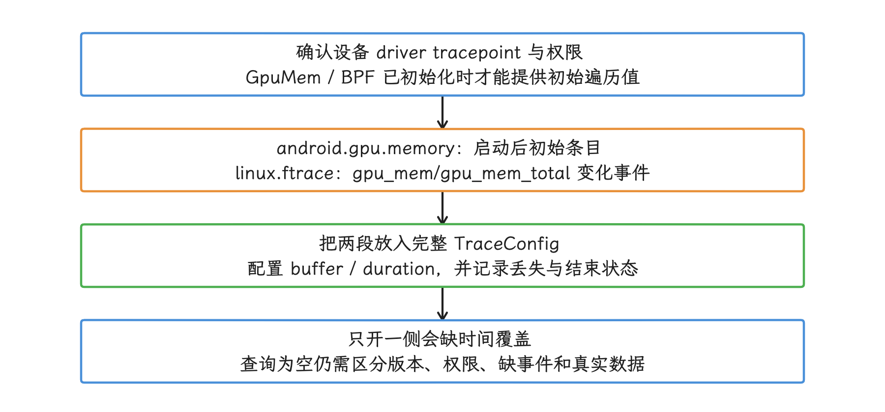

图：配置能序列化只验证 schema；不会证明 Android 设备能采到所有事件或具备相应权限。

`android.gpu.memory` 标准库可提供按进程的区间 counter，但本文核验的固定 r1 表 `android_gpu_memory_per_process` 只输出 ts/dur/upid/gpu_memory，没有保留 GPU 维度。多 GPU 时不能把这些行直接相加或当作同一条进程曲线。下面改从 GPU 轨道取值，保留 `gpu_id` 和 `track_id`，并在每条轨道内计算持续时间：

<!-- gracker-diagram: ch10-04-13-sql-gpu-dimension -->
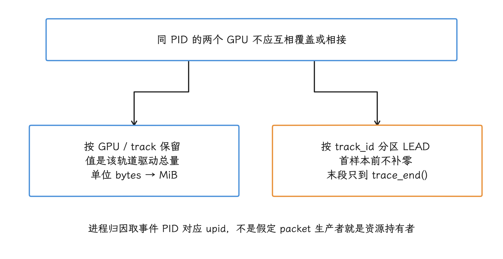

图：固定 r1 标准库表没有 GPU 列。修订查询从 track 的 gpu/upid 维度取值，在每个 track_id 内做 LEAD，避免跨 GPU 计算持续时间。

```sql
WITH gpu_counters AS (
  SELECT c.ts, c.track_id, c.value,
    CAST(EXTRACT_ARG(t.dimension_arg_set_id, 'gpu') AS INT) AS gpu_id,
    CAST(EXTRACT_ARG(t.dimension_arg_set_id, 'upid') AS INT) AS upid
  FROM counter AS c
  JOIN track AS t ON t.id = c.track_id
  WHERE t.type = 'process_gpu_memory'
), intervals AS (
  SELECT *,
    COALESCE(LEAD(ts) OVER (PARTITION BY track_id ORDER BY ts), trace_end()) - ts AS dur
  FROM gpu_counters
)
SELECT g.ts, g.dur, g.gpu_id, g.track_id, p.pid,
  p.name AS process_name, g.value / 1048576.0 AS gpu_memory_mib
FROM intervals AS g
JOIN process AS p USING (upid)
WHERE g.gpu_id IS NOT NULL
ORDER BY g.ts, g.gpu_id, p.pid;
```

⚠ 工具版本差异：同一份主机合成双 GPU trace，r1 启动脚本附带的 Perfetto v54.0 会把同 PID 的两个 GPU 样本放入同轨道；本次使用的 v58.2 能保留独立 GPU 轨道，以上查询已在它上面验证。v54.0 缺失 GPU 维度时，本查询因 `gpu_id IS NOT NULL` 条件不返回行；这不能证明没有 GPU 内存，也不能用 SQL 补回导入时已丢失的维度。

<!-- gracker-diagram: ch10-04-14-parser-version -->
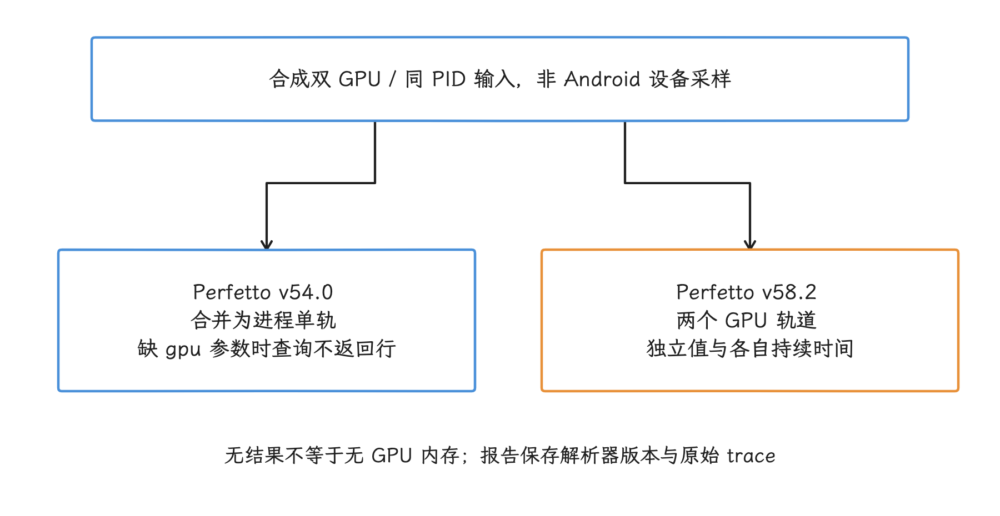

图：主机合成测试仅用于验证解析与 SQL。v54 将同 PID 双 GPU 样本合到一轨，v58.2 保留双轨；丢失维度后无法由查询补回。

结果中的 MiB 是驱动上报量除以 1048576，不是 PSS。ts/dur 为纳秒；末段只延伸至 trace 结束，首样本之前不自动补零，跨丢失事件的区间也可能失真。JOIN 使用事件中的 PID 所对应的 upid，而不是假定发出 packet 的进程就是资源所有者。设备采集仍要检查 tracepoint、权限、初始化和丢失。

### 3.3 其他 GPU 数据源各有用途

- `gpu.counters` 采集厂商定义的硬件 counter；含义、单位与支持范围依设备而变，频率等指标也可能来自 ftrace。实际注册名还可能带 `.adreno` 等后缀，采集配置需要精确匹配已注册的数据源名。
- `gpu.renderstages` 提供 graphics/compute submission（图形与计算提交）的执行阶段和时长，不保证存在名为“texture upload”的统一 stage。
- `vulkan.memory_tracker` 记录 Vulkan 的 driver/device memory allocation 与 bind（绑定）事件，适合观察 Vulkan 资源生命周期；它不覆盖 OpenGL、HWUI、Camera 和 SurfaceFlinger 的全部资源。
- 部分旧版或厂商内核还导出 DMA heap allocation/free tracepoint；`android17-6.18-2026-06_r6` 的通用锚点不提供一条可移植的 `dmabuf_heap/dma_heap_stat` 事件，采集配置应以目标设备的 `available_events` 为准。

<!-- gracker-diagram: ch10-04-15-gpu-data-sources -->
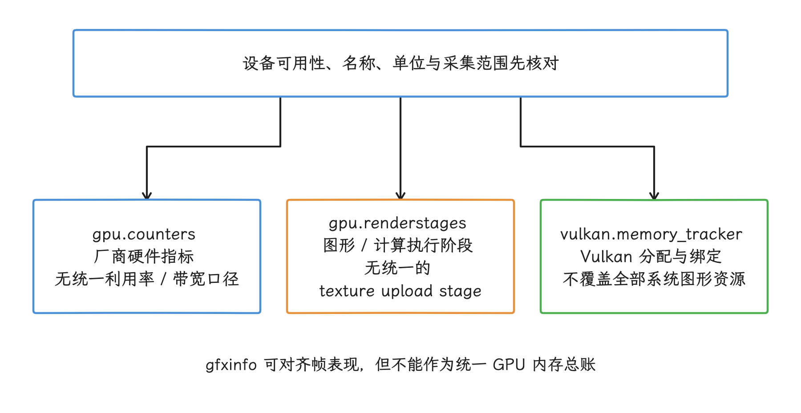

图：硬件 counter、提交阶段和 Vulkan allocation/bind 的含义不同。厂商注册名可能带后缀，配置要与设备服务中的名字精确匹配。

`dumpsys gfxinfo` 关注帧时间、HWUI 状态和渲染统计。它可以与内存时间线对齐，却不提供一份通用 GPU 内存总账。

## 4. Kernel 6.18 的 DMA-BUF 观测入口

### 4.1 进程 fd：谁还持有共享 buffer

标准 Linux 接口位于 `/proc/PID/fdinfo/FD`。DMA-BUF fd 会额外输出 `size`、`count`、`exp_name`，有名称时还会输出 `name`。

查示例应用当前持有哪些 DMA-BUF fd，遍历它的 fdinfo：

```bash
adb shell '
pids=$(pidof com.example.gallery)
if [ -z "$pids" ]; then
  echo "no matching process" >&2
  exit 1
fi
for pid in $pids; do
  case "$pid" in *[!0-9]*|"") continue ;; esac
  for info in /proc/$pid/fdinfo/*; do
    [ -r "$info" ] || continue
    if grep -q "^exp_name:" "$info"; then
      printf "pid=%s fd=%s\n" "$pid" "${info##*/}"
      grep -E "^(ino|size|count|exp_name|name):" "$info"
    fi
  done
done
'
```

`size` 是 buffer 容量，`count` 是 dma-buf file 引用计数（固定内核会减去这次 procfs 读取的临时引用），并非持有进程数、GPU 映射数或可回收比例。`exp_name` 是 exporter；`ino` 可在同次观测窗口内与 sysfs inode 关联。进程列表、fd 和引用计数都会变化，PID/inode 也不能跨释放重用后当作永久身份。权限不足、进程退出、fd 转交和没有匹配 buffer 都可能使输出缺失，应保留错误与采样起止时间。

<!-- gracker-diagram: ch10-04-16-fdinfo-evidence -->
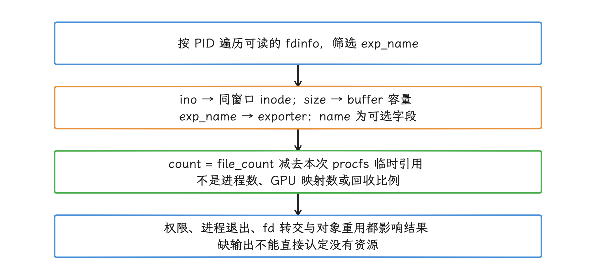

图：脚本会处理多个 pidof 结果并保留 inode 线索。创建点与完整持有链仍需应用记录、API tracker 或其他引用证据。

Linux 没有通用的 `/proc/PID/dmabuf` 文件。设备私有节点即使存在，也不能写成 Android 平台保证。

### 4.2 全局 sysfs：系统里有哪些唯一 DMA-BUF

在 `CONFIG_DMABUF_SYSFS_STATS` 开启时，`/sys/kernel/dmabuf/buffers/<inode>/` 提供 `size` 与 `exporter_name`。按 inode 生成一份快照：

```bash
adb shell '
root=/sys/kernel/dmabuf/buffers
if [ ! -d "$root" ] || [ ! -r "$root" ]; then
  echo "DMA-BUF sysfs unavailable or unreadable" >&2
  exit 1
fi
for entry in "$root"/*; do
  [ -d "$entry" ] || continue
  inode=${entry##*/}
  size=$(cat "$entry/size") || continue
  exporter=$(cat "$entry/exporter_name") || continue
  printf "%s %s %s\n" "$inode" "$size" "$exporter"
done
'
```

sysfs（内核对象信息文件系统）在该配置和访问权限成立时列出当前已登记的 DMA-BUF 对象容量，适合按 inode 去重和按 exporter 聚合。遍历与两个属性读取之间都可能有对象创建、释放，脚本会跳过读取失败的项，不能把输出叫作完全原子、无遗漏快照。它不保存创建调用栈；同窗口将 inode 与进程 fd 对上，只能证明观测时的持有线索，不能单凭它定位最初的业务创建点。Android user build 还可能限制 shell 读取。

<!-- gracker-diagram: ch10-04-17-sysfs-snapshot -->
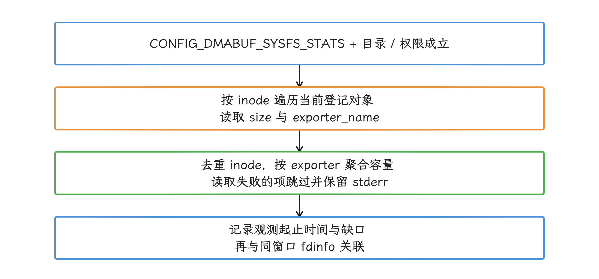

图：目录、对象和属性读取都可能变化；输出不是完全原子、无遗漏快照，也不是实际驻留物理页统计。

### 4.3 debugfs：实验室设备上的全局调试视图

实验室设备已 root 且挂载 debugfs 时，可以直接读全局列表：

```bash
adb shell su 0 cat /sys/kernel/debug/dma_buf/bufinfo
```

debugfs（内核调试文件系统）不适合作为生产接口，格式也不承诺稳定。厂商 GPU 节点同样受驱动、内核版本和 SELinux 约束；报告应记录设备路径与原始输出，避免把 Adreno、Mali、PowerVR 的私有路径互相套用。

<!-- gracker-diagram: ch10-04-18-access-paths -->
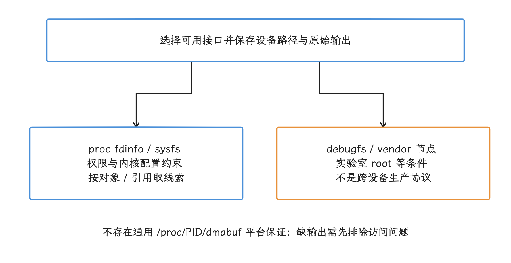

图：标准 fdinfo、可选 sysfs 和实验室 debugfs 有不同前提。厂商路径还需按对应 GPU、内核、SELinux 与格式记录。

## 5. 从增长曲线定位资源持有者

### 5.1 先辨认缓存、延迟释放与泄漏

图形资源释放常受三类延迟影响：

<!-- gracker-diagram: ch10-04-19-deferred-release -->


图：示意队列任务完成与引用清理可能延后于页面退出。缓存平台、异步释放和泄漏需要多轮同状态比较，不能靠一次 System.gc 判断归零。

- GPU command 尚未完成，driver 要等待 fence signal（同步栅栏发出完成信号）后才回收 backing memory；
- BufferQueue 的 producer、consumer（消费者）或 SurfaceFlinger 仍持有 slot（缓冲槽位）；
- 图片库、HWUI 或图形 API 保留高水位缓存，复用后不继续增长。

预热后数值保持稳定、不再上升，通常符合有上限缓存；每轮相同操作后基线持续上移，更像持有者引用或资源销毁不完整；退出页面后短时不降，需要把 fence 和 queue drain（队列中剩余任务处理完毕）的时间放进采样窗口。一次 `System.gc()` 不能证明图形资源应立即归零。

### 5.2 可复查的诊断实验

建议按同一套脚本保存下列数据：

1. 记录设备型号、Android build、GPU driver、kernel page size 和 app 版本。
2. 冷启动后等待页面稳定，采集 `meminfo`、`--gpumem`、DMA-BUF inode 快照和 Perfetto 基线。
3. 用固定数据集执行同一段页面、相机、视频或渲染操作。
4. 每轮在相同 UI 状态采样，并给 GPU fence 与异步销毁留下可观察区间。
5. 比较进程 GPU 总量、唯一 DMA-BUF、EGL/GL mtrack 与 Java/native 持有者数量。
6. 找到最早开始增长的指标，再选择 Bitmap、Surface、GL/Vulkan 或厂商工具继续定位。

报告要保存原始值与差值。若只有 App Summary 的 `Graphics` 一个数字，就无法区分 Gfx dev、EGL mtrack 和 GL mtrack。

<!-- gracker-diagram: ch10-04-20-diagnostic-loop -->
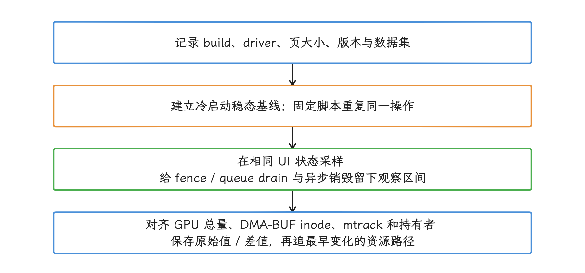

图：该流程是诊断方法，不给出设备通用阈值。一个 Graphics 摘要值不能分辨其三个分类来源。

### 5.3 Java 与 native profile 能发现什么

ART heap dump 适合查找仍被引用的 `Bitmap`、`Drawable`、`Surface`、`SurfaceTexture`、`ImageReader`、`Image`、`HardwareBuffer` 及业务缓存。native heap profile 可以定位覆盖到的 wrapper、命令构建对象与 allocator 分配栈，但本身不提供完整保留引用图。

这里的 native heapprofd 默认 heap 覆盖 `malloc` 家族的分配，其他 allocator 需相应 heap 集成；ART allocation profiling 使用另行注册的 `com.android.art` heap。Gralloc DMA-BUF 与 GPU driver private allocation 不受普通 malloc hook 管理；heap profile 里的 wrapper 字节数不能代替 GPU backing size。先用分配栈找到创建候选，再用 heap dump、应用所有权记录或资源表追查仍持有的对象，最后与 GPU/DMA-BUF 指标对齐；仅凭 profile 的分配栈不能证明资源仍存活。

<!-- gracker-diagram: ch10-04-21-wrapper-backing -->
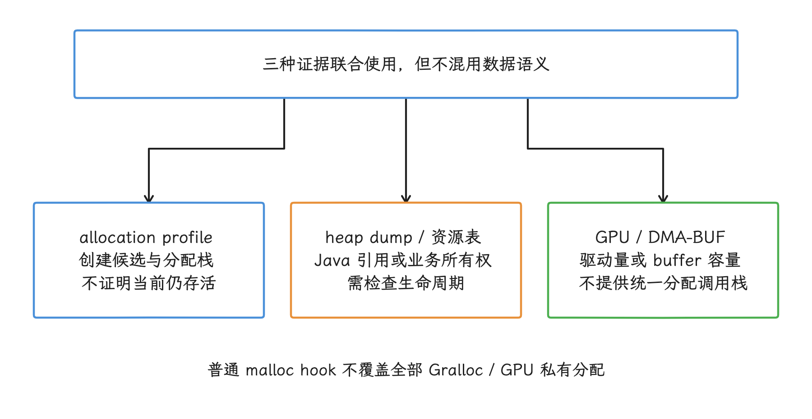

图：分配 profile 可定位覆盖范围内的创建栈，heap dump 查 Java 引用；GPU/DMA-BUF 指标用于对齐 backing，不能由 wrapper 字节换算全部驱动资源。

### 5.4 16 KB kernel page 的精确边界

`android17-6.18-2026-06_r6` 的 `dma_heap_buffer_alloc()` 使用 `__PAGE_ALIGN(len)`，DMA heap allocation 的起止按 kernel page（内核页）对齐。16 KB kernel page 下，小 allocation 尾部向上取整后的额外字节数上限更高。

<!-- gracker-diagram: ch10-04-22-page-rounding -->


图：示意数学例子：同为 17 KiB 请求，按 4 KiB 页取整得到 20 KiB，按 16 KiB 页得到 32 KiB；只验证页取整，不冒充实际 Gralloc 分配或固定增长率。

这条规则不能推导出统一的“图形内存增加百分比”。Gralloc 的 stride（行跨度）、plane（图像分量平面）、格式、压缩、tiling（分块布局）、secure heap（受保护内存区域）和驱动页表粒度都可能带来比尾部 page rounding（按页向上取整）更大的差异。比较 4 KB 与 16 KB build 时，应以 DMA-BUF inode size 和 GPU counter 实测，并按 allocation 尺寸分布解释差异。

<!-- gracker-diagram: ch10-04-23-layout-capacity -->
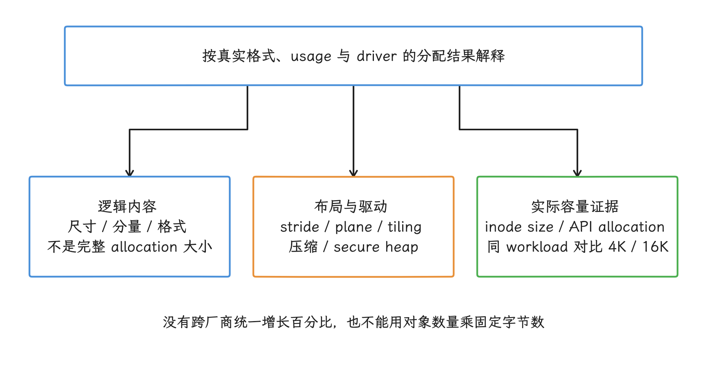

图：width × height × bytesPerPixel 只适合明确格式的逻辑估计；实际容量还受多平面、行跨度、压缩、tile、保护策略和页对齐影响。

## 6. 资源类型与修复方向

### 6.1 Hardware Bitmap

`Bitmap.Config.HARDWARE` 在 API 26 引入，像素存放在 graphic memory（图形内存）中，Bitmap 不可变。它能避免每次绘制都从软件像素上传纹理，但会占用图形资源，并限制像素读写和部分 Canvas 操作。

<!-- gracker-diagram: ch10-04-24-hardware-bitmap -->
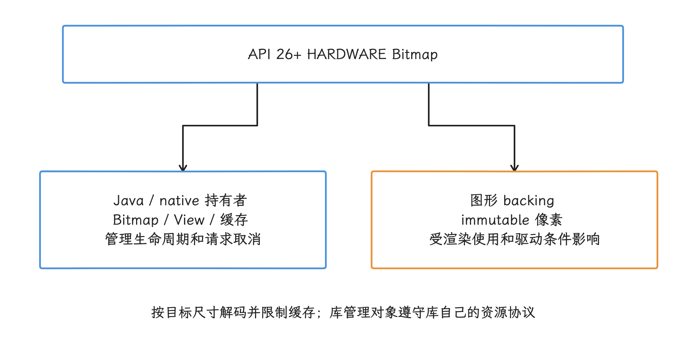

图：Hardware Bitmap 不可变，像素处于图形内存；Java 对象的可达性与图形资源是否仍被其他使用者引用，需要分别核对。

现代 Android 上不应把 `Bitmap.recycle()` 当作 Hardware Bitmap 的常规释放协议。解除 Java/native、View、Canvas、RenderThread 与缓存中的使用关系后，backing resource 才具备相应回收条件；不承诺 Java 引用消失后立即归零。`recycle()` 文档提醒避免对曾用于 View 或仍可能被其他地方引用的 Bitmap 手工回收。文档中 `invalidate()` 后还需一次 draw pass 的具体例子属于 `reconfigure()` 的使用前提，不能照搬成任意 Bitmap 都能安全 recycle 的通用同步协议。

<!-- gracker-diagram: ch10-04-25-bitmap-release -->
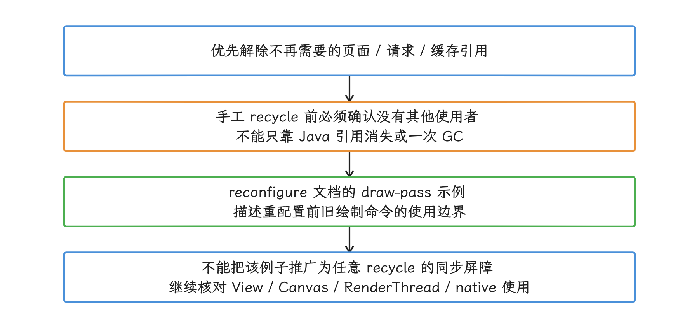

图：图按 Bitmap 官方方法文档区分语义；不建议用任意延迟或一次 invalidate 作为所有图形资源的释放完成信号。

图片页面的优先动作是按显示尺寸解码、限制内存缓存权重、在页面和请求取消时移除引用，并让 Glide/Coil 等图片库管理其资源池。`prepareToDraw()` 从 API 24 起可发起尚未上传 Bitmap 的异步 RenderThread 上传，把部分工作移到首次绘制之前；它不等待上传完成，也不承诺必然改善帧时间或减少驻留内存。修改像素后还可能重新上传。

<!-- gracker-diagram: ch10-04-26-prepare-upload -->


图：API 24 起 prepareToDraw 可异步触发 RenderThread 上传；函数返回不代表上传完成，像素修改后还可能需要重传。示意轨道不提供性能测量。

### 6.2 Surface、BufferQueue 与媒体资源

应用自己创建的 `Surface`、`SurfaceTexture`、`ImageReader`、`Image`、`MediaCodec` 和相机 session 要按 API 生命周期关闭。`ImageReader.acquire*()` 得到的每个 `Image` 都需要及时 `close()`；未关闭的 Image 会占用 `maxImages` 配额和对应 buffer。

<!-- gracker-diagram: ch10-04-27-media-ownership -->
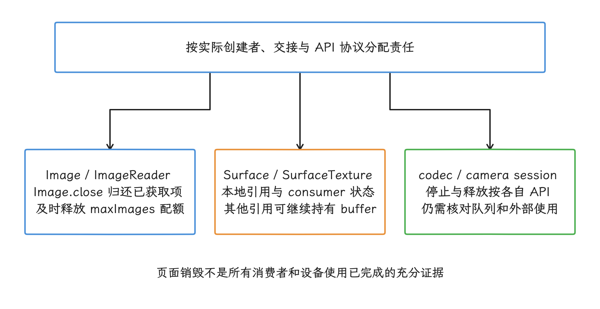

图：ImageReader 的已获取 Image 要及时 close，其他 API 按各自生命周期关闭。Surface 本地释放、SurfaceTexture 释放与 backing 完全回收是不同边界。

Surface 销毁后，buffer 还可能由 consumer 或 fence 持有。看到内存值延迟下降时，应同时核对 `onSurfaceTextureDestroyed()` 的返回值与释放责任、codec stop/release、camera session close、GPU counter 和实际引用。TextureView 回调返回 `true` 时由其释放 SurfaceTexture；返回 `false` 则调用方负责释放。`Surface.release()` 只解除本地对服务端 Surface 的引用；`SurfaceTexture.release()` 后仍被其他客户端或 GL 引用的 buffer 也可能继续分配。

<!-- gracker-diagram: ch10-04-28-texture-callback -->


图：销毁回调返回 true 时由 TextureView 释放 SurfaceTexture；返回 false 时调用方保留责任。SurfaceTexture.release 后仍可能有外部 buffer 引用。

BufferQueue 没有适用于所有 producer/consumer 的固定“三缓冲”结论。可用 slot 与同时分配的 buffer 数由 max dequeued（生产者最多取出的槽位）、min undequeued（必须留在队列中的最少槽位）、max acquired（消费者最多持有的槽位）、异步模式和 producer 行为共同决定。每个 buffer 的逻辑 payload（有效像素数据）可用 `width × height × bytesPerPixel` 粗估，真实 allocation 还要看 stride、plane、格式、压缩和对齐。

<!-- gracker-diagram: ch10-04-29-bufferqueue-count -->


图：固定 r1 的上限由 maxAcquired、maxDequeued、async/cannotBlock 与 mMaxBufferCount 共同限制；这不是所有场景固定分配三块 buffer 的结论。

### 6.3 OpenGL ES 与 Vulkan

GL ES 资源要按对象类型审查销毁上下文：纹理、buffer 和 renderbuffer 可由同一 share group 中的 context 共享；FBO（framebuffer object）属于 context 的非共享容器，不能因附件纹理共享就把 FBO 本身当作共享对象。按对应 `glDelete*` 删除名称后，其他 context 的绑定或容器附件仍可能持有底层对象；未解除的引用与尚未完成的使用都会影响回收。

<!-- gracker-diagram: ch10-04-30-gl-objects -->


图：GL ES3.2 允许纹理、buffer、renderbuffer 等共享，FBO 是不共享容器。删除名称后，其他绑定或容器附件还可能持有底层对象。

EGL Surface 走独立的 `eglDestroySurface(display, surface)` 协议；若仍是某线程的 current surface，会延后到不再 current 时销毁，pbuffer 的纹理绑定还有额外释放条件。它不属于前面的 GL share-group 对象清单。

<!-- gracker-diagram: ch10-04-31-egl-surface -->


图：流程中的条件描述 EGL API 语义，不承诺所有 driver backing 或跨进程资源在调用返回时归零。

Vulkan 要区分 object 与 bound memory（绑定到对象的设备内存）：销毁 `VkImage` 不会隐式完成所有 `vkFreeMemory()`，suballocation（从大块内存中切出的子分配）还要交还给应用 allocator。释放前必须满足 Vulkan 生命周期与同步规则。诊断构建可用 validation layer（校验层）、`vulkan.memory_tracker` 和 AGI frame profile 核对 allocation/bind/free。

<!-- gracker-diagram: ch10-04-32-vulkan-lifetime -->


图：销毁 VkImage 与释放 VkDeviceMemory 是不同操作；子分配还需归还应用 allocator。两者都要满足已提交使用完成、引用与同步规则。

不要在每次资源销毁时一概插入 `vkDeviceWaitIdle()`；它等待该逻辑设备所有队列的工作完成，可能排空流水线。应按实际依赖用 fence 等机制确认相关使用完成，再处理对象与内存；少数确实需要整设备空闲的阶段另行评估。

<!-- gracker-diagram: ch10-04-33-wait-idle -->


图：wait-idle 会等待逻辑设备所有队列；按依赖用 fence 可只等待相关使用完成。以下仅示意等待粒度，不构造测量时长或通用性能收益。

RenderScript 已在 API 31 废弃。维护历史代码时仍需销毁 `Allocation` 等对象，新项目应迁移到当前图形、计算或媒体 API。

### 6.4 SurfaceView 与 TextureView

`SurfaceView` 由独立 Surface layer 提供内容，系统有机会交给 Hardware Composer（硬件合成器）；`TextureView` 把 SurfaceTexture 内容作为 View 层级的一部分由 HWUI 采样，需要硬件加速窗口；软件渲染时不绘制内容。它支持 View 的 alpha、旋转和裁剪，但具体能力仍随版本变化，例如 SurfaceView 在 Android U 起也支持相应 alpha 能力，不能给出永远只属于 TextureView 的能力表。路径不同可能增加采样与合成工作。

<!-- gracker-diagram: ch10-04-34-view-composition -->


图：SurfaceView 可由合成策略交给 HWC；TextureView 在硬件加速 View 路径采样内容。能力与 overlay 资格受版本和内容限制，不能只按组件名比较内存。

内存上不能给出固定的“TextureView 一定更大”排序：SurfaceView 自己也有 BufferQueue，TextureView 所在应用窗口也需要 window buffers。分辨率、格式、queue 深度、overlay 资格（能否直接交给硬件合成器）和内容路径共同决定总量。相机和视频页面应在同一设备上比较进程 GPU counter、DMA-BUF inode 与帧时间，再结合变换、HDR、DRM 和生命周期需求选择。

## 7. Game、Camera 与 AR 的预算方法

游戏的纹理、render target、depth/stencil（深度/模板缓冲）、swapchain image（交换链图像）、staging buffer（传输暂存缓冲区）与 allocator block（分配器管理的大块内存）都要纳入预算。

<!-- gracker-diagram: ch10-04-35-game-budget -->
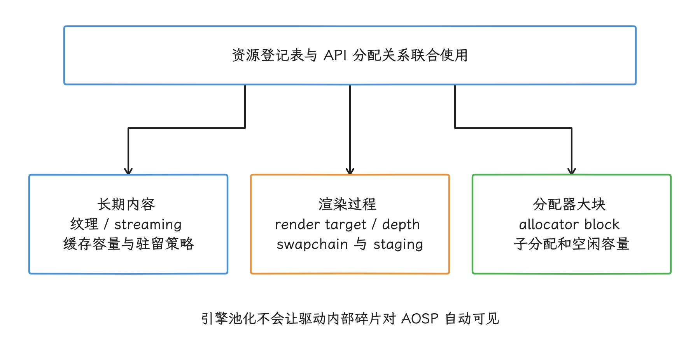

图：纹理、render target、深度模板、swapchain、staging 与 allocator block 均需纳入对应预算，并标明共享和子分配，防止重复相加。

引擎的 texture streaming（纹理流式加载）或 Vulkan suballocator 只改变资源管理方式，不会让 driver fragmentation（驱动内部碎片）对 AOSP 可见。AGI frame profile 可以查看单帧的纹理、shader、render target 和 RAM/GPU memory；系统级趋势仍要用 Perfetto 或 `--gpumem`。

Camera2 / CameraX 的每路输出 Surface 都可能维护独立 buffer 集合。预览、录制、分析、JPEG/RAW 同时开启时，应按每路分辨率、格式、`maxImages` 和 queue 行为计算，并确认分析线程及时关闭 Image。只按相机传感器分辨率乘一个 buffer 数会漏掉多个 plane、stride 和各 consumer 的独立队列。

<!-- gracker-diagram: ch10-04-36-camera-budget -->


图：预览、录制、分析与 JPEG/RAW 的输出路径可能有不同 buffer 集合；不能只用传感器分辨率乘一个固定数量推导全部容量。

AR 场景还包含相机输入、环境纹理、depth（深度数据）、mesh（网格）、点云与 render target。切换 session 后若 GPU 总量和 DMA-BUF inode 都持续增加，应同时查 session 持有者、Surface/Image 生命周期和引擎资源表，避免只从 Java heap 寻找答案。

<!-- gracker-diagram: ch10-04-37-ar-session -->
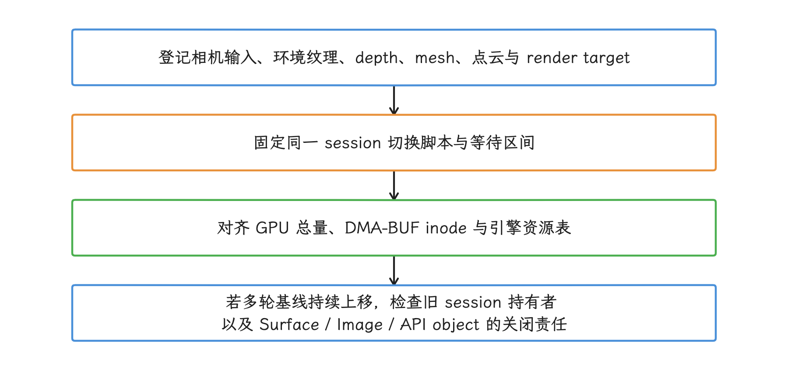

图：这是面向具体 AR 资源表的诊断方法；只有趋势不能单独证明某种驱动泄漏，仍需所有权和销毁证据。

## 8. Android 17 边界与发布检查

Android 17 的 AOSP 图形内存链提供这几个观测点：

- memtrack 为 `dumpsys meminfo` 补充 smaps 看不到的进程图形内存；
- GpuMem 用 eBPF map 保存驱动 `gpu_mem_total` 的全局与进程总量；
- GpuMemTracer 给 Perfetto 提供 trace 启动时的初始快照；
- ftrace 记录 trace 期间的 GPU 总量变化；
- kernel DMA-BUF sysfs/debugfs/fdinfo 描述共享 buffer。

它们不提供跨厂商统一的 allocation call stack（分配调用栈）、资源名或碎片率。AOSP 也没有应用可调用的 GPU 内存 compact（规整）API。需要精确到纹理、VkImage 或厂商 heap 时，应使用应用资源注册表、AGI、Vulkan tracker 或目标 GPU 的官方工具。

<!-- gracker-diagram: ch10-04-38-observability-boundaries -->
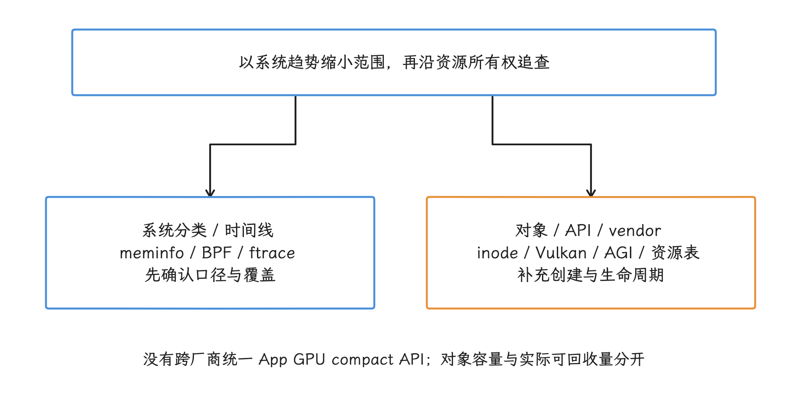

图：AOSP 的 mtrack、GpuMem 和 DMA-BUF 提供不同范围的分类或总量。精确资源名、创建栈和驱动碎片率还需 API tracker、资源表或厂商工具。

发布前至少确认：

<!-- gracker-diagram: ch10-04-39-release-check -->
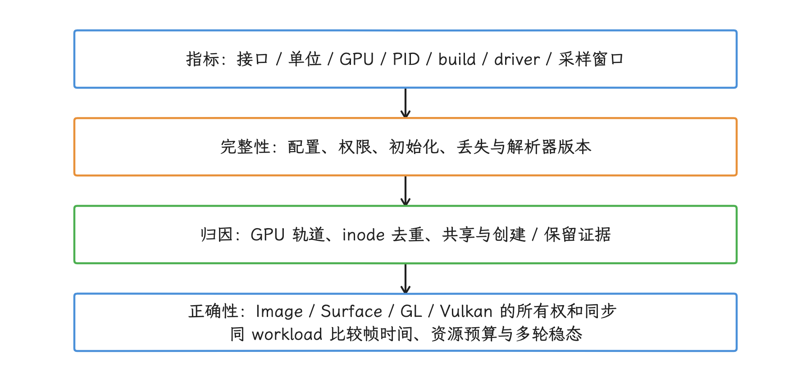

图：清单用于验收整条证据链；不能用一个 Graphics 数字、一次 GC 或单次峰值替代完整诊断。

- 指标名称、单位、设备 build、GPU driver 与采样时间写进报告。
- `Graphics` 摘要与 `EGL mtrack`、`GL mtrack`、`Gfx dev` 没有混写。
- `--gpumem` 支持已验证，0 与“不支持”能够区分。
- Perfetto 同时具备基线和增量，保存解析器版本；多 GPU 查询保留 GPU/轨道维度并检查旧解析器丢失。
- DMA-BUF 按 inode 去重，进程 fd 总和没有冒充系统唯一物理量。
- Hardware Bitmap 通过引用与缓存策略释放，没有依赖随意 `recycle()`。
- Image、Surface、SurfaceTexture、codec、camera session 都有明确负责 close/release 的持有者。
- GL/Vulkan 资源销毁满足 context、share group、queue 和 fence 生命周期。
- 4 KB / 16 KB 差异来自同一 workload（工作负载）实测，没有套用固定增长比例。
- 高水位缓存、GPU 延迟释放和持续泄漏已经用多轮时间线区分。

## 参考资料

- [Android 17 `IMemtrack.aidl`](https://android.googlesource.com/platform/hardware/interfaces/+/refs/tags/android-17.0.0_r1/memtrack/aidl/android/hardware/memtrack/IMemtrack.aidl)
- [Android 17 `android_os_Debug.cpp`](https://android.googlesource.com/platform/frameworks/base/+/refs/tags/android-17.0.0_r1/core/jni/android_os_Debug.cpp)
- [Android 17 `Debug.MemoryInfo`](https://android.googlesource.com/platform/frameworks/base/+/refs/tags/android-17.0.0_r1/core/java/android/os/Debug.java)
- [Android 17 `GpuService.cpp`](https://android.googlesource.com/platform/frameworks/native/+/refs/tags/android-17.0.0_r1/services/gpuservice/GpuService.cpp)
- [Android 17 `GpuMem.cpp`](https://android.googlesource.com/platform/frameworks/native/+/refs/tags/android-17.0.0_r1/services/gpuservice/gpumem/GpuMem.cpp)
- [Android 17 `GpuMemTracer.cpp`](https://android.googlesource.com/platform/frameworks/native/+/refs/tags/android-17.0.0_r1/services/gpuservice/tracing/GpuMemTracer.cpp)
- [Android 17 `BufferQueueCore.cpp`](https://android.googlesource.com/platform/frameworks/native/+/refs/tags/android-17.0.0_r1/libs/gui/BufferQueueCore.cpp)
- [Kernel `android17-6.18-2026-06_r6` `gpu_mem.h`](https://android.googlesource.com/kernel/common/+/refs/tags/android17-6.18-2026-06_r6/include/trace/events/gpu_mem.h)
- [Kernel `android17-6.18-2026-06_r6` `dma-heap.c`](https://android.googlesource.com/kernel/common/+/refs/tags/android17-6.18-2026-06_r6/drivers/dma-buf/dma-heap.c)
- [Linux DMA-BUF 文档](https://docs.kernel.org/driver-api/dma-buf.html)
- [Perfetto GPU 数据源](https://perfetto.dev/docs/data-sources/gpu)
- [Perfetto `android.gpu.memory`](https://perfetto.dev/docs/analysis/stdlib-docs#androidgpu-memory)
- [Bitmap API](https://developer.android.com/reference/android/graphics/Bitmap)
- [Bitmap.Config API](https://developer.android.com/reference/android/graphics/Bitmap.Config)
- [TextureView API](https://developer.android.com/reference/android/view/TextureView)
- [Android GPU Inspector](https://developer.android.com/agi)

- [Android17 gpuMem.c](https://android.googlesource.com/platform/frameworks/native/+/refs/tags/android-17.0.0_r1/services/gpuservice/bpfprogs/gpuMem.c)
- [Android17 libmemtrack](https://android.googlesource.com/platform/system/memory/libmemtrack/+/refs/tags/android-17.0.0_r1/memtrack.cpp)
- [Android17 libmeminfo](https://android.googlesource.com/platform/system/memory/libmeminfo/+/refs/tags/android-17.0.0_r1/androidprocheaps.cpp)
- [Perfetto固定r1 memory.sql](https://android.googlesource.com/platform/external/perfetto/+/refs/tags/android-17.0.0_r1/src/trace_processor/perfetto_sql/stdlib/android/gpu/memory.sql)
- [Perfetto固定r1 GPU parser](https://android.googlesource.com/platform/external/perfetto/+/refs/tags/android-17.0.0_r1/src/trace_processor/importers/proto/gpu_event_parser.cc)
- [OpenGL ES3.2规格 §2.6、§5](https://registry.khronos.org/OpenGL/specs/es/3.2/es_spec_3.2.pdf)
- [EGL eglDestroySurface](https://registry.khronos.org/EGL/sdk/docs/man/html/eglDestroySurface.xhtml)
- [Vulkan vkFreeMemory](https://docs.vulkan.org/refpages/latest/refpages/source/vkFreeMemory.html)
- [Vulkan wait-idle示例](https://docs.vulkan.org/samples/latest/samples/performance/wait_idle/README.html)
- [SurfaceTexture](https://developer.android.com/reference/android/graphics/SurfaceTexture)
- [Surface](https://developer.android.com/reference/android/view/Surface)
- [ImageReader](https://developer.android.com/reference/android/media/ImageReader)
- [16KB page sizes](https://developer.android.com/guide/practices/page-sizes)

- [Perfetto heapprofd 与 ART allocation profiling](https://perfetto.dev/docs/data-sources/native-heap-profiler)
