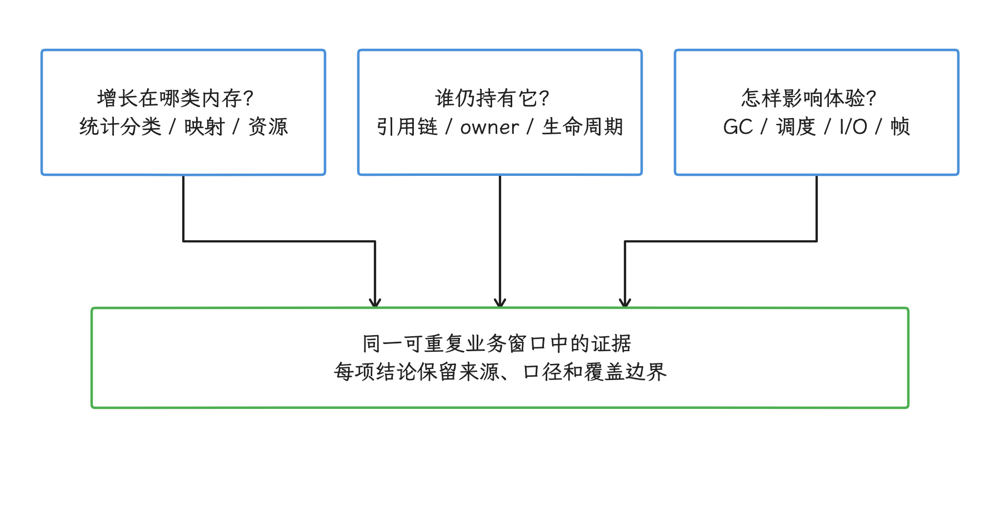
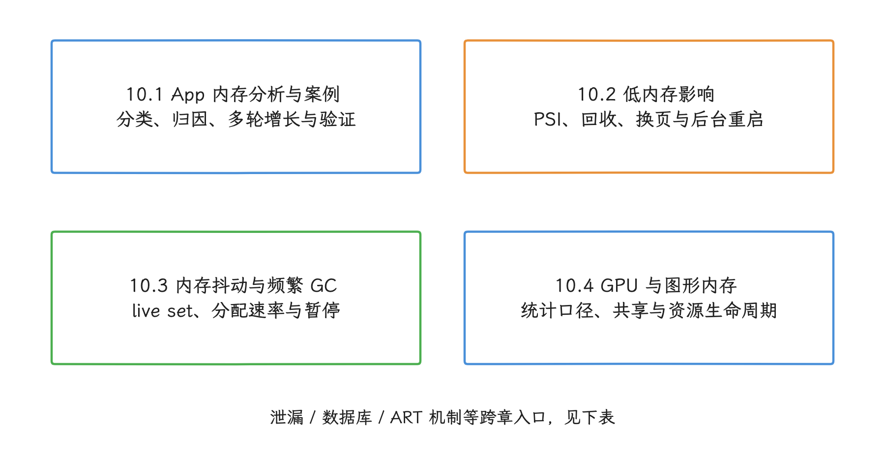
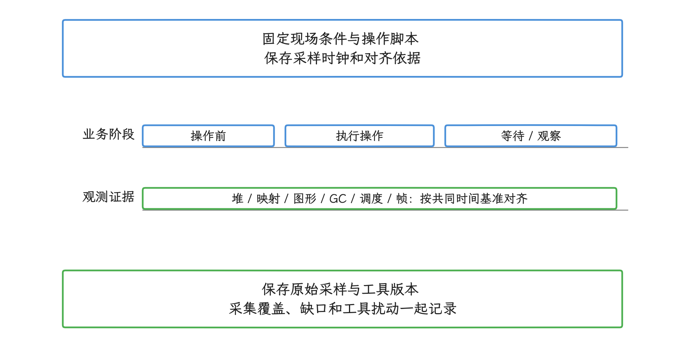
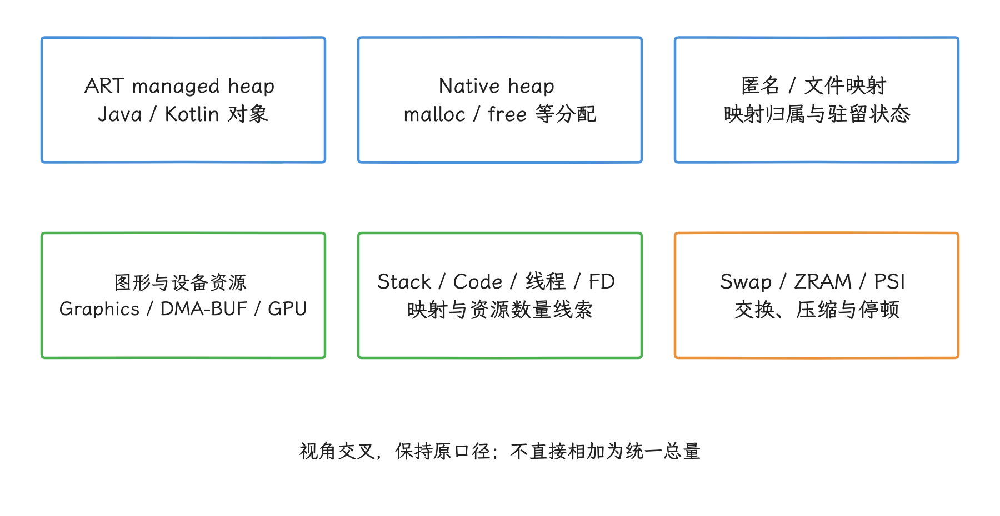
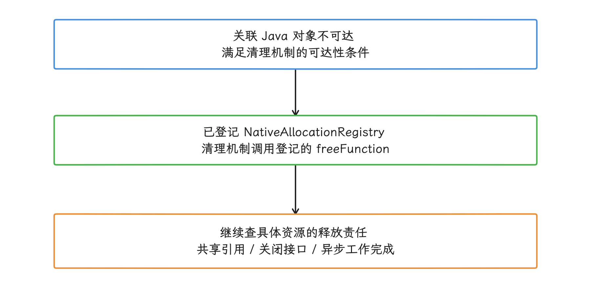
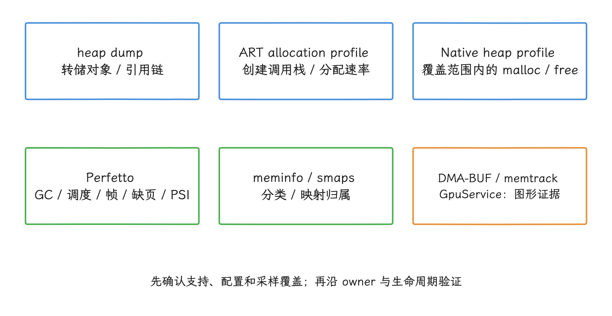
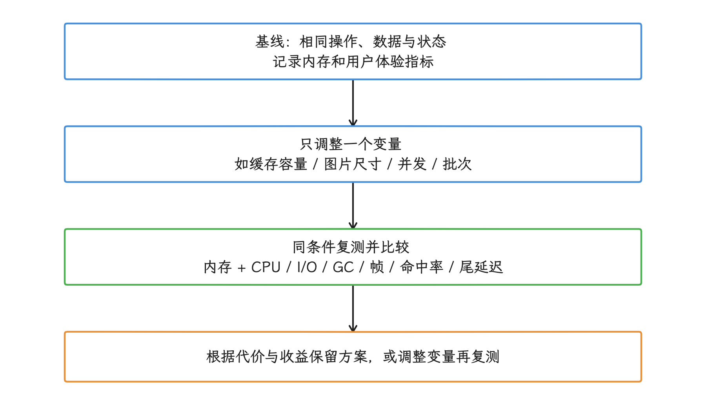
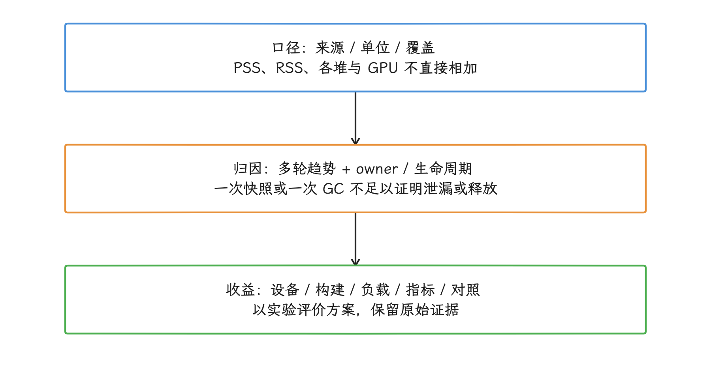

# 第 10 章：内存性能

内存问题影响体验的方式很多：OOM（内存不足）、频繁 GC、帧丢失、前后台恢复变慢、系统换页、cached process（缓存进程）重启，以及业务运行越久越迟缓。本章从应用性能视角组织诊断方法，重点回答三个问题：

1. 增长发生在哪类内存中；
2. 谁持有对象或资源；
3. 这项变化怎样影响 GC、调度、I/O 和用户可感知延迟。

<!-- gracker-diagram: ch10-index-01-three-questions -->

图：三个问题互相补充：分类指标定位增长范围，所有权证据说明谁仍持有资源，同一业务窗口的时间线检验体验影响。

> 源码基线：Android 17 / API 37 / AOSP `android-17.0.0_r1`；涉及 PSI（资源压力导致任务停顿的时间）、cgroup v2（控制组机制）、回收与内核内存统计时，内核核对版本为 `android17-6.18-2026-06_r6`；旧版本差异保留在对应专题中，结论范围不超过 Android 17。

## 内容索引

- [10.1 App 内存分析与案例](01-app-memory-analysis-cases.md)
- [10.2 低内存对系统性能的影响](02-low-memory-impact.md)
- [10.3 内存抖动与频繁 GC](03-memory-churn.md)
- [10.4 GPU 与图形内存统计、归因与诊断](04-gpu-graphics-memory-tracking.md)

<!-- gracker-diagram: ch10-index-02-topic-navigation -->

图：10.1 提供 App 排障主线；按低内存、分配抖动或图形资源线索进入 10.2–10.4。专题之间可以交叉取证，不是固定执行顺序。

## 按现象选择入口

| 现场现象 | 建议入口 |
| --- | --- |
| 不清楚 Java、Native、PSS、RSS、SwapPss、Graphics 的区别 | [10.1 App 内存分析与案例](01-app-memory-analysis-cases.md) |
| 页面退出后 Activity、View、callback 或资源仍被持有 | [23.2 内存泄漏检测与治理](../../part5-app/ch23-memory-practice/02-memory-leak-governance.md) |
| 多轮业务操作后内存持续增长 | [10.1 App 内存分析与案例](01-app-memory-analysis-cases.md) |
| PSI、换页、lmkd、后台重启或整机卡顿 | [10.2 低内存对系统性能的影响](02-low-memory-impact.md) |
| 需要查看从症状到证据的完整案例 | [10.1 App 内存分析与案例](01-app-memory-analysis-cases.md) |
| live set（仍存活的对象集合）稳定，但短命分配和 GC 很频繁 | [10.3 内存抖动与频繁 GC](03-memory-churn.md) |
| Graphics、DMA-BUF（跨设备共享的缓冲区）或 GPU private memory（GPU 私有内存）增长 | [10.4 GPU 与图形内存统计、归因与诊断](04-gpu-graphics-memory-tracking.md) |
| SQLite/Room 查询、CursorWindow 或分页造成峰值 | [24.2 数据库与序列化性能](../../part5-app/ch24-io-network/02-database-serialization-performance.md) |
| ART region、CMC（并发标记压缩）、LOS（大对象空间）或 compaction（内存压缩整理）引起疑问 | [4.2 ART Heap、GC 与后台维护调度](../../part1-fundamentals/ch04-memory/02-art-heap-gc-maintenance.md) |

## 分析顺序

拿到一个内存问题，我们按固定的顺序推进：先定义业务窗口，再确定内存域，然后区分 live set、churn 与峰值，最后做单变量对照实验。

### 1. 定义业务窗口

我们先把问题写成一段可重复的操作序列，再记录现场条件：设备、build fingerprint（系统构建标识）、ART Mainline（可独立更新的 ART 系统模块）版本、应用版本、ABI（应用二进制接口）、构建类型、数据集、前后台状态和采样时钟。

<!-- gracker-diagram: ch10-index-03-business-window -->

图：先定义可重复操作与等待区间，保存设备、构建、ART 模块、应用、ABI、负载和前后台状态。轨道仅示意按共同时间基准对齐；不同统计值不因此变成同一计量口径。

### 2. 确定内存域

窗口固定后，接下来确定增长落在哪个内存域。我们至少从以下视角调查，它们互相交叉，统计时不能直接相加。线程和文件描述符是资源线索；PSI 衡量资源压力造成的任务停顿，属于时间维度的压力信号（见 [PSI 官方说明](https://docs.kernel.org/accounting/psi.html)）：

- ART managed heap（由 ART 管理的 Java/Kotlin 对象堆）；
- Native heap；
- 匿名映射（没有文件作为后备存储）与文件映射；
- Graphics、DMA-BUF 与 GPU private memory；
- Stack（线程栈）、Code（代码映射）、线程和文件描述符；
- Swap/ZRAM（交换区与压缩内存）和系统 PSI。

<!-- gracker-diagram: ch10-index-04-investigation-views -->

图：这些是交叉的调查视角：ART 与 Native 堆可由匿名映射承载，图形资源也可能进入其他统计；线程数、FD 数和 PSI 不是另一套堆字节数。

GC 主要回收 managed heap 中不可达对象占用的堆空间。部分 Java 对象关联的 Native 分配通过 `NativeAllocationRegistry` 登记，对象不可达后由清理机制调用登记的释放函数（见 [固定 r1 源码](https://android.googlesource.com/platform/libcore/+/refs/tags/android-17.0.0_r1/luni/src/main/java/libcore/util/NativeAllocationRegistry.java)）。这条清理路径只覆盖登记过的分配，其余的 Native、Surface、codec（编解码器）、GPU 或内核资源，还需要逐类核对 owner（资源持有者）、关闭责任、共享引用和异步工作完成条件。

<!-- gracker-diagram: ch10-index-05-gc-native-boundary -->

图：部分 Native 分配登记了与 Java 对象关联的释放函数；对象不可达后可经清理机制触发释放。图中不承诺执行时机，也不表示所有 Native 或 GPU backing 已同步回收。

### 3. 区分 live set、churn 与峰值

确定内存域之后，我们用不同工具区分 live set、churn 与峰值：

- heap dump（堆转储）用于分析转储中的对象与引用链；记录采集工具是否先触发 GC 及其对象过滤策略，转储也会扰动进程内存（见 [官方工具说明](https://developer.android.com/studio/profile/capture-heap-dump)）；
- ART allocation profile（分配剖析）用于分析分配调用栈与分配速率；
- Native heap profile 用于分析 `malloc`/`free`；
- Perfetto 用于对齐 GC、调度、frame（帧）、fault（缺页）、PSI 与业务阶段；
- `dumpsys meminfo` 和 smaps（进程内存映射明细）用于确定统计分类与映射归属；
- DMA-BUF、memtrack 和 GpuService 分别提供图形对象、分类或驱动上报证据；先确认设备支持、权限、覆盖范围与采集完整性，缺数据不能直接按 0 解释。

工具标签能把调查范围缩小到具体的内存域和分配路径；要提出可验证的修复方案，我们还要拿到 owner、对象生命周期或调用栈。

<!-- gracker-diagram: ch10-index-06-tool-evidence -->

图：heap dump 查对象引用；分配剖析查创建热点和速率；时间线检验体验相关性；映射与图形统计限定增长范围。工具提供的证据不同，创建栈不能代替保留引用图。

### 4. 做单变量对照实验

我们用单变量对照实验检验调整的效果：一次只调整一个变量，例如缓存容量、图片目标尺寸、任务并发数、解析批次或 buffer（缓冲区）规格。比较内存指标时，同时观察 CPU、I/O、GC、frame deadline miss（帧没有按期完成）、缓存命中率和业务尾延迟（少数最慢请求的耗时）。

如果内存降下来了，但重建成本、I/O 或卡顿明显增加，方案就还需要继续调整。

<!-- gracker-diagram: ch10-index-07-single-variable -->

图：保留同一负载和现场条件，一次调整一个变量；同时比较内存、CPU、I/O、GC、帧超期、命中率与尾延迟。根据证据选择保留或继续调整，不预设缓存越小越好。

## 阅读建议

- App 侧排障从 10.1 开始，再按内存域进入对应小节。
- OOM、GC 抖动和前后台恢复问题，建议与第 4 章的 ART、lmkd、MemoryLimiter、内核回收章节对照。
- 图形与渲染问题要把 10.4 和渲染专题放在同一时间线分析，避免只看 Java heap。
- 平台或 OEM（设备厂商）调试还应保存 cgroup、PSI、lmkd（低内存终止守护进程）、MemoryLimiter 与 ART 配置，不能用 API level 代替设备实际状态。

## 证据边界

- 数据要有源码路径、官方文档或可复现实验支撑。
- PSS、RSS、Java heap、Native allocated 和 GPU memory 维持各自的统计范围，直接相加得不出统一口径。
- `System.gc()`、`WeakReference`、对象池、WebP、SparseArray、异步线程的讨论都限定在具体场景，不当作通用解法。
- 证明泄漏要靠重复观察，一次快照不够；确认资源已经释放，一次 GC 也不够。
- 性能收益必须注明设备、构建、负载、指标和对照条件。

<!-- gracker-diagram: ch10-index-08-evidence-boundaries -->

图：快照、GC 和工具标签都只是一段证据。泄漏与释放结论需结合重复业务、持有关系及资源生命周期；性能收益需保存可复查的现场条件。
