# Android 功耗模型与系统级优化

“某应用耗了多少电”看似只有一个数字，平台内部却要依次完成三件不同的工作：

1. 记录 CPU、屏幕、网络、传感器、WakeLock（阻止设备进入部分休眠状态的锁） 等资源的活动；
2. 把活动时间或硬件能量读数换算成组件耗电；
3. 把共享组件的成本分配给 UID（Linux 用户标识），再生成 Settings 和 bugreport 使用的结果。

这三层的数据源、单位和误差各不相同：BatteryStats 里的活动时长、PowerStats HAL（硬件抽象层） 的能量读数、ODPM rail（设备级电源轨计量） 和设置页里的应用百分比，属于不同层面的数字，比较之前要先想清楚各自代表什么。


> 源码基线：AOSP `android-17.0.0_r1`，对应 Android 17 / API 37；内核 `android17-6.18-2026-06_r6`。Fuel Gauge（电量计）、PMIC 与 rail（电源轨） 的具体名称由设备厂商实现。

功耗由 CPU、GPU、屏幕、网络、定位和传感器等组件在时间窗口内的活动共同产生。系统优化通过调度、休眠、批处理和硬件状态控制，缩短高功率状态的驻留时间。

## 组件功率、驻留时间与归因口径

不同层面的数字回答不同的问题。我们要先知道一份耗电数据来自哪一层、经过哪些换算，才能决定它能支撑什么结论。这一节按数据从硬件流向用户的顺序，逐层看这些数字是怎么产生的。

### 1. 功耗统计全景

| 层次 | 典型对象 | 记录内容 | 常用单位 |
|---|---|---|---|
| 电池侧 | Fuel Gauge、Coulomb Counter（库仑计） | 电池剩余电量、电流、电压、温度 | µAh、µA、mV、百分比 |
| 模块计量 | PowerStats HAL、ODPM | energy consumer（逻辑耗能组件）或 rail 的累计能量 | µWs |
| 活动记账 | `BatteryStatsImpl` | UID 和组件的时间、计数、状态、能量桶 | ms、次数、字节、µC 等 |
| 归因计算 | `PowerAttributor`、`*PowerStatsProcessor` | 设备组件和 UID 的估算耗电 | mAh |
| 对外结果 | `BatteryUsageStats`、`UidBatteryConsumer` | 查询窗口内的组件与 UID 归因 | mAh、百分比 |
| 诊断工具 | bugreport、Battery Historian、Perfetto、Power Profiler | 时间线、统计结果、rail 变化 | 取决于数据源 |

先分清单位：`µWs` 表示能量，`µAh` 和 `mAh` 表示电荷量；功率还需要能量除以时间。百分比必须注明分母：`BatteryManager.BATTERY_PROPERTY_CAPACITY` 是剩余容量比例，设置页的应用占比则受归因窗口和展示口径影响。能量与电荷量互相换算还需要对应电压，不能只因两项都用百分比或 mAh 就视为同一测量。


数据从硬件进入 Framework 后，每一层能走到哪一步取决于设备。缺少 energy consumer 时，组件归因可能退回 controller activity（控制器活动统计） 或 `power_profile.xml` 估算；energy meter 的原始 rail 主要用于观测，参与归因的输入由组件 collector 和 processor 组织，任意 rail 直接按 UID（Linux 用户标识，Android 用它归集应用资源） 时间分配，在归因管线里并没有这样一条现成路径。

### 2. `power_profile.xml`：软件估算的设备参数

`frameworks/base/core/res/res/xml/power_profile.xml` 的多数功耗参数是组件在特定状态下的增量电流，单位为 mA，按标称电压测量。电池侧参数与 rail 参数需按字段注释区分；例如 `memory.bandwidths` 明确使用 rail 侧 mA，`battery.capacity` 使用 mAh，controller voltage 使用 mV。对于以 mA 表示的活动电流，Framework 与活动时长相乘，得到电荷量：

`charge(mAh) = current(mA) × duration(ms) / 3_600_000`

向 profile 填值时，我们先把字段的测量口径查清楚：PMIC（电源管理芯片）的不同 rail 处于不同电压域，相同电流对应的功率不同，要求电池侧电流的字段就只认电池侧电流，其他电压域的 rail 电流直接填进去，数值就是错的。

#### 2.1 AOSP 默认文件与设备参数

AOSP 默认文件明确声明数值是故意设置的错误值，OEM 出货前必须用目标设备测量值覆盖。下面摘录的 `0.1` 来自 `android-17.0.0_r1`，用于展示字段形态。

```xml
<device name="Android">
    <item name="screen.on.display0">0.1</item>
    <item name="screen.full.display0">0.1</item>

    <item name="wifi.on">0.1</item>
    <item name="wifi.active">0.1</item>
    <item name="wifi.scan">0.1</item>

    <array name="cpu.active">
        <value>0.1</value>
    </array>
    <array name="cpu.clusters.cores">
        <value>1</value>
    </array>
    <array name="cpu.speeds.cluster0">
        <value>400000</value>
    </array>
    <array name="cpu.active.cluster0">
        <value>0.1</value>
    </array>
</device>
```

这段 XML 说明 display、Wi-Fi 和 CPU cluster 的键如何组织。性能报告若拿这些默认电流计算真实设备耗电，结果没有测量意义。


#### 2.2 CPU 参数按 scaling policy（策略） 与频点组织

异构 CPU 要写清 cluster（核簇）的核数、频点和对应活动电流。`CpuPowerStatsProcessor` 从 `CpuScalingPolicies` 取得 scaling policy（共享调频策略的一组 CPU）与频点，再从 `PowerProfile` 读取三类参数：

- CPU 整体 active 的基础电流；
- scaling policy 活跃的附加电流；
- scaling step，也就是某个具体频点的附加电流。

常规 time-in-state（各频点驻留时间）路径没有 CPU energy consumer 时，处理器具备按 uptime（不含深度休眠的运行时间）、policy 运行时间与频点时间计算的 profile 项。⚠ 采集实现边界：固定 r1 的 `CpuTimeInStateCollector.collectStats()` 清零数组后填入频点时间、uptime 差值和能量等字段，尚未填入 time-in-cluster，源码留有相应 TODO；不能因模型有 policy 项就认定当前采集路径已提供该项时长（见 [固定 collector](https://android.googlesource.com/platform/frameworks/base/+/refs/tags/android-17.0.0_r1/services/core/java/com/android/server/power/stats/CpuTimeInStateCollector.java)）。有 hardware energy（硬件能量读数）时，常规处理器仍利用 profile 的 power bracket（相近功耗档位分组）与 UID 时间分配总量。支持 x86 cycle/RAPL 的设备还可能采用下文 §3.1 的另一条路径。

因此，相同 CPU time 不保证相同耗电。任务运行在哪个 policy、哪些频点，以及设备是否提供 measured energy，都会改变结果。


#### 2.3 modem、Wi-Fi 与 Bluetooth 的 controller 数据

现代 profile 同时保留 legacy（兼容旧实现） 项和 controller 项。Wi-Fi 可提供 idle（空闲）、rx、不同 tx level（发射功率档位）及工作电压；modem 配置可区分 RAT（无线接入技术）、NR（5G New Radio） 频段和发射等级；Bluetooth controller 也可提供 idle、rx、tx 统计。

具体用哪组数据，取决于芯片、HAL 和 Framework collector（统计采集器） 的能力。同一网络制式的发射功率、驻留状态和 tail（传输结束后保持高功耗状态的一段时间） 行为也由基带、运营商与设备策略决定，把所有设备简化成“开启时间 × 一个固定 mA”，估算就会失真。

### 3. 组件功耗如何进入归因

#### 3.1 CPU

Android 17 不再使用顶层 `CpuPowerCalculator`。入口变为：

`BatteryUsageStatsProvider → PowerAttributor → MultiStatePowerAttributor → CpuPowerStatsProcessor`

`CpuPowerStatsProcessor` 会按设备状态、屏幕状态和 UID 进程状态聚合 CPU 统计。在常规 time-in-state 路径中，缺少 measured energy（实测能量）时使用 profile；存在 CPU cluster energy consumer 时，以硬件能量校正各 power bracket，再按 UID 在 bracket 中的活动比例分配。若已提供 WakeLock 聚合统计，这条常规路径还会从设备与 UID 的 CPU 估算中扣除对应 WakeLock 估算，并以 0 为下限，避免重复计入（见 [固定 r1 CPU 处理器](https://android.googlesource.com/platform/frameworks/base/+/refs/tags/android-17.0.0_r1/services/core/java/com/android/server/power/stats/processor/CpuPowerStatsProcessor.java)）。


平台还提供 x86 CPU cycle/RAPL 路径。`BatteryStatsImpl` 在 `x86CpuEnergyAttribution` 开关启用且不支持 time-in-state 时选择 `CpuCyclePerUidCollector`；collector 需要底层支持，会把 RAPL 的 CPU package 能量按 UID CPU cycle 占比归因，再结合电压换成 µC。处理器的 `computePowerFromEnergyConsumers()` 直接将设备和 UID 的 µC 转为 mAh，不再经过 profile/bracket 分配。

<!-- gracker-diagram: ed11-01-cpu-attribution-paths -->
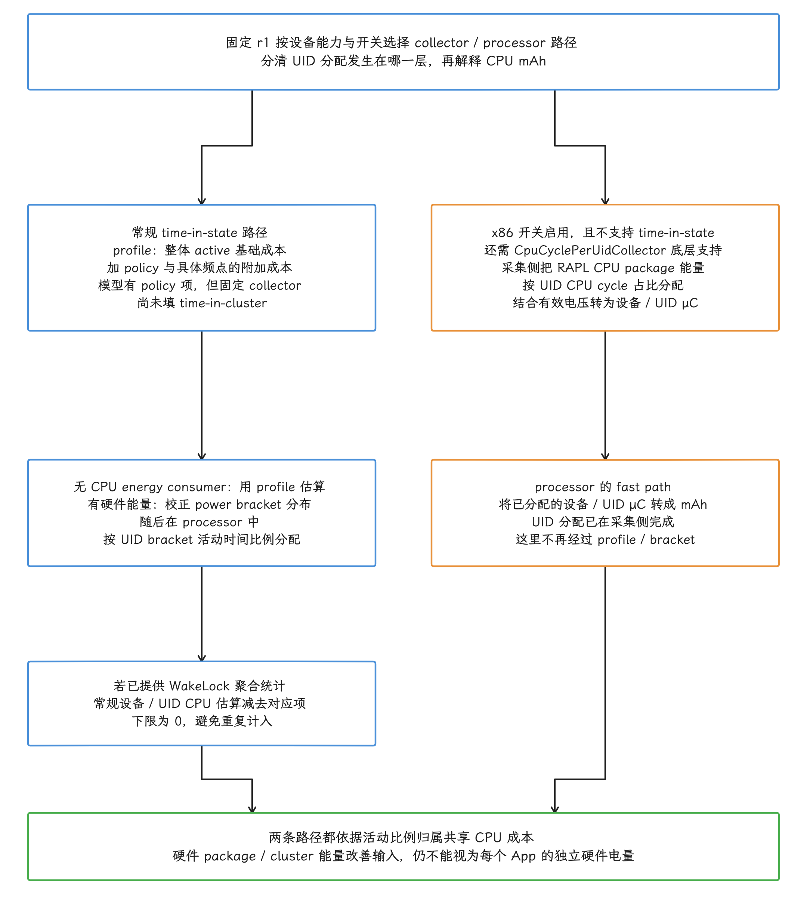

图：固定r1两路径：常规profile具有整体active、policy及频点成本，但CpuTimeInStateCollector尚未填time-in-cluster；无CPUconsumer用profile，有硬件能量则校正bracket，随后processor按UIDbracket活动分配。提供WakeLock聚合时，常规设备/UIDCPU估算扣对应项并以0为下限。x86开关启用且无time-in-state时选择需底层支持的cyclecollector，先把RAPLpackage能量按UIDcycles分摊并以有效电压转µC，processor只转mAh，不再profile/bracket分配。两者都不是逐App独立硬件测量。

两条路径都要靠活动记录来归属共享的 CPU 能量：前者在 processor 中按 bracket 时间分配，后者在采集侧按 cycle 分配。所以我们把后者的 UID 数值读作按活动比例分摊的结果就好，逐 App 各自的独立硬件测量，它提供不了。

#### 3.2 Display

`ScreenPowerStatsProcessor` 先计算设备级屏幕耗电：

- 有 screen energy consumer 时，使用累计能量；
- 没有时，使用 screen-on、doze（低功耗显示状态）、亮度档位时长与 profile。

UID 分配阶段按 top（最前台） activity duration（最前台 Activity 时长）占比分配亮屏耗电。总 top activity duration（应用处于最前台的 Activity 时长） 为 0 时，处理器跳过 UID 分配；Android 16 `ScreenPowerCalculator` 里 10 分钟的 smear（按时长摊分）门槛已经移除。

硬件 screen energy consumer 仍然是设备级输入：它提高屏幕总量的测量质量，每个应用的屏幕电量依旧来自前台活动时长比例。

<!-- gracker-diagram: ch11-01-07-screen-attribution -->
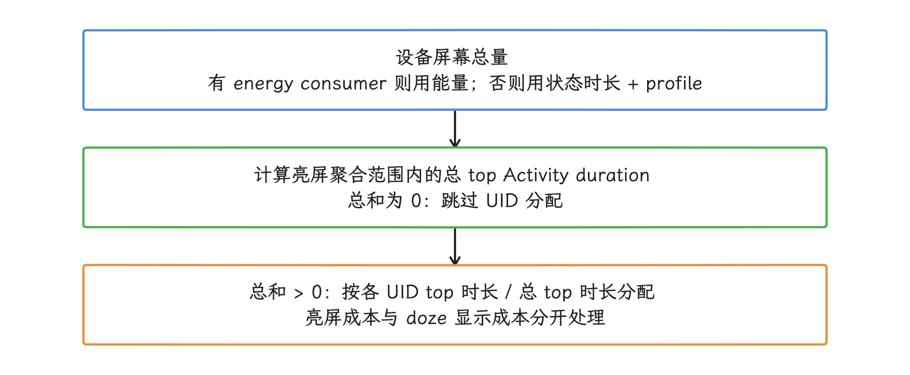

图：硬件 screen energy consumer 不是每 App 的独立屏幕电表。图对应固定 r1 的设备估算与 UID 分配顺序，不继承旧 calculator 的 10 分钟门槛。

#### 3.3 GPU

标准的 `BatteryConsumer.POWER_COMPONENT_*` 集合没有 GPU，`EnergyConsumerType.aidl` 也没有 GPU 专用枚举。GPU rail 可通过下列入口观察：

- Pixel 6 及后续 Pixel 的 ODPM / Power Profiler；
- 厂商 PowerMonitor measurement 或 consumer；
- Perfetto 中设备提供的 GPU rail；
- GPU frequency、busy 和调度 trace，用作负载代理指标；它们描述活跃程度，不直接等于能量。

`PowerMonitor` consumer 名称可以出现 GPU，但名称和组合方式允许 OEM 自定义。这与 `BatteryConsumer` 是否有标准 GPU 组件是两个不同的 API 层面。


#### 3.4 Cellular、Wi-Fi 与 Bluetooth

通信组件可能组合使用：

- controller activity：idle、rx、tx 及发射等级时长；
- network bytes、packets、scan 和连接状态；
- PowerStats energy consumer；
- `power_profile.xml` 回退参数。

共享 controller 或共享 rail 需要二次分配。网络字节多，未必代表 radio（无线通信模块）耗电高——短而分散的传输还可能增加唤醒和高功耗状态驻留时间。诊断时我们要同时观察传输窗口、网络状态、controller activity 与 rail。

<!-- gracker-diagram: ch11-01-09-radio-residency -->
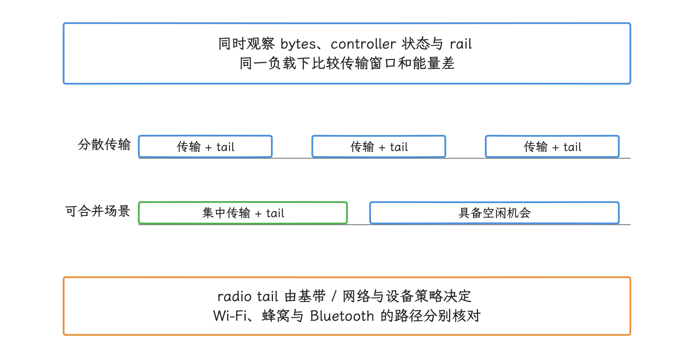

图：示意分散传输可能反复触发唤醒与 tail，批处理可能减少切换。条宽不按比例，不能由此预测固定节电百分比；实际还取决于网络、芯片、信号和业务延迟约束。

#### 3.5 GNSS、Camera、Audio、Video 与 Sensor

这些组件也存在多种路径：

| 组件 | 活动证据 | 能量输入 | UID 归属注意点 |
|---|---|---|---|
| GNSS | 请求者、signal quality（信号质量）、活跃时间 | energy consumer 或 profile | 多个请求者可能共享一次定位 |
| Camera | Camera 使用状态与时长 | CAMERA energy consumer 或 `camera.avg` | rail 可能包含 ISP（图像信号处理器）、传感器或共享域 |
| Audio / Video | 音频、视频活动状态与时长 | AOSP 默认 processor 使用 `audio` / `video` profile 参数估算 | DSP（数字信号处理器）、offload（交给专用硬件处理）与非 offload 的差异需另行观测；厂商 monitor 不自动进入标准归因 |
| Bluetooth | scan、controller rx/tx/idle | controller activity、energy consumer、profile | BLE、经典连接和音频链路不能混为一类 |
| Sensor | 注册 UID 与活跃时间 | sensor power 参数或 vendor 数据 | batching（批量上报）会改变唤醒成本 |

profile 数字反映特定设备测量条件。Camera、GPS 或 Bluetooth 没有跨设备通用电流值。

### 4. BatteryStats：活动记账层

`BatteryStatsService` 运行在 `system_server`，主要状态由 `BatteryStatsImpl` 维护。它负责记录活动与归属线索，并不会持续读取整机电流。

#### 4.1 Push 与 Pull

控制组件状态的系统服务会在状态变化时推送事件，例如屏幕、Wi-Fi、定位和 WakeLock（防止设备休眠的锁）；CPU 等累计统计则在状态切换或采样点拉取快照。Android 官方将两者称为 push（推送） 和 pull（拉取）。

一次 UID 归因可能依赖多种线索：

- CPU active、policy、频点和 UID 时间；
- 前台、后台、top 等进程状态；
- WakeLock、Job、Sync、FGS（前台服务） 与传感器时长；
- 网络字节、controller activity 和 radio 状态；
- EnergyConsumer 累计值；
- BatteryStats history 中的状态变化。

`BatteryStatsImpl` 记录的是 UID 级统计，而一个 UID 未必对应单个进程。共享 UID、多进程应用、系统 UID 和 SDK sandbox（SDK 沙箱进程） 等场景，都要先弄清楚这次统计的 UID 里包含哪些进程。


#### 4.2 时间窗口与持久化

BatteryStats 会持久化统计，跨重启保留需要的历史信息。`/data/system/batterystats.bin` 是当前实现中的存储文件，不属于应用可依赖的公开接口。

拔掉充电器并不会无条件重置所有统计。`shouldResetOnUnplugLocked()` 在允许自动重置、系统就绪且 history 允许重置的前提下，根据满电、高电量、一次明显充电和累计放电量等条件决定是否 reset；它不按 session（统计会话）时长判断。高电量阈值由 `BatteryStatsConfig.getHighBatteryLevelAfterCharge()` 提供，默认值为 90，OEM 可以配置。

实验前执行 `dumpsys batterystats --reset`，是人为建立一个采集窗口，和系统自动 reset 的策略不同。重置会影响整机统计，不要在用户设备或多人共享测试环境随意执行。

<!-- gracker-diagram: ch11-01-11-reset-window -->
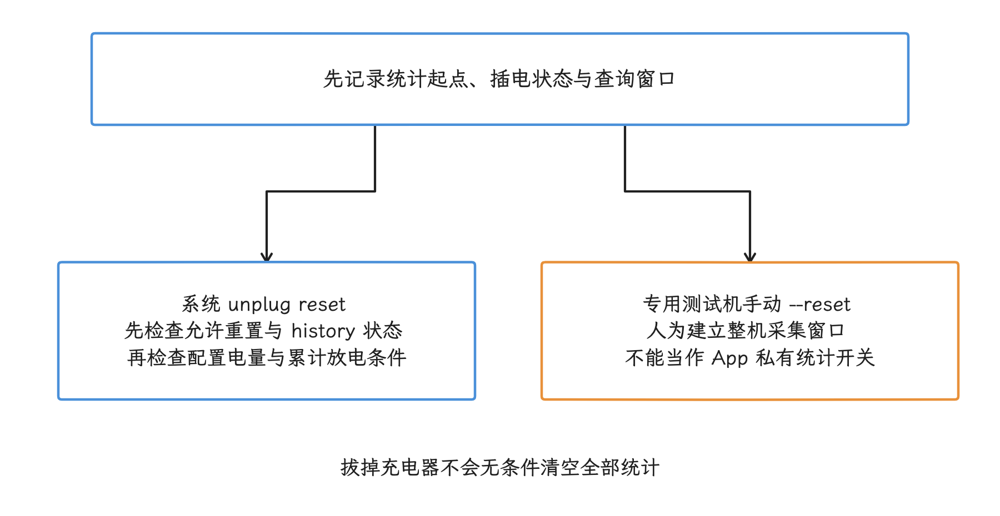

图：固定 r1 自动 reset 不以 session 时长判断。默认高电量阈值来自 BatteryStatsConfig，OEM 可改；手动重置影响整机统计。

#### 4.3 `dumpsys batterystats` 能回答什么

在专用测试机上，我们可以用下面的命令建立一个明确窗口并导出结果。

```bash
adb shell dumpsys batterystats --reset

# 运行受控测试场景后导出
adb shell dumpsys batterystats > batterystats.txt
adb bugreport bugreport.zip
```

`dumpsys` 适合核对 UID 活动、WakeLock、网络、Job 和组件统计；bugreport 可交给 Battery Historian（将 BatteryStats 历史数据可视化的工具），把 BatteryStats 历史数据可视化。官方文档已警告 Battery Historian 不再积极维护；新建诊断流程可优先评估系统跟踪、Macrobenchmark 功耗指标或 Power Profiler，已有 Historian 流程需先验证目标版本的解析兼容性。命令结果属于统计与归因，外接功耗仪给出的是瞬时电流曲线，两类数据回答的问题不同。

### 5. Coulomb Counter、Fuel Gauge 与 Framework 归因

#### 5.1 Coulomb Counter

Coulomb Counter 对电池充放电电流做时间积分，得到 charge（电荷量）变化。Android 设备常通过 Fuel Gauge 和 Health HAL 暴露剩余 charge、current、capacity 等属性。`BatteryManager` 中常见单位包括：

- `BATTERY_PROPERTY_CHARGE_COUNTER`：µAh；
- `BATTERY_PROPERTY_CURRENT_NOW`：µA；
- `BATTERY_PROPERTY_CAPACITY`：百分比；
- `BATTERY_PROPERTY_ENERGY_COUNTER`：nWh，设备支持情况不同。

`BATTERY_PROPERTY_CURRENT_NOW` 与 `BATTERY_PROPERTY_CURRENT_AVERAGE` 的公开契约都规定：正值表示净电流流入电池，负值表示净放电。设备实现决定属性是否可用、采样更新节奏与平均电流的计算窗口；我们遇到符号与契约不符的读数时，按设备实现的问题去核对；把它解释成另一种合法约定，是没有依据的。

读取前还要处理不支持属性的返回值：`getLongProperty()` 返回 `Long.MIN_VALUE`；`getIntProperty()` 对 targetSdk 28 及以上应用返回 `Integer.MIN_VALUE`，对更低 targetSdk 返回 `0`，这时“不支持”和有效零值看上去没有区别。精度结论要以目标 Fuel Gauge 的数据手册和整机验证为准，Coulomb Counter 没有跨设备通用的误差范围。


#### 5.2 Fuel Gauge

Fuel Gauge 通常结合 Coulomb counting（库仑计量）、电压、温度、电池模型和校准状态估计 State of Charge（SOC，剩余电量比例），部分实现还提供 State of Health（SOH，电池健康状态）。它面对的是整块电池，某次电流由哪个 UID 引起，它分辨不出来。

`android17-6.18-2026-06_r6` 中，`include/linux/power_supply.h` 和 `drivers/power/supply/power_supply_core.c` 定义了通用 power_supply 框架。具体 Gauge 驱动、属性集合和校准算法位于厂商实现，Android common kernel 在这里只提供接口。

#### 5.3 按问题选数据源

| 问题 | 合适数据 |
|---|---|
| 电池在测试窗口少了多少 charge（电荷量） | Fuel Gauge / 外接功耗仪 |
| 某个 rail 在窗口内增加了多少 energy（能量） | ODPM / PowerMonitor measurement |
| 哪个组件最活跃 | BatteryStats、Perfetto 状态和 controller 数据 |
| 哪个 UID 被归因了多少 mAh | BatteryUsageStats / UidBatteryConsumer |
| 某代码改动是否降低整机平均功率 | 外接仪表或稳定 rail delta，加受控 A/B |

Framework 不会简单地把 Coulomb Counter 总差值按应用比例切分。BatteryUsageStats 的组件算法可能使用 measured energy、controller 数据或 profile，再依据 UID 活动分配；电池总差值还包含系统、屏幕、基带、供电转换损耗和未归因部分。所以我们核对总趋势时可以把两类结果放在一起看，要拆到每个应用，还得回到归因结果。

<!-- gracker-diagram: ch11-01-13-battery-vs-uid -->
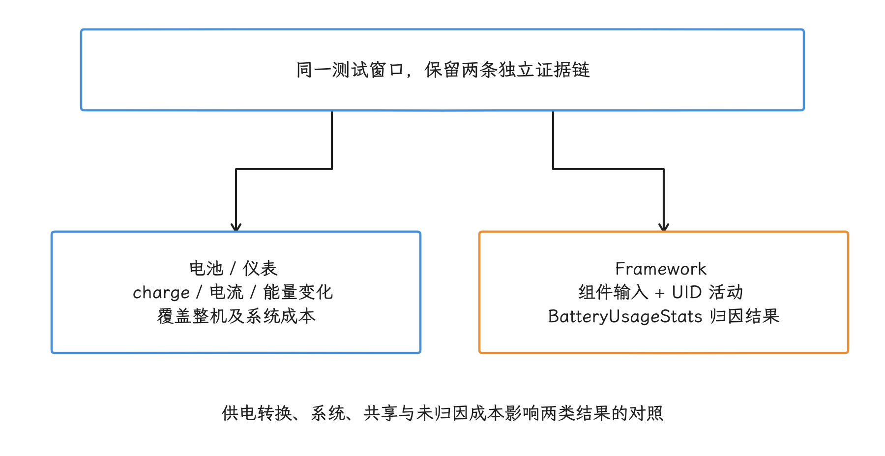

图：Coulomb Counter 与 Fuel Gauge 面向整块电池，不能直接识别 UID。整机趋势可交叉检查，不能把总差值按一个统一比例切成各 App。

### 6. 归因管线

#### 6.1 从 history 到 `BatteryUsageStats`

主路径为：

| 阶段 | 对象 | 作用 |
|---|---|---|
| 记录 | `BatteryStatsImpl` / `BatteryStatsHistory` | 保存状态变化、计数和能量输入 |
| 配置 | `AggregatedPowerStatsConfig` | 定义设备、屏幕、进程等聚合维度 |
| 聚合 | `MultiStatePowerAttributor` | 读取 history（状态变化历史），按时间与状态组织组件统计 |
| 计算 | `processor/*PowerStatsProcessor` | 计算设备组件和 UID 的 mAh |
| 输出 | `BatteryUsageStats.Builder` | 生成设备与 UID consumer |

`PowerAttributor` 是接口，默认实现使用 `MultiStatePowerAttributor`。不同 processor 的算法各自决定 measured energy、profile 和活动时长的组合方式，因此写不出一条覆盖所有组件的统一分摊公式。

<!-- gracker-diagram: ed11-01-activity-to-uid-pipeline -->
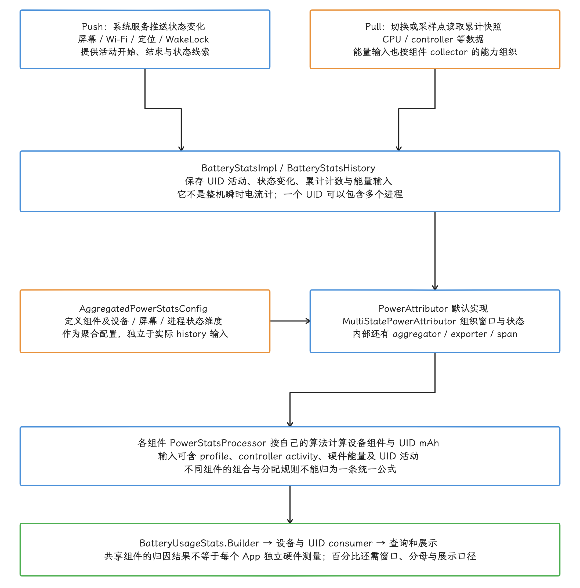

图：职责与数据流合图：Push状态和Pull累计快照进入BatteryStatsImpl/history，AggregatedPowerStatsConfig独立定义聚合维度，默认PowerAttributor实现组织窗口/状态，再由各组件processor和exporter等职责生成设备/UID consumer。图不表示逐行同步调用；BatteryStats不持续测整机瞬时电流，一个UID可含多进程。输入按collector/设备能力组织，不存在任意rail按UID时间统一分配的公式；设置页百分比还需窗口、分母与展示规则。

#### 6.2 Android 16 到 17 的变化

Android 16 是迁移阶段：`BatteryUsageStatsProvider` 对已支持的组件调用 `PowerAttributor`，其余组件保留 `*PowerCalculator`。在 `android-17.0.0_r1` 中，`BatteryUsageStatsProvider` 已移除这组顶层 calculator 回退，委托 `PowerAttributor` 生成组件结果。

阅读 Android 17 源码时，应从 `PowerAttributor`、`MultiStatePowerAttributor` 和 `processor/` 目录进入；使用 Android 16 或更早 tag 讨论历史行为时，仍需查看 `CpuPowerCalculator`、`ScreenPowerCalculator` 等旧实现。

<!-- gracker-diagram: ch11-01-15-provider-migration -->
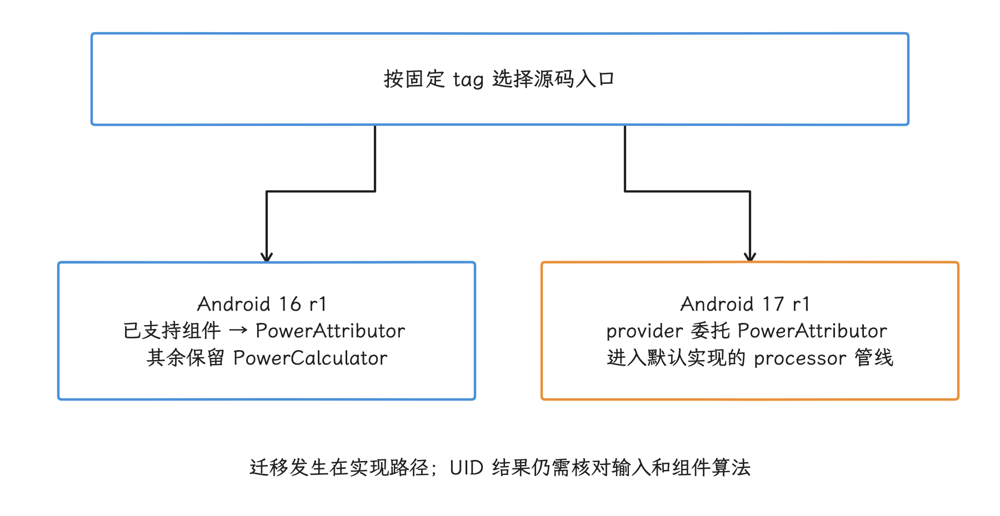

图：图只对比 provider 的顶层 calculator 回退。使用历史 tag 时保留原实现语义，不能把旧 CpuPowerCalculator 或 ScreenPowerCalculator 的细节套到 r1。

#### 6.3 设置页百分比

Settings 展示的是 Framework 归因结果，和 HAL 原始 rail 表是两条线。应用百分比受以下因素影响：

- 查询窗口与 BatteryStats reset 时点；
- measured energy 是否可用；
- profile 与 controller 参数质量；
- UID 前后台状态；
- 共享资源分配；
- 系统组件、未归因量和 reattribution（重新归因）；
- Settings 自身的分组和展示策略。

这个百分比适合排序和寻找异常组件。它达不到实验室仪表的绝对精度，所有 UID 百分比相加也未必覆盖电池端观测到的全部消耗。


### 7. PowerStats HAL、ODPM 与 PowerMonitor

#### 7.1 HIDL 与 AIDL（Android 接口定义语言） 的版本差异

Android 10、Android 11 的历史实现使用 HIDL（旧一代 HAL 接口定义语言）`android.hardware.power.stats@1.0::IPowerStats`：

- `getRailInfo()` 返回 rail 描述；
- `getEnergyData()` 返回累计能量；
- `EnergyData.energy` 使用 µWs。

Android 12 起的 AIDL `android.hardware.power.stats.IPowerStats` 包含三组接口：

- `getPowerEntityInfo()` / `getStateResidency()` 返回 PowerEntity 与各状态的累计驻留时间、进入次数、最近进入时间，用于检查子系统的状态驻留，不直接提供能量；
- `getEnergyConsumerInfo()` / `getEnergyConsumed()` 返回逻辑 consumer 与 `EnergyConsumerResult.energyUWs`；
- `getEnergyMeterInfo()` / `readEnergyMeter()` 返回 Channel 与 `EnergyMeasurement.energyUWs`。

这三组累计数据都从开机开始记录。接口契约允许某次查询缺少部分对象的结果，调用方需要按返回 ID 匹配并处理缺失。AIDL consumer 可以附带 UID attribution（UID 归因），但供应商是否提供、如何划分均由硬件与 HAL 决定。Channel 更接近物理或逻辑 meter（计量通道），名称不具备跨设备稳定性。


#### 7.2 ODPM 与 Pixel

Android Studio 官方 Power Profiler 文档说明，ODPM（On-Device Power Monitor，设备内功耗监测）rail 目前面向 Pixel 6 及后续 Pixel 设备。可见 rail 随设备变化，常见类别包括 CPU cluster、GPU、memory、display、camera、cellular、WLAN 和 UFS。

ODPM 测的是设备级 rail。测试期间其他应用、系统服务、亮度和网络活动都会进入读数；rail 的名称、划分与采样行为也由设备实现决定，所以我们做对比测试时，报告要同时记录机型、构建号和 rail 名。

不支持 ODPM 的设备仍可提供 battery gauge、Coulomb counter、BatteryStats 和其他代理指标；看不到 rail 只是少了这条观测路径，并不能据此认为该模块不耗电。

#### 7.3 API 35 `PowerMonitor`

Android 15 / API 35 增加 `PowerMonitor`、`PowerMonitorReadings` 和 `SystemHealthManager` 的异步读取 API。monitor 分为：

- `POWER_MONITOR_TYPE_MEASUREMENT`：直接测量的 device-specific rail（设备专用电源轨）；
- `POWER_MONITOR_TYPE_CONSUMER`：子系统 consumer，可能直接对应 rail，也可能经过模型计算或组合。


下面的读取函数保留 monitor 名称、类型、累计能量和各自时间戳，并处理设备不支持与能量不可用。


```kotlin
data class PowerReading(
    val name: String,
    val type: Int,
    val energyUWs: Long,
    val timestampMillis: Long
)

@RequiresApi(35)
fun readSupportedPowerMonitors(
    context: Context,
    executor: Executor,
    onSuccess: (List<PowerReading>) -> Unit,
    onFailure: (RuntimeException) -> Unit
) {
    val manager =
        context.getSystemService(SystemHealthManager::class.java)
            ?: return onSuccess(emptyList())

    manager.getSupportedPowerMonitors(executor) { monitors ->
        if (monitors.isEmpty()) {
            onSuccess(emptyList())
            return@getSupportedPowerMonitors
        }

        manager.getPowerMonitorReadings(
            monitors,
            executor,
            object : OutcomeReceiver<PowerMonitorReadings, RuntimeException> {
                override fun onResult(readings: PowerMonitorReadings) {
                    val result = monitors.mapNotNull { monitor ->
                        val energy = readings.getConsumedEnergy(monitor)
                        if (energy == PowerMonitorReadings.ENERGY_UNAVAILABLE.toLong()) {
                            null
                        } else {
                            PowerReading(
                                name = monitor.name,
                                type = monitor.type,
                                energyUWs = energy,
                                timestampMillis =
                                    readings.getTimestampMillis(monitor)
                            )
                        }
                    }
                    onSuccess(result)
                }

                override fun onError(error: RuntimeException) {
                    onFailure(error)
                }
            }
        )
    }
}
```

`getConsumedEnergy()` 的公开契约是自开机以来的累计 µWs，包含插电期间的能量，重启后不保留；`getTimestampMillis()` 使用 elapsed realtime（含休眠的开机时间）基准。比较场景要用同一次开机中同一 monitor 的有效前后读数：`ΔE = E₂ − E₁`；只有 `Δt = t₂ − t₁ > 0` 且累计值未重置时才计算区间平均功率，`P(mW) = ΔE(µWs) / Δt(ms)`。同时间戳不能被解释为已测得 0 功率；跨重启、负差值或缺项应重新建立基线。设备不支持 ODPM 时，supported monitor 列表可能为空。

⚠ 实现边界补充：固定 r1 的 `com/android/server/powerstats/PowerStatsService.java` 根据 `ACCESS_FINE_POWER_MONITORS` 权限选择两组缓存，最大缓存年龄候选分别为 20 秒和 250 毫秒；这不是硬件采样频率承诺。有前后有效值时，服务还会按调用 UID 对返回能量加入区间随机扰动，时间戳仍取底层读数。更频繁调用或获得 fine 粒度，都不能直接推出无缓存、无扰动的 HAL 原始值。短窗口回归应先核对时间戳是否推进、实际粒度与噪声，再结合长窗口及独立参考测量（见 [固定 r1 服务实现](https://android.googlesource.com/platform/frameworks/base/+/refs/tags/android-17.0.0_r1/services/core/java/com/android/server/powerstats/PowerStatsService.java)）。

<!-- gracker-diagram: ch11-01-20-monitor-cache-delta -->
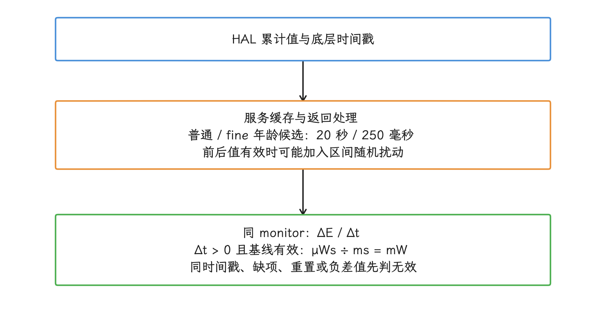

图：固定 r1 按权限选择缓存年龄候选，并可能对返回能量加入 UID 相关扰动；两种粒度都不能推出无扰动原始值。只有同次开机、同一 monitor、有效且推进的时间戳才支持区间平均功率。

### 8. Perfetto、Power Profiler 与 Battery Historian

#### 8.1 Perfetto `android.power`

Perfetto 的数据源名为 `android.power`。下面的配置同时采集 charge、capacity 和设备支持的 power rails。

```protobuf
buffers {
  size_kb: 32768
  fill_policy: RING_BUFFER
}

data_sources {
  config {
    name: "android.power"
    android_power_config {
      battery_poll_ms: 1000
      battery_counters: BATTERY_COUNTER_CHARGE
      battery_counters: BATTERY_COUNTER_CAPACITY_PERCENT
      collect_power_rails: true
    }
  }
}

duration_ms: 60000
```

`collect_power_rails` 只会输出设备提供的 rail。`battery_poll_ms` 是 trace 采样配置，Fuel Gauge 硬件更新频率是另一回事。长窗口需要我们评估 trace buffer（轨迹缓冲区） 占用、文件大小与设备扰动，生产设备采集还要遵守权限和隐私约束。

<!-- gracker-diagram: ch11-01-21-perfetto-power-clock -->
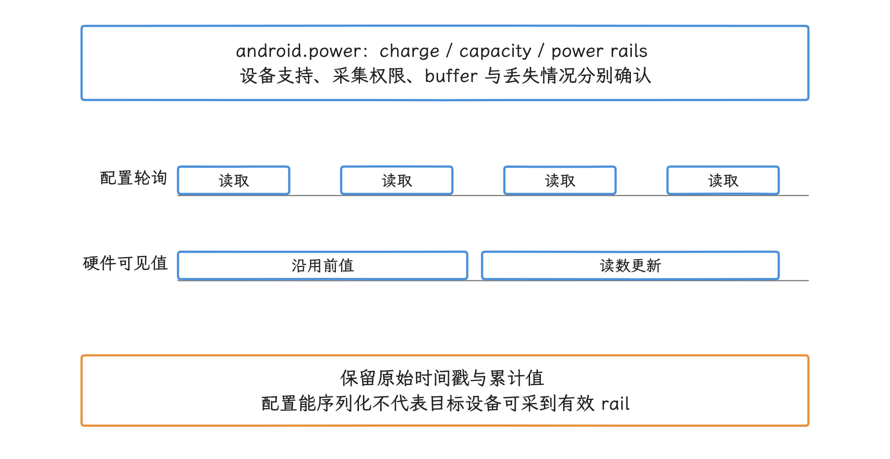

图：android.power 根据配置轮询设备支持的 counter 与 rail，硬件可能在多个轮询点之间只更新一次。轨道纯为说明更新与取样区别，不表示真实更新周期或测量结果。

#### 8.2 工具回答的问题不同

| 工具 | 强项 | 边界 |
|---|---|---|
| Battery Historian | bugreport 中的 BatteryStats 时间线 | 官方已停止积极维护；依赖采集窗口，需验证目标版本解析兼容性 |
| `dumpsys batterystats` | UID、WakeLock、Job、网络和组件统计 | 不提供高频电流波形 |
| Perfetto | rail、battery counter、调度、频率和应用 trace 的时间关联 | rail 设备相关；trace 本身有采集成本 |
| Power Profiler | Android Studio 中对比应用操作与 rail | ODPM 设备范围与 rail 可用性有限 |
| 外接功耗仪 | 受控场景的整机电流和能量 | 无法自动分配到 UID 或组件 |
| PowerMonitor API | 应用内读取累计 monitor 能量 | 设备支持、名称、范围与更新节奏不同 |

工具选择跟着问题走：整机 A/B 更适合外接仪表，模块变化适合 rail，UID 耗电归属适合 BatteryUsageStats，代码和电源事件的时间关系适合 Perfetto。


### 9. 如何做可信的功耗实验

#### 9.1 先确定测量对象

实验开始前，我们先写清楚目标：

- 整机电池 charge；
- 某条 rail 的 energy；
- 某个组件的 BatteryUsageStats mAh；
- 某 UID 的归因结果；
- 用户任务完成所需的总能量。

测量对象不同，结论的适用范围也不同：降低 UID 归因值未必降低整机能量，rail 降低也可能被其他 rail 抵消。

#### 9.2 控制实验条件

- 固定设备、系统构建、应用版本和数据集；
- 记录亮度、刷新率、网络、信号、音量、温度和充电状态；
- 让对比组从一致的 thermal（温控）、缓存、登录和电池状态开始；
- 采用多轮、交错顺序，报告离散程度；
- 用时间戳对齐应用 trace、服务端日志、rail 和 battery counter；
- 对 idle baseline（空闲基线）单独采样，避免把系统后台活动归给应用；
- 记录失败、重试、未完成任务和输出质量。

短测试中，电池百分比粒度通常过粗，可以改用 charge counter、rail delta 或外接仪表，同时验证读数的更新周期和噪声。

#### 9.3 校准的适用范围

校准检查的是 profile 或工具与受控参考测量之间的偏差。一个场景得到的校准系数，换到其他组件、温度和设备上就未必成立。


OEM 制作 `power_profile.xml` 时，应按官方 Power Values 指导在目标硬件上测量组件增量电流。应用团队做回归时，更适合保持工具、设备和条件一致，比较同一指标的差值；用整机系数修正所有 UID 归因，并不可取。

### 10. 与内核调度和 ADPF 的关系

Linux EAS（Energy-Aware Scheduling，能耗感知调度）使用 Energy Model 评估任务放在哪个 CPU 上；BatteryStats 使用 `power_profile.xml`、energy consumer 和活动统计计算查询窗口内的耗电。两者都涉及能量模型，但数据结构、时间尺度和用途不同。

在 `android17-6.18-2026-06_r6` 中，EAS 调度路径使用内核 Energy Model 与调度利用率；AOSP 没有标准调用链把 ODPM rail 实时写回 EAS cost table（调度成本表）。PowerStats 与 PowerMonitor 用于观测能量，ADPF（Android Dynamic Performance Framework）`PerformanceHintManager` 则由应用提供工作负载提示。

厂商可以在 Power HAL、调度器和固件中实现额外联动。缺少 vendor 源码和设备 trace 时，这些联动只能标记为设备特性，推广成平台通用机制缺乏依据。


### 11. 源码阅读入口

| 主题 | 源码入口 |
|---|---|
| profile 默认结构 | [power_profile.xml](https://android.googlesource.com/platform/frameworks/base/+/refs/tags/android-17.0.0_r1/core/res/res/xml/power_profile.xml) |
| 活动与 history | [BatteryStatsImpl.java](https://android.googlesource.com/platform/frameworks/base/+/refs/tags/android-17.0.0_r1/services/core/java/com/android/server/power/stats/BatteryStatsImpl.java) |
| 查询入口 | [BatteryUsageStatsProvider.java](https://android.googlesource.com/platform/frameworks/base/+/refs/tags/android-17.0.0_r1/services/core/java/com/android/server/power/stats/BatteryUsageStatsProvider.java) |
| 归因接口 | [PowerAttributor.java](https://android.googlesource.com/platform/frameworks/base/+/refs/tags/android-17.0.0_r1/services/core/java/com/android/server/power/stats/PowerAttributor.java) |
| 默认多状态归因 | [MultiStatePowerAttributor.java](https://android.googlesource.com/platform/frameworks/base/+/refs/tags/android-17.0.0_r1/services/core/java/com/android/server/power/stats/processor/MultiStatePowerAttributor.java) |
| CPU 归因 | [CpuPowerStatsProcessor.java](https://android.googlesource.com/platform/frameworks/base/+/refs/tags/android-17.0.0_r1/services/core/java/com/android/server/power/stats/processor/CpuPowerStatsProcessor.java) |
| x86 CPU cycle 采集 | [CpuCyclePerUidCollector.java](https://android.googlesource.com/platform/frameworks/base/+/refs/tags/android-17.0.0_r1/services/core/java/com/android/server/power/stats/CpuCyclePerUidCollector.java) |
| Screen 归因 | [ScreenPowerStatsProcessor.java](https://android.googlesource.com/platform/frameworks/base/+/refs/tags/android-17.0.0_r1/services/core/java/com/android/server/power/stats/processor/ScreenPowerStatsProcessor.java) |
| 公共 monitor API | [PowerMonitor.java](https://android.googlesource.com/platform/frameworks/base/+/refs/tags/android-17.0.0_r1/core/java/android/os/PowerMonitor.java)、[PowerMonitorReadings.java](https://android.googlesource.com/platform/frameworks/base/+/refs/tags/android-17.0.0_r1/core/java/android/os/PowerMonitorReadings.java) |
| PowerStats AIDL | [IPowerStats.aidl](https://android.googlesource.com/platform/hardware/interfaces/+/refs/tags/android-17.0.0_r1/power/stats/aidl/android/hardware/power/stats/IPowerStats.aidl) |
| kernel power_supply | [power_supply.h](https://android.googlesource.com/kernel/common/+/refs/tags/android17-6.18-2026-06_r6/include/linux/power_supply.h)、[power_supply_core.c](https://android.googlesource.com/kernel/common/+/refs/tags/android17-6.18-2026-06_r6/drivers/power/supply/power_supply_core.c) |

### 12. 复核检查表

- [ ] 区分活动时间、charge、energy、power 和百分比。
- [ ] 确认 `power_profile.xml` 来自目标设备，未使用 AOSP 默认值。
- [ ] Android 17 归因从 `PowerAttributor` 与 processor 目录阅读。
- [ ] Screen measured energy 与 UID top-activity 分配没有混写。
- [ ] GPU rail、PowerMonitor consumer 与 BatteryConsumer 标准组件没有混写。
- [ ] BatteryStats reset、查询窗口和插电状态已经记录。
- [ ] PowerMonitor 使用前后差值，并处理不支持该功能与 `ENERGY_UNAVAILABLE` 两种情况。
- [ ] ODPM 报告包含设备、构建、rail 名和并行系统负载。
- [ ] A/B 测试固定亮度、刷新率、网络、温度与数据集。
- [ ] 结论范围与测量工具一致，没有从设备 rail 直接推导 UID 电量。

### 版本与实现边界

| 版本 | 可验证变化 |
|---|---|
| Android 5.0 / API 21 | BatteryStats 与 Battery Historian 成为系统功耗诊断的重要入口 |
| Android 7.0 / API 24 | Wi-Fi、Bluetooth 和 modem controller activity 在设备支持时提供更细的状态数据 |
| Android 10 / API 29 | HIDL PowerStats HAL 提供 rail 信息与累计能量 |
| Android 12 / API 31 | AIDL PowerStats HAL 将 energy consumer 与 energy meter/channel 分开 |
| Android 15 / API 35 | 公开 `PowerMonitor`、`PowerMonitorReadings` 与 `SystemHealthManager` 读取 API |
| Android 16 / API 36 | `BatteryUsageStatsProvider` 处于 calculator 与 `PowerAttributor` 并存的迁移阶段 |
| Android 17 / API 37 | provider 委托 `PowerAttributor`；`MultiStatePowerAttributor` 配置组件 processor；screen UID 分配移除旧 10 分钟 smear 门槛；unplug reset 高电量阈值改为 `BatteryStatsConfig` 配置 |

版本迭代解释历史报告时很有用。分析 Android 17 时应优先使用 `processor/*PowerStatsProcessor`，避免把 Android 16 calculator 的实现细节当作当前源码。

## 调度、休眠与硬件状态控制

功耗模型指出能量花在哪里；系统策略决定这些工作何时执行、能否批处理、设备能否进入低功耗状态。排查后台任务为什么没跑、或者整机耗电为什么偏高时，我们打交道的就是这一层的机制。

### 系统为什么要限制后台工作

单个 App 只知道自己的任务是否紧急，系统还要综合考虑电量、充电状态、屏幕、移动状态、温度、内存压力、网络和其他 App。Android 因此把后台资源分配分为多组可叠加的策略：

| 决策维度 | 主要机制 | 影响对象 |
| --- | --- | --- |
| 设备是否空闲 | Doze、Light Doze、Low Power Standby | 网络、WakeLock、Job、Alarm、Sync |
| 用户多久使用一次 App | App Standby Buckets、Restricted bucket | Job 时长、Alarm 频率、后台网络 |
| 用户是否主动限制 App | Battery settings、background restriction | Job、Alarm、网络与后台执行 |
| 全局是否节电 | Battery Saver、OEM low-power policy | 位置、后台任务、显示、性能与厂商功能 |
| App 当前是否可见 | 进程重要性、FGS、BAL、while-in-use 权限 | 资源配额、界面拉起、位置与敏感资源 |
| ROM 的附加策略 | OEM 冻结、自启动和应用启动管理 | 进程调度、广播、推送与后台存活 |

下文沿用 Android 文档中的常用名称：FGS 指 Foreground Service（前台服务），BAL 指 Background Activity Launch（后台 Activity 启动）；quota 表示系统分配的资源配额，OEM 指设备厂商，ROM 指设备搭载的系统。它们分别约束不同环节，一个机制的状态推不出另一个机制的状态。


同一个 Job 可能同时等待充电约束、Doze 维护窗口、standby quota（待机配额） 和 OEM 调度条件。定位“为什么没运行”时，我们要把这些条件逐项核对一遍，只看 WorkManager 状态往往不够。


### Doze：按设备状态集中后台活动

Android 6.0 / API 23 引入 Doze（设备空闲省电模式）。设备长时间未使用时，系统暂停普通后台网络，忽略 App WakeLock，并延后 Job、Sync 与普通 Alarm；设备会周期性进入维护窗口，批量处理积压工作。

#### Light Doze 与 Deep Doze

Android 7.0 / API 24 加入限制较轻的 Light Doze。Light Doze 与 Deep Doze 各自维护状态，触发条件和限制强度不同；Deep Doze 进入 `STATE_IDLE` 后，会把 Light 状态置为 `LIGHT_STATE_OVERRIDE`，暂停 Light 自身的状态转换。

| 模式 | 进入条件 | 主要目的 |
| --- | --- | --- |
| Light Doze（轻度 Doze） | 屏幕关闭、未充电；不要求设备静止 | 较早限制后台网络和调度，移动中的设备也能节电 |
| Deep Doze（深度 Doze） | 典型为屏幕关闭、未充电并满足静止检测等约束；motion sensor（运动传感器）是否启用及 quick-doze 等路径由固定实现与配置决定 | 延长 suspend（系统挂起）驻留时间，限制更严格 |

设备移动、点亮屏幕或接入充电器会让 Deep Doze 退出。Light Doze 与 Deep Doze 在 `DeviceIdleController` 中有各自状态，`dumpsys deviceidle` 输出的 `mLightState`、`mState` 也要分开读。


#### 维护窗口的节奏

维护窗口会短暂恢复网络，并分发积压的 Sync、Job 和 Alarm。设备持续空闲时，维护窗口之间的休眠间隔会逐步增长。具体时长由平台版本、资源 overlay（资源覆盖配置）、DeviceConfig（系统动态配置） 与设备实现决定；App 在某款手机上量到的窗口间隔描述的是那台设备的行为，成不了调度 SLA（服务时限承诺）。

维护窗口到来，只是限制暂时放宽；某个任务要不要马上跑，还要依次满足它自身的约束、standby bucket（待机分组）、quota 和并发调度条件。

<!-- gracker-diagram: ed11-01-maintenance-and-job-gates -->
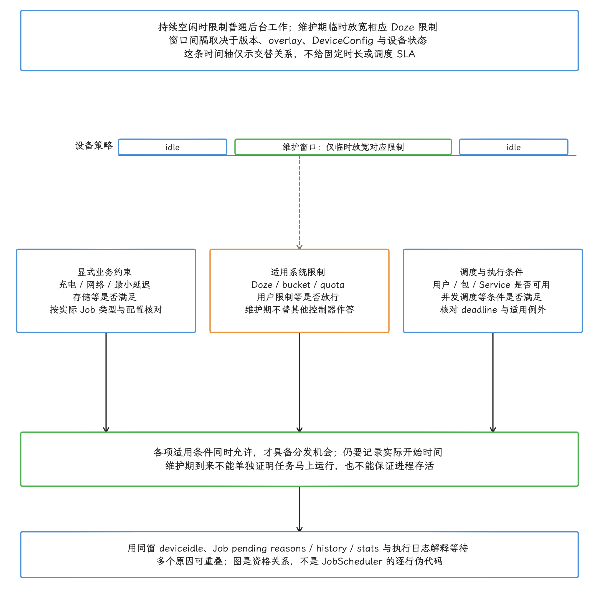

图：设备轨道仅示idle与维护期交替，无固定时长比例或SLA；间隔由版本、overlay、DeviceConfig及设备现场决定。维护期只放宽相应Doze限制，显式业务约束、适用bucket/quota/用户限制、用户包Service与并发等条件仍需按Job类型/deadline/例外分别判断。三路箭头是并行资格输入，不是固定逐行检查顺序；具备机会也需执行日志确认实际开始，pending原因可同时重叠。

#### Doze 中哪些能力会被限制

- 普通网络访问暂停。
- App 持有的 WakeLock 被忽略。
- `set()`、`setWindow()`、`setExact()` 等普通 Alarm 延后到维护窗口。
- JobScheduler、WorkManager 和 SyncAdapter 延后。
- 后台 Wi‑Fi 扫描停止。
- FGS 可以提高进程重要性；设备级 Doze 豁免来自电池优化豁免列表，FGS 换不来。


FCM 交付行为需注明发送配置和客户端版本。旧 `AndroidConfig` v1 的 high / normal priority 分别用于紧急可见通知与普通同步，高优先级处理可能获得临时网络及 partial WakeLock 机会。⚠ 文档版本差异：当前 Android Doze 指南已引导到 `AndroidConfigV2` 的 `RemoteNotification` / `BackgroundSync`；Firebase 迁移页在 2026-10-22 更新时仍列出 `26.1.0-eap01` 和 GA 前可变策略。新方案中，默认不可变通知可由 GMS Core 直接展示而不执行应用后台代码；后台同步允许批处理或延迟。不能把 v1 的回调和优先级假设直接套到 v2，也不能由通知及时展示推导 App 获得持续后台执行资格（见 [Firebase 官方迁移说明](https://firebase.google.com/docs/cloud-messaging/send/v2-api)）。


`setAndAllowWhileIdle()`、`setExactAndAllowWhileIdle()` 和 `setAlarmClock()` 能在空闲期间交付。前两者有频率限制：每个 App 约九分钟一次，系统还可以延长间隔。它们适合用户感知的关键事件；高频轮询不在适用范围里。

#### Android 17 的 listener（监听器） 型 allow-while-idle Alarm

API 37 新增 `setExactAndAllowWhileIdle(int, long, String, Executor, OnAlarmListener)`。这是 listener 形式的 allow-while-idle Alarm，可在设备空闲时交付。回调直接在指定 `Executor` 上执行；对仍有组件存活的 App 来说，等待精确回调期间无需持续持有 WakeLock。

`OnAlarmListener` 形式的 Alarm 依赖调用进程继续有组件运行，进程没有 Activity、Service 或 ContentProvider 时，系统可以取消它。进程退出后仍要收到事件的场景，应使用 `PendingIntent` 形式并遵守精确闹钟权限。新 API 没有改变 allow-while-idle 只能低频使用的原则。

<!-- gracker-diagram: ch11-01-31-alarm-listener-lifetime -->
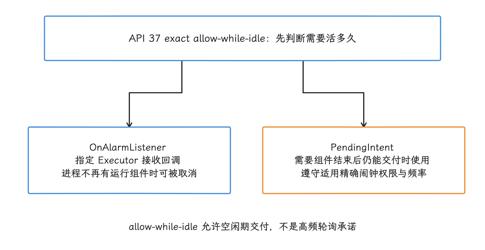

图：listener 型 API 不要求一直持锁等待，但也不是进程退出后的可靠持久投递。选择形式时同时核对时钟类型、组件生命周期和可取消条件。

#### Doze 豁免的范围

用户可以在系统设置中把 App 加入电池优化豁免列表。豁免 App 在 Doze 中可以访问网络并持有 `PARTIAL_WAKE_LOCK`，普通 Alarm 等限制仍可能存在。App 可用 `PowerManager.isIgnoringBatteryOptimizations()` 检查状态。

`ACTION_REQUEST_IGNORE_BATTERY_OPTIMIZATIONS` 只适用于官方列出的少数核心场景，Google Play 也限制直接请求豁免。一般应用应打开电池优化设置页，由用户决定，避免在首次启动时把“无限制”当作必选权限。


#### 从 Framework 到 kernel suspend

`DeviceIdleController` 决定何时限制 App 资源，`PowerManagerService` 与 SystemSuspend 协调系统休眠。内核 `android17-6.18-2026-06_r6` 的 `kernel/power/suspend.c` 执行 suspend 主流程，`drivers/base/power/wakeup.c` 管理 wakeup source（唤醒源），`kernel/sched/idle.c` 处理 CPU idle（CPU 空闲状态）。

Doze 状态本身说明的是策略进入了 idle 阶段；设备有没有实际进入 suspend，要另看内核一侧：驱动 wakeup source、内核 timer（定时器）、IRQ（中断请求）或 `system_server` 中的工作都可能拦住休眠。我们确认硬件状态时，把 `power/suspend_resume`、wakeup source 与 CPU idle 的 trace 放在一起看。

<!-- gracker-diagram: ed11-01-doze-policy-and-suspend-evidence -->
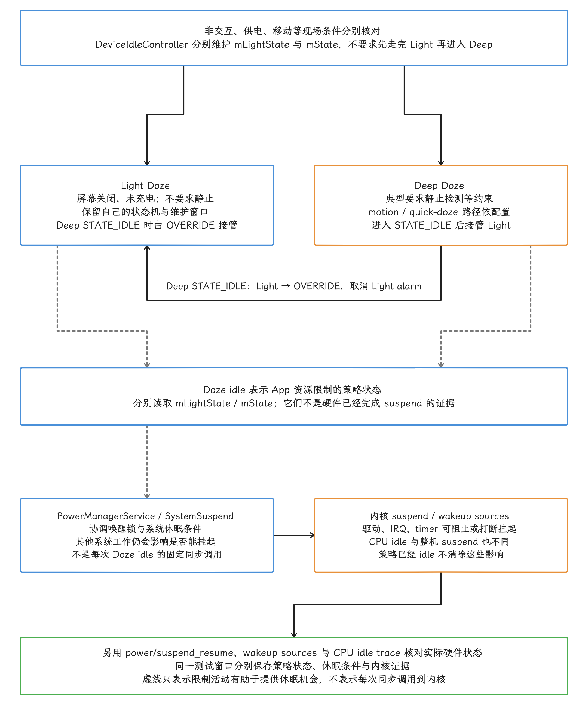

图：固定r1中Light/Deep独立维护状态，DeepSTATE_IDLE将Light设OVERRIDE并取消Lightalarm；设备不必先走完Light流程，motion/quickdoze依实现和配置。策略idle与PMS/SystemSuspend协调条件、内核实际suspend是不同证据层：虚线仅表示减少活动可以提供休眠机会，不表示每次idle同步调用内核，也不保证挂起。驱动wakeupsource、timer、IRQ和系统工作可阻止或打断休眠；同窗查看suspend_resume、wakeupsource与CPUidle，后者与整机suspend也须分开。

#### 强制进入 Doze 的测试方法

下面的命令用于专用测试设备，主动驱动 DeviceIdle 状态并保存快照。

```bash
adb shell dumpsys battery unplug
adb shell dumpsys deviceidle force-idle
adb shell dumpsys deviceidle
adb shell dumpsys jobscheduler com.example.app
adb shell dumpsys alarm

# 测试结束后恢复设备状态
adb shell dumpsys deviceidle unforce
adb shell dumpsys battery reset
```

`force-idle` 会绕过正常等待时间，适合验证功能恢复和任务延迟；自然进入 Doze 的时延，要用屏幕关闭、设备静止的自然路径来测。性能与续航测试还要覆盖这条路径。


### App Standby Buckets：按使用关系分配配额

App Standby（应用待机）不要求整台设备空闲。Android 9 / API 28 开始，系统根据使用模式把 App 动态放入不同的 standby bucket：Active（活跃）、Working set（常用）、Frequent（频繁使用）、Rare（很少使用） 或 Restricted（受限）；安装后从未运行的 App 还有 `Never` 状态。

#### 当前官方指导额度

下表是 Android 官方在 2026 年提供的近似资源额度。这些数字不承诺任务一定执行；设备状态、进程可见性、充电、用户限制、bucket 变化和未来系统更新都可能改变结果。

| Bucket（待机分组） | Regular jobs（普通任务） | Expedited jobs（加急任务） | Alarms（闹钟） | 后台网络 |
| --- | --- | --- | --- | --- |
| Active | Android 16+：滚动 60 分钟内最多约 20 分钟 | 滚动 24 小时内最多约 30 分钟 | 无 bucket 频率限制 | 不限制 |
| Working set | 滚动 4 小时内最多约 10 分钟 | 滚动 24 小时内最多约 15 分钟 | 每小时最多约 10 次 | 不限制 |
| Frequent | 滚动 12 小时内最多约 10 分钟 | 滚动 24 小时内最多约 10 分钟 | 每小时最多约 2 次 | 不限制 |
| Rare | 滚动 24 小时内最多约 10 分钟 | 滚动 24 小时内最多约 10 分钟 | 每小时最多约 1 次 | 禁用 |
| Restricted | 每天一次、批量会话最多约 10 分钟 | 滚动 24 小时内最多约 5 分钟 | 每天一次 exact 或 inexact alarm（精确或非精确闹钟） | 禁用 |

充电时多数 bucket 限制会放宽，Restricted 仍有专门规则。可见或前台进程通常不受 bucket 执行限制；运行 FGS 的进程仍要遵守 bucket 对 Job 和 Alarm 的限制。Android 16 之前，Active bucket 与 FGS 并发 Job 的 runtime quota（运行时长配额）更宽松，迁移测试要注意版本差异。

`QuotaController` 负责 JobScheduler 的配额判断，`AppStandbyController` 评估 bucket，`JobSchedulerService` 汇总约束并分发任务。表里的数字来自当前默认策略说明，我们当参照看就好；硬编码进业务重试逻辑并不可取。


#### Restricted bucket 的触发与例外

Android 12/12L 的无互动阈值为 45 天；Android 13+ 缩短为 8 天，关机时间不计入。Android 13+ 还可能因为 24 小时内广播或 binding（服务绑定）次数过多，把 App 放入 Restricted。设备厂商能调整非 Active App 的分类标准。

Companion Device（配套设备应用）、device/profile owner（设备或工作资料所有者）、persistent（常驻系统应用）、VPN、默认拨号、活动 widget（桌面小组件），以及具备部分官方列出权限或被用户设为“无限制”的 App，可能获得 Restricted 豁免。这里 device/profile owner 指设备或工作资料所有者，persistent 指常驻系统应用，widget 指桌面小组件；豁免条件应以运行设备和当前官方文档为准。

#### Adaptive Battery 的公开契约

Adaptive Battery（自适应电量管理）的公开契约只保证 bucket 会动态变化。设备可能预装使用机器学习预测近期使用情况的系统 App，也可以在没有该组件时按最近使用时间排序；厂商还能实现自己的分类标准。

AOSP 和公开文档没有规定统一的模型框架、网络结构、特征集合或训练方式。App 可以依赖 `UsageStatsManager.getAppStandbyBucket()` 的返回结果；预测器内部结构不属于公开契约。


#### 检查 bucket、quota 与 pending reason（待处理原因）

pending reason 指 Job 仍在等待的原因。下面的命令把测试 App 设为不同 bucket，并对照 UsageStats 与 JobScheduler。

```bash
bucket_before=$(adb shell am get-standby-bucket com.example.app | tr -d '\r')
adb shell dumpsys battery unplug
adb shell am set-standby-bucket com.example.app rare
adb shell am get-standby-bucket com.example.app
adb shell dumpsys usagestats appstandby
adb shell dumpsys jobscheduler com.example.app

# 测试结束后恢复 bucket 数值和电池模拟状态
adb shell am set-standby-bucket com.example.app "$bucket_before"
adb shell dumpsys battery reset
```

`battery reset` 只恢复 BatteryService 的电池模拟状态，不会撤销手工分桶；上面的最后两条命令分别还原这两项。设置回原 bucket 数值也不会还原分类器的完整历史，后续仍可能自动重新分桶。测试报告还要记录屏幕、充电、Doze、Battery Saver、网络和 App 进程状态，否则同一 bucket 下的不同结果无从解释。

API 34 提供单个 pending reason，API 36 增加 `getPendingJobReasons()` 与 `getPendingJobReasonsHistory()`。API 37 的 `JobScheduler.getPendingJobReasonStats(jobId)` 返回 `PENDING_JOB_REASON_*` 到累计 `Duration`（持续时间） 的映射；多个原因可同时存在，所以各项时长之和可能大于任务总等待时间。统计不会跨重启保留，任务成功或取消后也会清除。

<!-- gracker-diagram: ch11-01-37-pending-overlap -->
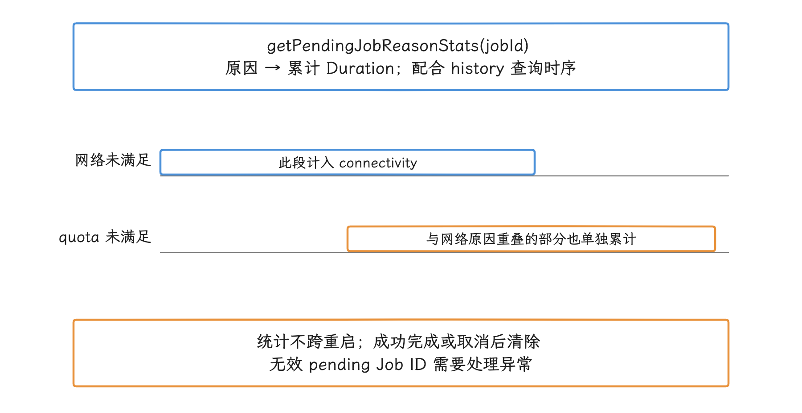

图：API 37 reason stats 累计每个原因的时长，重叠区间会分别计入；因此不能把各项直接相加当总等待。轨道是机制示意，不含虚构实测时长。

诊断时区分这几类：

- `PENDING_JOB_REASON_APP_STANDBY`：bucket 阻止执行。
- `PENDING_JOB_REASON_QUOTA`：当前 Job quota 已用完。
- `PENDING_JOB_REASON_DEVICE_STATE`：Doze、Battery Saver、内存或温度等设备状态。
- `PENDING_JOB_REASON_JOB_SCHEDULER_OPTIMIZATION`：JobScheduler 选择更合适的时间。
- 显式 constraint reason（约束原因）：充电、网络、存储、minimum latency（最短等待时间） 等业务约束未满足。

### 系统级后台限制

Doze 与 bucket 主要决定任务何时运行、可以运行多久。后台执行、后台界面和 while-in-use（仅使用期间授权）权限规则还会判断当前操作能否开始。

#### Background Activity Launch（后台 Activity 启动，BAL）

Android 10 / API 29 开始限制 Background Activity Launch。通知、full-screen intent（全屏通知意图）、系统角色和用户交互各有专门规则，FGS 通知本身不提供通用 BAL 豁免。

PendingIntent 与 IntentSender 的授权逐步改为 opt-in（显式选择启用）：

| 版本 | 变化 |
| --- | --- |
| target 34+ | PendingIntent 发送方不再默认授予自己的 BAL 能力；通过 `setPendingIntentBackgroundActivityStartMode()` 选择模式 |
| target 35+ | PendingIntent 创建方不再默认把自己的 BAL 能力交给接收方；通过 `setPendingIntentCreatorBackgroundActivityStartMode()` 授权 |
| API 36+ | 发送方优先使用 `MODE_BACKGROUND_ACTIVITY_START_ALLOW_IF_VISIBLE`；只有确有后台拉起需求时评估更宽模式 |
| target 37+ | `IntentSender.sendIntent()` 也要求发送方按 BAL 规则显式 opt-in |

授权链还必须包含一个原本就有后台启动资格的参与者，设置 mode 不会额外产生启动资格。可见 App 绑定服务并希望被绑定方拉起 Activity 时，Android 14+ 还要核对 `BIND_ALLOW_ACTIVITY_STARTS`。

<!-- gracker-diagram: ch11-01-38-bal-eligibility -->
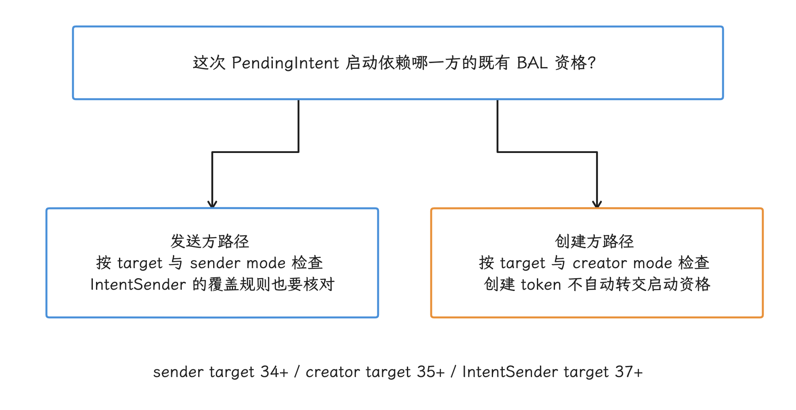

图：mode 不会凭空产生后台启动资格。按具体调用链分别核对 sender、creator、IntentSender 和平台例外，不能把双方开关简单当作通用双重授权公式。

#### 后台位置

- Android 8.0+：后台 App 通常每小时只能收到少量位置更新，此限制与 targetSdk 无关。
- Android 10+：权限语义上的后台位置访问需要 `ACCESS_BACKGROUND_LOCATION`。可见 Activity 或有效的 `location` FGS 使用前台定位权限（`ACCESS_COARSE_LOCATION` / `ACCESS_FINE_LOCATION`），界面退到后台也不会自动变成后台位置访问。
- Android 11+：从可见界面启动的 `location` FGS 属于 foreground location（前台定位），界面退到后台后仍可继续；App 已在后台才启动 FGS 时，没有 `ACCESS_BACKGROUND_LOCATION` 就拿不到位置。该权限也不免除后续版本的 FGS 后台启动限制。
- Android 14、target 34+：创建 `location` FGS 时立即校验类型权限与 while-in-use 条件。App 已在后台且不满足例外时，可能抛 `SecurityException` 或 FGS 启动异常。

地理围栏和 batched location（批量定位）可以减少 App 主动轮询，但绕不过权限和系统交付规则。

<!-- gracker-diagram: ch11-01-39-location-gates -->
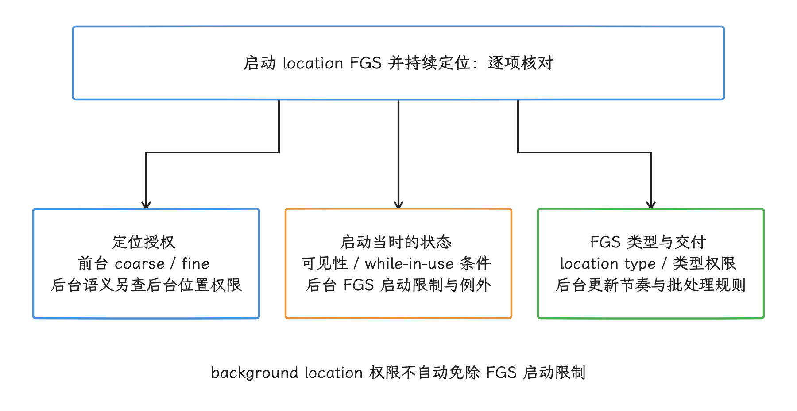

图：有效 location FGS 属于前台定位语义，界面退到后台不自动变成后台位置访问。App 已在后台启动时，还需分别满足适用后台定位权限与 FGS 启动条件。

#### 后台 Service 与 FGS

Android 8.0+ 对后台 Service 的创建和存活施加限制。可延迟任务交给 JobScheduler 或 WorkManager；用户知情的持续任务使用匹配类型的 FGS，并接受后台启动限制、类型权限和时长规则。

运行 FGS 并不会把 App 一直维持在 Active bucket。`AppStandbyController.reportEventLocked()` 有一个首次使用例外：App 尚在 Never bucket 时，`FOREGROUND_SERVICE_START` 事件会把它临时提升为 Active，其他 bucket 都不走这条提升路径。想拿 FGS 当 Doze、Job quota 或 while-in-use 权限的通用豁免是行不通的；Android 16 起与 FGS 并发的 Job 也受 runtime quota 约束。

<!-- gracker-diagram: ed11-01-bucket-classification-and-fgs-exception -->
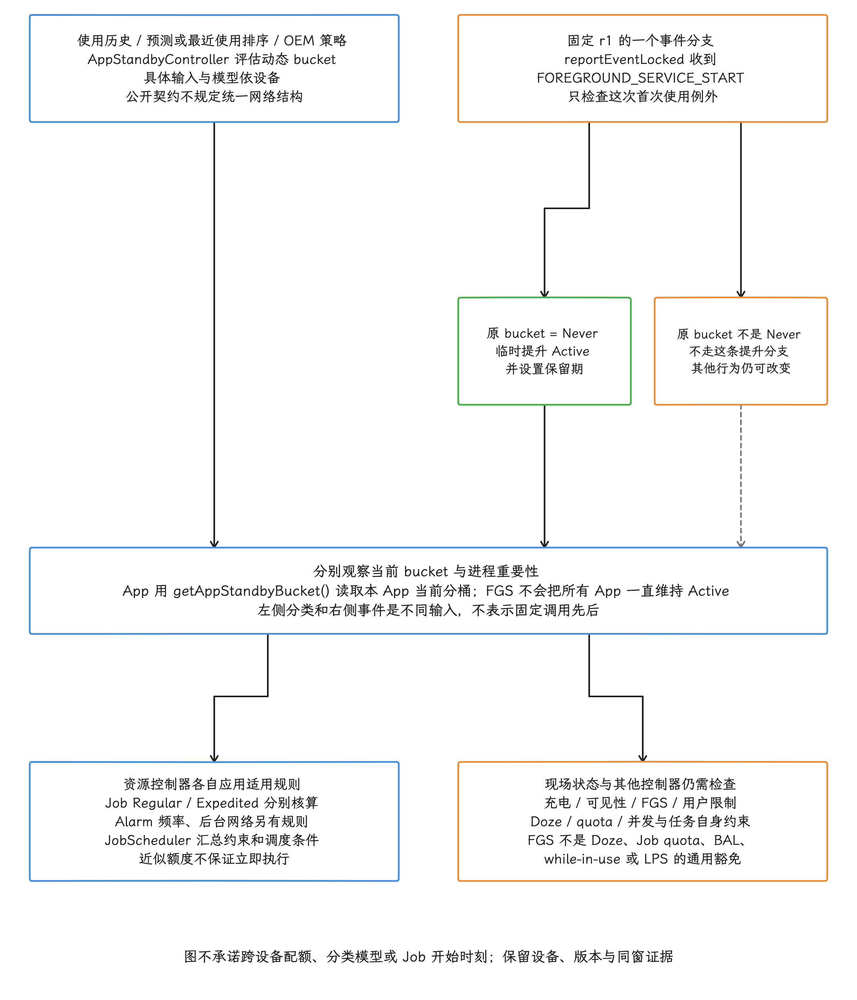

图：分类实现可预测、最近使用排序或OEM策略，不规定统一模型。右侧仅固定r1 reportEventLocked的FGS_START分支：原Never临时Active并设保留期，其他bucket不走此提升，但其他用户行为仍可改变。App读取自身当前bucket，另看进程重要性；各资源控制器结合Job普通/加急、Alarm、网络及充电/可见性/用户限制/Doze/并发和自身约束判断。近似配额不保证开始；FGS不维持所有App永远Active，也不是Doze、Jobquota、BAL、while-in-use、LPS通用豁免。

### Hibernation 与 Archiving

Hibernation（应用休眠）处理长期未用 App；Archiving（应用归档）也可由用户或安装器主动发起，不以长期未用为必要前提。两者都会影响后台可用性，但存储与恢复语义不同：

| 机制 | 平台起点 | 系统动作 | 恢复时要处理 |
| --- | --- | --- | --- |
| App hibernation | Android 11、target 30+ 提供权限自动重置；Android 12+ 设备且 target 31+ 扩展完整自动休眠 | 完整休眠会重置运行时权限、停止后台 Job/Alarm/Push，并清理缓存；只适用权限自动重置的场景不能套用全部效果 | 用户重新交互后退出休眠；权限不会自动恢复，旧 Job/Alarm 也不会自动重新调度 |
| App archiving | Android 15 提供 OS 级 archive/unarchive（归档/恢复） | 安装器移除 APK 与 cache，保留用户数据；Launcher（桌面启动器）可展示归档状态 | 用户点击后由负责的 installer（安装器）恢复包，再按安装/恢复路径初始化 |

Android 15 提供 `PackageInstaller.requestArchive()`，调用者需要 `DELETE_PACKAGES` 或 `REQUEST_DELETE_PACKAGES` 中的一项权限。结果异步交给 `statusReceiver`；若收到 `STATUS_PENDING_USER_ACTION`，还要等系统要求的用户确认走完，调用返回只说明流程开始。是否自动选择长期未用 App、由哪个商店恢复、图标如何显示，取决于安装器和设备体验；Google Play 的 auto-archive（自动归档） 策略是个例，其他 Android 15 设备按各自的实现走。

Hibernation 恢复后，App 应检查权限并重建必要任务。WorkManager 能帮助恢复一部分持久工作，依赖的 Alarm、通知和服务是否重新注册，还要业务自己验证。


### Battery Saver 与 Low Power Standby

#### Battery Saver 的全局策略

Battery Saver 是系统级省电模式。`PowerManagerService` 发布 low-power（低功耗） 状态，`BatterySaverController` 与 `BatterySaverPolicy` 计算各服务的策略。设备可以调整具体限制，所以 App 应读取公开状态并降低自身工作量：

- `PowerManager.isPowerSaveMode()` 判断 Battery Saver 是否开启。
- `ACTION_POWER_SAVE_MODE_CHANGED` 监听状态变化。
- `getLocationPowerSaveMode()` 返回当前定位节电策略，可能是屏幕关闭后停用 GNSS、停用全部 location provider（位置提供方）、只给前台 App、降低请求频率或不改变。

Battery Saver 并不会把所有 App 一律改成 Rare bucket。Job、Alarm、位置、网络、显示与性能策略会分别根据 low-power 状态调整，OEM 还能加入刷新率、性能上限或传感器策略。某项功能是否改变，应在目标 build（系统构建版本）上读取状态并测量。

#### Low Power Standby 的直接限制

Android 13 / API 33 公开 Low Power Standby（低功耗待机）状态。开启功能不等于限制此刻已经激活：固定 r1 的 `updateActiveLocked()` 还要求非交互、已过配置的 standby timeout，并检查维护窗口；`mActiveDuringMaintenance` 可改变维护期是否继续激活，调试强制状态另有分支。限制激活后，非豁免 App 的网络访问被禁用，WakeLock 被忽略，FGS 也不自动豁免。系统角色、ongoing call（进行中的通话）、临时 allowlist（允许列表）或设备 policy 可以提供例外（见 [固定 r1 控制器](https://android.googlesource.com/platform/frameworks/base/+/refs/tags/android-17.0.0_r1/services/core/java/com/android/server/power/LowPowerStandbyController.java)）。

App 可用 `isLowPowerStandbyEnabled()` 检查功能是否开启，并监听 `ACTION_LOW_POWER_STANDBY_ENABLED_CHANGED`。排查“FGS 明明活着却断网”时，我们先把 Low Power Standby 与 Doze、Data Saver 分开确认。

<!-- gracker-diagram: ch11-01-42-saver-vs-standby -->
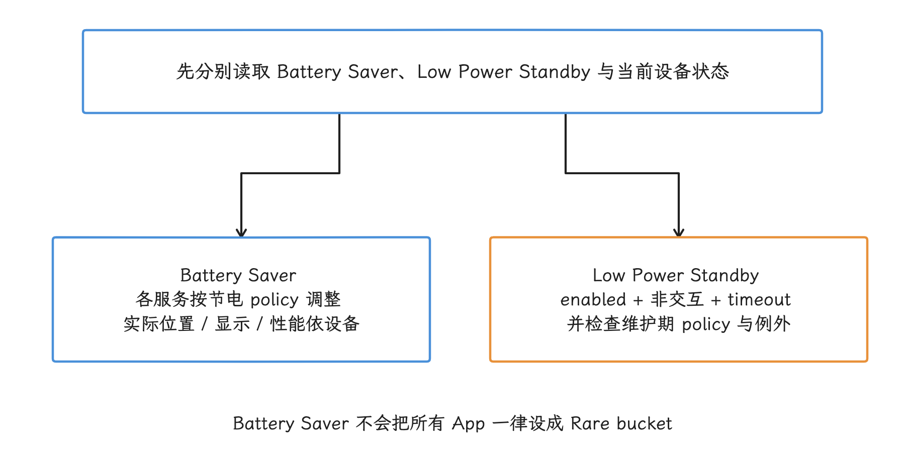

图：固定 r1 的 LPS enabled 不等于此刻 active；维护期可受配置影响，调试 force 分支另计。激活时非豁免 App 的网络与 WakeLock 受限，FGS 也在范围内。

#### Adaptive Battery 与 Routine Battery Saver

- Adaptive Battery 影响单个 App 的 bucket 分类，分类器可以使用预测或最近使用排序。
- Routine Battery Saver（按日常规律触发的省电模式）是 Android 10 的可选 OEM 集成。OEM 通过 `config_batterySaverScheduleProvider` 指定预装 provider，并预授予 `POWER_SAVER` 签名或特权权限，由它提供启用提示。官方要求只让一个 App 控制这组 API；多个控制者同时使用时，行为不受支持且没有定义。
- Adaptive Charging（自适应充电）属于电池健康与充电管理，设备实现可能根据日程、温度和电池状态控制充电。它与 App Standby、Battery Saver 分属不同机制，每台设备的充电曲线由具体实现决定。 [Pixel 官方说明](https://support.google.com/pixelphone/answer/6090612?hl=en)给出了按充电习惯调整满充时机的设备示例；不要把该示例当作全部 Android 设备的统一实现。

三项功能可能同时存在，观察入口分别是 bucket、low-power 状态，以及充电与 battery health（电池健康）服务。


#### Battery Saver 测试

下面的命令先保存 `low_power` 原值，再模拟设备断开电源并开启 Battery Saver；结束后分别恢复设置项和 BatteryService 的模拟状态。

```bash
low_power_before=$(adb shell settings get global low_power | tr -d '\r')
adb shell dumpsys battery unplug
adb shell settings put global low_power 1
adb shell dumpsys power
adb shell dumpsys jobscheduler com.example.app

# 测试结束后恢复显式修改的设置
if [ "$low_power_before" = "null" ]; then
    adb shell settings delete global low_power
else
    adb shell settings put global low_power "$low_power_before"
fi
adb shell dumpsys battery reset
adb shell dumpsys power
```

`battery reset` 不保证还原 `low_power` 设置项；实际 Battery Saver 状态还受充电和自动策略影响，要用最后的 `dumpsys power` 确认。性能基准要记录 Battery Saver、Low Power Standby、温度、充电和屏幕状态。CPU 频率下降或帧率变化属于设备结果，仅凭 `low_power=1` 预设不出固定幅度。


### OEM 功耗策略与设备差异

AOSP 允许厂商调整 bucket 分类和低功耗策略。ROM 还可能提供自启动、关联启动、后台活动、睡眠待机、冻结和用户白名单等设置，这些名称、默认值和行为会随品牌、机型、地区与系统版本改变。

社区站点 Don't Kill My App 适合发现兼容性线索，属于稳定的 API 契约之外的参考。文档中出现“十分钟后冻结”“某品牌默认禁止全部自启动”或固定排行时，必须给出机型、build、地区、设置状态和复现记录；缺少这些条件的数字应该删掉。

#### 区分几种容易混淆的现象

| 现象 | 进程与包状态 | 证据 |
| --- | --- | --- |
| Job 等待系统条件 | 进程可能不存在，包可正常启动 | Job pending reason、bucket、Doze、quota |
| OEM/内核冻结 | 进程可能仍在，但线程长时间不获调度 | vendor（厂商）日志、cgroup/freezer（控制组冻结）状态、sched trace（调度跟踪）；接口随设备变化 |
| 低内存回收 | 进程消失，系统有内存压力 | `ApplicationExitInfo`、lmkd/LMKD（低内存终止守护进程）日志、PSI（Pressure Stall Information，压力停顿信息）与内存 trace |
| force-stop（强制停止） | 包进入 stopped（已停止）状态，后台触发被阻断 | package/activity 状态、用户操作时间、重新点击图标后的恢复 |
| Android 13+ Task Manager 的“停止” | 整个 App 进程与 Activity 返回栈被移除，已调度的 Job 和 Alarm 仍可按原定时机交付 | 无停止回调；下次启动检查 `ApplicationExitInfo.REASON_USER_REQUESTED`，并用 `adb shell cmd activity stop-app com.example.app` 验证 |
| Hibernation | 长期未用，权限和后台任务被重置 | unused-app（未使用应用）设置、权限、Job/Alarm 与 push 状态 |
| Archiving | APK 被移除，用户数据保留 | Launcher/PackageInstaller 的 archive metadata（归档元数据）与 installer 状态 |

只凭 Perfetto 里“线程没有 runnable slice（处于可运行状态的时间段）”证明不了 OEM 冻结：线程可能正在 epoll（I/O 事件等待机制）中等待，Job 也可能尚未分发。判断冻结需要 ROM 侧状态或 vendor 日志支撑。


#### 兼容性测试方法

- 为每个目标机型记录 `ro.build.fingerprint`（系统构建标识）、地区、系统更新版本和电池设置。
- 同一 App 包与账号分别测试屏幕关闭、重启、充电、低电量、网络切换和多日不互动。
- 保存 `dumpsys jobscheduler`、`deviceidle`、`alarm`、`activity processes`、bucket、AppOps（应用操作与权限状态） 与设置页截图。
- 读取 `ApplicationExitInfo`，区分 low memory（低内存）、crash（崩溃）、ANR（应用无响应）、user requested（用户请求） 和其他退出原因。
- 推送测试记录服务端发送时间、设备到达时间、通知展示与用户交互；只记“收到/未收到”是定位不了问题的。
- 只有核心功能确受限制时才向用户解释设置入口；设置页面名称按设备动态展示，避免写成跨 ROM 固定路径。

<!-- gracker-diagram: ch11-01-46-delivery-time-evidence -->
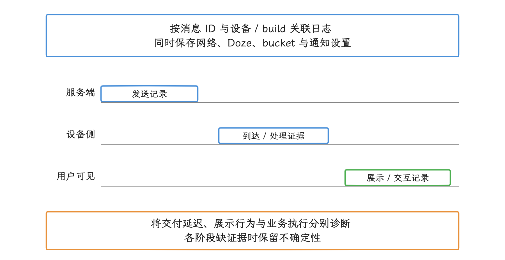

图：同一消息保存服务端发送、设备到达、通知展示与用户交互证据。轨道表示可独立观测的阶段，并不保证所有消息都有 App 回调或可见通知；时间基准必须先对齐。

删除系统包、禁用电源管理服务或要求所有用户打开“无限制”，都不适合作为产品修复：前两项会改变系统安全与兼容性，后一项会增加用户电量成本。

### 统一诊断：按控制器收集证据

| 需要回答的问题 | Framework 入口 | 调试入口 |
| --- | --- | --- |
| 设备是否在 Light/Deep Doze | `DeviceIdleController` | `dumpsys deviceidle` |
| App 属于哪个 bucket | `AppStandbyController`、`UsageStatsService` | `am get-standby-bucket`、`dumpsys usagestats appstandby` |
| Job 为什么等待 | `JobSchedulerService`、controllers（各约束控制器） | `dumpsys jobscheduler`、pending reason APIs |
| Battery Saver 是否生效 | `PowerManagerService`、`BatterySaverController` | `dumpsys power`、`settings get global low_power` |
| Low Power Standby 是否限制网络/WakeLock | `LowPowerStandbyController` | `dumpsys power`、PowerManager API |
| 后台界面为何被拒绝 | ActivityTaskManager BAL controller、`ActivityOptions` | ActivityTaskManager 日志、调用链与 opt-in mode |
| 是否进入 kernel suspend | SystemSuspend、kernel PM（内核电源管理） | Perfetto/ftrace `power/suspend_resume`、wakeup sources、CPU idle |

Perfetto 配置至少考虑 `sched/*`、`power/suspend_resume`、`power/cpu_idle`、`power/cpu_frequency`，再按问题加入 Binder、network 和 Framework `power`/`am` category（类别）。轨道名称和可用数据受 build 与厂商影响，`dumpsys` 快照与 trace 必须对应同一测试窗口。

### 复核清单

- 是否把 Doze 状态与 kernel suspend 分开确认？
- 是否同时检查 Light Doze、Deep Doze 和维护窗口？
- FGS 是否被错误地当成 Doze、Job quota 或 Low Power Standby 豁免？
- bucket 配额是否注明“近似指导值”，并记录充电与进程状态？
- Android 16+ 是否验证 top-started（从最前台状态启动）与 FGS 并发 Job 的 quota？
- Android 17 是否使用 pending reason stats 解释等待时间？
- Adaptive Battery 描述是否停留在公开契约，没有猜测模型结构？
- BAL 调用链是否按 sender、creator、IntentSender 与 targetSdk 分别检查？
- 后台位置是否同时满足权限、可见性、FGS type 和启动条件？
- Hibernation 与 Archiving 是否按权限、APK、数据和恢复语义区分？
- Battery Saver、Low Power Standby、Data Saver 与 Doze 是否分别取证？
- OEM 结论是否附机型、build、地区、设置和 trace/log？
- 测试结束后是否恢复 battery、deviceidle 与 AppOps 状态？

### 与其他章节的关系

§5.1–§5.2 解释 cpuidle（CPU 空闲管理）、cpufreq（CPU 频率管理） 与 EAS 的基础，§11.1 说明能量归因，§11.2 讨论 App 如何减少 WakeLock、Job、位置和网络开销。本节说明 Framework 策略与内核机制之间的关系：Framework 策略决定任务何时获得资源，内核与硬件决定设备能进入多深的低功耗状态。进程被回收时还要结合 §1.1，把 LMKD 与功耗限制区分开。

### 版本与实现边界

| 版本 | 系统级功耗与后台行为变化 |
| --- | --- |
| Android 6.0 / API 23 | Doze、App Standby、battery optimization exemption |
| Android 7.0 / API 24 | Light Doze；屏幕关闭且移动时也能应用较轻限制 |
| Android 8.0 / API 26 | 后台 Service、后台位置与隐式广播限制 |
| Android 9 / API 28 | App Standby Buckets、Adaptive Battery；定位节电 mode API |
| Android 10 / API 29 | BAL 限制、`ACCESS_BACKGROUND_LOCATION`、可选 Routine Battery Saver |
| Android 11 / API 30 | 未使用 App 权限自动重置；后台位置改为通过系统设置授予 |
| Android 12 / API 31 | Restricted bucket、App hibernation 完整效果、精确闹钟 special access |
| Android 13 / API 33 | Restricted 无互动阈值改为 8 天；Low Power Standby 公开 API；高优先级 FCM quota 与 bucket 脱离 |
| Android 14 / API 34 | PendingIntent 发送方 BAL opt-in；FGS type 与权限校验；Job pending reason API |
| Android 15 / API 35 | PendingIntent 创建方 BAL opt-in；OS 级 App Archiving；部分 FGS type 时长限制 |
| Android 16 / API 36 | Active bucket、top-started 和 FGS 并发 Job 受 runtime quota；多原因与历史 pending API |
| Android 17 / API 37 | `getPendingJobReasonStats()`；listener 型 exact allow-while-idle Alarm；`IntentSender.sendIntent()` BAL opt-in |

## 常见误区

### “设置页百分比就是应用的精确电量”

设置页使用归因结果，包含 measured energy、profile、controller activity 和共享资源分配，适合发现异常与比较排序；实验室级的绝对测量要靠外接仪表。

### “Coulomb Counter 能测出每个应用”

Coulomb Counter 面向整块电池，UID 结果来自 Framework 归因；两者可以对总趋势，互相替代不了。

### “CPU 使用率相同，耗电就相同”

CPU policy、频点、idle 进入、迁核、内存访问、WakeLock 和 thermal 状态都会改变能量。CPU time 只是归因输入之一。

### “GPU rail 就是某个游戏的 GPU 电量”

rail 是设备级计量点，可能包含共享电源域。应用 trace 可以帮助时间关联，自动排除不了系统 compositor（画面合成器）、其他进程和共享模块的影响。

### “PowerMonitor delta 就是电池掉电”

PowerMonitor 可能返回直接测量的 rail measurement（直接测量值），或模型估算的 modeled consumer（模型估算的逻辑组件），累计值还包含插电期间。电池 charge、rail energy 与 BatteryUsageStats mAh 的范围各不相同。

## 参考资料

- [AOSP Power Profiles](https://source.android.com/docs/core/power)
- [AOSP Power Values](https://source.android.com/docs/core/power/values)
- [Android Studio Power Profiler 与 ODPM](https://developer.android.com/studio/profile/power-profiler)
- [SystemHealthManager](https://developer.android.com/reference/android/os/health/SystemHealthManager)
- [PowerMonitor](https://developer.android.com/reference/android/os/PowerMonitor)
- [PowerMonitorReadings](https://developer.android.com/reference/android/os/PowerMonitorReadings)
- [固定 r1 PowerStatsService：缓存、权限与返回值扰动](https://android.googlesource.com/platform/frameworks/base/+/refs/tags/android-17.0.0_r1/services/core/java/com/android/server/powerstats/PowerStatsService.java)
- [Firebase AndroidConfigV2 迁移与 EAP 说明](https://firebase.google.com/docs/cloud-messaging/send/v2-api)
- [BatteryManager：电池属性、单位与返回值](https://developer.android.com/reference/android/os/BatteryManager)
- [Perfetto traced_probes：android.power](https://perfetto.dev/docs/reference/traced_probes)
- [Battery Historian](https://github.com/google/battery-historian)
- [Batterystats 与 Battery Historian：含维护状态警告](https://developer.android.com/topic/performance/power/setup-battery-historian)

### 官方与 API 文档

- [Optimize for Doze and App Standby](https://developer.android.com/training/monitoring-device-state/doze-standby)
- [App Standby Buckets](https://developer.android.com/topic/performance/appstandby)
- [Power management resource limits](https://developer.android.com/topic/performance/power/power-details)
- [Test power-related issues](https://developer.android.com/topic/performance/power/test-power)
- [AOSP：Platform power management with Doze](https://source.android.com/docs/core/power/platform_mgmt)
- [AOSP：Power management](https://source.android.com/docs/core/power/mgmt)
- [AOSP：App background behavior trackers](https://source.android.com/docs/core/power/trackers)
- [AOSP：Routine Battery Saver](https://source.android.com/docs/core/power/routine-battery-saver)
- [PowerManager API](https://developer.android.com/reference/android/os/PowerManager)
- [JobScheduler API](https://developer.android.com/reference/android/app/job/JobScheduler)
- [AlarmManager API](https://developer.android.com/reference/android/app/AlarmManager)
- [Android 17 features and APIs](https://developer.android.com/about/versions/17/features)
- [Secure background activity launches](https://developer.android.com/guide/components/activities/secure-bal)
- [Background FGS start restrictions](https://developer.android.com/develop/background-work/services/fgs/restrictions-bg-start)
- [用户在 Task Manager 停止 FGS 应用后的行为](https://developer.android.com/develop/background-work/services/fgs/handle-user-stopping)
- [Background location](https://developer.android.com/develop/sensors-and-location/location/background)
- [Request location permissions：前台定位与后台定位的边界](https://developer.android.com/develop/sensors-and-location/location/permissions)
- [Background execution limits](https://developer.android.com/about/versions/oreo/background)
- [App hibernation](https://developer.android.com/topic/performance/app-hibernation)
- [Android 15 App archiving](https://developer.android.com/about/versions/15/features#app-archiving)

#### Android 17 源码锚点

- [BatteryManager.java](https://android.googlesource.com/platform/frameworks/base/+/refs/tags/android-17.0.0_r1/core/java/android/os/BatteryManager.java)
- [CPU 归因处理器](https://android.googlesource.com/platform/frameworks/base/+/refs/tags/android-17.0.0_r1/services/core/java/com/android/server/power/stats/processor/CpuPowerStatsProcessor.java)
- [x86 CpuCyclePerUidCollector.java](https://android.googlesource.com/platform/frameworks/base/+/refs/tags/android-17.0.0_r1/services/core/java/com/android/server/power/stats/CpuCyclePerUidCollector.java)
- [AudioPowerStatsProcessor.java](https://android.googlesource.com/platform/frameworks/base/+/refs/tags/android-17.0.0_r1/services/core/java/com/android/server/power/stats/processor/AudioPowerStatsProcessor.java)
- [VideoPowerStatsProcessor.java](https://android.googlesource.com/platform/frameworks/base/+/refs/tags/android-17.0.0_r1/services/core/java/com/android/server/power/stats/processor/VideoPowerStatsProcessor.java)
- [PackageInstaller.requestArchive()](https://developer.android.com/reference/android/content/pm/PackageInstaller#requestArchive(java.lang.String,android.content.IntentSender))
- [IPowerStats.aidl](https://android.googlesource.com/platform/hardware/interfaces/+/refs/tags/android-17.0.0_r1/power/stats/aidl/android/hardware/power/stats/IPowerStats.aidl)
- [DeviceIdleController.java](https://cs.android.com/android/platform/superproject/+/android-17.0.0_r1:frameworks/base/apex/jobscheduler/service/java/com/android/server/DeviceIdleController.java)
- [AppStandbyController.java](https://cs.android.com/android/platform/superproject/+/android-17.0.0_r1:frameworks/base/apex/jobscheduler/service/java/com/android/server/usage/AppStandbyController.java)
- [JobSchedulerService.java](https://cs.android.com/android/platform/superproject/+/android-17.0.0_r1:frameworks/base/apex/jobscheduler/service/java/com/android/server/job/JobSchedulerService.java)
- [QuotaController.java](https://cs.android.com/android/platform/superproject/+/android-17.0.0_r1:frameworks/base/apex/jobscheduler/service/java/com/android/server/job/controllers/QuotaController.java)
- [JobScheduler.java](https://cs.android.com/android/platform/superproject/+/android-17.0.0_r1:frameworks/base/apex/jobscheduler/framework/java/android/app/job/JobScheduler.java)
- [PowerManagerService.java](https://cs.android.com/android/platform/superproject/+/android-17.0.0_r1:frameworks/base/services/core/java/com/android/server/power/PowerManagerService.java)
- [LowPowerStandbyController.java](https://cs.android.com/android/platform/superproject/+/android-17.0.0_r1:frameworks/base/services/core/java/com/android/server/power/LowPowerStandbyController.java)
- [BatterySaverController.java](https://cs.android.com/android/platform/superproject/+/android-17.0.0_r1:frameworks/base/services/core/java/com/android/server/power/batterysaver/BatterySaverController.java)
- [BatterySaverPolicy.java](https://cs.android.com/android/platform/superproject/+/android-17.0.0_r1:frameworks/base/services/core/java/com/android/server/power/batterysaver/BatterySaverPolicy.java)
- [ActivityOptions.java](https://cs.android.com/android/platform/superproject/+/android-17.0.0_r1:frameworks/base/core/java/android/app/ActivityOptions.java)

#### Android 17 Kernel 锚点

- [kernel/power/suspend.c](https://android.googlesource.com/kernel/common/+/android17-6.18-2026-06_r6/kernel/power/suspend.c)
- [kernel/sched/idle.c](https://android.googlesource.com/kernel/common/+/android17-6.18-2026-06_r6/kernel/sched/idle.c)
- [drivers/base/power/wakeup.c](https://android.googlesource.com/kernel/common/+/android17-6.18-2026-06_r6/drivers/base/power/wakeup.c)

#### OEM 行为线索

- [Don't Kill My App](https://dontkillmyapp.com/)：社区维护的设备行为记录，只用于兼容性线索，结论需在目标 build 复测
