# App 耗电优化与案例

我们治理应用耗电，先从场景、时间窗口和组件活动入手，再逐项检查 WakeLock、Alarm、网络、定位、动画和后台任务，最后在相同设备状态和业务负载下复测修复结果。

## 机制、系统边界与排查

### 从系统行为理解 App 耗电

我们从一个基本事实开始：App 并不直接决定电池消耗多少。它提交工作、请求硬件资源、保持设备唤醒，剩下的交给系统：调度器、HAL（硬件抽象层） 和驱动负责完成这些请求。所以拿到一个耗电问题时，我们先检查四件事：

- **设备被唤醒多久**：WakeLock、Alarm、Job、FGS（Foreground Service，前台服务）有没有延长 CPU 活跃时间。
- **哪些硬件保持工作**：GNSS（全球导航卫星系统）、蜂窝网络、Camera、麦克风、编解码器有没有超出业务生命周期。
- **单位工作量有多大**：采样频率、分辨率、上传字节数、重试次数是否与用户功能匹配。
- **工作能否延后或合并**：可延迟任务交给系统批处理，用户正在等待的任务保留及时性。

这些检查都要落到具体设备上。电流值脱离设备、网络、屏幕、温度和测量窗口就没有可比性：同一段代码跑在两款手机上，底层可能是不同的 modem（蜂窝基带）、GNSS、codec（编解码器） 和调度策略。所以工程判断要看目标设备的时间线和能量数据，某款设备上的一次测试结果只对那台设备成立。

<!-- gracker-diagram: ch11-02-01-request-to-hardware -->
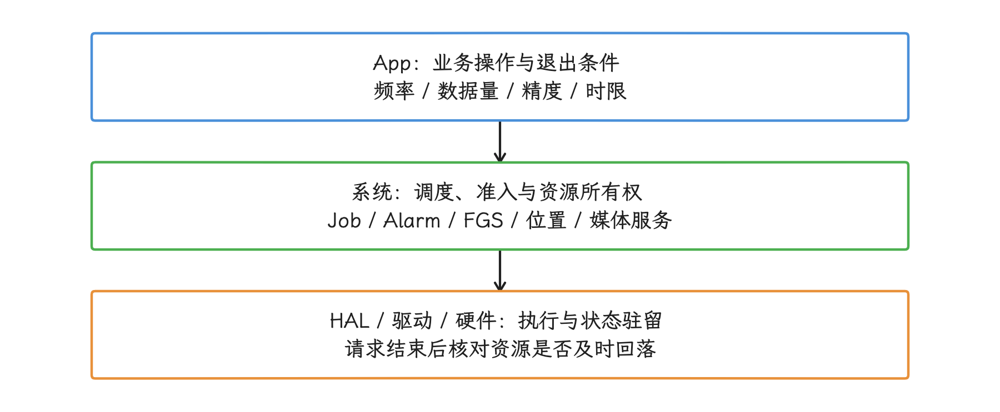

图：应用参数影响工作量与资源活动，但硬件功率还依设备、信号、温度和系统策略变化。图是职责链，不是统一能量公式。

#### 先选合适的执行机制

| 业务性质 | 建议入口 | 必须接受的系统边界 |
| --- | --- | --- |
| 用户正在界面里等待 | 协程、线程池或进程内异步任务 | 页面退出时取消无用工作，耗时工作不能阻塞主线程 |
| 可延迟、要求进程重启后继续 | WorkManager；平台组件可直接用 JobScheduler | 受约束、配额、standby bucket（应用待机分组）和 Doze（设备空闲省电模式）影响，执行时间不精确 |
| 用户要求在某个时刻收到提醒 | AlarmManager | 优先不精确闹钟；精确闹钟有权限和使用场景限制 |
| 用户知情的持续任务 | 对应类型的前台服务 | 需要持续通知、启动豁免、类型权限，部分类型有时长限制 |
| 服务端有新事件才处理 | FCM（Firebase Cloud Messaging）或业务推送通道 | 优先级必须符合用户可见性，离线与厂商环境要有降级方案 |

入口选好之后，系统还剩多少合并和延后的空间就基本定了。我们如果把普通同步放进精确闹钟或长期 FGS，等于主动放弃大量省电机会。

<!-- gracker-diagram: ch11-02-02-execution-contract -->
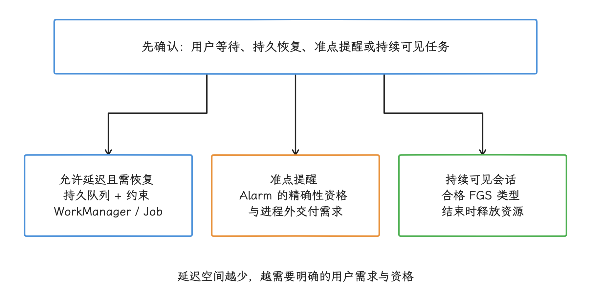

图：图聚焦三类跨页面任务；界面内即时操作仍由进程内异步处理。推送只是事件入口，后续执行仍需符合平台条件。

#### Doze 与前台服务

Doze 会延后普通网络访问、Job 和 Alarm，攒到 maintenance window（维护窗口）里批量执行。有些实现以为前台服务一开，网络和 Job 就能一直畅通，但 FGS 免不了同进程 Job 的配额，也拿不到设备级的 Doze 豁免；抱着这种假设的应用，在熄屏静置测试里很容易暴露问题。

<!-- gracker-diagram: ch11-02-03-fgs-not-idle-exemption -->
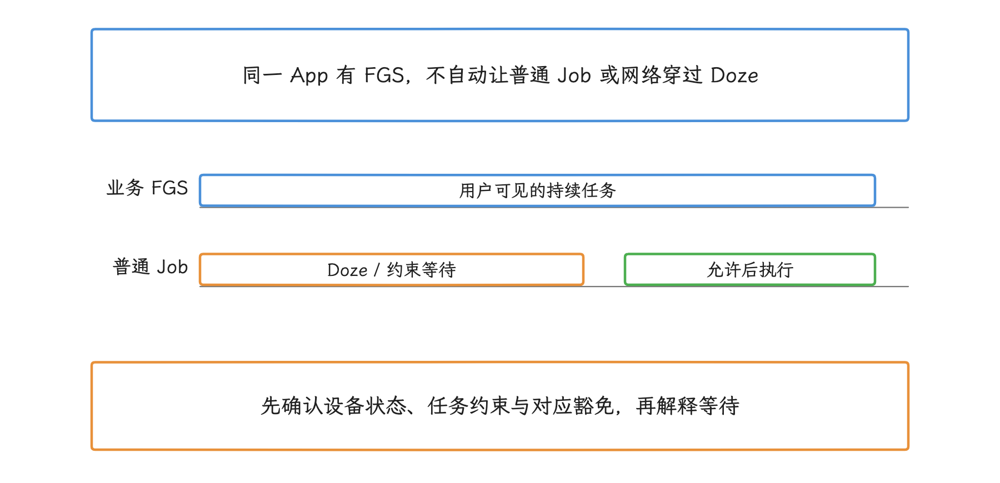

图：轨道只示意独立判断，无固定维护窗口或等待长度。FGS 不自动豁免 Doze；Android 16 起与 FGS 并发的相关 Job 也受 runtime quota。

### WakeLock 的适用窗口

`PARTIAL_WAKE_LOCK` 在策略允许时阻止系统因空闲而挂起，屏幕仍可关闭；它不要求 CPU 持续执行指令，也不承诺频率或网络可用。旧的 `SCREEN_DIM_WAKE_LOCK`、`SCREEN_BRIGHT_WAKE_LOCK` 和 `FULL_WAKE_LOCK` 已废弃；Activity 需要防止屏幕熄灭时，应使用 `FLAG_KEEP_SCREEN_ON` 或 `View.setKeepScreenOn()`，这样界面不可见后系统能恢复正常屏幕策略。

直接持锁之前，先看高层 API 是否已经代劳：WorkManager、JobScheduler、媒体、位置和下载这些 API，已经在各自的执行窗口内管理唤醒条件。只有高层 API 无法覆盖、且业务确实需要阻止挂起的受控执行区间，才评估直接持锁。锁要有单一所有者、稳定且不含隐私的 tag、由业务截止时间推导的超时，并在 `finally` 中释放；超时只是故障保护，替代不了正常释放。

客户端对象显示 held（已持有），只说明应用侧还握着这把锁。它当前是否生效，还要往下看几层：App tag、PowerManagerService 的 suspend（系统挂起） blocker（系统休眠阻止项）、SystemSuspend 和内核 `wakeup_source`（唤醒源），这些层级之间没有一一对应关系。这条链路的源码调用链、安全示例，Doze/LPS（Low Power Standby，低功耗待机）下的适用范围，以及 Android Vitals 的统计口径与逐层排障方法，统一见 [11.3 WakeLock 机制与功耗分析](03-wakelock.md)。

<!-- gracker-diagram: ch11-02-04-wakelock-owner -->
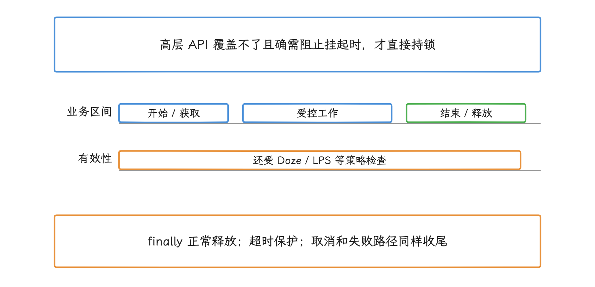

图：持锁不代表 CPU 始终忙碌、网络可用或必然阻止所有休眠路径。客户端 held 与系统实际 blocker、内核 wakeup source 不是一对一关系。

### WorkManager 与 JobScheduler：把延迟空间交给系统

WorkManager 适合需要可靠完成、允许延迟、进程重启后还要继续的工作；JobScheduler 是平台原生调度器，系统组件、不引入 Jetpack 的项目或需要平台能力的代码可以直接用。本文 WorkManager 契约核对到 2.12.0（2026-09-23 发布，最低 API 24）；文章覆盖 API 21–37 不代表当前库仍支持所有旧平台。内部调度器随库版本与设备变化，应用依赖公开契约；持久化任务也仍需可重入、能响应取消，不能承诺任何环境下都准时完成。

#### 约束表达的是业务条件

下面的 Kotlin 示例把大文件上传限制在充电且网络不计费的环境，并让失败任务指数退避。等待时长是产品选择的常量，方便测试和统一调整。

```kotlin
private const val UPLOAD_RETRY_DELAY_SECONDS = 30L

val uploadConstraints = Constraints.Builder()
    .setRequiresCharging(true)
    .setRequiredNetworkType(NetworkType.UNMETERED)
    .build()

val upload = OneTimeWorkRequestBuilder<UploadWorker>()
    .setConstraints(uploadConstraints)
    .setBackoffCriteria(
        BackoffPolicy.EXPONENTIAL,
        UPLOAD_RETRY_DELAY_SECONDS,
        TimeUnit.SECONDS
    )
    .build()

WorkManager.getInstance(context).enqueueUniqueWork(
    "pending-media-upload",
    ExistingWorkPolicy.KEEP,
    upload
)
```

`UNMETERED` 的判断依据是 `ConnectivityManager` 报告的网络是否计费，跟 Wi‑Fi 没有绑定关系：某些 Wi‑Fi 可能被标记为计费，某些蜂窝套餐或设备环境也可能被标记为不计费。业务只需要联网时，用 `CONNECTED` 就够了；多加的约束只会推迟任务，还可能让积压工作在条件满足时集中执行。

<!-- gracker-diagram: ch11-02-05-constraints-and-stop -->
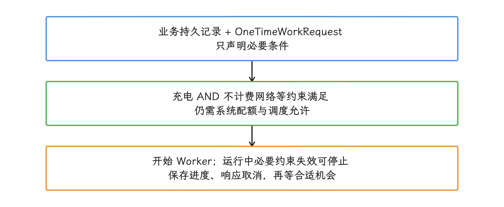

图：示例条件是充电与不计费网络，不是 Wi-Fi。条件满足不构成立即执行承诺；可靠恢复仍需应用处理重复与中止。

#### 周期、加急与唯一工作

- `PeriodicWorkRequest` 的最小重复间隔为 15 分钟。这是请求下限，系统可以因为约束、Doze、配额或 standby bucket 延后某一轮，也不承诺固定相位。
- flex window（弹性窗口）允许系统在周期尾部选择执行时间，适合对时刻不敏感的刷新。

- Expedited work（加急工作）面向用户刚触发、需要尽快开始的短工作，受 expedited（加急） quota（加急配额） 和 `OutOfQuotaPolicy` 约束。
- 唯一工作按名称与策略处理已有链；例如 `KEEP` 遇到同名 `ENQUEUED` 或 `RUNNING` 工作会忽略新请求，不会合并新输入。能合并的上报、清理、索引操作应在业务层保存待处理记录。

- `Result.retry()` 只用于可恢复错误。鉴权失败、参数错误等永久失败继续重试，只会重复唤醒设备和服务器。

<!-- gracker-diagram: ch11-02-07-period-flex -->
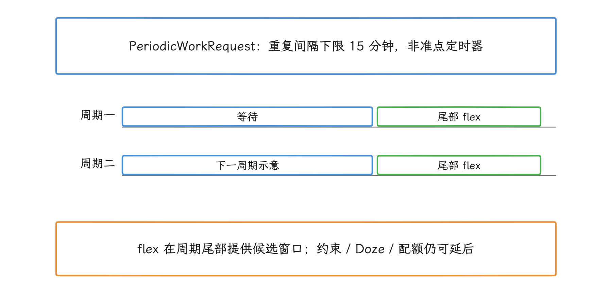

图：两条是不同周期的局部示意，不共用绝对时间轴。没有画出固定相位或保证每个窗口都执行；业务时刻敏感时不能把最小周期当 SLA。
<!-- gracker-diagram: ch11-02-06-keep-running -->
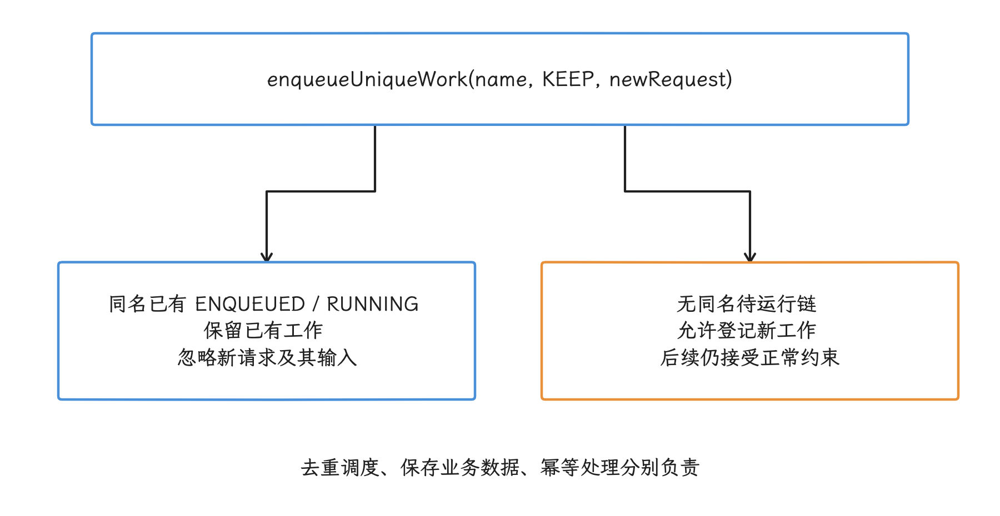

图：图依据 WorkManager 2.12.0 的 EnqueueRunnable。唯一调度不合并业务输入，也不保证业务只处理一次；数据先进入持久存储。
`PerformanceHintManager.Session.setPreferPowerEfficiency(true)` 是 Android 15+ 对正在运行线程的能效提示，属于 ADPF（Android Dynamic Performance Framework）能力。它不参与 WorkManager 排队，也不保证绑定到某类 CPU；设备是否采纳提示由系统和 Power HAL 决定。计算密集型代码想用它，先在实机上做 A/B 验证。

<!-- gracker-diagram: ch11-02-08-adpf-scheduler -->
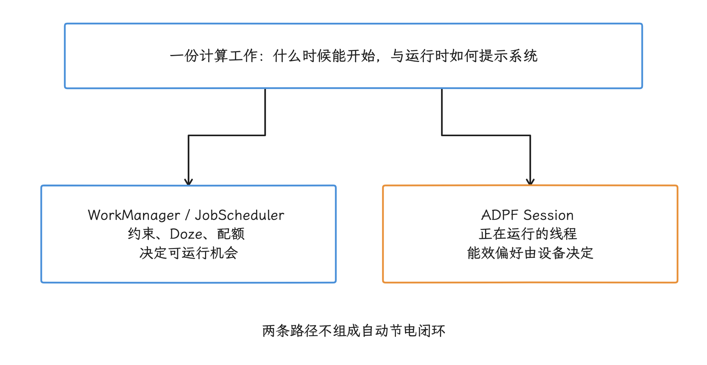

图：setPreferPowerEfficiency 从 API 35 提供，不参与 WorkManager 入队，不绑定特定 CPU；真实性能和能量效果要在支持设备验证。

#### Android 16 的 Job runtime quota

Android 16（API 36）调整了 regular 与 expedited job（加急任务） 的运行时配额：

- 在 App 处于 top state（最前台状态）时启动、界面消失后继续运行的 job，要遵守 job runtime quota（运行时长配额）。
- 与 FGS 并发执行的 job，也要遵守 job runtime quota。
- WorkManager、JobScheduler 和 DownloadManager 调度的相关工作都受影响。

这两套限制各自独立：FGS 的类型时长是一套，JobScheduler 的 runtime quota 是另一套，平台没有“Job 与 FGS 共用一个预算”的规则。用户发起的大文件传输可评估 user-initiated（用户发起） data transfer job（用户发起的数据传输任务）；它有专门的资格条件和配额语义，属于专用通道。

<!-- gracker-diagram: ch11-02-09-independent-budgets -->
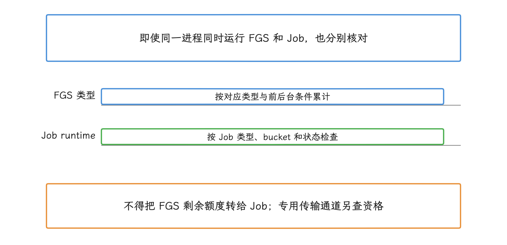

图：轨道说明独立预算，不按比例。Android 16 对相关 top-started 和 FGS 并发 Job 的配额变化，不代表 FGS 与 Job 共享一份时间池。

排查任务为何延迟或中止时，WorkManager 通过 `WorkInfo.getStopReason()` 提供原因，直接使用 JobScheduler 时则读取 `JobParameters.getStopReason()`。Android 16 还提供 `JobScheduler.getPendingJobReasonsHistory()`，用于查看任务没有运行的历史原因。

### AlarmManager：精确性有明确成本

AlarmManager 管的是进程生命周期之外的时间事件；普通同步、清理和重试更适合 WorkManager。用户能接受时间窗口时，我们选 `set()`、`setWindow()`、`setAndAllowWhileIdle()` 或不精确重复闹钟，给系统留下合并唤醒的机会。

#### 精确闹钟权限与例外

Android 12（API 31）引入 “Alarms & reminders” special app access（特殊应用访问权限）。Android 13+ 可根据受限使用场景选择 `SCHEDULE_EXACT_ALARM` 或 `USE_EXACT_ALARM`：

| 能力 | 授权方式 | 适用边界 |
| --- | --- | --- |
| `SCHEDULE_EXACT_ALARM` | 用户授予，也可被用户或系统撤销 | 使用面较宽；调用前检查 `canScheduleExactAlarms()` |
| `USE_EXACT_ALARM` | 安装时自动授予，用户不可撤销 | 只允许闹钟、计时器、日历等受限核心场景，并受 Google Play 政策约束 |

Android 14 对 target 33+ 的多数新安装应用不再预授予 `SCHEDULE_EXACT_ALARM`；备份恢复到 Android 14 设备时也按拒绝处理。已有授权随系统升级通常会保留。

`AlarmManager.OnAlarmListener` 形式的 `setExact()` 是个例外：它不要求 `SCHEDULE_EXACT_ALARM`。代价是回调活在进程里——进程退出后，系统不会为此重新创建 App。需要跨进程生命周期的可靠触发，通常用 `PendingIntent`（可由系统代应用执行的预封装操作），并遵守精确闹钟权限规则。这个例外服务于进程内存活期的精确回调，后台保活不在其列。

<!-- gracker-diagram: ch11-02-10-alarm-process-lifetime -->
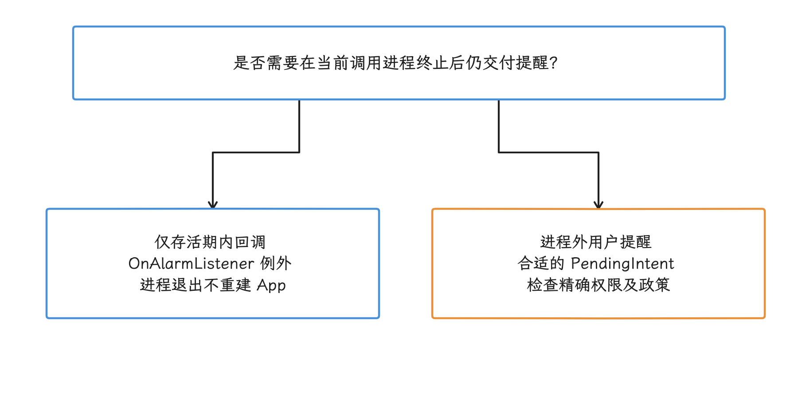

图：Listener 的 setExact 不要求 SCHEDULE_EXACT_ALARM，但依赖存活组件。PendingIntent 交付也仍受重启、权限、平台与业务恢复设计约束，不代表任意环境绝不丢失。

#### Doze 与 allow-while-idle

- `setAlarmClock()` 面向用户可见闹钟，系统会为交付离开低功耗模式。
- `setExactAndAllowWhileIdle()` 能穿过 Doze，但受到严格频率限制。
- `setAndAllowWhileIdle()` 允许在空闲状态交付不精确闹钟。
- 普通 Alarm 在 Doze 中可能延后到 maintenance window。

allow-while-idle 会按应用限频，实际交付还受设备状态和平台配额影响。Doze 指南中的“每应用九分钟”描述空闲限制；`AlarmManager` API 则以正常运行约一分钟、空闲时可能显著更长（如十五分钟）说明节流。它们的适用状态不同，这些量级也不是准点 SLA 或推荐轮询周期。闹钟回调只安排短操作；需要持久执行时，把后续工作交给 JobScheduler 或 WorkManager，并接受相应网络、Doze 和配额限制。

<!-- gracker-diagram: ch11-02-11-alarm-three-axes -->
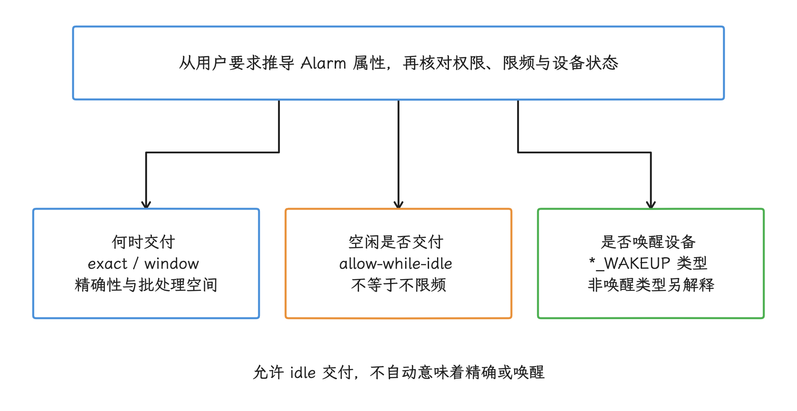

图：九分钟的 Doze 指南量级不能改写成正常运行条件；API 的约一分钟与空闲可能十五分钟也不是统一固定常量或轮询建议。

### 前台服务的运行限制

FGS 用持续通知表达用户知情的长任务，并提高进程重要性；Doze、Job quota（任务配额）、网络限制和硬件资源管理一样都管得到它。Android 14（target 34+）要求服务类型、类型权限和运行时前置条件同时成立：

- 未声明 `android:foregroundServiceType` 可能触发 `MissingForegroundServiceTypeException`。
- 缺少 `FOREGROUND_SERVICE_*` 权限，或 location、camera、microphone 等 while-in-use（仅使用期间允许） 条件不满足，可能触发 `SecurityException`。
- App 已在后台且不满足 FGS 启动豁免时，可能触发 `ForegroundServiceStartNotAllowedException`。

判读日志时，我们先把声明、权限、启动资格分开：三个异常各自指向不同的修复位置。

<!-- gracker-diagram: ch11-02-12-fgs-three-gates -->
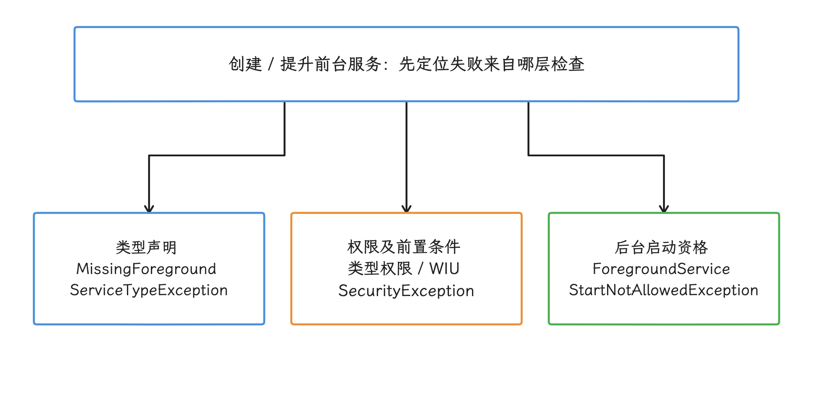

图：类型要求、权限条件和后台启动资格不是相互替代的许可；图以 target 34+ 适配场景概括，不代替各类型完整要求。

#### Android 14 与 Android 15 的超时

| 类型 | 平台限制 | 超时回调 | 未及时停止 |
| --- | --- | --- | --- |
| `shortService` | Android 14+，约三分钟 | `Service.onTimeout(int)` | 系统触发 ANR；系统不会代替服务自动完成 `stopSelf()` |
| `dataSync` | target 35+，后台状态下每 24 小时累计六小时 | `Service.onTimeout(int, int)` | 几秒内不停止会抛内部远程服务异常并终止进程 |
| `mediaProcessing` | target 35+，后台状态下每 24 小时累计六小时 | `Service.onTimeout(int, int)` | 与 `dataSync` 相同 |

六小时按类型分别计时，同一 App 的多个同类型服务共享该类型额度。用户把 App 带到前台会重置计时器。额度耗尽后继续启动同类型服务会收到 `ForegroundServiceStartNotAllowedException`。

`android-17.0.0_r1` 的 `ActiveServices.getTimeLimitedFgsType()` 把 `dataSync` 与 `mediaProcessing` 纳入此路径；宽限期结束后，`onFgsCrashTimeout()` 通过 `ForegroundServiceDidNotStopInTimeException` 终止宿主进程。`shortService` 走的是独立的 ANR（应用无响应） timer（超时计时器）。两条超时路径的表象相近，排查时要分开对待。

<!-- gracker-diagram: ch11-02-13-fgs-timeout-paths -->
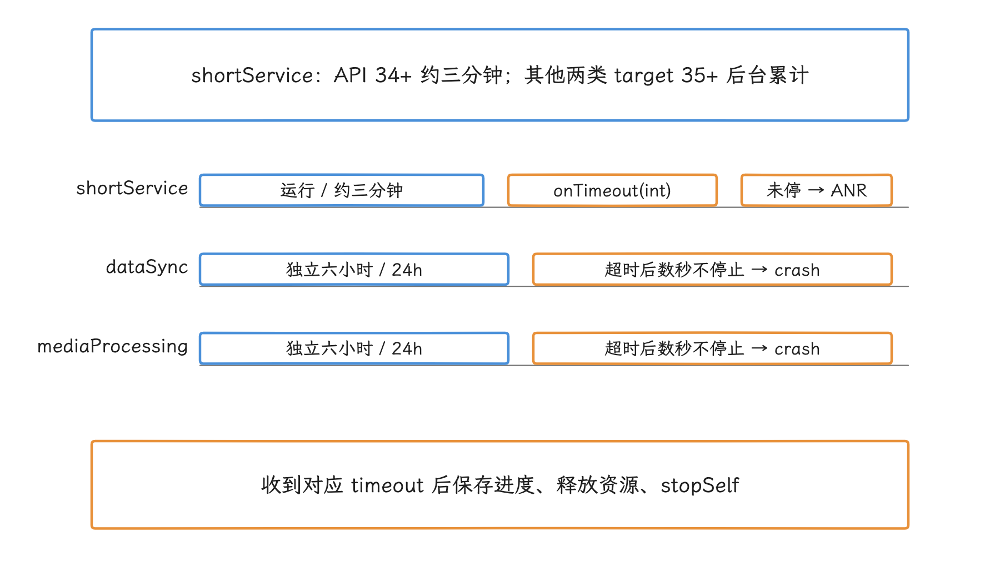

图：条宽不按时长比例；六小时按类型分别计，同 App 同类型共享，用户带到前台会重置。混合声明类型的源码选择还需看 getTimeLimitedFgsType，不把图当完整多类型算法。

收到超时回调，我们要做的事只有三件：保存进度、释放资源、停止服务。数据同步可以评估 WorkManager、user-initiated data transfer job 或 DownloadManager，选了哪个，就要接受哪个的调度和配额规则。

#### Android 17 后台音频

Android 17（API 37）把后台播放、音频焦点请求和音量修改纳入音频 hardening（限制强化）：

- 所有运行在 Android 17 上的 App，无论 targetSdk，都要有可见 Activity，或正在运行一个类型不是 `shortService` 的 FGS，才能进行这些后台音频交互。
- target 37 的 App 在后台还要求该 FGS 具有 while-in-use（WIU，仅使用期间允许）能力。通常由用户操作或 App 可见状态下启动的 FGS 获得。

- App 具有精确闹钟权限并操作 `USAGE_ALARM` 音频流时，WIU 要求可豁免；前一条“可见 Activity 或非 shortService FGS”仍然存在。

<!-- gracker-diagram: ch11-02-14-audio-two-gates -->
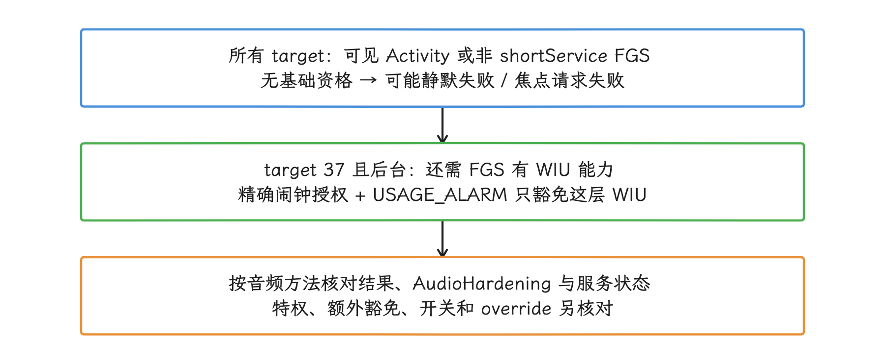

图：图是普通 App 的公开默认规则。音频焦点、播放与音量修改的源码入口并不完全相同；闹钟音频例外不能跳过前面的基础资格。
条件不满足时，播放和音量 API 可能静默失败，音频焦点请求返回 `AUDIOFOCUS_REQUEST_FAILED`。我们用 `adb dumpsys audio`，或在 logcat 里搜 `AudioHardening`：`level: partial` 表示没有运行 FGS，`level: full` 表示 FGS 缺少 WIU 能力。系统实现可对照 `AudioService.java` 与 `HardeningEnforcer.java`。以上是普通应用的公开默认规则；系统特权、部分操作的豁免、功能开关与调试 override 还要按具体方法核对，不能把这两级检查当成源码所有分支的全集。

媒体播放服务仍需声明 `mediaPlayback` 类型及对应权限。播放永久结束、收到不可恢复的焦点丢失或用户明确停止后，应关闭播放器、media session 和 FGS。

### 位置服务：priority 与请求参数

Fused Location Provider（融合位置提供方）的 priority 表达精度与功耗偏好，公开契约没有规定固定传感器组合或固定精度：

| Priority | 契约含义 | 合适的业务 |
| --- | --- | --- |
| `PRIORITY_HIGH_ACCURACY` | 偏向高精度，可能增加功耗 | 用户可见导航、运动轨迹、一次高精度确认 |
| `PRIORITY_BALANCED_POWER_ACCURACY` | 在精度与功耗之间平衡 | 城市天气、附近内容、非连续位置感知 |
| `PRIORITY_LOW_POWER` | 偏向低功耗，允许降低精度 | 对误差容忍度较高的低频场景 |
| `PRIORITY_PASSIVE` | 只接收其他客户端产生的位置，不为本请求额外计算 | 辅助更新、维护缓存时效性 |

高精度请求不保证 GNSS 一定启用，平衡模式也不保证只用 Wi‑Fi 和基站——系统设置、权限、设备能力、环境和其他客户端都会改变最终结果。所以我们拿到位置后，先看它的 `accuracy` 和时间戳，再结合业务容差判断它是否可用。

<!-- gracker-diagram: ch11-02-15-location-quality -->
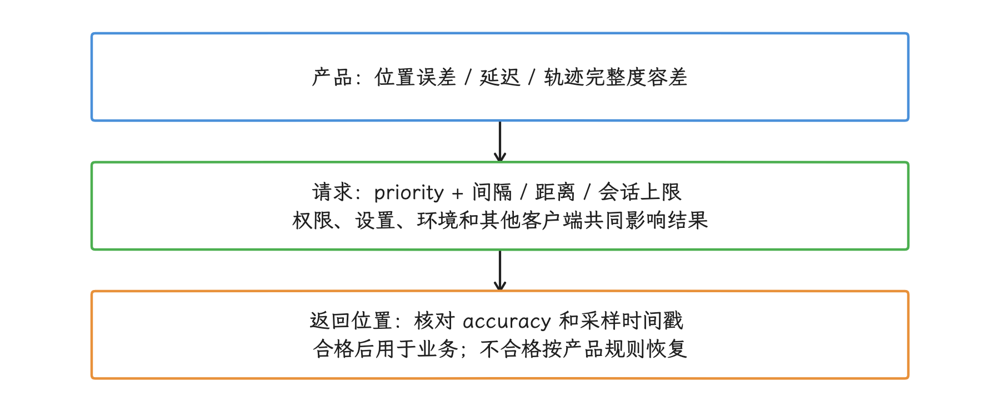

图：priority 不指定固定传感器组合或固定精度，PASSIVE 也只是复用其他请求的结果。图不能推导 GNSS 必开或必关。

#### 间隔、批量与生命周期

下面的请求用于允许批量交付的轨迹场景。几个时长是产品根据交互延迟和会话上限定义的常量，不是平台推荐值。

```kotlin
private val TRACK_SAMPLE_INTERVAL = 30.seconds
private val TRACK_BATCH_DELAY = 2.minutes
private val TRACK_SESSION_LIMIT = 45.minutes

val request = LocationRequest.Builder(
    Priority.PRIORITY_HIGH_ACCURACY,
    TRACK_SAMPLE_INTERVAL.inWholeMilliseconds
).apply {
    setMinUpdateIntervalMillis(TRACK_SAMPLE_INTERVAL.inWholeMilliseconds)
    setMaxUpdateDelayMillis(TRACK_BATCH_DELAY.inWholeMilliseconds)
    setDurationMillis(TRACK_SESSION_LIMIT.inWholeMilliseconds)
}.build()
```

`interval` 是期望采样间隔，不是首次定位的截止时间；这里还显式设置了最小更新间隔，限制通常情况下最快的更新速率（允许小幅时间抖动）。最大延迟达到间隔的两倍时可允许批量，提供方仍可不采用批量。批量交付的回调时间不等于每个位置的采样时间：单批内时间有序，跨批可能乱序，乱序样本可能不适用最小间隔与距离约束，应逐个核对位置时间戳。对实时导航，过长的批量延迟会影响交互。

<!-- gracker-diagram: ch11-02-16-location-batch-clock -->
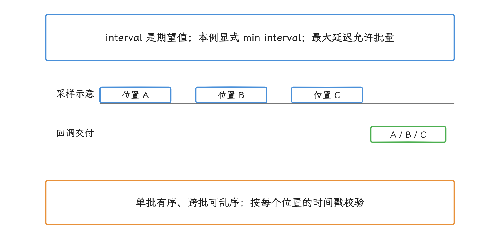

图：轨道不按比例，也不承诺实际采样和批量周期。跨批乱序的样本可能不适用最小间隔/距离约束；max delay 达到两倍 interval 才允许批量，设备仍可不采用。

释放应跟随真正的请求所有者：UI 拥有的请求随页面退出取消；用户主动导航由定位 FGS 拥有时，可在界面不可见后继续，到导航结束、权限撤销或服务停止时再调用 `removeLocationUpdates()`。请求时长上限只是保护，不能代替正常移除。

<!-- gracker-diagram: ch11-02-17-location-owner -->
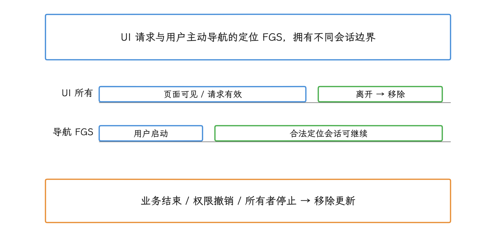

图：Activity 不可见不等于合格定位 FGS 必须结束。前提仍包括启动资格、类型与位置权限，后台定位或围栏另查相应权限。

还可以按需求设置最小位移、最大更新次数、请求时长以及“等待更准确的首个位置”。这些条件来自产品容差，不宜复制一组固定数字到所有场景。

#### Geofencing 的适用范围

Geofencing（地理围栏）适合“进入或离开区域时通知”这类事件驱动需求：判断交给系统，App 无需再用短周期定位轮询维持它，Play services 与位置栈还能合并多个客户端的请求。要注意响应速度——Android 8.0+ 在后台交付地理围栏事件时可能放宽到几分钟量级，秒级轨迹或严格到达时间超出了它的能力范围。

<!-- gracker-diagram: ch11-02-18-geofence-events -->
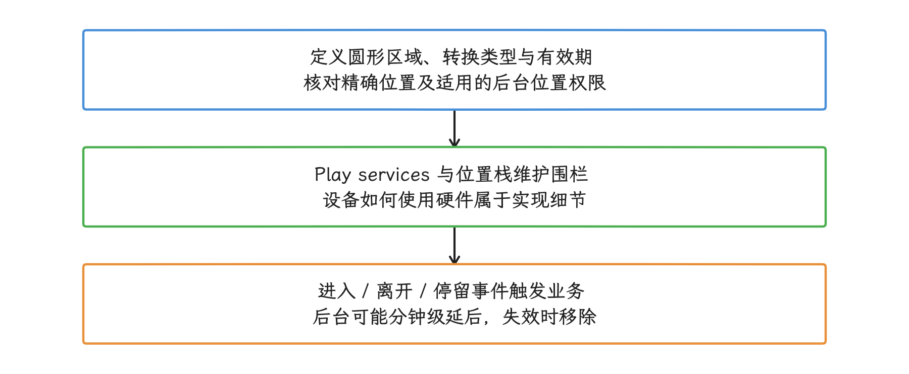

图：图只说明事件驱动契约，不承诺硬件独立执行、GNSS 常开或秒级到达通知；公开 GnssCapabilities 字段不能证明当前 Play services 业务的完整路径。

硬件是否参与围栏判断属于设备实现。公开 App 契约里，`GnssCapabilities`、`dumpsys location` 的字段都没有承诺能稳定表示 Play services Geofencing 的完整执行路径；从“设备支持 GNSS geofencing”推不出“当前业务已由硬件独立处理”。

后台定位要区分“界面不可见”和“没有合格的定位 FGS”：已合法启动且满足 while-in-use 条件的 `location` FGS 可继续前台定位，不因 Activity 退后台就一概要求后台定位权限；从后台新建服务则还受启动资格及权限检查。独立后台定位和后台地理围栏另需核对 `ACCESS_BACKGROUND_LOCATION` 等对应条件；权限授权也不会单独豁免 FGS 后台启动限制。

### 网络请求：减少唤醒、传输与失败重试

网络功耗由传输字节、连接建立、无线状态切换、信号质量、协议和设备实现共同决定。蜂窝与 Wi‑Fi 谁更省电没有跨设备结论，我们能下手的是业务可控制的行为。

#### 合并可延迟请求

- 日志、埋点、已缓存媒体和索引数据可以积累到大小、时限或网络条件满足后批量上传。
- 用户点击发送、支付确认等交互请求要保持即时，别为批量而延后。
- 复用 HTTP 连接，开启协议支持的压缩，使用增量接口、ETag（资源版本标识） 或版本游标减少重复字节。
- 失败按错误类型处理：网络瞬断可退避，服务端限流遵守 `Retry-After`（服务端建议的重试时间），客户端参数错误应停止重试。

- 大文件支持断点续传和幂等提交（重复提交不会产生额外副作用），避免一次失败重传全部内容。

<!-- gracker-diagram: ch11-02-20-retry-classification -->
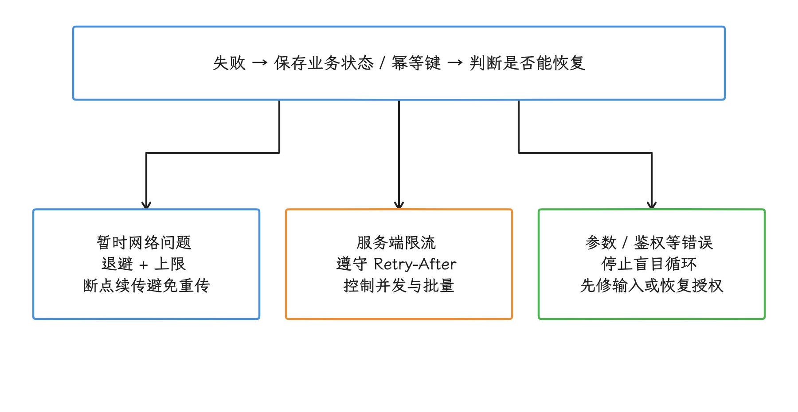

图：重试不是可靠性的唯一来源，服务端确认与业务幂等同样必要。具体错误分类按协议决定，鉴权恢复后可按业务重新发起。
批量的收益来自减少 App 唤醒与连接建立次数；如果每次传输大到容易超时或触发内存压力，就要缩小批次，并在目标网络环境重新测量。

<!-- gracker-diagram: ch11-02-19-network-batching -->
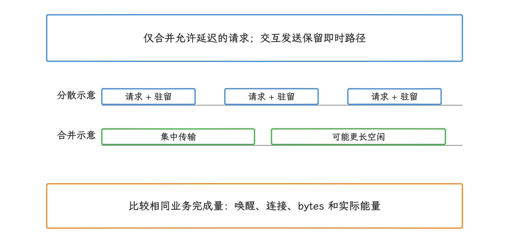

图：驻留取决于无线系统、网络与信号；图示不量化 tail 或收益。批次过大也可能增超时与内存成本，应受产品时限和大小限制。

#### 推送替代固定轮询

只有服务端状态变化才需要触发客户端的业务，适合用 FCM 或同类推送。旧 `AndroidConfig` 的 normal priority 适合可延后同步；high priority 用于时间敏感、用户可见内容，长期没有可见结果可能被降级或代理。

截至本轮核对，Firebase 的 `AndroidConfigV2` 仍是预览方案（客户端示例 26.1.0-eap01）：`RemoteNotification` 面向紧急可见通知，`BackgroundSync` 可合批或延后。默认不可变通知可由 Play services 展示而不启动应用代码；采用 v2 时应按消息意图与通知回调设计，不能照搬旧优先级规则。详见 [官方 v2 迁移说明](https://firebase.google.com/docs/cloud-messaging/send/v2-api)。推送回调也不等于持续后台执行许可。

<!-- gracker-diagram: ch11-02-21-push-intent-version -->
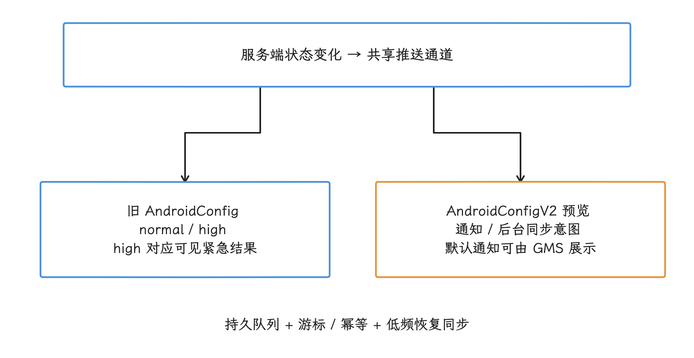

图：v2 仍是预览，不能把旧优先级规则照搬；推送可能延迟或重复，客户端用版本/游标恢复，不能把推送回调当持续后台执行权。

推送只解决“及时唤醒”，数据一致性仍要自己设计：消息可能重复、延迟或丢失，客户端要用版本号或游标拉取缺失数据；低频兜底同步可以交给 WorkManager。

### Camera 与 Audio 资源生命周期

#### Camera

Camera 的开销受 sensor mode（传感器工作模式）、分辨率、帧率、HDR、稳定算法、ISP（图像信号处理器）和编码路径影响。优化重点是让配置满足业务下限，并把资源生命周期限制在功能可见期间：

- 扫码或普通取景无需默认选择最大输出尺寸。
- `CONTROL_AE_TARGET_FPS_RANGE` 是请求范围，设备会结合 AE（自动曝光）与硬件能力选择帧率，不构成恒定帧率保证。
- 页面拥有的相机会话随页面退出结束；其他用户会话按实际所有者结束。停止 repeating 只阻止后续重复请求，已经在途的 capture 不因此立即结束。`CameraCaptureSession.close()` 异步拆会话，关闭设备可直接用 `CameraDevice.close()`，这条路径会丢弃剩余请求，不再等待它们的成功或失败回调；依据对应完成/关闭回调协调消费者后，再释放自己拥有且不再使用的 Surface，不能直接释放借用的输出。

- App 退到后台后若 `dumpsys media.camera` 仍显示活跃 client，应检查会话和错误分支。

<!-- gracker-diagram: ch11-02-22-camera-async-close -->
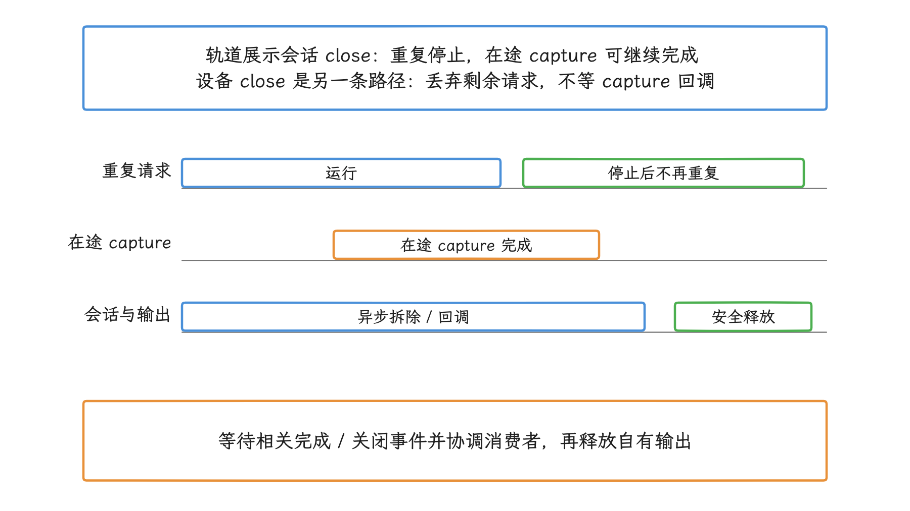

图：轨道展示 CameraCaptureSession.close 的异步完成路径。CameraDevice.close 则直接丢弃剩余请求，不等成功/失败回调；两者都应按关闭事件协调消费者，再释放自有输出，不能释放借用 Surface。
#### Audio

采样率、声道数、格式、缓冲区、编解码器、offload（交给专用音频硬件处理）能力和输出路由共同决定音频开销。44.1 kHz、48 kHz、96 kHz 之间没有统一的优劣排序，合适的取值取决于内容和设备：用内容和设备支持的原生配置，避免无收益的重采样；长时间播放要检查硬件 offload 是否生效，短提示音则别维持不必要的常驻播放对象。

录音、播放、焦点和 media session 都要跟随用户会话结束。音频线程不工作时还持有 WakeLock，或播放停止后仍保留 FGS，是常见的额外待机成本。

<!-- gracker-diagram: ch11-02-23-audio-release -->
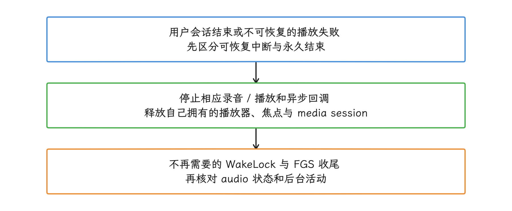

图：暂时中断不等于所有服务必须立即终止；永久结束与用户停止才按业务关闭。采样率与 offload 的最佳选择依内容和设备，不能给统一节电排序。

### 证据驱动的排查流程

#### 建立可复现窗口

我们先把可复现的测试窗口搭起来：记录机型、系统 build（构建版本）、App 版本、网络、屏幕亮度、温度、电池电量区间和操作脚本；对照组一次只改一个变量，重复多轮后比较时间线与分布。测试期间的 USB 供电、调试器和屏幕常亮都可能改变结果，要一并固定。

<!-- gracker-diagram: ch11-02-24-measurement-window -->
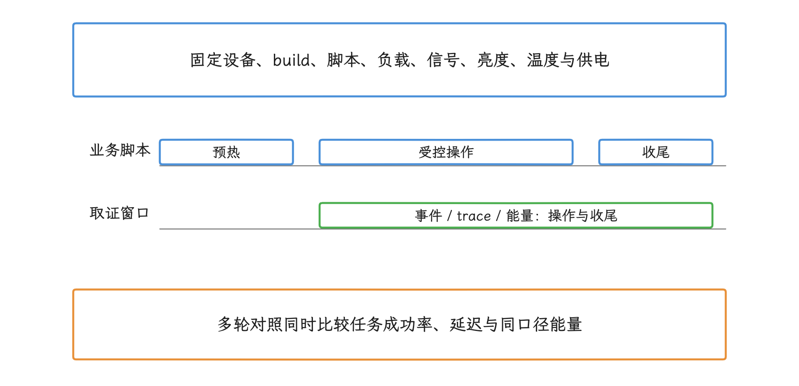

图：只在明确测试窗口执行重置；单个 dumpsys 是快照。这里不执行 adb，不生成虚构样本或收益，旧 Historian 解析还需核对版本兼容。

下面的命令用于一次短测试前清理 Batterystats，并在测试后收集各系统服务状态。

```bash
adb shell dumpsys batterystats --reset
# 执行固定测试脚本
adb shell dumpsys batterystats > batterystats.txt
adb shell dumpsys jobscheduler > jobscheduler.txt
adb shell dumpsys alarm > alarm.txt
adb shell dumpsys location > location.txt
adb shell dumpsys activity services > services.txt
adb shell dumpsys media.camera > camera.txt
adb shell dumpsys audio > audio.txt
```

重置 Batterystats 会影响设备上的累计统计，只应在专用测试设备与明确的测试窗口中执行。收集到的文件要结合 bugreport（系统诊断包）和 Perfetto 时间线来读；Battery Historian 官方已注明不再积极维护，旧工具用于现有流程时需核对新版本数据的兼容与缺失。单个 `dumpsys` 快照只是某一时刻的切面，拼不出整段耗电过程。

#### 按时间线归因

| 现象 | 证据入口 | 继续核对 |
| --- | --- | --- |
| 熄屏后仍无法 suspend（系统休眠） | Battery Historian、batterystats history、Perfetto suspend | WakeLock UID/tag、wakeup source、Alarm 与 Job 是否重叠 |
| Job 被推迟或中止 | WorkInfo/JobParameters stop reason、jobscheduler | standby bucket、约束、Android 16 runtime quota |
| 位置持续活跃 | `dumpsys location`、Battery Historian | 请求 UID、priority、间隔、后台权限和移除时机 |
| 周期性唤醒 | Alarm、JobScheduler 时间线 | exact/allow-while-idle、重复 PendingIntent、失败重试 |
| FGS 长时间存在 | `dumpsys activity services`、Perfetto CPU/network | service type、业务进度、timeout、硬件资源 |
| 后台音频静默 | `dumpsys audio`、`AudioHardening` 日志 | Activity 可见性、FGS、WIU、targetSdk、usage |
| Camera 退出后仍活跃 | `dumpsys media.camera`、cameraserver trace | session、device、Surface 的关闭路径 |

Perfetto 轨道依赖 trace（性能跟踪） config（采集配置）、系统 build 和厂商实现。标准 user build 上看不到 location、camera 或 wakelock 专用轨道时，我们回到 bugreport 与系统服务状态继续查；“没有轨道”只说明这条轨没采到，说明不了“没有耗电”。

## 案例：能量归因、修复与复测

通用检查项用来缩小范围；到了案例这一层，我们要保留功耗基线、异常组件、修改变量和复测窗口。

功耗问题很少由一行代码单独造成。常见过程是：应用发起工作，系统为它安排 CPU、网络、定位或存储资源，硬件进入高功耗状态，工作结束后资源又未及时释放。

以下六个案例说明怎样从业务现象追到系统侧的记录，再选择合适的 Android API 修复问题：用前台服务轮询消息、后台持续请求高精度定位、零散网络请求反复激活蜂窝链路、组件泄漏伴随周期回调、用 WakeLock 和 Alarm 对抗 Doze、多个模块各自注册后台任务。

这六个案例都不给通用的“节电百分比”：芯片、基带、信号、屏幕、温度、账号数据和 OEM（设备厂商） 策略都会改变结果。脱离 bugreport、trace、测试脚本与环境记录的数字，撑不起工程决策。

### 案例分析的共同步骤

每个案例我们都按同一组问题过一遍：

1. **功能契约是什么**：用户能接受多大延迟？工作是否由用户发起？错过一次是否可恢复？
2. **谁发起了资源请求**：记录 UID（Linux 用户标识，Android 通常用它区分应用及资源归属）、线程、Job ID、WakeLock tag（唤醒锁标签）、定位请求、网络调用和时间戳。
3. **系统为何准许或推迟**：检查 Doze、App Standby bucket（应用待机分组）、Battery Saver（省电模式）、后台限制、热状态和 Job quota。
4. **硬件是否被激活**：CPU 在跑，蜂窝基带未必在发射；收到了定位回调，也说明不了 GNSS 只服务当前 UID。判断要把应用、系统服务和硬件三个层级分开。
5. **修复是否破坏业务**：同时比较成功率、端到端延迟、重试量和能耗指标。

<!-- gracker-diagram: ch11-02-25-triangulate-evidence -->
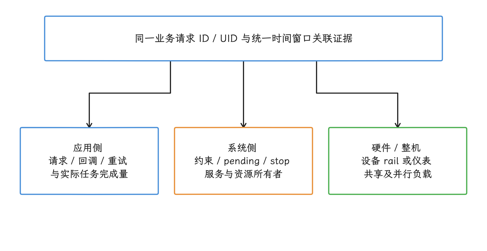

图：三类证据互补：CPU 工作不等于 modem 发射，位置回调不等于该 UID 独占 GNSS。归因数据与整机能量不能直接互换。

推荐保留以下测试信息：

| 类别 | 至少记录的内容 |
|---|---|
| 构建 | 设备型号、Android build（系统构建版本）、应用版本、target SDK（目标 API 级别） |
| 环境 | Wi-Fi/蜂窝、信号、温度区间、屏幕状态、充电状态 |
| 负载 | 账号数据量、请求数量、文件大小、测试时长 |
| 功能 | 成功率、延迟分布、丢失与重复次数 |
| 系统 | bugreport、Perfetto、`dumpsys batterystats`、相关服务的 dumpsys（状态快照） |
| 统计 | 样本数、预热规则、中位数与离散程度 |

`BatteryStats` 和 Battery Historian 适合按 UID 归因，也就是把活动关联到具体应用，并对齐事件时间；设备支持的电源轨（芯片或模块的供电通道）或外接功耗仪更适合测量总能量。两类工具回答的问题不同，谁也替代不了谁。

### 案例一：用前台服务轮询消息

#### 故障代码

下面的示例展示一种常见错误：为了“保活”（让进程长期存活），每五秒在前台服务中查询一次服务端。

```java
public final class MessagePollingService extends Service {
    private volatile boolean stopped;

    @Override
    public int onStartCommand(Intent intent, int flags, int startId) {
        startForeground(1, buildNotification());
        new Thread(() -> {
            while (!stopped) {
                checkNewMessages();
                SystemClock.sleep(5_000);
            }
        }, "message-poll").start();
        return START_STICKY;
    }

    @Override
    public void onDestroy() {
        stopped = true;
    }
}
```

我们看到，这段代码把“消息送达”做成了应用侧定时查询：就算没有新消息，定时器唤醒、网络握手和维持进程的成本也照付；`START_STICKY` 还可能在进程被终止后使服务重建，但不保证消息送达；每次 `onStartCommand()` 都另建线程，也可能叠加多个轮询循环。通知只说明服务对用户可见，降不了轮询的开销。

<!-- gracker-diagram: ch11-02-26-polling-loop -->
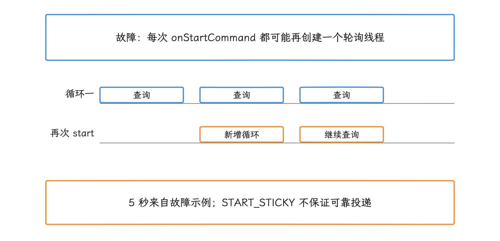

图：轨道表示故障示例可能叠加的循环，不是设备跟踪。持续通知不会消除网络握手、定时查询和并发重复的成本。

#### 按业务时效选择机制

| 业务要求 | 合适机制 | 说明 |
|---|---|---|
| 用户可见的实时消息 | 共享推送；旧配置的高优先级或 v2 的 RemoteNotification 对应可见通知 | 避免每个应用维护独立的定时探测连接（心跳） |
| 后台内容刷新 | 旧配置 normal 或 v2 BackgroundSync，另加低频恢复同步 | Doze 中允许延后 |
| 可延迟上传或同步 | WorkManager / JobScheduler | 声明网络、电量、充电等约束 |
| 用户正在感知的连续任务 | 与用途匹配的前台服务类型 | 导航、播放等工作结束后立即停服务 |

下面的 WorkManager 示例用于一次可恢复同步。同名工作尚在排队或运行时，`KEEP` 忽略本次新请求，避免排出一串等价工作；新业务数据须先持久化，不能指望新请求的输入被吸收。

```java
public final class MessageSync {
    private static final String UNIQUE_WORK = "message-recovery-sync";

    public static void enqueue(Context context) {
        Constraints constraints = new Constraints.Builder()
                .setRequiredNetworkType(NetworkType.CONNECTED)
                .build();

        OneTimeWorkRequest request =
                new OneTimeWorkRequest.Builder(MessageSyncWorker.class)
                        .setConstraints(constraints)
                        .setBackoffCriteria(
                                BackoffPolicy.EXPONENTIAL,
                                30,
                                TimeUnit.SECONDS)
                        .build();

        WorkManager.getInstance(context).enqueueUniqueWork(
                UNIQUE_WORK,
                ExistingWorkPolicy.KEEP,
                request);
    }
}
```

`KEEP` 抑制的是同名排队中或运行中工作的重复入队；漏消息、重试和重复投递，仍要靠 Worker 里的服务端游标或幂等键处理。周期任务的 15 分钟是最小周期，不是准点承诺，实时收消息别指望它。

<!-- gracker-diagram: ch11-02-27-message-recovery -->
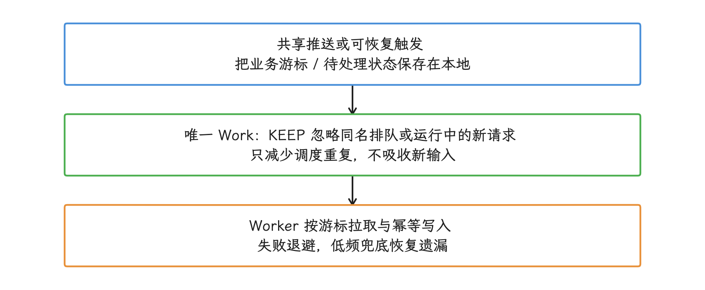

图：后台刷新允许延迟；用户可见消息使用相应可见通知契约。唯一 Work、周期下限与 START_STICKY 都不能承诺实时或 exactly-once。

#### 调度限制与应用契约

固定的 `android-17.0.0_r1` 中，`JobScheduler` 位于 `frameworks/base/apex/jobscheduler/`。应用无需为正在执行的 Job 再持有 CPU WakeLock，系统会在 Job 的整个执行期内代为持有。下面几条限制，比内部可调常量更适合作为应用契约：

- Android 12 起，每个应用最多保有 150 个已调度 Job，expedited job 也计入。
- 高频调用 `schedule()`、`enqueue()` 等调度入口可能被节流，不应依靠重复提交促使任务立刻运行。
- App Standby bucket、后台限制、Doze、Battery Saver、热状态、约束和 quota 都可能让 Job 等待。
- Android 16 的 `getPendingJobReasons()` 能返回同时存在的多个 pending reason（等待原因）。
- Android 17 的 `getPendingJobReasonStats()` 会按原因累计等待时长；统计在重启后不保留，Job 成功完成或取消后也会清除。

下面的 API 37 代码用于读取自己直接调度、且仍存在的原生 Job；`MESSAGE_SYNC_JOB_ID` 必须属于当前 `JobScheduler` namespace。WorkManager 的 WorkRequest UUID 不能直接当作原生 Job ID。

```java
if (Build.VERSION.SDK_INT >= 37) {
    JobScheduler scheduler = context.getSystemService(JobScheduler.class);
    try {
        Map<Integer, Duration> stats =
                scheduler.getPendingJobReasonStats(MESSAGE_SYNC_JOB_ID);
        stats.forEach((reason, duration) ->
                Log.i("JobDebug", "reason=" + reason + ", wait=" + duration));
    } catch (IllegalArgumentException noLongerPending) {
        // 查询前 Job 可能已经完成或取消；也要排查 ID/namespace 是否正确。
        Log.i("JobDebug", "Job unavailable: " + MESSAGE_SYNC_JOB_ID);
    }
}
```

多个原因可同时阻止一个 Job，各项时长之和可能超过实际总等待时间；不要画成互斥占比。空 Map 可能表示无需等待就执行，不能据此证明没有任何调度延迟。应在问题发生时采集，并连同 Job ID、namespace、业务请求 ID 及生命周期记录；完成、取消和重启都会影响可用数据。

<!-- gracker-diagram: ch11-02-28-pending-overlap -->
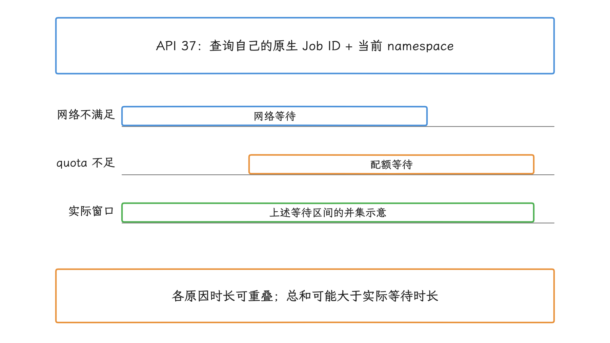

图：条宽为说明，不含测量值；原因不是互斥饼图。成功完成、取消或重启会清除相关统计；Job 不再 pending 可抛异常，空 Map 也不能证明零延迟。

#### 超时与调度机制的分工

各类型的超时限制已在前面的前台服务小节列出：`shortService` 约三分钟；target SDK 35+ 且应用位于后台时，`dataSync` 与 `mediaProcessing` 按类型分别累计每 24 小时 6 小时，同一类型下的多个服务共享这份额度；收到 `Service.onTimeout(int, int)` 后必须在数秒内停止。

这些限制拦的是前台服务滥用，轮询不会因为套上 FGS 就变成可靠同步。可恢复的数据传输应保存进度，交给调度 API；用户可见且不可中断的工作，才放进对应类型的前台服务。

#### 验证

修复前后，我们比较：

- 单位时间内进程唤醒次数、CPU running（CPU 保持运行） 时间和网络请求次数；
- Job 的 pending reason、stop reason（停止原因）、重试次数和端到端消息延迟；
- 前台服务运行时长以及 `onTimeout()`、ANR、crash（崩溃） 日志；
- Wi-Fi 与蜂窝两组测试，避免把基带变化误算成代码收益。

### 案例二：后台持续请求高精度定位

#### 故障代码

下面的请求在组件存活期间持续向 GPS provider（位置提供方） 请求更新，期望间隔为一秒，最小位移门槛为零。

```java
public final class LocationTracker implements LocationListener {
    private final LocationManager locationManager;

    public LocationTracker(Context context) {
        locationManager = context.getSystemService(LocationManager.class);
    }

    public void start() {
        locationManager.requestLocationUpdates(
                LocationManager.GPS_PROVIDER,
                1_000,
                0,
                this);
    }
}
```

问题出在两处：请求参数没有依据产品场景，生命周期里也缺少与注册对应的 `removeUpdates()`。系统可能因后台限制降低回调频率，但应用自己仍要主动修正请求、及时注销。

#### 把定位需求写成产品参数

定位策略至少要区分三类场景，我们按场景决定请求方式和退出条件：

| 场景 | 请求方式 | 退出条件 |
|---|---|---|
| 页面展示一次附近位置 | `getCurrentLocation()` 或缓存位置 | 得到结果、超时、页面离开 |
| 用户主动导航 | 连续高精度请求；按运动状态和 UI 需求设间隔、最小距离 | 导航停止、权限撤销、FGS 结束 |
| 后台地理围栏 | Geofencing 等系统能力 | 围栏移除、业务失效 |

下面使用平台 `LocationManager`（与前面的 GMS FLP API 区分）：`getCurrentLocation()` 从 API 30 提供，公共 `FUSED_PROVIDER` 常量从 API 31 提供，因此本例限定 API 31+。调用方先处理位置权限、provider 可用性与异常；所有 `request()`、`cancel()` 和回调都在主线程。新请求先取消旧请求，代次检查再拦截已排队的旧回调。结果可能为 `null`，也可能是最近的缓存位置，调用方仍须按精度与时间戳判断可用性。

```java
public final class CurrentLocationRequest {
    private final LocationManager locationManager;
    private final Executor mainExecutor;
    private CancellationSignal cancellationSignal;
    private long generation;

    public CurrentLocationRequest(Context context) {
        if (Build.VERSION.SDK_INT < 31) {
            throw new UnsupportedOperationException("API 31 required");
        }
        locationManager = context.getSystemService(LocationManager.class);
        mainExecutor = context.getMainExecutor();
    }

    @MainThread
    public void request(Consumer<Location> consumer) {
        cancel();
        final long token = generation;
        final CancellationSignal signal = new CancellationSignal();
        cancellationSignal = signal;
        locationManager.getCurrentLocation(
                LocationManager.FUSED_PROVIDER,
                signal,
                mainExecutor,
                location -> {
                    if (generation != token || signal.isCanceled()) return;
                    cancellationSignal = null;
                    consumer.accept(location); // 允许 null，由调用方处理。
                });
    }

    @MainThread
    public void cancel() {
        generation++;
        CancellationSignal previous = cancellationSignal;
        cancellationSignal = null;
        if (previous != null) previous.cancel();
    }
}
```

一次定位也可能启用高成本 provider；这种 API 的价值是给请求设置明确终点。导航等连续场景仍应使用 `LocationRequest`，参数须由可接受延迟、路径误差和运动速度推导，并在停止导航时移除 listener（监听器）。

<!-- gracker-diagram: ch11-02-29-current-location-generation -->
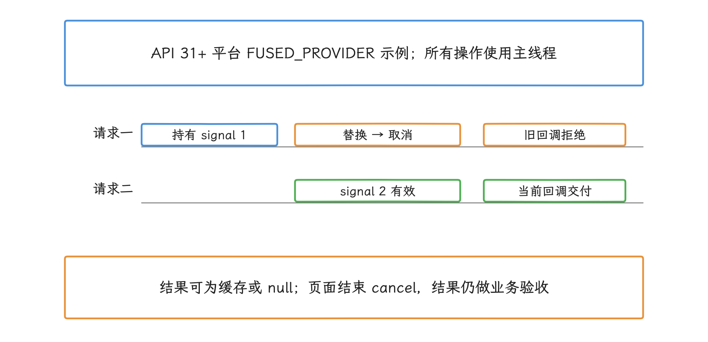

图：代次与取消信号共同使旧回调失效，不假设 cancel 能撤销所有已排队 Runnable。getCurrentLocation 从 API 30 提供，公共 FUSED_PROVIDER 常量使本例限定 API 31。

#### 系统端的检查链

定位请求到达系统端后，`LocationProviderManager` 会综合检查：

1. Manifest 声明、runtime permission（运行时权限） 与 AppOps（应用操作权限状态）；
2. 用户是否启用位置、当前用户与 allowlist（允许列表）；
3. UID 前后台状态及后台定位资格；
4. Battery Saver 对 location service（位置服务） 的模式；
5. 后台请求的最小间隔与其他豁免条件。

未通过检查的 registration（已注册的定位请求） 不会参与 provider request（提供方请求） 的合并，当前 UID 的请求也就驱动不了底层 provider。反过来，我们还要看整机：设备上若还有导航、系统服务或其他应用在请求定位，GNSS 或融合定位仍可能工作——“当前应用无回调”推不出“整机定位功耗为零”。

<!-- gracker-diagram: ch11-02-30-provider-active-merge -->
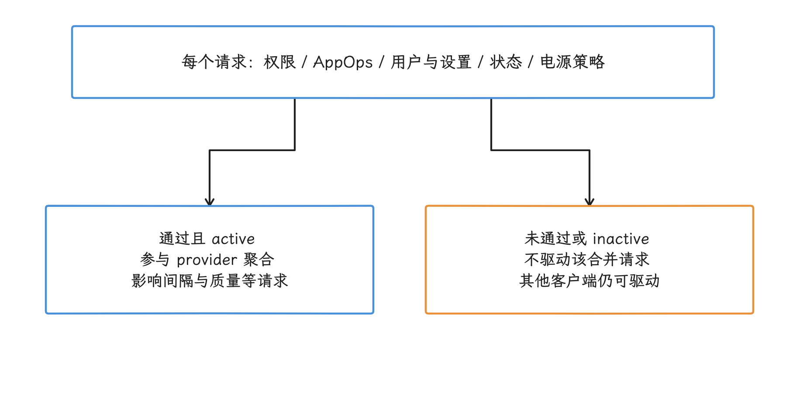

图：图按固定 r1 LocationProviderManager 解释 active 与 merge。当前 UID 没回调不能证明整机 GNSS 关闭；权限、间隔节流和旁路豁免需分别读具体分支。

Battery Saver 的位置模式定义在 `PowerManager`，包括不改变、熄屏禁 GPS、熄屏禁全部位置、只允许前台请求、熄屏时降低请求频率等策略。`SystemLocationPowerSaveModeHelper` 接收 `PowerManagerInternal` 的状态，`LocationProviderManager` 再据此更新 registration。OEM 可以选择不同策略，应用侧要把“当前是哪种模式”当成运行时状态来查询，而不是写死假设。

后台位置限制从 Android 8.0 就已存在：AOSP 里能找到后台节流间隔的配置默认值，设备配置和 OEM 策略都可以修改它，应用应依赖的公开行为只有“后台大约每小时少量更新”这一条。Android 12 增加的是精确/大致位置等权限变化，别把它当成后台节流的起点。

就算运行着 `location` 类型的 FGS，定位启动仍要过 Android 12+ 的后台 FGS 启动限制和 Android 14+ 的 while-in-use 权限检查。导航应用应由用户可见的操作启动，声明正确的前台服务类型，并在导航结束后释放请求。

#### Battery Saver 与 Thermal 的分工

Battery Saver 把位置策略传给 location service；Thermal service（热管理服务） 提供的是当前热状态和 headroom（距离热限制还有多少余量），平台不会把热状态自动换算成某个 location power-save mode。产品若允许在温度升高时降低更新频率，可以监听热状态后调整自身请求——注意别用高频轮询热状态制造新的负载。

<!-- gracker-diagram: ch11-02-31-battery-thermal-location -->
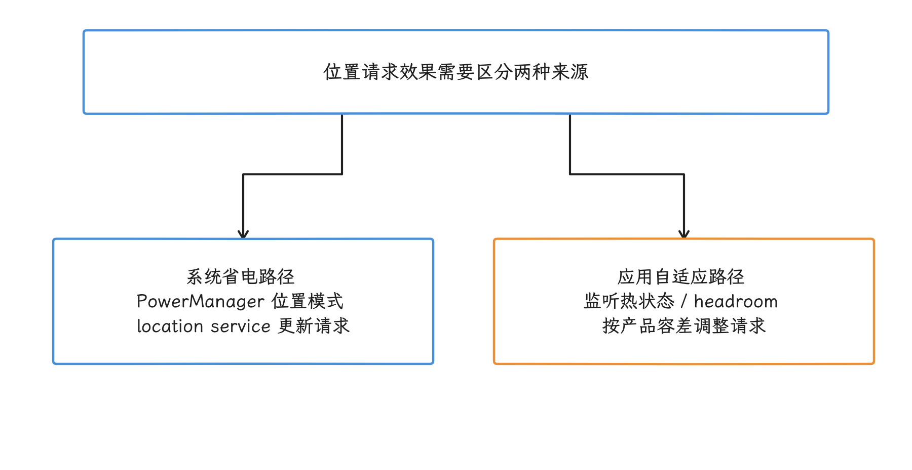

图：平台没有把 Thermal 状态自动换算成某个 location power-save mode 的公开通用链。厂商额外策略要有设备或源码证据；应用避免高频轮询热状态。

#### 验证

- `adb shell dumpsys location`：检查各 provider 的 request、registration、前后台与频率限制状态；
- bugreport 与 Battery Historian：对齐位置请求、WakeLock、屏幕、Doze 和 Battery Saver 时间线；
- Perfetto：检查 CPU 调度、Binder（进程间通信） 与设备提供的定位 trace；
- 设备电源轨或外接仪表：判断 GNSS、CPU 和整机能量是否同步下降。

测试必须覆盖权限被撤销、仅大致位置、熄屏、后台、Battery Saver、导航 FGS 和其他应用同时定位等状态。

### 案例三：零散网络请求反复激活蜂窝链路

#### Android 与 modem 的分工

要看清蜂窝链路为什么被反复激活，先分清 Android 框架和 modem 各管什么。Android Radio HAL（无线硬件抽象层） 的 `RadioState` 描述 modem 控制面处于 `OFF`、`UNAVAILABLE` 还是 `ON`。Android 17 的新实现使用稳定 AIDL（Android 接口定义语言） 接口 `IRadioModem`；`RadioModemProxy` 仍保留旧的 HIDL（HAL 接口定义语言） 分支以兼容旧设备。`setRadioPower()` 属于系统 telephony（电话与蜂窝网络） 的控制路径，普通应用做网络节能用不上它。

<!-- gracker-diagram: ch11-02-32-radio-state-vs-rrc -->
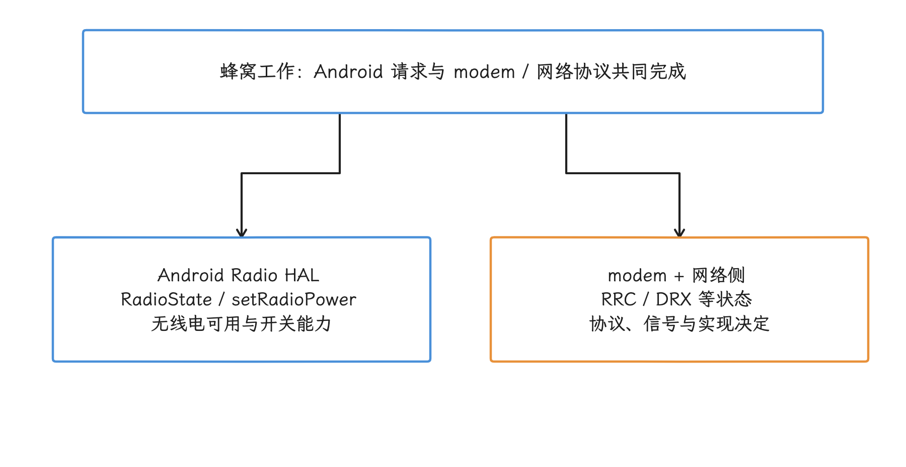

图：不能把 RadioState.ON 当 RRC_CONNECTED，也不能通过 App 看到的一次网络请求推出固定 tail。优化批量后，要用设备 modem / rail / 仪表检查真实变化。

LTE/5G 的 RRC（Radio Resource Control，无线资源控制）连接态、DRX（Discontinuous Reception，非连续接收）周期、inactivity timer（空闲计时器） 和发射功率，由 modem、网络制式、运营商参数及信号共同决定。公开 Android API 里找不到一套跨设备可靠的 RRC 状态。把 3G 的 DCH/PCH（专用信道/寻呼信道）、LTE 的 RRC Connected/Idle 和 5G 状态塞进同一张固定电流表，只会得出错误结论。

回到应用层，我们能确认的事实是：大量间隔很短的请求会增加 DNS、连接建立、TLS、CPU 与网络活动，蜂窝环境下还可能延长 modem 活跃时间。请求结束后基带还会保持活跃一段 tail time（尾时长）——它有多长、耗多少能量，必须在目标设备和网络上测量。

#### 使用持久化 outbox 合并可延迟上传

outbox 是本地持久化的待发送队列。下面的示例在业务事件写入 outbox 后，按唯一名称抑制重复上传 Worker；已有 Worker 运行时也会忽略新的 enqueue。

```java
public final class TelemetryUpload {
    private static final String UNIQUE_UPLOAD = "telemetry-outbox-upload";

    public static void notifyOutboxChanged(Context context) {
        Constraints constraints = new Constraints.Builder()
                .setRequiredNetworkType(NetworkType.CONNECTED)
                .build();

        OneTimeWorkRequest upload =
                new OneTimeWorkRequest.Builder(OutboxUploadWorker.class)
                        .setConstraints(constraints)
                        .setBackoffCriteria(
                                BackoffPolicy.EXPONENTIAL,
                                30,
                                TimeUnit.SECONDS)
                        .build();

        WorkManager.getInstance(context).enqueueUniqueWork(
                UNIQUE_UPLOAD,
                ExistingWorkPolicy.KEEP,
                upload);
    }
}
```

Worker 在一次运行中循环读取大小受限的批次，收到服务端确认后再通过事务删除；达到本次执行额度且 outbox 尚未清空时返回 `Result.retry()`。数据库保存唯一可信的待发送记录，还要安排低频恢复同步，以处理两类缝隙：“写入 outbox”与“调用 enqueue”进不了同一事务，以及 `KEEP` 判断期间出现并发请求的竞争窗口。

<!-- gracker-diagram: ch11-02-33-outbox-race-recovery -->
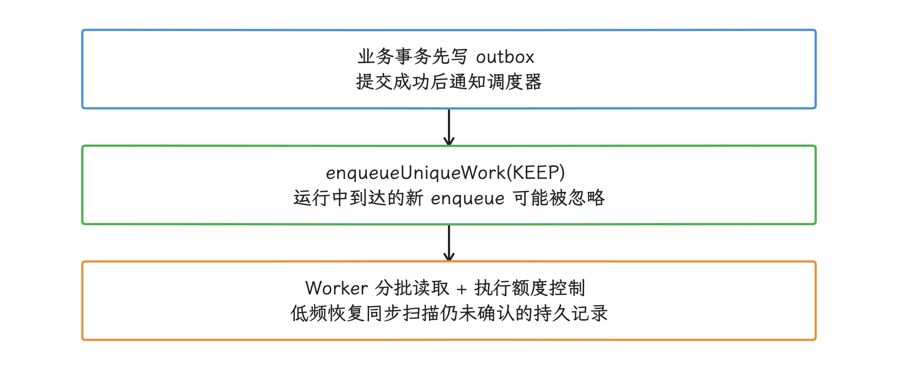

图：两类缝隙需覆盖：写库后未 enqueue 就崩溃，以及 Worker 结束附近的新记录碰到 RUNNING 的 KEEP 被忽略。单靠 enqueue 不保证 outbox 永远排空。

网络客户端应复用连接，并分别设置连接、读写与整次调用的超时。交互请求、支付确认和用户正在等待的发送操作，需要单独的及时执行路径；批量只作用于允许延迟的请求。

<!-- gracker-diagram: ch11-02-34-outbox-ack-idempotency -->
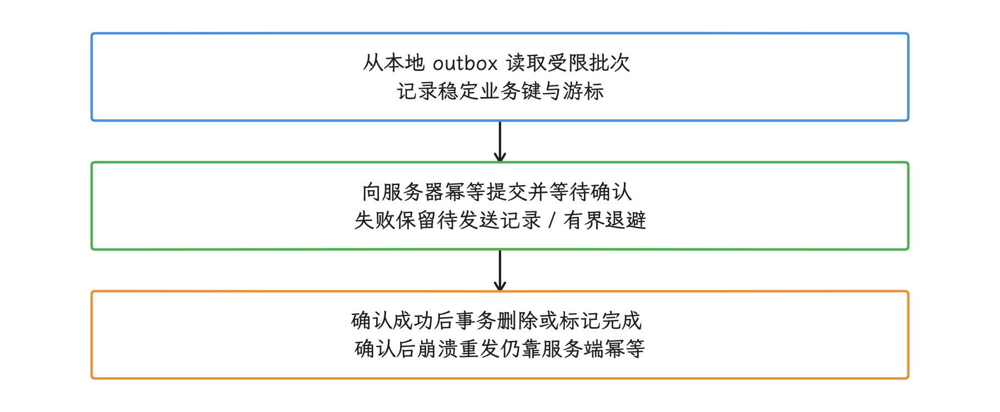

图：这是本文业务协议的设计流程，不是 WorkManager 的 exactly-once 保证。交互发送独立走及时路径，批量大小和超时要匹配实际网络。

#### 诊断证据

| 问题 | 证据 |
|---|---|
| 请求是否过碎 | 客户端调用日志、服务端 access log（访问日志）、包大小与时间间隔 |
| 是否重复握手 | 网络库 event listener（事件监听器）、Perfetto socket/CPU 事件、抓包 |
| 哪个 UID 产生流量 | `NetworkStatsManager`、`TrafficStats`、bugreport |
| modem 是否长时间活跃 | 设备支持的 modem/ODPM（设备端功耗测量）电源轨、厂商 trace、外接仪表 |
| 是否由弱信号放大 | 相同业务在 Wi-Fi、强信号蜂窝、弱信号蜂窝下分组测试 |

把 `TrafficStats` 的字节数换算成毫安之前，我们先看网络环境：同样字节在 Wi-Fi、5G 弱信号和漫游网络下的能量消耗可能相差很大。

### 案例四：组件泄漏伴随周期回调

#### 故障代码

下面的 Activity 注册网络回调后没有注销。匿名内部类会经由回调引用 Activity，页面销毁后仍可能收到事件。

```java
public final class NetworkScreen extends Activity {
    private final ConnectivityManager.NetworkCallback callback =
            new ConnectivityManager.NetworkCallback() {
                @Override
                public void onAvailable(Network network) {
                    renderNetwork(network);
                }
            };

    @Override
    protected void onStart() {
        super.onStart();
        getSystemService(ConnectivityManager.class)
                .registerDefaultNetworkCallback(callback);
    }
}
```

泄漏的直接后果是对象的生命周期结束了却收不回。若回调还会刷新 UI、查询数据库或发起网络请求，已销毁的页面就会继续触发 CPU、Binder 和 I/O 工作。堆占用高只是线索，我们要坐实耗电，就要找到对象被保留后继续干活的完整链条。

#### 对称释放

下面的修复限定 API 26+（带 `Handler` 的默认网络回调重载），需要 `ACCESS_NETWORK_STATE`。默认重载在内部线程回调，不能直接更新 UI；这里显式切到主线程，让注册、注销和代次检查处于同一线程。每次 `onStart()` 使用新回调，阻止停止或重启前排队的旧事件更新当前界面。`@RequiresApi` 与 `@MainThread` 来自 AndroidX annotations，仍需宿主遵守平台范围和线程契约。

```java
@RequiresApi(26)
public final class NetworkScreen extends Activity {
    private final Handler mainHandler = new Handler(Looper.getMainLooper());
    private boolean registered;
    private long generation;
    private ConnectivityManager.NetworkCallback callback;

    @Override
    protected void onStart() {
        super.onStart();
        if (registered) return;
        final long token = ++generation;
        callback = new ConnectivityManager.NetworkCallback() {
            @Override
            public void onAvailable(Network network) {
                if (registered && generation == token) renderNetwork(network);
            }
        };
        getSystemService(ConnectivityManager.class)
                .registerDefaultNetworkCallback(callback, mainHandler);
        registered = true;
    }

    @Override
    protected void onStop() {
        boolean wasRegistered = registered;
        registered = false;
        generation++;
        if (wasRegistered) {
            getSystemService(ConnectivityManager.class)
                    .unregisterNetworkCallback(callback);
        }
        callback = null;
        super.onStop();
    }
}
```

本例已防止同轮重复注册；生产代码还应按 UI 是否需要后台更新选择 `onStart/onStop` 或更长的实际所有者。`onAvailable()` 只表示网络出现，互联网可用或 validated 状态需观察后续 capabilities，不能从本回调直接推定。协程、Rx stream（ReactiveX 数据流）、sensor listener（传感器监听器）、location listener（位置监听器） 和 Handler callback（回调） 都要明确由谁注册、由谁取消。

<!-- gracker-diagram: ch11-02-36-network-callback-generation -->
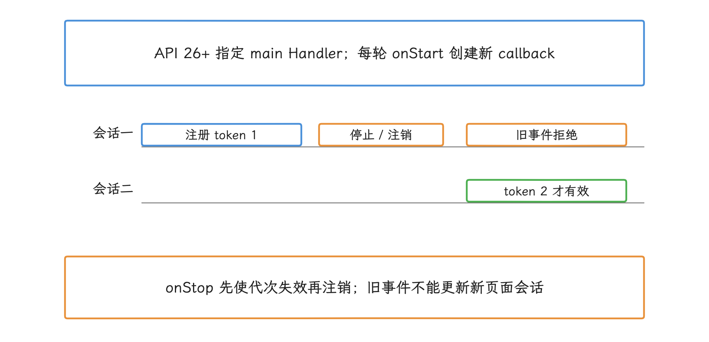

图：取消注册之外还防已经排队的事件。生命周期和回调都在主线程；onAvailable 只表示网络出现，互联网 validated 状态需后续 capabilities。

#### 从泄漏到功耗的证据链

把“泄漏”和“耗电”连起来，要按顺序建立四步：

<!-- gracker-diagram: ch11-02-35-leak-work-energy -->
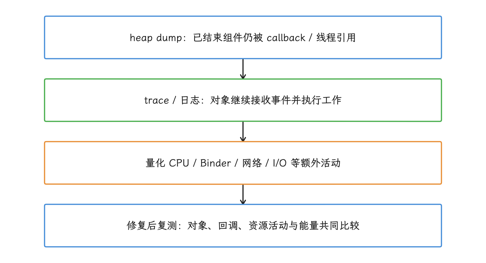

图：对象数量或 RSS 下降本身不能换算为节电。GC、回收和压缩路径依内核配置与负载，必须证明对象仍做工作以及对应时间窗口的成本。

1. heap dump（堆转储） 显示已销毁组件仍被某个 listener、线程或队列引用；
2. trace 或日志显示该对象仍收到回调；
3. 回调带来可量化的 CPU、binder、网络、定位或存储工作；
4. 修复后 retained object（仍被引用的对象） 数量、回调量和对应资源使用时间同时下降。

GC（垃圾回收） 次数增加可能带来 CPU 成本，内存压力也可能触发 reclaim（内存回收）、内存压缩或 swap（交换空间）；具体路径取决于设备内核与内存配置。`android17-6.18-2026-06_r6` 中页面回收的通用入口可从 `mm/vmscan.c` 追踪，但应用侧把 RSS（Resident Set Size，进程驻留内存）的变化直接换算成能耗是行不通的。

Android 17 的 `ProfilingTrigger.TRIGGER_TYPE_ANOMALY` 在系统检测到异常时可提供线索；产物类型随异常而变，需核对设备功能开关、注册条件和结果 tag，共享 UID 还可能影响产物交付。它不保证为每次泄漏自动生成 heap dump。这个接口能辅助取证，复现脚本、对象引用链和功耗测量仍然是主力。

<!-- gracker-diagram: ch11-02-37-profiling-anomaly -->
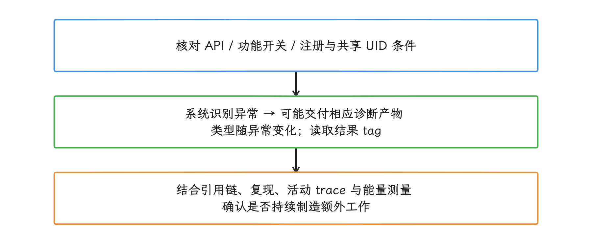

图：触发器不保证每次泄漏都检测到或自动产出 heap dump，更不是能量测量器。图只表示条件性取证入口。

### 案例五：用 WakeLock 和 Alarm 对抗 Doze

#### 长持锁与精确闹钟的组合

一种常见实现是在服务里长时间持有 WakeLock，检测到 `isDeviceIdleMode()` 后再安排 `setExactAndAllowWhileIdle()` 继续唤醒设备。这样会压缩系统合并后台工作的机会：

- Doze 会推迟普通 Job、sync、alarm 和网络访问，并忽略普通应用的 WakeLock；
- allow-while-idle 表示允许空闲时交付，不等于任意 alarm type 都唤醒设备；还要区分 `*_WAKEUP` 与非唤醒类型。交付受限频影响；只有业务确实要求空闲时到达才使用，是否精确另由业务选择。

即时消息应优先使用共享推送通道。普通后台刷新交给 WorkManager/JobScheduler，接受维护窗口或 quota 带来的延迟。只有闹钟、日历提醒这类用户明确要求准时发生的事件，才去评估 exact Alarm（精确闹钟） 资格。

<!-- gracker-diagram: ch11-02-38-idle-antipattern -->
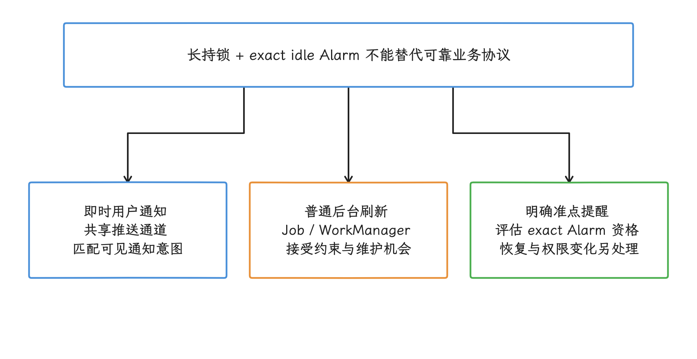

图：Doze 会忽略普通 App WakeLock 并推迟相关工作；allow-while-idle 仍限频，唤醒还看 alarm type。不同业务不能靠同一保活循环兜底。

#### Android 17 的 listener 型 idle Alarm

API 37 增加接收 `Executor` 与 `OnAlarmListener` 的 `setExactAndAllowWhileIdle()`。这种 listener 形式的 Alarm 依赖调用进程继续存活，下面的代码只适合当前组件仍存活时需要的精确回调。

```java
public final class VisibleSessionDeadline {
    private final AlarmManager alarmManager;
    private final Executor executor;
    private AlarmManager.OnAlarmListener listener;
    private long generation;

    public VisibleSessionDeadline(Context context) {
        if (Build.VERSION.SDK_INT < 37) {
            throw new UnsupportedOperationException("API 37 required");
        }
        alarmManager = context.getSystemService(AlarmManager.class);
        executor = context.getMainExecutor();
    }

    @MainThread
    public void schedule(long delayMillis, Runnable action) {
        if (delayMillis < 0) throw new IllegalArgumentException("negative delay");
        cancel();
        final long token = generation;
        listener = () -> {
            if (generation != token || listener == null) return;
            listener = null;
            generation++;
            action.run();
        };
        alarmManager.setExactAndAllowWhileIdle(
                AlarmManager.ELAPSED_REALTIME_WAKEUP,
                Math.addExact(SystemClock.elapsedRealtime(), delayMillis),
                "visible-session-deadline",
                executor,
                listener);
    }

    @MainThread
    public void cancel() {
        generation++;
        AlarmManager.OnAlarmListener previous = listener;
        listener = null;
        if (previous != null) alarmManager.cancel(previous);
    }
}
```

本例的构造、`schedule()`、`cancel()` 与回调均按主线程使用；代次用于拒绝已经入队但所属会话已取消的回调。系统可在调用进程不再有 Activity、Service 或 ContentProvider 时取消 listener Alarm，组件结束时我们也应调用 `cancel(listener)`。要在进程终止后仍可靠送达的用户提醒，用合适的 `PendingIntent` 方案，并遵守 exact Alarm 权限和政策。

<!-- gracker-diagram: ch11-02-39-listener-alarm-generation -->
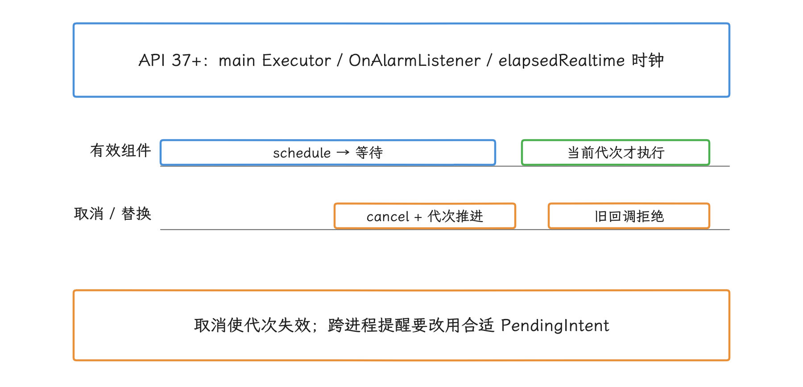

图：这不是可在进程退出后重建应用的定时器。所有操作按主线程使用，系统可在组件生命周期结束后丢弃 listener Alarm；精确回调也不能突破 idle 限频。

#### Doze 与 Low Power Standby

Doze 关注设备长时间闲置时的 CPU、网络、Job、Alarm 和 WakeLock。Low Power Standby 在设备支持、已启用且策略已 active 时，限制受影响 UID 的网络并忽略 WakeLock；非交互是相关条件之一，enabled 本身不等于立刻 active，timeout、Doze 及维护窗口策略还会影响生效时机，豁免也需分别核对。运行前台服务也不会自动获得这些网络与电源策略的豁免。

<!-- gracker-diagram: ch11-02-40-lps-effective-state -->
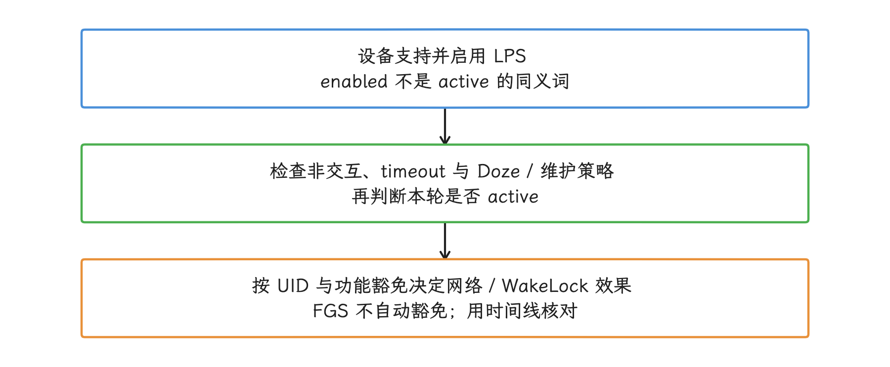

图：这是状态判断顺序概括，具体 active 条件和设备配置按固定 r1 方法核对；LPS 与 Doze 是不同策略，不能把一个状态查询当另一个。

平台进入 suspend 时会检查 wakeup source（内核唤醒源）。内核侧的对应文件是 `kernel/power/suspend.c` 与 `drivers/base/power/wakeup.c`。应用在 BatteryStats 中看到的 WakeLock 归因和内核 wakeup source 处于不同层级，排查时要通过时间线建立关联。

下面的命令用于在测试设备上强制进入和退出 Doze。

```bash
adb shell dumpsys deviceidle force-idle
adb shell dumpsys deviceidle
adb shell dumpsys deviceidle unforce
```

测试期间应确认设备未充电，并在结束后执行 `unforce`。用例要检查推送送达、普通同步延迟、维护窗口恢复、网络失败后的幂等重试，以及用户唤醒设备后的状态一致性。

### 案例六：多个模块各自注册后台任务

#### 问题

同步、日志、配置和清理模块若各自创建周期 Job，容易产生这些后果：

- 多个 Job 具有相同网络约束与相近时限，却分别启动进程和网络；
- 页面、广播和 push（推送） 都重复调用 `schedule()`；
- 每个模块独立重试，服务恢复时形成请求峰值；
- Job 数量、调度入口频率和 App Standby quota 更快触及限制。

合并的前提是约束语义一致，时间接近只是表象：精确时限、网络类型、充电要求、失败语义或用户可见性不同的工作，应保留独立调度。

<!-- gracker-diagram: ch11-02-41-merge-semantic-gate -->
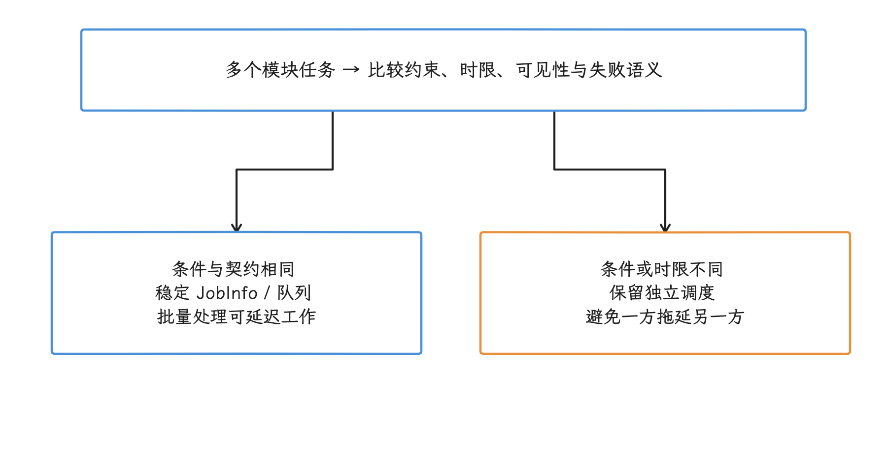

图：合并不是单纯减少 Job 数；同一批任务需能接受相同网络、充电和恢复策略。合并后仍有数量、频率、standby 和 runtime quota 限制。

#### 同约束工作使用一个 JobInfo

Android 14 起，`JobWorkItem`（Job 队列中的工作项）可以随 persisted Job（跨重启保留的任务） 一起持久化。下面的 API 34+ 示例让一组“需要不计费网络且允许延迟”的工作共享内容稳定的 `JobInfo`，每个条目使用可持久化 extras，而非不能随 Job 持久化的 Intent。

```java
public final class DeferredWorkQueue {
    private static final int JOB_ID = 4100;

    public static int enqueue(
            Context context,
            String operation,
            long recordId) {
        if (Build.VERSION.SDK_INT < 34) {
            throw new UnsupportedOperationException("API 34 required");
        }
        ComponentName service =
                new ComponentName(context, DeferredJobService.class);

        JobInfo job = new JobInfo.Builder(JOB_ID, service)
                .setRequiredNetworkType(JobInfo.NETWORK_TYPE_UNMETERED)
                .setPersisted(true)
                .build();

        PersistableBundle extras = new PersistableBundle();
        extras.putString("operation", operation);
        extras.putLong("record_id", recordId);

        JobWorkItem item = new JobWorkItem.Builder()
                .setExtras(extras)
                .build();

        return context.getSystemService(JobScheduler.class)
                .enqueue(job, item);
    }
}
```

`NETWORK_TYPE_UNMETERED` 指系统判定的非计量网络，Wi-Fi 只是常见情况之一。persisted Job 需要在 Manifest 中声明 `RECEIVE_BOOT_COMPLETED`，`DeferredJobService` 需要受 `BIND_JOB_SERVICE` 权限保护。服务异步循环调用 `dequeueWork()`，每项成功后调用 `completeWork()`。当 `dequeueWork()` 返回 `null` 且已取出的工作均已确认时，系统自动停止 Job；此时不要再自行调用 `jobFinished()`，否则可能丢失并发入队的新工作。因系统中止而仍有待完成项时，停止处理，并按业务可恢复性在 `onStopJob()` 返回 `true` 让未完成工作重新入队；重复执行仍靠幂等处理。

<!-- gracker-diagram: ch11-02-42-persisted-job-workitem -->
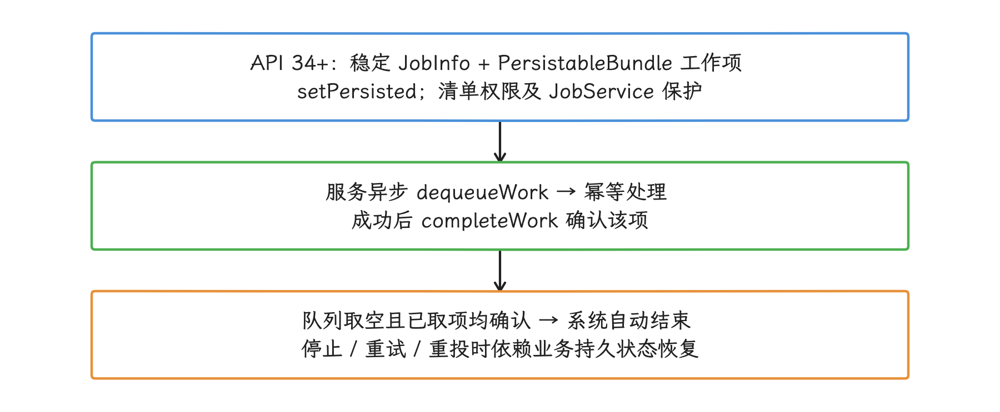

图：队列取空且已取项确认后由系统结束，不再自行 jobFinished，以免丢失并发入队项。API 34+ extras 可持久化而 Intent 不可；系统中止后按 onStopJob 返回值决定重排，业务仍须幂等。

业务记录要有自己的幂等键，保证重复处理不会产生额外副作用；`JobWorkItem` 只负责排队，业务数据的唯一可信来源仍然在应用自己的存储里。

官方 API 建议同一队列持续使用相同的 `JobInfo`。反复改变 extras（附加参数）、ClipData（可携带 URI 等内容的数据容器）或约束，可能让系统认为任务描述发生变化，导致正在运行的 Job 被停止后重启。合并之后，150 个 Job 上限、调度入口频率限制、standby bucket、quota 和设备状态限制照样生效。

#### App Standby 与等待原因

Adaptive Battery（自适应电量管理）或系统使用记录会影响 App Standby bucket，`QuotaController` 再按 bucket 与设备状态判断 Job 是否还有可用 quota。应用能做的是按业务时限选择普通、expedited 或 user-initiated 工作；频繁重新调度换不来执行机会。

<!-- gracker-diagram: ch11-02-43-quota-waiting-evidence -->
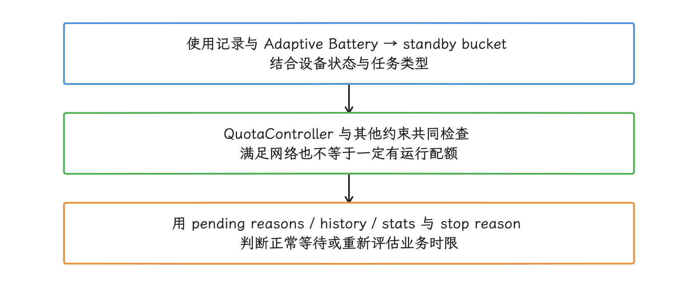

图：频繁 schedule 不会制造配额。API 37 原因时长可重叠且不跨重启持久保留；直接 Job 和 WorkManager 的诊断 ID/接口也需区分。

Android 17 可使用 `getPendingJobReasonStats()` 区分等待主要来自网络约束、App Standby、quota、设备状态还是调度优化。等待时间符合已声明的约束时，这是正常调度结果；若 SLA（服务时限承诺）不允许这段延迟，应重新选择 API 或调整业务契约。

#### 验证

合并有没有生效，我们比较合并前后的：

- 待调度 Job 数与每小时调度 API 调用数；
- 进程启动、Job session（任务执行批次）、网络连接和失败重试数量；
- 每类操作的最长等待、成功率和重复处理；
- `STOP_REASON_*`、pending reason stats 与当前 standby bucket；
- 单位业务量的 CPU time、网络字节和设备能量。

### 跨案例判断表

<!-- gracker-diagram: ch11-02-44-case-validation -->
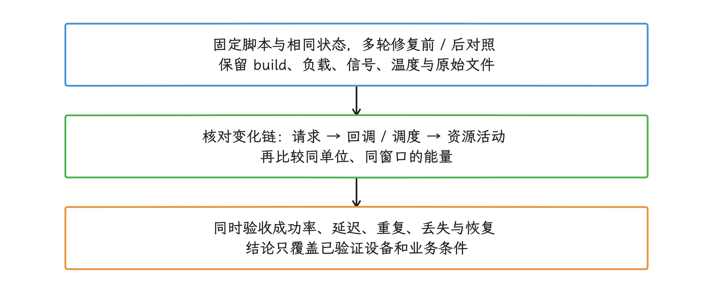

图：字节下降、回调停止、RSS 降低、Job 数减少与唤醒变少，都不能单独证明续航和体验同时改善。图不提供脱离设备的通用百分比。

| 现象 | 不能直接得出的结论 | 需要补的证据 |
|---|---|---|
| UID 网络字节下降 | 蜂窝功耗按同比例下降 | 信号、制式、modem rail（基带电源轨）、请求时间线 |
| 定位回调停止 | GNSS 已关闭 | 其他 registration、provider request、电源轨 |
| RSS 下降 | 电池续航提升 | GC/reclaim/CPU/I/O 与能量变化 |
| Job 长时间 pending | JobScheduler 出错 | pending reason、standby bucket、quota、设备状态 |
| FGS 仍在通知栏 | 网络和 WakeLock 可在 Doze 中自由使用 | Doze/LPS 状态、网络与 WakeLock trace |
| 唤醒次数下降 | 用户体验没有损失 | 成功率、延迟、丢失与恢复结果 |

### 复核清单

- [ ] 后台工作是否有明确的延迟与可靠性契约，并用 WorkManager 或 JobScheduler 承载、只添加必要约束？
- [ ] 用户不可见的工作是否误用了前台服务、WakeLock 或精确闹钟？
- [ ] WakeLock 是否有稳定 tag、业务上限和覆盖成功、失败、取消的释放路径？
- [ ] 是否把 `UNMETERED` 错当成 Wi‑Fi，或把周期最小间隔错当成准时保证？
- [ ] 是否用唯一工作、稳定 Job ID 或服务端游标消除了重复调度？
- [ ] Android 16 起是否记录 Job/Work 的 stop reason 与 pending reason history，并同时记录 standby bucket 和系统电源状态？
- [ ] 定位请求是否由场景推导精度、间隔、距离和退出条件，priority 按业务容差选择，退出后移除更新？
- [ ] Geofencing 是否被当成分钟级事件入口，而非秒级轨迹服务？
- [ ] 网络是否合并可延迟上传、复用连接、区分可重试与永久错误，且批量只作用于允许延迟的请求？
- [ ] 推送是否区分旧 AndroidConfig 优先级与 v2 预览消息意图，紧急通知是否对应用户可见结果？
- [ ] 精确闹钟是否属于用户明确感知的准点功能、权限撤销后能否降级，`OnAlarmListener` 例外是否只用在进程存活期间？
- [ ] FGS type、权限、启动资格和 timeout 是否分别处理？
- [ ] Android 17 后台音频是否满足非 shortService FGS、WIU 与 usage 规则？
- [ ] Camera、Audio、Surface、media session 是否在业务结束时关闭？
- [ ] listener、callback、线程、协程和 WakeLock 是否对称释放？
- [ ] 功耗结论是否来自目标设备、固定脚本和多轮对照，并附带设备、网络、温度、样本与原始产物？
- [ ] AOSP 引用是否来自 `android-17.0.0_r1`，内核引用是否来自 `android17-6.18-2026-06_r6`？

### 与其他章节的关系

§11.1 解释系统如何把 CPU、屏幕、网络、GNSS 与其他组件能量归因到 UID；这里讨论 App 怎样减少这些组件的活跃时间。§5.3 说明 Doze、App Standby 与 JobScheduler/WorkManager，§11.3 追踪 WakeLock 在 PowerManagerService 与 suspend 路径中的实现。遇到“任务被推迟”或“设备不休眠”时，应沿这些章节的系统路径继续定位。

## 版本与实现边界

| Android 版本 | 相关变化 |
| --- | --- |
| Android 5.0 / API 21 | JobScheduler 引入 |
| Android 6.0 / API 23 | Doze 与 App Standby 引入 |
| Android 8.0 / API 26 | 后台执行、后台位置与隐式广播限制趋严 |
| Android 12 / API 31 | 精确闹钟 special app access；后台启动 FGS 受限 |
| Android 13 / API 33 | `USE_EXACT_ALARM` 与通知权限等边界进入适配范围 |
| Android 14 / API 34 | target 34+ 强制 FGS type 与对应权限；`shortService` 时限；多数 target 33+ 新安装不预授予精确闹钟权限；Job pending reason API；persisted Job 可携带持久化的 `JobWorkItem` |
| Android 15 / API 35 | target 35+ 的 `dataSync`、`mediaProcessing` FGS 后台累计时限；`Service.onTimeout(int, int)`；ADPF 能效偏好提示 |
| Android 16 / API 36 | top-started 与 FGS 并发 job 恢复受 runtime quota 约束；`getPendingJobReasons()` 返回多个等待原因；新增 pending job reasons history |
| Android 17 / API 37 | 后台音频 hardening；target 37 后台音频增加 WIU 能力要求；`getPendingJobReasonStats()`；listener 版本 `setExactAndAllowWhileIdle()`；平台源码锚点 `android-17.0.0_r1` |

## 参考资料

- [Android 官方：WorkManager 2.12.0 与最低 API](https://developer.android.com/jetpack/androidx/releases/work)
- [Google Play services：LocationRequest.Builder](https://developers.google.com/android/reference/com/google/android/gms/location/LocationRequest.Builder)
- [Android 官方：LocationManager](https://developer.android.com/reference/android/location/LocationManager)
- [Android 官方：ConnectivityManager](https://developer.android.com/reference/android/net/ConnectivityManager)
- [Firebase 官方：AndroidConfigV2 预览迁移](https://firebase.google.com/docs/cloud-messaging/send/v2-api)
- [Android 官方：减少周期网络更新成本](https://developer.android.com/develop/connectivity/minimize-effect-regular-updates)
- [HTTP Semantics：Retry-After](https://www.rfc-editor.org/rfc/rfc9110.html#name-retry-after)
- [Android 官方：JobParameters 队列生命周期](https://developer.android.com/reference/android/app/job/JobParameters#dequeueWork())
- [Android 官方：电源管理资源限制](https://developer.android.com/topic/performance/power/power-details)
- [Android 官方：Doze 和 App Standby](https://developer.android.com/training/monitoring-device-state/doze-standby)
- [Android 官方：Excessive partial wake locks](https://developer.android.com/topic/performance/vitals/excessive-wakelock)
- [Android 官方：Persistent work](https://developer.android.com/develop/background-work/background-tasks/persistent)
- [Android 官方：WorkManager 定义工作请求](https://developer.android.com/develop/background-work/background-tasks/persistent/getting-started/define-work)
- [Android 官方：位置服务](https://developer.android.com/training/location)
- [Google Play services：Location priority](https://developers.google.com/android/reference/com/google/android/gms/location/Priority)
- [Android 官方：Geofencing](https://developer.android.com/training/location/geofencing)
- [Android 官方：Alarm 调度](https://developer.android.com/develop/background-work/services/alarms)
- [Android 官方：Android 14 精确闹钟变化](https://developer.android.com/about/versions/14/changes/schedule-exact-alarms)
- [Android 官方：Android 14 FGS type](https://developer.android.com/about/versions/14/changes/fgs-types-required)
- [Android 官方：FGS timeout](https://developer.android.com/develop/background-work/services/fgs/timeout)
- [Android 官方：Android 16 JobScheduler quota](https://developer.android.com/about/versions/16/behavior-changes-all#job-quota-opt)
- [Android 官方：Android 17 后台音频](https://developer.android.com/about/versions/17/changes/bg-audio)
- [Firebase 官方：Android 消息优先级](https://firebase.google.com/docs/cloud-messaging/android/message-priority)
- [Android 官方：Battery Historian](https://developer.android.com/topic/performance/power/setup-battery-historian)
- [AOSP：PowerManager.java](https://cs.android.com/android/platform/superproject/+/android-17.0.0_r1:frameworks/base/core/java/android/os/PowerManager.java)
- [AOSP：PowerManagerService.java](https://cs.android.com/android/platform/superproject/+/android-17.0.0_r1:frameworks/base/services/core/java/com/android/server/power/PowerManagerService.java)
- [AOSP：JobScheduler.java](https://cs.android.com/android/platform/superproject/+/android-17.0.0_r1:frameworks/base/apex/jobscheduler/framework/java/android/app/job/JobScheduler.java)
- [AOSP：JobSchedulerService.java](https://cs.android.com/android/platform/superproject/+/android-17.0.0_r1:frameworks/base/apex/jobscheduler/service/java/com/android/server/job/JobSchedulerService.java)
- [AOSP：AlarmManager.java](https://cs.android.com/android/platform/superproject/+/android-17.0.0_r1:frameworks/base/apex/jobscheduler/framework/java/android/app/AlarmManager.java)
- [AOSP：AlarmManagerService.java](https://cs.android.com/android/platform/superproject/+/android-17.0.0_r1:frameworks/base/apex/jobscheduler/service/java/com/android/server/alarm/AlarmManagerService.java)
- [AOSP：ActiveServices.java](https://cs.android.com/android/platform/superproject/+/android-17.0.0_r1:frameworks/base/services/core/java/com/android/server/am/ActiveServices.java)
- [AOSP：AudioService.java](https://cs.android.com/android/platform/superproject/+/android-17.0.0_r1:frameworks/base/services/core/java/com/android/server/audio/AudioService.java)
- [AOSP：HardeningEnforcer.java](https://cs.android.com/android/platform/superproject/+/android-17.0.0_r1:frameworks/base/services/core/java/com/android/server/audio/HardeningEnforcer.java)
- [Android 17 Kernel：pm_wakeup.h](https://android.googlesource.com/kernel/common/+/android17-6.18-2026-06_r6/include/linux/pm_wakeup.h)
- [Android 17 Kernel：wakeup.c](https://android.googlesource.com/kernel/common/+/android17-6.18-2026-06_r6/drivers/base/power/wakeup.c)

### Android 17 / API 37

- [Android 17 features and APIs](https://developer.android.com/about/versions/17/features)
- [JobScheduler API reference](https://developer.android.com/reference/android/app/job/JobScheduler)
- [AlarmManager API reference](https://developer.android.com/reference/android/app/AlarmManager)

#### 后台执行与位置

- [Foreground service timeouts](https://developer.android.com/develop/background-work/services/fgs/timeout)
- [Optimize for Doze and App Standby](https://developer.android.com/training/monitoring-device-state/doze-standby)
- [Background location limits](https://developer.android.com/about/versions/oreo/background-location-limits)
- [Android 16 JobScheduler quota changes](https://developer.android.com/about/versions/16/behavior-changes-all#job-quota-opt)
- [Power management resource limits](https://developer.android.com/topic/performance/power/power-details)

#### AOSP `android-17.0.0_r1`

- `frameworks/base/apex/jobscheduler/service/java/com/android/server/job/JobSchedulerService.java`
- `frameworks/base/apex/jobscheduler/service/java/com/android/server/job/JobServiceContext.java`
- `frameworks/base/apex/jobscheduler/service/java/com/android/server/job/controllers/QuotaController.java`
- `frameworks/base/apex/jobscheduler/framework/java/android/app/AlarmManager.java`
- `frameworks/base/services/core/java/com/android/server/am/ActiveServices.java`
- `frameworks/base/services/core/java/com/android/server/location/injector/SystemLocationPowerSaveModeHelper.java`
- `frameworks/base/services/core/java/com/android/server/location/provider/LocationProviderManager.java`
- `frameworks/opt/telephony/src/java/com/android/internal/telephony/RadioModemProxy.java`
- `hardware/interfaces/radio/aidl/android/hardware/radio/modem/IRadioModem.aidl`

#### Android common kernel `android17-6.18-2026-06_r6`

- `kernel/power/suspend.c`
- `drivers/base/power/wakeup.c`
- `mm/vmscan.c`
