# WakeLock 机制与功耗分析

WakeLock 解决一个很窄的问题：设备准备进入 system suspend（整机挂起）时，让某段仍需要 CPU 的工作继续执行。它的职责也仅止于此——线程能拿到多少 CPU、跑在什么频率，应用能否后台启动、能否联网、进程是否存活，都另有机制负责，WakeLock 一概管不着。

这组分工决定了排查方法。我们看到客户端对象显示 held（已持有），知道的只是客户端 `mHeld` 当前仍为真——它随正常释放或超时释放变化，跟“应用还没调用过 release（释放）”是两回事。同一时刻，PowerManagerService 可能已经因电源策略禁用了这把锁；BatteryStats 中的应用 tag（标签）、SystemSuspend 中的用户态锁和内核 `wakeup_source`（唤醒源）又分属不同的统计层级。排查要做的，就是把这几层对齐。


Google 在 [2026-03-04 的官方说明](https://developer.android.com/blog/posts/battery-technical-quality-enforcement-is-here-how-to-optimize-common-wake-lock-use-cases)中确认，自 3 月 1 日起，对持续超出 excessive partial wake lock（过度持有部分唤醒锁）阈值的应用逐步实施推荐入口收缩、商店警告等处理。所以我们排查功耗时，在本地电流之外，还要把线上质量指标一起纳入视野。

## 11.3.1 WakeLock 阻止的是哪一层睡眠

我们分析 CPU 低功耗状态时，至少要区分 CPU idle 与 system suspend：


- **CPU idle**：某个 CPU 没有 runnable task（已就绪、等待调度的任务）时进入 idle state（空闲状态）；持不持有 partial wake lock，都不改变这一点。
- **System suspend**：整机经过设备挂起流程进入更深的低功耗状态。正常自动挂起路径中，有效的 partial wake lock（阻止系统挂起的唤醒锁）会阻止这一步；系统特权 force-suspend 可能绕过用户态计数，这条路普通应用走不了。
- **硬件唤醒事件**：Alarm、按键、modem（蜂窝基带）、蓝牙或其他具备 wakeup 能力的设备可让系统从 suspend 返回。

### WakeLock level（级别）

| Level | 语义 | 应用建议 |
|---|---|---|
| `PARTIAL_WAKE_LOCK` | 屏幕可灭；正常自动挂起路径中，生效的锁阻止 system suspend | 只在专用 API 无法覆盖时短时使用 |
| `PROXIMITY_SCREEN_OFF_WAKE_LOCK` | 距离传感器靠近时控制屏幕关闭 | 通话等专用场景；先检查设备支持 |
| `SCREEN_DIM_WAKE_LOCK` | 保持屏幕暗亮 | API 17 废弃 |
| `SCREEN_BRIGHT_WAKE_LOCK` | 保持屏幕亮 | API 13 废弃 |
| `FULL_WAKE_LOCK` | 保持屏幕与设备唤醒 | API 17 废弃 |

要让当前界面保持亮屏，用 `WindowManager.LayoutParams.FLAG_KEEP_SCREEN_ON` 或 View 的 `keepScreenOn` 就够了，这类状态由系统根据窗口可见性管理。`PROXIMITY_SCREEN_OFF_WAKE_LOCK` 主要控制显示；要保持 CPU 唤醒，用的是 partial 锁。

下面的简图只表达 partial wake lock 的作用位置。

```text
屏幕关闭
   ↓
CPU 无任务时仍可进入各自的 idle state
   ↓
PowerManagerService 判断是否需要 CPU suspend blocker
   ├─ 需要：SystemSuspend 暂不发起 system suspend
   └─ 不需要：还需其他 blocker 释放、自动挂起可用、握手和内核检查通过
```

这张图画的只是正常自动挂起的准入条件：没有 partial 锁只是其中一条，离“已经休眠”还很远。suspend blocker 在默认路径以用户态计数阻止挂起；`wakeup_count` 握手检查的是读取之后有没有新的唤醒事件，握手成功后，内核也仍可能拒绝或中止挂起。

长时间持锁，在锁实际生效时占的是正常自动挂起的机会，CPU 未必跟着满负载；锁内若还有轮询、网络、定位或计算，能耗会继续往上走。反过来，单次持锁很短，触发得足够频繁时，设备同样可能难以形成稳定的 suspend 区间。

<!-- gracker-diagram: ch11-03-03-idle-with-lock -->
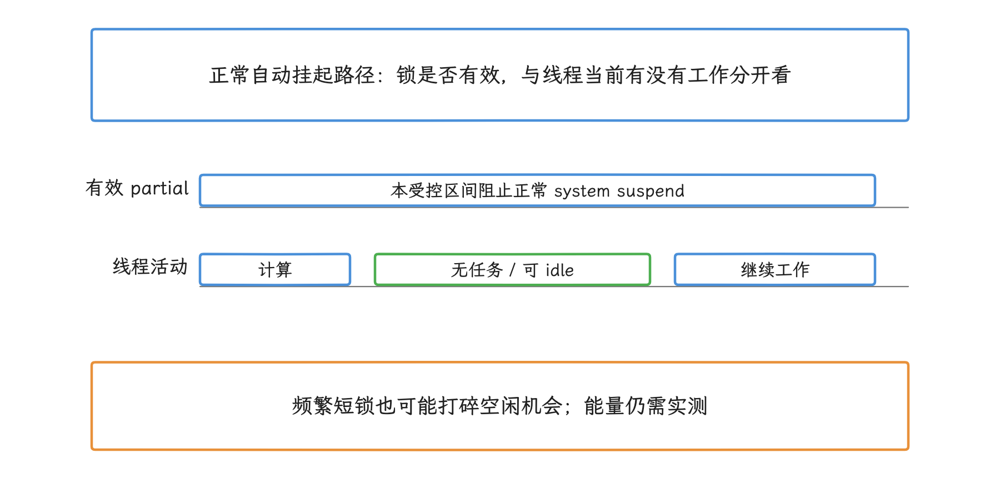

图：轨道只示意活动关系，不带真实时长或收益。CPU idle 与 system suspend 是两层；被 PMS 禁用的 held 锁，别按这条有效区间推断。

## 11.3.2 申请之前先检查专用 API

申请之前先过一遍下面的表：很多 Android API 已经在需要的执行窗口内代持 wake lock，应用再额外申请一把锁，得到的往往只是更长的持有时间。

| 工作 | 优先机制 | wake lock 由谁管理 |
|---|---|---|
| 可延迟后台任务 | WorkManager / JobScheduler | 调度框架在 Job 执行期管理 |
| 用户发起的长时上传或下载 | user-initiated data transfer job（用户发起的数据传输任务） | JobScheduler |
| 普通下载 | DownloadManager | 系统 |
| 音频播放 | Media APIs；Media3 可配置 wake mode（唤醒模式） | 音频栈或播放器 |
| 定位 | LocationManager / Fused Location（融合定位） | 定位栈在采集与投递期管理 |
| 传感器批处理 | wake-up sensor（唤醒型传感器）或 batching（批量上报） | Sensor framework |
| 到点提醒 | AlarmManager | Alarm 投递期由系统管理 |
| 用户可见的连续自定义工作 | 合适类型的 Foreground Service；确需 CPU 连续运行时再配 partial wake lock | 应用负责显式锁 |

Foreground Service（前台服务，FGS）会提高进程重要性并展示通知，但阻止整机 suspend 靠的是别的条件，FGS 本身带不来这层保护。也因此，直接持 partial wake lock 的后台工作通常应处在用户可见的 FGS 中；反过来，业务若不适合 FGS，通常也不适合直接持锁。


## 11.3.3 应用层的安全持锁模式

应用必须在 Manifest（应用清单）中声明 `android.permission.WAKE_LOCK`。

### 引用计数

`WakeLock` 默认启用引用计数：不含自动超时释放的普通配对里，两次 `acquire()` 要由两次 `release()` 平衡，释放次数一多就会产生 under-lock（释放次数超过申请次数）异常。固定 r1 还另外维护 internal/external 两个计数，超时释放只影响内部计数，调用方自己的释放配对仍要做完。共享代码里要写清每个 owner（所有者）；下面的独立单次操作用的是非引用计数锁，一把锁只服务一次任务，重叠任务要各拿各的锁。


我们先看同步工作的示例。它限定在工作线程调用，`exportCurrentItem()` 代表应用自己的同步导出操作，必须等到该项工作结束才返回。10 分钟是这个示例业务的保护值，不是平台建议，也不是调度额度；实际应用要另设可响应取消的业务截止时间。锁是每次调用的局部对象，用稳定 tag，在 `finally` 中释放。

<!-- gracker-diagram: ed11-03-sync-and-async-release-owner -->
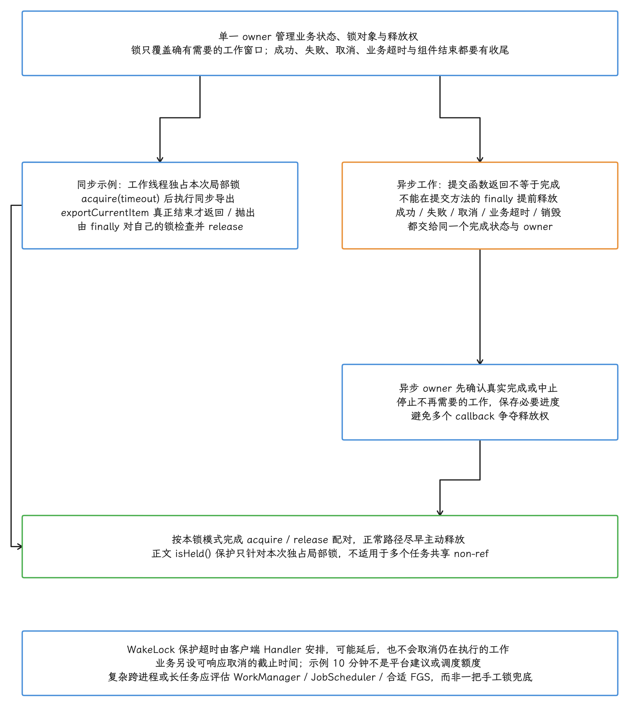

图：同步与异步都贴着真实完成边界管理同一个 owner 的锁。正文的示例每次创建独占的局部非引用计数锁，exportCurrentItem 同步返回或抛出后，才在 finally 里检查并 release；如果只提交了异步请求就返回，这个 finally 会来得过早。异步路径把成功、失败、取消、业务超时、销毁收进同一个终态：先确认完成或中止、收尾并保存进度，再按锁模式配对释放。客户端 Handler 的保护超时可能延后，也不会取消业务；10 分钟只是示例值，不是推荐值或配额。业务要另设可响应取消的 deadline，复杂跨进程或长任务应改评估调度 API 或合格的 FGS。

```java
public final class CpuBoundExport {
    private static final String WAKE_LOCK_TAG =
            "com.example.export:CpuBoundExport";
    private static final long WAKE_LOCK_TIMEOUT_MS =
            TimeUnit.MINUTES.toMillis(10);

    @WorkerThread
    public static void run(Context context) {
        PowerManager powerManager =
                context.getSystemService(PowerManager.class);
        PowerManager.WakeLock wakeLock = powerManager.newWakeLock(
                PowerManager.PARTIAL_WAKE_LOCK,
                WAKE_LOCK_TAG);
        wakeLock.setReferenceCounted(false);
        wakeLock.acquire(WAKE_LOCK_TIMEOUT_MS);
        try {
            exportCurrentItem();
        } finally {
            if (wakeLock.isHeld()) {
                wakeLock.release();
            }
        }
    }
}
```

`acquire(timeout)` 的释放由客户端 Handler 安排，只算兜底保护，当不成严格实时的截止器：Handler 阻塞或设备状态都可能让回调延后，锁到期时，仍在执行的导出照跑。所以正常路径仍要尽早 release；接近保护上限的任务应分段、保存进度，或改用调度 API。`@WorkerThread` 来自 AndroidX annotations，只表达线程契约。多个线程共享非引用计数锁时，任意一次 release 都会解除此前的 acquire，所以本例只对自己的独立锁做 `isHeld()` 保护，这套写法别照搬到共享锁上。

<!-- gracker-diagram: ed11-03-reference-count-and-shared-nonref -->
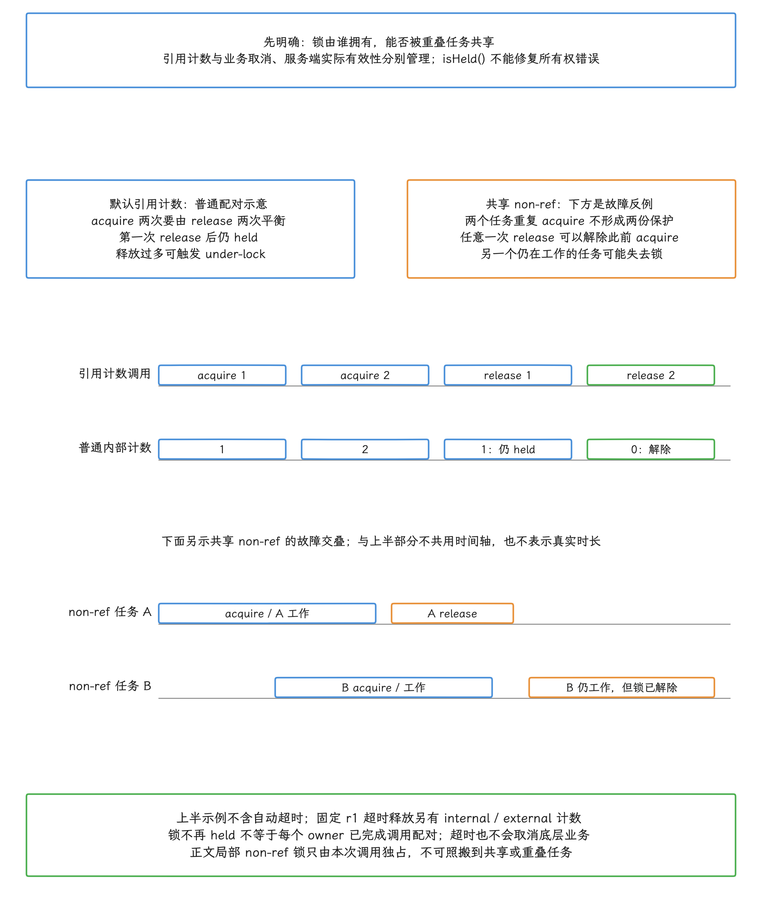

图：两组独立示意，不按时间比例。上半部分是默认引用计数、无自动超时介入的普通配对：2 次 acquire 对应 2 次 release，内部计数走 1→2→1→0，release 过度就是 under-lock。下半部分是两个任务错误共享一把非引用计数锁的反例：任意一次 release 都会解除此前的 acquire，另一个任务还在工作，锁却已经没了。固定 r1 的自动超时另有 internal/external 计数：锁不再 held，每个 owner 未必都完成了配对；超时同样取消不了业务。isHeld 修不了共享 owner 的问题，正文那种独占局部锁也不要套给重叠任务；上下两部分不共用时间轴。

### Tag

稳定 tag 便于 BatteryStats 和 Android vitals（Android 线上质量指标）聚合：

- 使用硬编码的包名、类名或操作名；
- 不放邮箱、账号、设备 ID 等个人信息；
- 不追加时间戳、随机数或递增序号；
- 同一持锁点每次使用同一 tag。

tag 的选择直接反映到线上归因：系统发现 tag 可能包含个人信息时，诊断工具可能只显示 `_UNKNOWN`；高基数 tag——同一持锁点产生大量不同 tag——则会让线上数据聚合不起来。


### WorkSource

`WorkSource` 回答的是“这份工作替哪个 UID（应用用户标识）执行”，常见于系统服务或中间层。Android 17 的 `PowerManagerService.BinderService.acquireWakeLock()` 会在非 null 且含归因内容的 `WorkSource` 上校验 `UPDATE_DEVICE_STATS` 权限；空对象会被归一为 null。这层校验把归因保护了起来：普通应用靠它改不了归因，把成本转给其他 UID 的路也走不通。


### held 与 enabled

Android 13 / API 33 增加了 `WakeLockStateListener`。它观察服务端的 acquire/release 与逻辑启停事件，信息比一个“电源策略开关”丰富，读数时要多想一层。

```java
if (Build.VERSION.SDK_INT >= 33) {
    wakeLock.setStateListener(
            context.getMainExecutor(),
            enabled -> Log.i(
                    "WakeLockState",
                    "serverEnabled=" + enabled
                            + ", clientHeld=" + wakeLock.isHeld()));
}
```

`isHeld()` 读的是客户端当前状态。`enabled=false` 的来源有很多：可能是正常释放，也可能是 cached（缓存进程）/frozen（冻结进程）、Doze、LPS 或其他策略让服务端忽略了这把锁，别把它读成统一的“持锁配额已耗尽”信号。回调异步执行，事件携带的 enabled 与回调里现读的 held 也未必是同一瞬间的快照。监听只用于观察，释放照常由应用完成；移除监听用 `setStateListener(executor, null)`，已排队事件仍要按实际所有者失效处理。策略重新允许时，未释放的锁还可能再次生效。


## 11.3.4 Android 17 Framework 调用链

### PowerManager.WakeLock 到 PowerManagerService

我们沿着一条调用链把整个过程串起来。下面的链路省略日志与权限检查，只保留客户端和服务端如何创建、持有及删除锁记录。

```text
PowerManager.newWakeLock()
  → 客户端 WakeLock 创建 Binder token
WakeLock.acquire()
  → IPowerManager.acquireWakeLock(token, flags, tag, package, WorkSource, ...)
PowerManagerService.acquireWakeLockInternal()
  → 创建或更新服务端 WakeLock 记录
  → 对客户端 token 执行 linkToDeath()
  → 更新 WakeLock summary、Notifier 与 BatteryStats
WakeLock.release()
  → IPowerManager.releaseWakeLock(token, ...)
  → 删除服务端记录并重新计算电源状态
```

链上有三个角色要先认清：Binder token 是服务端识别某次持锁关系的令牌，`linkToDeath()` 注册客户端进程死亡回调，WakeLock summary 是服务端汇总后的锁状态。客户端进程死亡时，Binder death 回调会清理服务端记录。这套死亡清理只是故障兜底，应用的正常 release 仍要自己完成——进程还活着、业务逻辑已经泄漏时，token 依然有效，系统也就无从判断任务其实已经结束。

<!-- gracker-diagram: ch11-03-11-binder-lifetime -->
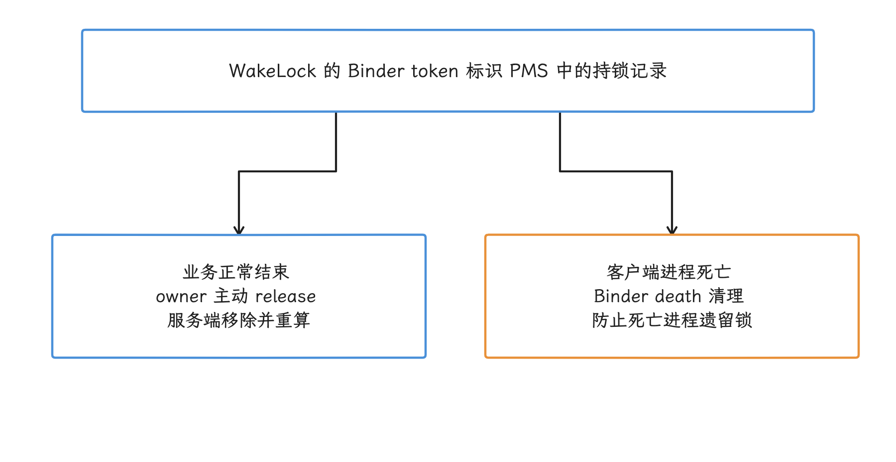

图：进程还活着但业务忘记结束时，token 仍可能有效，系统凭 token 判断业务已完成的路走不通。死亡清理与 acquire 超时都只是保护，正常释放仍要应用自己做。

归因是另一条线：PowerManagerService 根据 owner 与 WorkSource 保存归因，Notifier（电源事件通知组件）再把 acquire/release 事件交给 BatteryStats。某个系统组件持有锁，成本未必记在它名下；我们排查时要结合 WorkSource、UID 和 tag 一起看。

<!-- gracker-diagram: ed11-03-worksource-and-notifier-attribution -->
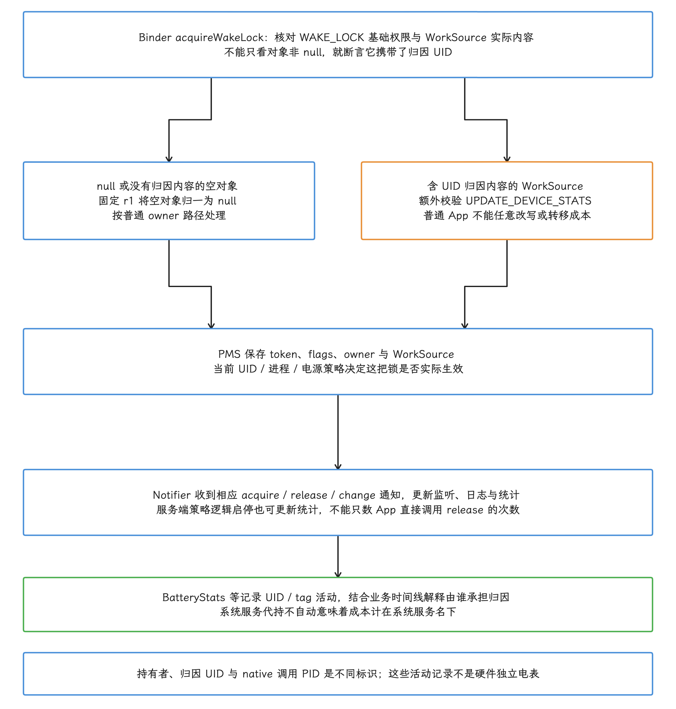

图：固定 r1 的权限与归因数据流。基础的 WAKE_LOCK 权限仍然需要；不带归因的空 WorkSource 会被归一成 null，只有实际含归因内容的才额外校验 UPDATE_DEVICE_STATS，普通 App 因此改不了成本归属。PMS 保存 token/flags/owner/WorkSource 并按状态判断有效性，再经 Notifier 用相应的 acquire/release/change 更新监听、日志与 BatteryStats。逻辑启停同样可能更新统计，每条事件未必对应 App 的直接调用；系统服务代持的锁也不会自动记在服务名下。持有者、归因 UID、nativePID 是三个不同的概念，活动归因算不上独立的硬件电量。

### PowerManagerService 禁用已申请锁的条件

Android 17 的 `setWakeLockDisabledStateLocked()` 会检查：


- WorkSource 归因 UID 是否进入 cached 状态；
- owner 进程是否进入 frozen 状态；
- `NO_CACHED_WAKE_LOCKS` 策略与进程状态；
- deep idle（深度空闲），以及配置允许时的 light idle（轻度空闲）；
- device-idle allowlist 与临时 allowlist；
- Low Power Standby（低功耗待机）allowlist；
- force-suspend（强制挂起）或按 power group（电源组）强制禁用。

状态变化后，`updateWakeLockDisabledStatesLocked()` 会给禁用的锁发逻辑 release 通知、给重新启用的锁发逻辑 acquire 通知，再重算 `mWakeLockSummary`。这类“逻辑通知”只更新服务端状态和统计，客户端并没有真的调用对应方法。App Standby bucket（应用待机分组）限制的是 Job、Alarm 与网络入口；wake lock 在服务端是否有效，要结合上面的 UID 与电源状态一起判断，单凭 bucket 推不出结论。

<!-- gracker-diagram: ed11-03-held-policy-and-logical-events -->
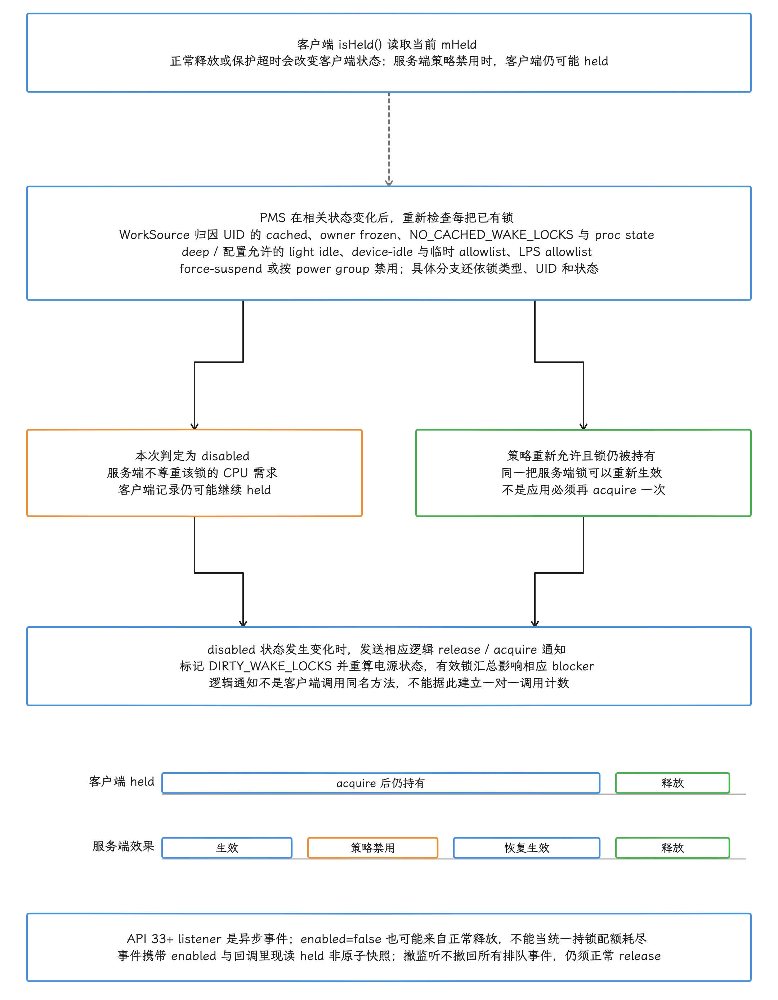

图：固定 r1 里逐把锁走分支：类型、UID、procstate，加上归因 cached、owner frozen、NO_CACHED、deep/配置 light、allowlists、LPS 与强制策略，这些条件并不是固定地全 AND 在一起，bucket 单独推有效性也推不动。状态改变会重查已有锁，只有 disabled 发生转换才发逻辑 release/acquire、置 DIRTY 并重算 summary；客户端可能一直 held，策略恢复时同一把锁还能重新生效。非比例轨道只示可能时序。API 33 的 listener 异步，enabled=false 也可能只是正常释放，事件值与回调里现读的 held 非原子；撤掉监听，排队中的事件未必都会跟着撤回。监听代替不了正常释放，也算不上统一的持锁配额信号。

### 多把 App 锁会汇总成一个 suspend blocker

PMS（PowerManagerService）通过 `mWakeLockSummary & WAKE_LOCK_CPU` 判断是否需要 CPU suspend blocker。suspend blocker 是用户态用于阻止整机挂起的锁；PMS 需要它时会持有名为 `PowerManagerService.WakeLocks` 的 blocker，不再需要时则释放。应用的多个 tag 会留在 PMS 与 BatteryStats，但从 PMS 到 SystemSuspend 的这一段已经汇总。PMS 的显示、启动等 blocker 仍各自存在，其他进程也可直接申请 native 锁；所以看到 `PowerManagerService.WakeLocks` 释放，离全局 suspend counter 归零可能还差好几项。


下面的路径来自 `android-17.0.0_r1`。

```text
PowerManagerService.updateSuspendBlockerLocked()
  → mWakeLockSuspendBlocker.acquire()
  → JNI nativeAcquireSuspendBlocker("PowerManagerService.WakeLocks")
  → hardware/libhardware_legacy/power.cpp acquire_wake_lock()
  → ISystemSuspend.acquireWakeLock(PARTIAL, "PowerManagerService.WakeLocks")
  → SystemSuspend 默认 counter 路径中 suspend counter 增加
```

固定 r1 的 libpower 走 AIDL `ISystemSuspend`，入口落在 `SystemSuspendAidl.cpp`；计数、挂起循环和统计由 `SystemSuspend.cpp` 负责。官方 SystemSuspend 介绍里出现的 HIDL 代码是历史迁移的解释材料，当前接口实现要看 AIDL 这一套。libpower 按名称缓存 native `IWakeLock`，于是服务统计到的调用 PID 是 system_server，每个原始 App 并不直接出现在这一层。

<!-- gracker-diagram: ed11-03-app-summary-native-counter-and-kernel -->
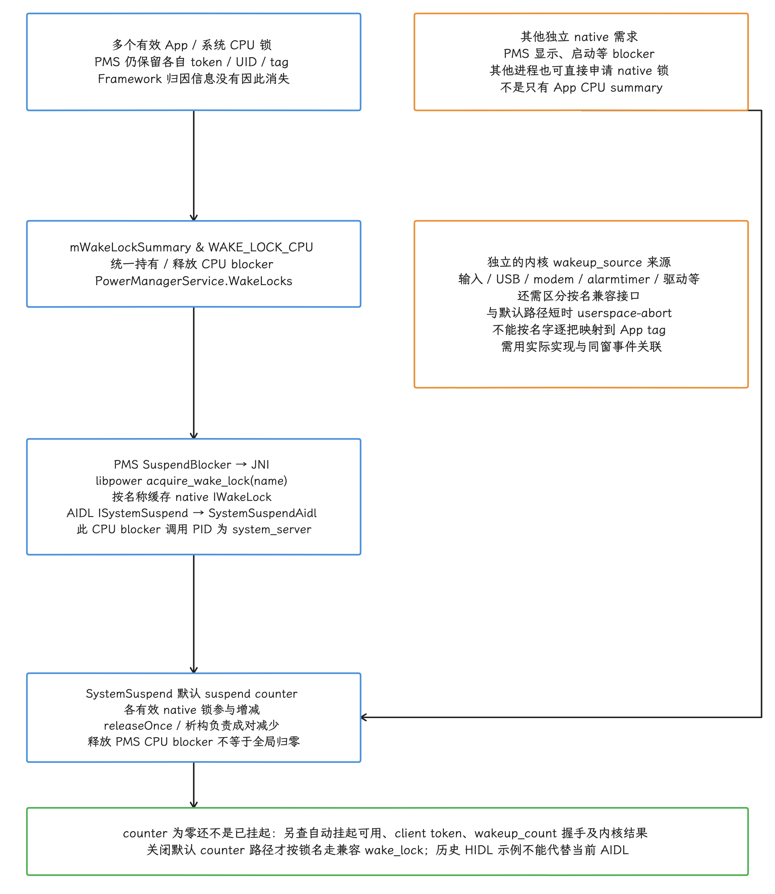

图：固定 r1 默认 counter 路径下的多对一汇总与独立来源。PMS 保留多个 token/UID/tag，把有效的 CPU 需求统一成 PowerManagerService.WakeLocks，经 JNI 到按名缓存 IWakeLock 的 libpower，再经 AIDL ISystemSuspend/SystemSuspendAidl 进入 native 计数，这条调用的 PID 是 system_server。releaseOnce 与析构配对地减少计数；显示、启动等 blocker 和其他进程的 native 锁也在这层参与，所以 CPU blocker 释放了，全局计数离 0 可能还差几项。右侧的内核驱动、兼容接口与短时 userspace abort 是独立来源，图里也就不画逐 App 的同名映射。只有关闭 counter 路径才按名走兼容 wake_lock；历史 HIDL 对应的是迁移前的实现。计数归零之外，挂起还要 auto/client/握手与内核检查都实际通过。

有了这条链，常见的对不上号就有解释了：BatteryStats 保留多个应用 tag，而对应的这一路 CPU blocker 在 native 侧名为 `PowerManagerService.WakeLocks`；SystemSuspend 中还可能有其他 native 或 kernel 项。前者记录应用归因，后者记录汇总后的用户态挂起阻止项。

### SystemSuspend 的 wakeup_count 握手

自动挂起的发起者也换过代：Android 9 及更早版本由 libsuspend（旧的用户态挂起库）发起；Android 10 起，SystemSuspend 负责管理用户态 suspend blocker 并协调系统挂起。

SystemSuspend 的 suspend 线程循环执行：

<!-- gracker-diagram: ch11-03-17-wakeup-count-handshake -->
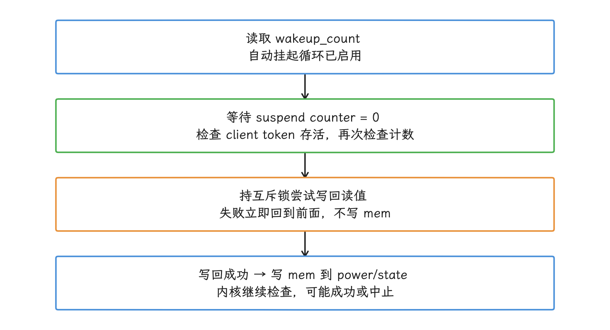

图：握手不保证挂起成功。期间新事件、文件 I/O、client 存活和 kernel 设备流程各需核对，挂起返回后还会按失败/短挂起策略安排下一轮。

1. 在自动挂起已启用的循环中读取 `/sys/power/wakeup_count`；
2. 等待用户态 suspend counter 归零，并检查存活的 autosuspend client token；
3. 再次确认 counter 没有增加，持相关互斥锁把先前读值写回；失败则立即重来，不写 `mem`；
4. 仅写回成功后才向 `/sys/power/state` 写 `mem`，由内核继续检查和尝试挂起；
5. 挂起返回后记录结果与唤醒原因，并按成功、失败或短挂起策略安排下一轮。

写回失败最常见的原因是期间来了新的唤醒事件；此外，读取、写入和挂起本身的 I/O 错误也要逐一核对。我们排查时把四个阶段分开看：counter 归零、握手成功、内核尝试、实际休眠成功，各是各的里程碑。

在默认 suspend-counter（挂起计数器）路径中，普通用户态锁靠计数阻止 suspend；`SystemSuspend.cpp` 仍会短暂写 `userspace-abort` 到 `/sys/power/wake_lock`，用来中止“用户态锁变化与 suspend 同时发生”的竞态。只有设备关闭 counter 路径后，才会按锁名使用 `/sys/power/wake_lock` 兼容接口。

<!-- gracker-diagram: ch11-03-18-userspace-abort-race -->
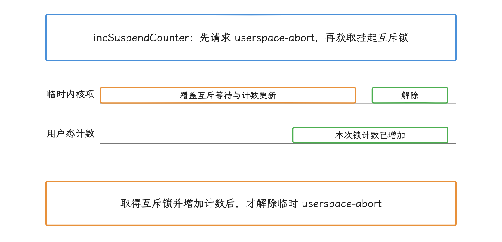

图：图只说明执行先后，不按时长比例；临时 abort 只是短暂写入，别据它推断每个 App tag 在 kernel 都有长期同名 source。关闭 counter 路径时才按名称走兼容 wake_lock 接口。

## 11.3.5 内核 wakeup_source

再往下一层是内核。Linux PM（电源管理子系统）使用 `struct wakeup_source` 记录可阻止或中断 suspend 的实体，`android17-6.18-2026-06_r6` 中的主要源码位置是：

- `drivers/base/power/wakeup.c`：注册、激活、停用、tracepoint（内核跟踪点）与 debugfs（内核调试文件系统）统计；
- `drivers/base/power/wakeup_stats.c`：`/sys/class/wakeup/wakeupN/` 的统计属性；
- `kernel/power/suspend.c`：system suspend 主流程；
- `kernel/power/wakelock.c`：`CONFIG_PM_WAKELOCKS` 用户态兼容接口。

### 用户态锁与内核 source 的映射关系

App 的 `PowerManager.WakeLock` 留在 Framework 的 UID/tag 统计里，PMS 把有效的 CPU 锁汇总成 `PowerManagerService.WakeLocks`；内核这边则另有来自 alarmtimer（内核闹钟定时器）、输入、USB、蓝牙、modem 和各设备驱动的 wakeup source。所以我们看到某个 kernel source（内核唤醒源）时，按名字去找同名 App tag，多半对不上。


### `/sys/kernel/debug/wakeup_sources`

在允许访问 debugfs 的设备上，下面的文件汇总全部 wakeup source：

```bash
adb root
adb shell cat /sys/kernel/debug/wakeup_sources
```

量产 user build（面向用户的系统构建）上通常拿不到 `adb root`，shell 也读不了 debugfs，这条命令适合已取得 root 权限或使用 userdebug 构建的实验机；量产问题优先依赖 bugreport（系统诊断包）、厂商日志和 SystemSuspend dumpsys（服务状态快照）。

Android 17 kernel 表头包括：

| 字段 | 含义 |
|---|---|
| `active_count` | 从 inactive 进入 active 的次数 |
| `event_count` | 上报 wakeup event 的次数 |
| `wakeup_count` | `events_check_enabled` 时收到的 wakeup event 近似计数；不等于成功从 suspend 恢复的次数 |
| `expire_count` | 定时激活到期次数 |
| `active_since` | 当前活跃持续时间；未活跃时为 0 |
| `total_time` | 累计活跃时间 |
| `max_time` | 单次最长活跃时间 |
| `last_change` | 最近一次状态变化时间 |
| `prevent_suspend_time` | autosleep（内核自动挂起）开启期间阻止 suspend 的累计时间 |

<!-- gracker-diagram: ch11-03-20-kernel-event-counters -->
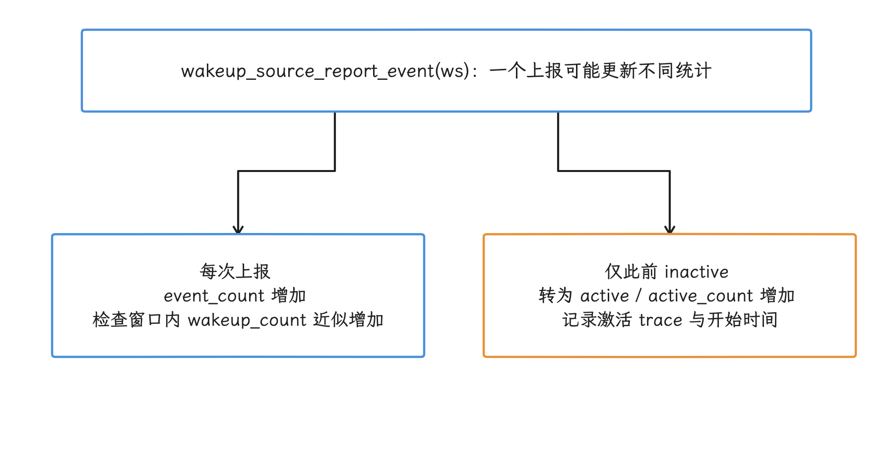

图：两条箭头表示同次上报的不同统计环节，属于并列关系。wakeup_count 也可包含导致挂起中止的事件，别当成功恢复次数读。

读这些数字有几个前提：时间已换算成毫秒，底层是 `ktime_get()` 的单调时钟，`last_change` 跟墙钟时间无关。比较快照时先确认同一来源与统计基线，再取累计项的增量；`active_since` 是当前活动段的年龄，这段结束后会归零。多个 source 可以同时活跃，时长直接相加会重复计算；`prevent_suspend_time` 也只覆盖 autosleep 开启期间的那部分，当不了“所有挂起被阻止”的完整真值。

<!-- gracker-diagram: ch11-03-21-stats-window-overlap -->
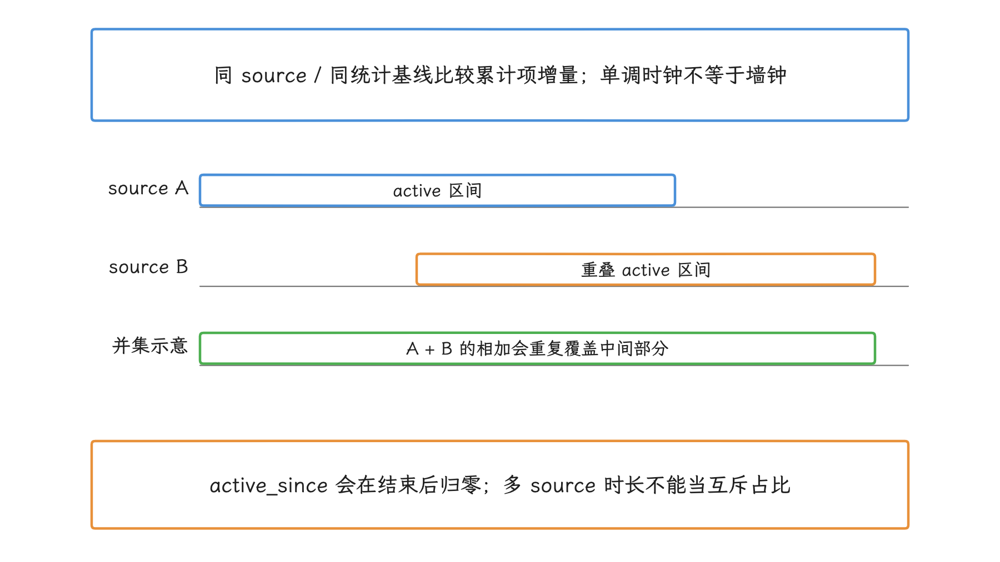

图：条宽不表示测量值。prevent_suspend_time 还受 autosleep 条件影响，覆盖不了所有被阻止的挂起；跨工具对齐前先检查时钟域、reset 与来源生命周期。

`wakeup_stats.c` 还会把各 source 注册到 `/sys/class/wakeup/wakeupN/`，并提供 `active_time_ms`、`total_time_ms`、`max_time_ms`、`prevent_suspend_time_ms` 等属性。sysfs（内核设备与驱动信息文件系统）的读取权限同样由设备构建与 SELinux 安全策略决定。

## 11.3.6 Doze、Low Power Standby 与 App Standby

### Doze

Doze（设备空闲省电模式）在维护窗口之外限制网络、Job、Sync、普通 Alarm，并忽略非豁免应用的 wake lock——多持一把锁换不来豁免。维护窗口时序由系统状态和设备实现决定，写死的十分钟、三十分钟序列靠不住。

allow-while-idle Alarm（可在设备空闲时交付的闹钟）和符合条件的 FCM 提供受控的交付机会，同时带着频率、时长或使用政策。旧 FCM `AndroidConfig` 的 high priority 对应时间敏感的可见结果；当前 `AndroidConfigV2` 预览按 RemoteNotification / BackgroundSync 意图区分，默认通知可由 Play services 直接展示，而不必启动 App 代码——把每次推送都画成“应用拿到 CPU 执行窗口”，就跟实际交付路径对不上了。

### Low Power Standby

Low Power Standby（低功耗待机，LPS）要先分清 enabled（启用）与 active（生效）两个状态。默认判断涉及非交互、timeout、Doze 后的维护窗口及 `activeDuringMaintenance` 配置；force-active 是另一路强制条件。实际生效后，受影响 UID 的网络和 wake lock 受限，FGS 也不自动豁免。Android 14+ 的 `isExemptFromLowPowerStandby()` 和按 reason/feature 查询的 `isAllowedInLowPowerStandby(...)` 反映相应的豁免或能力；LPS 已禁用时它们同样可能返回 true，拿这个返回值去推“当前 active”或“某把锁必然有效”，是靠不住的。

### App Standby

App Standby bucket 直接影响 Job、Alarm、网络与后台运行机会，但它对 wake lock 没有一个稳定公开的“每天可持锁多少分钟”契约。bucket 等级降低后，后台入口减少；进程进入 cached、Doze 或 LPS 后，PMS 又可能禁用已申请的 partial wake lock。这几层状态我们要联合起来检查。


## 11.3.7 由系统或库代持的 WakeLock

应用自己从未调用 `newWakeLock()`，Android vitals 里却可能出现归因到它的锁——来源往往是系统或库在代持。


| 来源 | 常见行为 | 排查方向 |
|---|---|---|
| JobScheduler | Job 执行期代持，归因给调度应用 | Job 是否完成、stop reason（停止原因）、超时与重试 |
| WorkManager | 通常经 JobScheduler 执行 | Worker 是否卡住、链是否重复、约束是否合适 |
| AlarmManager | Alarm 投递时持有 `*alarm*` | Alarm 频率、Receiver 时长、是否需要 exact（精确）闹钟 |
| FCM（Firebase Cloud Messaging） | 代持与归因依 SDK、消息类型及实际交付路径 | 旧消息优先级或 v2 意图、投递频率及对应回调时长 |
| Location | 获取和投递位置期间持有 | 精度、间隔、生命周期与后台资格 |
| Audio / Media | 播放栈或播放器管理 | 会话和 FGS 是否在播放结束后停止 |

WorkManager 管理锁的生命周期，Worker 的执行仍受配额约束，库代持也不自动构成 Play 指标豁免。Android 16 的相关 Job runtime quota 变化同时影响 WorkManager、JobScheduler 与 DownloadManager；API 31+ 可结合 `WorkInfo.getStopReason()` 或 `JobParameters.getStopReason()` 排查，重试、约束和完成度要一起记录。

### Alarm Receiver

AlarmManager 在投递期间维护共享的 `*alarm*` 锁和 in-flight 引用计数，等最后一项交付完成才释放。普通 Receiver 在 `onReceive()` 返回时即算完成；用了 `goAsync()` 的，要由 `PendingResult.finish()` 标记完成，广播超时要求照样存在——先返回、再把任意异步工作都当作被锁覆盖，是靠不住的。Receiver 只做轻量交接，持久工作交给 Worker；direct listener 另有完成通知与超时跟踪路径。

<!-- gracker-diagram: ch11-03-24-alarm-inflight-refcount -->
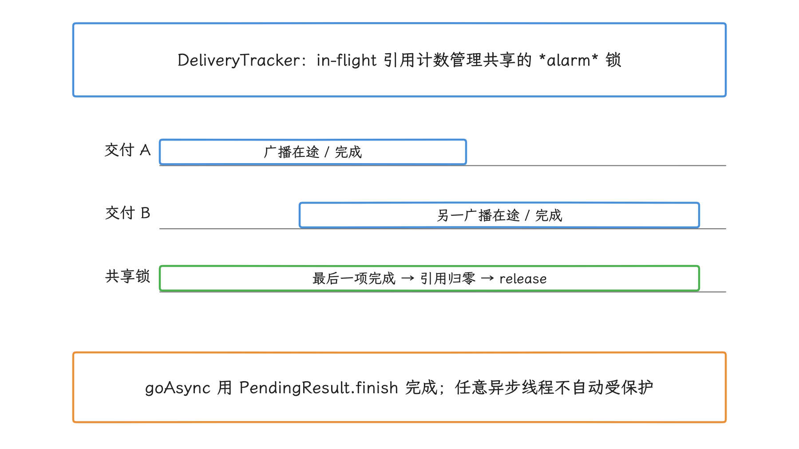

图：示意只针对广播投递完成路径；不是每个 Receiver 返回都释放全局共享锁。direct listener 有自己的完成通知与超时跟踪；持久工作应交给合适调度 API。

### Android 17 listener 型 allow-while-idle Alarm

`setExact(..., OnAlarmListener, Handler)` 从 API 24 起公开，进程终止后就不会再投递。用 `OnAlarmListener` 设置 exact Alarm 时，`SCHEDULE_EXACT_ALARM` 可以省去。

API 37 新增公开重载：

`setExactAndAllowWhileIdle(int, long, String, Executor, OnAlarmListener)`

它适合精确的 idle（设备空闲期）回调，前提是回调只在当前组件存活期间有意义：系统可在调用进程不再有 Activity、Service 或 ContentProvider 时取消 Alarm，所以组件结束时我们要记得 `cancel(listener)`。需要在进程终止后继续投递的闹钟、日历提醒，仍走合适的 `PendingIntent` 路径，并满足 exact Alarm 资格。

<!-- gracker-diagram: ch11-03-25-listener-alarm-owner -->
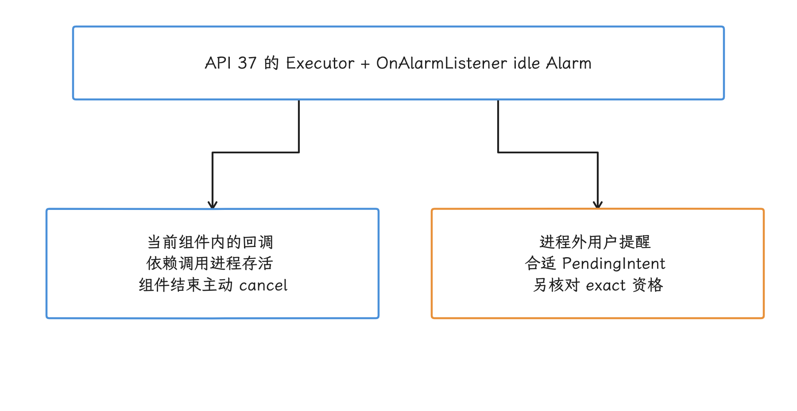

图：listener 例外不需要 SCHEDULE_EXACT_ALARM，也不提供进程退出后的重建交付；它不是保活通道。允许 idle 交付仍不免除限频，唤醒还取决于 alarm type。

## 11.3.8 本地诊断

### 四层证据表

| 层级 | 工具 | 能回答的问题 |
|---|---|---|
| 应用 | 日志、Background Task Inspector | 哪段业务申请、完成、取消或重试 |
| Framework | `dumpsys power`、BatteryStats、Historian | token、tag、UID、WorkSource、前后台时间 |
| SystemSuspend | `dumpsys suspend_control_internal` | Native/Kernel 分类、blocker、suspend/wakeup 统计 |
| Kernel/硬件 | wakeup sources、Perfetto、PowerMonitor、电源轨 | 哪个 source 活跃，整机能量是否变化 |

API 35+ 起可以通过 `SystemHealthManager` 枚举 `PowerMonitor` 描述、读取 `PowerMonitorReadings` 累计能量。monitor 可能对应 measurement rail，也可能对应 consumer 子系统，笼统都叫“独立电源轨”并不准确；结果还受设备支持、缓存、粒度与返回处理影响。比较时检查有效能量、同一 monitor 和推进的时间戳，更细的限定见 [11.1 系统功耗模型](01-android-power-model-system-optimization.md)。共享 rail 同样当不了某个 App 的独立电表。ADPF 能效提示只表达运行偏好，锁仍要应用自己释放。


### 第一步：确认 Framework 记录

我们先从 Framework 记录看起。下面的命令分别查看当前 PMS 锁、UID 历史和 SystemSuspend 统计。

```bash
adb shell dumpsys power
adb shell dumpsys batterystats --history
adb shell dumpsys suspend_control_internal --wakelocks
adb shell dumpsys suspend_control_internal --wakeups
```

`dumpsys power` 回答“现在有哪些客户端记录”；BatteryStats 回答“谁在什么时间持有并被归因”；SystemSuspend 的 `--wakelocks` 还会列出标为 Native/Kernel 的来源，这些行里混有用户态锁之外的条目，读的时候要分开；原生条目时间以 ms 展示，额外的 kernel 总活动时长行以 ns 标注。`suspend_control_internal` 的可用选项和权限会随 build（系统构建）类型与厂商实现变化。

<!-- gracker-diagram: ch11-03-26-diagnostic-drilldown -->
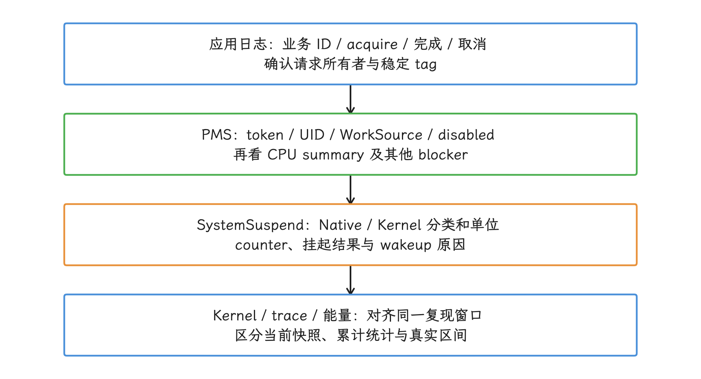

图：几层信息互相补齐。Native/Kernel 行并不都是应用锁；单次 dump 还原不了整个历史，某个 kernel source 名称也独自证明不了归因 UID。

### 第二步：生成可复现的 Battery Historian 输入

下面的流程只应在专用测试设备上执行：重置统计，运行固定复现脚本并记录时间，再生成 bugreport。

```bash
adb shell dumpsys batterystats --reset
adb bugreport wake-lock-reproduction.zip
```

Battery Historian 官方已注明不再积极维护，新平台数据要先核对解析兼容性，再用 Perfetto 与系统服务信息交叉检查。bugreport 里可能有账号、通知、网络和设备信息，分析要用本地 Battery Historian 或受控环境，未脱敏的文件不要上传到未知第三方服务。时间线上要同时查看 screen（屏幕）、Doze、Job、Alarm、network（网络）、process state（进程状态）与 partial wake lock。

### 第三步：Perfetto 对齐 kernel 与能量

下面的 userdebug 配置采集 wakeup-source tracepoint，并在设备支持时采集电池与 power rail（电源轨）数据。

```textproto
buffers: {
  size_kb: 32768
  fill_policy: RING_BUFFER
}
data_sources: {
  config {
    name: "linux.ftrace"
    ftrace_config {
      ftrace_events: "power/wakeup_source_activate"
      ftrace_events: "power/wakeup_source_deactivate"
      ftrace_events: "power/suspend_resume"
    }
  }
}
data_sources: {
  config {
    name: "android.power"
    android_power_config {
      battery_poll_ms: 1000
      battery_counters: BATTERY_COUNTER_CHARGE
      battery_counters: BATTERY_COUNTER_CAPACITY_PERCENT
      collect_power_rails: true
    }
  }
}
duration_ms: 60000
```

固定 r1 的 Perfetto `FtraceParser` 会把 wakeup-source activate/deactivate 按名称解析为 `Wakelock(...)` slice（区间）：该名称活动计数从 0 变 1 时开始，从 1 变 0 时结束。这条解析行为对应的是固定版本，其他版本的 raw ftrace 表现要另行确认。捕获前已经 active、捕获结束仍未停用、事件丢失或同名来源都会影响配对，要保留“不完整区间”的判断；source 名称与 App UID 之间同样没有直接等号。

<!-- gracker-diagram: ch11-03-28-perfetto-config-parser -->
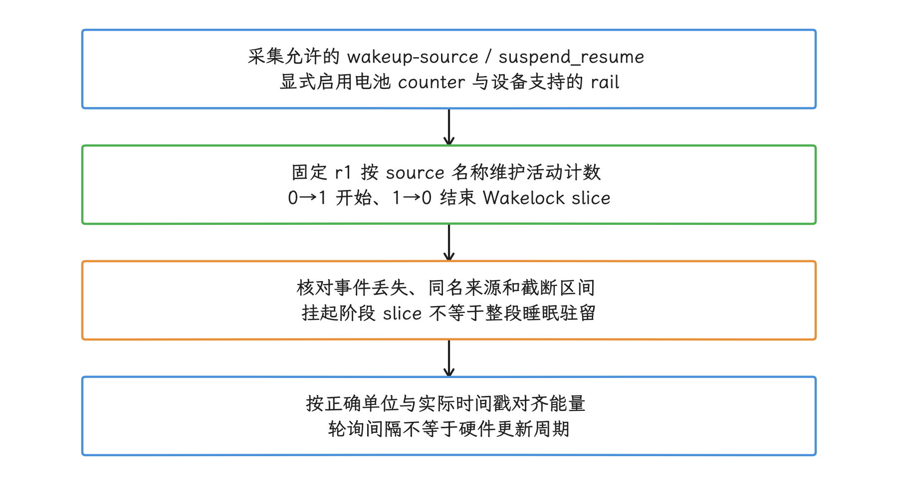

图：图只对应该固定解析器，其他版本的 raw/track 表现要另行确认。轨道缺失时，锁可能仍在，能耗也未必为零；charge 为 µAh，capacity 为百分比，rail energy 为 µWs。

`power/suspend_resume` 描述内核挂起/恢复的各个阶段；挂起是否真正成功、睡眠驻留有多久，要结合 suspend 统计与时间线确认，阶段 slice 的时长也就当不了全部睡眠时间。电池 charge 单位是 µAh、capacity 是百分比、rail 的累计 energy 是 µWs；1000 ms 是请求的轮询间隔，硬件读数未必每秒更新。rail 依赖 PowerStats HAL 和设备支持，轨道缺失只说明没采到，功耗未必为零；user build 还可能限制相应 ftrace 事件。

## 11.3.9 常见故障模式

### 异常路径没有 release

同步代码用 `try/finally`；异步代码要统一完成状态，成功、失败、取消、超时和组件销毁都汇入同一个 release 路径。若生命周期跨进程或可能持续很久，应改用 WorkManager、JobScheduler 或合适类型的 FGS，别让一把手工管理的锁跨越复杂的回调状态机。


### acquire 与 release 所有者不同

若由 Activity 调用 acquire、由 Service 调用 release，或由多个 callback（回调）共同操作引用计数，容易出现重入（同一流程再次进入）和欠释放（申请次数多于释放次数）。把锁对象、业务状态和释放权交给同一个 owner 管理，是直接的解法。


### 用 FGS 掩盖后台轮询

FGS 通知与 partial wake lock 都改变不了高频轮询本身的问题。实时下行优先共享推送通道，可延迟同步使用 Job/WorkManager；FGS 只用于用户正在感知的连续工作。

### 第三方 SDK 与框架代持

Android vitals 归因到应用的锁可能来自 SDK、WorkManager、JobScheduler、FCM 或 Location。按锁名与时间回查 API 调用，只搜项目里的 `newWakeLock()` 是找不全的。

### 高基数 tag

把请求 ID 或用户 ID 放进 tag，会把同一持锁点分散成大量统计项，还可能触发 `_UNKNOWN` 脱敏。业务请求 ID 应留在应用日志中，wake-lock tag 保持稳定，两者通过时间戳关联。

### 只看持锁时长

我们看持锁时长时，先区分客户端 held 与系统实际生效区间；就算确实占用了 suspend 机会，也到不了能量那一步。修复评估还要看：


- 锁内 CPU running time（CPU 实际运行时间）与线程活动；
- 网络、定位、传感器和存储活动；
- suspend 成功次数与睡眠时长；
- 设备 power rail 或外接仪表数据；
- 业务成功率、端到端延迟与恢复行为。

## 11.3.10 Google Play excessive partial wake lock

Android vitals 在以下条件下把一次应用会话计入 excessive partial wake lock：


- 所有非豁免 partial wake lock 合计，在 24 小时内达到或超过 2 小时；
- 统计锁在应用后台或运行 Foreground Service 时的持有时间；
- 当前豁免包括 audio、location 和 JobScheduler user-initiated API 创建的锁。

若 28 天内超过 5% 的应用会话命中，可能影响 Google Play 可见性。2026-03-04 官方实施说明确认，3 月 1 日起已逐步推出相应质量处理；持续超阈值的应用可能减少推荐等发现入口，或在商店详情页显示耗电警告。

这两个数最容易读错。5% 是命中该问题的会话比例门槛，说的可不是“每个用户可以持锁 5% 的时间”；两小时是 Android vitals 汇总多把非豁免锁后的质量指标，应用的 system API quota（系统接口配额）里并没有这一项。Play Console 的 wake-lock name（锁名称）、affected sessions（受影响会话）和 P90/P99 时长（90/99 分位数）可以用来定位来源，修复仍要回到具体业务与系统时间线。

<!-- gracker-diagram: ed11-03-vitals-scope-and-denominators -->
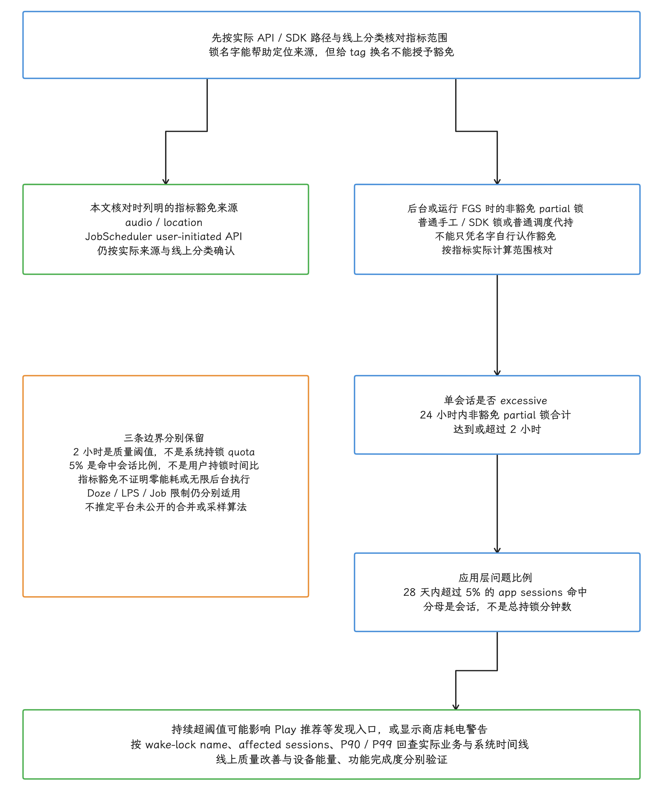

图：只按本文已核对的指标解释计算范围。先分清锁的实际 API/SDK 来源与线上分类：当前列明的豁免是 audio、location、JobScheduler user-initiated，普通手工或调度代持的锁凭 tag 自认豁免是不算数的。对后台或 FGS 中的非豁免 partial 锁，24 小时合计 ≥ 2 小时用于单会话的 excessive 判定；28 天内超过 5% 的 app session 命中是另一套窗口与会话分母，可能影响 Play 可见性。2 小时在系统 API quota 之外，5% 也不是用户时间占比；拿到豁免也证明不了零能耗、无限执行或 Doze/LPS 放行，更推不出平台未公开的合并/采样算法。按 name、affected sessions、P90/P99 回查业务，能量和功能要另行验证。

## 11.3.11 版本边界

| 版本 | 相关变化 |
|---|---|
| Android 8 / API 26 | 兼容范围起点；后台执行与位置限制已开始影响持锁场景 |
| Android 9 / API 28 | App Standby buckets；SystemSuspend 迁移前的历史分界 |
| Android 10 / API 29 | SystemSuspend 取代 libsuspend 成为现代用户态挂起协调路径 |
| Android 12 / API 31 | 后台 FGS 启动限制；exact-alarm 权限 |
| Android 13 / API 33 | `WakeLockStateListener`、Low Power Standby；`ACQUIRE_CAUSES_WAKEUP` 废弃 |
| Android 14 / API 34 | LPS policy 查询能力；FGS 类型与 while-in-use 权限检查范围扩大 |
| Android 15 / API 35 | PowerMonitor；限时 FGS 行为 |
| Android 16 / API 36 | Job runtime quota 变化影响 WorkManager、JobScheduler、DownloadManager |
| Android 17 / API 37 | 公开 listener 版 `setExactAndAllowWhileIdle()`；平台源码锚点 `android-17.0.0_r1` |
| 2026-03 | Google Play excessive partial wake lock 可见性处理开始执行 |

## 11.3.12 复核清单

- [ ] 是否存在专用 API，可省去手工 partial wake lock？
- [ ] Manifest 是否只在确有需要时声明 `WAKE_LOCK`？
- [ ] tag 是否稳定、可定位且不含个人信息或唯一 ID？
- [ ] acquire/release 是否由同一 owner 管理？
- [ ] 是否覆盖成功、失败、取消、超时和组件销毁？
- [ ] 超时是否只作为保险，正常路径是否主动 release？
- [ ] 是否区分客户端 held 与服务端 enabled？
- [ ] 是否同时检查 Doze、LPS、cached/frozen、FGS 和 App Standby？
- [ ] 是否区分 BatteryStats tag、SystemSuspend blocker 与 kernel wakeup source？
- [ ] 框架或 SDK 代持的锁是否按 Job、Alarm、FCM、Location、Audio 分别回查？
- [ ] 修复是否同时验证功能 SLA（服务时限承诺）、suspend 时间与设备能量？
- [ ] 平台引用是否来自 `android-17.0.0_r1`，kernel 引用是否来自 `android17-6.18-2026-06_r6`？

## 参考资料

### Android Developers

- [Choose the right API to keep the device awake](https://developer.android.com/develop/background-work/background-tasks/awake)
- [Use wake locks](https://developer.android.com/develop/background-work/background-tasks/awake/wakelock)
- [Follow wake lock best practices](https://developer.android.com/develop/background-work/background-tasks/awake/wakelock/best-practices)
- [Debug wake locks locally](https://developer.android.com/develop/background-work/background-tasks/awake/wakelock/debug-locally)
- [Identify and optimize wake lock use cases](https://developer.android.com/develop/background-work/background-tasks/awake/wakelock/identify-wls)
- [Task scheduling and WorkManager](https://developer.android.com/develop/background-work/background-tasks/persistent)
- [Excessive partial wake locks](https://developer.android.com/topic/performance/vitals/excessive-wakelock)
- [PowerManager API](https://developer.android.com/reference/android/os/PowerManager)
- [AlarmManager API](https://developer.android.com/reference/android/app/AlarmManager)
- [PowerMonitor API](https://developer.android.com/reference/android/os/PowerMonitor)
- [Doze and App Standby](https://developer.android.com/training/monitoring-device-state/doze-standby)
- [Android 16 JobScheduler quota changes](https://developer.android.com/about/versions/16/behavior-changes-all#job-quota-opt)

### AOSP `android-17.0.0_r1`

- `frameworks/base/core/java/android/os/PowerManager.java`
- `frameworks/base/services/core/java/com/android/server/power/PowerManagerService.java`
- `frameworks/base/services/core/jni/com_android_server_power_PowerManagerService.cpp`
- `frameworks/base/apex/jobscheduler/framework/java/android/app/AlarmManager.java`
- `frameworks/base/apex/jobscheduler/service/java/com/android/server/alarm/AlarmManagerService.java`
- `hardware/libhardware_legacy/power.cpp`
- `system/hardware/interfaces/suspend/aidl/default/SystemSuspend.cpp`

### Android common kernel `android17-6.18-2026-06_r6`

- `drivers/base/power/wakeup.c`
- `drivers/base/power/wakeup_stats.c`
- `kernel/power/suspend.c`
- `kernel/power/wakelock.c`

### 官方系统资料

- [Wake lock 质量处理实施说明（2026-03-04）](https://developer.android.com/blog/posts/battery-technical-quality-enforcement-is-here-how-to-optimize-common-wake-lock-use-cases)
- [Wake lock 指标与 P90/P99 说明](https://developer.android.com/blog/posts/raising-the-bar-on-battery-performance-excessive-partial-wake-locks-metric-is-now-out-of-beta)
- [AOSP：当前 SystemSuspend AIDL 实现](https://android.googlesource.com/platform/system/hardware/interfaces/+/refs/tags/android-17.0.0_r1/suspend/aidl/default/SystemSuspendAidl.cpp)
- [AOSP：Perfetto wakeup-source 解析器](https://android.googlesource.com/platform/external/perfetto/+/refs/tags/android-17.0.0_r1/src/trace_processor/importers/ftrace/ftrace_parser.cc)
- [SystemSuspend service](https://source.android.com/docs/core/power/systemsuspend)
- [Perfetto power data sources](https://perfetto.dev/docs/data-sources/battery-counters)
- [Battery Historian](https://developer.android.com/topic/performance/power/setup-battery-historian)
