# Bluetooth 扫描与连接功耗分析

排查 Bluetooth 功耗异常时，“蓝牙开着”这个状态的信息量很有限：开关只说明协议栈在运行，而 Bluetooth controller（蓝牙控制器，通常包含芯片和固件）此刻可能处于 idle（空闲），也可能正在扫描、广播、建立链路、传输音频或反复重连。我们把四类证据分开看：应用进程的回调频率、系统为 UID（应用用户标识）记录的扫描时间、controller 的 Tx/Rx（发送/接收）时间、整机电量，各自描述一个层面。

全文沿 BLE（Bluetooth Low Energy，低功耗蓝牙）扫描与 GATT（Generic Attribute Profile，通用属性配置文件）连接两条路径展开。诊断目标是回答五个问题：谁发起、持续多久、系统采用了什么扫描或连接参数、controller 是否持续工作、应用在业务结束后是否停止活动。

> 源码基线：AOSP `android-17.0.0_r1`（Android 17 / API 37）。

## 11.4.1 先确定哪类 Bluetooth 活动在耗电

拿到一台疑似 Bluetooth 耗电的设备，我们先弄清耗电的是哪一类活动。相关活动至少分为五类：

| 活动 | 主要成本 | 常见应用问题 | 优先证据 |
|---|---|---|---|
| BR/EDR（经典蓝牙）发现与连接 | inquiry/page（发现/寻呼）、profile（功能协议）连接、ACL/SCO（普通数据/同步音频） | 反复 discovery、连接失败后立即重试 | Bluetooth dump、HCI snoop（主机控制接口协议日志）、controller activity（控制器活动统计） |
| BLE 扫描 | controller 接收窗口、active scan（主动扫描）请求、主机回调 | 无过滤、长时 `LOW_LATENCY`、页面退出后未停止 | `AppScanStats`、BatteryStats、应用日志 |
| BLE 广播 | 广播间隔、connectable（可连接）状态、payload（载荷）更新 | 过短间隔、业务结束后仍广播 | Bluetooth dump、controller activity |
| GATT 连接与数据 | 连接事件、PHY（物理层）、ATT（属性协议）事务、重传 | 轮询 characteristic（特征值）、长期高优先级、重连风暴 | GATT 状态、回调时序、HCI snoop |
| A2DP（立体声音频）/ HFP（免提通话）/ LE Audio | controller、Codec（编解码器）、audio DSP（音频数字信号处理器）、CPU、传感器 | 把整条媒体处理链都归到 Bluetooth | audio dump、Bluetooth dump、Perfetto、power rails（电源轨） |

连接事件稀疏、无持续数据时，BLE 链路可以减少无线活动；要比较连接和扫描哪个更省电，还得把扫描 duty cycle、连接参数和设备实现放在一起看。“已连接”与“低功耗”是两回事：连接间隔很短、notification（外围设备主动通知）很密、链路质量差导致重传，或者应用持续发起 ATT 读写时，controller 仍会频繁进入 active（工作）状态。


## 11.4.2 BLE 扫描成本由哪些参数决定

一次扫描的能耗分布在三个层级，我们先区分 controller 与 host（运行蓝牙协议栈的主机系统）：

- **Controller 侧**：扫描窗口占用接收机；active scan 还可能发送 scan request（扫描请求）并等待 scan response（扫描响应）。
- **Bluetooth 进程侧**：过滤、组装 `ScanResult`、维护 scanner（扫描客户端）与统计。
- **应用进程侧**：Binder（进程间通信）回调、对象分配、业务判断、日志和网络上报。

BatteryStats 根据 WorkSource（工作归属信息）、扫描类型和 controller activity 把扫描与无线活动归因到应用，应用 CPU、网络等另记在各自的统计分量里。它没有直接测量三个层级各自的能量，所以这些时间与估算值在相加之前，要先弄清每一项量的是什么。


### Scan mode 控制接收 duty cycle

`ScanUtil.kt` 为常规模式提供以下 AOSP 默认参数：

| Scan mode | 默认 window / interval（窗口/间隔） | 近似 duty cycle（占空比） | 用途 |
|---|---:|---:|---|
| `SCAN_MODE_LOW_POWER` | 140 ms / 1400 ms | 10% | 默认模式、后台低频发现 |
| `SCAN_MODE_BALANCED` | 183 ms / 730 ms | 25% | 前台但不要求即时发现 |
| `SCAN_MODE_LOW_LATENCY` | 100 ms / 100 ms | 100% | 用户正等待配对的短窗口 |
| `SCAN_MODE_OPPORTUNISTIC` | 不单独启动扫描 | 取决于其他 scanner | 只消费现有扫描结果 |

这些数字是常规扫描的 AOSP 17 默认值，SDK 并未把它们写成公开行为保证，batch 路径另有参数，拿来当量级参考就好。`configureRegularScanParams()` 还会分别为 1M 与 Coded PHY 选择当前更激进的 client，所以一个 App 请求的 mode 与硬件实际运行的 duty cycle 是两回事；`Settings.Global`、DeviceConfig、feature flag（功能开关）、controller 能力和 OEM（设备厂商）配置都可能改变运行参数。应用依赖 mode 的语义即可，具体毫秒数交给系统。

<!-- gracker-diagram: ch11-04-03-scan-window-duty -->
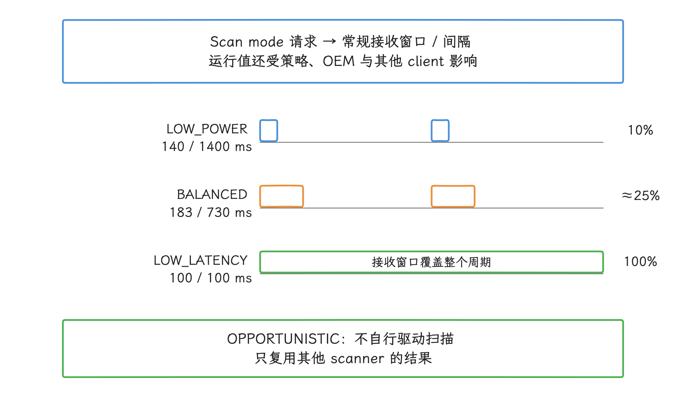

图：仅展示固定 r1 的常规默认值；每行两周期各自归一化、不共用绝对时间标尺，图为示意，batch 参数另行确认。

Bluetooth 栈还使用内部的 screen-off scan mode（熄屏扫描模式）：无过滤扫描会在屏幕关闭时暂停，部分可继续的扫描会被降到更稀疏的内部参数，完整机制见 11.4.5。至于熄屏后每台设备实际耗电多少，还要以实测为准。

### Filter 主要减少结果与主机唤醒

`ScanFilter` 可以匹配 service UUID（服务唯一标识）、manufacturer data（厂商数据）、service data（服务数据）、设备地址等字段。controller 支持硬件 offload（由控制器直接处理）且资源充足时，过滤可以在较低层完成；普通 `ALL_MATCHES` 的部分路径也可以由 host 过滤。硬件跟踪或批量能力不足时，甚至可能直接注册失败，此时软件回退只是可能性之一，要按设备能力判断。

过滤条件并不会自动缩短 controller 的扫描窗口：它的收益主要是减少无关结果上送、Binder 回调和应用进程工作；要降低射频接收时间，还得缩短扫描时长或选用较低 duty cycle。

<!-- gracker-diagram: ed11-04-scan-window-filter-and-host-cost -->
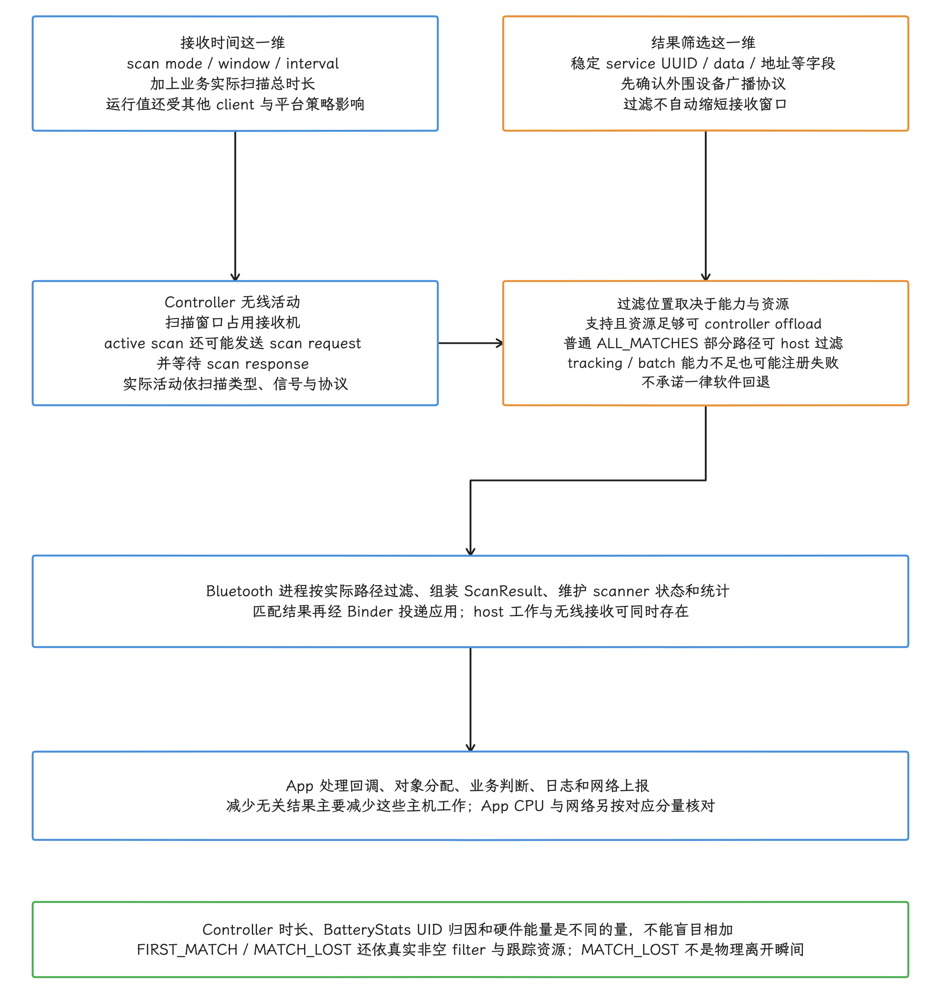

图：两个控制维度与结果数据流合图：scanmode/window/interval和业务总时长影响RF接收机会，filter按稳定广播字段筛结果，不自动缩短接收窗口。支持且资源足可controlleroffload，普通ALL_MATCHES部分路径可host匹配，tracking/batch不足也可能直接注册失败，不能一概当软件回退。Bluetooth进程结果组装/统计及App回调/分配/业务/网络可与RF并行产生成本；controller时长、UID归因与硬件能量不同不可盲加。FIRSTMATCH/MATCHLOST还需非空filter/跟踪资源，lost不证明物理离开瞬间。

`FIRST_MATCH` / `MATCH_LOST` 适合“目标出现或离开”的事件模型，前提是非空 filter（过滤条件）、controller 跟踪资源和平台支持都到位。`MATCH_LOST` 报告的是平台的跟踪与超时判断，至于设备是否刚离开物理范围，要另外核实。

`OPPORTUNISTIC` 回答的是“要不要自己驱动扫描”，与链路层 active/passive scan type 分属两个维度；主动请求 scan response 还是被动接收，由 API 36.1 的 `setScanType()` 控制，默认 active。普通配网（为外围设备配置网络）页面仍可使用 `ALL_MATCHES`，前提是扫描窗口短、找到目标后立即停止。

<!-- gracker-diagram: ch11-04-04-mode-vs-scan-type -->
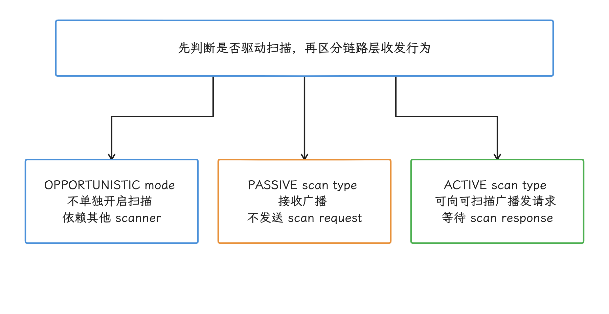

图：机会式管“要不要扫描”，主动/被动管“怎么收发”，两个维度；API 36.1 setScanType 默认 active，改为 passive 前先确认业务字段没有依赖 scan response。

### Batch 降低回调频率

`ScanSettings.Builder.setReportDelay()` 请求延迟、批量上送，主要减少 host 与应用唤醒，零延迟就是逐条报告。硬件 batch storage（批量结果存储）的容量和能力取决于设备，这个延迟值只描述投递节奏；AOSP 17 的批量投递还可能叠加报告间隔下限与退避，精确的回调周期要按目标设备实测。

Android 14 / API 34 新增 `CALLBACK_TYPE_ALL_MATCHES_AUTO_BATCH`：屏幕关闭时累计结果并按延迟投递 batch（批量），亮屏时恢复逐条回调，亮屏或停止扫描时也会触发已有批次的交付。`reportDelayMillis` 至少为 `AUTO_BATCH_MIN_REPORT_DELAY_MILLIS`，即 10 分钟。这类模式适合能容忍延迟的观察任务；用户正在等待的配网，还是用即时回调。

<!-- gracker-diagram: ch11-04-06-auto-batch-transitions -->
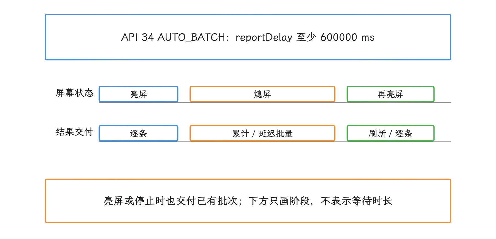

图：轨道不按时间比例，回调周期与发现延迟以实测为准；批量能力、间隔下限与退避取决于设备实现，无过滤暂停等规则另行核对。

## 11.4.3 把扫描绑定到业务生命周期

配网页面的扫描要用稳定 filter，设好业务超时，让重复 stop 安全，页面退出时停止。下面的示例把 start/stop 与会话状态都限定在主线程，我们为每次扫描创建独立 callback，旧会话已排队的回调一律忽略；权限请求和 Bluetooth 开关引导在调用前完成。还要留意 Handler 超时可能因线程繁忙而延后，把它当尽力而为的保护来用。


```kotlin
private const val SCAN_TIMEOUT_MS = 10_000L

class PairingScanner(
    private val adapter: BluetoothAdapter,
    private val serviceUuid: UUID,
    private val onResult: (ScanResult) -> Unit,
    private val onFailure: (Int) -> Unit,
) {
    private val handler = Handler(Looper.getMainLooper())
    private class Session(val scanner: BluetoothLeScanner) {
        lateinit var callback: ScanCallback
        lateinit var timeout: Runnable
    }
    private var session: Session? = null

    @MainThread
    @RequiresPermission(Manifest.permission.BLUETOOTH_SCAN)
    fun start() {
        check(Looper.myLooper() == handler.looper)
        if (session != null) return
        val scanner = adapter.bluetoothLeScanner ?: return
        val filters = listOf(
            ScanFilter.Builder().setServiceUuid(ParcelUuid(serviceUuid)).build()
        )
        val settings = ScanSettings.Builder()
            .setScanMode(ScanSettings.SCAN_MODE_LOW_LATENCY)
            .setCallbackType(ScanSettings.CALLBACK_TYPE_ALL_MATCHES)
            .build()
        val current = Session(scanner)
        current.callback = object : ScanCallback() {
            override fun onScanResult(type: Int, result: ScanResult) {
                handler.post {
                    if (session === current) onResult(result)
                }
            }
            override fun onScanFailed(errorCode: Int) {
                handler.post {
                    if (session !== current) return@post
                    stop()
                    onFailure(errorCode)
                }
            }
        }
        current.timeout = Runnable {
            if (session === current) stop()
        }
        session = current
        try {
            scanner.startScan(filters, settings, current.callback)
            check(handler.postDelayed(current.timeout, SCAN_TIMEOUT_MS))
        } catch (e: RuntimeException) {
            stop()
            throw e
        }
    }

    @MainThread
    @SuppressLint("MissingPermission") // stop 也用于权限已撤销后的本地收尾
    fun stop() {
        check(Looper.myLooper() == handler.looper)
        val current = session ?: return
        session = null
        handler.removeCallbacks(current.timeout)
        try {
            current.scanner.stopScan(current.callback)
        } catch (e: SecurityException) {
            Log.w("PairingScanner", "Permission revoked during stop", e)
        } catch (e: IllegalStateException) {
            Log.w("PairingScanner", "Bluetooth unavailable during stop", e)
        }
    }
}
```

调用方要在找到目标、`onStop()`、Bluetooth 关闭和权限撤销时调用 `stop()`。`startScan()` 正常返回只表示调用已提交，注册可能异步失败，也可能被静默限流，所以超时路径必须收尾。示例的 stop 在权限撤销或蓝牙不可用时会清理本地状态并记日志；远端请求是否已被移除，要用 Bluetooth dump 之类的系统侧输出确认。`LOW_LATENCY` 只覆盖用户等待的短区间，失败后歇一下再试，避免立即循环重试。

<!-- gracker-diagram: ed11-04-pairing-session-and-late-events -->
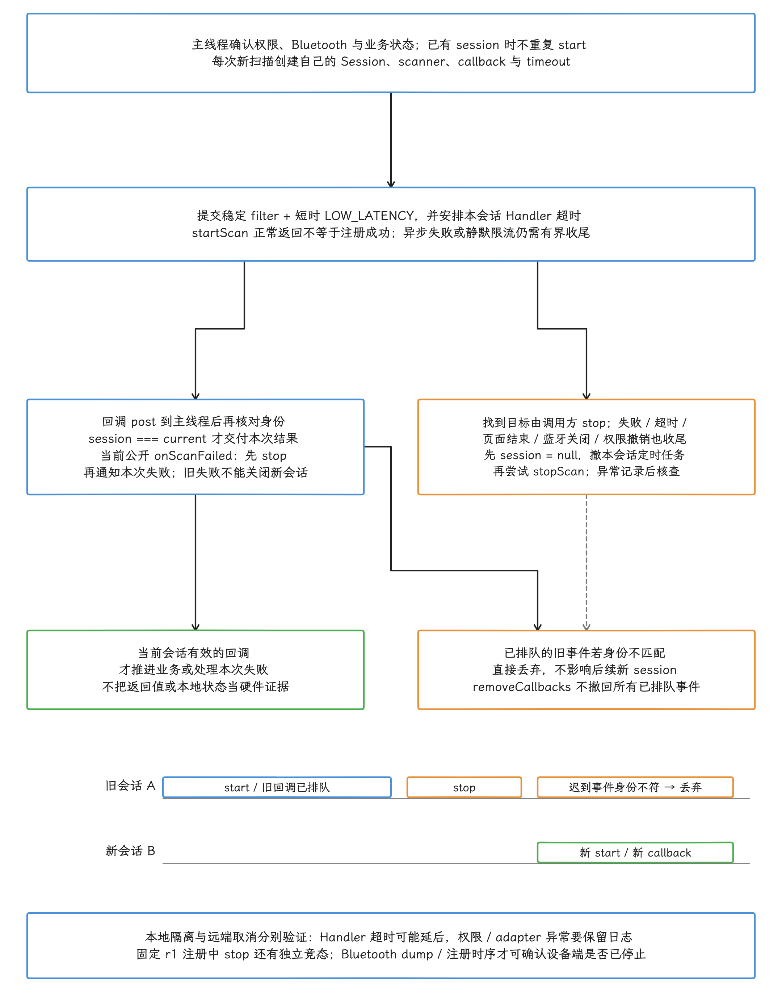

图：当前示例在主线程管理每次独立Session/callback/timeout，已有session不重复start。正常提交不等注册成功；回调post后核对对象身份，只有当前会话可交付结果，当前公开失败先stop再onFailure，旧事件不能推进或结束新会话。找到目标由调用方stop，生命周期/超时/权限/蓝牙变化也收尾：先sessionnull与撤定时任务，再try远端stop，异常留日志。非比例双轨仅示已排队旧事件可能迟到，removeCallbacks不撤回全部事件。Handler超时可延后，本地隔离不证明远端已取消；固定r1注册中stop竞态与设备dump/时序仍独立核对。

平台上还有一个注册竞争要核对：固定 r1 的 `stopScan(callback)` 会先移除客户端映射，`stopLeScan()` 在尚未收到注册结果、`mScannerId <= 0` 时直接返回，后续成功注册回调也缺少对应的取消检查。所以这个示例保证的只是应用侧会话与定时任务的收尾；该版本注册中的远端请求是否同步取消，要结合目标系统修订、Bluetooth dump 和注册时序验证，设备端是否已经停止同样要靠这些输出确认，主机示例测试给不出答案。

<!-- gracker-diagram: ch11-04-09-registration-stop-race -->
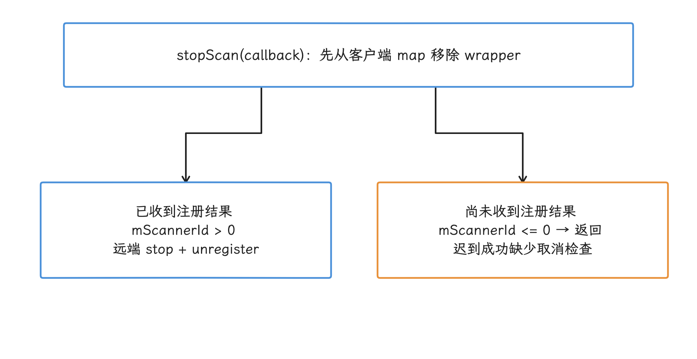

图：来自固定 r1 的实际方法控制流；应用本地状态已清理，远端扫描未必同步结束，应按目标平台修订和 dump 核对。该竞态在不同版本的表现以目标平台为准。

## 11.4.4 后台发现、权限与进程存活

谈后台，我们先把“界面不可见”和“进程不存在”分成两件事。按官方文档，进程存活的应用在界面不可见时仍可使用 `BluetoothLeScanner`，只是系统照样应用扫描降级、屏幕状态和后台执行策略；进程可能被回收时，改用 `PendingIntent`（由系统代应用投递的预封装操作）扫描，或交给 Companion Device Manager（配套设备管理器）。

<!-- gracker-diagram: ch11-04-10-background-discovery-entry -->
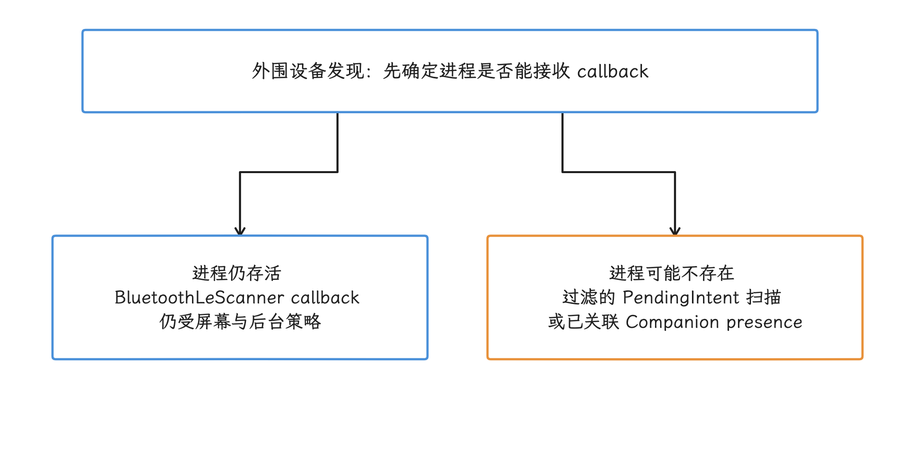

图：后台扫描没有无限后台执行权；进程被杀会影响普通 GATT/callback 生命周期，周期 Job/Alarm 重启扫描还会在设备不在场时唤醒应用。

### Android 12+ 权限

| 操作 | targetSdk 31+ 权限 | 位置边界 |
|---|---|---|
| 扫描附近设备 | `BLUETOOTH_SCAN` | 从结果推导位置时还需相应位置权限 |
| 与已配对设备通信 | `BLUETOOTH_CONNECT` | 与扫描位置声明分开 |
| 让本机广播 | `BLUETOOTH_ADVERTISE` | 与扫描位置声明分开 |

这三个权限属于 Nearby devices（附近设备）运行时权限组。兼容 Android 11 及以下时，旧 `BLUETOOTH` / `BLUETOOTH_ADMIN` 通常设 `maxSdkVersion="30"`；位置权限只有在 Android 12+ 已无需位置并作出相应声明时才同样截到 30，若应用仍推导物理位置或另有定位功能，位置权限要保持原样。Android 10/11 的后台发现还可能需要 `ACCESS_BACKGROUND_LOCATION`。

`neverForLocation` 是数据用途声明：应用确认扫描结果不会用于推导物理位置时，可为 `BLUETOOTH_SCAN` 设置该 flag（标志），代价是平台可能过滤部分 BLE beacon（信标）结果。它只管数据用途，扫描 duty cycle 不因它改变，把它当省电参数是误用。


### PendingIntent 扫描

下面的示例使用显式 BroadcastReceiver（广播接收器）和同一个 mutable（内容可由系统补充）`PendingIntent` 启停扫描，便于系统在进程不常驻时投递匹配结果。


```kotlin
private const val BLE_SCAN_ACTION = "com.example.ble.SCAN_RESULT"
private const val SCAN_START_SUCCESS = 0

@RequiresApi(26)
@RequiresPermission(Manifest.permission.BLUETOOTH_SCAN)
fun startPresenceScan(
    context: Context,
    scanner: BluetoothLeScanner,
    serviceUuid: UUID,
): PendingIntent {
    val intent = Intent(context, BleScanReceiver::class.java)
        .setAction(BLE_SCAN_ACTION)
    val mutableFlag = if (Build.VERSION.SDK_INT >= 31) PendingIntent.FLAG_MUTABLE else 0
    val pendingIntent = PendingIntent.getBroadcast(
        context, 0, intent, PendingIntent.FLAG_UPDATE_CURRENT or mutableFlag,
    )
    val filters = listOf(
        ScanFilter.Builder()
            .setServiceUuid(ParcelUuid(serviceUuid))
            .build()
    )
    val settings = ScanSettings.Builder()
        .setScanMode(ScanSettings.SCAN_MODE_LOW_POWER)
        .setCallbackType(ScanSettings.CALLBACK_TYPE_FIRST_MATCH)
        .build()

    try {
        val result = scanner.startScan(filters, settings, pendingIntent)
        check(result == SCAN_START_SUCCESS) { "BLE scan request rejected: $result" }
        return pendingIntent
    } catch (e: RuntimeException) {
        pendingIntent.cancel()
        throw e
    }
}

@RequiresApi(26)
@RequiresPermission(Manifest.permission.BLUETOOTH_SCAN)
fun stopPresenceScan(
    scanner: BluetoothLeScanner,
    pendingIntent: PendingIntent,
) {
    try {
        scanner.stopScan(pendingIntent)
    } finally {
        pendingIntent.cancel()
    }
}
```

Bluetooth 栈要向 Intent 填充扫描 extras（附加数据），所以 Android 12+ 显式使用 mutable flag，显式 Receiver 则负责限制投递目标。这个例子要求 API 26+ 和已声明的 `BleScanReceiver`，并由单一 owner 管理这个固定身份的 PendingIntent：每次调用复用同一身份，要修改 filter/settings 时先停止旧扫描，因为 r1 对已注册的同一个 PI 再次 start 会直接忽略。

返回 0 也只是请求提交成功，异步注册可能还在路上：Receiver 先检查 `EXTRA_ERROR_CODE`，成功时再读取 `EXTRA_LIST_SCAN_RESULT` / `EXTRA_CALLBACK_TYPE`，并校验业务是否仍有效、安排短任务。stop 抛出的权限或状态异常由调用者处理，取消 token 之后设备是否静止同样要另行确认。Android 12+ 的后台 FGS（Foreground Service，前台服务）启动限制仍然生效，`PendingIntent` 扫描换不来无限后台执行权。

<!-- gracker-diagram: ed11-04-pi-identity-and-delivery -->
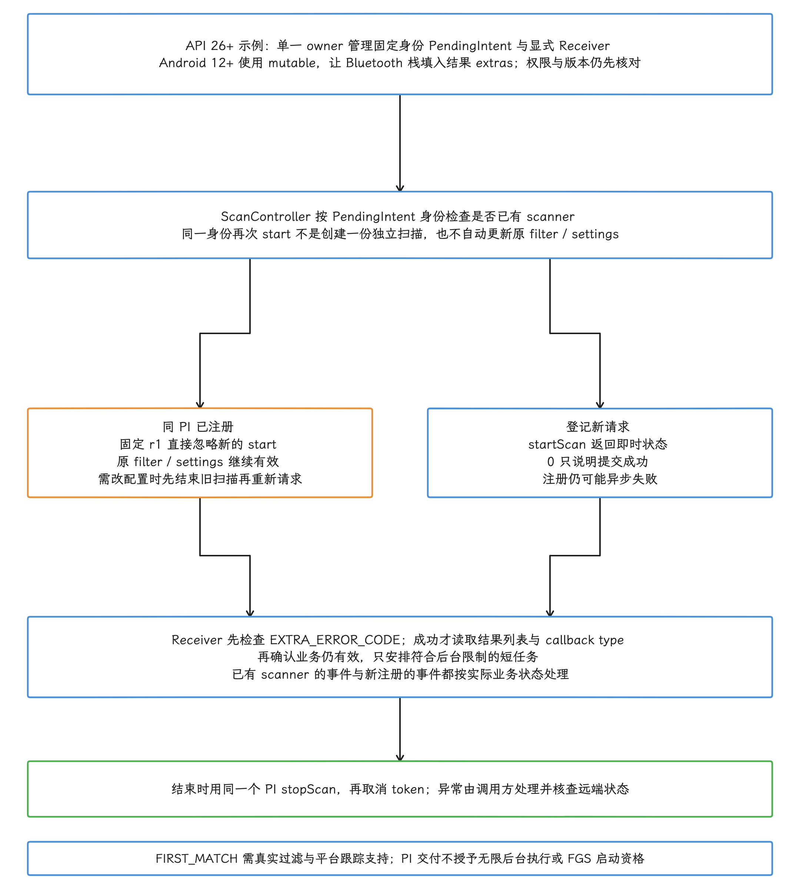

图：单owner管理API26+固定身份PI与显式Receiver，31+mutable供栈填extras。固定r1已有同PI scanner会忽略新start，不更新filter/settings，需更改先结束旧扫描再重新请求；新start即时0也仅说明提交，异步注册可失败。Receiver先ERRORCODE后成功结果/callbacktype，再核业务有效性与受限短工作。结束用同PIstop再canceltoken，异常由调用方处理并核查远端，取消token不等整机无线静止；FIRSTMATCH需非空filter和跟踪支持，PI不豁免后台FGS/执行限制。

不要用 AlarmManager 或 WorkManager 周期启动扫描来模拟“设备出现”事件：外围设备不在附近时，这种设计照样唤醒进程。穿戴、配件和 IoT（物联网）产品若存在稳定关联关系，可以评估 Companion Device Manager 的 presence API（设备出现/离开事件接口）；评估时把 filter 支持、随机 MAC（定期变化的设备地址）和配件广播协议放在一起看，它的适用范围有限。


## 11.4.5 Android 17 的 BLE 扫描实现与平台限制

Android 17 把扫描实现集中到了 `packages/modules/Bluetooth/android/app/src/com/android/bluetooth/le_scan/`，下面的函数与默认参数都取自 `android-17.0.0_r1` 的这条路径；对照旧目录结构或历史 master 分支的行号时，要先把路径换算过来。

下图标出回调扫描和 `PendingIntent` 扫描共享的主要路径。


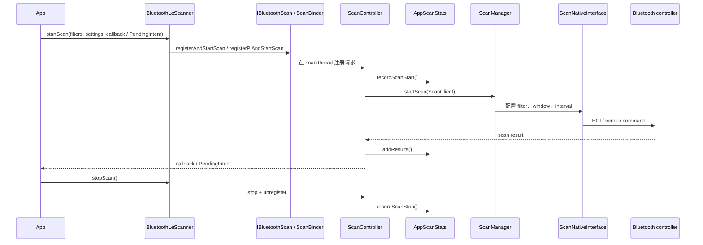

这个调用顺序直接影响读数方式：`ScanController` 在 `ScanManager.startScan()` 之前就调用 `AppScanStats.recordScanStart()`。某个逻辑扫描随后因熄屏、位置关闭或 system suspend（整机挂起）被暂停时，Bluetooth dump 能记录 suspended duration（暂停时长）；而 BatteryStats 的 start/stop 区间可能覆盖整个逻辑请求，读数时要把逻辑请求和 controller 实际接收分开。

<!-- gracker-diagram: ch11-04-16-logical-active-suspended -->
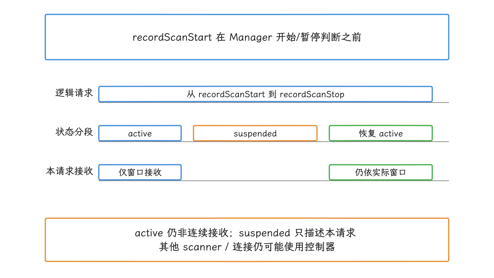

图：轨道不按比例，也没有实测时间；active 段同样说明不了接收机在连续工作。BatteryStats 的 start/stop 可覆盖逻辑请求，controller activity 与硬件能量要另作对照；暂停本请求时，整颗 controller 上可能还有其他 scanner 或连接在活动。

### 注册频率限制

`AppScanStats.isScanningTooFrequently()` 读取可由 DeviceConfig 调整的 quota（配额）。AOSP 17 默认保留最近 5 次已结束扫描，若其中最早一次的开始时间仍处于 30 秒窗口内，`ScanController.registerAndStartScan()` 会拒绝后续非特权回调扫描注册，并在内部的 `onScannerRegistered` 返回 `SCAN_FAILED_SCANNING_TOO_FREQUENTLY`。这个错误要靠日志发现：r1 的 `BluetoothLeScanner.BleScanCallbackWrapper` 对此状态只记日志，应用侧的 `onScanFailed()` 收不到它。同一版本的 `registerPiAndStartScan()` 跳过了这项检查，5 次 / 30 秒只描述非特权回调入口，其余入口另有规则。

这两个数（5 次和 30 秒）来自 DeviceConfig 默认值，OEM 和不同设备上的实际窗口可能不同。靠连续 start/stop 抬高发现概率，更容易触发拒绝，也增加 Binder 与 controller 配置开销。遇到公开失败回调或疑似静默限流，动作是停止循环、等待业务事件或退避计时器；应用自己的扫描超时则用来解除“仍在扫描”的本地状态。

<!-- gracker-diagram: ch11-04-17-registration-quota-api-gap -->
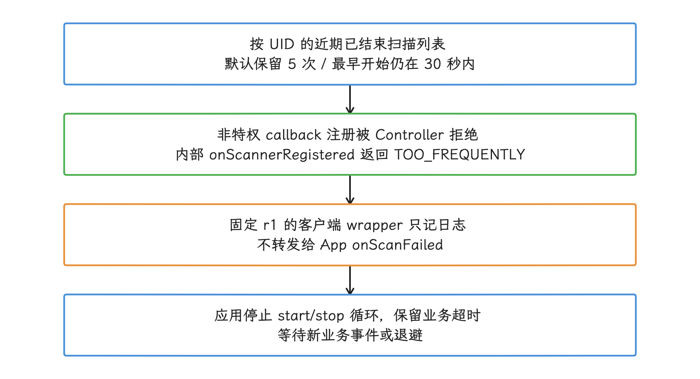

图：5/30 是可配置默认值，只作用于该版本的非特权回调注册；PI 注册没有执行这一频率检查，其他策略或资源限制照样生效。

### 熄屏与位置关闭时的暂停

`ScanUtil.requiresScreenOn()` 对非 opportunistic（机会式）且没有非空 filter 的扫描返回 true；屏幕关闭后，`ScanManager` 把这类 client（扫描客户端）移到 `mSuspendedScanClients`，亮屏且条件满足时再恢复。

再看位置这层：`ScanUtil.requiresLocationOn()` 对未声明 disavowed location（声明扫描不用于位置）且没有非空 filter 的扫描返回 true，位置关闭时这类扫描同样暂停。位置状态检查与 `BLUETOOTH_SCAN` 运行时授权是两层独立检查，排查时两层都要过。

这里的“非空”指至少一个 filter 带实际匹配字段，`ScanFilter.Builder().build()` 生成的空壳不算数。`requiresScreenOn()` / `requiresLocationOn()` 用的是 `hasNonEmptyFilters`；另一些统计和降级分支使用 `isFiltered`，在 `treatEmptyFiltersAsUnfiltered` flag 关闭时仍可能只看列表是否为空，读代码时要把这两个判定分开。系统 suspend 还会通过 `ScanSuspendManager` 暂停常规及批量扫描，其恢复代码等待亮屏，刚从 suspend 返回时扫描还处于暂停。这些自动暂停是系统行为，拿它当停止扫描的替代并不可靠：逻辑请求仍然存在，系统配置和 OEM 行为也可能变化，业务离开扫描场景时我们仍要显式 stop。

<!-- gracker-diagram: ch11-04-18-suspend-gates -->
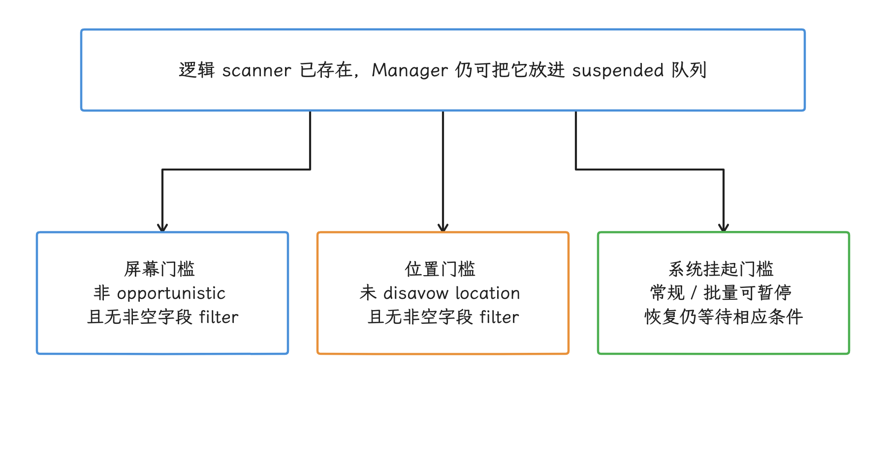

图：位置状态与运行时权限是两套检查；空 filter 壳与有过滤条件要区分开。isFiltered 另受 feature flag 影响，system resume 后扫描未必立即全部恢复；有 filter 虽然跳过这里的暂停判定，结果投递仍要过权限与位置检查。

### 长时间扫描降级

AOSP 17 的 legacy scan timeout（旧扫描超时）默认为 10 分钟，可由 DeviceConfig 调整。`ScanManager.startScan()` 只在常规扫描分支设置这项计时器，批量扫描分支和自动批量扫描进入批量路径时都跳过。常规扫描中的 opportunistic 和 first-match（首次匹配）扫描豁免这条 timeout，其余长时常规扫描会经历以下变化：


- 无 filter：改成 opportunistic，不再单独驱动 controller 扫描。
- 有 filter：把当前 mode 的上限限制到内部 `SCAN_MODE_FORCE_DOWNGRADED`，它是 `SCAN_MODE_LOW_POWER` 的别名；实际还受其他限制影响，固定射频占空比要以实测确认。

Android 17 还包含由 feature flag 控制的 scan allowance throttling（扫描额度限速）。该模式启用时，系统跳过 legacy timeout 路径，改由 `ScanThrottler` 按 UID 记录加权扫描额度：默认额度 6 分钟、补充窗口 1 小时，按 mode 权重折算，各 mode 实际可运行的时长有差异；当前前台 UI 与特权 client 可绕过额度分支。适用 client 的额度耗尽后降到内部 screen-off mode。这套机制属于平台实现与可配置策略，6 分钟读作额度数字就好，应用的任务时限建立在自己的业务超时上更稳妥。

<!-- gracker-diagram: ed11-04-legacy-timeout-or-weighted-allowance -->
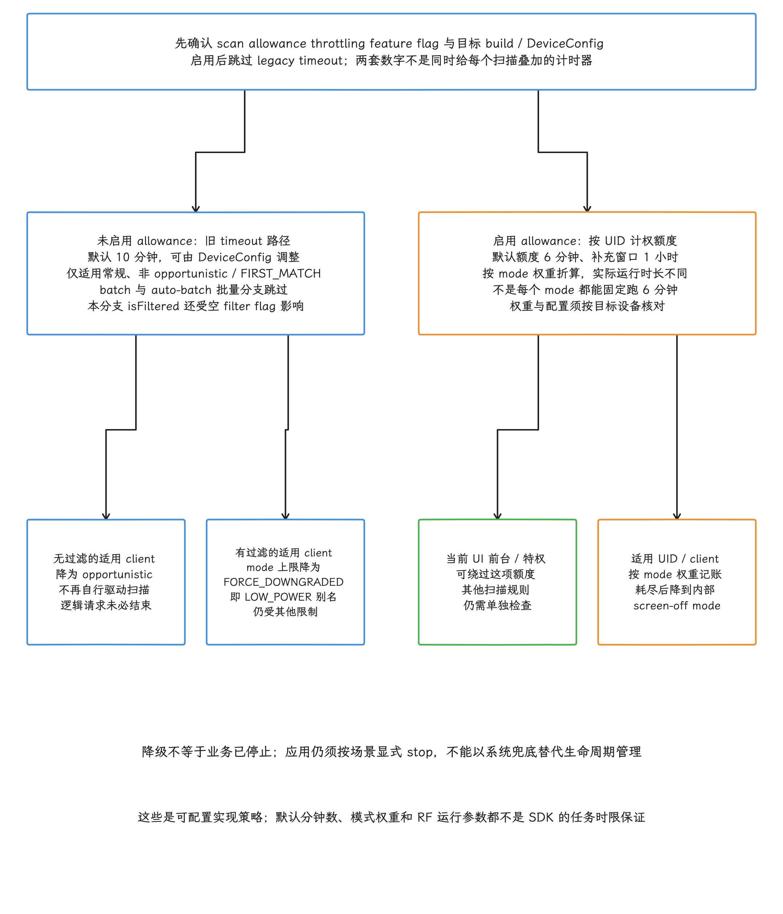

图：固定r1按allowancefeatureflag分流：启用时跳过legacytimeout，默认UID6min额度/1h补充按mode权重折算，当前前台UI/特权可绕过此额度但其他规则仍在，适用client耗尽降内部screenoff。未启用的旧timeout默认10min可配，只在适用常规非opportunistic/FIRSTMATCH路径设置，batch/autobatch批量跳过；无filter改机会式不自行驱动，有filter上限FORCEDOWNGRADED即LOWPOWER，isFiltered受空filterflag影响。这不是两套同时叠加的时限，也非SDK任务deadline；降级不等停止逻辑请求或固定RF占空比，应用仍须显式收尾。

### BatteryStats 归因

`ScanMetricsReporter.recordScanStart()` 计算：

`isUnoptimized = !(isFilterScan || isBackgroundScan || isOpportunisticScan)`

这里的 `isBackgroundScan` 指 `FIRST_MATCH` callback（回调）类型，与 Activity 是否在后台无关；这个命名很容易被误读，先记住这层映射再看公式。

<!-- gracker-diagram: ch11-04-21-unoptimized-classification -->
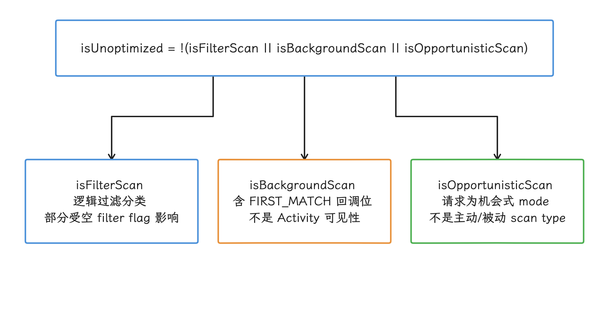

图：这三个条件服务于系统记账分类，RF 活动或某个 App 的能量要另外求证；WorkSource 上报是受权限保护的系统入口。

Bluetooth 进程通过 `BatteryStatsManager.reportBleScanStarted()` 和 `reportBleScanStopped()` 记录 WorkSource。在这个固定版本里，`addResults()` 发现累计结果跨过一个新的百位桶时调用一次 `reportScanResults(100)`，stop 时上报 `results % 100`；单次批量跨过多个百位桶时，这段代码也只上报一次 100，所以这个计数看趋势可以，当无损的逐包账本会漏。这是系统归因模型，改写这类统计的入口需要 `UPDATE_DEVICE_STATS` 权限，应用侧调不进去。

<!-- gracker-diagram: ch11-04-22-scan-result-accounting -->
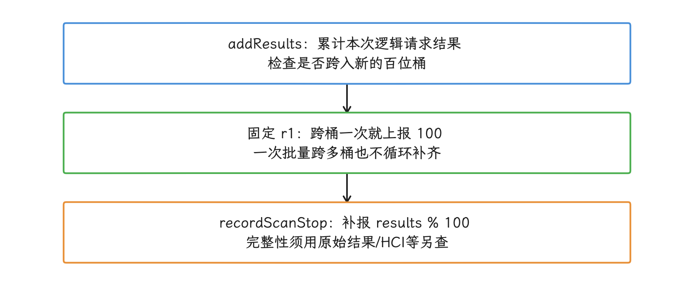

图：这是该源码实现的记账规则，对每包投递没有保证；结果计数、扫描时间和 controller Tx/Rx 之间没有直接的能量换算关系。

BatteryStats 的 BLE scan 时间、controller 的 Tx/Rx/idle 时间和电量估算各管一段，互相替代会丢信息。旧版 `source.android.com` 功耗说明描述过 batch scan（批量扫描）成本归到 Bluetooth 应用的归账方式，它对应当年的实现，当前 r1 的全部路径要多看一步：`dispatchPendingIntentStartScan()` / `ScanMetricsReporter` 仍能为逻辑请求记录 UID/WorkSource，具体电量拆分要看目标版本的 collector/processor 与硬件数据。所以看到 UID 时间较短时，我们继续检查 Bluetooth 组件与 controller activity。

## 11.4.6 GATT 连接的功耗控制

扫描停下来之后，功耗的主因转向连接事件与数据传输。GATT 连接里常见的浪费有这些：

- 已知设备仍从无过滤扫描开始。
- 设备不在附近时持续 direct connect（直接连接）。
- characteristic 可以使用 notification，却由应用每秒轮询。
- 大量小包分散发送，连接长期保持高优先级。
- `BluetoothGatt` 已不使用，但没有 `disconnect()` 和 `close()`。
- 失败重试没有随机错开和次数上限，多台设备同时进入重连。

### Android 17 的连接入口

API 37 新增 `BluetoothGattConnectionSettings`，并弃用多组旧 `connectGatt(Context, boolean, ...)` overload（重载）。下面的示例显式选择 LE transport（低功耗蓝牙传输）、direct connect 和自动 MTU（最大传输单元）协商。

```kotlin
@RequiresApi(37)
@RequiresPermission(Manifest.permission.BLUETOOTH_CONNECT)
fun connectForForegroundTransfer(
    device: BluetoothDevice,
    executor: Executor,
    callback: BluetoothGattCallback,
): BluetoothGatt? {
    val settings = BluetoothGattConnectionSettings.Builder()
        .setTransport(BluetoothDevice.TRANSPORT_LE)
        .setAutoConnectEnabled(false)
        .setAutomaticMtuEnabled(true)
        .setOpportunisticEnabled(false)
        .build()

    return device.connectGatt(settings, executor, callback)
}
```

Direct connect 适合用户正在等待的首次连接；已知设备的长期 presence 场景可以评估 auto connect（自动连接）或 Companion Device presence。API 37 的 opportunistic GATT client（机会式客户端）自己不维持底层连接，等其他 client 都离开后会自动断开，适合愿意复用现有连接的观察者。

<!-- gracker-diagram: ch11-04-23-gatt-connection-modes -->
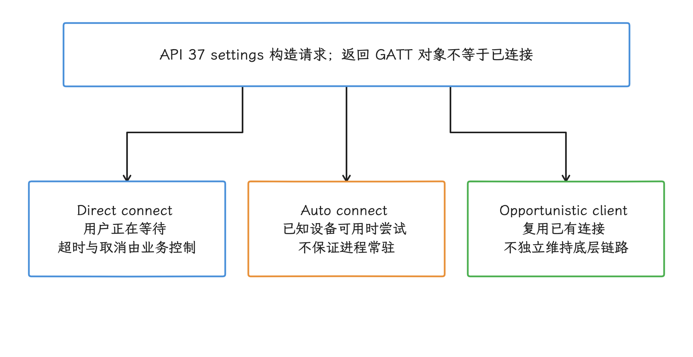

图：先核对版本与 BLUETOOTH_CONNECT。连接以异步状态回调推进；opportunistic 与其他 client 的实际底层共享关系要分别解释。

### 连接参数要随业务阶段变化

| 控制项 | 高吞吐阶段 | 空闲或低频通知阶段 | 约束 |
|---|---|---|---|
| Connection priority（连接优先级） | `CONNECTION_PRIORITY_HIGH` | `BALANCED` 或协议允许时 `LOW_POWER` | 只向 controller / peripheral（外围设备）发出请求 |
| 数据模型 | 批量读写 | notification / indication（通知/指示） | 避免固定周期轮询 |
| MTU | 减少 ATT 分片可能有利 | 无持续流量时收益有限 | Android 14+ 首个 MTU 请求会请求 517 |
| PHY | 良好信号下 2M 可缩短空口占用时间 | Coded PHY（编码物理层）可改善远距离可靠性 | 最省电选择取决于 RSSI（接收信号强度）、重传和两端能力 |
| LE subrate（连接子速率机制） | 按延迟需求评估 `OFF` / `SUBRATE_MODE_HIGH` | `SUBRATE_MODE_LOW` 偏低突发、低功耗 | API 36.1（次版本 API）；还需 `BLUETOOTH_CONNECT` 及特权或 Companion Device 关联，两端支持 |

`requestConnectionPriority(HIGH)` 只覆盖批量传输窗口，完成后恢复 `BALANCED`；方法返回 true 说明请求已提交，最终参数由远端设备和 controller 决定。

<!-- gracker-diagram: ch11-04-24-connection-priority-phase -->
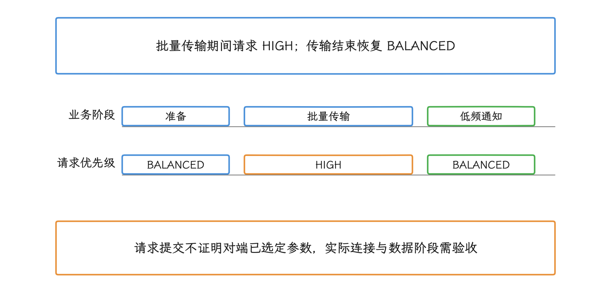

图：阶段轨道不表示真实连接间隔或数据速率。低功耗还取决于重传、外围设备固件、PHY、通知频率和其他共享 client。

Android 14 起，首个 GATT client 调用 `requestMtu()` 时，Android 栈会请求 ATT MTU 517，并忽略后续 client 的 MTU 请求；API 37 的 `setAutomaticMtuEnabled(true)` 则默认在连接后自动协商。我们要在成功的 `onMtuChanged()` 里读取实际结果，按协商值和具体 ATT 操作的协议开销计算有效载荷：MTU 字节数里含协议开销，链路也未必协商到 517。


`requestSubrateMode()` 的返回值是状态码，确认更新要看 `onSubrateChange()` 的成功状态；`LOW/HIGH` 是模式名，按 subrate factor 数值排序会读错。


周期状态更新优先考虑 characteristic notification / indication（外围设备支持时），并减少无变化的数据上报。订阅要在两端完成：本地 `setCharacteristicNotification()` 之外，通常还要按该特征协议写远端 CCCD（客户端特征配置描述符），等待描述符写入结果；只打开本地回调，远端未必开始发送。通知频率由配件固件控制，配件每几十毫秒发送一次无变化数据时，这部分成本手机侧单独消除不了。

<!-- gracker-diagram: ch11-04-27-notification-subscription -->
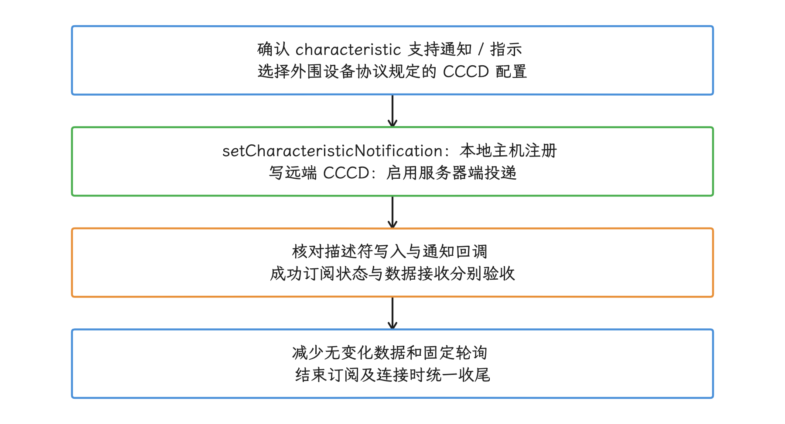

图：本地回调注册只是订阅的一半，只打开本地回调，远端未必开始发送；通知频率、广播协议和固件依然影响成本，任何通知方案相对轮询负载的优势都要按实际负载验证。通知与描述符完成回调可能交错，箭头顺序仅供参考。

### 重连状态机

重连策略至少应包含以下状态：


1. 用户前台触发 direct connect，并设置较短超时。
2. 已知设备暂时离线时进入带 jitter（随机扰动）的指数退避，避免多台设备同时重试。
3. 达到重试上限后停止主动尝试，等待扫描匹配、Companion presence 或用户动作。
4. Bluetooth 关闭、权限撤销、用户解绑和业务完成时取消 pending retry（待执行重试）。
5. 每次放弃一个 `BluetoothGatt` 实例时调用 `close()`；需要主动断链时先调用 `disconnect()`。

连接建立是异步的：`connectGatt()` 返回了非 null 对象只说明请求已受理，业务要跟着 `onConnectionStateChange()` 的状态和结果走；旧 `BluetoothGatt` 的迟到回调同样按对象/会话隔离，以免干扰新的连接。`disconnect()` 是主动断开请求，`close()` 释放这个本地 GATT client；底层链路可能被其他 client 共用，某个 App close 之后射频是否停止，取决于链路上还有谁在用。`autoConnect=true` 会让系统在设备可用时尝试连接，适合已知外围设备，但它保不住进程：进程被终止后，应用仍要用官方后台方案恢复工作。

<!-- gracker-diagram: ed11-04-gatt-retry-and-terminal-ownership -->
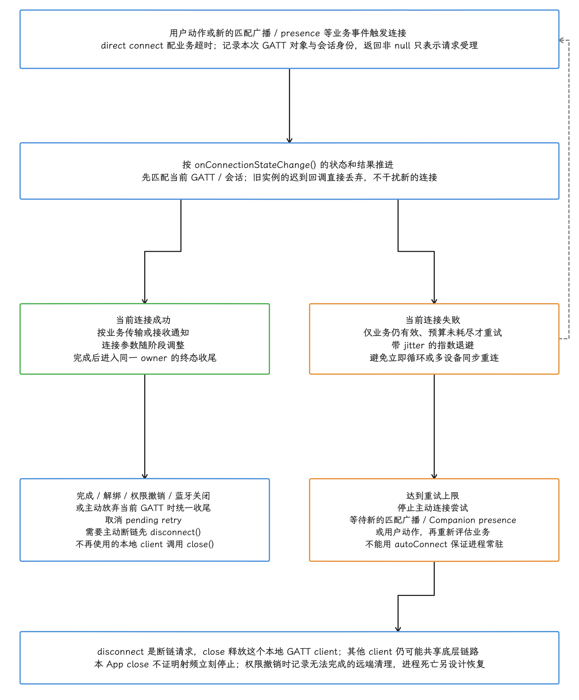

图：业务有界重连状态与对象所有权合图：connectGatt非null仅受理，当前GATT/会话匹配的onConnectionStateChange状态结果才推进，旧回调丢弃。失败仅预算剩余且业务有效时jitter指数退避再试，达到上限停主动尝试等新广播/presence/用户事件；所有终态取消pendingretry。需主动断链先disconnect请求，不用的本clientclose；底层可能被其他client共享，close不证明RF立刻停止。权限撤销无法完成远端清理要记录，autoConnect不保进程常驻，进程死亡另设计恢复；图不给平台固定超时或排空保证。

## 11.4.7 诊断：把请求、归因和硬件证据对齐

诊断要从固定复现场景开始：我们先清除统计，启动一次扫描或连接，记录操作开始与结束时间，然后停止业务、等设备回到稳定状态。测试期间固定屏幕、位置、Wi-Fi、蜂窝信号、外围设备距离和固件版本。

下面的命令收集当前 Bluetooth 状态、当前充电周期内的统计与完整 bugreport（系统诊断包）。

```bash
adb shell dumpsys bluetooth_manager > bluetooth-manager.txt
adb shell dumpsys batterystats --charged > batterystats.txt
adb bugreport bluetooth-power.zip
```

`bluetooth-manager.txt` 可能含设备地址、名称和应用信息，离开受控环境前要脱敏。不同构建的 dump 字段会变化，自动化脚本应以目标版本样本为依据。

### 三层证据分别回答什么

| 证据 | 能回答 | 不能单独回答 |
|---|---|---|
| 应用日志与 trace marker（跟踪标记） | 业务何时 start/stop、filter、mode、结果数、重试原因 | controller 是否按请求参数工作 |
| `dumpsys bluetooth_manager` / `AppScanStats` | scanner UID、ongoing/last scan、screen-on/off 结果、suspended、timeout、callback 或 PI（PendingIntent） | 精确 mAh（毫安时） |
| `dumpsys batterystats` / Battery Historian | UID BLE scan 归因、Bluetooth controller 时间、wake lock/job/alarm 的时间关系；Historian 已不再积极维护，新系统需核对字段兼容 | 设备电源轨实测 |
| Perfetto | 进程调度、Binder、CPU idle、wake lock 与受支持的 power rail | 所有机型都有 Bluetooth 独立 rail |
| HCI snoop | scan/connection 参数、重试、ATT 事务与协议时序 | 整机电量；日志还包含敏感数据 |
| 外接电源分析仪或 ODPM（设备端功耗测量） | 场景级电流或 rail 能量变化 | 单凭波形定位发起 UID |

在 `dumpsys bluetooth_manager` 中，优先查 `Ongoing scans`、`Last scans`、scanner id、UID、callback / PI、filter、scan mode、suspended、forced/timeout 和 screen-off result。字段名由版本与 OEM 决定，某个字段没出现时，活动可能仍在进行，需结合其他输出交叉确认。

<!-- gracker-diagram: ch11-04-30-diagnostic-evidence-chain -->
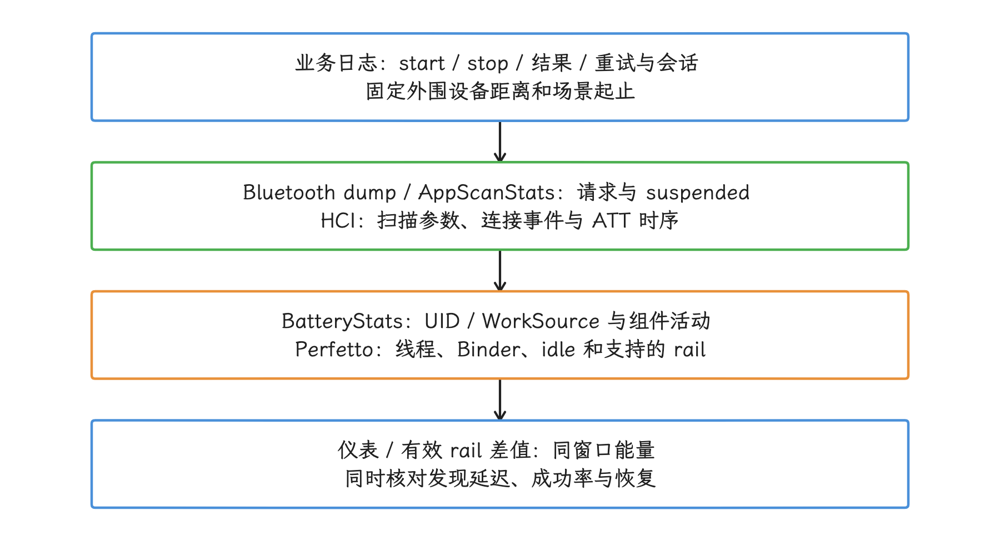

图：当前 dump、历史归因、协议日志和能量仪表各自有覆盖范围；单个 UID 的扫描时长或某条缺失 rail 不足以支撑结论，要放回覆盖范围里一起读。

BatteryStats 的 controller 数据依赖 Bluetooth controller activity reporting（活动上报）与设备 `power_profile`（功耗估算参数），历史功耗说明使用 `bluetooth.controller.idle/rx/tx/voltage` 等值。r1 的 `BluetoothPowerStatsProcessor` 先按 idle/rx/tx 电流与时间估算；若有能量消费者硬件读数，还可按实测总电荷调整组件总量，再按 scan time 或收发字节等分摊 UID。所以组件总量可以受硬件读数校准，UID mAh 仍出自模型归因，把它当该 App 的独立电源表就高估了。硬件支持 ODPM 时，Perfetto 的 `android.power` 可采集 power rails，rail 名称和归属由设备厂商定义。

<!-- gracker-diagram: ch11-04-31-component-vs-uid-model -->
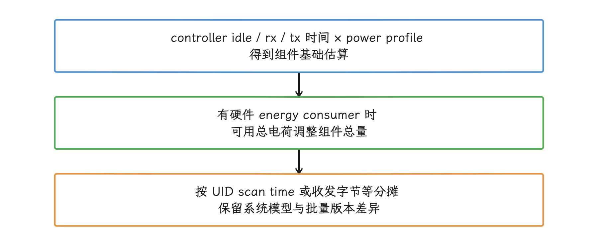

图：固定 r1 的 collector/processor 支持硬件总量校准，UID 仍经模型归因；旧文档关于 batch 计入 Bluetooth App 的说法对应旧实现，当前全部路径以 r1 为准。

### 实验设计

对比扫描策略时，至少保留以下样本：

- 短时 `LOW_LATENCY` + filter，目标设备在场。
- 相同时间的 `LOW_POWER` + filter。
- 无 filter，用于验证熄屏暂停与归因范围，只在测试设备执行。
- `PendingIntent` + `FIRST_MATCH`，进程起始状态固定。
- GATT 轮询与 notification 两种固件/应用配置。
- 高优先级传输后恢复 `BALANCED`，对比未恢复的版本。

每组重复多次，并记录系统版本、build fingerprint（系统构建标识）、外围设备距离、RSSI、数据量和连接参数。还要留意 USB 供电会改变电池计数器：需要精确测量时，用能断开充电的测试夹具或外接电源分析仪。


## 11.4.8 版本边界

| 版本 | 相关变化 |
|---|---|
| Android 7 / API 24 | 系统开始收集 LE scan 与 Bluetooth controller activity 归因 |
| Android 8 / API 26 | 后台执行限制生效；Companion Device Manager 可用于伴随设备发现 |
| Android 10 / API 29 | 后台 Activity 限制；旧权限模型下后台扫描涉及后台位置权限 |
| Android 12 / API 31 | `BLUETOOTH_SCAN`、`ADVERTISE`、`CONNECT` 拆分；后台 FGS 启动受限 |
| Android 13 / API 33 | GATT 的内存安全读写 callback / overload（回调/重载）逐步替代旧接口 |
| Android 14 / API 34 | auto-batch callback（自动批量回调）；首个 GATT MTU 请求改为请求 517 |
| Android 15 / API 35 | `GATT_CONNECTION_TIMEOUT` 对连接超时提供明确状态 |
| Android 17 / API 37 | `BluetoothGattConnectionSettings` 与新 `connectGatt()`；旧 Context overload 废弃；Bluetooth 扫描实现以 `le_scan` 包为主 |

版本表只描述平台公开行为和 AOSP 17 实现；OEM 可调整 scan quota、timeout、window/interval、feature flag 和后台策略，涉及产品承诺时，以目标设备上的验证为准。


## 11.4.9 LE Audio、空间音频与头动追踪

LE Audio 播放时，Bluetooth 只占媒体功耗的一部分，其余成本分散在下面这些地方，我们要同时观察：


- controller 的 ISO（等时数据流）/ ACL（异步数据链路）活动与链路质量；
- audio HAL（音频硬件抽象层）、Codec 和 DSP 的 active 时间；
- AudioTrack、混音与效果处理线程；
- 头动追踪传感器的采样、SensorService（传感器系统服务）投递与渲染更新；
- 屏幕、网络流媒体缓存和应用 CPU 工作。

Bluetooth rail、audio DSP rail 与 HCI/线程证据放在一起可以缩小范围，某条 rail 的单独变化还称不上必要条件或因果证明。头动追踪还可能走软件传感器链或硬件隧道，SensorService/应用线程是否承担每帧处理，要按设备确认。设备没有独立 rail 时，用 A/B 场景控制变量：保持音量、Codec、媒体内容、屏幕状态和网络缓存相同，只改变耳机链路或头动追踪开关。媒体处理链细节见 8.2，整机功耗模型见 11.1。

<!-- gracker-diagram: ch11-04-35-headtracking-paths -->
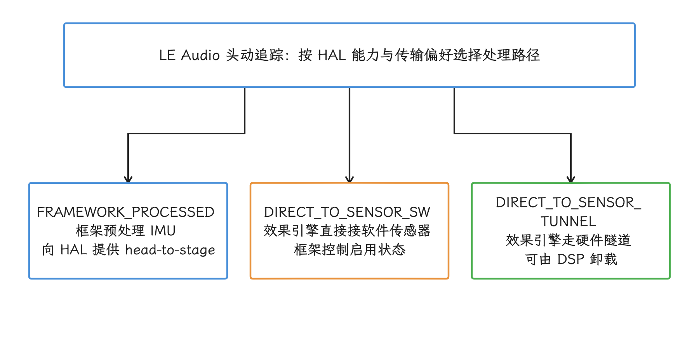

图：各条路径上应用或 SensorService 承担的工作差别很大；图展示官方支持的连接模式，某台设备是否全部支持、是否有节电收益，都要实测。

## 11.4.10 工程检查清单

### 扫描

- [ ] 有非空 `ScanFilter`，且广播协议提供稳定可过滤字段。
- [ ] 用户找到目标、页面退出、权限撤销、Bluetooth 关闭时调用 stop。
- [ ] `LOW_LATENCY` 只覆盖用户等待的短窗口。
- [ ] 后台 presence 使用 `PendingIntent` 或 Companion Device API。
- [ ] 不用周期 Job/Alarm 反复启动扫描。
- [ ] 处理公开扫描失败与疑似静默限流；固定 r1 的频率错误可能不转发，不立即重试。
- [ ] 日志脱敏 MAC、设备名和 manufacturer payload（厂商载荷）。

### 连接

- [ ] 已知设备不重复执行无过滤扫描。
- [ ] direct connect、auto connect 与 opportunistic connection 的场景分开。
- [ ] characteristic 变化使用 notification / indication，减少轮询。
- [ ] 高 connection priority 在传输完成后恢复。
- [ ] MTU、PHY 和 subrate 以成功 callback 与实机结果为准；订阅同时核对本地注册与远端 CCCD。
- [ ] 重连有 jitter、上限和取消条件。
- [ ] 不再使用的 `BluetoothGatt` 调用 `close()`。

### 诊断

- [ ] 同时保留业务时间戳、Bluetooth dump 与 BatteryStats。
- [ ] 把逻辑 scan duration、active/suspended duration 和 controller activity 分开。
- [ ] mAh 结论由 power rail、外接仪器或受控电池实验支撑。
- [ ] OEM 差异标出 build fingerprint 与设备型号。

## 小结

Bluetooth 功耗优化从确定活动类型开始。BLE 扫描要限制 duty cycle、持续时间和回调量，GATT 连接要控制轮询、连接优先级、数据批次和重试。Android 17 的 Bluetooth 栈已经提供 quota、熄屏暂停、长时降级和按 UID 限速，这些保护是系统的兜底，应用的生命周期管理还得自己来。

系统归因、controller activity 与硬件能量是三类证据。我们把它们放到同一时间轴上，就能分开“应用逻辑请求仍存在”“controller 正在收发”和“整机电量增加”这三件事。

## 参考资料

- [Find BLE devices](https://developer.android.com/develop/connectivity/bluetooth/ble/find-ble-devices)
- [Communicate in the background](https://developer.android.com/develop/connectivity/bluetooth/ble/background)
- [Bluetooth permissions](https://developer.android.com/develop/connectivity/bluetooth/bt-permissions)
- [ScanSettings API reference](https://developer.android.com/reference/android/bluetooth/le/ScanSettings)
- [BluetoothGatt API reference](https://developer.android.com/reference/android/bluetooth/BluetoothGatt)
- [BluetoothGattConnectionSettings API reference](https://developer.android.com/reference/android/bluetooth/BluetoothGattConnectionSettings)
- [Measure power values（含历史归因说明）](https://source.android.com/docs/core/power/values)
- [LE 数据传输与通知配置](https://developer.android.com/develop/connectivity/bluetooth/ble/transfer-ble-data)
- [LE Audio 头动追踪路径](https://source.android.com/docs/core/audio/ht-leaudio)
- [Bluetooth Core 6.1 Link Layer：扫描与请求/响应](https://www.bluetooth.com/wp-content/uploads/Files/Specification/HTML/Core-61/out/en/low-energy-controller/link-layer-specification.html)
- [BluetoothPowerStatsProcessor.java — android-17.0.0_r1](https://android.googlesource.com/platform/frameworks/base/+/refs/tags/android-17.0.0_r1/services/core/java/com/android/server/power/stats/processor/BluetoothPowerStatsProcessor.java)
- [Perfetto power data sources](https://perfetto.dev/docs/data-sources/battery-counters)
- [BluetoothLeScanner.java — android-17.0.0_r1](https://android.googlesource.com/platform/packages/modules/Bluetooth/+/refs/tags/android-17.0.0_r1/framework/java/android/bluetooth/le/BluetoothLeScanner.java)
- [ScanBinder.kt — android-17.0.0_r1](https://android.googlesource.com/platform/packages/modules/Bluetooth/+/refs/tags/android-17.0.0_r1/android/app/src/com/android/bluetooth/le_scan/ScanBinder.kt)
- [ScanController.java — android-17.0.0_r1](https://android.googlesource.com/platform/packages/modules/Bluetooth/+/refs/tags/android-17.0.0_r1/android/app/src/com/android/bluetooth/le_scan/ScanController.java)
- [ScanManager.java — android-17.0.0_r1](https://android.googlesource.com/platform/packages/modules/Bluetooth/+/refs/tags/android-17.0.0_r1/android/app/src/com/android/bluetooth/le_scan/ScanManager.java)
- [AppScanStats.kt — android-17.0.0_r1](https://android.googlesource.com/platform/packages/modules/Bluetooth/+/refs/tags/android-17.0.0_r1/android/app/src/com/android/bluetooth/le_scan/AppScanStats.kt)
- [ScanMetricsReporter.kt — android-17.0.0_r1](https://android.googlesource.com/platform/packages/modules/Bluetooth/+/refs/tags/android-17.0.0_r1/android/app/src/com/android/bluetooth/le_scan/ScanMetricsReporter.kt)
- [ScanThrottler.kt — android-17.0.0_r1](https://android.googlesource.com/platform/packages/modules/Bluetooth/+/refs/tags/android-17.0.0_r1/android/app/src/com/android/bluetooth/le_scan/ScanThrottler.kt)
- [ScanUtil.kt — android-17.0.0_r1](https://android.googlesource.com/platform/packages/modules/Bluetooth/+/refs/tags/android-17.0.0_r1/android/app/src/com/android/bluetooth/le_scan/ScanUtil.kt)
- [BluetoothGattConnectionSettings.java — android-17.0.0_r1](https://android.googlesource.com/platform/packages/modules/Bluetooth/+/refs/tags/android-17.0.0_r1/framework/java/android/bluetooth/BluetoothGattConnectionSettings.java)
- [BluetoothDevice.java — android-17.0.0_r1](https://android.googlesource.com/platform/packages/modules/Bluetooth/+/refs/tags/android-17.0.0_r1/framework/java/android/bluetooth/BluetoothDevice.java)
- [BluetoothGatt.java — android-17.0.0_r1](https://android.googlesource.com/platform/packages/modules/Bluetooth/+/refs/tags/android-17.0.0_r1/framework/java/android/bluetooth/BluetoothGatt.java)
