# 用户设置与业务配置对能耗的影响

“亮度 50%、高刷开启、深色模式开启”这些用户设置，改变的是面板发光、显示时序、应用渲染、视频管线和系统调度。我们对比两轮功耗实验时，先确认两边设置一致；设置一旦不同，差值里很可能混进显示侧的变化。

> 源码基线：AOSP `android-17.0.0_r1`（Android 17 / API 37）。

本文同时复核论文《An Empirical Analysis of Mobile Energy Consumption Across User Configurations》。论文中的百分比来自单台 Samsung Galaxy S23 Ultra 的自动化短场景，属于软件归因统计；复现数据还存在设置标签冲突（见 11.5.2）。引用这些数字时按论文口径下的相对结果对待，面板实测收益和其他设备的预期值都要另行验证。

## 11.5.1 先确认能耗数字来自哪里

“屏幕耗电”这个数字可能来自四种口径。我们拿到数字时先问它出自哪一种，再决定它能回答什么问题；一种口径的数字直接当另一种用，结论会偏：

| 证据 | 表达的含义 | 适合回答的问题 | 主要边界 |
|---|---|---|---|
| 外接电源分析仪 | 设备输入侧的电压、电流与能量 | 整机在两个配置下相差多少 | 需要稳定供电、采样与电池旁路方案 |
| 设备 power rail（电源轨）/ ODPM（设备端功耗测量） | SoC（片上系统）或设备定义 rail 的能量 | 哪条硬件供电链路发生变化 | rail 名称、覆盖范围和开放程度由设备决定 |
| 燃料计 / 电池电量变化 | 一段时间内的电池侧变化 | 长场景的整机续航趋势 | 短窗口易受计数精度、温度和电池状态影响 |
| BatteryStats / power profile（功耗估算参数） | 组件活动和 UID（应用用户标识）的测量或估算归因 | 谁在何时使用了哪些组件 | 归因口径不等于外接仪器的整机能量 |


### 显示归因的测量与模型两条路径

旧资料常把 BatteryStats 描述成“状态时长乘 power profile”，这个说法到 Android 17 已经不完整：`ScreenPowerStatsCollector` 实际收集的是：

- `DISPLAY` energy consumer（显示能量计量组件）提供的 consumed energy（已消耗能量）；
- 各显示的 screen-on、doze（低功耗显示）与亮度档位时长；
- UID 的 top activity（最前台 Activity）时长。

HAL 的 `EnergyConsumerResult.energyUWs` 报告开机以来累计的 µWs（即 µJ）。采集器的 `ConsumedEnergyHelper` 先取能量增量，再用本次与上次电压的平均值换算成 µC；`ScreenPowerStatsProcessor` 再把 µC 换算为 mAh。处理器读取的是当前布局中的第 0 个显示 energy consumer，据此还下不了“所有显示计量项已汇总”的结论。描述符中的 consumer 数量为 0 时，处理器才使用 `PowerProfile` 模型；单次 HAL 读数失败，也仍按计量路径走。[来源：采集与换算实现](https://android.googlesource.com/platform/frameworks/base/+/refs/tags/android-17.0.0_r1/services/core/java/com/android/server/power/stats/PowerStatsCollector.java)、[显示处理器](https://android.googlesource.com/platform/frameworks/base/+/refs/tags/android-17.0.0_r1/services/core/java/com/android/server/power/stats/processor/ScreenPowerStatsProcessor.java)。

走到模型这条路径时，估算按显示设备使用 `ambient.on.displayN`、`screen.on.displayN` 和 `screen.full.displayN`（N 为序号）：亮屏估算包含基础亮屏电流×时长，以及各亮度档位的附加电流×时长，doze 成本单独计算。这套档位模型只看档位和时长，页面像素颜色不在输入里，相同亮度下 OLED 页面配色的成本变化也就刻画不了。旧的 `ambient.on`、`screen.on`、`screen.full` 在缺少新显示配置时仍可能被迁移为 display0 参数，离“完全失效”还远。


UID 归因是另一条路径：处理器在亮屏状态中，以各 UID 的 top activity 时长占同组 UID 总时长的比例分配显示成本；总时长为 0 时跳过这项比例归因。它支撑的是系统级归因，再往下落到某个 View、某帧 GPU 工作或某个颜色像素，就超出它能给出的证据了。所以文章或评审报告要证明产品设置带来的整机收益，还要回到设备 rail、长时间燃料计测试或外接仪器上补证。

<!-- gracker-diagram: ed11-05-display-cost-and-uid-share -->
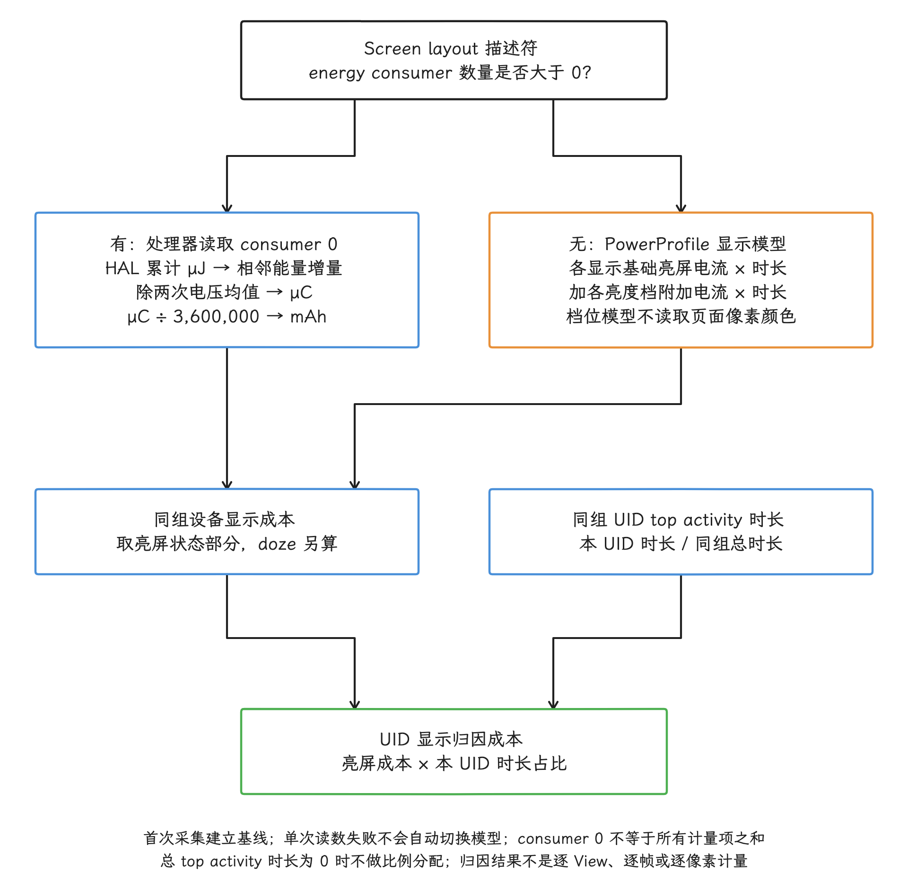

图：固定r1按描述符consumer数量选择计量或模型：大于0读取consumer0，不能推断多项求和。helper对HAL累计µJ先差分，再按两次电压均值转µC，处理器再转mAh，首次建基线；数量0才走各显示powerprofile，单次失败不自动改模型。两支形成设备成本后，亮屏部分按同组UIDtopactivity时长占比分配，零总时长跳过，doze另算。归因不是逐View/帧/像素实测，像素颜色也不进入亮度档模型。

## 11.5.2 如何阅读 2026 年单机实验

论文正文给出实验设计，复现仓库提供脚本和 CSV，我们读的时候两条线都看。核验固定在提交 [`f12c27c5487e`](https://github.com/wellington-oj/user_energy/tree/f12c27c5487ec0e9be97ab468c3ab104dacca02b)上，仓库后续的变化就混不进结论；核验做的是重算公开数据和读取代码，真机实验并未重跑。

论文给出的实验条件：

- 设备为一台 Galaxy S23 Ultra，Snapdragon 8 Gen 2、5000 mAh 电池、Dynamic AMOLED、最高 120 Hz；
- 场景覆盖 WhatsApp、Instagram、TikTok、YouTube 和手电筒；
- 879 组配置：通用变量的 72 种组合×12 种应用条件，加上独立的 15 种手电筒条件；公开 CSV 中每组均有 15 条记录；
- Instagram、TikTok、YouTube 的动作参数为 15 或 30 秒，手电筒另含 60 秒；WhatsApp 扫描消息长度。动作参数与整条记录的 `duration_ms` 是两个量，后者还覆盖脚本与测量窗口中的其他阶段。


论文的数据清洗与统计口径：

- ⚠️ 矛盾：论文写初始 13,184 条；固定版本 CSV 实际为 **13,185 条=879×15**。按 notebook 顺序，先排除 155 条 `is_outlier=True`，再检查正时长（此步未额外排除），最后排除 381 条 `Smart_Metric_W ≤ 0.05`，共移除 536 条，保留 12,649 条。这 536 条分属不同环节，各自对应哪条规则要分开记；

- 通过 `dumpsys batterystats` 提取软件计量/估算值，再以 `估算能量 J = mAh × 电压 V × 3.6` 换算。通用设置和分辨率比较平均功率 `W=J/实际秒数`；时长与消息长度比较累计能量。`mAh` 只是电量，乘上电压才是能量；
- 使用双侧 Mann-Whitney U 检验，以 `p < 0.05` 作为单项结果的筛选条件。notebook 对部分 Overall 汇总仍保留未显著结果，图上有柱子时，显著性要回到检验值确认。

还有三项复现限制必须保留：

1. **标签不自洽**：在 12,960 条非手电筒记录中，`Config_Theme` 与 `Experiment_ID` 路径的 theme 标签有 10,800 条不一致，refresh 有 1,440 条不一致，airplane 有 2,160 条不一致；brightness 与 saving 的相应标签一致。这是字段冲突，哪一侧对应设备真实设置，光靠数据判断不了；仓库又没有发布原始设备日志和设置实现，真值只能等原始日志或新实验。[来源：固定版本 CSV](https://github.com/wellington-oj/user_energy/blob/f12c27c5487ec0e9be97ab468c3ab104dacca02b/script_data/master_energy_data.csv)。
2. **归因范围混合**：notebook 对 IG/WPP/LIGHT 使用 `t_total`，对 YT/TT 使用组件合计减 `r_total`，各应用的整机测量口径并不统一。Overall 先求各应用的均值，再等权汇总；读它时按“各应用均值的等权平均”理解，与全部记录直接加总、跨设备的平均续航收益是两回事。[来源：notebook](https://github.com/wellington-oj/user_energy/blob/f12c27c5487ec0e9be97ab468c3ab104dacca02b/script_data/script.ipynb)。
3. **绝对单位错误**：时长/消息分支用已经是 W 的 `Smart_Metric_W` 除以 1000 后再乘秒数，却把结果命名为 `Energy_Joules`，这些数值实际是 kJ。共同缩放动不了百分比和秩检验，但引用绝对能量前必须校正单位。后文只保留明确标注来源的相对结果。

<!-- gracker-diagram: ch11-05-06-label-conflict -->
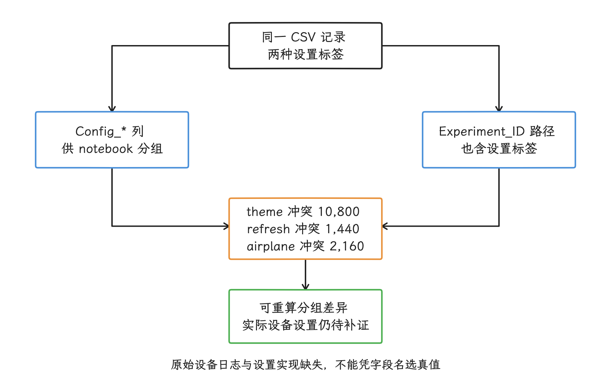

图：看到分组字段冲突时，先保留原始证据，再限制能够得出的结论。 同一批 12,960 条非手电筒记录中统计字段冲突；数量不是设备设置失败次数。不能自行认定列或路径哪一方是真值。

这项工作拿来建立实验变量表很合适，公开分组也能重算部分论文百分比；但“分组差异确由相应真实设置导致”这句话，要等原始日志或新实验补证，标签冲突就卡在这里。它的结论也止步于这台单机、这些短场景：跨面板、跨 SoC、跨 OEM（设备厂商）的判断，以及长时间稳态下的判断，都需要新的证据；软件归因、短采样窗口和单机设计都会限制外推。

后文引用这些数字时，我们都按“论文报告的单机、短场景、软件归因结果”来读，并同时保留上述数据冲突与单位限制；产品文案、系统默认值和 KPI（关键绩效指标）要用的话，需要自己再测。

<!-- gracker-diagram: ch11-05-07-power-energy-overall -->
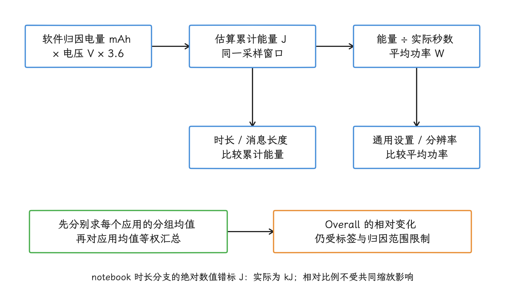

图：先确定量纲和归因范围，再解释相对变化与跨应用汇总。 通用设置/分辨率用 W；时长/消息用累计能量。各应用底层归因不同；Overall 等权汇总应用均值，不是整机或跨设备能量。

## 11.5.3 亮度：滑块位置、面板亮度与显示功耗

论文报告亮度分组的功率增幅较大。读下表前先明确口径：这些百分比描述平均功率 W，整机实测能量与续航时长的反向变化是另外两回事：

| 比较 | 论文观察 | 使用边界 |
|---|---:|---|
| 0% → 100%，应用均值等权汇总 | +86.5% | 单台 S23 Ultra、短场景、软件归因平均功率 |
| 0% → 100%，Instagram | +96.8% | 受内容、脚本及归因范围影响 |
| 0% → 100%，WhatsApp | +210.2% | 比值以 0% 档分组均值为分母，不能视作面板功率增幅 |
| 0% → 50%，应用均值等权汇总 | +46.0% | 不能推导 50% 对应某个固定 nit（尼特，亮度单位）值 |

### 滑块位置、窗口值与物理 nit

`WindowManager.LayoutParams.screenBrightness` 的 0～1 表示从暗到亮，小于 0 表示跟随用户偏好；系统设置中的滑块位置、窗口归一化值和物理 nit 是三个不同量。自动亮度的 `BrightnessMappingStrategy` 可以依据 lux、nit 曲线、校准与用户修正计算目标值，也存在简单映射实现。滑块拉到 0% 时屏幕仍在显示；50% 落在哪个 nit 上，由面板和映射策略决定，未必是最大 nit 的一半。所以记录时分成三份：设置值、系统目标值、可观测的面板状态。

<!-- gracker-diagram: ch11-05-08-brightness-mapping -->
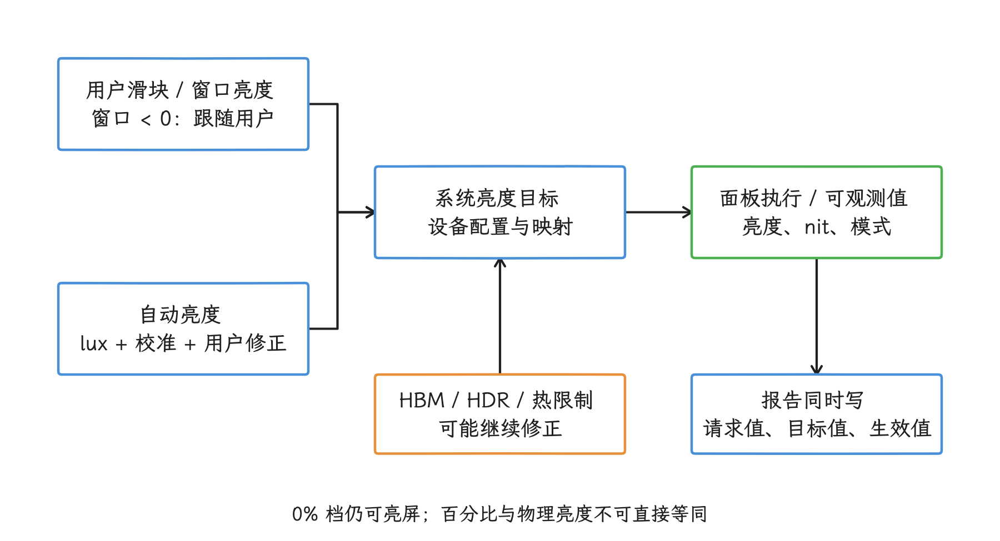

图：将设置值、自动亮度映射和最终面板状态分开记录。 这是概念链路：BrightnessMappingStrategy 主要参与自动亮度，不代表所有手动滑块都只经过同一策略。50% 不能跨设备当作固定 nit。

因此，跨设备实验应同时记录：

- 设置滑块值或 Window brightness；
- 是否开启自动亮度；
- 环境照度；
- 若设备可读，记录目标与当前 nit；
- HBM（High Brightness Mode，高亮模式）、HDR（高动态范围）、相机或阳光可读模式是否触发；
- 面板类型与显示模式。

### 面板类型改变内容与亮度的关系

再看面板这一层：LCD（液晶显示器）的背光通常是显示功耗的重要来源，页面颜色对背光本身的影响有限。OLED / AMOLED（有机发光二极管）面板的像素自发光，像素亮度、颜色、发光面积和面板实现都会改变成本。相同滑块值下，白底网页、低平均画面亮度的视频和大面积黑色界面可能有不同功耗。


亮度变化还可能改变热负载。户外高亮或 HDR 与持续渲染同时发生时，我们把温度、thermal severity 和频率限制一起看，再判断掉帧该归给谁——面板发热引起的 CPU/GPU 降频只是候选之一。短测若跨过设备热阈值，需按温度阶段分析。这条链路属于待 trace 与温度记录验证的可能路径，论文本身没有测这一层因果。

<!-- gracker-diagram: ch11-05-10-brightness-thermal -->
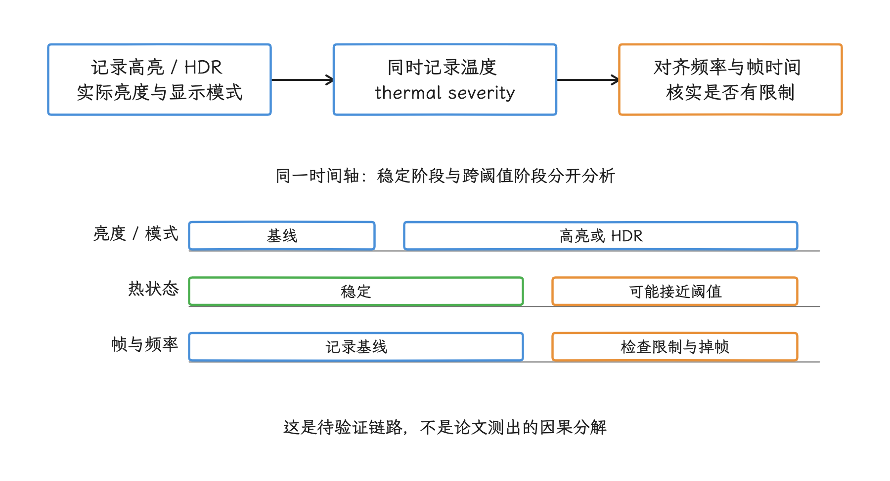

图：把亮度、热状态、性能变化对齐后再判断机制。 所有轨道仅示意可能阶段，条长不是测量值；温度或掉帧单独出现不足以证明高亮导致处理器降频。

### 固定亮度与自动亮度的分工

- 固定亮度适合回归测试，用来减少环境光带来的变化；
- 自动亮度适合用户场景复测，用来检查策略在环境变化下的表现；
- 户外高亮、HDR 与相机预览应单独建组，避免与普通室内结果合并。

固定档位时还要关掉其他会自动改变亮度的变量，等亮度稳定后再开始采样。报告里只写“亮度 50%”是不够的，至少补上自动亮度状态、环境与设备。


## 11.5.4 刷新率：显示链路里的四个频率

显示链路里至少有四个相关频率：

1. 应用产生新 buffer（图形缓冲区）的速率；
2. Choreographer / VSync（垂直同步信号）驱动 UI 的节奏；
3. SurfaceFlinger（系统显示合成服务）合成与提交的节奏；
4. 面板执行的物理刷新率。

应用以 30 fps（每秒帧数）解码视频，面板却可能运行在 60 Hz、90 Hz 或 120 Hz（每秒刷新次数），靠重复帧显示 30 fps 内容。支持 Android Adaptive Refresh Rate（自适应刷新率，ARR）的显示模式把 TE/VSync 基准节拍与实际刷新间隔解耦，可以在同一模式中按基准节拍的整数倍改变呈现间隔，并受最小帧间隔约束；呈现间隔变了，TE/VSync 基准也未必跟着变。所以应用回调节奏、合成调度与面板刷新，我们要分别观察。

<!-- gracker-diagram: ch11-05-12-display-cadences -->
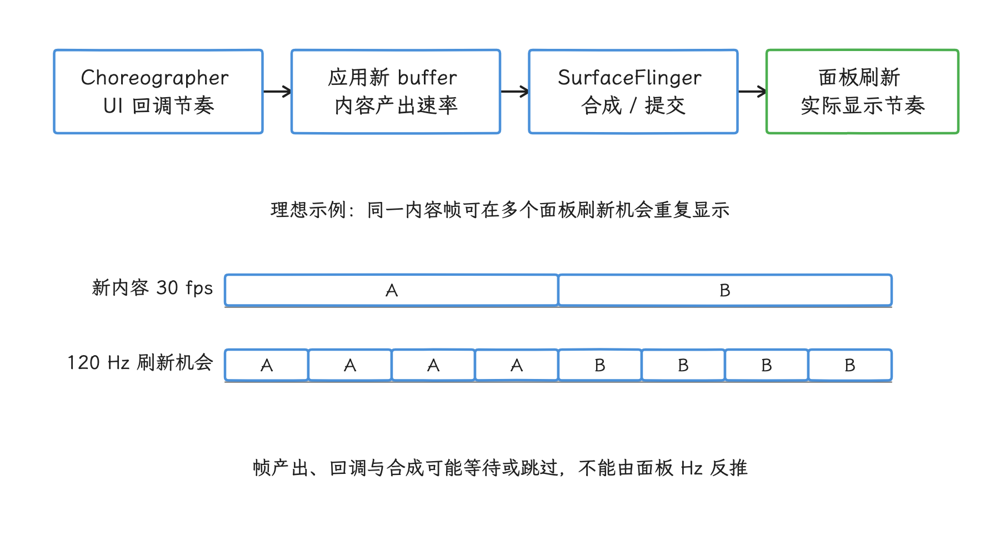

图：显示链路中的四个节奏必须用各自证据观察。 下方仅给出 30 fps 内容在 120 Hz 刷新机会重复呈现的理想示例，不是某设备 trace，也不规定 Choreographer 或 SF 必须跟随哪一频率。 上方串联展示 UI 路径；视频解码可有独立产帧节奏。

固定节奏下，60 Hz 与 120 Hz 的相邻刷新机会分别相隔约 16.67 ms、8.33 ms。应用若要每次都提供新帧，通常需要维持相应的吞吐和截止时间；这份预算可以由主线程、RenderThread 与 GPU 的流水线跨帧重叠分摊，各段面对的具体截止时间还受调度偏移影响。反过来看，提高面板刷新率并不会自动把应用的计算量翻倍，静态内容与重复 buffer 尤其如此。


### 论文中的刷新率数字

| 比较 | 论文观察 | 解释范围 |
|---|---:|---|
| `fps30` → `fps120`，应用均值等权汇总 | +10.8% | 平均功率 W；配置标签不等于面板实测频率 |
| `fps30` → `fps60`，Instagram | +9.2% | 论文正文及固定 CSV 分组重算约 +9.24%；原文 +9.1% 有误 |
| YouTube 的最高差值 | +16.3% | 平均功率 W；保留数据标签冲突边界 |
| WhatsApp | 论文未报告显著差异 | 不能据此证明刷新率没有成本 |

从这些数字读到“60 Hz 是所有设备的最佳能效点”，证据是不够的。应用应表达内容帧率偏好，系统应结合用户选择、其他可见 Layer（图层）、热状态、省电策略与设备能力做出决策。

## 11.5.5 系统如何决定刷新率

上一节把四个频率分开看，这一节看系统在它们之间怎么选。`DisplayModeDirector` 汇集多个 vote，并生成显示模式与刷新率范围。输入来源包括：

- 用户的默认、最低和峰值刷新率设置；
- 应用对 mode（显示模式）或 frame rate（帧率）的请求；
- 屏幕亮度区间与环境光策略；
- High Brightness Mode（高亮模式）；
- 省电模式；
- thermal（热状态）限制；
- OEM 配置与设备支持的显示模式。

<!-- gracker-diagram: ch11-05-14-policy-and-layer-hints -->
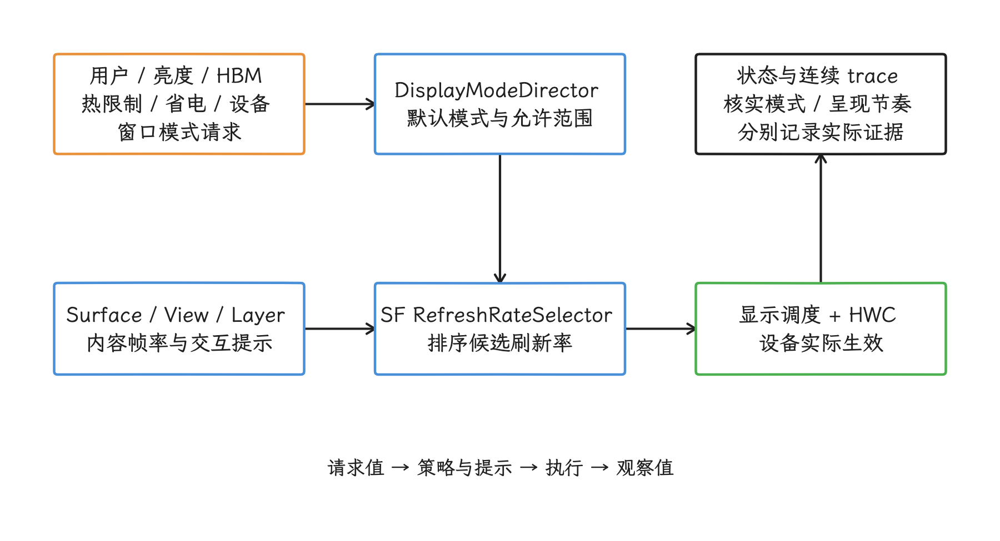

图：把显示策略约束与内容帧率提示汇入最终决策，而非让单个 App 直接控制面板。 概念链路省略 Binder/服务间转发；Layer 提示不等于直接进入 DMD 的同类窗口模式 vote，调用成功也不证明硬件生效。

`DisplayModeDirector` 按优先级组合 vote 并过滤可用模式；若交集为空，会逐步舍弃最低优先级约束，必要时退回默认模式。画架构图时，把 vote 画成“按优先级取舍的输入”更贴近实际，硬凑成“同时满足的硬条件”会画错。SurfaceFlinger 的 `RefreshRateSelector` 在显示策略允许的范围内，另外结合可见 Layer 的内容帧率提示、启发式与交互信号排序候选值。窗口/应用的模式请求与 Surface/View 提示属于不同入口，最终结果还需经显示调度与 HWC 生效。

<!-- gracker-diagram: ch11-05-15-priority-vote-loop -->
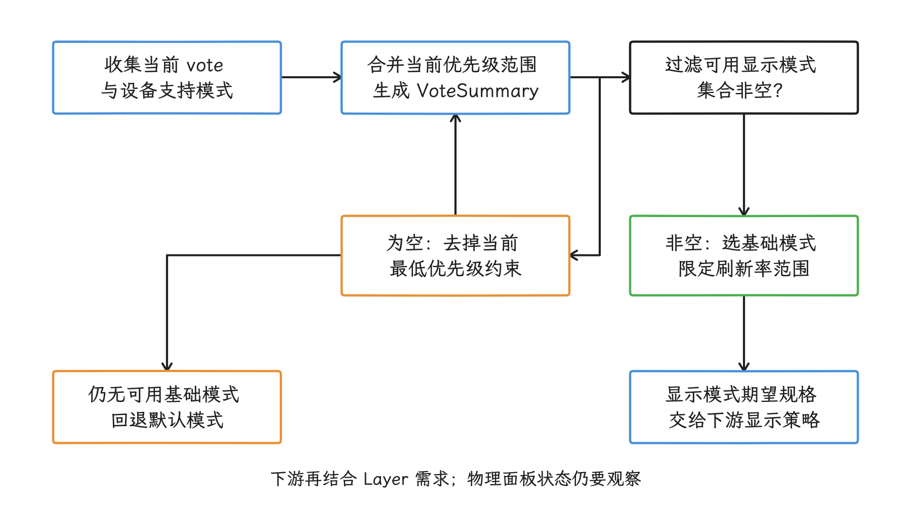

图：用可用模式集合判断约束组合是否成立，按优先级解决冲突。 固定 r1 常规决策示意，省略测试专用 alwaysRespectAppRequest 等分支；不是所有 vote 永远同时有效。

### `Surface.setFrameRate()` 的用法与限制

`Surface.setFrameRate()` 从 Android 11 / API 30 提供。视频、自绘 Surface 和游戏可以上报内容帧率，系统会评估是否切换显示模式或采用可兼容的倍频，例如 24 fps 内容可能配合 120 Hz。其他 Surface、用户设置、省电模式或设备限制都可能让请求落空。

Surface 仍可见但暂停产帧时，可把 `setFrameRate()` 的 frameRate 设为 0，恢复接受系统选择；API 34 起也可用 `clearFrameRate()`。销毁 Surface 或切到其他应用而隐藏时，这一步可以省掉。恢复播放时重新报告真实内容帧率；内容稳定时，跟随内容变化调用即可。该 API 本身不会给生产者限帧，调用返回也只说明请求已提交，面板是否切换要结合显示通知、状态与 trace 观察。

<!-- gracker-diagram: ch11-05-16-surface-vote-lifecycle -->
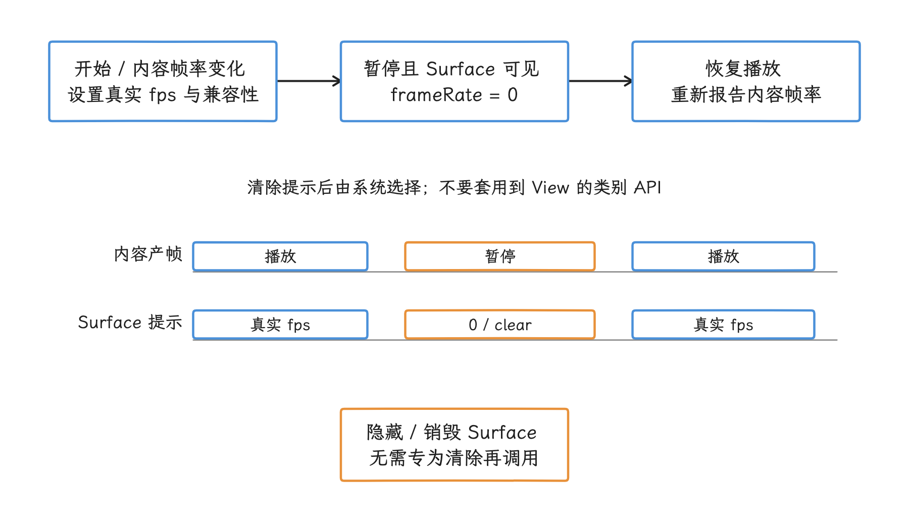

图：内容开始或变化时报告真实帧率，仍可见但暂停时撤回旧提示。 setFrameRate 自 API30，三参数切换策略自 API31，clearFrameRate 自 API34；轨道只示意阶段，调用不承诺切换且不负责生产者限帧。

### View 与 ARR

Android 15 / API 35 增加 `View.setRequestedFrameRate()`，View 可在需要绘制时提供正数帧率或类别提示。请求设在 ViewGroup 上并不会自动传播给子 View；恢复默认用 `REQUESTED_FRAME_RATE_CATEGORY_DEFAULT`，显式不投偏好用 `REQUESTED_FRAME_RATE_CATEGORY_NO_PREFERENCE`——这套语义与 Surface 的“0 清除”规则不同。官方 ARR 文档把 Android 15 作为平台引入点，但设备支持还依赖显示硬件、Composer HAL（显示合成硬件抽象层）接口和 OEM 配置。应用侧文档将 Android 15 QPR1（季度平台更新 1）及后续版本列为相关支持范围。


Android 16 / API 36 增加 `Display.hasArrSupport()`。到了 Android 17 / API 37，应用仍应先检查设备能力再讨论 ARR 行为：系统版本只说明平台具备这层机制，设备是否支持 ARR 以能力检查为准。

<!-- gracker-diagram: ch11-05-18-arr-te-cadence -->
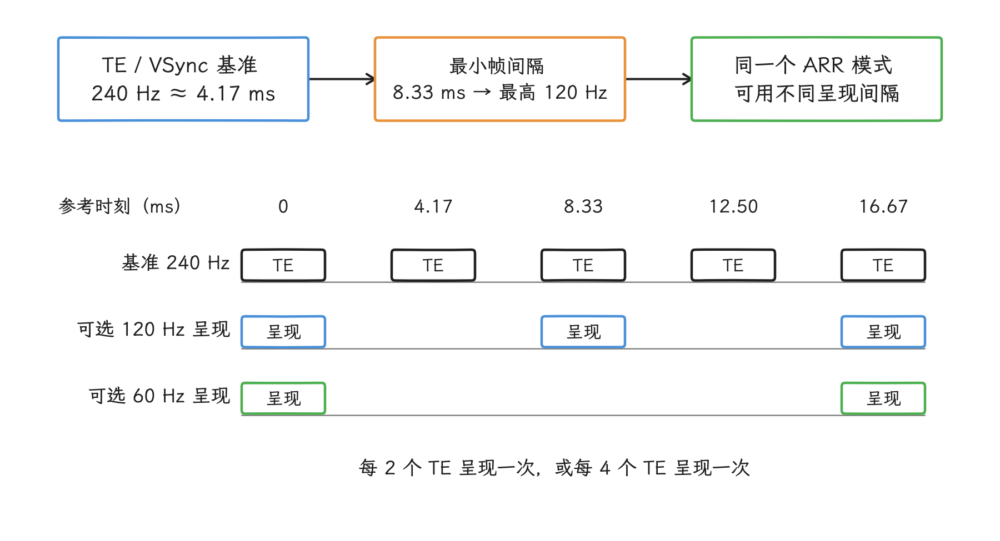

图：在同一 ARR 模式中，以 TE 基准的整数倍选择满足最小帧间隔的呈现时机。 官方参数示例：TE/VSync 基准240Hz、最小帧间隔约8.33ms（最高120Hz）。下方为两种独立示例节奏，不是真机 trace，也不是 Choreographer 回调。 矩形是事件标记，宽度不表示持续时间。

### 常见场景的策略

| 场景 | 合理的应用表达 | 观察重点 |
|---|---|---|
| 静态阅读、聊天停留 | 让系统降低更新频率，避免无意义 invalidation（界面重绘请求） | 应用帧产出、VSync、面板观察值 |
| 列表滑动 | 交互期间请求合适帧率，停止后及时撤销 | 掉帧、触摸阶段、静止后的降频延迟 |
| 短视频流 | 视频内容帧率与滚动交互分别处理 | 视频 Layer、UI Layer、模式切换 |
| 长视频 | 用 Surface API 报告源内容帧率 | 24/30/60 fps 的倍频、切换黑屏或卡顿 |
| 游戏 | 结合帧率、热预算和用户画质选择 | sustained fps（可持续帧率）、GPU、温度、功率 |


固定的 `android-17.0.0_r1` 中，`DisplayModeDirector` 在省电开启时投出 0～60 fps 的 **render frame-rate** 范围 vote，并结合设备配置的低功耗支持模式；这条源码事实说的是 vote 的范围；各设备的面板物理刷新是否恒定在 60 Hz，以及 ARR、帧率覆盖、其他约束与 OEM 实现，都要分别验证。

## 11.5.6 深色模式：屏幕技术与内容共同决定收益

Android 官方文档把暗色主题的收益放在屏幕技术条件下描述，同时强调低光环境与无障碍价值。做功耗分析时，我们把 UI 背景、媒体内容、面板类型和用户亮度分开看。

论文在同一台 AMOLED 设备上得到以下结果：

| 场景 | 深色主题相对浅色主题 | 边界 |
|---|---:|---|
| Instagram | -2.4% | 只覆盖该次内容与短脚本 |
| WhatsApp | -3.8% | 文本页面占比与配色会影响结果 |
| 应用均值等权汇总 | -1.4% | 平均功率 W；不能推广为 AMOLED 的固定收益 |

这些相对值是论文对平均功率的报告。公开数据还拆不出内容、亮度或时长各自的份额；同理，“深色主题没有价值”这样的结论，这些数据也支撑不了。

对 OLED / AMOLED，大面积低亮度像素通常有利；但图片、视频、地图与相机预览中的媒体像素保持原样，应用的背景、导航栏等界面元素变暗，改不到这些像素上。对 LCD，背光仍持续工作，页面配色通常难以形成同等级别的面板收益。

<!-- gracker-diagram: ed11-05-theme-content-and-panel -->
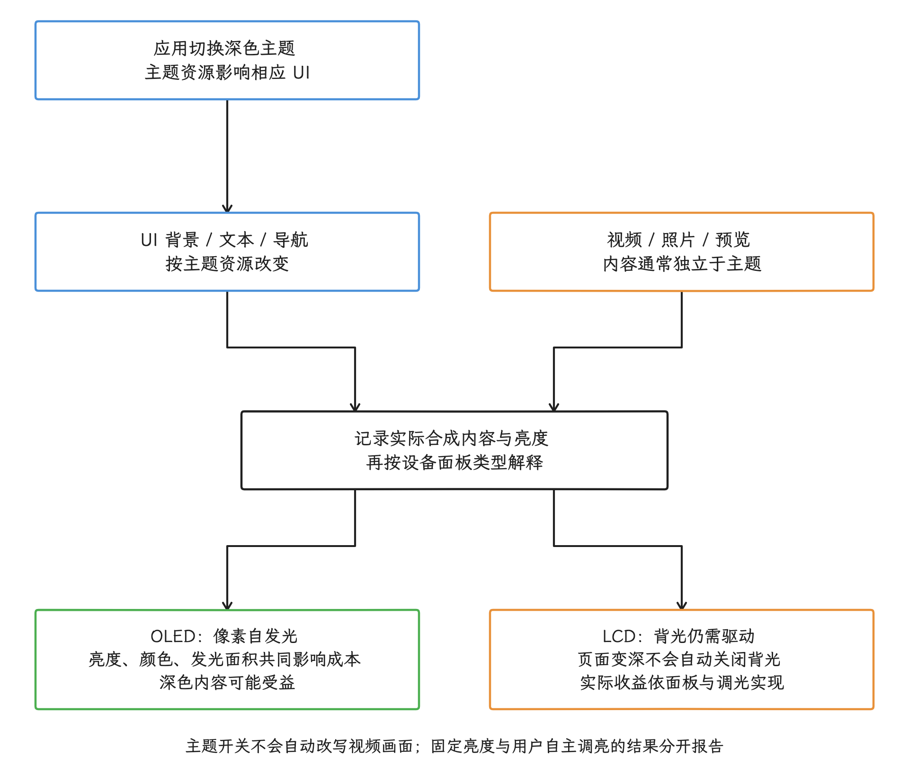

图：将面板机制与主题内容范围合图：主题资源改变相关UI，视频/照片/预览通常独立，不因主题开关自动改写。先核对实际合成内容与亮度，再按OLED像素颜色/亮度/发光面积或LCD背光与调光实现解释可能收益。这里没有固定节能比例；固定亮度配色对照与用户自主调亮后的结果分别报告。

还要防止亮度补偿混入结果。用户若在深色界面上提高亮度，新增的亮度成本可能抵消像素颜色带来的收益。测试时固定滑块，比较的是主题本身；用户研究保留用户自主调整后的亮度，比较的是真实使用——两组问题分开解释。


产品文案宜写成“在部分 OLED 设备和深色内容页面上可能降低显示功耗”，并把视觉舒适、低光使用和系统一致性作为独立收益。“所有设备显著省电”这类承诺，文案里不要出现。

## 11.5.7 省电模式：策略联动与观察项

论文报告省电分组的应用均值等权平均功率下降 9.1%，YouTube 下降 14%，TikTok 下降 7.3%；WhatsApp 未报告显著降低。这组软件归因结果里混着设备策略与脚本联动，读作“该设备、该脚本下的总体效果”更合适，单独归给“固定 Android 参数包”的成分还分不出来。

Android 为应用提供 `PowerManager.isPowerSaveMode()` 等状态接口，系统与 OEM 可以据此限制后台执行、位置、网络、动画、刷新率或处理器策略。应用层能拿到的是状态；具体的 CPU 上限、刷新率上限与后台规则，由各系统与 OEM 决定。


测试报告应记录省电模式是否开启，还要记录它带来的可观察变化：

- 当前刷新率范围是否收窄；
- 后台任务是否推迟；
- 网络请求是否改变；
- 动画或触觉反馈是否调整；
- CPU/GPU 频率、thermal severity（热状态等级）和业务耗时是否变化。

普通应用应通过 `PowerManager.isPowerSaveMode()` 查询，并监听 `ACTION_POWER_SAVE_MODE_CHANGED` 后重新读取状态；查询结果里只有省电状态本身，CPU、亮度或刷新率等具体限制要靠观察确认。直接读写隐藏的 `Settings.Global.LOW_POWER_MODE` 不是普通应用的通用控制方案。测试控制应使用设备支持且具备相应权限的 shell 能力，`dumpsys` 只用于观察；shell 权限与普通 App 权限也是两回事。

<!-- gracker-diagram: ed11-05-saver-state-policy-and-evidence -->
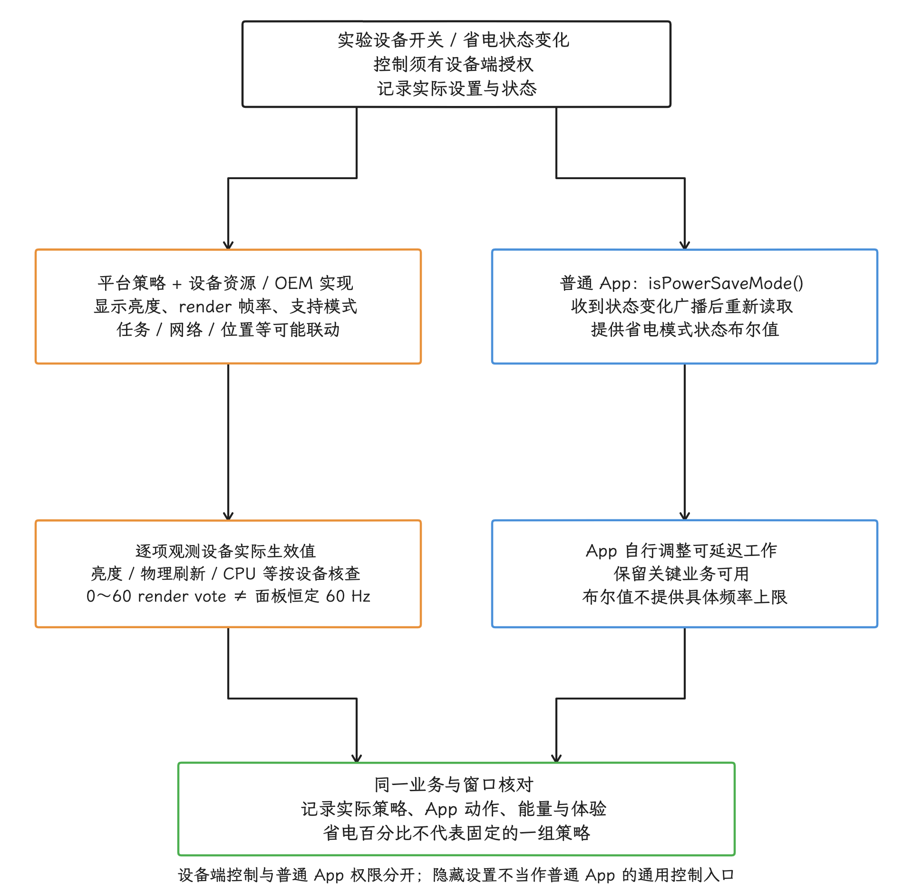

图：省电状态分为设备策略和App观测/适配两路。实验控制单独核对设备端授权；普通App通过isPowerSaveMode及状态广播后重读，按状态调整自己的可延迟工作。布尔值不列出具体CPU/亮度/刷新率限制，隐藏设置也不是通用App控制入口；平台资源/OEM的实际多项联动需设备证据。固定r1的0～60是renderframe-rate范围vote，不是所有面板恒定60Hz。比较相同业务和窗口，记录实际策略、App动作、能耗、成功率与体验，不将论文相对百分比当固定策略包收益。

## 11.5.8 视频分辨率、消息长度与网络状态

这一节的三类变量表面上属于用户设置，测到的能量却往往包含整段业务动作的开销。

### 视频分辨率

论文中，YouTube 1440p 相对 240p 的平均功率增幅为 5.5%，720p 与 1440p 之间没有检出统计显著差异。“没有检出”说的是本实验的窗口，离“分辨率对功耗没有影响”这个结论还差得远。短窗口内可能同时存在：

- 网络下载与缓存；
- 解码器固定成本、codec 与硬件/软件解码路径；
- Surface 合成与缩放；
- 面板亮度与视频平均画面亮度；
- 播放控件、广告和脚本动作。

弱网、高码率、软件解码、录屏或热限制场景可能得到不同结果。视频测试应至少记录 codec（编解码器）、码率、分辨率、帧率、HDR、缓存状态、网络类型和播放时长。

<!-- gracker-diagram: ch11-05-24-video-power-path -->
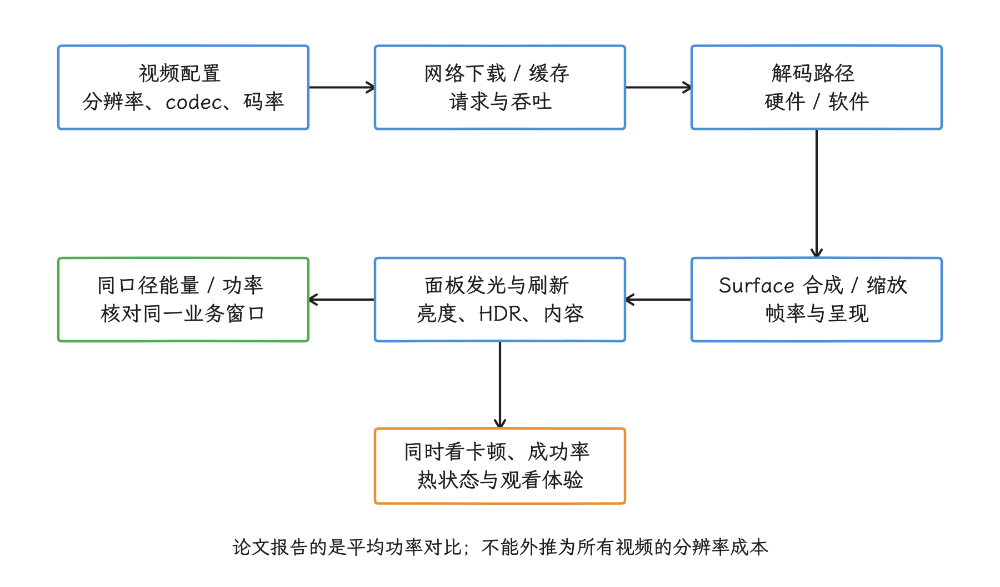

图：沿下载、解码、合成和显示链路定位分辨率可能改变的成本。 这是机制路径，不是论文对5.5%的成分分解；硬件解码、缓存、codec、码率与内容不同会改变结果，未显著不证明无影响。

### 消息长度

论文的 WhatsApp 脚本中，消息从 100 字符增至 200 字符后，总能耗增加 115.6%。这个百分比描述的是整次脚本，单字符能量是另一个量。文本注入或输入法处理、布局、加密、网络与回执等是可能的解释路径；公开脚本与统计未对这些阶段逐项测量，+115.6% 应记在整次任务头上，分摊到某个环节的依据还不存在。

复现实验应分别记录输入时长、按键或注入方式、布局次数、上下行字节、CPU 时间和后台任务。若动作持续时间也随字符数增加，报告还要区分“单位时间功率”与“完成一次任务的总能量”。

<!-- gracker-diagram: ch11-05-25-message-task-energy -->
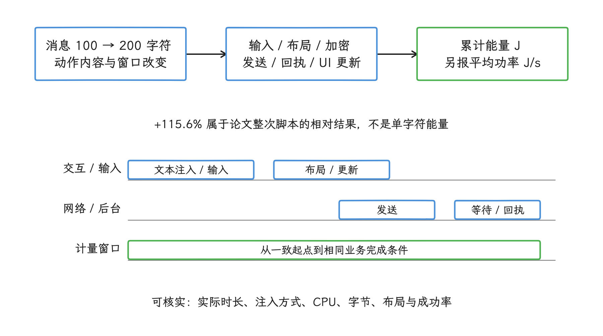

图：消息更长可能改变任务时长与多个阶段，按整次任务和平均功率分别报告。 轨道仅为可能阶段，条长不表示论文测量。公开结果没有把输入、布局、加密或网络各自的能量拆出。

### 网络状态

论文未报告飞行模式分组的显著差异；又赶上 airplane 标签公开冲突，这一项连“一次核实过实际无线状态的 A/B 测试”都替代不了。飞行模式下 Wi-Fi 也可能仍然开着，各无线接口的真实状态必须逐项记录。线上弱网、蜂窝寻网、重传、DNS/TLS 重试，以及请求结束后基带仍保持活跃的 radio tail（基带尾时长），都可能改变结论。

网络实验应记录 Wi-Fi / 蜂窝制式、信号强度、传输字节、缓存、请求重试与服务器响应。飞行模式会同时改变多项能力，精确模拟弱网要另找手段。

<!-- gracker-diagram: ch11-05-26-network-state-tail -->
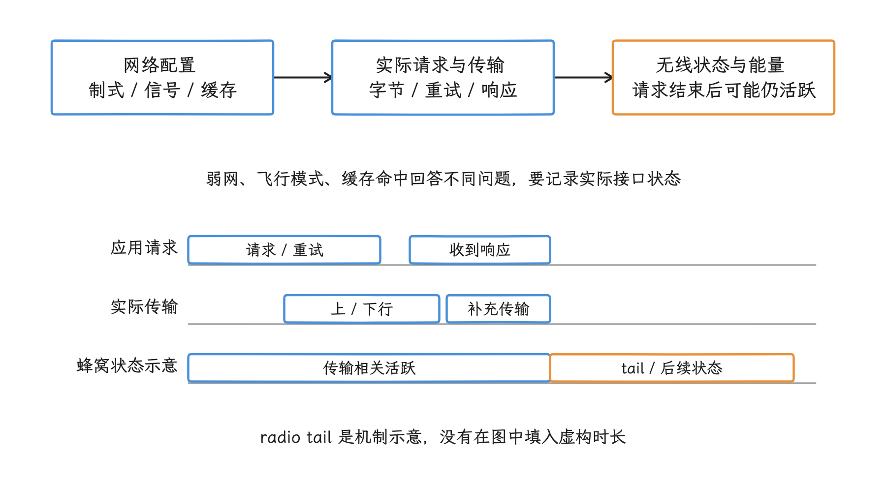

图：把请求动作、实际传输和无线活跃阶段放到同一时间线上。 轨道仅示意蜂窝 tail 的一种可能路径，实际状态/持续时间由制式与设备决定；飞行模式标签不等于Wi-Fi关闭，不能精确代替弱网。

## 11.5.9 测试设计：记录请求值与生效值

我们要设计一份可复现的用户设置功耗实验，至少要交代下面这些条件：

| 变量 | 请求或配置值 | 生效值与证据 | 常见混淆 |
|---|---|---|---|
| 亮度 | 滑块、Window brightness（窗口亮度）、自动亮度 | 当前亮度、nit、HBM/HDR 状态 | 同一百分比跨设备比较 |
| 刷新率 | 用户 min/peak（最低/峰值）、应用 frame-rate vote | 应用帧/回调、VSync、显示模式与设备开放的实际刷新证据 | ARR 下仅凭模式名或单一 VSync 值认定面板恒定 120 Hz |
| 主题 | 系统与应用主题 | 页面颜色、媒体内容、用户补偿亮度 | 把 OLED 结论用于 LCD |
| 省电模式 | 开关状态 | 刷新率、任务、网络、频率变化 | 把 OEM 行为当成 Android 合同 |
| 网络 | Wi-Fi / 蜂窝 / 弱网配置 | 信号、吞吐、重试、缓存 | 用飞行模式代表所有网络问题 |
| 热状态 | 起始温度、环境温度 | thermal severity、频率、峰值温度 | 冷机组与温度稳定组直接比较 |
| 电池与供电 | 初始电量、USB、充电状态 | fuel gauge（电量计）、rail 或仪器记录 | 充电策略改变调度和统计 |
| 业务 | App 版本、账号、内容、动作 | 成功率、时长、帧数、字节 | 两组脚本没有完成相同任务 |


### 分三层安排实验

1. **固定基线**：固定设备、亮度、刷新率范围、主题、网络、内容、温度区间和采样窗口。
2. **单变量扫描**：每次改变一项设置，并验证其他生效值未随之变化。
3. **用户场景复测**：恢复自动亮度、ARR、动态内容和常用网络，检查实验方向是否仍存在。

固定基线用于比较代码版本，用户场景用于评估体验。两者应分别报告。单变量扫描也要警惕联动：开启省电模式可能同步改变刷新率、后台任务和处理器策略。

<!-- gracker-diagram: ed11-05-controlled-and-user-experiments -->
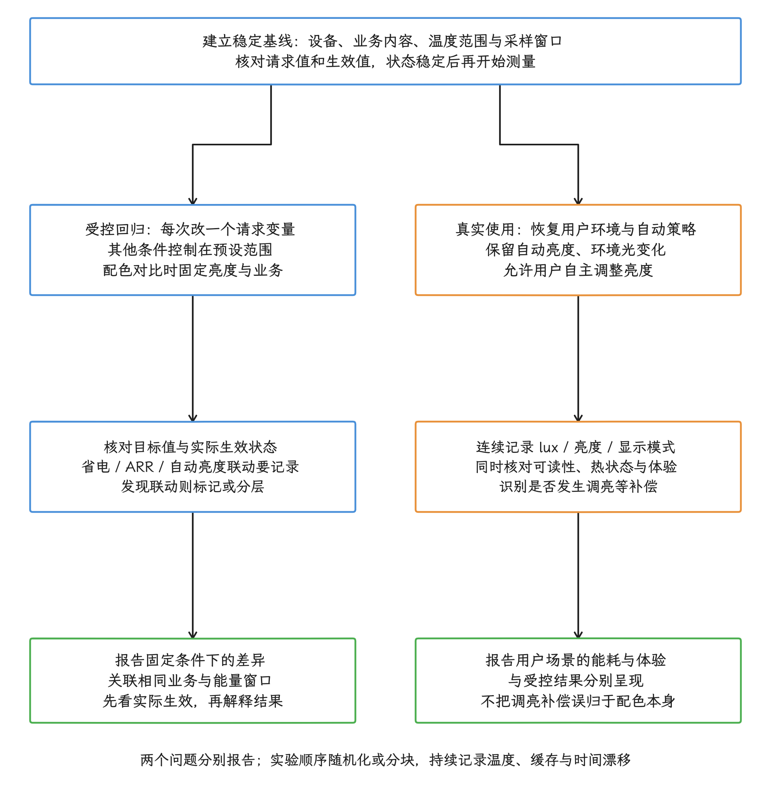

图：共同稳定基线后分两类实验：受控分支每次改一个请求变量，配色比较固定亮度，并核对其他实际生效值；省电/ARR/自动亮度联动要记录或分层。真实使用分支恢复自动条件与用户调整，连续记录环境、亮度、模式与可读性，补偿需要实际观察。两类结果分别呈现，关联同一业务与采样窗口；实验顺序随机化或分块，记录温度、缓存与时间漂移。

### 快速采集系统快照

在测试窗口之外分别采集前后快照。每次执行以下命令会新建临时目录，避免覆盖上一轮；完整 bugreport 较重，可在一组实验完成后再采集，采集过程不纳入短场景能量窗口：

```bash
out_dir="$(mktemp -d "${TMPDIR:-/tmp}/display-power.XXXXXX")"
adb shell dumpsys display > "$out_dir/display.txt"
adb shell dumpsys SurfaceFlinger > "$out_dir/surfaceflinger.txt"
adb shell dumpsys batterystats --charged > "$out_dir/batterystats.txt"
# 可选：放在整组实验结束后，采集开销不计入测试窗口。
adb bugreport "$out_dir/display-power.zip"
printf '%s\n' "$out_dir"
```

`dumpsys display` 与 SurfaceFlinger 输出适合确认配置和当时状态，连续时间线要靠其他工具补。`batterystats --charged` 是累计统计窗口，本轮动作的净增量要靠记录窗口、重置/充电时点自己算出来。BatteryStats 用于系统归因，bugreport 保存诊断上下文；命令输出中的应用、账号、设备标识和网络信息应在分享前脱敏。

连续分析时，几类工具的分工不同：

- Perfetto：同时观察 FrameTimeline（帧时间线）、VSync、调度、CPU frequency/idle（频率/空闲状态）、thermal 与设备开放的 power rail；
- Battery Historian：可读取历史较长时间线；官方已标明不再积极维护，新分析优先使用系统跟踪、Power Profiler 等受支持工具；
- Android Studio Power Profiler 与 Macrobenchmark `PowerMetric`：区分 ODPM 的整设备/子系统数据和电池电量差；先检查设备支持。`PowerMetric` 的 `Type.Power`、`Type.Energy` 与 `Type.Battery` 量纲不同，彼此之间不能混用；rail 的总和与完整整机能量也是两个概念。

<!-- gracker-diagram: ch11-05-29-snapshot-continuous -->
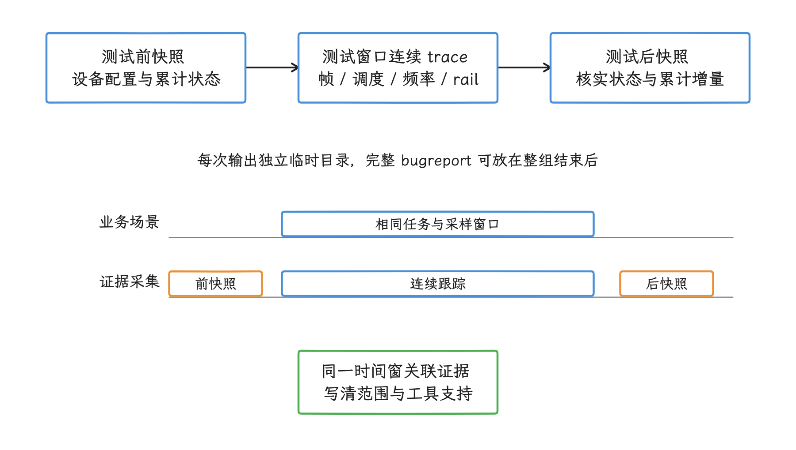

图：前后快照确认边界条件，连续跟踪解释窗口中发生的变化。 轨道仅示意采集阶段；dumpsys与bugreport采集放在短测试窗口外。--charged是累计窗口，rail总和也不自动等于完整整机能量。

### 重复、统计与失败样本

功耗数据常呈偏态分布，并有少量远高于多数样本的长尾值。报告应给出重复次数、中位数、离散程度、异常值规则与场景成功率。用 Mann-Whitney U 检验时，样本独立性仍是前提，数据偏态免不了这条要求；它比较的是独立样本的分布，显著结果要落到“中位数不同”的表述，还需分布形态支撑。同一设备上的顺序重复可能受温度、缓存和时间漂移影响，应随机化/分块、按设计选择独立或配对分析，并说明多重比较处理。除 p 值外还应报告效果量、区间估计与业务成功率——统计显著离产品价值还有距离。

删除异常样本必须有预先定义的规则，并保留失败原因。脚本超时、广告出现、网络失败、温度越界或业务动作未完成，应作为场景质量问题记录；数值偏大本身构不成删除理由。


## 11.5.10 版本边界：Android 11 到 Android 17

| 平台 | 相关变化 | 阅读方式 |
|---|---|---|
| Android 11 / API 30 | `Surface.setFrameRate()` 与多刷新率应用接入 | 应用可表达 Surface 内容帧率 |
| Android 12 / API 31 | 新增带 `changeFrameRateStrategy` 的三参数重载；compatibility 在 API 30 已存在 | 区分只允许无缝与允许非无缝切换的策略，仍受用户偏好和设备条件约束 |
| Android 15 / API 35 | 平台引入 ARR，增加 View 级帧率请求能力 | 支持受硬件、HAL 与 OEM 配置约束 |
| Android 16 / API 36 | `Display.hasArrSupport()` 提供能力检查 | 系统版本与设备能力分开判断 |
| Android 17 / API 37 | 源码锚点；显示策略继续汇集用户、应用、亮度、热与省电投票 | 以设备生效状态验证请求结果 |

版本表描述的是平台能力演进；每台设备升级后实际开放哪些显示模式，要按具体设备确认——刷新率列表、ARR、HBM、power rail 和 consumed-energy 数据的可用范围都在此列。


## 11.5.11 产品策略与提示写法

### 亮度

阅读、聊天、图文流与长视频场景可优先检查亮度。提示语应以可读性为前提，例如“环境允许时降低屏幕亮度”；用户的无障碍需求排在省电前面，也应避免频繁修改系统亮度。

### 刷新率

视频和自绘内容应上报内容帧率，静态 UI 应停止无意义刷新。是否建议用户降低峰值刷新率，要结合设备、场景和体验数据。游戏、绘图与快速滚动页面可能从高刷获得明显体验收益。

### 深色模式

可说明部分 OLED 设备、深色页面和合适亮度下存在省电机会；媒体内容占主导的页面尤其要谨慎，写成所有设备通用的续航功能就过头了。

### 分辨率与网络

弱网、发热、流量受限或解码压力较高时，降低码率与分辨率可能同时改善稳定性和能耗。正常网络下的收益要由业务场景测量，不宜从单机论文数字推导。

### 省电模式

应用应尊重系统省电状态，减少可延迟工作，并验证关键路径是否仍可用。固定的 CPU 上限或刷新率上限属于设备策略，应用侧按状态适配即可。


## 11.5.12 评审清单

- [ ] 亮度记录包含固定/自动状态、环境和 HBM/HDR 条件
- [ ] 跨设备比较使用可解释的物理亮度信息，或明确滑块值不可比
- [ ] 刷新率同时记录用户配置、应用请求和系统生效状态
- [ ] ARR 结论包含 `Display.hasArrSupport()` 与设备支持边界
- [ ] 深色模式结论区分 OLED / LCD、页面颜色与媒体内容
- [ ] 省电模式结论没有把 OEM 参数写成平台保证
- [ ] 视频实验记录 codec、码率、帧率、HDR、缓存和网络
- [ ] 网络实验记录信号、重试、字节与 radio 状态
- [ ] BatteryStats 归因与整机测量没有混用
- [ ] 实验写明重复次数、离散程度、异常值规则和失败样本
- [ ] 论文百分比注明 W/累计能量、等权汇总、固定数据版本及标签冲突
- [ ] `mAh`、µWs/µJ、µC、J、W 的换算与采样窗口一致

## 小结

用户设置属于功耗实验条件，也可能改变多条系统链路。亮度要从滑块值追到面板亮度与内容；刷新率要分清应用产帧、VSync、合成和面板刷新；深色模式要结合屏幕技术、页面颜色与用户亮度；省电、视频和网络设置则常带来多变量联动。

BatteryStats 的显示归因可能使用硬件 consumed energy，也可能回退到 `PowerProfile`；无论走哪条，产品场景的整机测量都要另外补上。可靠结论应写清设备、请求值、生效值、测量来源、业务动作和统计边界。

## 参考资料

- [An Empirical Analysis of Mobile Energy Consumption Across User Configurations](https://arxiv.org/abs/2604.25587)
- [论文固定版本 CSV](https://github.com/wellington-oj/user_energy/blob/f12c27c5487ec0e9be97ab468c3ab104dacca02b/script_data/master_energy_data.csv)、[分析 notebook](https://github.com/wellington-oj/user_energy/blob/f12c27c5487ec0e9be97ab468c3ab104dacca02b/script_data/script.ipynb)、[聚合脚本](https://github.com/wellington-oj/user_energy/blob/f12c27c5487ec0e9be97ab468c3ab104dacca02b/ebserver/experiment-results/master.py)
- [Surface 帧率 API](https://developer.android.com/reference/android/view/Surface)、[View 帧率 API](https://developer.android.com/reference/android/view/View#setRequestedFrameRate(float))、[ARR 能力检查](https://developer.android.com/reference/android/view/Display#hasArrSupport())
- [Power Profiler](https://developer.android.com/studio/profile/power-profiler)、[PowerMetric](https://developer.android.com/reference/kotlin/androidx/benchmark/macro/PowerMetric)、[Perfetto power data sources](https://perfetto.dev/docs/data-sources/battery-counters)
- [SciPy：Mann-Whitney U 的独立样本与分布检验合同](https://docs.scipy.org/doc/scipy/reference/generated/scipy.stats.mannwhitneyu.html)
- [AOSP：Platform power management values](https://source.android.com/docs/core/power/values)
- [AOSP：Adaptive refresh rate](https://source.android.com/docs/core/graphics/arr)
- [AOSP：Multiple refresh rate](https://source.android.com/docs/core/graphics/multiple-refresh-rate)
- [Android Developers：Frame rate](https://developer.android.com/media/optimize/performance/frame-rate)
- [Android Developers：Adaptive refresh rate](https://developer.android.com/develop/ui/views/animations/adaptive-refresh-rate)
- [Android Developers：Dark theme](https://developer.android.com/develop/ui/views/theming/darktheme)
- [Android Developers：Battery Historian](https://developer.android.com/topic/performance/power/setup-battery-historian)
- AOSP `android-17.0.0_r1`：`ScreenPowerStatsCollector.java`、`ScreenPowerStatsProcessor.java`、`PowerProfile.java`
- AOSP `android-17.0.0_r1`：`DisplayModeDirector.java`、`BrightnessMappingStrategy.java`、`RefreshRateSelector.cpp`
- [Samsung Display：OLED 自发光与 LCD 背光机制](https://global.samsungdisplay.com/28033)
- [Android：网络访问与无线状态机](https://developer.android.com/develop/connectivity/network-ops/network-access-optimization)
- [Google：飞行模式中保留 Wi-Fi/蓝牙（Pixel 示例）](https://support.google.com/pixelphone/answer/12639358?hl=en)
- [Android：热状态与可持续性能](https://developer.android.com/games/optimize/adpf/thermal)
