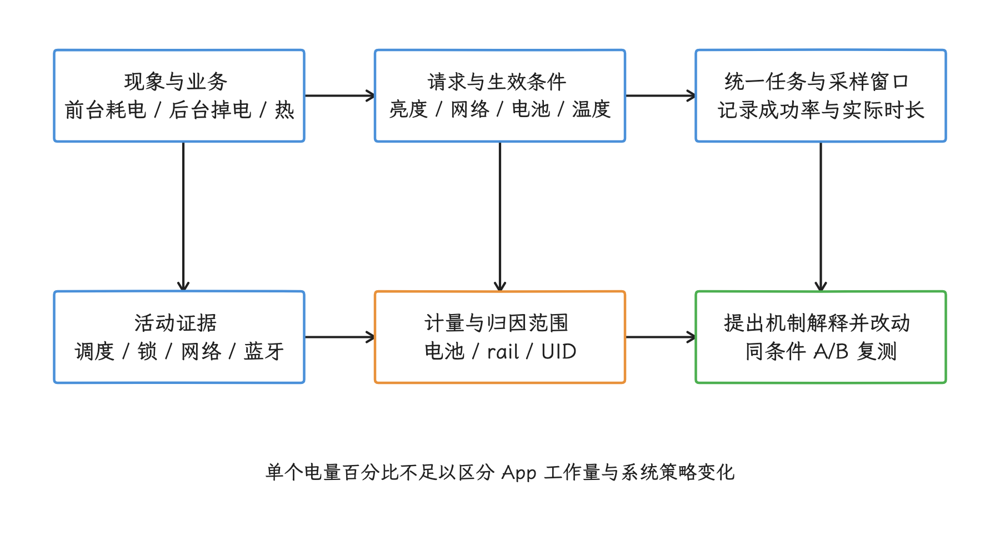
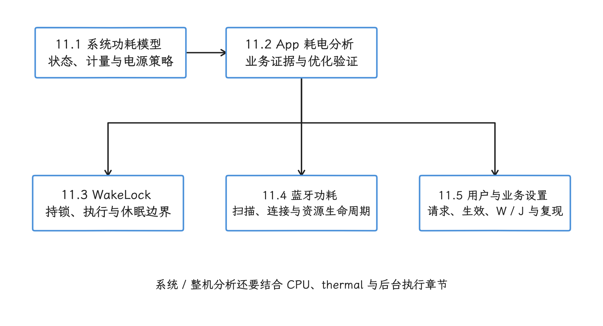
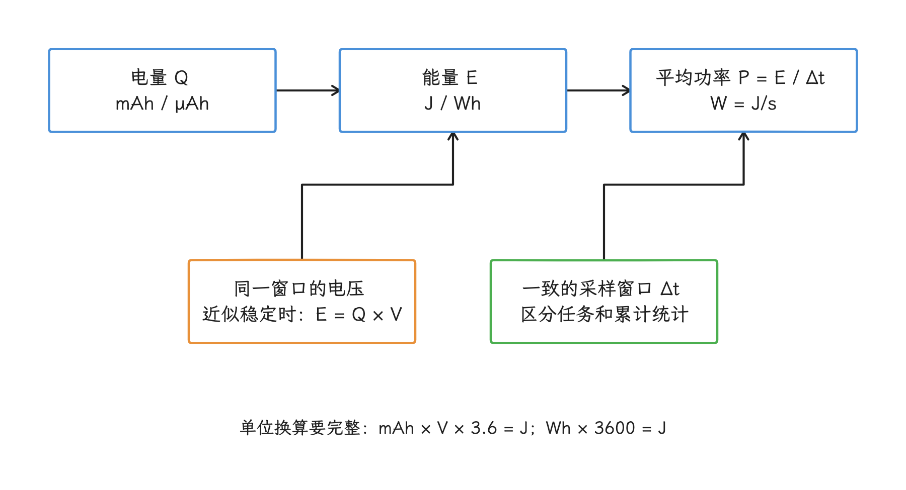

# 第 11 章：功耗

严格来说，功耗指能量消耗的速率，耗电量指一段时间内累计消耗的能量；本章同时讨论两者。功耗问题通常跨越较长的时间窗口，并与卡顿、启动、后台执行和设备温度相互影响。

用户可感知的现象包括前台耗电、后台掉电和发热后的性能下降。分析功耗问题时，需要同时记录工作负载（实际执行的业务工作量）、调度、thermal（温控状态）、后台限制、WakeLock（阻止设备进入部分休眠状态的锁）、网络行为与设备状态。

应用侧优化与系统侧策略需要分别取证，不能只用电量百分比归因。

<!-- gracker-diagram: ch11-index-02-evidence-loop -->

图：先对齐业务、设备状态与测量窗口，再解释组件活动与能量变化。 关联时间线只提供线索；UID 归因、设备 rail 和整机测量各有范围，修改后还需同条件复测。

## 内容索引

- [11.1 Android 功耗模型与系统级优化](01-android-power-model-system-optimization.md)
- [11.2 App 耗电优化与案例](02-app-power-optimization-cases.md)
- [11.3 WakeLock 机制与功耗分析](03-wakelock.md)
- [11.4 Bluetooth 扫描与连接功耗分析](04-bluetooth-scan-connection-power.md)
- [11.5 用户设置与业务配置对能耗的影响](05-user-settings-energy-impact.md)

<!-- gracker-diagram: ch11-index-03-reading-map -->

图：用系统模型和 App 证据建立基础，再按问题进入专项。 阅读分支可并行组合；WakeLock、蓝牙和显示设置会相互影响，不代表彼此排斥的故障分类。

## 阅读建议

- App 侧耗电：先读 11.1 和 11.2，再进入对应专项。
- 系统或整机分析：结合 11.1、11.2 与 CPU/thermal 章节。
- 后台任务配额与 TARE（The Android Resource Economy，Android 资源经济系统）的版本边界：读 [5.3 后台执行、任务调度与 App Hibernation](../../part1-fundamentals/ch05-cpu-power/03-background-jobs-hibernation.md)。

<!-- gracker-diagram: ch11-index-01-charge-energy-power -->

图：电量先结合电压换成能量，再按同一窗口计算平均功率。 mAh 不是 J；电压变化时应按时间积分。电池电量百分比还受容量、估算精度和状态影响，不能直接归因到 App。
