# Android 网络与 TLS（传输层安全） 性能优化

一次接口调用的等待时间，分散在客户端排队、DNS（域名系统） 解析、路由尝试、建连与拥塞控制、加密握手、上传、边缘节点、服务端、响应传输、解析和界面更新里。拿到“接口耗时 2 秒”这样一个结果，我们还回答不了“这 2 秒花在哪一段”。

移动网络持续变化，但客户端能控制的始终是请求时机、复用、总期限、缓存、重试和内容降级这几件事。所以优化工作的第一步是把计时方式统一起来，再按协议、请求组织和网络状态选择策略——这也是全篇的展开顺序。

> 源码基线：Android 17 / API 37、AOSP `android-17.0.0_r1`、OkHttp 5.3.0、Play services Cronet 18.0.1；设备可能使用其他内核分支。

`netd`（Android 网络管理守护进程） 与 DNS Resolver（解析器） 的内部细节见 12.2，系统选网与 `NetworkAgent` 见 1.22。

## DNS、连接、传输与应用处理

### 应用网络栈和主线程边界

动手优化之前，我们先弄清应用的 HTTP 请求走哪条路径——不同路径的落点各不相同：OkHttp 自己管理连接池，TCP 通常经 `java.net.Socket`，TLS 走平台 JSSE/Conscrypt（Java 与 Android 的 TLS 实现）；Cronet 使用 Chromium native（原生代码） 网络栈；API 34 起的 `HttpEngine` 则交给设备提供的实现。这条路径决定了哪些环节在我们手里，也是后面讨论主线程问题的前提。

路径不同，HTTP/3 的位置也不同：HTTP/3/QUIC 的状态机跑在 Cronet/HttpEngine 的用户空间 provider（实现提供方） 里，内核只看到 UDP/IP/socket；OkHttp 5.3.0 则没有稳定公开的 HTTP/3 配置入口。

主线程的网络限制要区分“直接发起网络”与“等待后台网络”两种情况。`Inet6AddressImpl` 在 DNS 缓存检查前调用 `BlockGuard.getThreadPolicy().onNetwork()`，BlockGuard 就靠这类钩子检测线程违规 I/O；`BlockGuardOs` 还覆盖 connect、阻塞 poll（等待文件描述符事件） 与 recvmsg（接收 socket 消息） 等 socket 入口，JNI 直接 I/O 则可能避开部分检测。

`Future.get()`、`CountDownLatch.await()` 或 `runBlocking` 虽不会抛 `NetworkOnMainThreadException`，仍会让 UI 等待后台请求，带来卡顿甚至 ANR（应用无响应）——这就是第二种情况。判断主线程问题时，我们先分清卡顿属于哪一种，再往下定位。

<!-- gracker-diagram: ch12-01-01-network-stack-layers -->
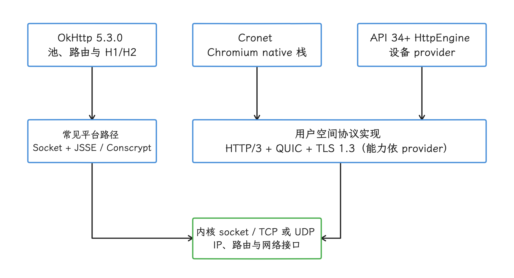

图：先确定由哪个网络实现管理连接、TLS 与协议状态。 内核接口是概念共用层，省略JNI/Binder细节；OkHttp枚举h3不代表内置HTTP/3实现。

<!-- gracker-diagram: ch12-01-02-main-thread-boundaries -->
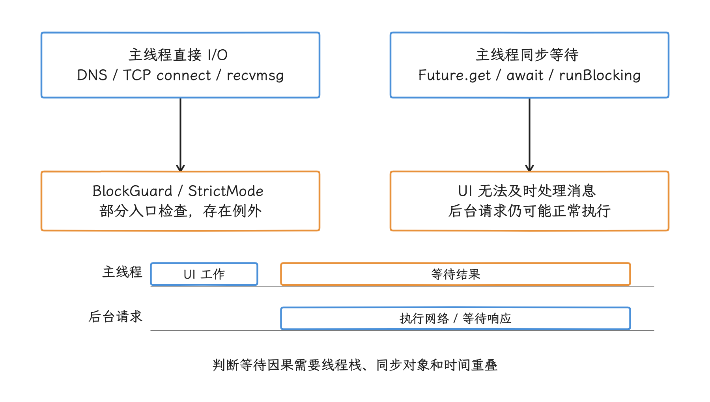

图：区分被线程策略检测的网络入口与把 UI 阻塞在同步等待上的调用。 固定r1有UDP connect、非阻塞poll等检测例外；无异常不等于无卡顿。轨道只示意等待关系。

### 一次请求应当怎样计时

常规的非双工请求（发送和接收不能同时进行）可以按下面的顺序观察，双工的情况随后单独说：

```text
enqueue / execute
  → Dispatcher 排队
  → 代理选择与 DNS
  → 路由尝试
  → TCP + TLS，或 QUIC + TLS
  → 请求头与请求体
  → 响应头
  → 响应体
  → 反序列化、业务处理与界面更新
```

缓存命中或连接复用会跳过若干阶段，重定向、认证、路由回退和重试又可能让某些阶段出现多次；双工请求还允许请求体与响应交错。所以监控系统要保存的是事件序列；某段计时从哪里开始、到哪里结束，看的是它前后的事件；每种事件出现几次，以实际序列为准。

<!-- gracker-diagram: ch12-01-03-call-event-sequence -->
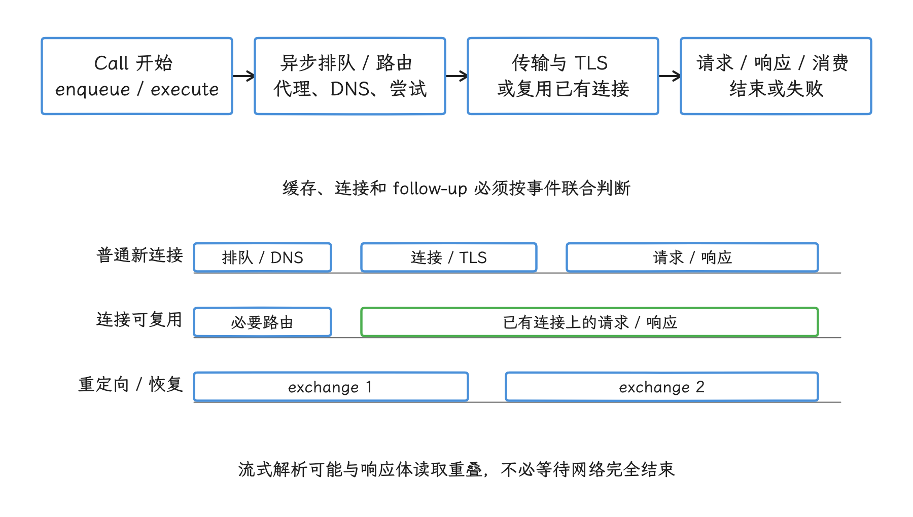

图：保留实际事件序列，区分缺席、重试和交错。 上方是普通顺序路径；新鲜缓存可跳过网络，连接合并仍可能有DNS，双工与100-continue另记。条长没有时长含义。

#### 需要分开的指标

| 指标 | 建议边界 | 能回答的疑问 |
|---|---|---|
| Call 总耗时 | `callStart` 到 `callEnd` / `callFailed` | 用户发起的单次 `Call` 在网络库内停留多久 |
| Dispatcher（请求调度器）排队 | `dispatcherQueueStart` 到 `dispatcherQueueEnd` | 并发上限或线程资源是否造成客户端等待 |
| DNS | 每组 `dnsStart` 到 `dnsEnd` | 域名解析、缓存和重定向域名是否消耗时间 |
| TCP 建连 | `connectStart` 到 `secureConnectStart`，无 TLS 时到 `connectEnd` | Socket 建连和路由尝试是否缓慢 |
| TLS | `secureConnectStart` 到 `secureConnectEnd` | 加密握手与证书处理消耗多少时间 |
| 请求发送 | `requestHeadersStart` 到 `requestBodyEnd`，无请求体时到 `requestHeadersEnd` | 上传或请求体生产是否缓慢 |
| 响应头等待 | 请求发送结束到 `responseHeadersStart` | 网络往返、边缘节点和服务端共同造成的等待 |
| 响应体传输 | `responseBodyStart` 到 `responseBodyEnd` | 下载和应用读取速度是否偏低 |
| 内容可用时间 | 业务发起到数据可展示 | 网络、解析、数据库和 UI 的整体结果 |

<!-- gracker-diagram: ch12-01-04-call-lifetime -->
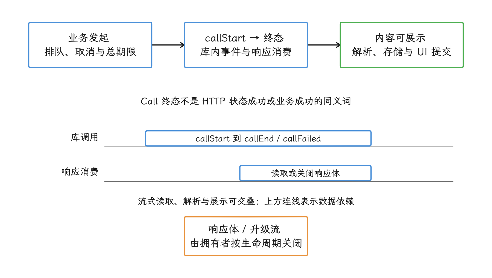

图：将业务发起、库调用、响应消费与 UI 提交分别计时。 execute返回响应头不等于callEnd；callEnd包含延迟消费，提前关闭也可能结束，业务成功要独立定义。

OkHttp 5.3.0 的 `callStart` 在调用 `enqueue()` 或 `execute()` 后触发。请求若因 Dispatcher 或 HTTP/2 stream（同一连接中的独立请求流） 资源不足而等待，`dispatcherQueueStart` / `dispatcherQueueEnd` 可以直接把这段时间记下来。相关约束写在同版本的 [`EventListener.kt`](https://github.com/lysine-dev/okhttp/blob/parent-5.3.0/okhttp/src/commonJvmAndroid/kotlin/okhttp3/EventListener.kt) 中。

#### TTFB 的两种起点

同样是 TTFB（Time to First Byte，首字节时间），不同平台可能从不同起点算起；客户端常见的起点有两种：

- 从 `callStart` 到 `responseHeadersStart`（开始收到响应头）：包含排队、DNS、连接、握手、上传和等待响应，接近用户等待响应头的时间。
- 从请求发送结束到 `responseHeadersStart`：把前置阶段排除掉了，但网络往返、代理、CDN（内容分发网络）、服务端排队与处理仍在其中。

只看一个高的 TTFB，我们还归因不到服务端：要缩小范围，得把服务端 trace（性能跟踪）、`Server-Timing`、CDN cache（节点/缓存） 状态和客户端分段计时放在一起用，统计时固定响应头与响应体的分段方式。另外 OkHttp 的 `responseHeadersStart` 表示开始读取响应头，和业务已经拿到可展示数据是两回事。

<!-- gracker-diagram: ch12-01-05-ttfb-endpoints -->
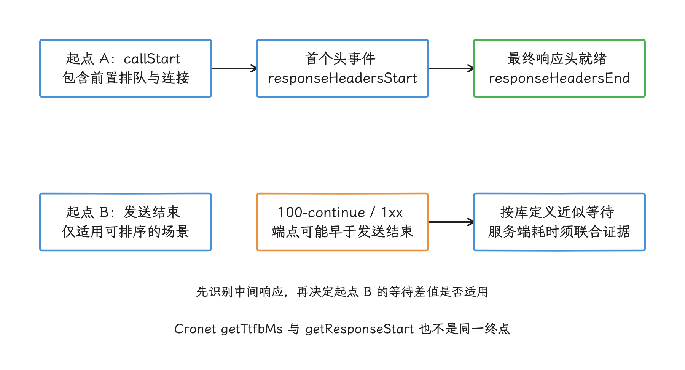

图：给每个响应等待指标写清起点、终点和中间响应规则。 固定5.3.0的responseHeadersStart在库读到头后触发，不是wire首字节；100-continue可早于上传结束。

#### 传输速率怎么算

传输速率适合用在大响应、上传和媒体流上。计算时至少记录：

- 有效载荷字节数与计时起止点；
- 内容编码，例如 gzip、Brotli；
- 是否命中 HTTP cache；
- 应用是否因读取响应过慢产生 backpressure（上游被迫等待的背压）；
- 协议、网络 transport（传输类型）、是否 metered（按流量计费）、是否 roaming（漫游）；
- 中断、续传和重试字节。

`NetworkCapabilities.getLinkDownstreamBandwidthKbps()` 返回的是系统估计的**第一跳 transport（端口） 带宽**，也就是设备到所连接网络的链路能力，拿它当实际请求吞吐会有很大偏差。

<!-- gracker-diagram: ch12-01-06-throughput-vs-link -->
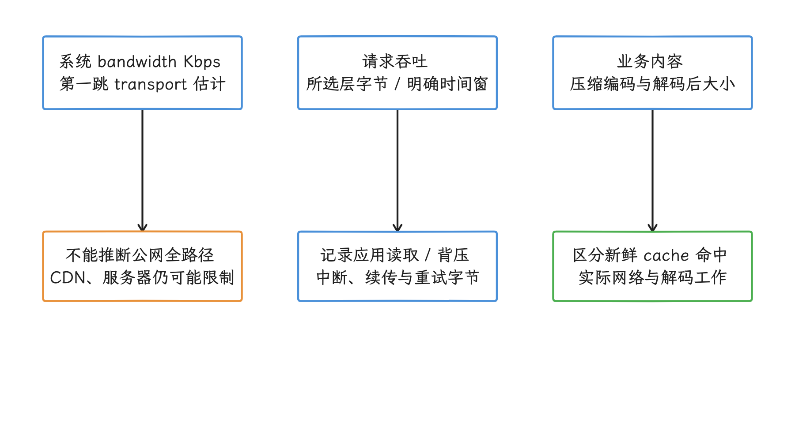

图：分别记录系统链路估计、窗口内字节与内容编码。 第一跳能力不是端到端测速；应用消费、背压、缓存与重试也会改变观察值。无示例数值代表真机吞吐。

### HTTP/1.1、HTTP/2 与 HTTP/3

| 能力 | HTTP/1.1 | HTTP/2 | HTTP/3 |
|---|---|---|---|
| 传输 | TCP | TCP | QUIC over UDP（基于 UDP 的 QUIC） |
| 加密 | 可选；Android 业务通常使用 TLS | HTTPS 场景使用 TLS | TLS 1.3 集成在 QUIC 握手中 |
| 同连接并发 | 常规实现中一条连接一次处理一个请求 | 多个 stream（请求流）复用一条连接 | 多个 QUIC stream 复用一条连接 |
| 头部压缩 | 无协议级动态压缩 | HPACK（HTTP/2 头部压缩） | QPACK（HTTP/3 头部压缩） |
| 丢包影响 | 该 TCP 连接等待缺失字节 | 同一 TCP 连接上的 stream 都受传输层顺序约束 | 丢失数据所属 stream 等待重传；共享拥塞控制仍会影响整条连接 |
| 网络迁移 | 通常重建连接 | 通常重建连接 | 协议具备 Connection ID（连接标识）与路径验证能力，能否迁移取决于实现和服务端 |

<!-- gracker-diagram: ch12-01-07-http-transport-layers -->
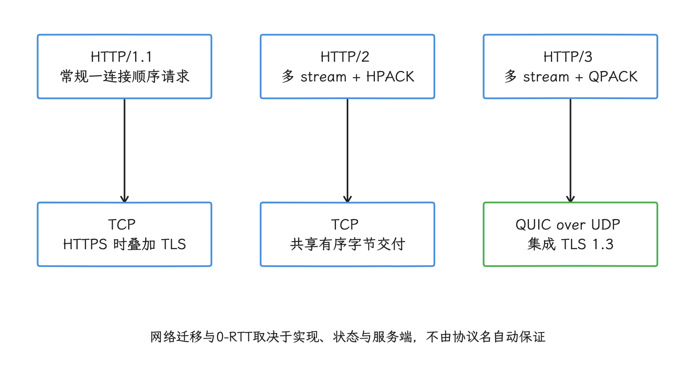

图：先分清 HTTP 消息组织和其下的可靠传输层。 H1这里指常规无流水线实现；H2仍共享TCP有序交付；H3共享连接资源且可能有QPACK依赖。

把三代协议放在一起看，HTTP/2 首先把应用层组织并发时对多条连接的依赖降了下来，靠 multiplexing（多路复用） 和 HPACK 减少重复开销。但 TCP 仍按字节顺序交付，一段数据丢失后，后续字节都要等重传；服务端允许的最大并发 stream、优先级实现和单连接拥塞也会影响最终结果。

HTTP/3 把 HTTP 映射到 QUIC stream，某个 stream 丢失的数据不再要求其他 stream 等待同一字节序列。但连接级拥塞窗口、设备 CPU、服务器调度和 UDP 路径仍是共享资源，存在丢包时 HTTP/3 也不一定更快。

#### 0-RTT 的边界

QUIC 恢复连接时可能发送 TLS early data（握手完成前的早期数据），把一次往返省下来，这个过程称为 0-RTT。它需要已有会话状态、客户端允许、服务端接受并保留相应配置。服务端也可以拒绝 early data，客户端随后按正常握手继续。所以我们按 0-RTT 失败的路径设计功能正确性，把它当成可能落空的一次往返节省。

<!-- gracker-diagram: ch12-01-09-zero-rtt-resumption -->
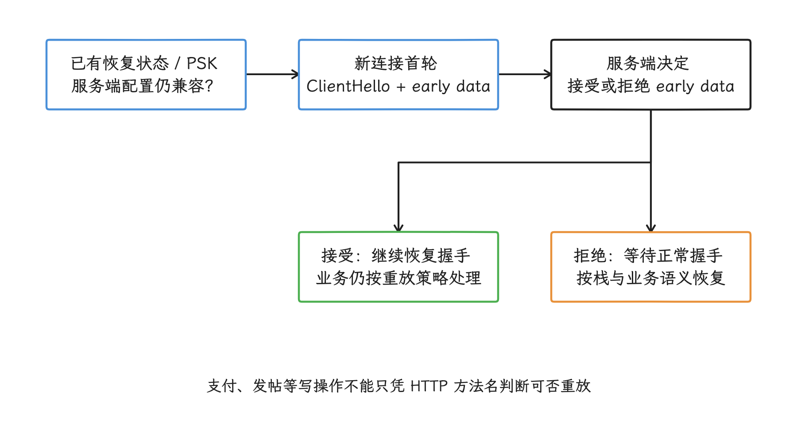

图：在恢复握手首轮发送可重放的早期数据，并保留拒绝后的正确恢复路径。 需要可用PSK/会话状态及双方支持；0-RTT不是握手完成，也不保证响应无需等待。

Early data 可能被重放——同一份请求数据可能被攻击者再发一遍，安全属性弱于新握手后的 1-RTT 数据。所以业务能发送的，是那些能够容忍重放的操作：支付、发帖、创建订单这类要等握手完成，或者靠服务端幂等键、去重记录和明确的重放策略兜底。HTTP 方法名只能当线索，判断依据还是业务语义。

Cronet 侧由 `QuicOptions.Builder.enableTlsZeroRtt()` 控制 TLS 0-RTT；`addAllowedQuicHost()` 只配置允许使用 QUIC 的 host（目标主机） allowlist（主机允许列表）。跨进程会话恢复还与磁盘 cache、provider（安全服务提供者，即具体的密码实现） 和服务端状态有关。

#### QUIC 连接迁移的条件

QUIC 的 Connection ID 允许连接在 IP 或端口变化后从新路径继续，Cronet 还提供 `ConnectionMigrationOptions`。迁移能否成功，要看 provider 配置、服务器支持、路径验证、NAT（网络地址转换）、VPN 和中间网络，切换 Wi‑Fi 与蜂窝时仍可能出现请求失败。所以业务层要保留取消、重试和幂等处理，把连接迁移当成有条件的优化——切换是否无感知，取决于上面这些条件是否同时满足。

<!-- gracker-diagram: ch12-01-10-quic-migration -->
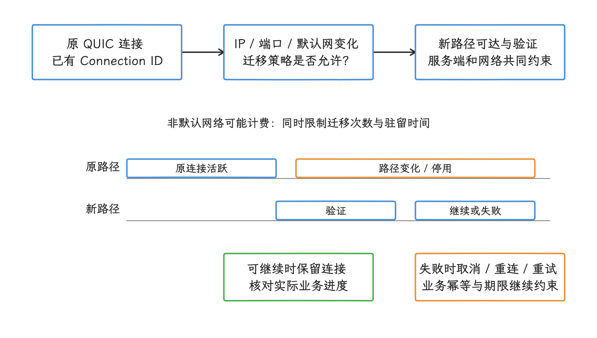

图：网络变化后先验证新路径，迁移失败仍由业务恢复保证正确性。 CID只是机制前提；provider、服务端、NAT/VPN及计费网络规则均影响结果。轨道无真实时长。

#### Android 上怎样使用 HTTP/3

OkHttp 5.3.0 的稳定协议栈覆盖 HTTP/1.1 与 HTTP/2，需要 HTTP/3 时可以评估 Cronet。当前 Android 官方接入使用下面的 Play services 依赖：

```kotlin
dependencies {
    implementation("com.google.android.gms:play-services-cronet:18.0.1")
}
```

构造 `CronetEngine` 前要调用 `CronetProviderInstaller.installProvider(Context)`，并处理 Play services 缺失、需要更新或安装失败。官方 `cronet-fallback` 是能力较弱的 Java fallback（备用实现） 实现，它的 HTTP/3、性能和连接迁移表现要按 fallback 本身单独验证，再决定能否沿用 native（C/C++ 层） Cronet 的结论。

一个进程通常只创建一个 `CronetEngine`，多个 engine 避免并发使用同一个 storage directory（存储目录）。若应用打包 native Cronet provider，还要按 [25.10 应用体积分析与优化：DEX、Native SO 与资源](../../part5-app/ch25-power-size/10-apk-r8-resource-optimization.md) 验证 ABI（应用二进制接口）、符号和 16 KB page size（内存页大小） 兼容性；页大小变化对初始化耗时没有通用收益比例。

<!-- gracker-diagram: ch12-01-11-cronet-provider -->
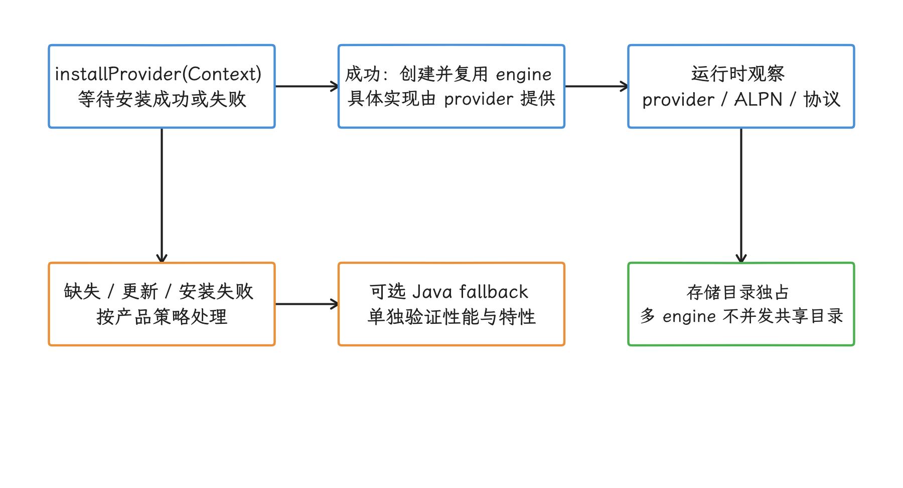

图：先确认 provider 可加载，再复用 engine 并观察实际协商协议。 Play services18.0.1是接入坐标，不是设备内provider版本或HTTP/3成功证明；Java fallback不能沿用native能力承诺。

#### 协议选择的线上分组

HTTP/3 发布至少要按这些维度分组：

- 协商后的协议，而非客户端“已启用 QUIC”的配置值；
- 首次连接、会话恢复和已有连接复用；
- Wi‑Fi、蜂窝、VPN、漫游与 metered 状态；
- 地区、运营商、CDN POP（边缘节点）和服务端版本；
- P50、P95、P99 延迟（50/95/99 分位数），以及失败率、回退率和重试率；
- 请求大小、响应大小与电量成本。

发布 HTTP/3 要客户端、服务端和网络路径一起就位：服务器正确发布能力，CDN 和防火墙放行相应 UDP 路径，客户端还要保留 HTTP/2 回退。先向少量流量开放；之后若尾部延迟或失败率变差，我们按网络与地区逐组定位，整体平均值在这一步容易掩盖问题。

<!-- gracker-diagram: ch12-01-08-loss-and-qpack -->
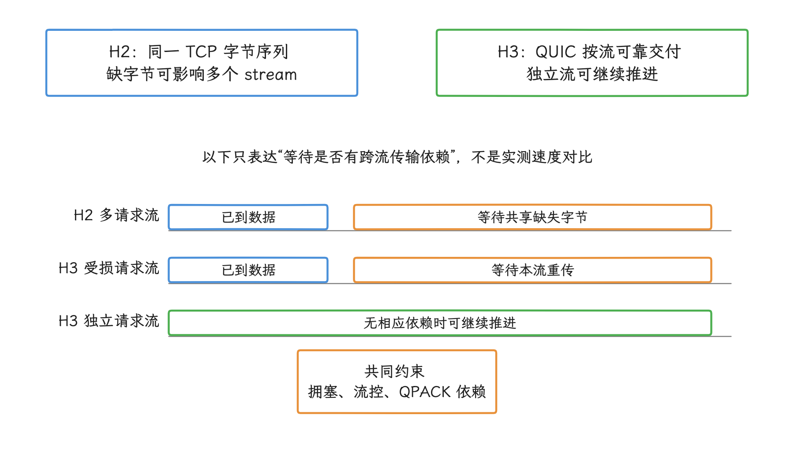

图：丢失数据不再要求独立请求流等待同一 TCP 字节序列，但依赖仍需单独检查。 轨道是机制示意；QUIC共享拥塞/连接流控，QPACK动态表依赖和关键控制流仍可能阻塞多个请求。

<!-- gracker-diagram: ch12-01-12-protocol-rollout -->
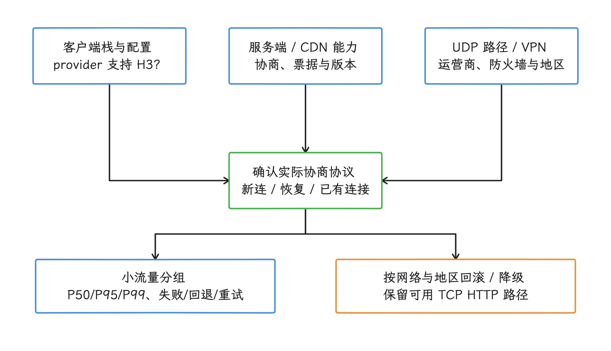

图：客户端、服务端与UDP路径一起验证，再按网络和地区评估尾部指标。 启用QUIC配置不代表协商为h3；UDP不可用时保留TCP HTTP回退，具体H2/H1依实现和服务端。

### 请求组织：复用、并发、合并与预热

协议之外，客户端能直接下手的是请求组织。这一节按连接复用、并发与聚合、预连接预热的顺序展开，它们共同决定一次请求要重复付出多少建连和调度成本。

#### 共享 OkHttpClient

OkHttp 官方建议复用一个 `OkHttpClient`：每个 client 都自带连接池和线程资源，每次请求新建 client 会丢失复用机会，还会留下空闲资源。

下面的代码创建一个共享 client，并从它派生不同超时策略：

```kotlin
data class TimeoutPolicy(
    val callMs: Long,
    val connectMs: Long,
    val readMs: Long,
    val writeMs: Long,
)

val sharedClient = OkHttpClient()

fun clientFor(
    base: OkHttpClient,
    policy: TimeoutPolicy,
): OkHttpClient = base.newBuilder()
    .callTimeout(policy.callMs, TimeUnit.MILLISECONDS)
    .connectTimeout(policy.connectMs, TimeUnit.MILLISECONDS)
    .readTimeout(policy.readMs, TimeUnit.MILLISECONDS)
    .writeTimeout(policy.writeMs, TimeUnit.MILLISECONDS)
    .build()
```

<!-- gracker-diagram: ch12-01-13-shared-client-pool -->
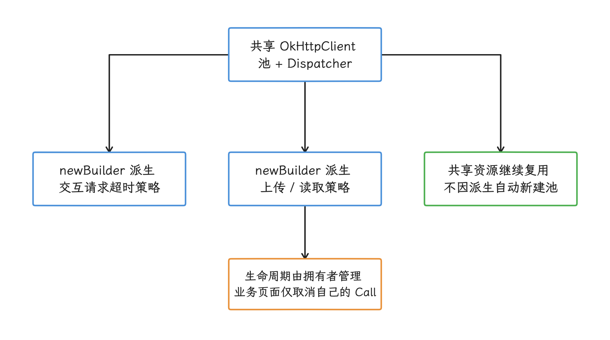

图：从共享 client 派生超时策略时保留连接池和 Dispatcher。 共享资源不意味着所有Address可复用；同步并发仍由应用控制，使用者不能随意关闭共享资源。

`newBuilder()` 派生的 client 会共享连接池和线程资源。我们可按交互请求、上传、流式读取等类别配置策略；只有代理、信任管理器、证书固定、DNS 或协议要求相互冲突时，才值得认真评估独立 client。

OkHttp 5.3.0 默认最多保留 5 条**空闲**连接 5 分钟——这条默认值只描述空闲连接的回收；连接总数与域名数量另有约束，正在承载 HTTP/2 stream 的连接也不算空闲，并发由 Dispatcher、服务端 stream 配置、socket 与系统资源共同决定。要判断池子够不够用，我们先统计新建连接率、空闲回收和服务端 keep-alive（保持连接） 策略，再决定是否调整默认数字。

连接能否复用还受 scheme（协议）、port、代理、DNS、socket/TLS 配置、hostname verifier（主机名校验器） 和 certificate pin（证书固定规则）ner（证书固定器） 等完整 `Address` 条件约束。HTTP/2 的跨主机 connection coalescing（连接合并） 还要求现有连接指向同一 IP/端口、证书覆盖新主机，并使用兼容的主机名校验与 pin；两个域名是否共享连接，要按这些条件逐项核对。

OkHttp 5 默认启用 fast fallback（快速回退），并行尝试可用路由以降低 IPv6 / IPv4 连接等待。这会让一次 `Call` 出现多组 connect 事件，所以监控代码要按 attempt（尝试） 分别保存。

<!-- gracker-diagram: ch12-01-14-idle-pool-vs-concurrency -->
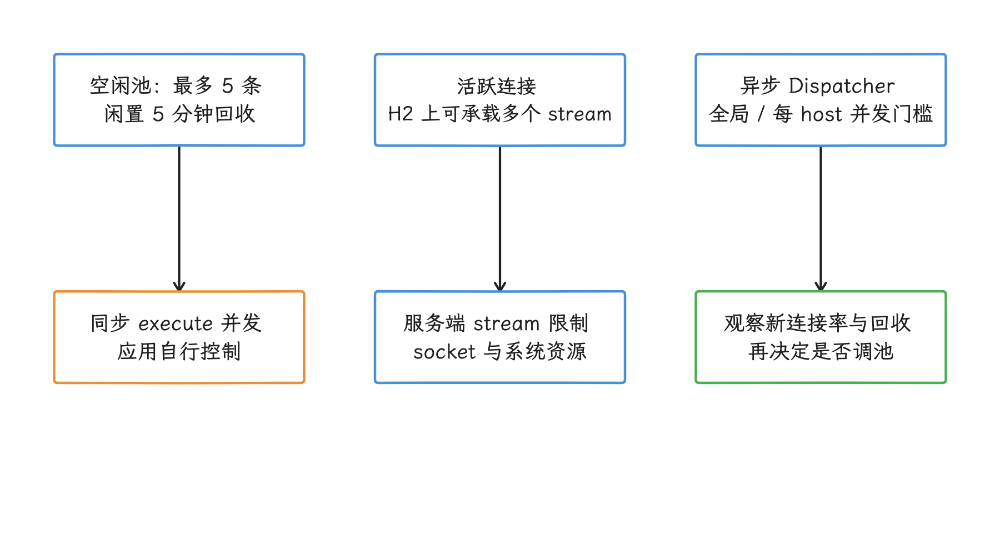

图：分别看空闲池、活跃连接和请求调度限制。 固定5.3.0的5条/5分钟只描述空闲保留策略；不是总连接或每主机请求上限的同义词。

<!-- gracker-diagram: ch12-01-15-connection-eligibility -->
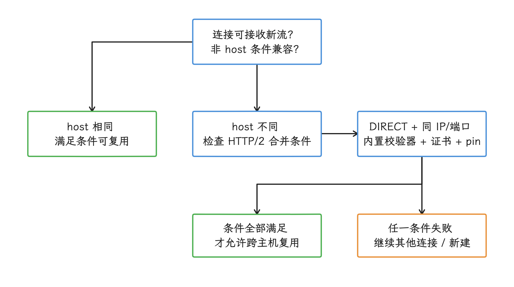

图：先检查连接与Address资格，同主机复用和跨主机合并走不同后续条件。 固定5.3.0概念分支，省略内部对象锁；跨主机需要H2、直连路由相同socket地址、端口/证书/校验器/pin和容量均满足。

<!-- gracker-diagram: ch12-01-16-fast-fallback -->
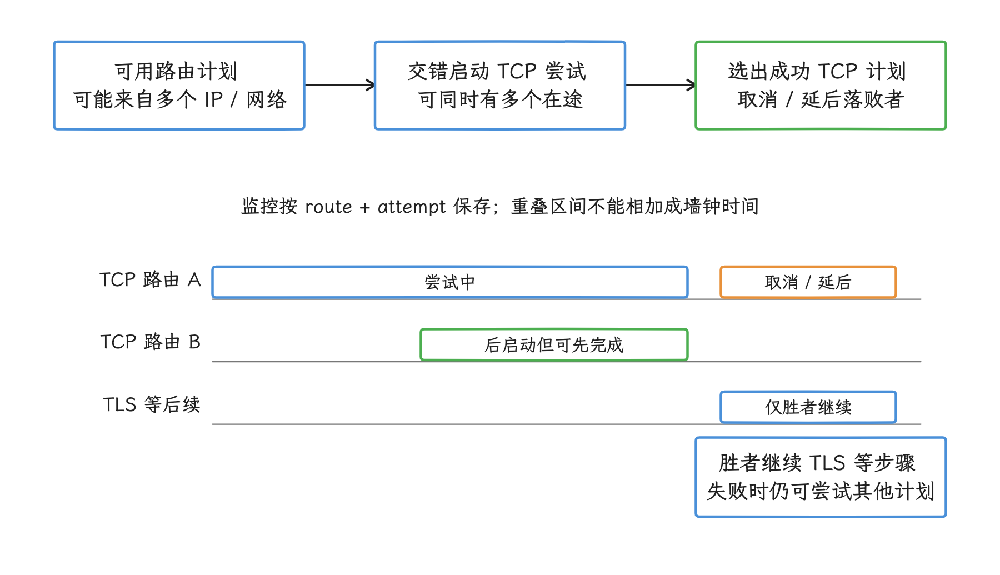

图：交错尝试TCP路由，选出胜者后再完成TLS等连接准备。 阶段轨道只示意并行关系；固定算法有250ms调度参考间隔，不代表每次实际连接时间，TLS不与所有地址同时竞速。

#### 并行请求与聚合接口的取舍

聚合接口能减少网络往返、重复 header（请求头） 和客户端调度，但也会放大响应体、缓存失效范围和单次失败的影响。反过来，HTTP/2 / HTTP/3 的并行请求允许各数据块独立缓存、独立失败和按优先级展示。

两种组织方式怎么选，我们把几组量摆在一起比较：

- 页面最早可展示时间与全部数据完成时间；
- 每个接口的缓存周期和权限范围；
- 部分失败是否允许展示；
- 聚合服务的超时与下游 fan-out（一次请求扇出为多个下游调用）；
- header、序列化和重复字段占比；
- 取消页面后还有多少无用请求继续执行。

同一页面每次打开都发出相同请求时，缓存或状态复用通常比单纯增加并发更有效。而搜索联想、滚动图片和页面切换，要及时取消过期请求，把 Dispatcher、stream 和带宽资源让给当前可见的内容。

<!-- gracker-diagram: ch12-01-17-aggregation-parallel -->
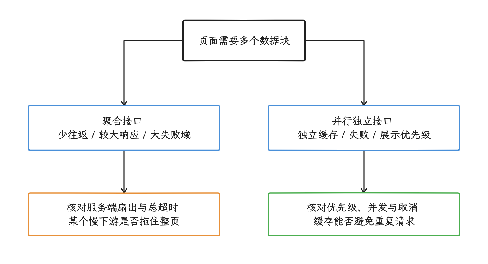

图：按首个可展示、全部完成、缓存与部分失败评估请求组织。 图中不提供通用速度排序；聚合服务端fan-out和协议并发会改变真实结果。

#### 预连接的真实成本

OkHttp 并不保证任意业务请求都能通过公开的 `preconnect()` API 预建连接。发送 HEAD 或空 GET 做成 warmup（预热），会产生 DNS、连接、TLS、服务器、流量和电量成本；后续请求还可能因网络切换、不同 authority（URL 中的主机与端口部分）、证书条件、连接空闲回收或服务端关闭而错过复用。

若冷启动指标证明预热有收益，可设置无副作用、低成本、允许失败的专用 endpoint（服务端接口），并满足这些条件：

- 与后续请求使用同一 authority 和网络栈；
- 不触发鉴权刷新、业务统计、昂贵后端或 WAF（Web Application Firewall）规则；
- 只在很快会使用该域名时执行；
- 不阻塞首屏，也不把失败展示给用户；
- 记录复用命中率、额外字节和电量变化。

DNS 预解析只减少 resolver（解析器） 阶段，TCP、TLS 或 QUIC 握手仍在它的工作范围之外；Cronet 的 QUIC hint（提示） 与会话元数据也只用于提示和状态复用，建连结果仍以运行时为准。

<!-- gracker-diagram: ch12-01-18-warmup-costs -->
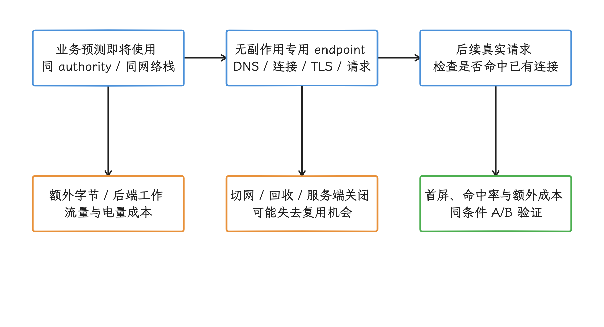

图：只有很快需要的同authority、同栈请求才值得验证预热复用收益。 HEAD/GET预热是真实请求，会消耗网络、服务端和电量；DNS预解析不等于TCP/TLS已建立，hint不保证建连成功。

### CDN、DNS 与图片

请求组织之外，CDN、DNS 和图片体量同样影响每一段耗时。这一节看客户端在这三处分别能观察到什么、能改动什么。

#### 客户端如何观察 CDN

CDN 会改变 DNS 答案、边缘节点距离、TLS 会话、协议协商、缓存命中和回源（边缘节点访问源站）路径。客户端可在不泄露敏感信息的前提下记录：

- 业务域名的匿名分组；
- 协议与 IP family；
- CDN 提供的 POP / cache 状态响应头白名单；
- DNS、connect、TLS、响应头等待和传输耗时；
- 响应码、重试、回退和字节数。

单靠客户端的 TTFB，我们很难分清边缘排队、cache miss（缓存未命中） 与源站处理，CDN 日志和服务端 trace ID 要补上这一环；两者都应采用白名单传递，并避免把完整 URL、query（查询参数）、Cookie、Authorization 或用户标识写入 APM（应用性能监控系统）。

<!-- gracker-diagram: ch12-01-19-cdn-evidence -->
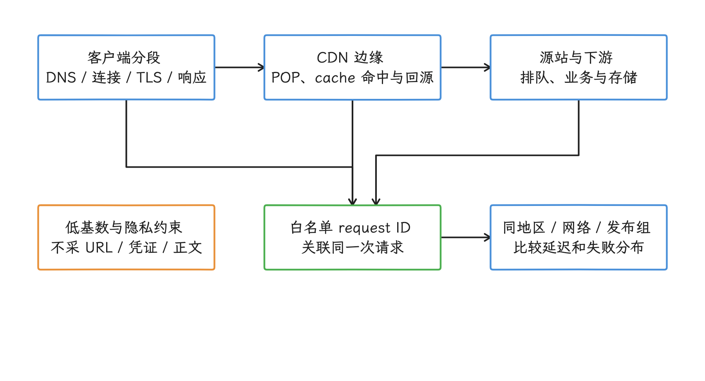

图：用客户端事件、CDN状态和服务端trace关联相同请求。 客户端TTFB包含多段等待，不能单独分摊到CDN或源站；关联字段按白名单且不携带凭证或完整URL。

#### 自定义 DNS 与系统边界

OkHttp 的 `Dns` 接口允许自定义解析。HTTPDNS（通过 HTTP 查询的业务 DNS） 通过 HTTP 查询域名，DoH（DNS over HTTPS）把 DNS 查询放进 HTTPS 通道，接入这类业务 DNS 服务要处理 TTL（解析结果有效期）、IPv6、多个地址、负缓存（缓存解析失败结果）、取消、故障回退和缓存隔离。URL 仍应保留域名，让 Host、SNI（TLS 握手中的服务器名称） 和证书校验使用域名；把 HTTPS URL 改成裸 IP 会破坏这些语义——这一条在后面证书小节还会再遇到。

<!-- gracker-diagram: ch12-01-21-domain-and-ip -->
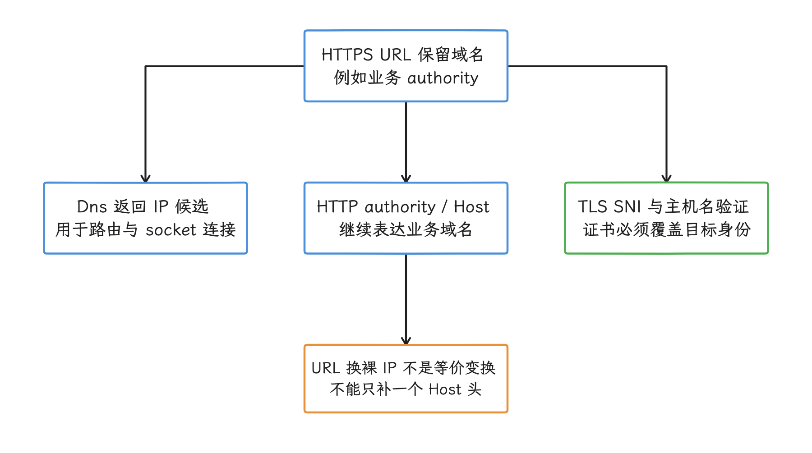

图：解析结果决定连接地址，原始URL域名继续用于HTTP与TLS身份语义。 不能仅把URL改成裸IP再补Host头就假定SNI和主机名验证保持原样；专门设计的IP证书服务须单独处理。

自定义解析还可能绕开 Android Private DNS（系统加密 DNS）、VPN、企业 split DNS（按域名分流解析）、局域网域名和 captive portal（需要登录认证的网络） 流程，采用前要确认安全与网络治理要求。如果怀疑系统 DNS 慢，判断依据应来自按网络分组的事件数据，个别超时不足以支撑全量切换。

<!-- gracker-diagram: ch12-01-20-custom-dns-lifecycle -->
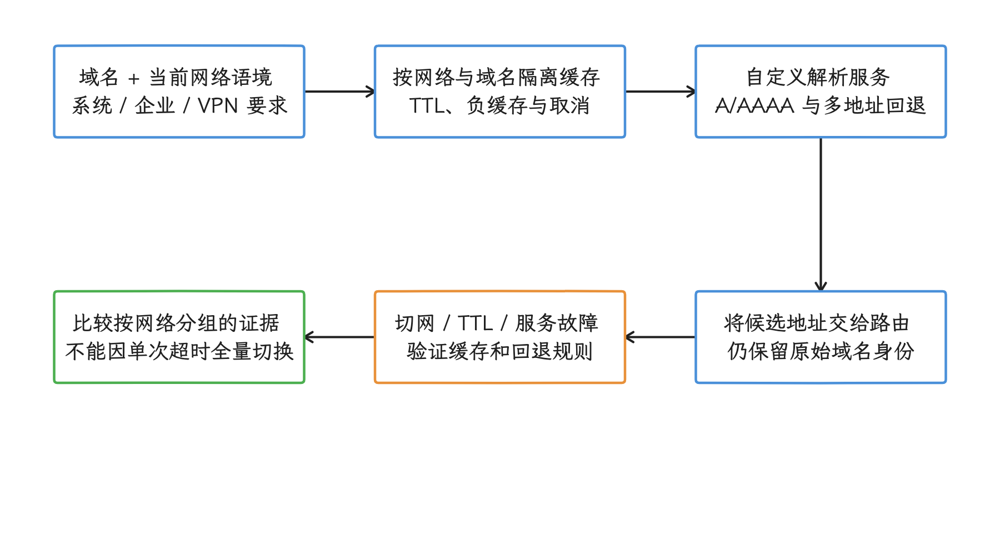

图：把业务DNS请求、TTL缓存、多地址路由和系统网络边界一起管理。 自定义HTTPDNS/DoH不自动继承系统PrivateDNS、VPN或企业splitDNS语义；网络变化后缓存与路由需重新核实。

#### 图片网络优化

图片请求优化的主要手段，仍是减少无用字节和无用工作：

- 按显示尺寸、密度和裁剪方式请求合适分辨率；
- 列表优先缩略图，进入详情后再请求大图；
- 使用内存与磁盘 cache，服务端提供稳定 cache key（缓存键）、`ETag` 或合理的 `Cache-Control`；
- 页面离开后取消不再可见的请求；
- 根据请求观测和用户设置选择画质，Wi‑Fi / 蜂窝标签只作参考信号；
- 渐进式图片仅在编码格式、解码器和渲染组件均支持时采用。

缩略图和原图要使用可推导或可关联的 cache key，防止列表滚动时重复下载。渐进式传输如果需要多次解码，还会增加 CPU 和内存成本，这时必须同时测量首个可用画面出现时间与完整解码时间。

<!-- gracker-diagram: ch12-01-22-image-request-work -->
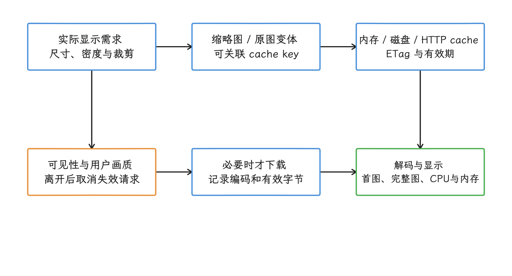

图：减少无用像素、下载与解码，并保持列表和详情的缓存关系。 渐进式需要格式、解码器、渲染共同支持；多次解码可能增加CPU/内存，首图与完整解码应分别测量。

### 弱网策略：期限、重试、缓存与降级

弱网下的体验，取决于期限、重试、缓存与降级这四件事怎么配置，这一节按这个顺序展开。

#### 各层超时的含义

OkHttp 5.3.0 的默认 connect、read、write timeout 都是 10 秒，默认没有覆盖完整 `Call` 的总 timeout。这几个数字的含义并不相同：

- `callTimeout` 覆盖整个调用，包括 DNS、建连、写入、服务端处理、读取、重定向和内部恢复。
- `connectTimeout` 只约束新 TCP socket 的连接阶段，DNS 和完整调用在它之外。
- `readTimeout` 约束 socket 与单次读取操作，覆盖不了整个响应体的时间。
- `writeTimeout` 约束写入操作，上传业务的完整截止时间要另行设定。

超时值应来自接口 SLO（服务目标）、用户等待预算、请求体大小和可恢复方式。交互接口需要明确总期限；大文件上传更适合分片、进度与断点续传；长连接和流媒体要按心跳或 segment（媒体分段） 设计；后台同步应使用 WorkManager 的网络约束与重试调度。

把弱网 timeout 一律调大，会延长用户等待并占用并发资源；一律调小，则会放大尾部网络上的失败与重试。每类请求都先记录超时发生在哪一段，我们再据此调整对应的那一项。

<!-- gracker-diagram: ch12-01-23-timeout-and-deadline -->
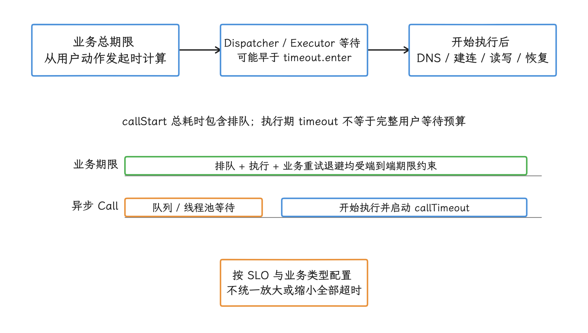

图：从业务发起计算总期限，分别约束排队、执行和退避。 固定5.3.0异步callTimeout在AsyncCall.run才启动，排队不计入；取消不保证同步DNS立刻返回，长连接初始建立另有范围。

#### 失败分类与重试决策

请求失败可以分成几类：

| 失败位置 | 风险 | 处理方向 |
|---|---|---|
| DNS 或尚未发送请求的连接失败 | 服务端大多尚未收到业务请求 | 允许网络库尝试其他地址或路由，并受总期限限制 |
| TLS 证书、主机名或协议校验失败 | 安全配置或中间网络异常 | 停止盲目重试，保留错误分类 |
| 请求体发送后连接中断 | 客户端不知道服务端是否已经执行 | 查询业务状态，或依赖幂等键去重 |
| HTTP 408、429、503 | 服务端可能允许稍后尝试 | 按接口契约和 `Retry-After` 决定 |
| 其他 4xx | 请求、权限或业务状态通常需要修改 | 按响应语义处理 |
| 响应体中途失败 | 已接收部分数据 | 支持 Range / ETag 的下载可续传，其他请求按业务语义恢复 |

<!-- gracker-diagram: ch12-01-24-retry-unknown-result -->
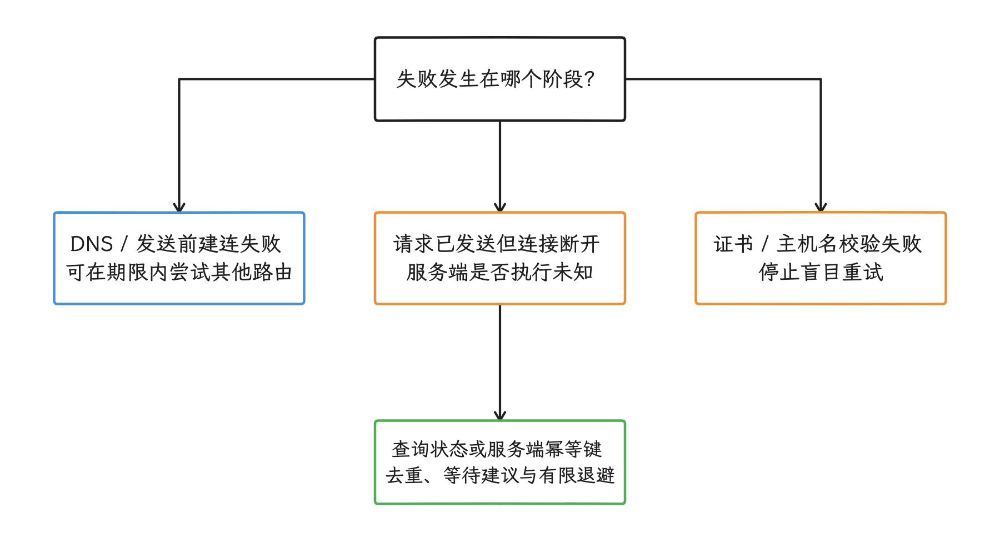

图：先判断是否可能已执行，再按错误类型和业务语义决定恢复。 方法名只是线索；请求发送后断连可能结果未知，不能把客户端失败当作服务端未执行。

指数退避要加入随机抖动（随机延迟），并受尝试次数、总期限、前后台状态和用户取消约束。服务端给出 `Retry-After`（建议的重试时间） 时优先遵守；恢复网络时，挂起请求要避免同时齐发。

OkHttp 的 `retryOnConnectionFailure` 默认开启，处理部分路由和连接层恢复；重定向、认证与某些响应也会在一个 `Call` 内产生 follow-up（后续请求） 请求。应用层重试叠加在其上时，要分别记录网络库 attempt 与业务 attempt，避免重试次数相乘。在 Interceptor（拦截器） 内阻塞等待退避会占用执行资源，重试调度更适合放在请求编排层或 WorkManager。

<!-- gracker-diagram: ch12-01-25-retry-layers -->
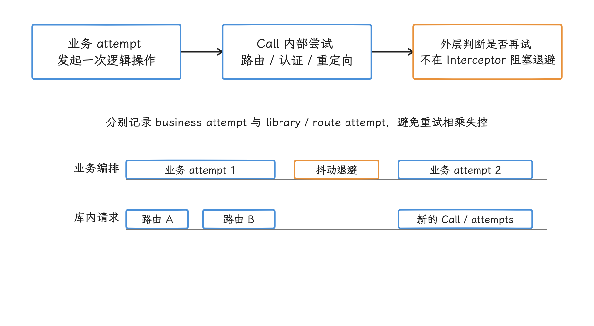

图：一个业务attempt中的Call可包含多次路由、认证和重定向，外层退避另计。 内部恢复并不覆盖所有错误；应用重试必须受幂等、Retry-After、取消和总期限共同约束。轨道不表示次数上限或实际时长。

HTTP 方法的规范语义只是初筛线索：一个声明为 PUT 或 DELETE 的接口，仍可能包含审计、通知或外部系统副作用。支付、订单和发帖等写操作，应由服务端提供幂等键和可查询结果。

#### HTTP cache 与业务离线数据

OkHttp cache 遵守 HTTP 缓存语义。下面的函数为共享 client 配置磁盘 cache，容量由产品策略传入：

```kotlin
fun withHttpCache(
    base: OkHttpClient,
    directory: File,
    budgetBytes: Long,
): OkHttpClient = base.newBuilder()
    .cache(Cache(directory, budgetBytes))
    .build()
```

<!-- gracker-diagram: ch12-01-26-cache-ownership -->
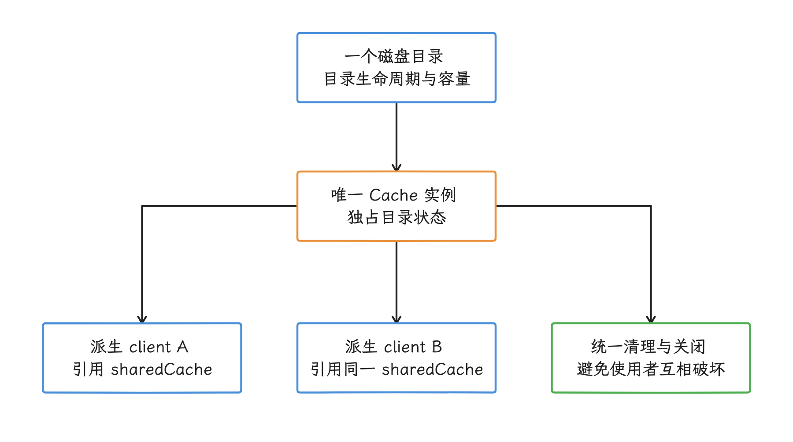

图：同一目录由一个Cache实例独占，该实例可被多个client共享。 不能为同一目录反复创建并发Cache实例；容量、清理和关闭由拥有者统一管理。

服务端应正确返回 `Cache-Control`、`ETag`、`Last-Modified` 和 `Vary`。客户端 cache 只保存符合规则的 HTTP 响应；Room、SQLite 或文件层的业务离线数据，要在对应的层里另建。

离线时若产品允许使用已经过期但仍在可接受时限内的 stale 响应，我们可以显式构造只读 cache 请求：

```kotlin
fun offlineRequest(
    url: HttpUrl,
    maxStaleSeconds: Int,
): Request {
    val policy = CacheControl.Builder()
        .onlyIfCached()
        .maxStale(maxStaleSeconds, TimeUnit.SECONDS)
        .build()

    return Request.Builder()
        .url(url)
        .cacheControl(policy)
        .build()
}
```

cache miss 时，`onlyIfCached()` 会得到 504 `Unsatisfiable Request`，不会自动访问网络。UI 要区分“没有缓存”“缓存过旧”“请求失败”和“已展示旧数据并刷新中”。

<!-- gracker-diagram: ch12-01-27-http-cache-decision -->
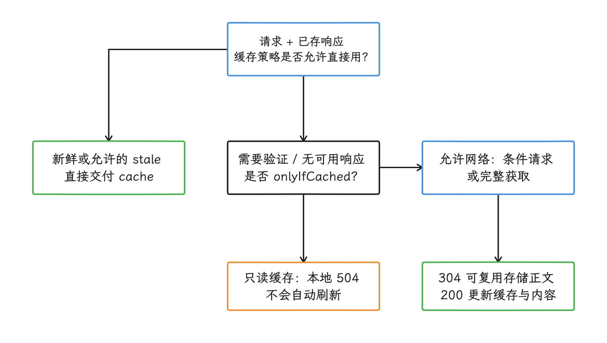

图：先按HTTP策略判断缓存能否使用，再决定验证或本地失败。 onlyIfCached禁止网络；maxStale不越过must-revalidate/no-cache，单个504不能辨别不存在、过旧或需验证。

#### 弱网降级的依据

弱网降级可以选择已有缓存、较低分辨率、较小分页、暂停自动播放或延后非交互同步。网络 transport 只是提示：同一 Wi‑Fi 可能经过拥塞链路，蜂窝也可能有良好吞吐。策略输入应结合用户设置、metered、roaming、系统估计和近期请求观测，并设置滞回——为升降级使用不同阈值，避免频繁切换画质。

<!-- gracker-diagram: ch12-01-28-weak-network-adaptation -->
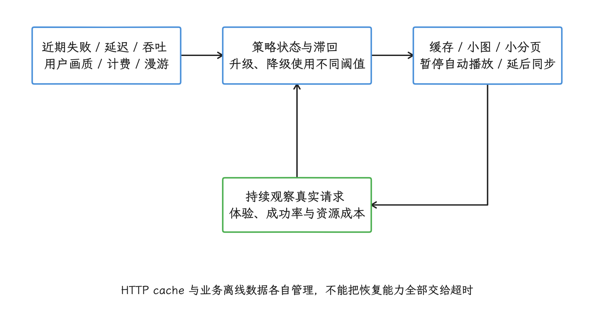

图：结合近期请求与用户约束作降级，使用不同升降阈值减少震荡。 transport标签、第一跳估计或运营商分配值均不能单独代表实际业务吞吐；图中没有通用阈值。

### 平台提供的策略输入

策略输入里还有两项来自平台。`SubscriptionInfo.getStreamingAppMaxDownlinkKbps()` / `getStreamingAppMaxUplinkKbps()` 表示运营商为流媒体应用分配的速率上限，未知时返回 `BITRAT（无线接入技术，例如 LTE/5G）E_UNKNOWN`，它只是分配值，拿来当链路测速会误判；targetSdk 37 的局域网功能则要适配 `ACCESS_LOCAL_NETWORK` 或系统 picker（由系统展示的设备选择器），权限被拒时按权限问题处理，归入普通弱网会走错方向。局域网权限与网络切换的完整规则见 [1.22 Connectivity 服务、网络选择与回调](../../part1-fundamentals/ch01-architecture/22-connectivity-service.md)。

<!-- gracker-diagram: ch12-01-29-platform-signal-scope -->
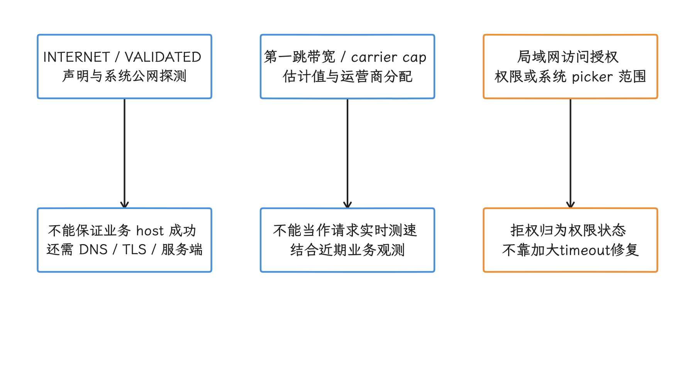

图：不同平台字段分别描述能力、估计、分配和授权，策略要分开使用。 SubscriptionPlan.BITRATE_UNKNOWN表示未知或不适用；target37的局域网拒权不是弱网。picker只授予其限定选择范围。

### 长连接、解析与后台流量

WebSocket 适合高频双向消息，但长连接不会自动省电。固定 ping/pong（心跳请求/响应）、代理或 NAT 空闲超时、网络切换后的重复重连，都可能让蜂窝 radio（无线基带） 频繁保持活跃；低频通知优先复用 FCM（Firebase Cloud Messaging）等系统通道，高频业务则要和服务端共同定义心跳、退避、会话恢复和消息去重。

<!-- gracker-diagram: ch12-01-30-heartbeat-radio -->
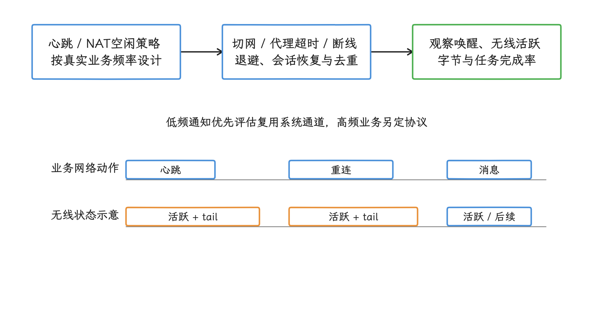

图：心跳与反复重连会改变无线活跃窗口，应和服务端共同设计恢复。 轨道仅示意可能阶段；tail依RAT、信号、设备与运营商变化，WebSocket不自动保证省电。

Retrofit 的 suspend adapter（协程适配器） 也不会让协议本身变快。EventListener 已显示网络完成、业务仍迟迟拿不到数据时，我们要继续区分 Converter/JSON 解析、数据库和 UI 映射；协程取消还要确认会传到 `Call.cancel()`。网络、CPU 解析和界面提交分别记录 trace，避免把网络完成后的 CPU 时间计入 TTFB。

<!-- gracker-diagram: ch12-01-31-network-parse-ui -->
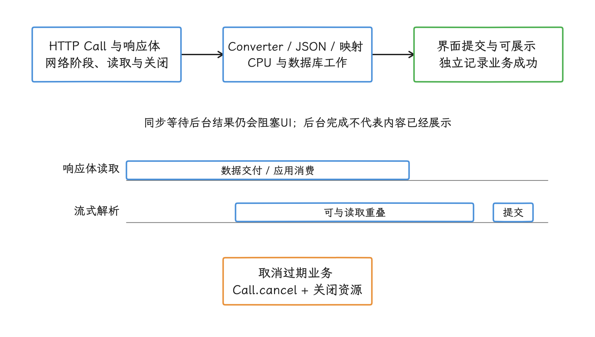

图：分别观察网络、流式解析、存储与界面提交，取消要传到请求所有者。 suspend不改变协议速度；解析可能与读取重叠，Call终态包含响应消费，UI可用时间另计。

日志、遥测和可延迟同步应在应用内合批，交给 WorkManager/JobScheduler 设置网络、电量和充电约束。蜂窝 tail time（请求结束后基带继续活跃的时长）会受设备、RAT（无线接入技术）、信号和运营商配置影响，写死一个固定时长会出错；是否节能要比较唤醒次数、radio 活跃窗口、字节量和任务完成率。

### 监控：EventListener 与 NetworkCallback

前面的策略都要靠数据支撑。这一节我们看客户端的两条观测通道——OkHttp 的 EventListener 与系统的 NetworkCallback——以及怎样用 Perfetto 把网络事件和线程对齐。

#### OkHttp EventListener

每个 `Call` 都要由 `EventListener.Factory` 创建独立 listener。回调必须快速返回，不做磁盘或网络 I/O，也不重新进入同一个 client；事件先写入无阻塞队列，再由后台消费者批量处理。

下面的示例记录总耗时与 Dispatcher 排队时间，不采集 URL 或 header：

```kotlin
data class CallMetric(
    val totalMs: Long,
    val queueMs: Long?,
    val failed: Boolean,
)

class CallTimingListener(
    private val emit: (CallMetric) -> Unit,
) : EventListener() {
    private var callStartNs = 0L
    private var queueStartNs = 0L
    private var queueTotalNs = 0L

    override fun callStart(call: Call) {
        callStartNs = System.nanoTime()
    }

    override fun dispatcherQueueStart(call: Call, dispatcher: Dispatcher) {
        queueStartNs = System.nanoTime()
    }

    override fun dispatcherQueueEnd(call: Call, dispatcher: Dispatcher) {
        if (queueStartNs != 0L) {
            queueTotalNs += System.nanoTime() - queueStartNs
            queueStartNs = 0L
        }
    }

    override fun callEnd(call: Call) {
        finish(failed = false)
    }

    override fun callFailed(call: Call, ioe: IOException) {
        finish(failed = true)
    }

    private fun finish(failed: Boolean) {
        val endNs = System.nanoTime()
        val totalNs = endNs - callStartNs
        val activeQueueNs = if (queueStartNs != 0L) {
            endNs - queueStartNs
        } else {
            0L
        }
        val allQueueNs = queueTotalNs + activeQueueNs
        emit(
            CallMetric(
                totalMs = TimeUnit.NANOSECONDS.toMillis(totalNs),
                queueMs = allQueueNs.takeIf { it > 0L }?.let {
                    TimeUnit.NANOSECONDS.toMillis(it)
                },
                failed = failed,
            )
        )
    }
}

val metricQueue = ConcurrentLinkedQueue<CallMetric>()
val monitoredClient = OkHttpClient.Builder()
    .eventListenerFactory {
        CallTimingListener { metric -> metricQueue.add(metric) }
    }
    .build()
```

<!-- gracker-diagram: ch12-01-32-event-listener-pipeline -->
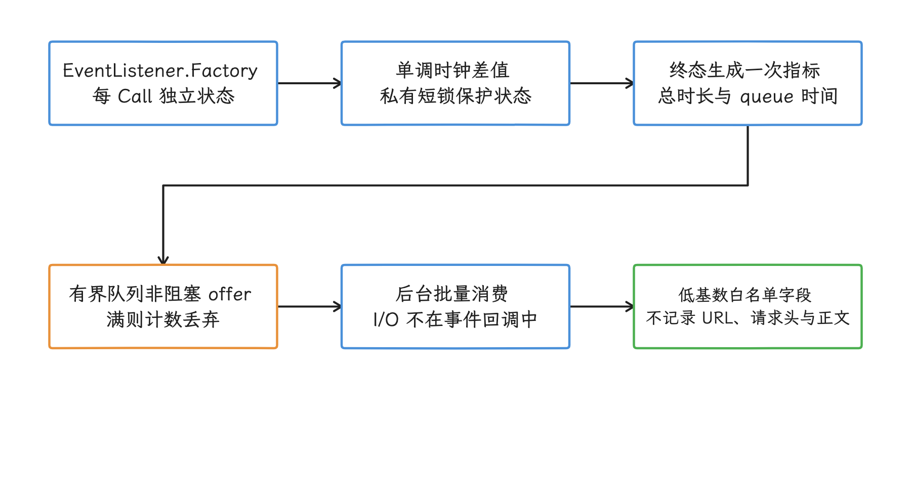

图：用独立listener维护调用状态，快速入队后由后台批量消费。 事件可跨线程或并行；短排队可舍入0ms，没有事件才为null。队列满时丢弃计数，回调不能阻塞或抛异常。

生产监控可以按同样的方式增加 DNS、connect、secure connect、request、response 和 `connectionAcquired`（取得可用连接） span（时间区间）。DNS、connect、请求与响应事件可能因重定向和恢复重复出现，应追加到 attempt 列表；连接复用时 DNS 和 connect 事件会缺席，这是复用生效的正常表现。

指标上传要限制基数——控制字段不同取值的数量——并保护隐私。建议记录经过白名单映射的接口模板、协议、状态码、错误类别和时间分段；完整 URL、query、header、请求体、响应体、Cookie 与 token 都要留在网络性能日志之外。

#### 用 Perfetto 对齐网络与线程

Perfetto 不会自动把 OkHttp `Call` 展成 DNS、TLS 和 TTFB。我们可以用 AndroidX Tracing 的异步 slice（时间片段） 标记整个逻辑调用，用唯一 cookie（关联编号） 区分同名并发请求；阶段事件仍由 EventListener 使用单调时钟记录，单调时钟只持续递增，不受系统时间校准影响，之后再按 Call、route（路由） 和 attempt 关联。trace 名称沿用同一套低基数与隐私约束，不写完整 URL、用户 ID、token 或查询参数。

主线程出现 `nativePollOnce` 通常只说明 Looper 正在等待消息。只有调用栈、线程状态和时间重叠共同指向 `Future.get()`、锁、socket 或协程桥接点时，我们才能判断 UI 在等待网络。网络 slice 与主线程慢区间重叠只能建立相关性，要补足因果依据，还得靠业务 request ID（贯穿两端的同一请求标识） 和同步对象栈。

<!-- gracker-diagram: ch12-01-33-trace-causality -->
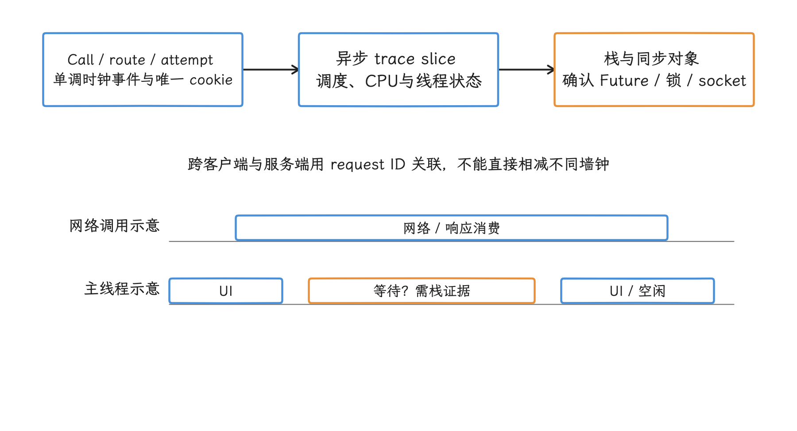

图：用Call关联号、异步slice和线程证据一起判断UI为何等待。 网络slice重叠只说明相关；nativePollOnce常是Looper空闲，不能单独定为网络卡顿。轨道非真实trace。

#### NetworkCallback 的职责范围

`NetworkCallback` 测不了业务 host 的 DNS、TLS 或响应延迟。`INTERNET` 是网络能力声明，`VALIDATED` 是系统公网探测结果，业务请求成功仍取决于目标域名、路由、证书、CDN 和服务端。应用只需把 capability（网络能力）、metered、blocked（是否被系统阻止）、VPN 与网络切换作为请求策略输入；回调顺序、每 UID 100 个共享 request/callback 配额、注册生命周期、FullScore（系统内部用于选网的完整评分） 和 linger（旧网络短暂保留期） 统一见 [1.22 Connectivity 服务、网络选择与回调](../../part1-fundamentals/ch01-architecture/22-connectivity-service.md)。

后台任务若只关心“有网”或“非计费网络”，优先使用 WorkManager/JobScheduler constraint（约束条件）。网络切换后不要统一清空连接池或立即重放全部失败请求；先让网络库处理连接状态，再由业务幂等和退避策略决定恢复。

<!-- gracker-diagram: ch12-01-34-network-callback-scope -->
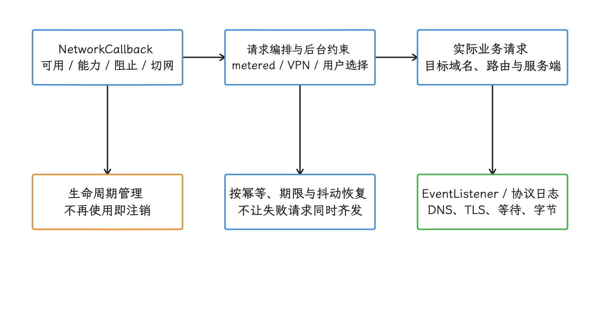

图：系统回调提供网络策略输入，业务质量由请求事件另行验证。 NetworkCallback不能测host级DNS/TLS/TTFB；注册按生命周期注销，切网不应统一清池或重放所有请求。

### 排查清单

#### 指标

- [ ] 总耗时、排队、DNS、connect、TLS、响应头等待和响应体传输已分开
- [ ] 计时使用单调时钟
- [ ] 重定向、路由回退和重试按 attempt 保存
- [ ] 协议、cache、network、metered 与失败类别进入低基数分组
- [ ] APM 没有记录完整 URL、query、凭证或正文

#### 协议与请求组织

- [ ] OkHttpClient 或 CronetEngine 在进程内复用
- [ ] HTTP/3 指标按协商协议统计，并保留 HTTP/2 回退
- [ ] 0-RTT 只用于可容忍重放的业务
- [ ] 聚合接口与并行请求比较了缓存、部分失败和最早展示时间
- [ ] warmup 有专用 endpoint、命中率和额外流量数据
- [ ] 页面离开后会取消失效请求

#### 弱网

- [ ] 每类接口有总期限和阶段 timeout
- [ ] 重试受幂等、结果未知、`Retry-After`、尝试次数和总期限约束
- [ ] 网络恢复采用抖动，避免请求同步重发
- [ ] HTTP cache 与业务离线数据职责清楚
- [ ] 降级策略结合近期请求观测，带有滞回

#### Android 平台

- [ ] default network callback 在不再使用时注销
- [ ] `INTERNET`、`VALIDATED`、metered、transport 与请求结果没有混用
- [ ] 第一跳带宽估计没有写成实时吞吐
- [ ] Android 17 流媒体 carrier cap（运营商速率上限） 正确处理 `BITRATE_UNKNOWN`
- [ ] target 37 的局域网功能已适配权限或系统 picker


## TLS 握手、证书与安全边界

基础网络路径之上，TLS 增加密钥协商、证书验证和会话恢复。一个 HTTPS 请求在发送业务数据前，可能依次经过 DNS 解析、传输层连接、TLS 握手和证书验证；业务数据很少的短请求里，这些准备工作反而可能占据大部分等待时间。所以我们先解决“时间花在哪一段”的测量问题，再谈优化；优化始终以保住验证强度为前提——放宽验证换来的延迟下降只是表面的，耗时也要记到具体阶段名下，别都记成笼统的“TLS”。

后文会反复出现几个缩写：Encrypted Client Hello（ECH）、Certificate Transparency（CT（opt-in））；它们与明文流量策略、HPKE 的版本差异都按前文基线核对，版本迭代只保留会影响迁移判断的节点。

### 先把一次安全连接分段

RTT（Round-Trip Time）表示报文往返一次的时间。网络制式、无线信号、运营商路由和服务端地域会让 RTT 相差很大，所以这里不用固定毫秒数估算握手成本。一次新 HTTPS 连接可按下列阶段记录：

| 阶段 | 常见工作 | 观测重点 |
|:---|:---|:---|
| DNS | A/AAAA 查询，分别获取 IPv4/IPv6 地址；ECH 场景还可能读取 DNS HTTPS 资源记录 | 缓存命中、解析器类型、查询并发 |
| 传输层 | TCP 三次握手；QUIC 则把传输参数协商与 TLS 1.3 握手结合 | 新连接比例、IPv4/IPv6 竞速、丢包 |
| TLS | ClientHello（客户端提出的能力与参数）、密钥协商、证书和 Finished（握手完整性确认）消息 | TLS 版本、完整握手或恢复、ECH |
| 证书验证 | 信任链、主机名、有效期、CT 等检查 | 失败类型、证书链、SCT（证书透明度时间戳） |
| HTTP | 发送请求并等待响应头与响应体 | 协议、连接复用、服务端处理 |

<!-- gracker-diagram: ch12-01-35-https-stage-boundaries -->
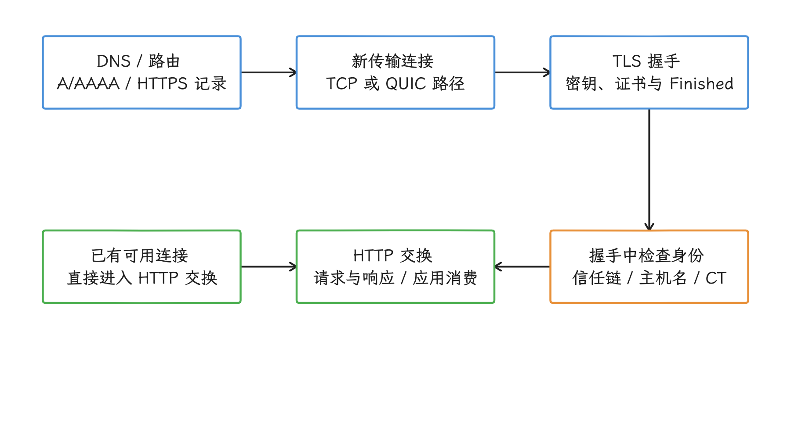

图：按实现事件划分解析、传输、握手和业务，证书检查属于握手过程。 证书验证不是必然额外网络往返；QUIC把传输与TLS组合，复用连接可省去新建路径。条长非测量值。

HTTP/2 或 HTTP/3 可以让多个请求复用一条连接。复用命中时前四段不会为每个请求重新执行，收益通常大于调整加密算法参数——这也是后面反复出现的主线：先争取复用，再谈参数。

### TLS 1.3 减少了哪些等待

#### 完整握手

在常见的 TLS 1.2 完整握手中，客户端要等收到服务器第一轮握手消息后才能发送密钥交换与 Finished，服务器确认后进入应用数据阶段，连接成本通常按两个网络往返理解。TLS 1.3 让客户端在首个 ClientHello 中就发送 key share（用于密钥协商的临时公钥材料），完整握手可在一个往返后发送应用数据。这一比较针对协议消息路径，直接换算成固定百分比或固定毫秒数并不可靠。

Android 10（API 29）起，平台 TLS 实现默认启用 TLS 1.3；同一版本的 Android 文档也明确，基于 socket 的平台 TLS 1.3 API 不支持 0-RTT。到了 Android 17，应用通过 `SSLSocket`、`SSLEngine` 或依赖平台 provider 的网络库使用 TLS 1.3，仍要以网络库公开的能力和服务端协商结果为准。

<!-- gracker-diagram: ch12-01-36-tls-full-handshake -->
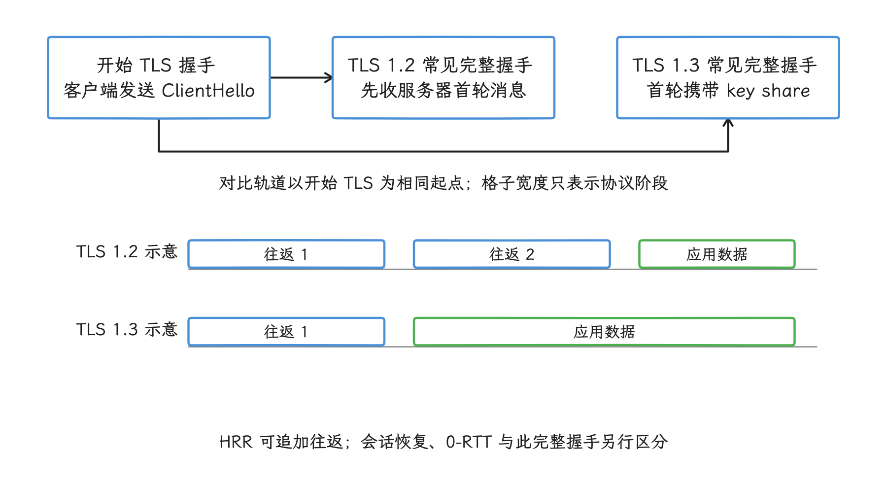

图：比较完整握手中客户端何时能够发送应用数据。 仅常见协议路径：TLS1.2约2个TLS往返、1.3约1个；不含TCP、HRR、丢包或业务处理，不能推固定性能百分比。

#### 连接复用和会话恢复

这三个概念容易混淆：

| 机制 | 是否新建传输层连接 | 是否重新进行 TLS 握手 | 适用时机 |
|:---|:---:|:---:|:---|
| HTTP 连接复用 | 否 | 否 | 原连接仍可用 |
| TLS 会话恢复 | 是 | 是，但使用 PSK（预共享密钥）或缓存的 session state（会话状态）缩短协商 | 原连接已关闭，双方仍保留恢复状态 |
| TLS 1.3 0-RTT | 是 | 恢复握手中提前发送 early data（握手确认前的早期数据） | 网络栈、服务端和业务语义均允许 |

<!-- gracker-diagram: ch12-01-37-reuse-resume-earlydata -->
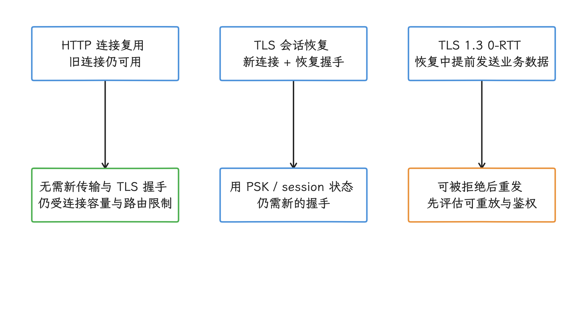

图：把继续使用旧连接与新连接的恢复握手分开。 0-RTT属于恢复握手中的早期数据能力；可用性取决于具体栈和服务端，不能由TLS1.3版本号推断。

连接复用能否命中，取决于池内是否还有可用连接；池容量与 keep-alive 的默认值见前文「共享 OkHttpClient」。要判断复用有没有发生，我们先统计 `connectionAcquired` 回调、新建连接率、域名数量和服务端空闲超时，再调整 `maxIdleConnections` 与 keep-alive。

会话恢复发生在新连接上。客户端持有可用的 session ticket（会话票据），服务端仍可能让这次连接退回完整握手：服务端重启、用于保护票据的 ticket key 轮换、负载均衡把请求转到其他节点，以及票据过期，都可能造成这个结果。要确认恢复是否发生，我们把客户端的 `secureConnectStart`/`secureConnectEnd` 和 TLS 库日志、服务端的 full/resumed handshake（完整/恢复握手） 指标放在一起看。

<!-- gracker-diagram: ch12-01-38-session-ticket-lifetime -->
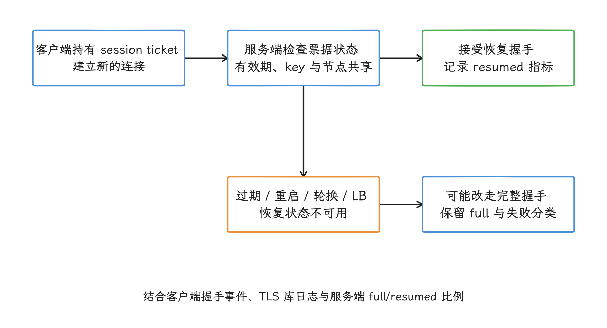

图：客户端持有票据与服务端实际接受恢复是两个条件。 过期、重启、密钥轮换或负载均衡可能使恢复不可用；secureConnect时长本身不能证明是否恢复。

#### 0-RTT 与可重放风险

前面已经说过 early data 可能被重放，这里从安全条件再往前推一步。RFC 8446 要求应用协议评估重复执行的后果，HTTP 方法名只能作为初筛条件：一个 GET 请求也可能消费一次性令牌、改变计数器或读取带时序约束的敏感资源；某些 POST 请求在业务上则可能带有幂等键，用于识别并去重同一次业务操作。所以安全条件应写成“该请求被重复执行也不会产生不可接受后果”，只列一份 GET/HEAD 白名单是不够的。

<!-- gracker-diagram: ch12-01-39-earlydata-business-gate -->
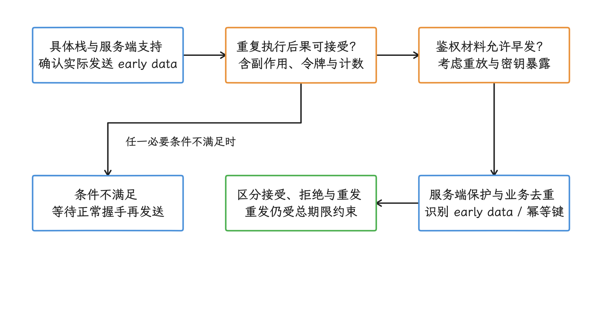

图：把早期数据资格落实到重复执行后果、鉴权与服务端保护。 GET/HEAD不是安全证明，幂等键也需服务端实现；仅PSK保护的0-RTT没有前向保密，不能自动继承后续握手保证。

OkHttp 5.3 的稳定公开协议配置没有 HTTP/3 或 TLS early-data 开关；平台 `HttpEngine` 的 QUIC hint（提示某个主机可尝试 QUIC） 也证明不了某个请求已经用上 early data。Cronet 侧 `QuicOptions.Builder.enableTlsZeroRtt()` 与跨进程会话恢复的配置面，已在前文「0-RTT 的边界」列出。启用前应确认以下事项：

- 网络库版本和具体传输协议支持 0-RTT；
- 服务端具备重放（replay）防护，并能区分 early data；
- 请求语义允许重放，鉴权材料也允许在 early data 中发送；
- 指标能区分普通恢复、0-RTT 被接受和 0-RTT 被拒绝后重发。

### 网络安全能力的版本演进

| 版本 | 已核对的平台变化 | 迁移含义 |
|:---|:---|:---|
| Android 6.0 / API 23 | `android:usesCleartextTraffic` 与 `NetworkSecurityPolicy` 进入平台 | 应用可声明和查询明文策略 |
| Android 7.0 / API 24 | Network Security Configuration（网络安全配置）上线 | 可按域名配置明文、信任锚（证书验证的信任起点）、调试证书和证书固定 |
| Android 9 / API 28 | targetSdk 28 及以上默认不允许明文流量 | 旧应用升级 targetSdk 时要检查 HTTP 端点 |
| Android 10 / API 29 | 平台 TLS 1.3 默认启用；平台 TLS socket 不支持 0-RTT | TLS 版本与 early data 能力要分别判断 |
| Android 15 / API 35 | 新增 `android.crypto.hpke.HpkeSpi` | provider 实现层获得标准 SPI（Service Provider Interface，服务提供者接口） |
| Android 16 / API 36 | 应用可在 Network Security Configuration 中选择启用 CT | 升级 targetSdk 37 前可先做兼容性验证 |
| Android 17 / API 37 | ECH 进入平台网络安全配置；targetSdk 37 及以上默认启用 CT；新增应用层 HPKE API | 同时核对运行系统、targetSdk、网络库和服务端 |

Android 的 Java TLS 路径由 Conscrypt 等安全 provider 实现，底层使用 BoringSSL。模块化更新能让部分实现随 Google Play 系统更新交付，但设备、模块版本和厂商支持存在差异，所以诊断报告要记录设备 build fingerprint（用于定位系统镜像版本的构建指纹）、provider 名称与版本——一句“Android 17”概括不了这些差异。

<!-- gracker-diagram: ch12-01-40-security-runtime-matrix -->
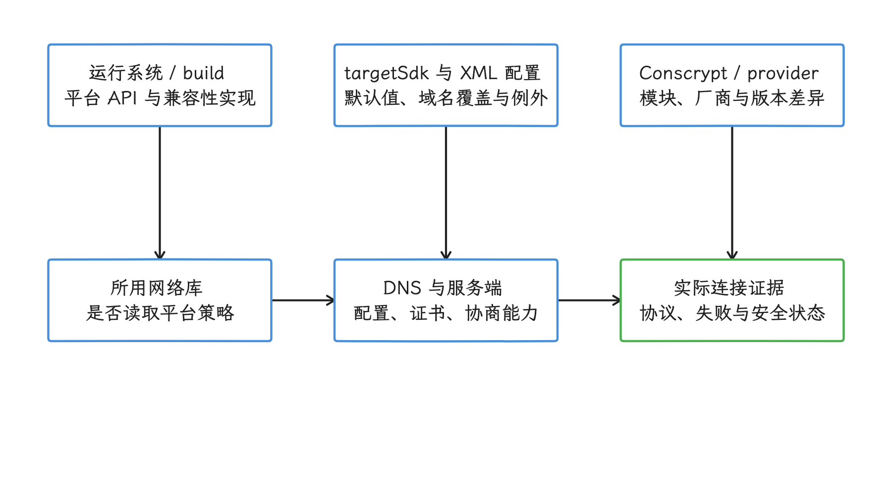

图：运行系统、target、模块实现和网络栈共同决定实际能力。 版本表给出引入节点，不证明某设备已接入、协商或强制执行；报告记录build、provider及网络库版本。

### Android 17 的 Encrypted Client Hello（ECH，加密客户端问候）

普通 TLS ClientHello 会暴露 SNI（Server Name Indication）等元数据——SNI 通常就包含目标主机名。ECH（RFC 9849）把敏感内容放入加密的 inner ClientHello（承载真实连接参数的内层 ClientHello），真实连接参数就此不可见，外层仍保留完成路由和兼容协商所需的信息。不过网络观察者仍可能依据 IP、流量形态和 DNS 看到部分元数据——ECH 隐藏的只是 ClientHello 里的内容，访问行为本身还在那里。

#### 四个生效条件

Android 17 的 `<domainEncryption>` 提供 `enabled` 和 `disabled` 两种公开模式；运行在 Android 17、targetSdk 37 及以上的应用，平台配置默认启用 ECH。不过一次连接要真正发出有效 ECH，还要同时满足：

1. 应用使用的网络库已经接入 Android ECH 能力；
2. DNS 或网络库获得了服务端可用的 ECHConfig，即包含服务端公钥和算法参数的 ECH 配置；
3. 负责终止 TLS、实际完成握手的 CDN、代理或服务节点支持对应配置；
4. 当前连接路径没有绕过平台网络安全策略，例如没有改用完全自管且不读取该策略的网络栈。

<!-- gracker-diagram: ch12-01-41-ech-inner-outer -->
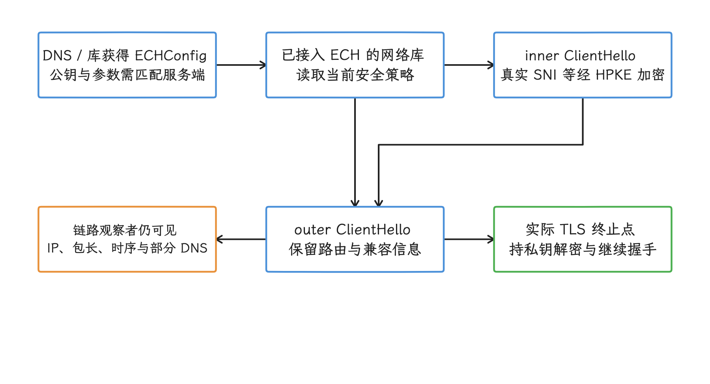

图：可用配置、已接入的库和实际TLS终止点共同完成ECH。 ECH保护路径观察者看到的敏感Hello内容；终止TLS的服务端可解密，目标IP与流量形态仍可见。

官方文档对 `enabled` 的定义很具体：存在 ECHConfig 时要求使用 ECH；没有配置时发送 ECH GREASE——占位扩展，让中间设备习惯 ECH 报文格式，避免其把现有格式写死、阻碍协议升级。`disabled` 既不启用 ECH，也不发送 GREASE。应用通常无需自行解析和安装 ECHConfig，交给已经调用平台 ECH 能力的网络库处理即可。

AOSP `android-17.0.0_r1` 中，Conscrypt 的接法是：`SSLParametersImpl.getEchOptions()` 根据网络安全策略生成 ECH 选项，`Platform` 把配置不匹配包装为 `android.net.ssl.EchConfigMismatchException`，其中可携带服务端返回的重试配置。所以 ECH 失败后会不会静默改用普通 TLS 并没有统一答案：网络库可能按重试配置重连，也可能把失败交给调用者。

<!-- gracker-diagram: ch12-01-42-ech-default-version-difference -->
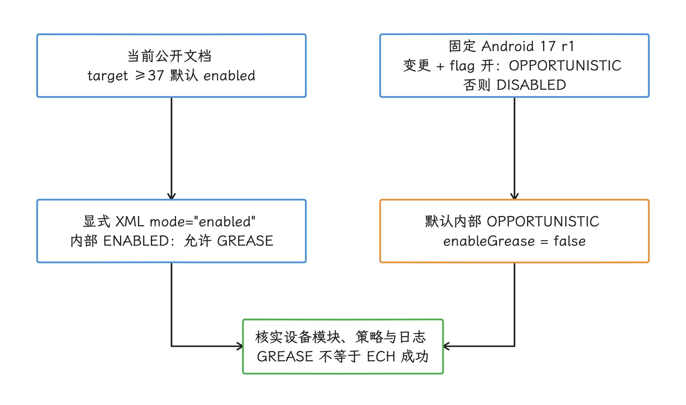

图：明确记录文档默认enabled与r1内部OPPORTUNISTIC的不同分支。 固定源码默认需兼容性变更和flag开启；OPPORTUNISTIC不发GREASE，显式XML enabled才映射ENABLED，不能合并承诺。

<!-- gracker-diagram: ch12-01-43-ech-grease-and-retry -->
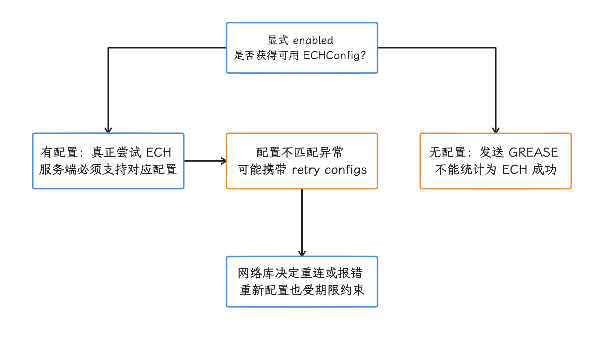

图：区分真实ECH、无配置占位与失败后的库层处理。 图以显式enabled语义为例；GREASE不加密真实SNI，异常可能携带retry配置，但不承诺静默普通TLS回退。

#### ECH 性能的分段测量

ECHConfig 常由 DNS HTTPS 资源记录分发——DNS 中携带服务参数的一类记录。查询是否产生额外网络等待，取决于缓存、解析器是否并行查询 A/AAAA 与 HTTPS 记录、加密 DNS 连接是否复用，以及网络库自己的解析流程，所以我们要逐项分开测量，统一写成“ECH 增加一次 DNS RTT”会失真。

ClientHello 加密使用 HPKE。客户端只在新 TLS 握手中执行相关密码运算，已建立连接上的 HTTP 请求不会重复执行。评估时把下面几项分开记：

- HTTPS 资源记录的缓存命中和查询时长；
- 有 ECHConfig、仅 GREASE、配置不匹配三类连接；
- 完整握手、会话恢复和连接复用比例；
- 同一设备、同一网络条件下的 CPU 时间与握手墙钟时间，即用户实际等待的经过时间。

<!-- gracker-diagram: ch12-01-44-ech-cost-accounting -->
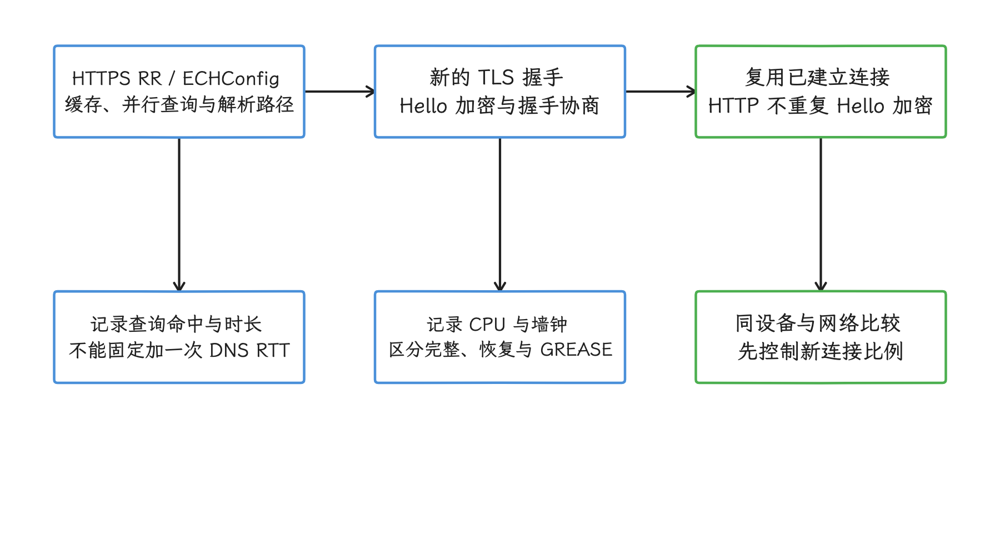

图：把配置获取、密码运算和已有连接上的HTTP请求分别记账。 DNS是否额外等待依缓存与并行；HPKE发生在新TLS握手，不为已建连接每个HTTP请求重算。图中无固定RTT或收益。

### Android 17 的 Certificate Transparency（CT，证书透明度）

再来看证书这一侧。CA（Certificate Authority，证书颁发机构）签名和系统信任链只能证明证书能追溯到受信任根。CT 通过公开日志和 Signed Certificate Timestamp（SCT，签名证书时间戳）留下可供审计的签发记录，用于发现误签或恶意签发。

#### CT 默认值的决定条件

Android 16（API 36）允许应用选择启用 CT。应用运行在 Android 17 且 targetSdk 37 及以上时，平台默认启用 CT；运行在旧系统上的同一 APK 拿不到 Android 17 的平台 CT 验证，targetSdk 低于 37 的应用仅凭“设备是 Android 17”也推断不出默认已开启，判断时要连同 targetSdk 一起看。

Network Security Configuration 的规则还包含一个容易遗漏的分支：

1. 当前域显式启用 CT 时，执行 CT 验证；
2. 当前域使用用户证书，或直接在应用配置中声明自定义信任锚时，默认不执行 CT；
3. 其他情况继承上层配置。

私有 PKI（企业自建的公钥基础设施）和抓包调试环境常落入第二种情况：同一应用的公网站点会执行 CT，使用企业根证书的内网站点则默认不执行。若业务确需让自定义信任锚也执行 CT，应显式配置并验证证书签发流程，公网证书的经验在这里替代不了测试。

<!-- gracker-diagram: ch12-01-45-ct-config-precedence -->
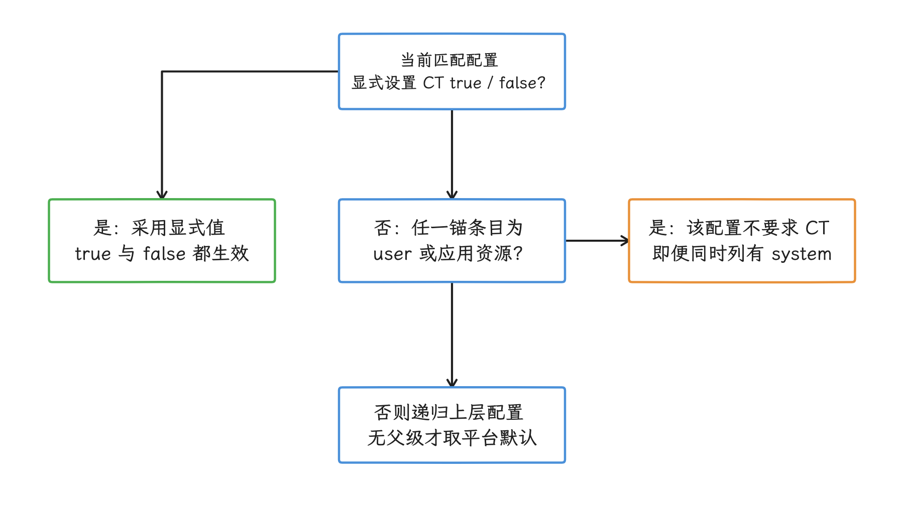

图：逐层计算当前匹配配置是否要求CT，包含显式false与自定义锚。 判断单位是配置，不是本次选中的链根；任一user/资源锚可关闭未显式设置的当前配置CT。

#### Android CT Policy 的判定条件

策略会按 SCT 交付方式、证书有效期、日志状态和日志运营者判断：

| SCT 交付方式 | Android CT Policy 的检查要点 |
|:---|:---|
| 嵌入证书 | 至少 1 个 SCT 来自检查时处于 Qualified、Usable 或 ReadOnly 状态的日志，这些是策略接受的日志生命周期状态；证书有效期不超过 180 天时需要来自 2 个不同日志，超过 180 天时需要 3 个；满足数量的 SCT 至少覆盖 2 个日志运营者 |
| OCSP stapling（服务端在握手中附带证书状态响应）或 TLS 扩展 | 至少 2 个 SCT 来自检查时合格的不同日志，并覆盖至少 2 个日志运营者 |

<!-- gracker-diagram: ch12-01-47-ct-sct-delivery-policy -->
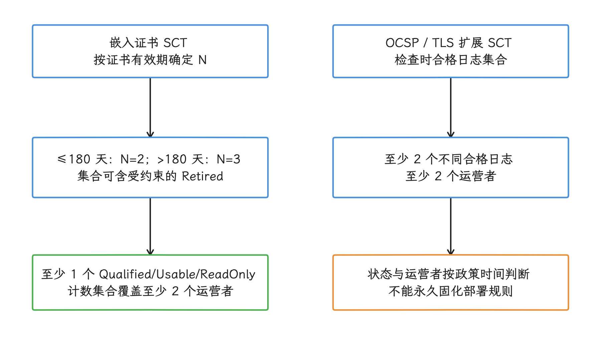

图：按交付方式、有效期、状态和运营者联合判断SCT集合。 表中N是不同日志计数；Retired有签发/退休时间限制，运营者按SCT签发时归属；部署前重新核对政策。

日志状态和 Android CT log list（平台认可的 CT 日志清单）会变化。证书部署流程应以当前 Android CT Policy 和预发布设备测试为准，不要把表中的数字固化成多年不变的服务端规则。

CT 检查通常用握手携带的证书、OCSP 响应或 TLS 扩展在本地完成，按“额外一次网络请求”估算会走偏。迁移期间更常见的影响反而是握手直接失败，例如 SCT 缺失、日志状态不满足政策、证书链发送错误；这时客户端要保留异常类型、域名、系统版本和证书摘要，服务端要监控 targetSdk 37 分批放量期间的 TLS 失败率。

<!-- gracker-diagram: ch12-01-46-ct-enforcement-loglist -->
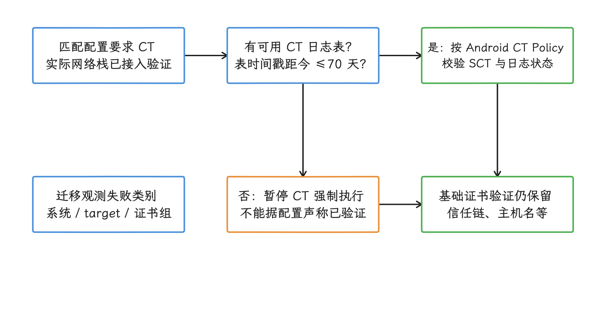

图：把配置要求、可用日志表与证书政策检查分开。 当前Android政策：日志表不可用或时间戳超过70天暂停CT强制；基础信任链与主机名校验继续。

### 明文策略、信任锚和证书链

#### 明文默认值

Android 7.0 及以上可使用 Network Security Configuration 按域名管理明文和信任锚。应用 targetSdk 28 及以上时，`cleartextTrafficPermitted` 的默认值为 `false`；targetSdk 27 及以下默认为 `true`。注意这只是 targetSdk 默认值，第三方或 native 网络实现未必遵守：网络库是否查询 `NetworkSecurityPolicy`，需要核对对应代码。

从 HTTP 迁移时，客户端应直接配置 HTTPS URL。先访问 HTTP 再跟随 301/302 会多一次明文请求、一次服务端响应和一条新的 HTTPS 连接路径，还会在重定向前暴露请求元数据。WebView 的 mixed content（HTTPS 页面加载 HTTP 资源） 策略是另一组配置，不要拿普通 API 客户端的明文策略去推 WebView 行为。

<!-- gracker-diagram: ch12-01-48-cleartext-direct-https -->
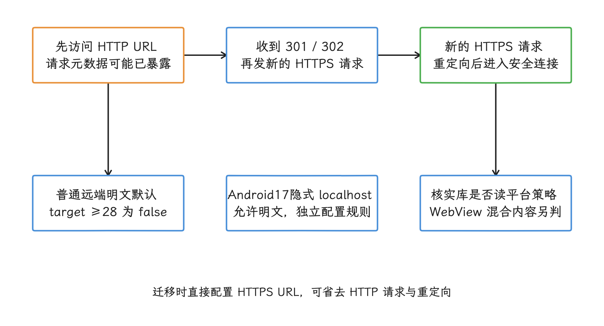

图：迁移时直接使用HTTPS，并分别核实远端默认值与localhost例外。 target≥28普通远端默认禁明文；Android17隐式loopback规则受实现flag且不推广到任意LAN，自管栈可能不读取策略。

#### 证书链与证书固定

TLS 服务端应发送叶子证书（直接签发给目标域名的证书）和客户端建立信任链所需的中间证书，通常不发送根证书，也不发送无关中间证书。证书数据会进入握手字节数；在带宽低、丢包高的网络上，过大的握手更容易跨越多个传输包并触发重传。判断“过长”要看实际链路字节和兼容性，没有固定的层数标准。

Network Security Configuration 支持 certificate pinning（证书公钥固定），但 Android 官方文档不建议一般应用把 pinning 当作默认方案：服务端证书或 CA 轮换处理不当会使应用失联。如果威胁模型（需要防范的攻击和采用的信任假设）要求使用 pinning，就要准备 backup pin（备用公钥摘要）、合理的失效时间、证书轮换演练和远端恢复方案。删除证书校验、信任所有证书或放宽主机名校验，都不属于性能优化。

<!-- gracker-diagram: ch12-01-49-certificate-pin-recovery -->
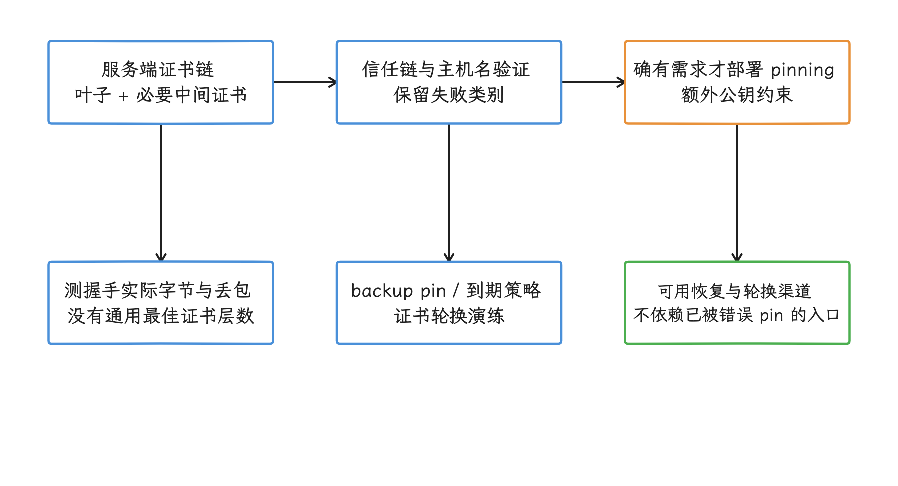

图：保持身份校验，按实际链字节和轮换可恢复性评估部署。 通常发送叶子和必要中间证书而非根；pinning需威胁模型、backup和演练，同一被拦端点无法承担唯一救援通道。

### API 35 与 API 37 的 HPKE 位于不同接口层

Hybrid Public Key Encryption（HPKE，混合公钥加密，RFC 9180）把 KEM（密钥封装机制）、KDF（密钥派生函数） 和 AEAD（带关联数据的认证加密） 组合成标准公钥加密方案。它适合用接收方公钥加密较短的消息或会话材料，但不替代 HTTPS 的身份验证、连接管理和传输协议。

Android 的 API 演进分为两步：

- Android 15 / API 35 新增 `android.crypto.hpke.HpkeSpi`。它是安全 provider 实现 HPKE 引擎的 SPI，供加密服务实现者接入平台；对应用开发者来说它不是日常加密入口。
- Android 17 / API 37 新增 `Hpke`、`Sender`、`Recipient`、`Message` 及参数规范。`Hpke.getInstance()` 用于获取实例，`seal()`/`open()` 是 one-shot（单次调用完成一次加密或解密） 操作；`Sender`/`Recipient` 面向需要在同一上下文中处理多条消息的场景。

当前 Android 文档标明平台 HPKE 只支持 RFC 9180 的 base mode（基本模式）：它用接收方公钥建立加密上下文，发送方身份则不在认证范围内。业务要求发送方认证时，应在协议层增加经过审计的签名或身份绑定设计——“使用接收方公钥加密”本身当不了双向身份认证。

ECH 协议内部也使用 HPKE 加密 inner ClientHello，但应用不需要调用 `android.crypto.hpke.Hpke` 来实现 ECH；自行用应用层 HPKE 包裹 HTTP payload（业务载荷），也得不到 ECH 对 ClientHello 元数据的保护。

<!-- gracker-diagram: ch12-01-50-hpke-api-layers -->
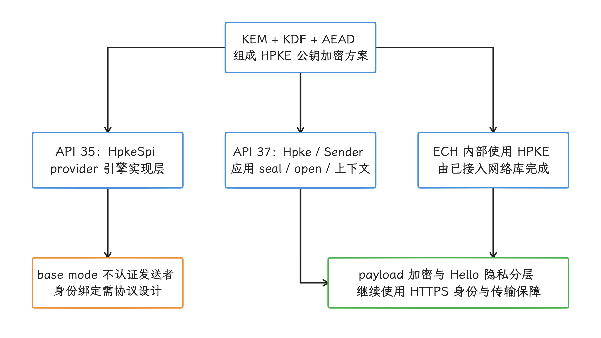

图：区分provider SPI、应用加密入口与TLS内部ECH。 Android当前只支持base mode：接收方公钥加密不认证发送方；应用payload加密不能保护ClientHello，也不替代HTTPS。

### 加密 DNS 与 ECH 的关系

Android 9 引入 Private DNS 的 DNS over TLS（DoT）设置。AOSP `android-17.0.0_r1` 的 DnsResolver `PrivateDnsConfiguration.cpp` 同时包含 DoT 与 DoH（DNS over HTTPS，通过 HTTPS 加密传输的 DNS）的配置和查询路径。DoT/DoH 保护客户端到解析器之间的 DNS 传输，ECH 保护 TLS ClientHello 中的敏感字段，两者处理的是不同的泄露面：

- 只有 DoT/DoH：能够观察链路流量的第三方不易读取 DNS 查询内容，但普通 TLS SNI（Server Name Indication，服务器名称指示，通常包含目标主机名） 仍可能暴露目标域名；
- 只有 ECH：ClientHello 的敏感字段被保护，但明文 DNS 仍可能暴露查询；
- 两者均启用：目标 IP、包长、时序和连接频率仍然可见。

DoH 首次查询的成本取决于已有 HTTP/2/HTTP/3 连接、DNS 缓存、连接竞速（并行尝试多个地址或协议）和解析器实现，并不固定增加一个 RTT。应用层自定义 DNS 还可能绕过系统 Private DNS、HTTPS 记录处理，以及网络切换后的缓存和重新解析规则，采用前要评估这些副作用。

<!-- gracker-diagram: ch12-01-51-dns-ech-privacy -->


图：按DNS传输、Hello内容和流量元数据分别说明保护范围。 DoT/DoH只保护客户端到解析器的传输；两者都有仍可见IP、包长和时序，DoH成本不固定增加一次RTT。

### 客户端与服务端的性能证据

#### 客户端事件

OkHttp `EventListener` 可记录 `dnsStart`/`dnsEnd`、`connectStart`、`secureConnectStart`/`secureConnectEnd`、`connectionAcquired`、表示开始收到响应头的 `responseHeadersStart` 和失败回调。这些时间点能回答“时间花在哪一段”；至于会话有没有恢复、ECH 有没有被接受、CT 的某条规则有没有命中，还要靠更多信号。

前文已经说明 Perfetto 不会自动生成 OkHttp 的阶段轨道。要把网络阶段与线程、CPU、蜂窝 radio 和进程状态对齐，仍应在网络回调中加入应用 trace slice（表示一段持续时间的追踪区间）；协议层的情况要靠 Cronet NetLog（Cronet 网络事件日志）、平台网络日志和服务端 TLS 指标补齐。生产日志不要记录会话密钥、完整证书、鉴权头或用户请求内容。

#### 服务端指标

服务端至少应能按应用版本和灰度发布批次（分批放量的用户组）观察：

- TLS 版本、cipher suite（加密套件）、ALPN（Application-Layer Protocol Negotiation，应用层协议协商）与完整/恢复握手比例；
- HTTP/2、HTTP/3 连接比例和 0-RTT 接受/拒绝情况；
- ECH 接受、GREASE、配置不匹配和重试；
- 证书链版本、SCT 交付方式与 TLS alert（TLS 协议错误通知）；
- 新连接率、连接寿命、空闲超时和负载均衡节点切换。

客户端和服务端的时间基准可能不同。分析单次请求时，我们用贯穿两端的 request ID 关联两端事件；比较分布时，使用同一网络类型、同一设备组和同一发布阶段，避免把用户构成变化误判为协议收益。

<!-- gracker-diagram: ch12-01-52-client-server-evidence -->


图：用贯穿两端的request ID关联请求，同条件比较分段分布与失败。 不同墙钟不能直接相减；库事件不足以证明resumed/ECH/CT结果，协议日志和服务端指标需联合且脱敏。

#### 排查对照表

| 现象 | 优先核对 | 常见误判 |
|:---|:---|:---|
| 同一域名频繁出现 `secureConnectStart` | 客户端实例是否复用、服务端 keep-alive、网络切换、连接失败 | 直接增大空闲连接上限 |
| 首次请求慢，后续请求正常 | DNS 缓存、新连接、完整 TLS 握手，以及首次访问触发的服务端初始化或缓存未命中 | 把整段都归为证书验证 |
| targetSdk 37 分批发布后 TLS 失败增加 | Android 17 设备占比、CT Policy、SCT 与自定义信任锚 | 关闭全部证书校验 |
| Android 17 上 ECH 连接失败 | 网络库是否接入、HTTPS 记录、ECHConfig 更新、`EchConfigMismatchException` | 假定平台总会静默降级 |
| 开启 DoH 后解析变慢 | DoH 连接复用、缓存、解析器地域、网络切换 | 固定认为多一个 RTT |
| HPKE 解密失败 | suite（算法组合）、info（上下文信息）、AAD（参与认证但不加密的附加数据）、密钥格式和 base mode 边界 | 把 HPKE 当作 TLS 会话 |


## 版本与实现基线

| 版本 | 相关变化 |
|---|---|
| Android 8 / API 26 | 范围下界；`onAvailable()` 后的 capabilities（网络能力）与 link properties（链路属性）callback 顺序得到公开保证 |
| Android 11 / API 30 | 平台改进 5G 场景的带宽估计；返回值仍是第一跳估计 |
| Android 17 / API 37 | `SubscriptionInfo` 增加流媒体分配速率；target 37 的局域网访问受 `ACCESS_LOCAL_NETWORK` 约束 |
| OkHttp 5.3.0 | 客户端锚点；共享 client、fast fallback、EventListener 排队事件与默认 timeout（超时）口径以此版本为准 |
| Cronet 18.0.1 | Play services Cronet 接入锚点；provider 可用性和协议协商需要在运行时观测 |


## 与其他部分的关联

- **前文「DNS、连接、传输与应用处理」**：连接池、缓存、HTTP/2、HTTP/3 与 OkHttp 事件决定新连接出现的频率并提供分段指标。
- **§12.2 netd 与 DnsResolver**：系统 DNS、Private DNS、HTTPS 资源记录与每网络解析状态。
- **§1.2 版本演进**：适合核对 targetSdk 与运行系统共同改变行为的案例。


## 参考资料

- [Read network state](https://developer.android.com/develop/connectivity/network-ops/reading-network-state)
- [`ConnectivityManager`](https://developer.android.com/reference/android/net/ConnectivityManager)
- [`ConnectivityManager.NetworkCallback`](https://developer.android.com/reference/android/net/ConnectivityManager.NetworkCallback)
- [`NetworkCapabilities`](https://developer.android.com/reference/android/net/NetworkCapabilities)
- [OkHttp 5.3.0 README](https://github.com/lysine-dev/okhttp/blob/parent-5.3.0/README.md)
- [OkHttp 5.3.0 `OkHttpClient.kt`](https://github.com/lysine-dev/okhttp/blob/parent-5.3.0/okhttp/src/commonJvmAndroid/kotlin/okhttp3/OkHttpClient.kt)
- [OkHttp 5.3.0 `EventListener.kt`](https://github.com/lysine-dev/okhttp/blob/parent-5.3.0/okhttp/src/commonJvmAndroid/kotlin/okhttp3/EventListener.kt)
- [Perform network operations using Cronet](https://developer.android.com/develop/connectivity/cronet)
- [Send a simple Cronet request](https://developer.android.com/develop/connectivity/cronet/start)
- [`CronetEngine.Builder`](https://developer.android.com/develop/connectivity/cronet/reference/org/chromium/net/CronetEngine.Builder)
- [`QuicOptions.Builder`](https://developer.android.com/develop/connectivity/cronet/reference/org/chromium/net/QuicOptions.Builder)
- [RFC 9113: HTTP/2](https://www.rfc-editor.org/rfc/rfc9113)
- [RFC 9114: HTTP/3](https://www.rfc-editor.org/rfc/rfc9114)
- [RFC 9000: QUIC](https://www.rfc-editor.org/rfc/rfc9000)
- [RFC 9001: Using TLS to Secure QUIC](https://www.rfc-editor.org/rfc/rfc9001)
- [`SubscriptionInfo`](https://developer.android.com/reference/android/telephony/SubscriptionInfo)
- [Android 17 local network permission](https://developer.android.com/privacy-and-security/local-network-permission)

- [Android 17 behavior changes](https://developer.android.com/about/versions/17/behavior-changes-17)：ECH 与 targetSdk 37 的 CT 默认行为。
- [Network Security Configuration](https://developer.android.com/privacy-and-security/security-config)：明文、信任锚、CT、ECH 和证书固定配置。
- [Android Certificate Transparency Policy](https://developer.android.com/privacy-and-security/certificate-transparency-policy)：SCT 数量、日志状态和运营者要求。
- [Android 10 TLS 1.3](https://developer.android.com/about/versions/10/features#tls-1.3)：TLS 1.3 默认启用及平台 0-RTT 边界。
- [Android HPKE package](https://developer.android.com/reference/android/crypto/hpke/package-summary)、[Hpke](https://developer.android.com/reference/android/crypto/hpke/Hpke) 与 [HpkeSpi](https://developer.android.com/reference/android/crypto/hpke/HpkeSpi)：API 35/37 的接口层次与 base mode 限制。
- [AOSP Conscrypt `SSLParametersImpl.java`](https://android.googlesource.com/platform/external/conscrypt/+/android-17.0.0_r1/common/src/main/java/org/conscrypt/SSLParametersImpl.java) 与 [`Platform.java`](https://android.googlesource.com/platform/external/conscrypt/+/android-17.0.0_r1/platform/src/main/java/org/conscrypt/Platform.java)：Android 17 ECH 策略映射与配置不匹配异常。
- [AOSP DnsResolver `PrivateDnsConfiguration.cpp`](https://android.googlesource.com/platform/packages/modules/DnsResolver/+/android-17.0.0_r1/PrivateDnsConfiguration.cpp)：Android 17 DoT/DoH 实现锚点。
- [RFC 8446: TLS 1.3](https://www.rfc-editor.org/rfc/rfc8446)、[RFC 9180: HPKE](https://www.rfc-editor.org/rfc/rfc9180)、[RFC 9849: ECH](https://www.rfc-editor.org/rfc/rfc9849)。
- [OkHttp 5.3 `ConnectionPool.kt`](https://github.com/square/okhttp/blob/parent-5.3.0/okhttp/src/commonJvmAndroid/kotlin/okhttp3/ConnectionPool.kt) 与 [`EventListener.kt`](https://github.com/square/okhttp/blob/parent-5.3.0/okhttp/src/commonJvmAndroid/kotlin/okhttp3/EventListener.kt)：连接池默认值和客户端事件边界。
- [Cronet `QuicOptions.Builder`](https://developer.android.com/develop/connectivity/cronet/reference/org/chromium/net/QuicOptions.Builder.html)：QUIC/TLS 0-RTT 的公开配置面。
