# netd 与 DnsResolver：DNS 解析性能和故障诊断

建立一条新连接前通常要先解析域名，但一次 HTTP 请求未必触发解析：连接池能复用现有连接，HTTP/2、HTTP/3 也能在同一连接上承载多次请求。所以诊断 DNS 问题要先回答三个问题：本次请求有没有触发解析、解析绑定在哪条网络、后续连接实际用了哪个结果。这些答案也决定了我们往下该看系统 resolver（解析器）还是应用侧的 HTTPDNS（通过 HTTP API 获取解析结果的应用侧方案）。

[12.1 Android 网络与 TLS 性能优化](01-android-network-tls-performance.md)介绍请求阶段、连接和传输协议，[1.22 Connectivity 服务、网络选择与回调](../../part1-fundamentals/ch01-architecture/22-connectivity-service.md)说明平台网络状态与系统如何选择默认网络。诊断时，我们要做的就是把这两章的应用侧事件对应到系统调用路径上，让每一步都落到可核对的系统证据。

## 一、四层边界：调用方、框架、resolver、netd

Android 应用常用的解析入口包括：

- `InetAddress.getAllByName()` 与 `Network.getAllByName()`；
- API 29 起提供的 `android.net.DnsResolver`；
- OkHttp 默认的 `Dns.SYSTEM`，它在 Android 上委托 `InetAddress.getAllByName()`；
- native（C/C++ 层）代码的 `android_getaddrinfofornetwork()` 等 NDK 网络 API。

传入明确的 `Network` 时，普通系统查询直接使用该网络的 resolver 配置；未指定网络时，解析走哪条网络由该入口的进程绑定与系统 DNS 网络选择规则决定，未必是物理默认网。数值地址、localhost 和受支持网络上的 `.local` 还可能走专门路径。DNS 绑定只作用于解析这一步，后续 socket 想落在同一网络，连接侧仍须使用相应 `Network` 的 socket 工厂或绑定机制。Wi-Fi、蜂窝、VPN 同时存在时，我们把解析网络与实际连接网络分开记录。

<!-- gracker-diagram: ch12-02-02-dns-socket-network -->
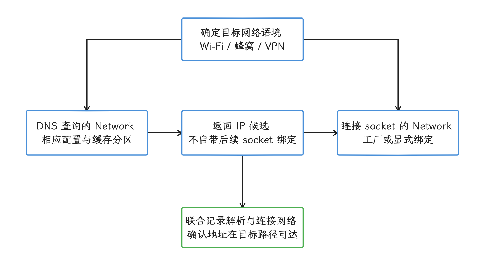

图：解析与连接两侧分别确定Network，不能只绑定DNS就推断后续路由。 未指定网络还受进程绑定与入口规则影响；数值地址、localhost、.local有专门路径。

| 层级 | 典型组件 | 主要职责 | 应用侧证据 |
|---|---|---|---|
| 调用方 | OkHttp、Cronet、`InetAddress`、应用自定义 resolver | 决定查询时机、缓存策略和后续连接 | DNS 阶段事件、异常、连接目标 |
| Framework API（框架接口） | `DnsResolver`、`Network` | 指定 `Network`、查询类型、取消和回调线程 | `DnsException`、rcode（DNS 响应码）、结果数量 |
| DNS Resolver 模块 | `com.android.resolv`、`IDnsResolver` | 按 `netId`（系统分配的网络标识）保存配置与缓存，执行 DNS 查询和 Private DNS | `dumpsys dnsresolver` |
| native 网络管理 | `netd`（Android 原生网络管理服务） | 创建网络、路由、接口、权限、转发规则 | `dumpsys connectivity`、平台日志 |

“netd 负责 Android DNS”这个说法把两个服务混成了一个。resolver 源码在 `packages/modules/DnsResolver`，native `netd` 在 `system/netd`；`ConnectivityService` 在同一个网络生命周期里分别调用它们，我们看证据时也要分别对号。

<!-- gracker-diagram: ch12-02-01-resolver-control-query -->
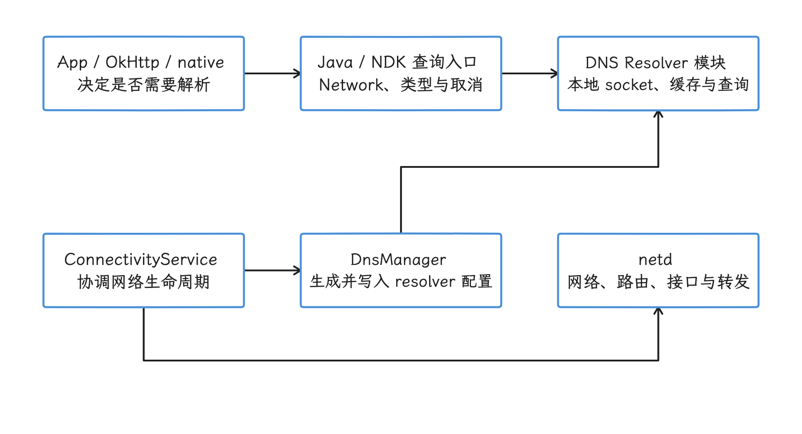

图：区分应用查询数据通路、系统配置Binder和native网络管理。 App连线是概念调用路径，省略Bionic/兼容代理细节；IDnsResolver是系统受权配置入口，不是普通应用查询Binder。

## 二、版本迁移：从 netd 内部代码到独立主线模块

这段历史解释了旧资料里的路径从哪来；实际排查以当前目录和服务分工为准。

| 版本 | 变化 | 阅读旧资料时的判断 |
|---|---|---|
| Android 9 及更早 | resolver 代码分布在 Bionic（Android 的 C 标准库）与 netd，Java 查询可经本地代理 `dnsproxyd` | 旧文章中的 `system/netd` 路径可能只适用于当时版本 |
| Android 9 | 用户设置中加入 Private DNS，公开模式以 DNS-over-TLS（DoT，通过 TLS 加密 DNS）为基础 | Private DNS 属于系统解析策略，不等同于应用 DoH |
| Android 10 | resolver 迁入 `system/netd/resolv`，以 `com.android.resolv` APEX（可独立更新的系统模块包）交付 | 这是模块化初期的源码位置 |
| Android 17 | 当前实现位于 `packages/modules/DnsResolver`；接口仍以 `IDnsResolver` 与本地代理入口服务系统调用方 | 源码锚点使用 `android-17.0.0_r1` |

官方模块文档说明，Android 10 的 DNS Resolver 模块直接服务 `/dev/socket/dnsproxyd`，resolver 配置的 Binder（Android 进程间通信机制）入口也从 netd 移入该模块。

依赖方向也由官方模块文档写明：netd 动态链接 resolver 模块；resolver 依赖 Bionic，其余依赖静态链接，并不反过来依赖 netd 的服务或库。配置 Binder 入口由模块自己提供，系统服务无需让 netd 转发配置。Mainline 允许单独更新模块，动手排查前，我们先记录设备上的实际模块版本。


模块可以独立更新，全局 DNS 控制权仍在系统手里：清空所有网络的 resolver 缓存、修改别的网络的 DNS server、操纵 Private DNS 校验状态，这些能力都由系统权限和服务分工保护，普通应用拿不到。


## 三、`DnsResolver` API

### 3.1 Looper、Executor 与取消信号分别控制什么

Android 17 新增 `DnsResolver(Context, Looper)`；API 29 的 `DnsResolver.getInstance()` 在 API 37 被标记为废弃。`Context` 用于访问系统服务；可空的 `Looper` 监视查询文件描述符事件，传 `null` 时使用主 Looper；传入的 `Executor` 则在普通 `query()` / `rawQuery()` 的 FD 就绪路径上读取结果并执行回调。业务回调跑在哪个线程由 `Executor` 决定，Looper 只管监视，两者要分开看。组合查询的额外等待超时存在下述固定 r1 例外。


查询应绑定 `CancellationSignal`。普通 FD 路径的取消会移除监听并关闭查询 fd，已经进入业务层的回调照常走完。固定 r1 的组合查询还多一层：额外等待到期后，`HttpsEndpointAccumulator` 在 Handler 线程直接调用 `reportResult()`，没有重新经过传入的 Executor，报告入口也不会再检查用户取消信号。所以我们在最终回调入口自己重新检查取消和网络会话代次，再自行切换到所需执行环境；“取消后绝不回调”“所有结果均在同一 Executor”这两条假设，一条都靠不住。这是固定源码的控制流核对，未以真机复现代替实际模块验证。[来源：r1 组合查询聚合器](https://android.googlesource.com/platform/packages/modules/Connectivity/+/refs/tags/android-17.0.0_r1/framework/src/android/net/util/HttpsEndpointAccumulator.java)。

<!-- gracker-diagram: ed12-02-callback-paths-and-session-guard -->
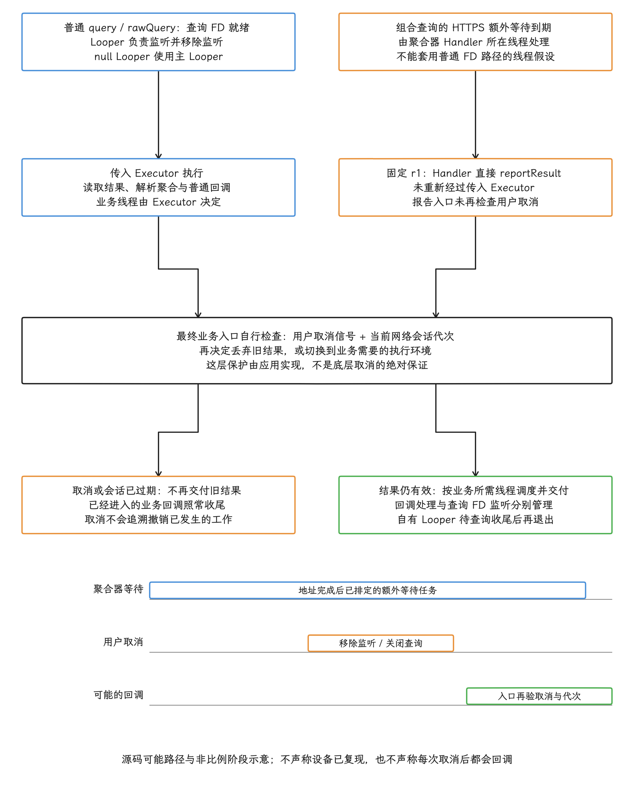

图：固定r1两条调度路径与业务取消保护合图：普通FD就绪由Looper监听后交Executor读取/回调，nullLooper用主Looper；组合HTTPS额外等待到期时Handler直接reportResult，未重进Executor，也未再核用户取消。因此最终业务入口自行检查CancellationSignal和网络会话代次，再决定丢旧结果或切换到需要的执行环境。取消底层监听/关闭查询不能追溯终止已进入的业务回调，自有Looper待查询收尾后退出。三轨只示源码可能交错，不声称真机已复现或每次取消后必回调。

迁移到新构造方法后，可按应用生命周期复用 resolver，避免每次创建线程；长期实例使用适当生命周期的 Context。提供自有 Looper 时，要在待处理查询取消或收尾后再退出线程。API 级别或扩展版本判断仍须保留：targetSdk 升级并不会让旧系统自动获得新 API。

### 3.2 `query()`、`rawQuery()` 与错误信息

普通地址查询用 `query()`：不指定地址类型的重载按目标网络的 IPv4/IPv6 能力发起相应 A/AAAA 查询，聚合并按 RFC 6724 排序；指定类型的重载可单独查询地址记录。`rawQuery()` 则返回原始 DNS 应答，供需要指定报文或自行解析记录的调用方使用；A/AAAA/HTTPS 组合重载另见下节。

两类 API 都用 `Callback.onAnswer(answer, rcode)` 或 `onError(DnsException)` 回调，rcode 在普通 query 里同样存在。差别在 answer 的类型：地址查询是 `List<InetAddress>`，raw query 是 `byte[]`，组合查询是 `HttpsEndpoint`。A/AAAA 聚合中只要有一项有效成功，最终 rcode 就可为 0，另一项失败可能因此被掩盖；`onAnswer` 也可能携带空结果或非零 rcode。判断解析是否成功，要看结果内容和 rcode，回调名说了不算。


常规路径会把失败信息折叠：`InetAddress` 与 OkHttp 经常把多种解析失败统一成 `UnknownHostException`。我们拿到这个异常只知道“解析失败”，至于是 NXDOMAIN（域名不存在）、SERVFAIL（服务器处理失败）、超时还是本地策略拒绝，从异常本身分不出来。

`FLAG_NO_CACHE_LOOKUP`、`FLAG_NO_CACHE_STORE` 和 `FLAG_NO_RETRY` 属于诊断或特定协议策略，不适合为了“更实时”而长期全量开启。缓存旁路会增加延迟、流量与 resolver 压力；若要对比缓存与上游行为，应控制样本量，并把实验请求与用户请求分开标记。

### 3.3 API 37 的 HTTPS 资源记录组合查询

API 37 与 S 扩展版本 22 增加了 `TYPE_HTTPS`、`HttpsEndpoint` 和 A/AAAA/HTTPS 组合查询。拿到 `HttpsEndpoint` 后，`HttpsEndpoint.getHttpsRecords()` 给出按 SvcPriority 排序的记录列表；`getIpAddresses()` 按 RFC 6724 排序，并限制为当前网络支持的地址族，地址可来自 A/AAAA 或 HTTPS hints。ALPN、端口、目标名称和 ECH 配置这些服务参数挂在每条 `HttpsRecord` 上，Endpoint 一级的接口拿不到它们。另外两点要留意：`getIpAddressHints()` 可包含当前网络不支持的地址族；AliasMode（优先级 0）记录没有普通 ServiceMode 的完整服务参数，连接实现须继续遵循记录语义。


`httpsTimeoutMillis` 控制地址结果完成后的 HTTPS **额外等待**，提供以下常量与显式时长：

- `HTTPS_QUERY_WAIT_NONE`：相关 A/AAAA 已收到结果而 HTTPS 尚未返回时，不再额外等待；它不禁用 HTTPS 查询，已经先到的 HTTPS 记录仍可使用；
- `HTTPS_QUERY_WAIT_AUTO`：使用平台默认额外等待；固定 r1 的值为 50 ms，这个实现参数只在该基线内成立；
- `HTTPS_QUERY_WAIT_UNTIL_TIMEOUT`：不启动上述额外等待截止，继续等待 HTTPS 查询自身完成或 resolver 超时；
- 显式非负毫秒数：在相关地址结果完成后，最多再等该时长；它不约束此前 A/AAAA 的等待。

如果 HTTPS 记录先到，并为当前网络需要的地址族提供足够 hints，固定 r1 可提前返回并取消剩余查询，无需每次等齐三类结果。若地址查询先完成，则按上面的额外等待策略处理；HTTPS 返回无数据或等待到期时，记录列表可为空。还要留意 `UNTIL_TIMEOUT`：上游丢弃 HTTPS 查询时它可能延长等待，业务端到端期限须独立管理——额外等待参数覆盖的只是 HTTPS 这一段，完整的 DNS 超时要另算。

<!-- gracker-diagram: ch12-02-09-https-wait-policy -->
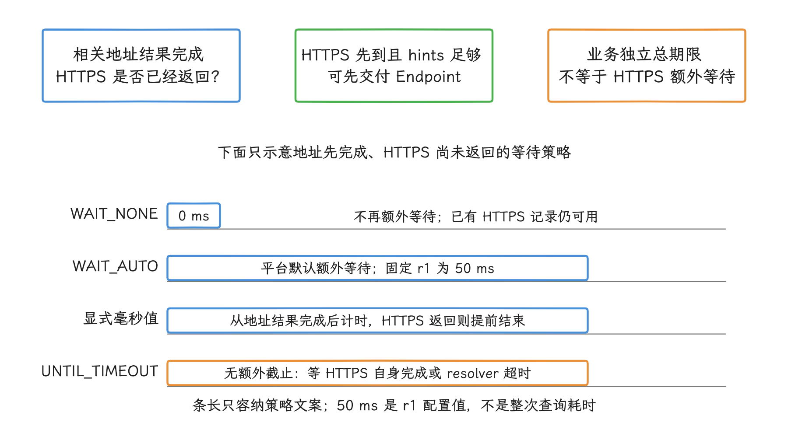

图：足够地址信息就绪后，按HTTPS已完成与等待策略决定交付。 AUTO固定r1默认50ms是额外等待参数，不是完整查询timeout；HTTPS先到且hints足够可早返并取消剩余查询。轨道非实测。

OkHttp 5.3 的 `Dns.lookup()` 只返回 `List<InetAddress>`，`HttpsEndpoint` 上的 ALPN、端口、优先级或 ECH 配置，经自定义 `Dns` 传不过去；要用这些元数据，网络库的连接实现必须显式支持它们。

<!-- gracker-diagram: ed12-02-endpoint-records-and-connector -->
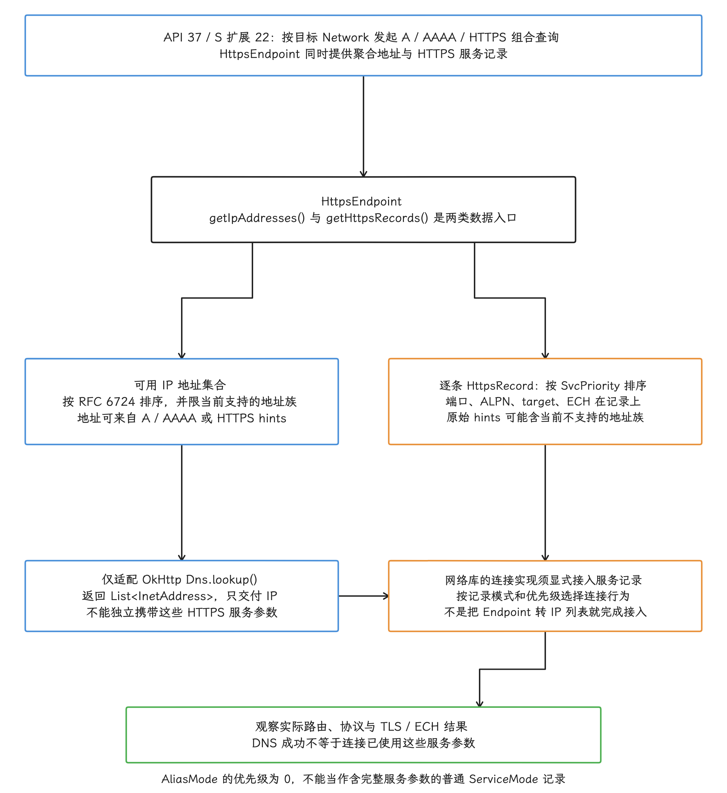

图：API37/S扩展22的数据层次与连接接口合图：Endpoint的可用地址按RFC6724和当前网络地址族形成，逐条HttpsRecord按SvcPriority排序并保存端口/ALPN/target/ECH等；原始hints可能含当前不支持的地址族，AliasMode优先级0不能当普通ServiceMode完整参数。传统OkHttp5.3Dns.lookup只交ListInetAddress，服务元数据须连接实现显式接入；解析成功或得到IP不证明已使用相应协议/ECH，最终以实际路由和握手为准。

## 四、系统调用路径

我们把一次网络生命周期画成下面的时序图，用它定位网络创建、DNS 配置与应用查询分别由谁处理。


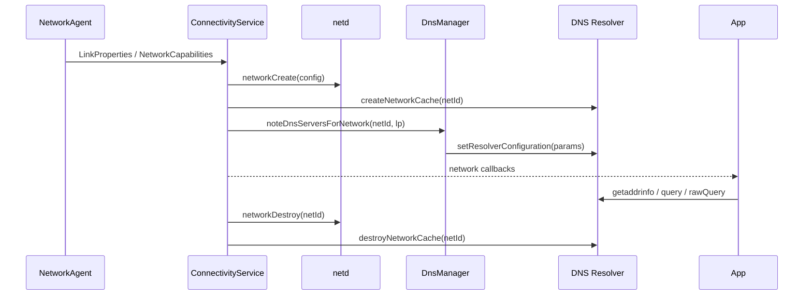

图中展示两组职责和一次正常生命周期的概念顺序，省略错误恢复、重复配置及网络回调交错。netd 维护 native network 对象与转发规则，resolver 为同一 `netId` 建立缓存并接收配置。读图时把两条线分开：应用查询数据路径通常经 JNI/NDK 与本地 `dnsproxyd` socket，图中 App→Resolver 连线画的是查询数据通路；配置走的是系统侧的 Binder `IDnsResolver`，应用并不直接调用它。同样，应用收到网络回调，也说明不了网络库已停止复用旧连接。

### 4.1 网络创建与销毁

在固定 r1 的正常创建路径中，`ConnectivityService` 先调用 `mNetd.networkCreate(config)`，再调用 `mDnsResolver.createNetworkCache(netId)`，两次调用之间没有事务保证。销毁路径先调用 `networkDestroy(netId)`，中间还会进行地址/socket 清理，再调用 `destroyNetworkCache(netId)`。各调用分别处理异常，排错时两侧日志要分别核对，单看其中一条成功，认定不了另一侧也成功。

resolver 按网络隔离缓存，是为了避免 Wi-Fi 与蜂窝共用彼此不兼容的解析状态。应用自定义缓存也要守同一条规则：只以 hostname（主机名）作为 cache key（缓存键）时，旧网络拿到的地址会继续用在新网络上，VPN 分流和企业域名最容易踩到。

### 4.2 DNS server 与 Private DNS 配置

`LinkProperties`（接口、路由、DNS 等链路属性）更新后，`ConnectivityService.updateDnses()` 把变化交给 `DnsManager.noteDnsServersForNetwork()`。`DnsManager` 生成用于跨进程传递配置的 `ResolverParamsParcel`，再经 `IDnsResolver.setResolverConfiguration()` 写入对应 `netId`。参数包括 DNS server、用于补全短主机名的搜索域、采样与超时配置、Private DNS 信息等。

DNS 配置变化时，`ConnectivityService.updateDnses()` 还会调用 `DnsManager.flushVmDnsCache()`，由后者发送系统保护的 `ACTION_CLEAR_DNS_CACHE` 广播，通知 Java 运行时丢弃进程内 DNS 结果。这条广播直接作用于 Java 运行时；resolver 的每网络 native cache、Java 或应用自己的解析缓存、网络库里的已建连接要分开看，自建缓存要应用自己清。


单独清理 DNS 缓存不会自动关闭 OkHttp 连接池中的 socket。切网后“解析已更新但请求仍访问旧地址”，要同时查已有连接、socket 绑定和其他缓存；“多数由连接复用造成”这类结论需要统计支持。完整网络销毁则是另一条路径，ConnectivityService 可能主动清理相关 socket；此时需联合 connect、实际目标地址和绑定网络判断。

<!-- gracker-diagram: ed12-02-config-update-and-cache-lifetimes -->
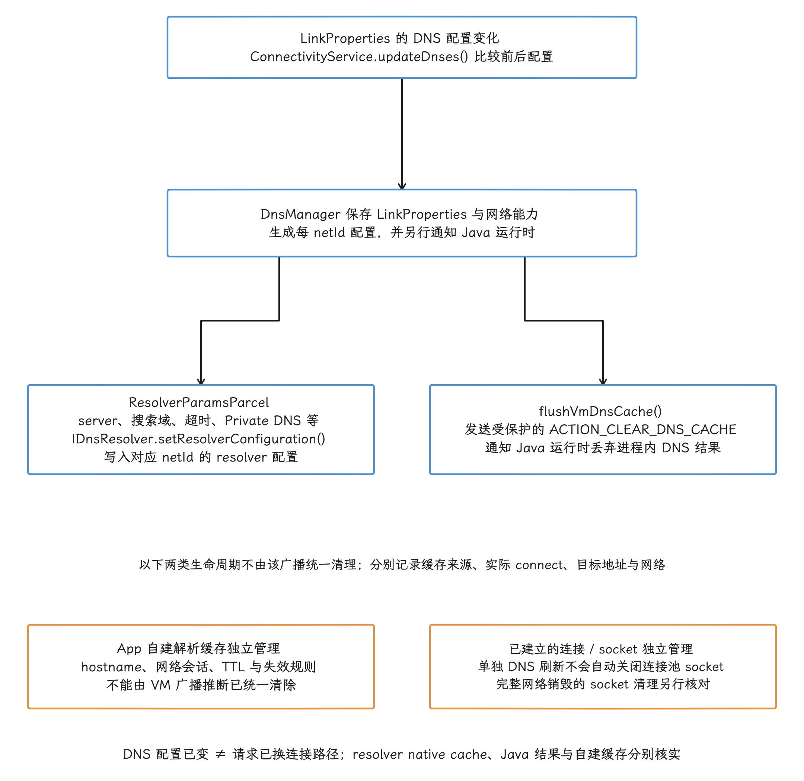

图：固定r1配置与失效范围合图：LP的DNS变化经updateDnses交DnsManager，ResolverParamsParcel通过IDnsResolver写入对应netId；另以flushVmDnsCache受保护广播通知Java运行时丢弃进程DNS结果。两路不是App全部缓存/连接统一清理：resolver nativecache、Java结果、自建缓存依各自规则核实，App缓存按网络会话和TTL管理。单独DNS刷新不自动关闭连接池socket；完整网络销毁的socket清理是另一条路径。联合记录connect目标与绑定网络，不由解析配置已变推断请求已换路径。

### 4.3 服务接口与源码位置

关键源码锚点如下。模块根目录分别为 `packages/modules/Connectivity`、`packages/modules/DnsResolver` 与 `system/netd`；文件链接保留固定 r1 的完整路径，避免长路径撑宽表格。

| 职责 | 模块 | 源码文件 |
|---|---|---|
| Framework DNS API | Connectivity | [`DnsResolver.java`](https://android.googlesource.com/platform/packages/modules/Connectivity/+/refs/tags/android-17.0.0_r1/framework/src/android/net/DnsResolver.java) |
| 网络生命周期协调 | Connectivity | [`ConnectivityService.java`](https://android.googlesource.com/platform/packages/modules/Connectivity/+/refs/tags/android-17.0.0_r1/service/src/com/android/server/ConnectivityService.java) |
| resolver 参数生成 | Connectivity | [`DnsManager.java`](https://android.googlesource.com/platform/packages/modules/Connectivity/+/refs/tags/android-17.0.0_r1/service/src/com/android/server/connectivity/DnsManager.java) |
| Binder 接口 | DnsResolver | [`IDnsResolver.aidl`](https://android.googlesource.com/platform/packages/modules/DnsResolver/+/refs/tags/android-17.0.0_r1/binder/android/net/IDnsResolver.aidl) |
| resolver 服务与 dump | DnsResolver | [`DnsResolverService.cpp`](https://android.googlesource.com/platform/packages/modules/DnsResolver/+/refs/tags/android-17.0.0_r1/DnsResolverService.cpp) |
| resolver 配置与统计 | DnsResolver | [`ResolverController.cpp`](https://android.googlesource.com/platform/packages/modules/DnsResolver/+/refs/tags/android-17.0.0_r1/ResolverController.cpp) |
| DoT/DoH 状态 | DnsResolver | [`PrivateDnsConfiguration.cpp`](https://android.googlesource.com/platform/packages/modules/DnsResolver/+/refs/tags/android-17.0.0_r1/PrivateDnsConfiguration.cpp) |
| native 网络管理 | netd | [`NetdNativeService.cpp`](https://android.googlesource.com/platform/system/netd/+/refs/tags/android-17.0.0_r1/server/NetdNativeService.cpp) |

遇到把 Android 10 的 `system/netd/resolv` 当作当前目录的资料，保留它的迁移史结论，再回到上表的 Android 17 文件核对实现。

## 五、Private DNS、DoT、DoH 与 `.local`

### 5.1 用户设置名称与内部传输

Android 的公开 Private DNS 设置向用户展示的是 DoT 模式和 provider hostname（提供商主机名）。resolver 内部则同时存在 DoT 与 DNS-over-HTTPS（DoH，通过 HTTPS 发送 DNS 查询）的配置、验证和统计代码，DoH 实现还包括 `packages/modules/DnsResolver/rust/src/doh/`。内部实际采用哪种加密传输，受平台版本、provider 与实验配置影响。

应用拿到的是解析结果，单次查询走 DoT 还是 DoH，从 `InetAddress`、OkHttp `Dns` 或普通 `DnsResolver.query()` 回调里看不出来。公开状态可以记录 `LinkProperties.isPrivateDnsActive()` 与 `getPrivateDnsServerName()`；已验证服务器详情和实际传输路径，要从有权访问的平台 dump、日志或内部状态核对，`getDnsServers()` 只反映配置，当不成“本次实际使用的加密上游”。写诊断报告时，我们把 Private DNS 状态、配置与单次实际传输分开记。


Private DNS 保护的是系统 resolver 到上游 DNS provider 之间的 DNS 流量；HTTPS 流量本身和 TLS ClientHello 中的服务器名称不在它的覆盖范围内，ECH 的适用条件见 12.1。

### 5.2 应用 DoH 是另一套解析策略

应用自带 DoH 后，上游、缓存、bootstrap 和 fallback 都由应用维护，可能不使用系统 Private DNS、VPN DNS 命名空间、企业 split DNS 与门户网络的解析策略。DoH 数据流是否绕过 VPN 隧道是另一个问题，取决于进程/socket 绑定、VPN 覆盖和系统规则。安全收益、泄露面与兼容成本应分别核实：

- 公网固定域名可按业务策略使用应用 resolver；
- 企业内网域名、VPN 域名和门户网络优先遵循系统策略；
- fallback 是否允许从加密解析切到系统 DNS，应由安全与隐私策略定义；
- DoH 服务自身的域名解析须另行解决；再次调用同一个业务客户端，会形成走不完的递归依赖。


### 5.3 mDNS 与本地网络权限

支持该功能的 DNS Resolver 模块可对 `.local` 名称发起一次性 mDNS 查询，适用于已知名字的地址解析；官方模块文档与固定 r1 `res_cache.cpp` 都把蜂窝和 VPN 网络排除在外，所以“系统支持 .local”要看目标网络是否在支持范围内。持续发现与跟踪服务的生命周期属于 NSD 的能力，一次性 mDNS 查询不带这一层。

targetSdk 37 的广泛本地网络访问需要 `ACCESS_LOCAL_NETWORK` 运行时授权，`.local` 解析也在限制范围内。官方还提供由 NSD 系统 picker 选择设备并授予限定访问的路径，这条授权限定在所选设备上，扩不到任意 LAN 或任意 `.local` 查询。TCP、UDP、OkHttp、Cronet 与 WebView 的本地访问均须核实适用规则；失败时先检查运行系统、target、实际授予范围与目标网络。

<!-- gracker-diagram: ch12-02-16-mdns-nsd-permission -->
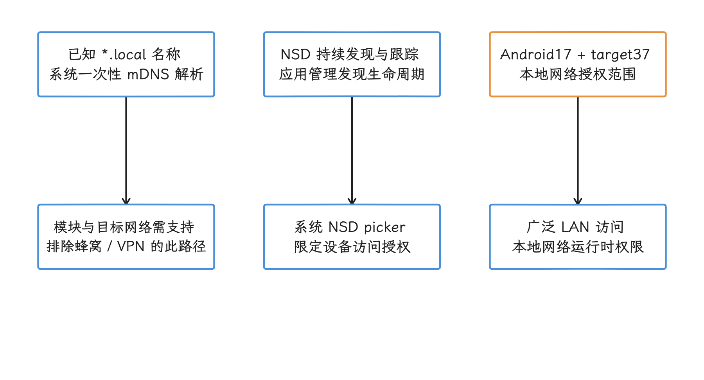

图：分开已知名字解析、服务发现生命周期和实际访问授权。 系统.local mDNS排除VPN/蜂窝；picker授予限定设备访问，不能推广为任意LAN或任意.local解析权限。

## 六、从业务错误到系统证据的诊断顺序

### 6.1 先确认请求是否停在 DNS

一次请求至少记录这些相邻事件：

1. DNS 开始、结束或失败；
2. connect（连接）开始、目标地址与结束；
3. TLS 握手开始、结束；
4. HTTP 请求头发送、库读到响应头的事件与响应消费终态；若测 wire 首字节，另记对应数据源，OkHttp `responseHeadersStart` 对应的是库读到响应头，代替不了 wire 首字节；
5. 取消、网络切换和进程生命周期事件。

把这些事件摆到同一时间线上，请求停在哪一段就清楚了：复用已有连接时，没有 DNS 与 connect 事件属于正常现象；DNS 很快而 connect 超时，查路由、地址族与目标 IP；TLS 慢，回到 12.1 查握手与证书；首字节慢，查服务端、CDN 与回源链路。

<!-- gracker-diagram: ch12-02-17-failure-stage-routing -->
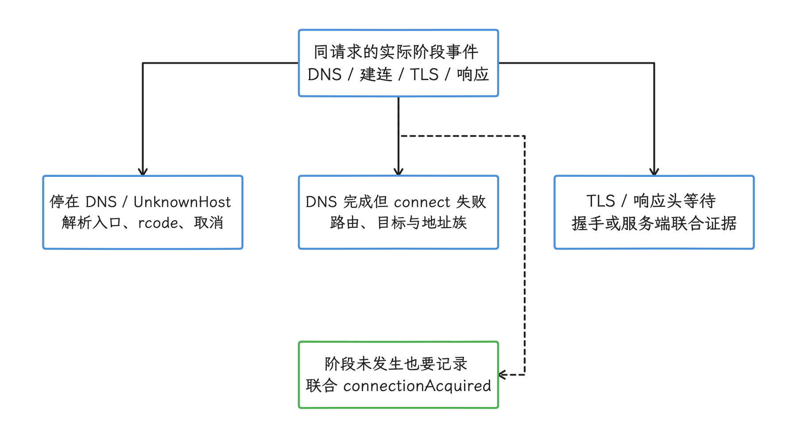

图：从实际阶段事件分流DNS、路由、TLS与服务端问题。 复用可能跳过阶段，跨主机合并仍可能先解析；OkHttp头事件不等于wire首字节，缺席也不能填0ms。

### 6.2 记录故障对应的网络上下文

每次故障至少关联：

- 应用进程内的网络会话标识；
- Wi-Fi、蜂窝、VPN 等传输类型；
- `NetworkCapabilities` 中的 `VALIDATED`（系统公网探测通过）与 `CAPTIVE_PORTAL` 等标志；它们说明的是系统探测结果，业务域名、TLS 或服务端正常与否要另行确认；
- `LinkProperties` 中的接口、DNS server 数量和 Private DNS 状态；
- 默认网络变化到请求开始之间的时间；
- 查询来源：系统、HTTPDNS、应用 DoH 或缓存。

`netId` 只是平台内部标识：它由系统重复分配，同一个值可能先后属于不同网络。线上长期聚合要换稳定的维度，可以用进程内递增的网络会话号，或带定期更换盐值的标识。


### 6.3 三组 shell 证据

下面三条命令用于受控测试设备，或已经获准收集 bugreport（系统诊断包）的环境；resolver dump（状态转储）需要 `DUMP` 权限，普通第三方应用在生产设备中执行不了。

```shell
adb shell dumpsys connectivity
adb shell dumpsys dnsresolver
adb shell dumpsys dnsresolver querylog
```


我们逐条看：第一条核对网络、LinkProperties、能力、VPN 与 Private DNS。第二条给出 resolver 的每网络配置、缓存相关信息、上游采样统计与 Private DNS 状态，它是一份状态汇总，完整缓存条目或应用请求清单要另想办法。第三条输出有界 query log：固定 r1 的 DnsProxyListener 跳过反向查询，主要记录存在缓存未命中事件的查询；DnsQueryLog 输出 hostname 首字符和首个 IPv4/IPv6 地址的前缀，同时保留时间、netId、UID/PID 与耗时。这些遮蔽后的字段仍留着关联线索，谈不上匿名。

<!-- gracker-diagram: ch12-02-20-querylog-scope-redaction -->
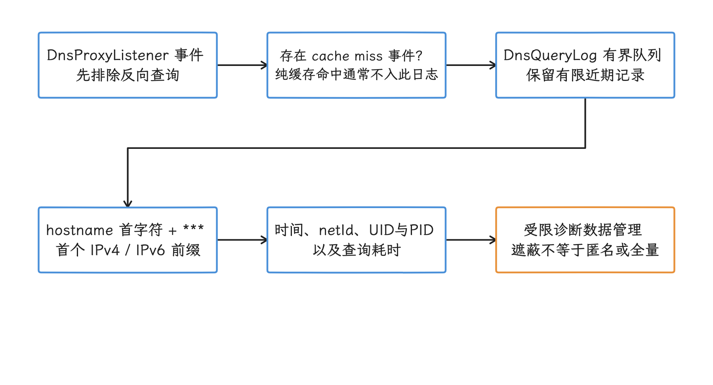

图：先检查查询是否进入日志，再理解遮蔽后的信息与局限。 固定r1跳过反向查询，纯缓存命中不记该日志；hostname首字符和地址前缀、时间/UID/PID等仍可识别关联。

`ResolverController::dump()` 的 server 数字由 resolver 保存的样本聚合，包含成功、错误、超时、内部错误、平均 RTT、最近样本时间和可用状态；样本受配置的有效期与数量约束，“total”对应的也只是这些样本，而非设备生命周期内的全部 DNS 请求。它适合观察对应网络和上游的集中失败；应用耗时和分位数要应用侧自己测——应用可能命中其他缓存、等待调度或复用连接。


### 6.4 NetworkDiagnostics 的探测范围

固定 r1 的 `NetworkDiagnostics` 将探测 socket 绑定到指定 Network，按其 LinkProperties、路由和 Private DNS 配置准备 ICMP、UDP DNS 与 DoT 检查。DoT 检查确实包含到 853 端口的连接、TLS 握手和 DNS 报文交换；但它并不构成对业务 HTTPS、ECH、DoH 或企业域名语义的完整验证，某类检查未出现，只说明这项探测没做，推不出该协议不可用。

这类平台探测能把系统网络故障的范围收窄；业务域名、CDN 地址或应用 HTTPDNS 是否正常，还是要靠应用自己的证据——把平台探测结果与同一时间的 hostname 类别、查询来源和 connect 目标关联起来看。

<!-- gracker-diagram: ch12-02-22-network-diagnostics-probes -->
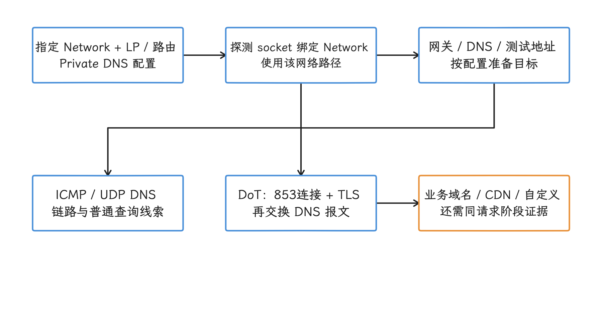

图：平台在指定Network上执行配置相关的探测，业务端点仍需自己的证据。 固定r1按LinkProperties/路由/PrivateDNS准备ICMP、UDP DNS、DoT；不是业务HTTPS、DoH、ECH或HTTPDNS成功证明。

### 6.5 常见现象的证据分流

| 现象 | 优先核对 | 暂时不要推断 |
|---|---|---|
| `UnknownHostException` 增长 | 使用的解析入口、网络会话、resolver/HTTPDNS 结果、超时与取消 | 一定是 NXDOMAIN |
| DNS 高分位延迟增长 | 冷缓存请求（查询时没有可用缓存结果）比例、上游 server RTT、网络切换、线程排队、查询类型 | 换 HTTPDNS 一定更快 |
| 切网后第一个请求失败 | socket 是否复用旧网络、缓存是否带网络维度、新网络是否验证 | DNS 缓存一定污染 |
| VPN 下公网正常、内网域名失败 | VPN DNS、split DNS、绑定的 `Network`、应用 DoH/HTTPDNS 覆盖 | 运营商 DNS 劫持 |
| DNS 成功但 `VALIDATED` 丢失 | Captive Portal、路由、HTTP 探测、Private DNS 校验 | 网络已经可用 |
| `.local` 失败 | API 37 本地网络权限、目标网络、mDNS 适用范围 | 公网 DNS server 故障 |

## 七、HTTPDNS 与 OkHttp 自定义 `Dns`

系统 resolver 与 HTTPDNS 解决不同问题。系统路径继承 `Network`、VPN、Private DNS 与平台缓存策略；HTTPDNS 能提供业务域名调度和独立的上游服务。接入 HTTPDNS 之后，网络隔离、TTL（Time to Live，缓存有效期）、并发、bootstrap 和 fallback 都要应用自己维护。

OkHttp 的 `Dns.lookup(hostname)` 是同步接口，并且可能被多个请求并发调用。实现时要守的规则包括：

- `lookup()` 内优先读取线程安全的内存缓存；
- 缓存 key 至少包含 hostname 与网络会话，必要时加入地址族和用户网络策略；
- TTL 遵循 DNS/HTTPDNS 服务协议；NXDOMAIN、NODATA 与瞬时超时、SERVFAIL、权限或取消分别分类，避免把所有查询失败按同一负缓存期限保存；
- 缓存缺失时若要同步访问 HTTPDNS，这段耗时会进入建连前的 DNS 阶段；
- 异步预取应由明确的业务触发，过期结果只做有界续用；
- 持久化地址只适用于能正确保存 TTL、网络分区和数据版本的设计，默认优先使用内存；
- HTTPDNS 客户端使用独立、最小化的 bootstrap 路径，避开对同一个自定义 `Dns` 的递归调用；
- 系统 fallback 由产品的可用性、隐私和企业网络策略共同决定。

<!-- gracker-diagram: ed12-02-app-resolver-cache-bootstrap-policy -->
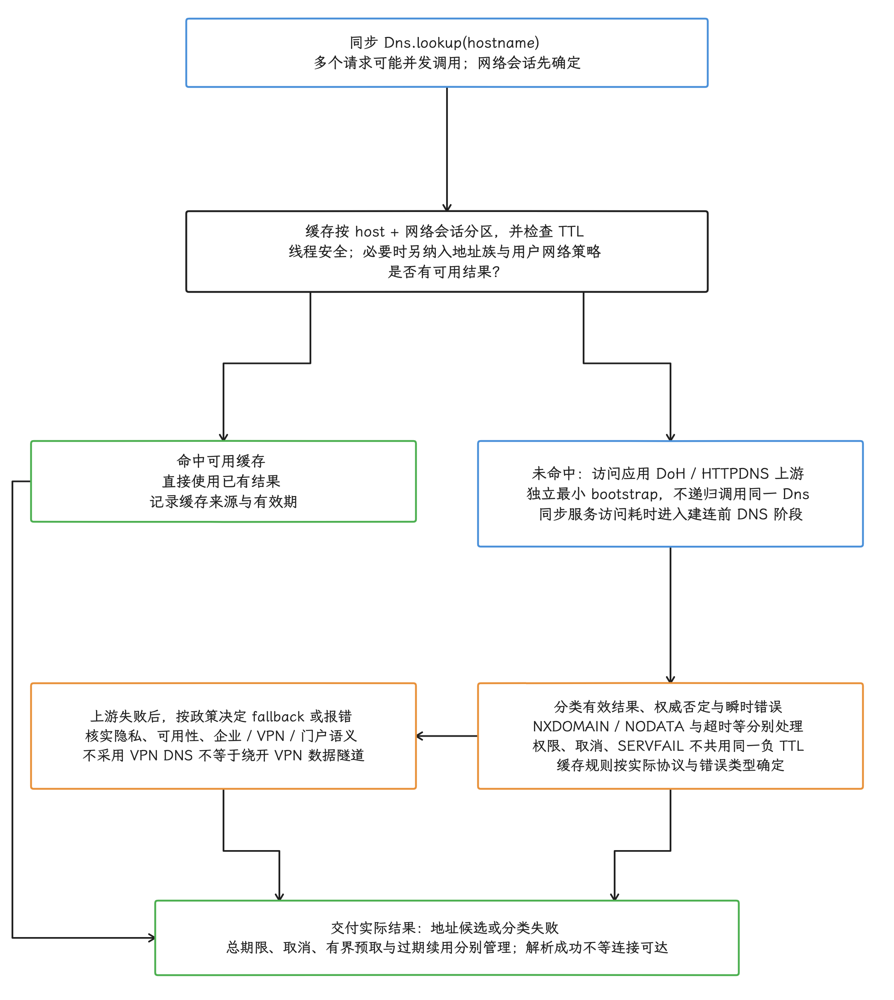

图：应用自定义解析的建议职责图：同步且可能并发的lookup先查按host/网络会话分区并检查TTL的线程安全缓存；miss才用独立最小bootstrap访问上游，不能递归调用同一Dns，同步上游耗时计入DNS。有效地址、NXDOMAIN/NODATA权威否定与超时/SERVFAIL/取消/权限等分类，不统一负缓存期限。失败后是否fallback取决于隐私、可用性、企业/VPN/门户策略，解析命名空间与VPN数据路由分别核查。按实际结果交地址或错误，总期限、取消、预取、有界过期续用和来源标记分别管理；不是完整可执行状态机，也不保证解析成功即connect成功。

使用解析得到的 IP 建立连接时，URL 仍应保留原始 hostname，让 TLS SNI（握手中携带的目标主机名）、证书主机名校验和 HTTP Host 保持一致。直接把 URL 改为 IP，再关闭主机名校验，属于安全缺陷。


连接池会改变 DNS 统计：已有连接直接可用时通常跳过 `lookup()`，但 OkHttp 5.3.0 为检查跨主机 HTTP/2 合并路由，也可能先解析再复用同一连接，所以“有 DNS 事件”推不出“必有新连接”。多地址的尝试与回退由连接策略决定。我们应联合 DNS、connect 与 connectionAcquired 记录来还原实际路径，完整规则见 12.1 与 24.7。

<!-- gracker-diagram: ch12-02-25-dns-before-coalescing -->
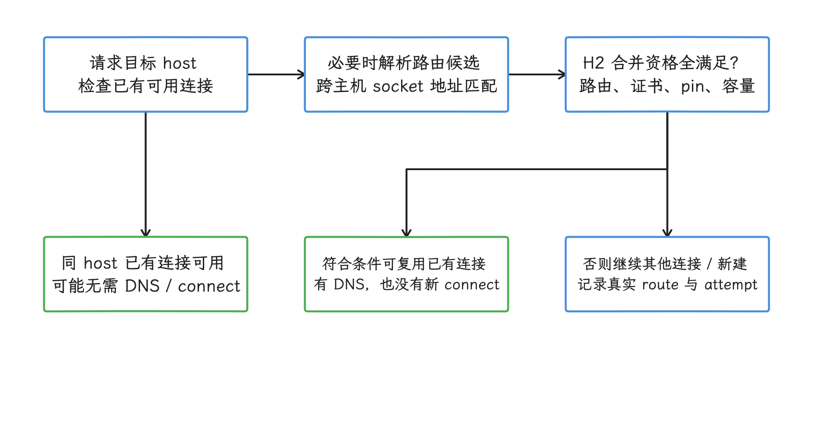

图：跨主机HTTP/2合并可能先解析路由，再判断已有连接是否可用。 固定OkHttp5.3.0；同host直接复用可跳过解析，但有DNS不能推出必然新connect，实际顺序以事件为准。

## 八、指标、日志与告警

### 8.1 分位数应服务于 SLO

中位数、p90、p95 和 p99 描述的是不同百分位的延迟，p90 表示 90% 的样本延迟不超过该值。分位数按业务请求量和 SLO（Service Level Objective，服务等级目标）来选；低流量域名的 p99 波动很大，固定套用只会制造噪声。聚合时至少要区分：

- 解析来源与缓存状态；
- 网络传输类型、VPN 和 Private DNS 状态；
- 冷启动、前后台与网络切换会话；
- A、AAAA、HTTPS 等查询类型；
- 成功、空结果、超时、取消和可获得的 rcode；
- DNS 结束后的 connect 成功、失败及地址族。

DNS 分位数以实际发生的解析事件为样本；未解析而复用连接的请求，我们把它记为阶段未发生，填 0 ms 会把它混进分布。另报 DNS 触发率、缓存命中率、样本数和失败率，避免仅用成功样本解释总体体验。“切网后故障”同样不套通用秒数：记录 `elapsed_since_default_network_change_ms`，按线上分布与期限划窗口，并分开复用与新连接。

<!-- gracker-diagram: ed12-02-upstream-samples-and-app-denominators -->
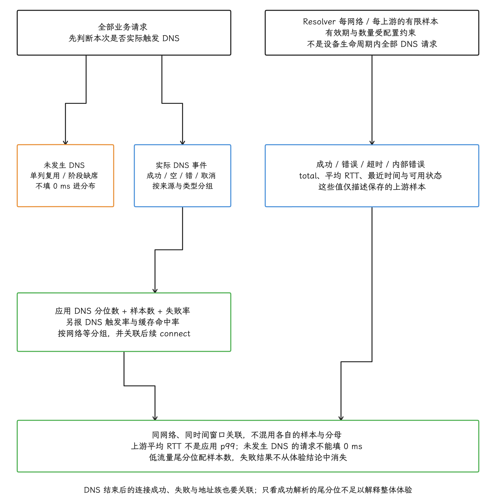

图：两类统计与业务发生率合图：resolver上游的total/成功错误超时/平均RTT描述受配置有效期和数量限制的保存样本，不是设备所有请求；应用DNS分布只以实际发生的解析事件为样本，未发生阶段单列而不填0ms。按来源/cache/Network/类型/结果分组，报告分位数、样本数和失败率，另报触发率与命中率并关联connect。系统和应用只在同网络同窗关联，不混分母；上游均值非应用p99，低流量尾分位配样本量，失败不能从整体体验结论中消失。

### 8.2 最小事件字段

一条解析事件可包含：

| 字段 | 用途 |
|---|---|
| `request_id` / `trace_id` | 与 connect、TLS、HTTP 阶段关联 |
| `network_session_id` | 区分切网前后的解析和连接 |
| `resolver_source` | system、HTTPDNS、app DoH、memory cache |
| `query_type` | A、AAAA、HTTPS 或组合查询 |
| `duration_ms` | 查询或缓存读取耗时 |
| `result_count` / `address_family` | 判断空结果与地址族变化 |
| `error_stage` / `error_class` / `rcode` | 在 API 能提供时区分失败 |
| `fallback_from` / `fallback_to` | 评估降级是否有效 |
| `connect_outcome` | 验证解析结果能否建立连接 |

完整 hostname、DNS server、返回 IP 和 provider name 都可能成为敏感网络信息。生产埋点可使用服务端分配的域名类别、受控 allowlist（明确允许采集的列表）、轮换 HMAC（使用定期更换的密钥生成消息认证码）或网段级分类；诊断包的访问权限、保留时间和导出范围也要受控。哈希前若候选域名很少，攻击者仍可能离线枚举并恢复原值，所以无盐散列算不上匿名化。


### 8.3 告警要能指向动作

| 告警信号 | 关联证据 | 可能的处置方向 |
|---|---|---|
| system DNS 超时上升 | 按网络和运营商分组的统计、resolver RTT、Private DNS 状态 | 核对特定网络或 provider |
| HTTPDNS fallback 上升 | HTTPDNS 服务耗时、bootstrap、缓存过期 | 隔离服务故障或调整预取 |
| DNS 正常但 connect 失败 | 返回地址族、目标 IP 分类、路由和连接池 | 检查地址可达性与旧连接 |
| 切网会话错误集中 | 网络变化间隔、缓存来源、连接是否复用 | 修正网络维度缓存或客户端生命周期 |
| 企业/VPN 用户异常 | VPN、代理、split DNS、应用 resolver 覆盖 | 缩小自定义解析范围 |


## 九、Tethering offload 与本机 DNS 路径的分工

硬件 tethering offload 加速的是下游设备经手机转发的 IP 流量，本机应用的 Java/NDK 名称查询不在其中；但热点 DNS 仍在排查范围内：下游客户端可能使用手机提供的 DNS 转发服务，也可能自行连接上游，固定 r1 同时可见 netd 的 legacy DNS proxy 配置和 IDnsResolver 的 `setDnsForwarding` 接口。具体路径取决于 Tethering 实现与配置，需与硬件数据转发分别核实。

反馈来自热点下游设备时，我们先判断失败发生于其自身解析、手机 DNS 转发、上游选择还是数据转发/NAT/offload，再沿实际路径取证；本机应用则从 Network、LinkProperties、resolver、应用缓存与连接池定位。两个场景可以共享上游故障，但它们是两条调用链，仅凭“都涉及 netd”套用同一条解释行不通。

<!-- gracker-diagram: ch12-02-29-tethering-dns-offload -->
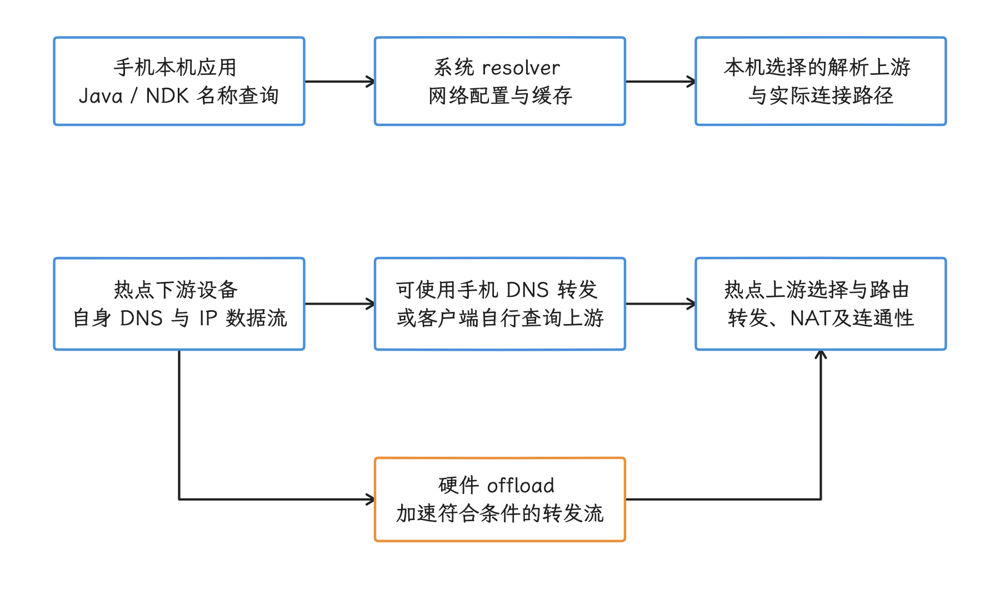

图：本机API解析与下游DNS转发、IP数据加速分别定位。 固定r1可见legacy DNS proxy和IDnsResolver转发接口，具体启用路径依Tethering配置；硬件offload不等于执行本机DNS查询。

## 小结

DNS 诊断以 `Network` 为主线串起证据链：`ConnectivityService` 协调网络生命周期，netd 管理平台内部网络，DNS Resolver 主线模块维护每个 `netId` 的配置、缓存和 Private DNS，应用网络库决定查询时机、连接复用与自定义解析策略。

排查时我们先确认请求是否发生 DNS，再记录对应的网络会话和解析来源；随后用客户端阶段事件、`dumpsys connectivity`、`dumpsys dnsresolver` 与脱敏 query log（查询日志）相互印证。HTTPDNS 或应用 DoH 能补充业务调度与安全策略，接入时仍要设计好 TTL、网络隔离、bootstrap、企业网络兼容和隐私保护。

## 参考资料

- [DNS Resolver 模块](https://source.android.com/docs/core/ota/modular-system/dns-resolver)
- [`DnsResolver` API 参考](https://developer.android.com/reference/android/net/DnsResolver)
- [`HttpsEndpoint` API 参考](https://developer.android.com/reference/android/net/dns/HttpsEndpoint)
- [Android 17 本地网络权限](https://developer.android.com/privacy-and-security/local-network-permission)
- [NDK Networking API](https://developer.android.com/ndk/reference/group/networking)
- [`DnsResolver.java`（Android 17）](https://android.googlesource.com/platform/packages/modules/Connectivity/+/android-17.0.0_r1/framework/src/android/net/DnsResolver.java)
- [`ConnectivityService.java`（Android 17）](https://android.googlesource.com/platform/packages/modules/Connectivity/+/android-17.0.0_r1/service/src/com/android/server/ConnectivityService.java)
- [`DnsManager.java`（Android 17）](https://android.googlesource.com/platform/packages/modules/Connectivity/+/android-17.0.0_r1/service/src/com/android/server/connectivity/DnsManager.java)
- [`NetworkDiagnostics.java`（Android 17）](https://android.googlesource.com/platform/packages/modules/Connectivity/+/android-17.0.0_r1/service/src/com/android/server/connectivity/NetworkDiagnostics.java)
- [`IDnsResolver.aidl`（Android 17）](https://android.googlesource.com/platform/packages/modules/DnsResolver/+/android-17.0.0_r1/binder/android/net/IDnsResolver.aidl)
- [`DnsResolverService.cpp`（Android 17）](https://android.googlesource.com/platform/packages/modules/DnsResolver/+/android-17.0.0_r1/DnsResolverService.cpp)
- [`ResolverController.cpp`（Android 17）](https://android.googlesource.com/platform/packages/modules/DnsResolver/+/android-17.0.0_r1/ResolverController.cpp)
- [`DnsQueryLog.cpp`（Android 17）](https://android.googlesource.com/platform/packages/modules/DnsResolver/+/android-17.0.0_r1/DnsQueryLog.cpp)
- [`PrivateDnsConfiguration.cpp`（Android 17）](https://android.googlesource.com/platform/packages/modules/DnsResolver/+/android-17.0.0_r1/PrivateDnsConfiguration.cpp)
- [`NetdNativeService.cpp`（Android 17）](https://android.googlesource.com/platform/system/netd/+/android-17.0.0_r1/server/NetdNativeService.cpp)
- [OkHttp `Dns.kt`（5.3.0）](https://github.com/square/okhttp/blob/parent-5.3.0/okhttp/src/commonJvmAndroid/kotlin/okhttp3/Dns.kt)
- [`HttpsEndpointAccumulator.java`（固定 r1，额外等待、回调与取消边界）](https://android.googlesource.com/platform/packages/modules/Connectivity/+/refs/tags/android-17.0.0_r1/framework/src/android/net/util/HttpsEndpointAccumulator.java)
- [`HttpsRecord` API](https://developer.android.com/reference/android/net/dns/HttpsRecord)
- [`DnsProxyListener.cpp`（固定 r1，查询 socket 与 querylog 范围）](https://android.googlesource.com/platform/packages/modules/DnsResolver/+/refs/tags/android-17.0.0_r1/DnsProxyListener.cpp)
- [`res_cache.cpp`（固定 r1，网络缓存与 mDNS 网络限制）](https://android.googlesource.com/platform/packages/modules/DnsResolver/+/refs/tags/android-17.0.0_r1/res_cache.cpp)
- [`LinkProperties` 公开 API](https://developer.android.com/reference/android/net/LinkProperties)
- [Tethering hardware offload](https://source.android.com/docs/core/data/tethering-offload)
