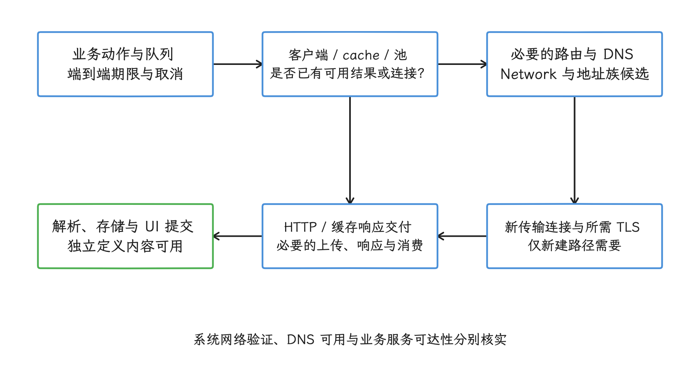
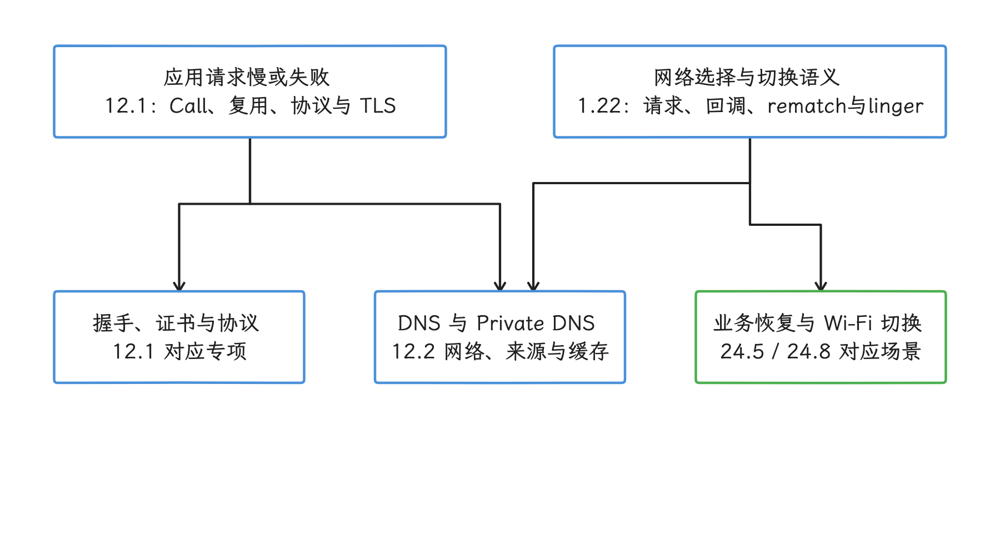
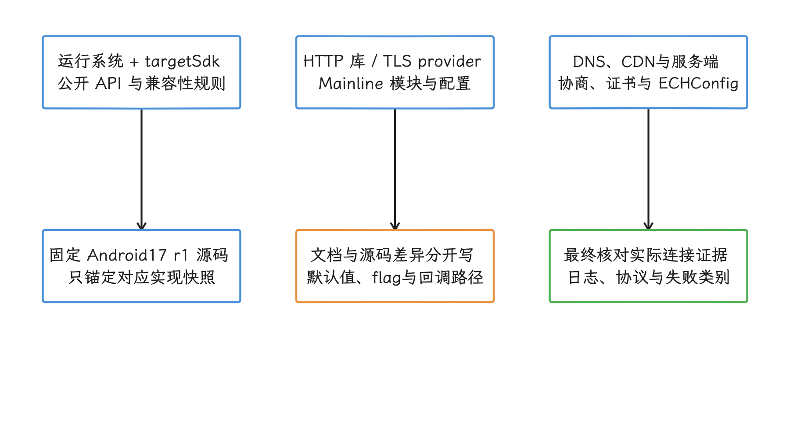

# 第 12 章：网络性能

本章讲 Android 应用网络请求的端到端成本：业务排队、必要的路由与 DNS 解析、新传输连接和 TLS 握手、HTTP 交换、响应消费与应用处理。缓存、连接复用、并行尝试和流式处理会让部分阶段跳过或交叠，不能把它们都画成固定串行耗时。系统侧还要区分 netd 的网络/路由管理与 DNS Resolver 的每网络配置、缓存和 Private DNS；网络选择与 NetworkCallback 语义见 [1.22](../../part1-fundamentals/ch01-architecture/22-connectivity-service.md)。

排查时先按阶段分析一次请求，再根据证据进入 TLS 或 DNS 专项。Wi-Fi 图标、系统网络验证、DNS 可用性和目标服务可达性分别代表不同状态，不能合并成一个“网络正常”或“网络异常”的结论。

<!-- gracker-diagram: ch12-index-01-request-stage-map -->

图：先看请求实际经历的阶段，再区分系统状态与业务端点可用性。 箭头表示依赖，非固定串行时长；连接复用与缓存可跳过新建阶段，流式处理可交叠，示意不声称性能收益。

## 章节地图

- [12.1 Android 网络与 TLS 性能优化](01-android-network-tls-performance.md)
- [12.2 netd 与 DnsResolver：DNS 解析性能和故障诊断](02-netd-dnsresolver-network-diagnostics.md)

## 阅读路径

### 应用网络性能排查

先读 12.1，建立请求阶段模型并确认连接是否复用，再处理 TLS 握手、证书链和信任配置；若问题集中在解析、Private DNS 或特定网络，继续阅读 12.2。

### 系统网络栈排查

先读 [1.22 Connectivity 服务、网络选择与回调](../../part1-fundamentals/ch01-architecture/22-connectivity-service.md)，确定 NetworkRequest、NetworkCallback、网络排序、rematch 和 linger 的语义，再用 12.2 检查 netd 路由与每网络 DNS。业务连接恢复与容灾见 [24.5](../../part5-app/ch24-io-network/05-mobile-network-connection-resilience.md)，Wi-Fi 网络选择与切换性能见 [24.8](../../part5-app/ch24-io-network/08-wifi-connectivity-selection.md)。

<!-- gracker-diagram: ch12-index-02-chapter-reading-map -->

图：应用请求先在12.1分段，系统选择先读1.22，再按证据进入DNS或恢复专项。 阅读分支不是故障根因断言；DNS、TLS与系统Network可能共同影响同一请求。

## 版本边界

各文以 Android 17 / API 37 / AOSP `android-17.0.0_r1` 为当前核验锚点，并分别说明适用范围。HTTP 客户端、TLS provider 与 Mainline 模块版本仍须单独记录；targetSdk、运行系统与服务端配置共同影响结果。12.1 已分别披露 ECH 当前文档与固定 r1 默认策略的差异，12.2 也区分普通查询与组合查询超时的回调路径。版本历史不能替代实际模块与连接证据，也不能用旧版网络分数或退出主路径的 API 推导当前行为。

<!-- gracker-diagram: ch12-index-03-network-version-boundaries -->

图：把系统与target、网络库和模块、DNS与服务端一起纳入证据。 固定r1用于源码核验，不能概括所有更新设备；ECH默认与组合查询线程差异见各专项，不凭版本号推断启用与成功。