# Android View 渲染管线与分析方法

遇到渲染问题，我们先确定 Producer、Surface、layer（合成图层）和合成位置，再沿具体线程与 fence（同步完成信号）往下分析。标准 View 管线在这里只充当分类基线，SurfaceView、TextureView、Flutter、Camera 和视频会改变其中若干节点。

> 源码基线：AOSP `android-17.0.0_r1`；内核 `android17-6.18-2026-06_r6`。

## 按 Producer、Surface 与合成位置分类

### 为什么需要理解渲染管线

Perfetto 里看到一帧超时，我们先回答三个问题，再去看各段 trace slice（追踪时间区间） 有多长。直接盯着最长的那段，容易把原因归到错误的阶段：

1. 谁在生产本帧 buffer（图像缓冲区）？
2. buffer 写入哪个 `Surface`，是否形成独立 layer？
3. 本帧在哪里合成，又在哪个时间边界完成 present（帧呈现）？

第一问的答案在 Producer 一侧。Producer 指生成并提交 buffer 的组件：标准 App Window 通常由 HWUI 的 RenderThread 生产 buffer，HWUI 也就是 Android 的硬件加速 UI 渲染器；SurfaceView、Camera、Video、WebView、Flutter、游戏和 React Native 则可能把生产工作交给引擎线程、解码器或硬件模块。BufferQueue 则架在 Producer 与读取 buffer 的 Consumer 之间，负责传递数据。

生产之外，系统侧还有三个角色：SurfaceFlinger（SF）组织各个 layer，HWC（Hardware Composer，硬件合成器）选择硬件合成路径，FrameTimeline 记录预期帧与实际帧的时间。不同出图类型在线程、layer 数量、合成位置与 FrameTimeline 覆盖程度上的差别，就是我们分类的起点。

`queueBuffer` 表示 Producer 把 buffer 交回队列，`latch`（采纳） 表示 SurfaceFlinger 在本轮采纳该 buffer，`present fence` 是显示管线完成本轮 present 后给出的同步信号。这三个事件各自只说明显示路径走到了对应位置；要还原整帧，我们还得把其他阶段的记录串起来。本节先明确公共主线，后续章节再解释各出图类型从哪里分开。分析走到 dma-buf（跨设备共享 buffer 的内核机制）、sync_file（把同步 fence 暴露为文件描述符的接口）、DRM/KMS（内核显示与模式设置子系统） 或调度器实现时，我们统一回到导语里的内核基线核对；Framework 结论不依靠某个单独的 kernel 函数推导。

<!-- gracker-diagram: ch13-01-02-three-boundaries -->
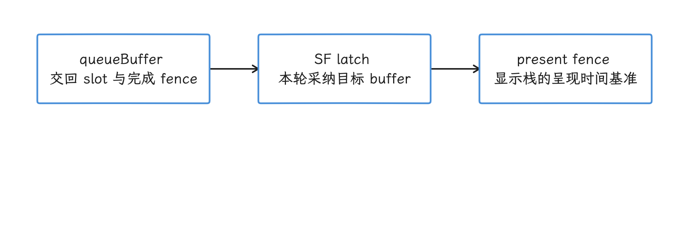

图：沿提交、采纳与显示反馈追踪同一帧。 提交与 latch 均不能代替 GPU 完成或光学测量。

### 用四个坐标识别出图类型

框架名称在这里帮不上忙：`SurfaceView`、`TextureView`、WebView、Flutter 和 Compose 都是 API 或框架名称，单凭名称还确定不了 trace 里的图形路径。同一个 Flutter 页面可能用 `SurfaceView` 或 `TextureView` 作宿主，嵌入的 Platform View（嵌入 Flutter 的原生平台视图） 还会改变 layer 拓扑；同一个播放器也可能在普通 BufferQueue、SurfaceView 独立 layer 与 tunneled/sideband（绕开普通 buffer 队列的专用媒体路径） 之间切换。

所以每次分析，我们先固定四个坐标：

| 坐标 | 要确认的对象 | Trace 或源码证据 |
|---|---|---|
| Producer | HWUI RenderThread、GL/Vulkan thread、Chromium、Flutter raster thread（光栅化线程）、Camera HAL（相机硬件抽象层）、MediaCodec、游戏引擎或其他模块 | 线程 slice、GPU submission（命令提交）、decoder/camera 事件 |
| 输出目标 | App Window、独立 `Surface`、`SurfaceTexture`、swapchain（轮换使用的一组可显示 buffer）、离屏 `HardwareBuffer` 或 sideband stream | BufferQueue、ANativeWindow（NDK 窗口接口）、SurfaceControl、layer dump |
| layer 拓扑 | 内容进入宿主窗口，还是形成一个或多个独立 child layer | layer parent、relative layer、Z-order（前后叠放顺序）、`BufferTX` |
| 合成与 present | 宿主 HWUI 采样、SurfaceFlinger CLIENT composition（用 GPU 合成）、HWC DEVICE composition（由显示硬件合成）或专用媒体路径 | RenderEngine（SurfaceFlinger 的 GPU 合成引擎）、composition type、HWC、present fence |

线程名只说明某段代码在哪条线程执行。确认渲染类型时，我们还要用对象标识把线程、swapchain/BufferQueue、SurfaceControl 和目标 layer 对到同一条路径：看到 `GLThread`，要再确认它是否写入独立 layer；看到 `SurfaceView` 对象，要再确认本帧是否被 HWC 作为 overlay（独立硬件图层） 处理。

<!-- gracker-diagram: ch13-01-01-four-coordinates -->
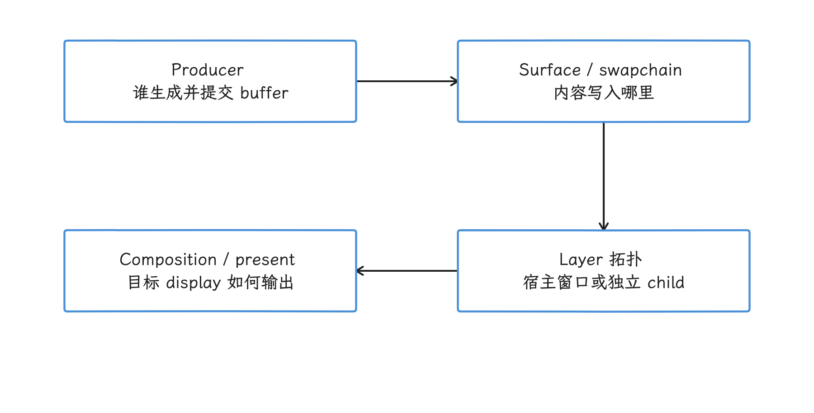

图：先对应 Producer、输出目标、Layer 拓扑与合成结果。 框架名和线程名只提供候选，最终用对象标识验证。

### 版本与架构对照表

Android 9 到 Android 17 的图形栈，用“Legacy”与“BLAST”二分来讲太粗了。对 trace 更有帮助的写法，是逐版本标出可以用哪些对象和观测方法：BLAST 指协调窗口 buffer 更新与 `SurfaceControl.Transaction` 提交的机制，Legacy 是对更早 BufferQueue/layer 路径的概括称呼。

| 平台 | 公共显示主线 | Trace 判读要点 |
|---|---|---|
| Android 9 / API 28 | App Window 常见传统 BufferQueue producer/consumer 路径 | 不应期待 BLAST 或 FrameTimeline；以 `Choreographer`、HWUI、`queueBuffer`、SF/HWC slice 为主 |
| Android 10 / API 29 | `SurfaceControl.Transaction` 能力扩展，该 tag 的 libgui 尚无 BLASTBufferQueue，App Window 按当时 BufferQueue 路径分析 | 不要只凭系统版本断定采用 BLAST，要以进程内对象和 trace 为证 |
| Android 11 / API 30 | BLAST 进入平台主线，窗口 buffer 与 layer transaction 的组织方式开始改变 | 旧资料中的 `BufferStateLayer` 只适合对应旧源码 tag，不能拿来解释 Android 17 的 FrontEnd（layer 状态处理阶段） |
| Android 12 / API 31 | BLAST 与 FrameTimeline 构成现代 trace 基线 | 标准 App Window 可用 SurfaceFrame/DisplayFrame token（跨阶段关联一帧的标识）对齐；独立 Surface 仍需 layer、BufferQueue 与 fence 证据 |
| Android 13 / API 33 | `AutoSingleLayer` 下的 latch-unsignaled 策略成为重要边界 | acquire fence 尚未 signal（发出完成信号）时，transaction 也不再必定无法 latch；硬件读取仍要遵守同步约束 |
| Android 14 / API 34 | 公共 Choreographer→HWUI→BLAST→SF→HWC 骨架延续；SurfaceView 增加 alpha 与 lifecycle 能力 | 标准窗口仍按公共主线读，独立 Surface 的透明度与生命周期要单独核对 |
| Android 15 / API 35 | Window/SurfaceView 源码与 API 面开始提供 desired HDR headroom（SDR 白场以上的 HDR 亮度余量），r1 中仍带 feature flag 边界 | headroom 只是请求；还要核对目标设备的 feature flag（功能开关）、bit depth（色深）、面板与显示策略 |
| Android 16 / API 36 | SurfaceView 源码增加整数 `compositionOrder`，r1 API 签名带 `@FlaggedApi`；公共主线延续 | 多 Surface 页面要记录 parent、relative layer、flag 状态与 Z-order |
| Android 17 / API 37 | 锚定 FrontEnd `RequestedLayerState` / `LayerSnapshot`、预测 present time、现行 BLAST/HWC 路径；SurfaceView blur region 与 `compositionOrder` 仍带 flag 边界 | 源码按 `android-17.0.0_r1` 的对象名解释；旧 `DispSync`、固定 phase offset（相位偏移）和逐个旧 Layer latch 模型不能直接套用 |

这张表列出的是各版本的观测方法差异；图形栈并没有每个版本重做一套，BLAST 改变的是 buffer 与窗口状态进入 SurfaceFlinger 的组织方式，Producer/Consumer 分工和 acquire/release fence 仍然存在。 历史边界分别核对 [Android 10 libgui 目录](https://android.googlesource.com/platform/frameworks/native/+/android-10.0.0_r1/libs/gui/)、[Android 11 BLAST](https://android.googlesource.com/platform/frameworks/native/+/android-11.0.0_r1/libs/gui/BLASTBufferQueue.cpp)、[Android 13 默认 latch 策略](https://android.googlesource.com/platform/frameworks/native/+/android-13.0.0_r1/services/surfaceflinger/SurfaceFlinger.cpp) 与 [当前 SurfaceView](https://android.googlesource.com/platform/frameworks/base/+/android-17.0.0_r1/core/java/android/view/SurfaceView.java)；默认值仍可被设备配置覆盖。

<!-- gracker-diagram: ch13-01-03-version-evidence -->
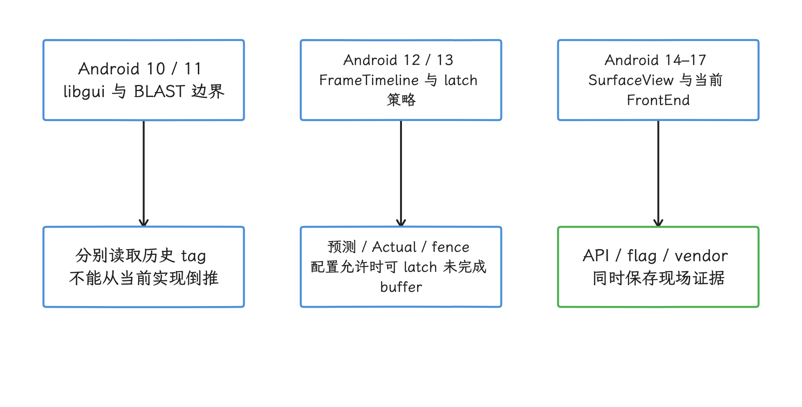

图：历史 tag、当前对象名和设备配置分别核对。 默认值与源码注解不能代替目标设备的开关值。

### 典型模式对比

把四个坐标套到常见页面上，就得到下面的主干模式；每一行还标注了这类模式容易误判的点：

<!-- gracker-diagram: ch13-01-04-host-or-child -->
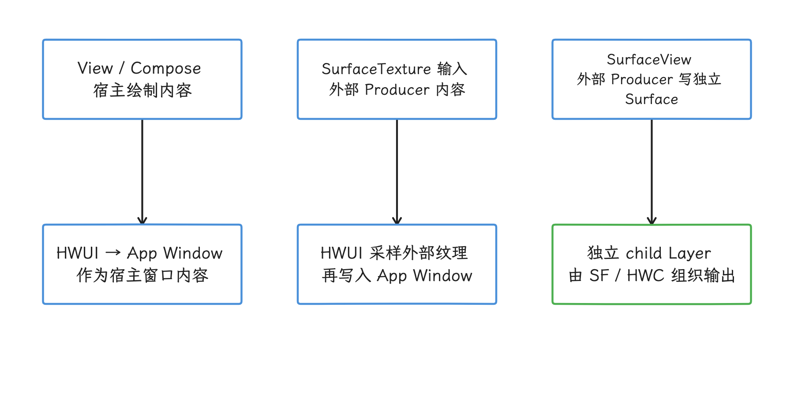

图：标准 UI、TextureView 与 SurfaceView 的合成位置不同。 独立 Layer 不保证 overlay；纹理采样不等于固定 CPU 拷贝。

| 模式与章节 | Producer 与输出对象 | 合成位置 | 容易误判的点 |
|---|---|---|---|
| 标准 Android View<br>本篇 | MainThread 准备状态，HWUI RenderThread/GPU 产出<br>→ 宿主 App Window | SF 选择 DEVICE 或 CLIENT | MainThread `draw()` 结束不等于 buffer 已提交 |
| Software / 离屏<br>[13.2](02-android-software-offscreen-mixed-rendering.md)、[13.6](06-surfacecontrol-hardwarebuffer-renderer.md) | `lockCanvas()` 线程、CPU raster（CPU 光栅化）或离屏 GPU<br>→ 可见 Surface 或离屏 buffer | 可见目标进入 SF/HWC；离屏目标由下游消费 | “软件绘制”不等于没有 BufferQueue；离屏完成 fence 也不是 present fence |
| 混合渲染<br>[13.2](02-android-software-offscreen-mixed-rendering.md) | 宿主 HWUI + 一个或多个独立 Producer<br>→ App Window 与 child layer 并存 | SF/HWC 合成多个 layer | 不能用宿主窗口一条 FrameTimeline 代表所有独立 Surface |
| 多窗口<br>[2.14](../../part1-fundamentals/ch02-rendering/14-multiwindow-desktop-rendering.md) | 每个 Window 各有 ViewRoot/Surface；线程可能同进程共享，也可能跨进程<br>→ 多个 Window layer | 每个 display 分别组织输出 | “多窗口必定同一主线程串行”只适用于部分同进程场景 |
| SurfaceView<br>[13.3](03-surfaceview-textureview-pipelines.md) | 解码器、Camera、GL/Vulkan 或其他 Producer<br>→ 独立 child Surface/layer | 常由 SF/HWC 与宿主拼层 | 独立 layer 有利于 overlay，但不保证低延迟或 DEVICE composition |
| TextureView<br>[13.3](03-surfaceview-textureview-pipelines.md) | 外部 Producer 写入 `SurfaceTexture`<br>→ 内容作为纹理进入宿主 View 树 | 宿主 HWUI 再采样到 App Window | 成本是额外采样/宿主合成，不宜笼统写成固定 CPU 拷贝 |
| OpenGL ES<br>[13.4](04-opengl-egl-angle.md) | GL thread / engine thread<br>→ EGL window surface（EGL 的可显示窗口目标）对应 BufferQueue | SF/HWC | `eglSwapBuffers()` 返回不代表 GPU 写完或已经 present |
| Vulkan<br>[13.5](05-vulkan-hwui-multi-queue.md) | engine/render thread<br>→ `VkSwapchainKHR` 对接 ANativeWindow | SF/HWC | 显式 API 可以降低部分 driver 开销，但 CPU 成本取决于引擎、同步和驱动 |
| WebView<br>[13.9](09-webview-rendering.md) | Chromium renderer/compositor、Viz（Chromium 的显示合成服务）与宿主进程协作<br>→ Chromium surface 与宿主窗口组合，具体拓扑依实现而定 | Chromium 合成后进入 Android 显示链 | 只看 App MainThread 会漏掉 renderer/GPU 进程 |
| Flutter<br>[13.7](07-flutter-rendering-pipeline.md) | UI/raster/platform thread 与 Impeller/Skia 渲染后端<br>→ 宿主可用 SurfaceView 或 TextureView；Platform View 再增加分支 | 宿主 layer 与 Platform View 共同进入 SF/HWC | 框架名不能确定宿主 render mode（渲染承载方式），线程组织还随 Flutter/Engine 版本变化 |
| Camera<br>[13.10](10-camera-pipeline.md) | Camera HAL、ISP（图像信号处理器）与应用/系统消费者<br>→ 预览 Surface、ImageReader、编码器等多消费者 | 预览常通过独立 layer 参与合成 | request/result 完成不等于预览已 present |
| Video / HWC<br>[13.11](11-video-overlay-media3-codec-pipeline.md) | MediaCodec、解码器、播放器<br>→ SurfaceView buffer queue 或 tunneled/sideband 路径 | HWC overlay、专用媒体路径或 CLIENT fallback | 解码完成、releaseOutputBuffer 与上屏时间不是同一边界 |
| 游戏引擎<br>[13.12](12-game-engine.md) | game/render thread、GL/Vulkan queue<br>→ ANativeWindow swapchain，可能叠加独立 UI/video layer | SF/HWC | 平均 FPS 会掩盖 frame pacing（帧输出节奏）、queue depth（排队帧数）与 present 抖动 |
| Compose<br>[13.8](08-compose-rendering-pipeline.md) | Compose runtime 与 UI thread 生成状态，HWUI RenderThread/GPU 产出<br>→ 默认仍是宿主 App Window | SF/HWC | recomposition（重组）、layout、draw 与 GPU 提交属于不同阶段 |
| React Native<br>这里只给分型基线 | JS、Fabric（新架构 UI 渲染系统）、HWUI；第三方原生组件可另建 Surface<br>→ 标准 View 树或 SurfaceView/TextureView 分支 | 取决于宿主与原生组件拓扑 | JS thread 只是 Producer 路径的一段，不能代表 present |

[13.6 SurfaceControl 与 HardwareBufferRenderer](06-surfacecontrol-hardwarebuffer-renderer.md) 与 [13.4 OpenGL ES、EGL 与 ANGLE](04-opengl-egl-angle.md) 分别解释 layer 控制和 GLES→Vulkan 翻译。[2.14 多窗口、PiP 与桌面模式渲染管线](../../part1-fundamentals/ch02-rendering/14-multiwindow-desktop-rendering.md)、[2.2 帧率、刷新率与显示模式选择](../../part1-fundamentals/ch02-rendering/02-framerate-refresh-display-mode.md)、[13.13 Android 17 / Android XR 空间 UI 与环境资产渲染性能](13-android-xr-spatial-ui-rendering.md) 继续分析 window/display 分支。本节后半给出所有路径共用的证据收集步骤。

#### 快速识别当前管线

<!-- gracker-diagram: ch13-01-05-producer-roles -->
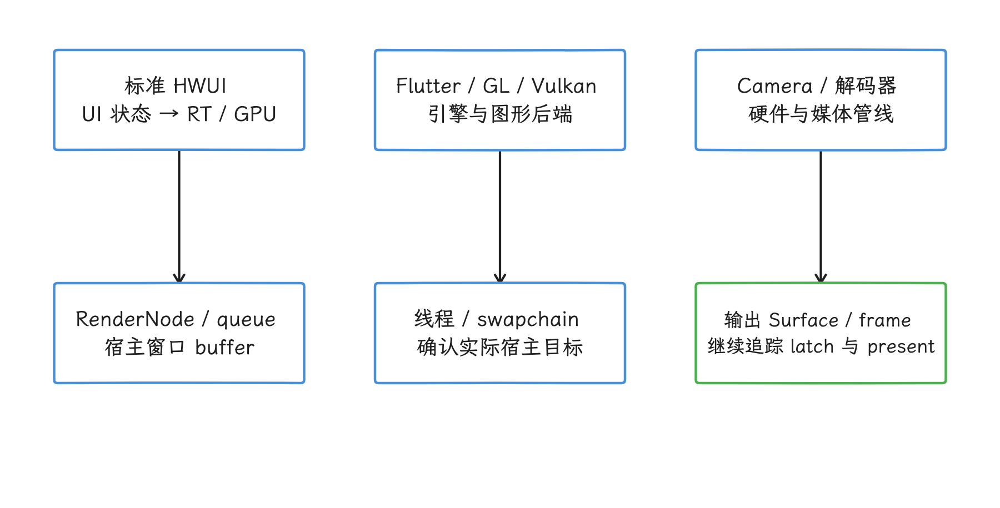

图：不同 Producer 要追踪各自的提交和完成证据。 这些是角色，物理线程和宿主形式取决于实际版本与配置。

一段 trace 可以先做四项检查：

1. 找到目标 Window、Surface 和 layer，确认是一层还是多层。
2. 找到 Producer：MainThread/RenderThread、GL/Vulkan thread、解码器、Camera、Chromium、Flutter raster thread 或其他引擎线程。
3. 确认提交点：`queueBuffer`、BLAST buffer transaction、SurfaceControl transaction（图层状态更新） 或硬件模块输出。
4. 确认合成与显示：latch、composition type（合成类型）、RenderEngine、HWC、FrameTimeline 和 present feedback（显示结果反馈）。

这四项检查做完，当前管线基本就能定下来。线程名在其中只提供线索，最终仍要以线程、队列与目标 layer 的对象对应为准。

<!-- gracker-diagram: ch13-01-06-identify-path -->
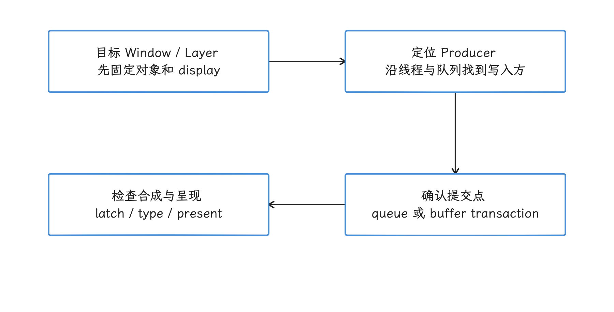

图：按目标对象、Producer、提交点和输出结果依次确认。 多窗口、多 Layer 与多个 display 必须分别对应。

### 阅读路径

App 滑动卡顿从本篇开始；有视频、地图或相机预览时，再读 [13.2 Android 软件、离屏与混合渲染路径](02-android-software-offscreen-mixed-rendering.md) 和 [13.3 SurfaceView 与 TextureView 渲染管线](03-surfaceview-textureview-pipelines.md)。

音视频开发者可以按 [13.11 视频 Overlay、Media3 与专业编解码管线](11-video-overlay-media3-codec-pipeline.md) → [2.2 帧率、刷新率与显示模式选择](../../part1-fundamentals/ch02-rendering/02-framerate-refresh-display-mode.md) 阅读。播放器卡顿只查刷新率往往不够，还要对齐解码输出、buffer timestamp（内容时间戳）、acquire fence、latch 和 present。

游戏与自研引擎可以按 [13.4 OpenGL ES、EGL 与 ANGLE](04-opengl-egl-angle.md) / [13.5 Vulkan 原生管线与 HWUI 多队列](05-vulkan-hwui-multi-queue.md) → [13.12 Android 17 游戏引擎渲染链路](12-game-engine.md) → 本节的分析方法阅读。要同时观察 game/render thread、GPU queue、swapchain 深度、FrameTimeline、Game Mode 与温控。

Framework 工程师可先读前面的公共主线，再看 [13.6 SurfaceControl 与 HardwareBufferRenderer](06-surfacecontrol-hardwarebuffer-renderer.md)、[2.2 帧率、刷新率与显示模式选择](../../part1-fundamentals/ch02-rendering/02-framerate-refresh-display-mode.md) 和 [13.5 Vulkan 原生管线与 HWUI 多队列](05-vulkan-hwui-multi-queue.md)。遇到 vendor（设备或芯片厂商） 显示问题时，还要补充 Composer HAL、display driver（显示驱动） 和面板证据。

### 公共主线：十二个检查点

不同 Producer 的路径要放到同一组检查点上比较，先需要一个公共骨架。标准 App Window 可以压缩为十二个检查点：

`vsync-app → doFrame → syncAndDrawFrame → dequeueBuffer → GPU submit → queueBuffer → BLAST transaction → SF snapshot/latch → HWC strategy → 可选 CLIENT composition → present → present feedback`

这十二个点只是跨路径的坐标：实际动作未必同步、依次执行，特殊 Producer 也未必具备完整的 HWUI slice。标准 View 的逐调用链解释放在后文；这里只保留比较不同 Producer 所需的公共检查点。

<!-- gracker-diagram: ch13-01-07-public-app-half -->
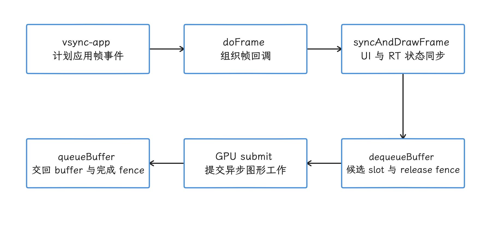

图：把应用调度、UI 同步与 buffer 生产放到同一组坐标中。 这是观察坐标，异步工作可以重叠；非 HWUI 路径可替换节点。

| 检查点 | 先回答的问题 | 不能据此断言 |
| --- | --- | --- |
| `vsync-app` | 应用何时被计划唤醒 | 目标进程已经运行 |
| `doFrame` | 哪类 callback（帧回调）或前序消息占用预算 | GPU 一定正常或异常 |
| `syncAndDrawFrame` | UI 状态何时交给 RenderThread | buffer 已提交或显示 |
| `dequeueBuffer` | Producer 是否拿到候选 slot（缓冲区槽位）及其 release fence | 等待一定由 buffer 数不足造成 |
| GPU submit | 命令何时进入 GPU queue | submit 返回即 GPU 完成 |
| `queueBuffer` | slot、元数据和 production fence（Producer 完成写入的同步信号）何时交回 | SF 已采纳像素 |
| BLAST / `BufferTX` | buffer update 是否到达 SurfaceFlinger 进程 | acquire fence 已满足 |
| snapshot / latch | 本轮采纳哪个 layer 状态和 buffer | Android 13+ 的 buffer 已可读 |
| HWC strategy | 本帧采用哪种 composition type | 结果由 API 名称固定决定 |
| CLIENT composition | RenderEngine 是否生成 client target（GPU 合成后的显示目标） | App shader（着色器）是回退根因 |
| present / release | HWC 何时接收输出、何时归还 layer buffer | panel（物理显示面板）已完成光学响应 |
| present feedback | display 到达 Android 可观测显示边界 | 单个 layer 的 release 时间 |

<!-- gracker-diagram: ch13-01-08-public-system-half -->
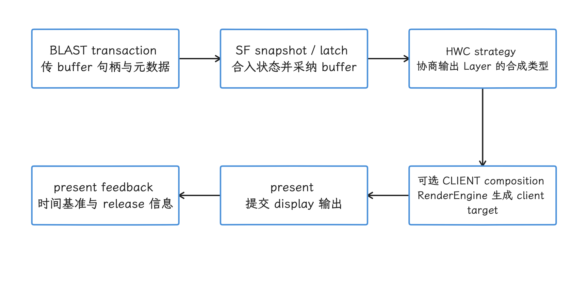

图：从 BLAST 事务继续追踪目标 display 的显示结果。 CLIENT 合成可选，presentOrValidate 可能提前完成 present。

### 统一分析方法

分清类型只是第一步；要定位一帧的问题，还得把观察、关联和结论分开，落到可核对的对象上。

#### 先区分事实、关联与结论

| 层次 | 示例 | 是否足以确认根因 |
| --- | --- | --- |
| 观察事实 | `dequeueBuffer` 持续 8 ms；目标 layer 为 CLIENT | 否 |
| 时间关联 | 等待与上一帧 release fence 较晚发出 signal 的时段重合 | 还要核对对象 |
| 因果结论 | 同一队列无可复用 slot，因为 HWC 延迟归还上一轮 buffer | 是，但必须有队列、fence 和 layer 证据 |

“同一时间发生”未必就是“前者导致后者”。对象身份没对上时，长 slice 只能列为候选。

<!-- gracker-diagram: ch13-01-09-evidence-strength -->
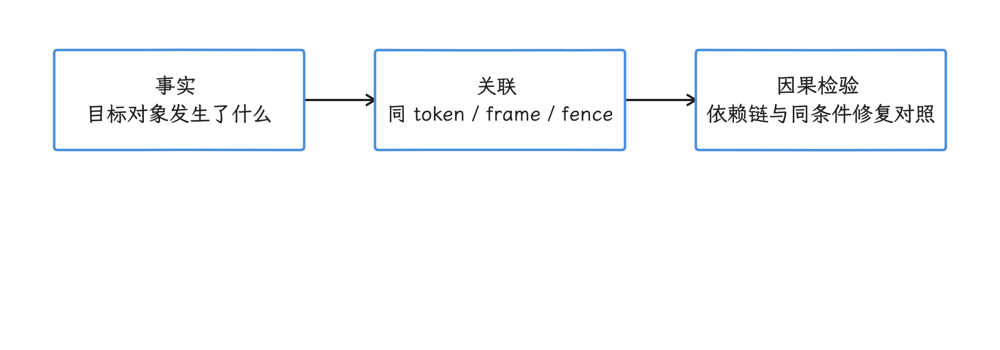

图：先记录观测事实，再建立同帧关联，最后检验原因。 时间接近或单一 jank 分类不能独立证明根因。

#### Step 1：锁定对象与路径

先建立一张对象记录表：

| 字段 | 用途 |
| --- | --- |
| package、UID、PID、关键 TID | 用应用包名、UID（应用身份标识）、PID（进程 ID）和 TID（线程 ID）锁定 Producer 与线程 |
| displayId、mode、刷新率 | 区分内外屏、虚拟显示和显示模式切换 |
| Window、Surface、layer id | 对齐 WindowManagerService（WMS）、SurfaceFlinger（SF）、Perfetto 与 Winscope（窗口和图层检查工具） |
| parent、Z-order | 确认宿主内容和独立 child layer |
| BufferQueue / BLAST | 对齐 dequeue、queue 与 `BufferTX` |
| surface/display token | 对齐 App SurfaceFrame 与 SF DisplayFrame |
| 输入动作与时间窗 | 锁定用户看到的目标帧 |

控件或框架名只能给出候选；要定案，我们还得用 Producer、输出 `Surface`、layer 拓扑和合成结果来验证。

<!-- gracker-diagram: ch13-01-10-object-identity -->
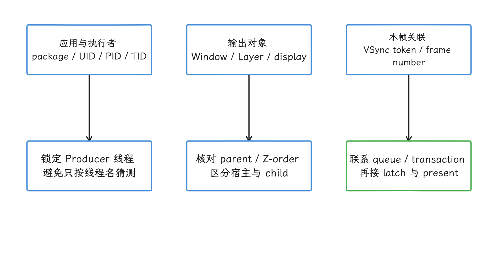

图：先把应用、图层和帧记录对应到同一条显示路径。 PID、Layer、token 与 frame number 各有作用域，不能互换。

#### Step 2：记录 Producer、Consumer 与 fence 的关系

| 路径 | Producer | 第一接收点 | SF 主要对象 |
| --- | --- | --- | --- |
| 标准 View / Compose | HWUI RenderThread / GPU | 应用进程内 BLAST | 宿主窗口 transaction |
| SurfaceView | codec、Camera、GL/Vulkan 等 | 独立 Surface Consumer（接收 buffer 的组件） | 独立 child layer |
| TextureView | codec、Camera、GL | App 内 `SurfaceTexture` | HWUI 采样后的宿主窗口 |
| WebView | Chromium 与宿主 HWUI | functor（把 Chromium 绘制接入 HWUI 的桥接对象）或 child Surface | 以现场拓扑为准 |
| HardwareBufferRenderer | HWUI RenderThread / GPU | 调用方 `HardwareBuffer` | 调用方提交后才送显 |

三类 fence 各回答一个问题：acquire fence 说明“buffer 何时可读”，release fence 说明“buffer 何时可复用”，present fence 说明“本轮 Display 何时到达显示边界”。顺着这组关系，我们把两类常见现象分开查：`dequeueBuffer` 长时间等待时，检查同一队列的可用 slot、Consumer 持有量和上一轮 release；`BufferTX` 积压时，检查 transaction readiness（事务是否满足处理条件）、acquire 的状态，以及 buffer 最终被 latch 还是 drop（丢弃）。增加队列深度可能增加 buffer 内存占用，并在实际排队变深时增加延迟；仅提高上限不保证二者都会增加，不能把它当成默认修复。

<!-- gracker-diagram: ch13-01-11-fence-roles -->
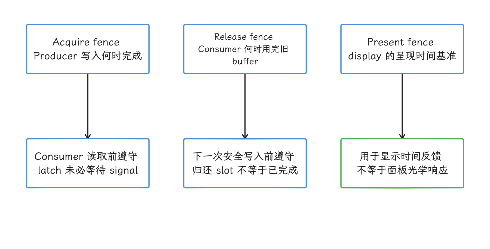

图：三个同步边界分别说明可读、可复用与显示呈现。 FREE slot 可携带未完成 release fence，present 不能替代 release。

API 37 的 `Surface.isProducerThrottlingEnabled()` 查询 EGL/Vulkan Producer 的 CPU throttling 配置；它本身不能证明当前调用确实发生背压。`setProducerThrottlingEnabled(false)` 关闭 queue/present 侧的这一类节流，不改变帧率投票，也不消除 dequeue 或 swapchain acquire 的正常同步等待。Android 17 r1 中这组 API 带 `bq_producer_backpressure_control` flag；异步模式始终启用此节流，设置无效。

<!-- gracker-diagram: ch13-01-12-producer-throttle -->
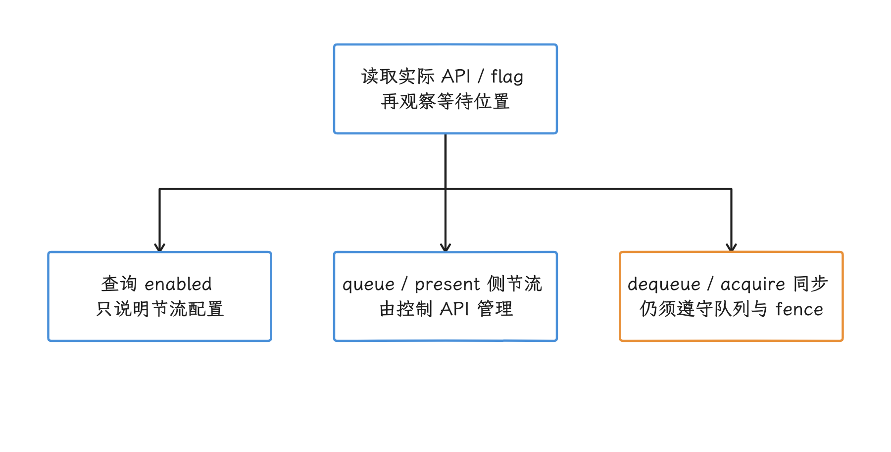

图：配置查询、queue 侧节流与 dequeue 同步分别核对。 固定 r1 有 flag 边界；异步模式设置无效，关闭不改变帧率投票。

#### Step 3：对齐同一帧

采集 trace 时，要覆盖目标 App、SF、`system_server` 和上游 Producer 的线程调度，以及 gfx/view/wm 图形类别、FrameTimeline、BufferQueue/SF、GPU 与设备可提供的 HWC/Display 轨迹；layer 层级和 transaction 变化可配合 Winscope 检查。

| 轨道 | 重点 |
| --- | --- |
| App / RenderThread / 引擎 | `doFrame`、draw、dequeue/queue、GPU submit |
| codec / Camera / Chromium / Flutter | 非标准 Producer 的节奏 |
| BufferQueue / BLAST | queue 周转、transaction、`BufferTX` |
| SurfaceFlinger | transaction、snapshot/latch、RenderEngine |
| FrameTimeline | expected/actual（预期/实际时间）、surface/display token、jank type（卡顿类型） |
| GPU / HWC / Display | 异步执行、composition type 与 present |

我们按“锁定 token（跨阶段关联帧记录的标识）/layer → 帧开始 → CPU/GPU 生产 → transaction 到达 → acquire/latch → SF/HWC/present → 上一帧 release”的顺序复原路径。相邻帧会重叠，只看时间是否接近，容易把对象配错。

下面的 Perfetto SQL 用于找出目标进程中带有 jank 标记的实际帧，并用 surface token 关联对应的预期帧：

```sql
INCLUDE PERFETTO MODULE android.frames.timeline;

WITH expected_unique AS (
  SELECT upid, surface_frame_token,
         MIN(id) AS expected_id, MIN(ts) AS expected_ts,
         MIN(dur) AS expected_dur
  FROM expected_frame_timeline_slice
  WHERE surface_frame_token IS NOT NULL
  GROUP BY upid, surface_frame_token
  HAVING COUNT(*) = 1 AND MIN(dur) >= 0
)
SELECT p.name AS process_name, a.id AS actual_id, a.layer_name,
       a.surface_frame_token, a.display_frame_token,
       e.expected_id, e.expected_ts, e.expected_dur,
       a.ts AS actual_ts, a.dur AS actual_dur,
       a.jank_type, a.present_type, a.on_time_finish
FROM actual_frame_timeline_slice AS a
JOIN process AS p ON a.upid = p.upid
LEFT JOIN expected_unique AS e
  ON a.upid = e.upid
 AND a.surface_frame_token = e.surface_frame_token
WHERE p.name = 'com.example.app'
  AND a.surface_frame_token IS NOT NULL
  AND a.layer_name IS NOT NULL
  AND a.dur >= 0
  AND a.jank_type IS NOT NULL AND a.jank_type != 'None'
ORDER BY a.ts DESC
LIMIT 20;
```

这里按 Actual id 保留完整记录。固定 r1 的 [Perfetto 解析器](https://android.googlesource.com/platform/external/perfetto/+/android-17.0.0_r1/src/trace_processor/importers/proto/frame_timeline_event_parser.cc) 按 `upid + surface_frame_token` 只保留一份 Expected，因为共享该 token 的工作使用同一预测；Expected 的 Layer 名可能仅属于最先出现的 Layer，不能强制与每条 Actual 的 Layer 相等。查询仅在该进程/token 有恰好一条完整 Expected 时关联；`expected_id` 为 NULL 表示缺失、未结束或异常重复。带 jank 分类的记录也可能是 Buffer Stuffing 等类型，不都意味着 Late Present。独立 Surface 缺少完整 App FrameTimeline 时，回到 Producer、BufferQueue、layer、fence 和 present。

<!-- gracker-diagram: ch13-01-13-frame-join -->
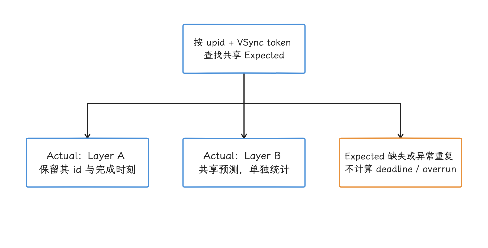

图：Expected 以进程/token 关联，Actual 保留独立 id 和 Layer。 固定 r1 解析器会去重 Expected；不能强制两边 Layer 相等。

#### Step 4：按证据模式归因

| 模式 | 主要证据 | 不能直接推断 |
| --- | --- | --- |
| 主线程 / RenderThread CPU 重 | expected/actual 与明确 CPU 子段一致 | 整段 wall time（实际经过时间）都是 GPU |
| App GPU 晚完成 | submit 不晚，GPU stage（执行阶段）或 acquire readiness（可读取条件）较晚 | `queueBuffer` 返回等于完成 |
| Buffer 队列阻塞 | dequeue 与同队列 release/Consumer 对上 | 只需增加 buffer |
| Producer 抖动 | codec/Camera/引擎 cadence（输出间隔）不稳 | SF 复用旧 buffer 就是 SF 卡顿 |
| SF CPU/GPU 超预算 | SF actual、CPU/GPU 与 jank type 相互印证 | SF actual 全属主线程 CPU |
| HWC 路径变化 | composition type、client target、GPU/功耗同变 | SurfaceView 必然获得 DEVICE |
| 显示后段延迟 | App、latch、composition 按时，present 晚 | framework trace 覆盖面板响应 |
| VRR 口径错误 | 内容帧率、render rate、refresh rate 不一致 | 固定 16.6 ms 适合所有模式 |

帧率、端到端延迟和功耗要分别记录。队列更深可能让吞吐稳定但交互更慢；CLIENT composition 可能保持帧率，却增加 GPU、带宽和功耗。

<!-- gracker-diagram: ch13-01-14-causality-gates -->
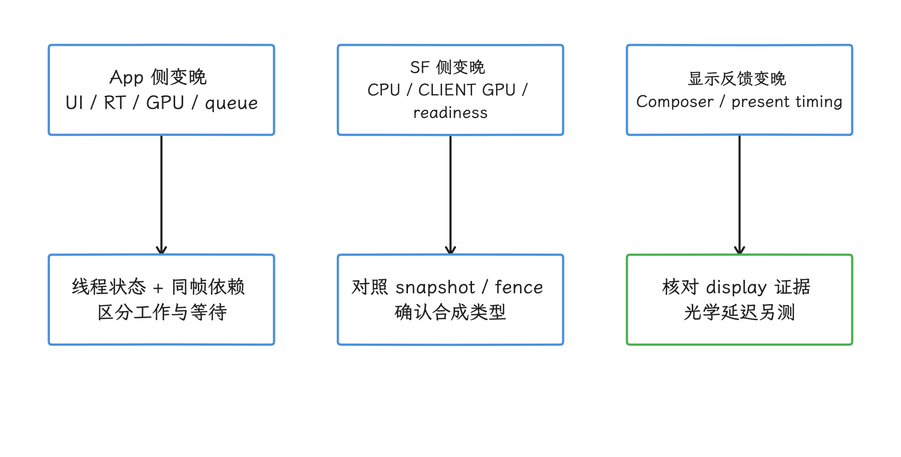

图：CPU、GPU 与显示后段分别寻找对应阶段证据。 队列吞吐、交互延迟与功耗是不同指标，不能互相代替。

### 选型与复核

下面的决策树用于按输出对象和合成需求选择渲染入口：

```text
普通 Android UI？
├── 是：View / Compose → HWUI → 宿主窗口
└── 否：上游能否直接向 Surface 生产 buffer？
    ├── 是：需要独立 layer 或避免宿主二次采样？
    │   ├── 是：SurfaceView / Surface / ANativeWindow
    │   └── 否：需要宿主任意纹理效果？是 → TextureView
    └── 否：RenderNode 输出到自管 HardwareBuffer？是 → HardwareBufferRenderer
```

SurfaceView 提供独立 layer 条件，不保证 DEVICE、低功耗或低延迟；TextureView 通常增加一次宿主采样。WebView、Flutter 和游戏必须核查真实宿主、Producer、BufferQueue、layer 与 HWC。

<!-- gracker-diagram: ch13-01-15-choose-surface -->
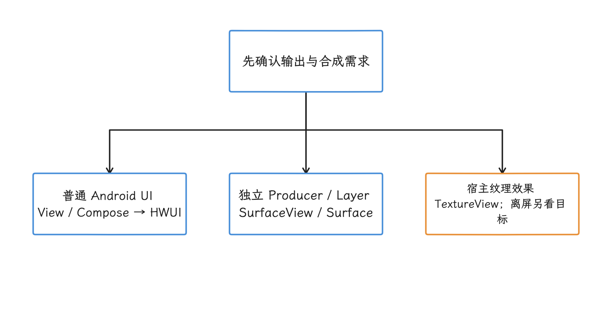

图：按普通 UI、独立输出和宿主效果选择承载对象。 还要核对内容能力、保护要求和设备合成结果，不能仅按性能口号选型。

复盘完成前确认：

<!-- gracker-diagram: ch13-01-16-review-measures -->
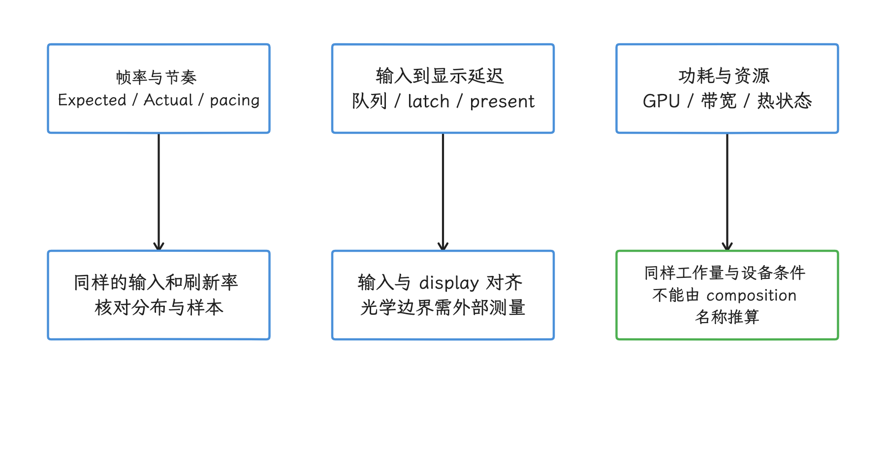

图：在同设备、场景与采集配置下分别验收帧率、延迟和功耗。 采集缺口和对象对应要记录，单帧变短不是完整修复证据。

- [ ] package/PID、display、Window、layer、BufferQueue 和时间窗已经锁定；
- [ ] Producer、第一 Consumer、SF layer 与送显路径已经记录；
- [ ] acquire、release、present fence 没有混用；
- [ ] token、frame number（帧序号） 或明确时序指向同一帧；
- [ ] CPU wall time（实际经过时间）、GPU execution（执行时间） 与 fence wait（同步等待） 已分开；
- [ ] 上一帧 release 是否让当前帧等待已经检查；
- [ ] FrameTimeline、GPU/HWC 缺失时的证据边界已说明；
- [ ] DEVICE/CLIENT 只作为设备现场结论；
- [ ] 帧率、端到端延迟、功耗分别验收；
- [ ] 修复前后设备、场景、输入和采集配置一致。

### 公共主线的源码入口

下面的源码入口覆盖公共主线，全部固定到 `android-17.0.0_r1`：

- [`Choreographer.java`](https://android.googlesource.com/platform/frameworks/base/+/android-17.0.0_r1/core/java/android/view/Choreographer.java)：`scheduleFrameLocked()`、`doFrame()` 与五类 callback 顺序；
- [`ViewRootImpl.java`](https://android.googlesource.com/platform/frameworks/base/+/android-17.0.0_r1/core/java/android/view/ViewRootImpl.java)：`scheduleTraversals()`、batched input、`performTraversals()`、`performDraw()`；
- [`HardwareRenderer.java`](https://android.googlesource.com/platform/frameworks/base/+/android-17.0.0_r1/graphics/java/android/graphics/HardwareRenderer.java) 与 [`ThreadedRenderer.java`](https://android.googlesource.com/platform/frameworks/base/+/android-17.0.0_r1/core/java/android/view/ThreadedRenderer.java)：Java HWUI 入口；
- [`RenderProxy.cpp`](https://android.googlesource.com/platform/frameworks/base/+/android-17.0.0_r1/libs/hwui/renderthread/RenderProxy.cpp)、[`DrawFrameTask.cpp`](https://android.googlesource.com/platform/frameworks/base/+/android-17.0.0_r1/libs/hwui/renderthread/DrawFrameTask.cpp)、[`CanvasContext.cpp`](https://android.googlesource.com/platform/frameworks/base/+/android-17.0.0_r1/libs/hwui/renderthread/CanvasContext.cpp)：RenderThread 状态同步、绘制、dequeue/queue duration；
- [`BLASTBufferQueue.cpp`](https://android.googlesource.com/platform/frameworks/native/+/android-17.0.0_r1/libs/gui/BLASTBufferQueue.cpp)：`onFrameAvailable()`、`acquireNextBufferLocked()`、`Transaction::setBuffer()`；
- [`SurfaceFlinger FrontEnd`](https://android.googlesource.com/platform/frameworks/native/+/android-17.0.0_r1/services/surfaceflinger/FrontEnd/) 与 [`Layer.cpp`](https://android.googlesource.com/platform/frameworks/native/+/android-17.0.0_r1/services/surfaceflinger/Layer.cpp)：requested state、snapshot、`BufferTX`、latch 与 release callback（buffer 可复用时的通知）；
- [`SurfaceFlinger.cpp`](https://android.googlesource.com/platform/frameworks/native/+/android-17.0.0_r1/services/surfaceflinger/SurfaceFlinger.cpp)：transaction readiness（事务是否具备处理条件）、latch-unsignaled、composite；
- [`HWComposer.cpp`](https://android.googlesource.com/platform/frameworks/native/+/android-17.0.0_r1/services/surfaceflinger/DisplayHardware/HWComposer.cpp) 与 [`HWC2.cpp`](https://android.googlesource.com/platform/frameworks/native/+/android-17.0.0_r1/services/surfaceflinger/DisplayHardware/HWC2.cpp)：validate/presentOrValidate/present 和 fences；
- [`FrameTimeline.cpp`](https://android.googlesource.com/platform/frameworks/native/+/android-17.0.0_r1/services/surfaceflinger/Scheduler/FrameTimeline.cpp)：SurfaceFrame、DisplayFrame 与 present feedback。
- [`events.sql`](https://android.googlesource.com/platform/external/perfetto/+/android-17.0.0_r1/src/trace_processor/perfetto_sql/stdlib/prelude/after_eof/events.sql)：`actual_frame_timeline_slice` 的列定义；查询字段应跟随采集端对应的 Perfetto schema。

内核侧按 [`android17-6.18-2026-06_r6`](https://android.googlesource.com/kernel/common/+/refs/tags/android17-6.18-2026-06_r6) 核对 dma-buf（共享 buffer 的内核机制）、dma-fence/sync_file、DRM atomic 与 vblank。Vendor GPU、Composer、display driver 和面板时序要用目标设备源码与 trace 补证。

### 用角色和边界读 trace

看到任何 App 出图问题，我们先确定 Producer、Surface/layer、合成位置和 present 边界，再进入线程耗时。标准窗口从 `vsync-app → doFrame → RenderThread → BLAST → SurfaceFlinger → HWC` 建立基线；特殊框架与硬件 Producer 只是在某些节点替换角色或增加分支。

`queueBuffer` 说明内容已提交，`BufferTX` 说明 SurfaceFlinger 侧仍有待处理的 buffer 更新，latch 说明本轮已经采纳，present fence 提供显示管线完成呈现的时间反馈。按顺序对齐这四类记录，才能区分帧开始晚、Producer 完成晚、Consumer 等待、退回 GPU 合成和显示后段延迟。


## View、HWUI 与 BLAST 标准路径

分类确定内容属于普通 App Window 之后，我们沿 ViewRootImpl、RenderThread、BLAST 和 SurfaceFlinger 还原一帧。

标准 HWUI App Window 的页面主体由普通 View 或 Compose host（Compose 宿主容器） 组织，RenderThread 生成宿主窗口 buffer。承载主体内容的独立 Surface、浏览器 compositor（合成器）、游戏引擎 swapchain、Camera HAL 或视频解码器 Producer 属于其他管线，这条标准路径并不适用于它们。

Compose 独立于 Android platform 发布，我们在这里只说明它在标准 App Window 中的位置；某个 Jetpack 版本的行为要从它自己的版本核对，从 Android 平台源码推不出来。

### 如何确认这是标准 HWUI 页面

要确认页面属于标准类型，我们依据的是主体内容由谁生产、经哪里提交。普通 View、纯 Compose 或 `ComposeView` 页面通常属于标准类型；单看页面里出现的某个框架控件名，还定不了类。

| 条件 | 标准类型的证据 | 需要切换章节的信号 |
|---|---|---|
| 主体 Producer | `ViewRootImpl`、HWUI RenderThread 与 App GPU queue | Chromium、Flutter raster、Camera HAL、MediaCodec 或游戏引擎主导主体内容 |
| 输出目标 | 当前 App Window 的 `Surface` / BLAST BufferQueue | 独立 Surface、SurfaceTexture 输入、sideband stream 或另一条 swapchain |
| layer 拓扑 | 主体像素落在 App Window layer | 出现承载主体内容的 child layer 或多个独立 Producer layer |
| 帧节奏 | `Choreographer#doFrame` 与窗口 SurfaceFrame 能解释主体更新 | 引擎、解码器或硬件模块维护独立 cadence（输出间隔） |

常规列表页、详情页和设置页是典型标准页面。它们可能包含复杂布局、耗时较高的 shader 或大量 Compose 重组；“标准”只描述路径，不评价负载大小。页面嵌入视频、地图、相机预览或大型 WebView 后，我们就要按实际占主体内容的 Producer 和 layer 重新分类。

### 一帧的完整旅程

标准页面可以按 12 个观察点还原。系统状态栏、导航栏、壁纸等 layer 仍会同时参加 display composition（显示合成）；下面我们只跟踪目标 App Window。

#### ⓪ 帧为什么被安排

输入、动画、`invalidate()`、`requestLayout()`、Insets 或窗口状态变化会让后续帧有工作。`ViewRootImpl.scheduleTraversals()` 在尚未安排 traversal 时，向主线程消息队列插入同步屏障，并向 `Choreographer` 注册 `CALLBACK_TRAVERSAL` runnable；`Choreographer` 再用 `mFrameScheduled` 合并尚未执行的帧申请。异步帧消息可以越过普通同步消息，但同步屏障不替代 CPU 调度，也不会越过正在执行的任务。

`invalidate()` 只标记需要重绘的脏区域并安排后续 traversal，绘制发生在后面的 traversal 里。同一个 pending（尚未执行） frame 内的连续调用会被合并，并不会各自申请一份 VSync。

<!-- gracker-diagram: ch13-01-17-traversal-schedule -->
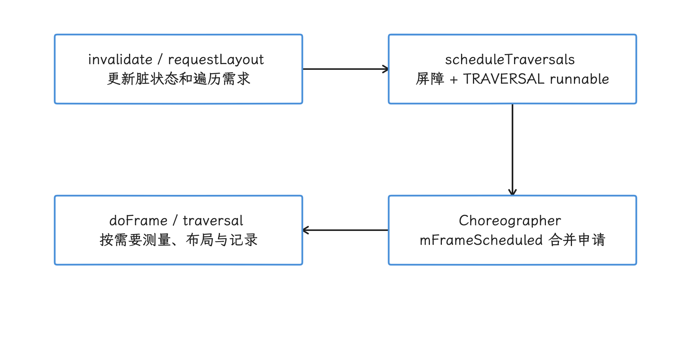

图：多次重绘申请可合并到待执行帧，真正绘制稍后发生。 屏障允许异步消息绕过同步消息，不能抢占当前任务或替代调度。

#### ① `vsync-app` 安排应用帧事件

Scheduler 根据预测 present time，以及描述工作时长和就绪余量的 app `workDuration`、`readyDuration` 参数计算应用 wakeup（唤醒时刻），再经 EventThread / DisplayEventReceiver 把 VSync 事件送到进程。

SurfaceFlinger 里的 `vsync-app` 事件是调度和分发线索，不能仅凭它断言目标应用已成功收到事件；EventThread 的发送也有失败分支。还需核对 App 接收侧事件、`Choreographer#doFrame` 和调度记录，区分事件分发、目标线程可运行与真正上 CPU。线程本来就在运行时，也不一定出现新的 `sched_wakeup`。

<!-- gracker-diagram: ch13-01-18-vsync-delivery -->
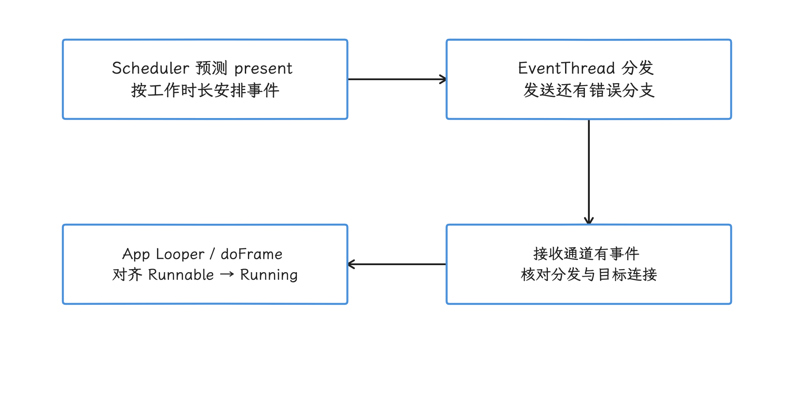

图：从 SF 的帧计划继续核对 App 接收和线程执行。 发送可失败；线程已运行时不一定产生新的 sched_wakeup。

#### ② MainThread 组织本帧

`Choreographer#doFrame()` 的 callback 顺序是：

`INPUT → ANIMATION → INSETS_ANIMATION → TRAVERSAL → COMMIT`

这一段有三个关键点：

<!-- gracker-diagram: ch13-01-19-callback-order -->
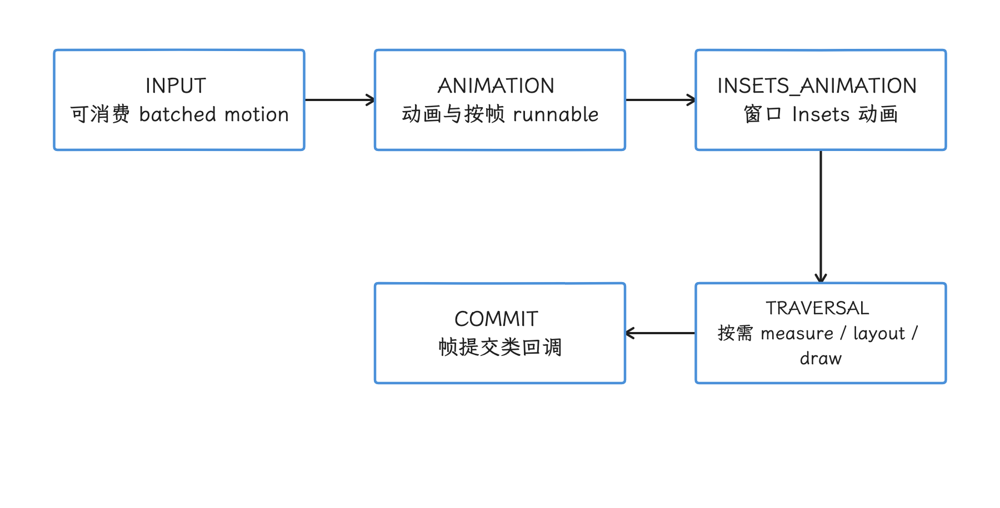

图：同一 doFrame 按固定顺序处理帧回调。 这里只表示回调阶段顺序，不表示每阶段必有工作或相同时长。

- INPUT 的重要工作之一是按帧集中消费 batched motion event（批量触摸事件）；普通输入事件也会通过 InputChannel 与 Looper 消息循环异步处理。
- Traversal 按本帧状态决定是否执行 measure、layout 与 draw，并不会每帧都完整遍历整棵 View 树。
- 硬件加速路径的 `draw()` 主要更新 RenderNode/DisplayList（可复用的绘制指令记录），描述“画什么”；像素生产发生在后面的 RenderThread/GPU 阶段。

#### ③ `syncAndDrawFrame()` 交给 RenderThread

<!-- gracker-diagram: ch13-01-20-rendernode-reuse -->
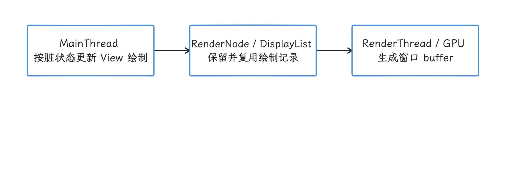

图：UI 更新可复用绘制树，RT 与 GPU 负责后续像素生产。 每帧不一定重建整棵树，UI draw 返回也不证明 buffer 已写完。

`ViewRootImpl.performDraw()` 经 `ThreadedRenderer` / `HardwareRenderer` 更新窗口绘制树的根节点 root RenderNode（窗口绘制树的根节点），然后调用 `syncAndDrawFrame()`。native 侧由 `RenderProxy` 把 `DrawFrameTask` 投递到 RenderThread。

UI 线程会在 `DrawFrameTask::postAndWait()` 等待 RenderThread 完成必要的同步。`DrawFrameTask::run()` 先执行 `syncFrameState()`；该函数返回 `info.prepareTextures`，表示本轮纹理准备是否允许提前放行 UI 线程：

- 返回 true 时，RenderThread 可以在 draw 前 `unblockUiThread()`；
- 返回 false 时，UI 线程要等 draw 或 `waitOnFences()` 之后再被放行。

这解释的只是 UI/RenderThread 的同步边界；GPU 是否完成、何时 present，都还要看后面的阶段。

下面的源码骨架用于展示 UI thread 的等待与放行位置。它省略了 callback、skip-frame 和错误分支，不是可编译代码。

```text
RenderProxy::syncAndDrawFrame()
    DrawFrameTask::drawFrame()
        postAndWait()

DrawFrameTask::run()
    canUnblockUiThread = syncFrameState(info)
    if (canUnblockUiThread)
        unblockUiThread()
    if (canDrawThisFrame)
        CanvasContext::draw()
    else
        CanvasContext::waitOnFences()
    if (!canUnblockUiThread)
        unblockUiThread()
```

上面的骨架里，`canUnblockUiThread` 就是 `syncFrameState()` 在 `CanvasContext::prepareTree()` 之后返回的 `info.prepareTextures`。它为 true 时 UI thread 在 draw 前放行；纹理缓存空间不足等情况会返回 false，UI thread 保持等待，直到本轮 draw 或 fence wait 结束。

<!-- gracker-diagram: ch13-01-21-ui-unblock -->
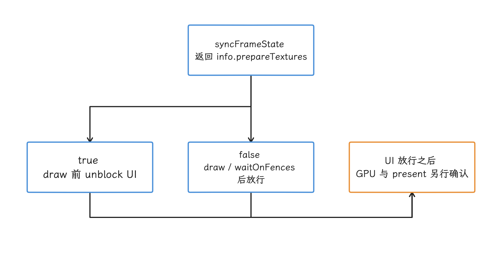

图：syncFrameState 的结果决定 UI 是否可以在 draw 前放行。 这是固定 r1 的简化分支，省略回调和错误处理；与 GPU 完成或 present 无等价关系。

#### ④～⑥ RenderThread 生产窗口 buffer

RenderThread 使用 App Window 的 `Surface` / BufferQueue Producer：

1. `dequeueBuffer()` 取得候选 slot 与 release fence。没有可用 slot 或队列约束不满足时，可能等待、超时或返回 `WOULD_BLOCK`；已 queue 过 buffer 且达到 max-dequeued 上限时，固定 r1 返回 `INVALID_OPERATION`。返回的 release fence 由 Producer 的 EGL/Vulkan 等实现遵守，等待可能移到后端或首次写入前，不能一概算成 BufferQueue 的选槽等待。
2. HWUI 的 Skia OpenGL/Vulkan pipeline 录制并提交 GPU 命令。
3. `queueBuffer()` 提交 slot、frame number、timestamp（内容时间戳）、dataspace、crop/transform（裁剪与变换） 等元数据，以及表示 Producer 写入完成的 producer completion fence（Producer 写入完成的同步信号）。

CPU 命令提交完成、`queueBuffer()` 返回时，GPU 仍可能继续写入。Producer completion fence 在 Consumer 侧作为 acquire fence，约束 Consumer 何时能安全读取这块 buffer。

<!-- gracker-diagram: ch13-01-22-dequeue-results -->
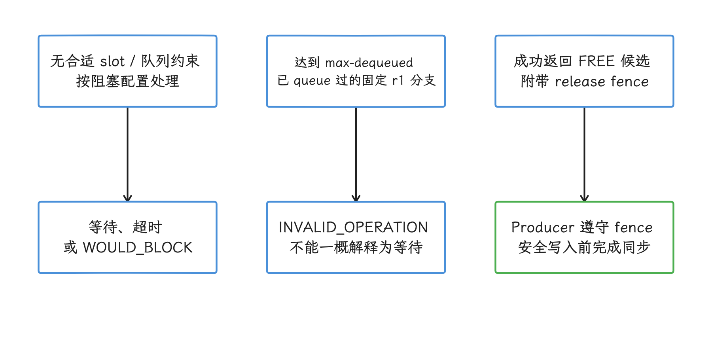

图：区分无槽等待、持有上限错误和返回 fence 的后续同步。 max-dequeued 报错分支以已 queue 过为前提；阻塞行为受模式与超时配置影响。

#### ⑥' BLAST 把 buffer 变成 transaction

<!-- gracker-diagram: ch13-01-23-gpu-acquire-fence -->
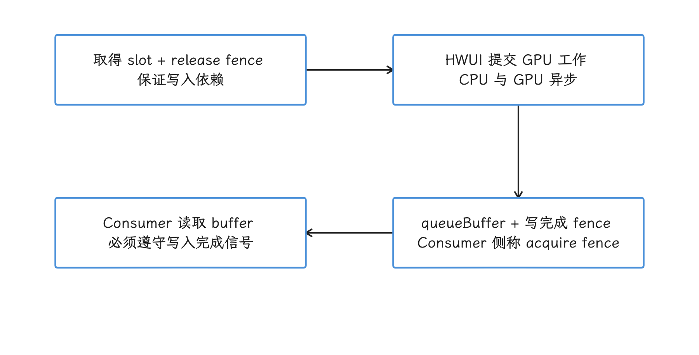

图：Producer 提交命令与 buffer 时附上写入完成信号。 queue 返回可能受背压影响；提交时 GPU 不必已经完成。

标准 App Window 的 BLASTBufferQueue 位于应用进程。`onFrameAvailable()` 接到可用通知后，在可获取 buffer 时经 `acquireNextBufferLocked()` 从 Consumer 取得 `BufferItem`，再调用 `Transaction::setBuffer()` 填入 buffer、acquire fence、frame number 和 release callback。普通路径合并 pending transaction 后自行 `apply()`；同步窗口更新可先合入调用方提供的 transaction，由同步协调方统一提交，并非每个通知都立即独立 apply。

SurfaceFlinger 进程收到含 buffer 的 transaction、计入 pending 之后，`BufferTX - <layerName>` 增加；buffer 被 latch 或 drop 后减少。App 侧 `queueBuffer()` 与 SurfaceFlinger 侧 `BufferTX` 是两个不同的时间点。

<!-- gracker-diagram: ch13-01-25-pending-buffertx -->
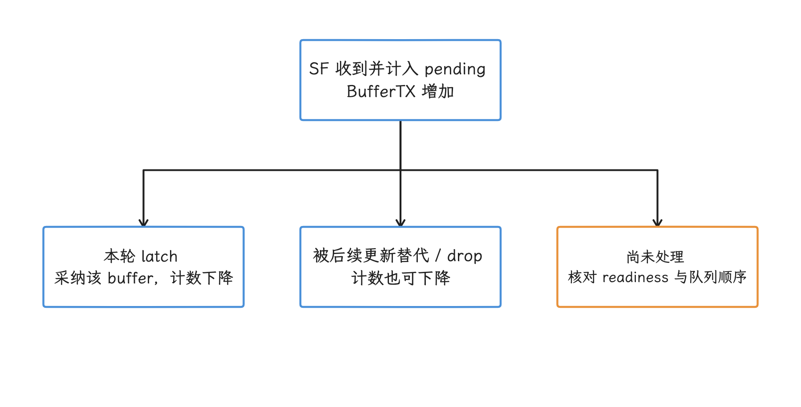

图：BufferTX 增加对应 SF 收到 buffer 更新，下降可来自 latch 或 drop。 它不等于 App queue 时刻、所有 buffer 数或 GPU 工作量。

下面的源码骨架用于标出 `queueBuffer()` 之后的 BLAST transaction 边界。它展示普通非同步分支；没有展开 callback、无法立即 acquire 和同步事务合并。

```text
BufferQueueProducer::queueBuffer(slot, QueueBufferInput{fence, ...})
    slot.state = QUEUED
    frameAvailableListener.onFrameAvailable(BufferItem)

BLASTBufferQueue::onFrameAvailable(BufferItem)
    acquireNextBufferLocked()
        Transaction.setBuffer(
            surfaceControl, buffer, acquireFence, frameNumber, ...)
        Transaction.apply()

SurfaceFlinger::setTransactionState(...)
    TransactionHandler::queueTransaction(...)
```

这段路径传递的是 slot、buffer handle（缓冲区句柄）、元数据和同步对象，整帧像素不会经 Binder（Android 进程间通信机制） 复制。SF 侧收到 transaction 后还要检查 readiness、生成本轮 layer snapshot（状态快照），再执行 latch 和 composition。走到这里任何一步，都还代替不了 present 一侧的记录。

<!-- gracker-diagram: ch13-01-24-blast-transaction-branches -->
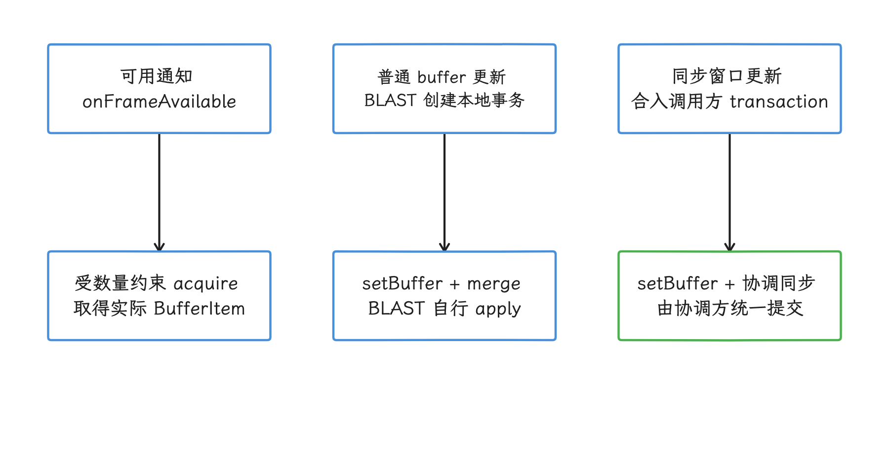

图：BLAST 从应用内队列取出 buffer，再组织 SurfaceControl transaction。 无法立即 acquire 时可延后；普通与同步路径的 apply 所有者不同。

#### ⑦～⑧ SF FrontEnd 与 latch

transaction 到达后，接下来的工作都在 SurfaceFlinger 进程里：它在 `vsync-sf` 节奏下集中 flush transaction，FrontEnd 把请求合入 `RequestedLayerState`，再由 `LayerLifecycleManager` / `LayerSnapshotBuilder` 生成本轮 `LayerSnapshot`。

<!-- gracker-diagram: ch13-01-26-sf-frontend -->
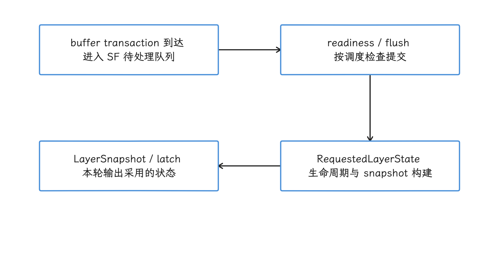

图：SF 将请求合入状态并生成输出所需快照，再采纳本轮 buffer。 阶段由 SF 调度组织，图中顺序不表示同步跨进程调用或固定耗时。

`latch` 表示本轮采纳了目标 layer 的新 buffer。一般路径会检查 acquire fence；符合 `shouldLatchUnsignaled()`、简单单 layer update、队列顺序等条件时，可以先 latch 尚未 signal 的 buffer，也就是先采纳 transaction，不等待 Producer 完成信号。RenderEngine 或 HWC 真正读取内容时仍要遵守 fence。

<!-- gracker-diagram: ch13-01-27-latch-unsignaled -->
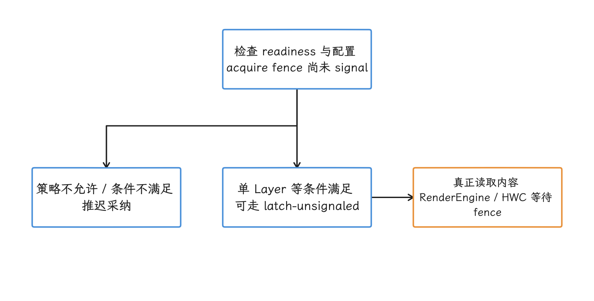

图：固定 r1 允许在受限条件下先采纳未 signal 的 buffer。 AutoSingleLayer 还检查 first transaction、非 early 配置与简单 buffer update；读取方仍遵守 fence。

#### ⑨～⑪ HWC composition 与 present

SurfaceFlinger 为目标 display 筛选并组织参与输出的 layer，与 HWC 协商 composition type（CLIENT/DEVICE 等类型）；被遮挡、过滤或属于其他 display 的 layer 不一定交给这一 display 的 HWC。`HWComposer::getDeviceCompositionChanges()` 只有满足 `canSkipValidate` 时才尝试 `presentOrValidate()`：本次没有 CLIENT composition，且 Composer 支持预期 present 时间，或当前已到 earliest-present 边界。其结果分为：

- `PresentSucceeded` 表示这次组合 HAL 调用已经走完 present 分支，并保存了 present/release fences；
- `Validated` 表示 validate 已在本次调用中完成；随后还要读取 HWC 要求改变的 composition type（CLIENT GPU 合成或 DEVICE 硬件合成等类型） 或其他 request，并调用 `acceptChanges()`；
- 不满足 skip 条件时，单独调用 `validate()` 检查当前 layer 组合能否由硬件处理；
- 有 CLIENT layer 时，RenderEngine 先生成 client target，再通过 `setClientTarget()` 把 buffer 和对应的 acquire fence 交给 HWC；
- `presentAndGetReleaseFences()` 在已由前一步完成 present 的 fast path（已由前一步完成 present 的快速路径） 中只需 flush commands；其他路径调用 `present()`，并收集每个 layer 的 release fence。

`PresentSucceeded` 是 Composer/HWC 调用状态，panel 此时未必已完成扫描。

<!-- gracker-diagram: ch13-01-28-hwc-fast-path -->
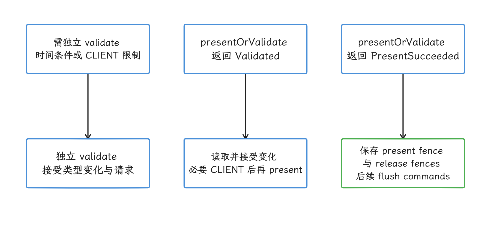

图：没有 CLIENT 且时间条件允许时，可尝试组合调用。 PresentSucceeded 已完成 HAL present 调用，不能再走需要新 CLIENT 绘制的分支，也不等于面板已扫描完。

#### ⑫ present 与 release feedback

<!-- gracker-diagram: ch13-01-29-client-target -->
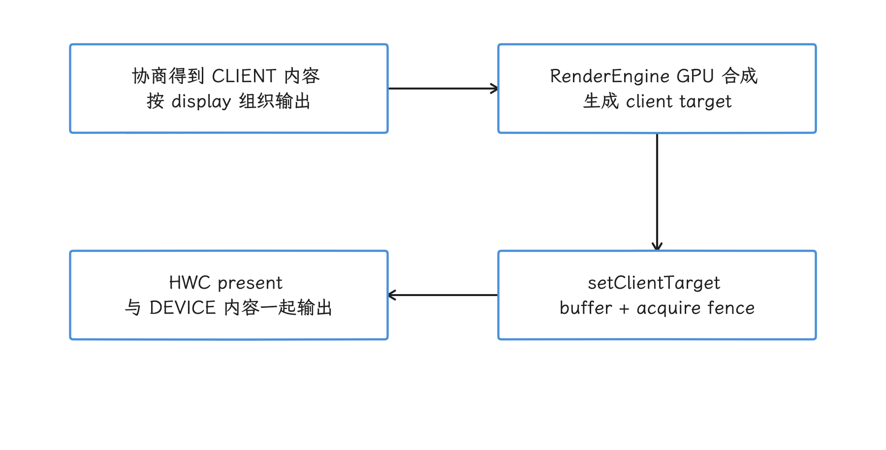

图：RenderEngine 将 CLIENT 内容合成到 client target 后再交给 HWC。 CLIENT 与 DEVICE 可共同组成输出，client target 自带 acquire fence。

HWC 返回每个 display 的 present fence 和每个 layer 的 release fence。SurfaceFlinger 还会根据 CLIENT/DEVICE composition 合并或替换 release 信息，再通过 callback/release channel（释放通知通道） 回传 Producer。

Present fence 是 Android 显示栈里 display-present 的时间基准；panel 扫描、像素响应，以及从触摸输入到屏幕发光的完整延迟，还需要 driver trace（驱动追踪） 或外部测量。Release fence 约束旧 buffer 何时能安全复用，present fence 替代不了它。

<!-- gracker-diagram: ch13-01-30-feedback-boundaries -->
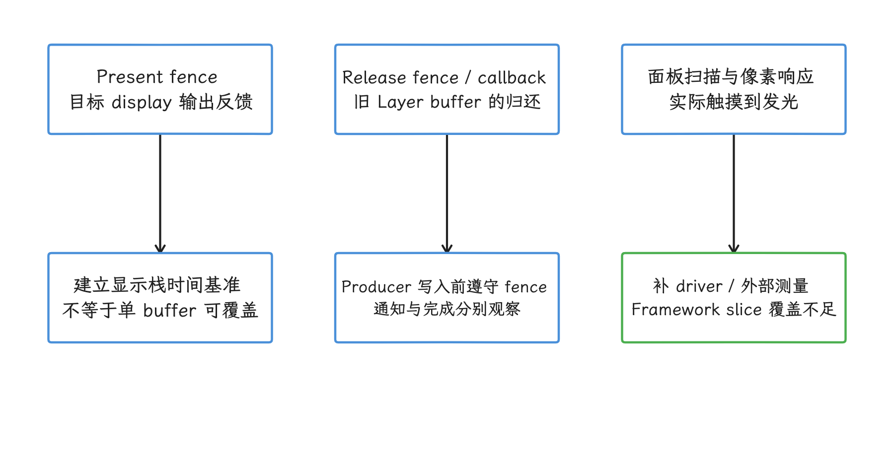

图：显示反馈、资源复用与光学响应是不同的边界。 SF 可按合成路径合并 release 信息，不能把回调收到时刻当成 fence signal。

### BLAST Buffer 生命周期

#### Slot 状态机

下面的状态图展示普通非 shared-buffer 模式的主要循环。它没有穷尽 `cancelBuffer`、丢弃 queued buffer、attach/detach、断连和 shared-buffer 等分支：

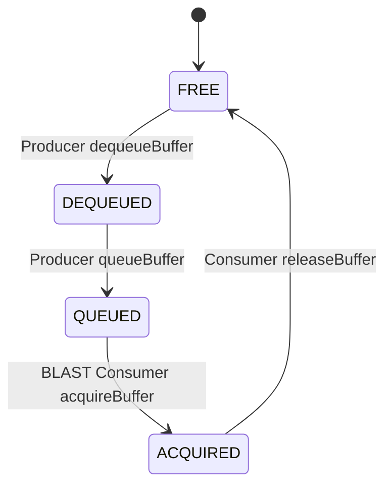

`releaseBuffer()` 把 slot 归还到可 dequeue 的状态，但 slot 仍可能携带上一轮 release fence。Producer 再次写入前必须遵守该 fence；`FREE` 只表示 slot 已成为候选，不保证硬件已经允许立即覆盖内容。

<!-- gracker-diagram: ch13-01-31-slot-main-cycle -->
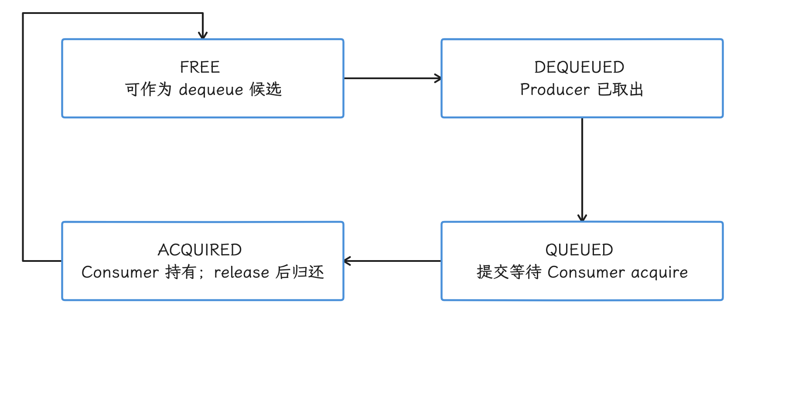

图：普通队列循环中，slot 在 Producer、队列与 Consumer 之间流转。 省略 cancel、drop、attach/detach 和 shared-buffer 等分支；FREE 仍可能附未完成 fence。

| 状态 | 主要持有方 | 含义 |
|---|---|---|
| `FREE` | BufferQueue | 可作为 dequeue 候选，可能带待遵守的 release fence |
| `DEQUEUED` | Producer/RenderThread | 已取出，准备写入或正在写入 |
| `QUEUED` | BufferQueue | Producer 已提交，等待 Consumer acquire；acquire fence 可能尚未 signal |
| `ACQUIRED` | BLAST/BufferItemConsumer | Consumer 已取得，后续通过 transaction 进入 SF pending/latch/release 路径 |

#### 队列深度由运行时约束共同决定

“BLAST 始终维护三个 buffer”并不符合源码。BufferQueue 有一组 slot，我们逐项看运行时约束：

- `maxDequeuedBufferCount`：Producer 同时持有的 DEQUEUED 上限；
- `maxAcquiredBufferCount`：BLAST Consumer 同时持有的 ACQUIRED 上限；
- synchronous/async（同步/异步队列模式） 队列模式、Producer 是否允许阻塞，以及 queued backlog（已经排队但尚未消费的数量）；
- 当前各 slot 的状态；
- release fence、BLAST pending release（等待处理的释放信息）；
- 当前/最大刷新率对应的 acquired-count 策略。

Triple buffering（三缓冲） 是常见运行状态，但每台设备、每个窗口是否固定用三个 slot，要看上面的约束。它可以减少 Producer 与 Consumer 相互等待，也可能让 in-flight frame（仍在处理链中的帧）增多。是否增加一整帧延迟，取决于 pacing（帧节奏）、queue depth（排队深度）、latch 和 present，单看“有第三个 slot”推不出来。

<!-- gracker-diagram: ch13-01-32-queue-depth -->
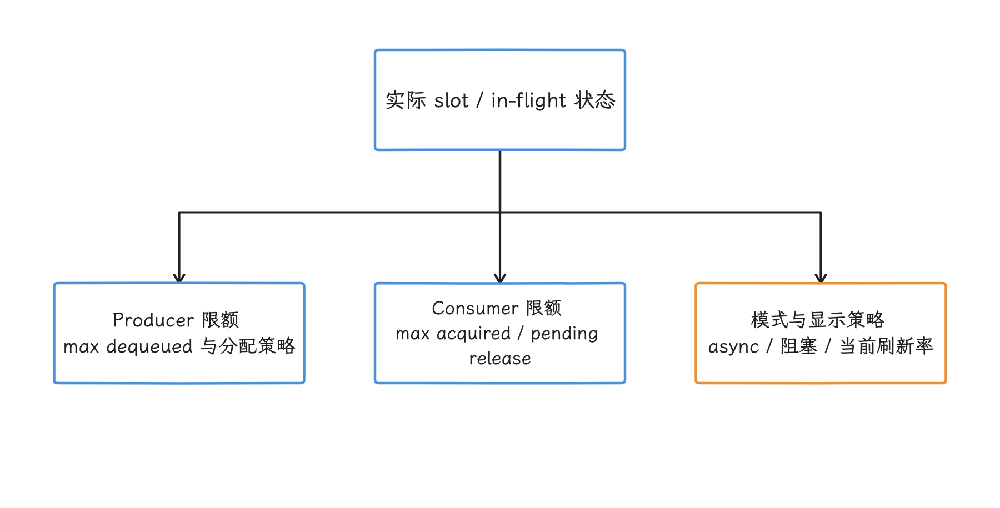

图：实际分配、状态和队列策略共同影响在途帧数。 提高上限不等于多排一帧；三缓冲不是每个窗口永恒固定的配置。

`dequeueBuffer()` 等的未必是“上一帧那块 buffer”。普通模式可选择满足队列和分配约束的 FREE slot，并把该 slot 的 release fence 返回；未 signal 的 fence 不自动将这个 FREE slot 排除。没有合适候选时再按阻塞/超时配置处理，达到 max-dequeued 上限则可能直接报错。Producer 安全写入前的 fence 等待要另行定位。

<!-- gracker-diagram: ch13-01-33-free-not-writable -->
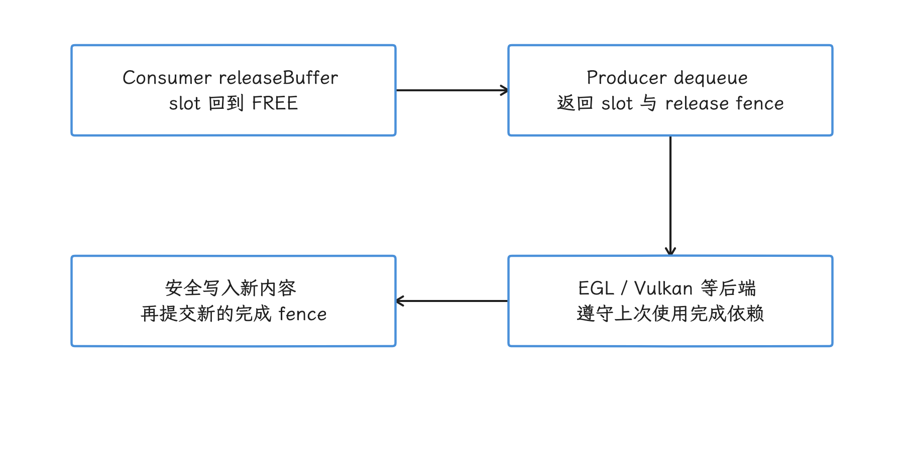

图：BufferQueue 可返回带 release fence 的 FREE slot。 选槽等待与后端 fence 同步要分别定位，不能把未 signal 自动当作 FREE 不可选。

#### BLAST 的 release 路径

正常的 buffer 释放信息由 SF release callback/release channel 回到 BLAST，再由 `BLASTBufferItemConsumer::releaseBuffer()` 归还 slot。Transaction completed callback 还会对 stale submitted buffer（已被后续提交替代的旧 buffer）生成 fake release（补发资源归还通知，仍携带应遵守的 fence，不是伪造内核 fence 已完成）；诊断时要区分释放来源，transaction-completed 回调只是其中一路。

<!-- gracker-diagram: ch13-01-34-release-sources -->
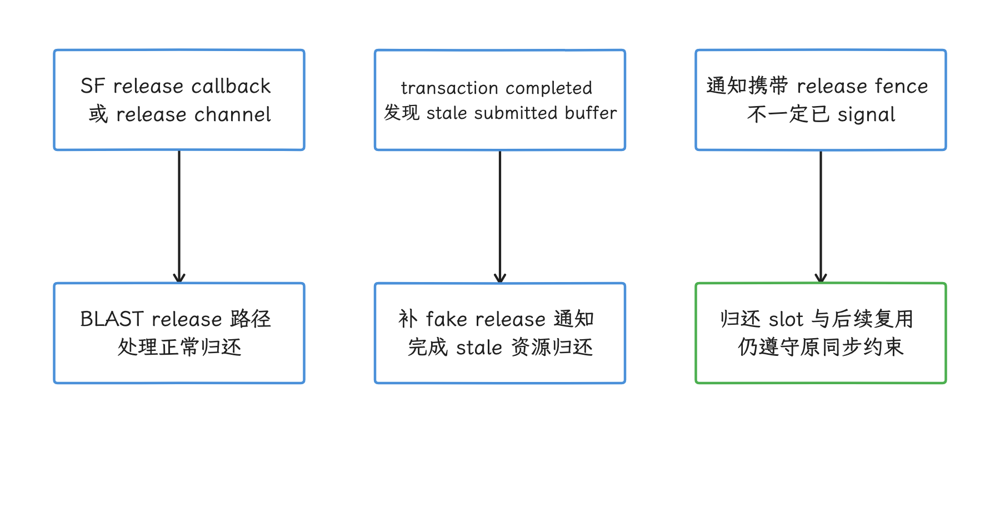

图：按来源区分正常释放、完成回调补通知和真正的 fence 完成。 fake release 是补回调，不是伪造内核已完成信号。

Release 信息可携带与当前刷新率相关的 current max acquired count（当前允许的 ACQUIRED 数量上限）；BLAST 对 EGL Producer 可以暂存一部分已 release buffer，在当前刷新率低于设备最大刷新率时控制延迟和分配行为。诊断 queue depth 时要查看当时的 acquired/dequeued 上限和 pending release，只数 trace 上的三个 buffer 名称是不够的。

<!-- gracker-diagram: ch13-01-35-egl-acquired-policy -->
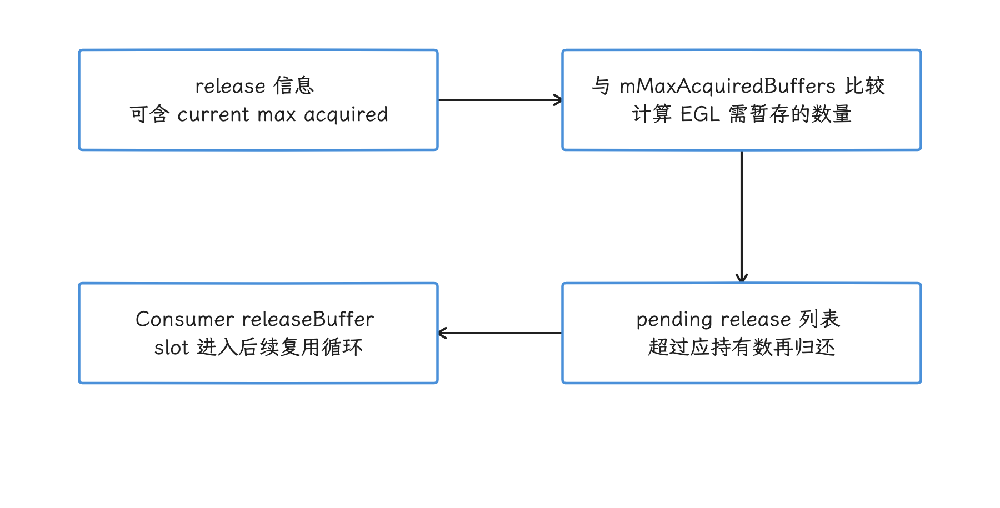

图：BLAST 可结合当前 acquired 上限暂存 EGL 的部分释放信息。 字段表示数量上限，不是实时已取得数；该持有策略有 EGL 条件。

#### Buffer stuffing recovery

`Choreographer`/HWUI 路径包含 buffer stuffing recovery，用于缓解 Producer 提交过快造成的队列堆积。`BBQBufferQueueProducer::waitForBufferRelease()` 记录等待，`ViewRootImpl` / `ThreadedRenderer` 把信号传到 `Choreographer.onWaitForBufferRelease()`；等待超过相应阈值时，后续 `doFrame()` 可以主动延后一帧，使 queued buffer 数下降。

Android 17 r1（`android-17.0.0_r1`）的阈值是最近 frame interval（帧间隔） 的一半。进入 recovery 后，`DELAY_FRAME` 会请求下一次 VSync 并跳过当前 `doFrame()`；后续 recovery 还可能对 animation frame time 应用一个 frame interval 的负 offset，即从动画帧时间中减去一个 frame interval。

<!-- gracker-diagram: ch13-01-36-stuffing-recovery -->
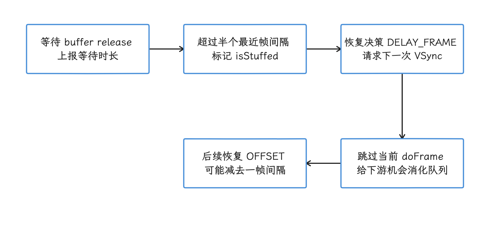

图：足够长的 buffer 释放等待触发恢复，随后可主动延后本次帧。 阈值为最近帧间隔的一半；DELAY_FRAME 跳过当前 doFrame，后续可能偏移动画时间。

`buffer_stuffing_multi_recovery` 控制同一段动画是否允许多次恢复；`buffer_stuffing_recovery_threshold` 启用时，在允许多次 recovery 的分支中，已累计 delay 达到 100 ms 后不再追加此次主动 delay；它按帧间隔累计，最后一次追加可能跨过 100 ms，并非精确截断在 100 ms。两项都是可变的 aconfig flag（平台配置开关），目标设备的取值必须从配置或 trace 确认。

<!-- gracker-diagram: ch13-01-37-recovery-threshold -->
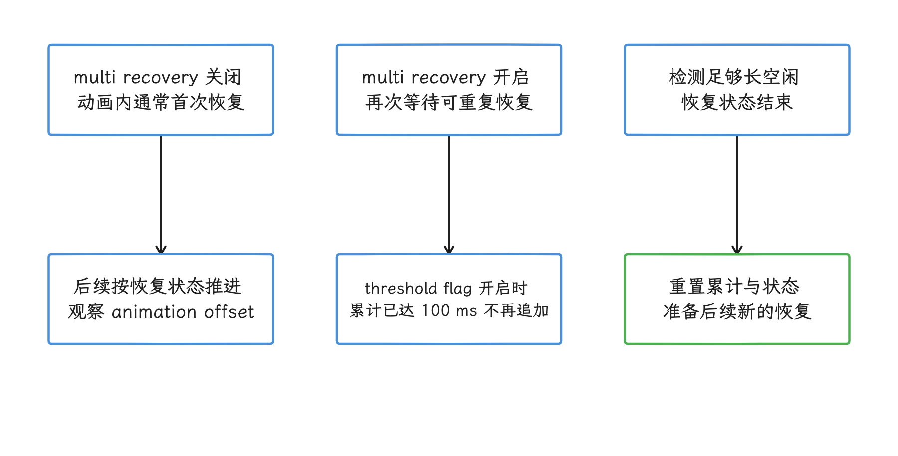

图：多次恢复、追加 delay 和空闲退出分别受状态与 flag 控制。 100 ms 是追加前的累计判断，最后一帧可跨过阈值；不是精确截断总延迟。

这项机制用于降低队列过深带来的额外输入到显示延迟，不用于提升 GPU 或显示硬件的处理能力。Perfetto 中看到 `Buffer stuffing recovery`、`buffer stuffed` 或 `Negative offset` 时，要同时检查 dequeue wait、FrameTimeline `Buffer Stuffing` 和 queue backlog 是否回落。

### 渲染时序图（BLAST Sequence）

下面的图把 App、BLAST、SurfaceFlinger 与 HWC 放在同一条时序线上：

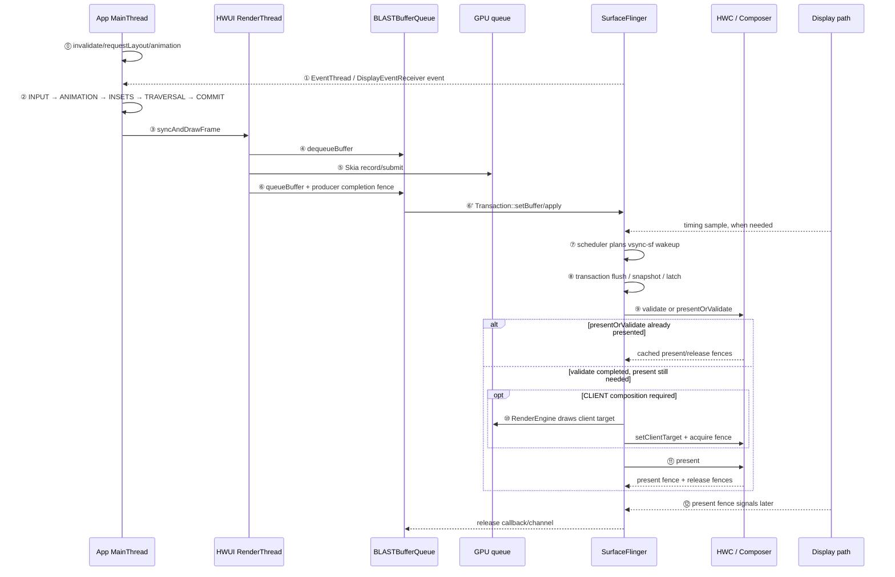

图里 BLAST 消费 BufferItem 的位置在 App 进程，SF 侧消费的是 SurfaceControl transaction。`queueBuffer()` 返回不是 SF 合成或 present 完成的凭证；调用本身仍可能因 Producer throttling、BLAST 同步或回调路径等待。后续 `dequeueBuffer()` 也可能因可用 slot 或队列约束等待；要以实际 slice 和 fence 区分这些等待。

<!-- gracker-diagram: ch13-01-38-asynchronous-overlap -->
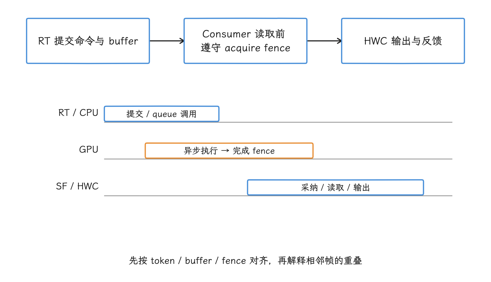

图：用异步依赖读时序，不把 CPU 返回当成 GPU 或显示完成。 轨道仅为依赖示意，条长不是实测；queue 调用也可能发生背压等待。

### Trace 视角

“正常耗时 < 1 ms / 2 ms / 8 ms”这类固定阈值不适合跨刷新率、设备和场景复用。判断某一阶段慢不慢，我们应把它与本帧的 expected timeline（预期时间线）、线程状态和当前 display budget（该帧可用的显示时间预算） 对齐。

| 阶段 | 主要信号 | 需要回答的问题 |
|---|---|---|
| App 收帧 | `Choreographer#doFrame`、app FrameTimeline | App 是按时醒来，还是 runnable 等待或消息队列处理已经延误 |
| MainThread | INPUT、ANIMATION、INSETS_ANIMATION、TRAVERSAL、COMMIT | 哪个 callback 或业务工作先增加 |
| UI→RT | `syncAndDrawFrame`、RenderThread `DrawFrame` | UI 在等状态同步，还是 RT 已进入 draw |
| Buffer 生产 | `dequeueBuffer`、GPU slice/fence、`queueBuffer` | slot 等待、CPU submission、GPU completion、queue 中哪一段较晚 |
| App→SF | `BufferTX - <layerName>`、transaction、latch | buffer update 是否到达 SurfaceFlinger，是否被本轮采纳 |
| SF/HWC | SF actual、composition type、DisplayHAL、present feedback | 系统 CPU、CLIENT GPU、HWC/display 哪段晚 |

#### MainThread、RenderThread 与 GPU 分开看

`DrawFrame` 是 RenderThread 上的追踪区间，其 wall time 也可包含阻塞等待；它既不等于纯 CPU Running 时间，也不代表 GPU duration（GPU 执行时长）。线程状态还要区分：

- Running 长：线程获得 CPU 后工作量大；
- Runnable 长：线程已可运行但没有及时上 CPU；
- Sleeping/blocked 长：线程处于睡眠或阻塞状态，可能在等待 futex（线程同步原语）、Binder、buffer、fence 或其他资源。

提高 CPU 频率消不掉所有阻塞等待。我们应把 `sched_wakeup`、`sched_switch`、线程状态、CPU frequency 和目标 slice 对齐，再讨论调度、cpuset（可运行的 CPU 集合）、uclamp（调度利用率上下限） 或 thermal（温控限制）。

<!-- gracker-diagram: ch13-01-39-thread-states -->
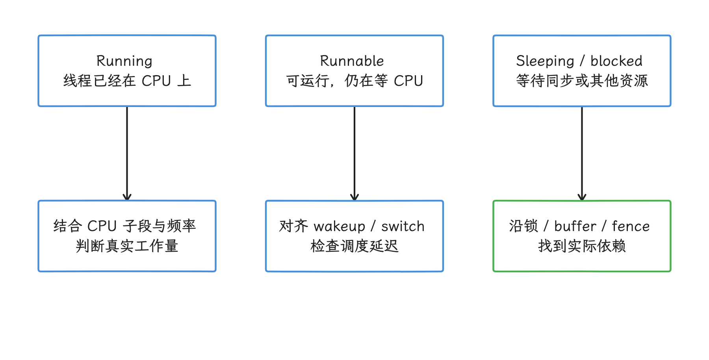

图：先拆开 Running、Runnable 和 blocked，再解释 DrawFrame 的 wall time。 CPU 频率不能自动消除 fence、锁或队列等待；GPU duration 另行观测。

#### 四个关口

一帧可以按以下顺序排查：

1. `doFrame` 内哪个 callback 的耗时先变长？
2. RenderThread 是同步、绘制、GPU 提交，还是 `dequeueBuffer` 等待？
3. `queueBuffer` 之后，`BufferTX`、latch 是否按时？
4. App 按时交付后，SF actual、composition type、HWC/DisplayHAL 和 present 是否按时？

`主线程短 + RenderThread 短 + Jank`，还不够下“SurfaceFlinger 或 HWC 问题”的结论。Jank 表示帧未满足预期时间，GPU completion、buffer transaction、acquire fence、display prediction error 都可能发生在两个 CPU slice 之外。

<!-- gracker-diagram: ch13-01-40-four-diagnostic-gates -->
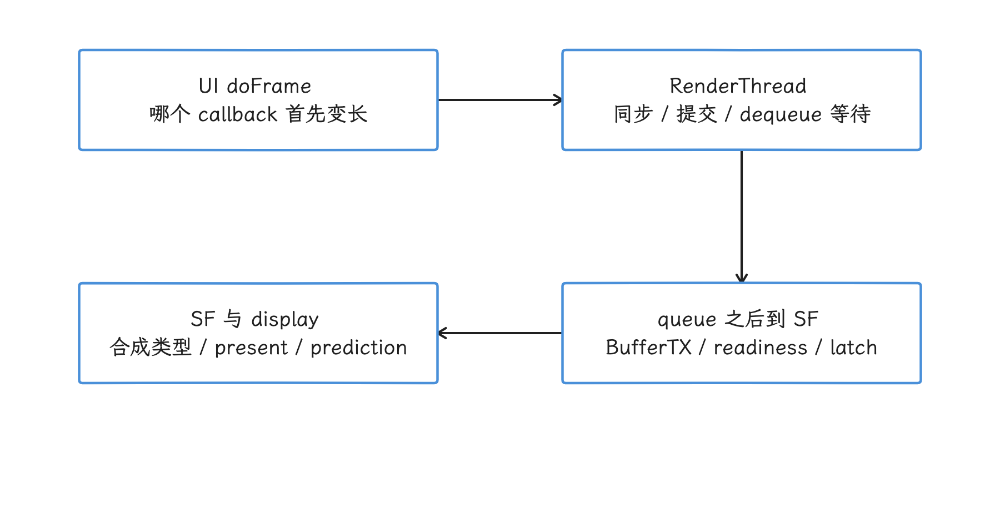

图：依次核对 UI 回调、RT、事务与显示后段。 UI 和 RT 短不能排除 GPU、acquire fence、事务或显示预测问题。

#### 用 RecyclerView 滑动校准观察顺序

拿一次跟手滑动当例子，可以把上述关口连成一帧：

1. `ACTION_MOVE` 经输入通道到达应用，同一 VSync 周期积累的 batched motion event 在 INPUT callback 中消费；滚动容器据此更新偏移并请求 redraw（重绘）。
2. ANIMATION、INSETS_ANIMATION 与 TRAVERSAL 继续执行。RecyclerView 是复用 DisplayList，还是重新 bind（绑定数据）、measure、layout item，要以本帧 slice 和 layout request 为准。
3. `ThreadedRenderer.draw()` 更新 root RenderNode，RenderThread 取得窗口 buffer、提交 GPU 命令并 `queueBuffer()`。
4. BLAST 把 `BufferItem` 放入 transaction。SurfaceFlinger 计入待处理队列时 `BufferTX` 增加，latch 或 drop 后下降。
5. SF 与 HWC 协商 composition type，DisplayFrame 与 present fence 给出显示栈时间边界；触摸到光子的完整时延还需要输入、driver 与外部测量。

手指抬起进入 fling 后，RecyclerView 的 `ViewFlinger` runnable 通过 `postOnAnimation()` 继续调度，在主线程回调中调用 `OverScroller.computeScrollOffset()` 计算位移；`OverScroller` 是状态/插值对象，不是独立动画线程。INPUT 工作减少属于正常变化。该实现按本次归档的 [AndroidX RecyclerView 源码快照](https://android.googlesource.com/platform/frameworks/support/+/37226c5aa663533d0eae15507b9d3d3d3e0a7fd5/recyclerview/recyclerview/src/main/java/androidx/recyclerview/widget/RecyclerView.java) 核对，目标应用仍需记录实际依赖版本。

<!-- gracker-diagram: ch13-01-41-scroll-fling -->
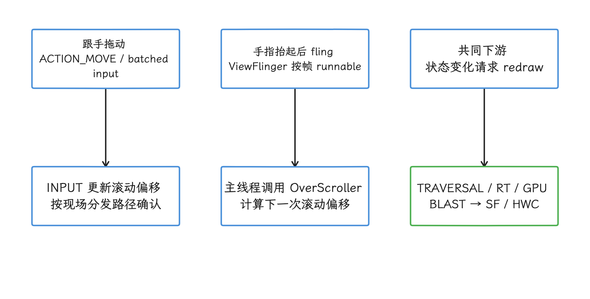

图：拖动依赖输入，惯性滚动由按帧 runnable 继续更新位移。 两者仍进入同一宿主 HWUI 显示链；OverScroller 不是独立线程。

### FrameTimeline 与 Jank 检测

FrameTimeline 从 Android 12 起为标准 App Window 提供 `SurfaceFrame` 和 `DisplayFrame` 的 expected/actual（预期/实际） 时间线。App 通过 FrameTimeline VSync id 选择预期 present 时间线；该信息沿 HWUI/BLAST transaction 进入 SurfaceFlinger。

我们先分清两类 token：

- `surface_frame_token` 是应用工作对应的 VSync token，同一进程的多个 layer 可以共享它；须结合 `upid` 与 `layer_name` 区分记录；
- `display_frame_token` 关联合成后的 DisplayFrame。

一个 DisplayFrame 可以包含多个进程、多个 layer 的 SurfaceFrame，两种 token 合不成一个“端到端 token”。

<!-- gracker-diagram: ch13-01-42-surface-display-token -->
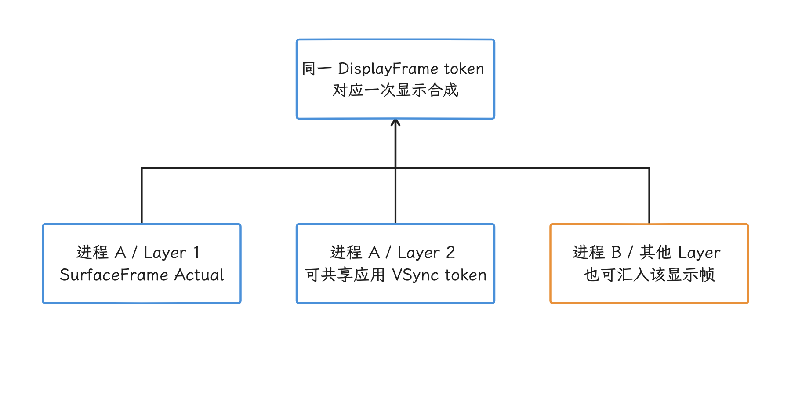

图：显示合成帧可汇入多个进程、多个 Layer 的 SurfaceFrame。 surface token 与 display token 作用不同，不能合成一个通用端到端 id。

#### Expected 与 Actual

比较 deadline（截止时间） 时，应使用完整区间：

- expected end = `expected.ts + expected.dur`；
- actual end = `actual.ts + actual.dur`；
- overrun = actual end - expected end，表示超出预期截止时间的时长。

`SurfaceFrame::setAcquireFenceTime()` 把 App actual end 设置为 `max(acquire fence signal time, queue time)`；fence 尚未 signal 时，暂用 queue time。对标准 HWUI 窗口，actual end 因而反映 Producer 完成可读与 buffer post（提交入队） 两个时间点中较晚的一项，UI thread 返回时刻替代不了它。

<!-- gracker-diagram: ch13-01-43-actual-end -->
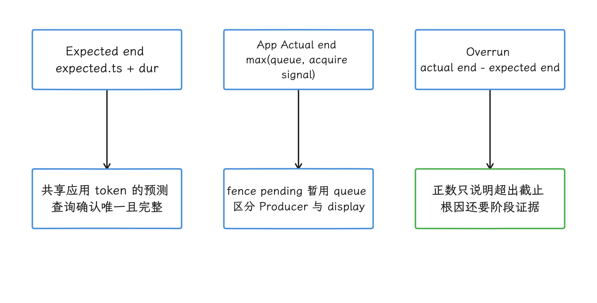

图：完整区间的结束时刻用于比较，App Actual end 结合 queue 与写入完成时间。 acquire 仍 pending 时源码暂用 queue time；不能换成 UI 返回时刻或面板呈现时刻。

`jank_type` 给出的是卡顿分类线索，根因还要靠对应阶段的记录来确定。`Buffer Stuffing` 要结合 dequeue wait、queued backlog、`BufferTX`、latch、release fence 和 recovery trace 来看；SQL `jank_type` 中的 `SurfaceFlinger CPU Deadline Missed`、`SurfaceFlinger GPU Deadline Missed`、`Display HAL`、`Prediction Error` 分别指向 SF CPU、SF GPU、显示 HAL 或预测误差，也要与对应的线程或硬件记录对齐。

下面的 Perfetto SQL 用于按 SurfaceFrame token 对齐目标应用的 expected/actual 记录：

```sql
INCLUDE PERFETTO MODULE android.frames.timeline;

WITH expected_unique AS (
  SELECT upid, surface_frame_token,
         MIN(id) AS expected_id, MIN(ts) AS expected_ts,
         MIN(dur) AS expected_dur
  FROM expected_frame_timeline_slice
  WHERE surface_frame_token IS NOT NULL
  GROUP BY upid, surface_frame_token
  HAVING COUNT(*) = 1 AND MIN(dur) >= 0
)
SELECT
  a.id AS actual_id, a.surface_frame_token, a.display_frame_token,
  a.ts AS actual_ts, a.dur AS actual_dur,
  e.expected_id, e.expected_ts, e.expected_dur,
  CASE WHEN e.expected_id IS NOT NULL
       THEN (a.ts + a.dur) - (e.expected_ts + e.expected_dur)
  END AS overrun_ns,
  a.jank_type, a.present_type, a.on_time_finish, a.layer_name
FROM actual_frame_timeline_slice AS a
JOIN process AS p ON a.upid = p.upid
LEFT JOIN expected_unique AS e
  ON a.upid = e.upid
 AND a.surface_frame_token = e.surface_frame_token
WHERE p.name = 'com.example.app'
  AND a.surface_frame_token IS NOT NULL
  AND a.layer_name = 'TARGET_LAYER_FROM_TRACE'
  AND a.dur >= 0
ORDER BY a.ts;
```

先把 `com.example.app` 和 `TARGET_LAYER_FROM_TRACE` 替换为现场进程名与精确 Layer 名；Layer 不保证包含包名。Actual 按 id/Layer 保留，Expected 按解析器的 `upid + surface_frame_token` 语义关联，不要求 Layer 相等；同 token 的多个 Layer 可共享一份预测。Expected 缺失、未结束或异常重复时，`overrun_ns` 为 NULL。`overrun_ns > 0` 只表示 Actual end 晚于 Expected end，不能单独说明根因；不同 Layer 的 Actual 仍应分别统计，再检查对应时窗的 CPU、GPU、BufferQueue 与 SF/HWC。

<!-- gracker-diagram: ch13-01-44-deadline-query-guards -->
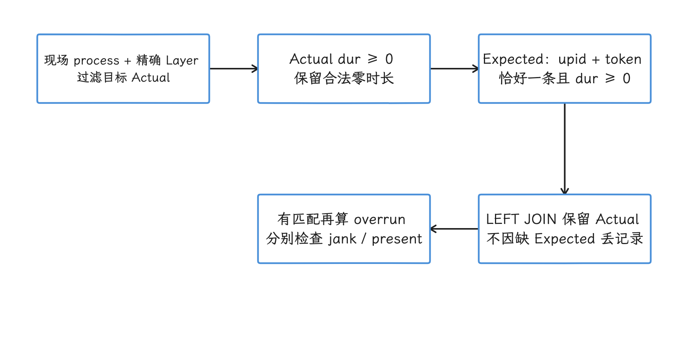

图：Actual 保留目标 Layer，Expected 按进程/token 唯一完整记录关联。 不能用包名猜 Layer，也不能任意选重复 Expected；未匹配保留 NULL。

#### FrameTimeline 的覆盖边界

标准 HWUI App Window 是 FrameTimeline 覆盖较完整的场景。SurfaceView 主体、Camera、Video、游戏引擎或其他独立 Producer 不一定提供同样完整的 App actual slice。缺少目标 layer/token 时，应回到 producer queue、frame number、`BufferTX`、latch、HWC 和 present timing。

<!-- gracker-diagram: ch13-01-45-coverage-fallback -->
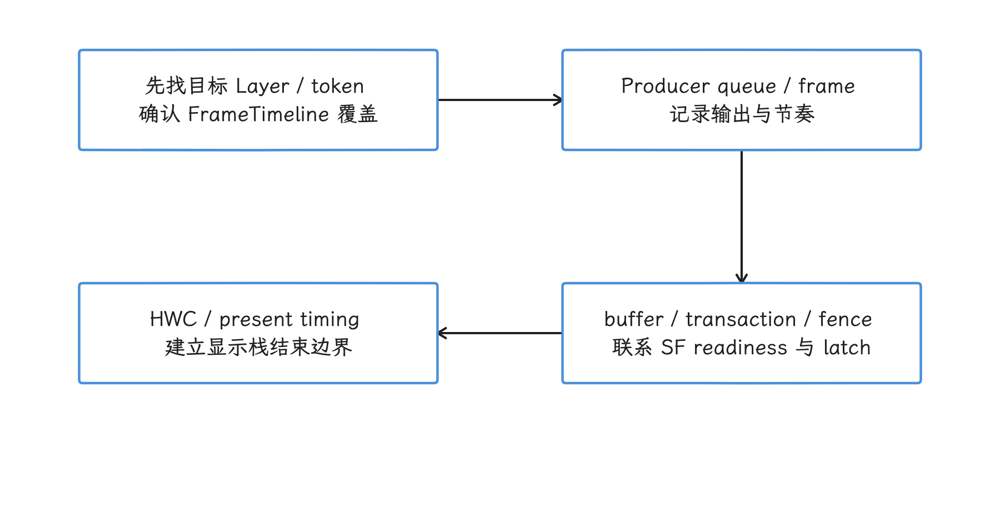

图：目标 Layer 没有完整 App 时间线时，沿 Producer 到显示输出补证。 没有 slice 不是没有工作；独立 Camera、视频、游戏的覆盖取决于实际接入。

### Compose 在标准 App Window 中的位置

纯 Compose 或 `ComposeView` 不会因声明式 UI 自动创建独立 Surface。在普通宿主中，Compose 内容仍通过 Android owner（连接 Compose 与 Android View/HWUI 的宿主对象）写入当前 App Window；`syncAndDrawFrame()` 之后继续走 RenderThread、BLAST、SurfaceFlinger 与 HWC。

Compose 改变的是 MainThread 生成 UI 内容的方式：

- Composition 执行相关 composable（Compose UI 函数），更新需要重新生成的 UI tree；
- Layout 测量节点尺寸并确定放置位置；
- Drawing 把绘制操作交给 Android Canvas/HWUI。

状态在不同阶段被读取时，可能只触发对应阶段或后续阶段的必要工作，不表示每帧完整重做三阶段。`SubcomposeLayout`、Lazy layout 等可以在布局期间组合子项；intrinsic 查询与 Lookahead 也有自己的测量/预测边界。它们不能概括为“普通测量过程允许同一 child 随意反复 measure”，需按对应 Compose 实现分析阶段交错。

<!-- gracker-diagram: ch13-01-46-compose-window -->
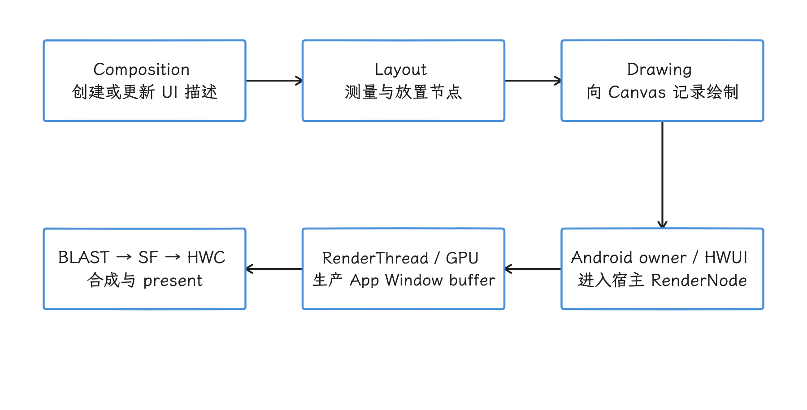

图：Compose 组织 UI 内容，宿主窗口继续走标准 HWUI 显示链。 阶段可跳过或交错；图不表示每帧完整重做，也不允许普通测量任意反复 measure。

判断类型时看 Producer、Surface 和 layer：

| 页面结构 | 默认分类 |
|---|---|
| View 页面嵌 `ComposeView` | 标准 HWUI |
| Compose 页面嵌普通 `AndroidView` | 通常仍是标准 HWUI |
| Compose 中嵌 `SurfaceView`/视频/Camera | SurfaceView 或混合类型 |
| Compose 中嵌 `TextureView` | TextureView 或混合类型 |
| 页面主体为 WebView/Flutter 等引擎 | 对应引擎类型 |

Compose Runtime、Compiler、Kotlin、BOM（集中约束依赖版本的版本清单） 和 tracing 的版本必须单独记录，用 `android-17.0.0_r1` 推断 strong skipping（跳过输入未变化的 composable）、slice 名或 compiler 行为，是推不出来的。没有 composition tracing 时，可以判断窗口级 MainThread/HWUI 成本，宿主 slice 要精确归因到某个 composable 就做不到了。

<!-- gracker-diagram: ch13-01-47-compose-embedded-types -->
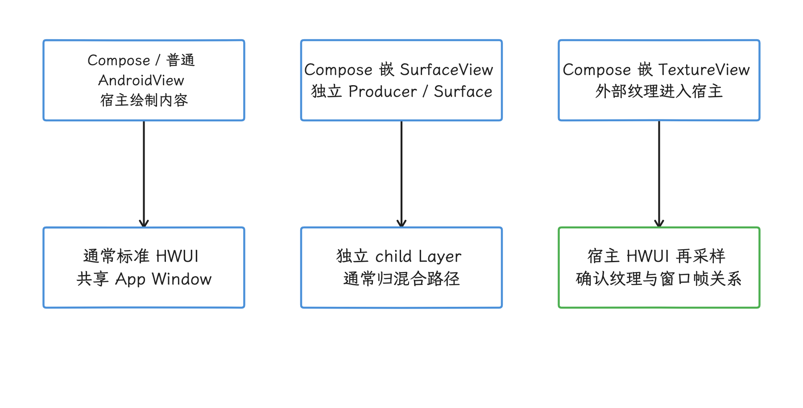

图：分类取决于实际 Producer 与承载对象，Compose 不自动创建独立 Surface。 嵌入 WebView、Flutter、视频等要另查拓扑；Jetpack 与平台版本分别固定。

### 系统策略的核对方法

#### ADPF hint 的效果核对

ADPF（Android Dynamic Performance Framework，Android 动态性能框架）的 `PerformanceHintManager.Session` 可以报告 target/actual work duration（目标/实际工作时长）。HWUI 的 `CanvasContext` / `HintSessionWrapper` 也会管理 hint session。提示交给 Power HAL（电源硬件抽象层） 和 vendor 实现后，API 不承诺绑定固定 CPU、保持固定频率或每次都提升性能。

若要证明 ADPF 产生效果，至少应对齐 session 上报、vendor hint 响应和后续调度/频率变化。只看到频率升高或只看到 API 调用，都不够。

<!-- gracker-diagram: ch13-01-48-adpf-evidence -->
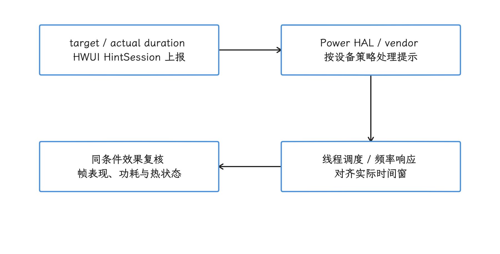

图：把 hint 上报、vendor 响应与调度变化联系起来。 API 不承诺固定 CPU 或频率；时间关联还需同条件对照检验效果。

#### HWC 路径看 composition 结果

HWC 能否使用 overlay，以及是否支持某种 transform（变换）、format（像素格式）、dataspace（颜色空间与范围）、blend（混合） 或 protected content（受保护内容），取决于设备实现和当时可用资源。应查看每个 layer 的 composition type、client composition、FrameTimeline GPU composition、HWC trace 或 dumpsys。

功耗下降、SF slice 变短或 present 提前，单独哪一项都证明不了目标 layer 使用 DEVICE composition。

<!-- gracker-diagram: ch13-01-49-hwc-proof -->


图：目标 Layer 的合成类型要由现场输出记录证明。 SurfaceView、低功耗或较短 SF slice 均不能单独推出 DEVICE。

#### 预取的实际收益

RecyclerView GapWorker、Compose Lazy prefetch（预取）、图片预热和 shader/pipeline cache 可以把能够提前确定的工作移到关键 deadline 之前，但未知的后续 UI 状态它生成不了，`INPUT → ANIMATION → INSETS_ANIMATION → TRAVERSAL → COMMIT` 顺序也不因此改变。

证明预取有效，需要看到 prefetch 工作提前执行，并且后续关键帧的 bind/measure/upload 或 pipeline creation 成本下降；只凭滑动变顺，推断不出系统“提前补帧”。

<!-- gracker-diagram: ch13-01-50-prefetch-critical-path -->


图：先证明工作提前发生，再确认后续关键帧的对应成本下降。 未知状态不能预先生成；预取不会改变 Choreographer 五阶段顺序。

#### 结论与证据门槛

| 想确认的结论 | 至少要保存的证据 | 单独不足的信号 |
|---|---|---|
| UI/RenderThread 调度等待下降 | 同场景 runnable delay、线程状态、CPU 落点和优先级/cgroup（控制组）对比 | 单帧 duration 变短 |
| ADPF 产生设备侧响应 | HintSession 上报、vendor hint 响应、随后发生的调度或频率变化 | 只有 API 调用或只有 cpufreq 上升 |
| BufferQueue 深度改变 | max dequeued/acquired、slot/async 配置及 queue wait 对比 | `dequeueBuffer` 变短 |
| stuffing recovery 生效 | recovery trace、主动 delay 与 backlog 回落 | 只有 FrameTimeline `Buffer Stuffing` |
| HWC 使用 DEVICE composition | per-layer composition type、HWC 或 GPU composition 证据 | 功耗下降、SF slice 变短或 present 提前 |

### 标准路径的源码入口

标准路径的平台源码入口如下：

- [`Choreographer.java`](https://android.googlesource.com/platform/frameworks/base/+/android-17.0.0_r1/core/java/android/view/Choreographer.java) 与 [`ViewRootImpl.java`](https://android.googlesource.com/platform/frameworks/base/+/android-17.0.0_r1/core/java/android/view/ViewRootImpl.java)：VSync 申请、五类 callback、buffer stuffing recovery、traversal；
- [view flags](https://android.googlesource.com/platform/frameworks/base/+/android-17.0.0_r1/core/java/android/view/flags/view_flags.aconfig)：`buffer_stuffing_multi_recovery` 与 `buffer_stuffing_recovery_threshold` 的可变 flag 定义；
- [`ThreadedRenderer.java`](https://android.googlesource.com/platform/frameworks/base/+/android-17.0.0_r1/core/java/android/view/ThreadedRenderer.java)、[`HardwareRenderer.java`](https://android.googlesource.com/platform/frameworks/base/+/android-17.0.0_r1/graphics/java/android/graphics/HardwareRenderer.java) 与 [HWUI JNI](https://android.googlesource.com/platform/frameworks/base/+/android-17.0.0_r1/libs/hwui/jni/android_graphics_HardwareRenderer.cpp)：Java 到 native HWUI；
- [`RenderProxy.cpp`](https://android.googlesource.com/platform/frameworks/base/+/android-17.0.0_r1/libs/hwui/renderthread/RenderProxy.cpp)、[`DrawFrameTask.cpp`](https://android.googlesource.com/platform/frameworks/base/+/android-17.0.0_r1/libs/hwui/renderthread/DrawFrameTask.cpp)、[`CanvasContext.cpp`](https://android.googlesource.com/platform/frameworks/base/+/android-17.0.0_r1/libs/hwui/renderthread/CanvasContext.cpp)：UI unblock、RenderThread draw、buffer duration、hint session；
- [`BufferQueueProducer.cpp`](https://android.googlesource.com/platform/frameworks/native/+/android-17.0.0_r1/libs/gui/BufferQueueProducer.cpp)、[`BufferQueueConsumer.cpp`](https://android.googlesource.com/platform/frameworks/native/+/android-17.0.0_r1/libs/gui/BufferQueueConsumer.cpp) 与 [`BLASTBufferQueue.cpp`](https://android.googlesource.com/platform/frameworks/native/+/android-17.0.0_r1/libs/gui/BLASTBufferQueue.cpp)：slot 状态、dequeued/acquired 上限、buffer transaction 与 release；
- [`SurfaceFlinger FrontEnd`](https://android.googlesource.com/platform/frameworks/native/+/android-17.0.0_r1/services/surfaceflinger/FrontEnd/)、[`Layer.cpp`](https://android.googlesource.com/platform/frameworks/native/+/android-17.0.0_r1/services/surfaceflinger/Layer.cpp) 与 [`SurfaceFlinger.cpp`](https://android.googlesource.com/platform/frameworks/native/+/android-17.0.0_r1/services/surfaceflinger/SurfaceFlinger.cpp)：requested state、snapshot、`BufferTX`、transaction readiness 与 latch；
- [`HWComposer.cpp`](https://android.googlesource.com/platform/frameworks/native/+/android-17.0.0_r1/services/surfaceflinger/DisplayHardware/HWComposer.cpp)、[`HWC2.cpp`](https://android.googlesource.com/platform/frameworks/native/+/android-17.0.0_r1/services/surfaceflinger/DisplayHardware/HWC2.cpp) 与 [`FrameTimeline.cpp`](https://android.googlesource.com/platform/frameworks/native/+/android-17.0.0_r1/services/surfaceflinger/Scheduler/FrameTimeline.cpp)：composition strategy、present/release fence、SurfaceFrame/DisplayFrame。
- [Perfetto `events.sql`](https://android.googlesource.com/platform/external/perfetto/+/android-17.0.0_r1/src/trace_processor/perfetto_sql/stdlib/prelude/after_eof/events.sql)：`actual_frame_timeline_slice` 与 `expected_frame_timeline_slice` 的字段定义。

Kernel 侧固定到 `android17-6.18-2026-06_r6`：

- [`kernel/sched/core.c`](https://android.googlesource.com/kernel/common/+/refs/tags/android17-6.18-2026-06_r6/kernel/sched/core.c)、[`kernel/cgroup/cpuset.c`](https://android.googlesource.com/kernel/common/+/refs/tags/android17-6.18-2026-06_r6/kernel/cgroup/cpuset.c)：调度、uclamp 与 cpuset；
- [`kernel/sched/cpufreq（CPU 频率调节）_schedutil.c`](https://android.googlesource.com/kernel/common/+/refs/tags/android17-6.18-2026-06_r6/kernel/sched/cpufreq_schedutil.c)：调度利用率到 schedutil；
- [`drivers/dma-buf/`](https://android.googlesource.com/kernel/common/+/refs/tags/android17-6.18-2026-06_r6/drivers/dma-buf/) 与 [`drivers/dma-buf/sync_file.c`](https://android.googlesource.com/kernel/common/+/refs/tags/android17-6.18-2026-06_r6/drivers/dma-buf/sync_file.c)：共享 buffer 和用户态 fence fd 的通用内核机制。

Vendor governor（厂商的频率调节策略）、Power HAL、GPU driver、Composer、display driver 与 panel 时序不在 common kernel 结论范围内，必须用目标设备源码和 trace 补充证据。


## 版本与实现边界

标准路径跨版本比较时，要单独核对的节点集中在下表：

| 平台 | 标准页面相关节点 | 分析影响 |
|---|---|---|
| Android 11 / API 30 | BLAST 进入平台主线 | 旧 tag 仍需按当时 Layer/transaction 对象分析 |
| Android 12 / API 31 | App Window BLAST 与 FrameTimeline 形成现代基线；`PerformanceHintManager` 公开 | 可关联 SurfaceFrame/DisplayFrame，ADPF 仍只提供 hint |
| Android 13 / API 33 | `AutoSingleLayer` latch-unsignaled 成为默认策略 | transaction latch 与 acquire-fence signal 可以分离 |
| Android 14 / API 34 | 标准 Choreographer/HWUI/BLAST/SF/HWC 拓扑延续 | SurfaceView 的 alpha/lifecycle 变化不要套到 App Window |
| Android 15 / API 35 | Window 可表达 desired HDR headroom；edge-to-edge（内容延伸到系统栏区域）可能改变 Insets/Traversal 成本 | HDR/Insets 变化不自动改变标准页面分类 |
| Android 16 / API 36 | 标准主拓扑延续 | 跨版本实验要固定 vendor、刷新率、应用构建与 Jetpack 版本 |
| Android 17 / API 37 | 当前锚点：FrontEnd snapshot、现行 BLAST acquired-count、buffer stuffing recovery、预测 present time 与 HWC fast path | 方法名和 flag 以 `android-17.0.0_r1` 为准，不从当前 tag 反推首引版本 |

<!-- gracker-diagram: ch13-01-51-platform-vendor-library -->


图：跨版本实验分别固定平台 tag、应用依赖和设备实现。 当前源码不能独立证明首引版本、设备 flag 或 vendor 行为。


## 结论

标准 HWUI 页面的一帧由 MainThread 准备状态，RenderThread/GPU 生成 App Window buffer，BLAST 把 BufferItem 包装成 SurfaceControl transaction，SurfaceFlinger/HWC 完成合成与 present。

定位问题时，我们依次对齐 `doFrame`、`syncAndDrawFrame`/`DrawFrame`、dequeue/GPU/queue、`BufferTX`、latch、FrameTimeline 和 present feedback。每个信号只回答一个阶段；只有按同一 SurfaceFrame、frame number 或明确的相邻时序把它们对齐，才能区分 UI 工作量、调度等待、GPU 执行、BufferQueue 等待、SF 合成与 display 后段延迟。


<!-- gracker-diagram: ch13-01-52-end-to-end-evidence -->


图：把每段观测按 buffer、token 与明确依赖连接起来。 每个信号只回答一个阶段，单独最长 slice 或平均 FPS 都不能完成归因。