# Android 软件、离屏与混合渲染路径

软件渲染回答“谁生成像素”，离屏渲染回答“像素先写到哪里”，这是两个独立的维度：CPU 可以直接写可见 `Surface`，GPU 也可以先把结果画进离屏纹理或 `HardwareBuffer`（可在 CPU、GPU 和硬件模块之间共享的图形 buffer）。拿到一个渲染问题，我们先按顺序确认 Producer（生成 buffer 的组件）、输出位置、Consumer（取得并读取 buffer 的组件）和最终可见 layer。

<!-- gracker-diagram: ch13-02-01-orthogonal-dimensions -->
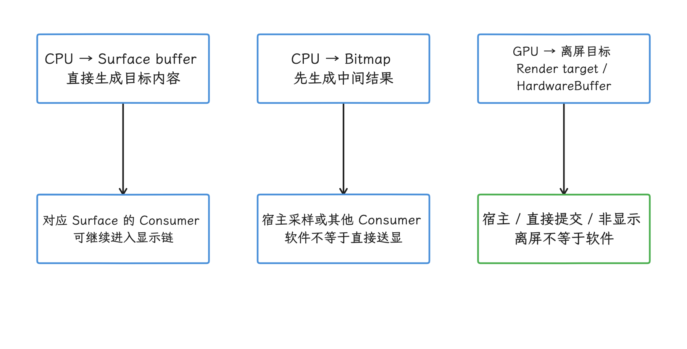

图：分别确认像素由谁生成，以及先写入哪个目标。 CPU 可以直写可见 Surface，GPU 也可生成离屏中间结果；可见性还由后续提交决定。

> 源码基线：平台 AOSP `android-17.0.0_r1`；内核 `android17-6.18-2026-06_r6`（涉及 dma-buf（共享 buffer 的内核机制）、dma-fence（内核同步对象）、sync_file（把 fence 暴露为文件描述符的接口）、调度与内存回收时以内核为准）。

## CPU 光栅化与离屏缓冲区

这一节我们先认路，再走流程：从“像素由谁生产、结果写到哪里”的分类出发，依次经过整窗口软件绘制、业务线程直接写 `Surface`、单 View software layer 与 GPU 离屏，再把 CPU 直写可见 Surface 的 lock、draw、post 拆开，最后落到 trace 证据与成本估算上。

### 软件与离屏路径的分类

#### 先按“生产方式 × 结果去向”分类

碰到一条渲染路径，我们先问两件事：像素由谁生产，结果先写到哪里。按这两个维度，常见路径可以归纳成四组：

| 生产者 | 结果先写到 | 最终可见对象 | 典型入口 |
|---|---|---|---|
| CPU | 当前窗口或独立 `Surface` buffer | 对应 SurfaceFlinger layer | `ViewRootImpl.drawSoftware()`、`SurfaceHolder.lockCanvas()` |
| CPU | Bitmap 中间结果 | 宿主 App Window | `LAYER_TYPE_SOFTWARE`、显式 Bitmap Canvas |
| HWUI / GPU | GPU render target（渲染目标）或 `HardwareBuffer` | 取决于后续消费者 | 硬件 Canvas 的 `saveLayer()`、`RenderEffect`、`HardwareBufferRenderer` |
| App GPU | `HardwareBuffer` | 独立 `SurfaceControl` layer | EGL / Vulkan 生产后调用 `Transaction#setBuffer()` |

表格前两行是 CPU 软件栅格化，由 CPU 把绘制指令转换成像素；后两行是 GPU 离屏渲染，和软件渲染分属两个维度。判断一条路径的性质时，我们盯住生产者和中间结果的去向：中间结果若只交给编码器、算法或缓存，它就停在显示链之外，后面自然也就看不到 SurfaceFlinger latch、HWC present 和 display present fence。

下面的图用于确认中间结果的消费者，以及它是否进入显示链：

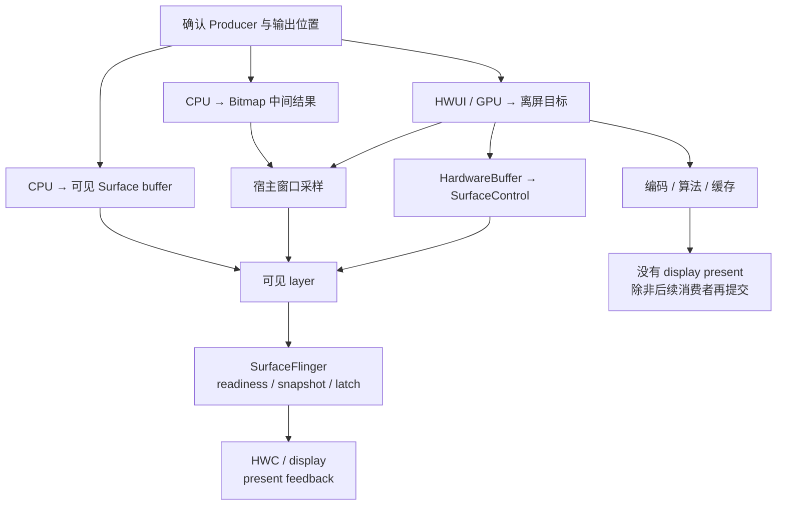

从图上读，三条分支的去向各不相同：纯离屏分支停在编码、算法或缓存消费者手里，不会自动产生 SF layer；走宿主窗口采样的，显示证据要到宿主 App Window 上找；走 `Transaction#setBuffer()` 提交的，我们接着跟踪目标 `SurfaceControl` layer 的 transaction、latch、composition、present 与 release。

<!-- gracker-diagram: ch13-02-02-consumer-destination -->
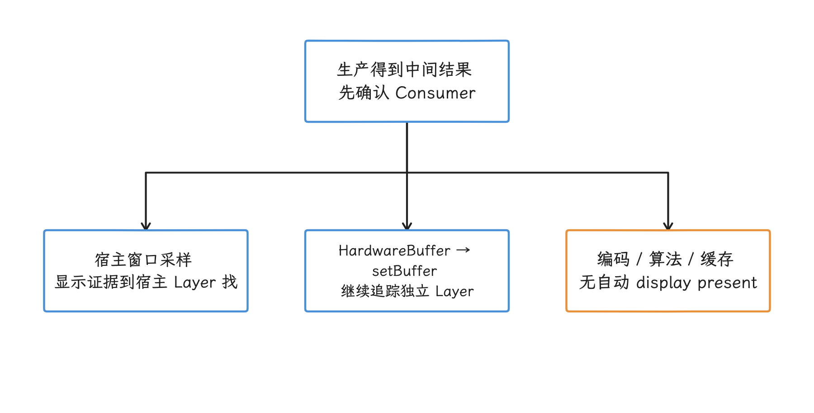

图：中间结果可被宿主采样、直接提交到 Layer 或留在非显示任务中。 离屏完成不自动创建 SF Layer，也不自动产生 display present。

#### 整窗口软件绘制

这一类对应表格第一行：应用或 Activity 关闭硬件加速时，普通 View 树改由 `ViewRootImpl.drawSoftware()` 绘制——锁住窗口 `Surface`，取得 software Canvas，调用 `mView.draw(canvas)`，最后执行 `unlockCanvasAndPost()`。

这条路径通常仍由 `ViewRootImpl` 的测量、布局、绘制遍历和 `Choreographer#doFrame()` 驱动，区别只在窗口 buffer 改由 CPU Canvas 生成，HWUI RenderThread 的 GPU 绘制不参与，VSync 调度则照旧可能起作用。所以在 trace 里少了 RenderThread slice 时，我们还不急着下“当前在走软件路径”的结论，判定要靠后文 Trace 视角列出的组合证据。

<!-- gracker-diagram: ch13-02-03-software-window -->
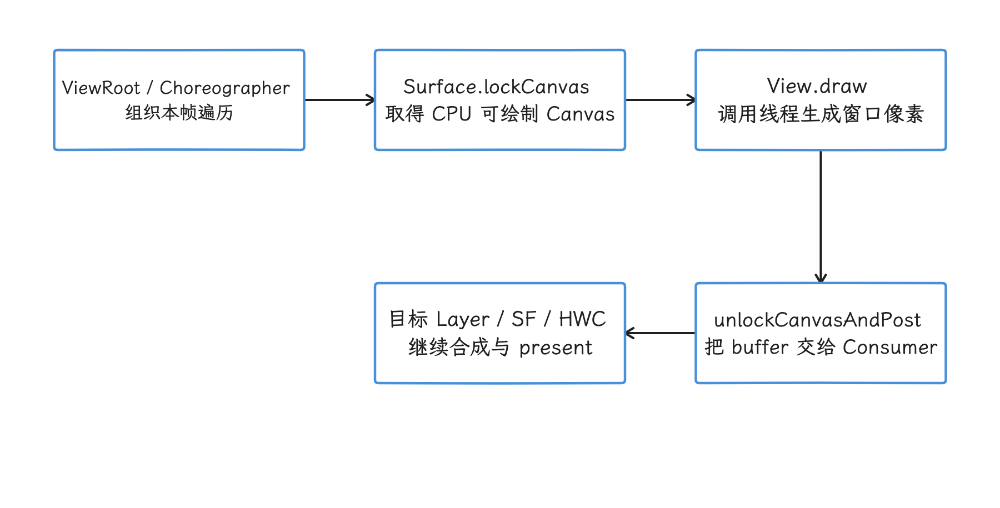

图：关闭窗口硬件加速后，ViewRoot 用 CPU Canvas 生成窗口 buffer。 Choreographer 和 BufferQueue/SF/HWC 仍可能参与；没有 RT slice 单独不能定案。

#### 业务线程直接写 `Surface`

另一类入口由业务代码自己驱动：`Surface.lockCanvas()`、`SurfaceHolder.lockCanvas()` 或 `lockHardwareCanvas()` 是显式 Surface 生产接口：

- `lockCanvas()` 返回 CPU Canvas；
- `lockHardwareCanvas()` 返回硬件加速 Canvas，走的是 GPU 路径；
- `SurfaceHolder` 的生产循环可以放在业务线程中，节奏由应用决定，未必跟随宿主窗口 `Choreographer`。

在 trace 里看到 lock/post（取得 Canvas 后提交）循环（先取得 Canvas 再提交）时，我们要同时确认线程、Surface/layer 和 Canvas 类型：它可能是软件 Producer，也可能是独立硬件 Canvas Producer。

<!-- gracker-diagram: ch13-02-04-surface-canvas -->
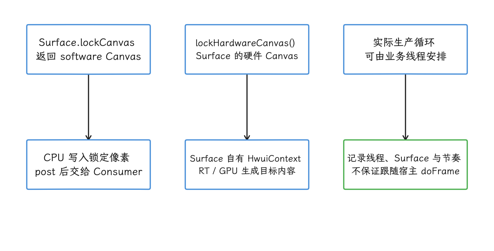

图：同样的 lock/post 外形可以对应 CPU 写入或 HWUI/GPU 绘制。 Surface.lockHardwareCanvas 使用该 Surface 的上下文，不能一概看成宿主窗口绘制树。

#### 单个 View 的 software layer

`View#setLayerType(LAYER_TYPE_SOFTWARE, paint)` 只改变该 View 子树：公开语义是 software layer 由 Bitmap 承载，也就是先把子树画成一张 CPU Bitmap，`View.buildLayer()` 的 software 分支调用的正是 `buildDrawingCache(true)`。宿主窗口若开启硬件加速，这块 Bitmap 之外的事情照旧，后续仍有 RenderThread、窗口 BufferQueue、BLAST transaction 和 SurfaceFlinger layer。

合并发生在应用侧，所以 SurfaceFlinger 看不到独立的“software View layer”：这块 Bitmap 已经与其他 View 内容一起进了宿主窗口 buffer，SF 只能观察到 App Window。

<!-- gracker-diagram: ch13-02-05-view-software-layer -->
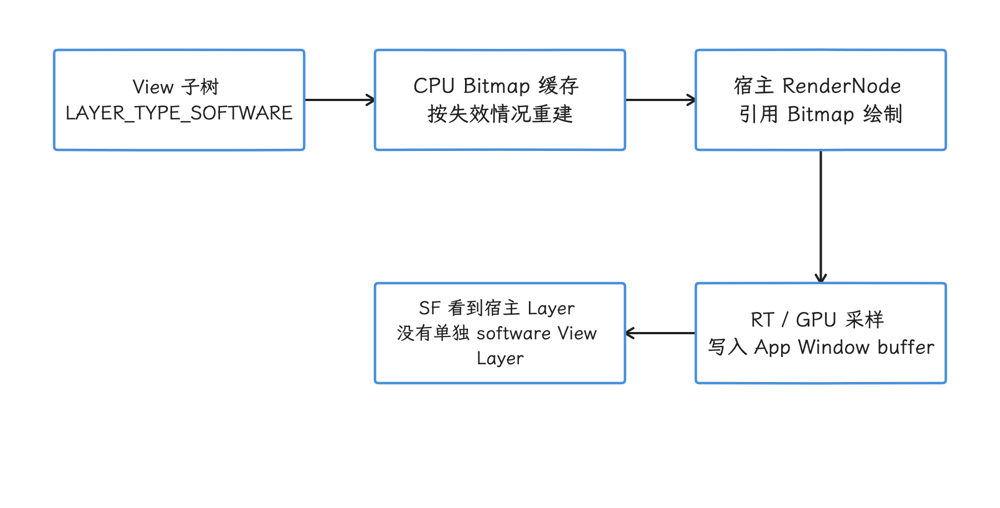

图：View 子树先栅格化为 Bitmap，再参与宿主硬件帧。 它不单独创建 SurfaceFlinger 可见 Layer；缓存失效时 CPU 与 GPU 成本可能并存。

公开的 `buildDrawingCache()` 从 API 28 起已弃用，业务代码应避免依赖它；源码里出现内部 drawing-cache 分支，也预测不了设备上会有名为 `uploadToTexture` 的固定 Perfetto slice，更稳的证据是 CPU Bitmap 栅格化、缓存失效、宿主 HWUI 帧以及可能的纹理上传成本。

#### 三种常被混淆的 layer

| 入口 | 软件 Canvas | 硬件 Canvas |
|---|---|---|
| `LAYER_TYPE_SOFTWARE` | Bitmap 软件层 | 子树先栅格化到 Bitmap，再由宿主硬件帧采样 |
| `LAYER_TYPE_HARDWARE` | 硬件加速关闭时按 software layer 行为处理 | HWUI/GPU 中间层 |
| `Canvas.saveLayer()` | 软件离屏像素存储 | GPU render target/FBO（Framebuffer Object，帧缓冲对象）类中间目标 |

`saveLayer()` 由 CPU 还是 GPU 执行，取决于当前 Canvas 类型，光看 API 名判断不出来。`Canvas.isHardwareAccelerated()` 回答当前 Canvas 是否硬件加速；`View.isHardwareAccelerated()` 只说明 View 所在窗口是否开启硬件加速。所以硬件加速窗口中的 View，仍可能被画到 Bitmap software Canvas 上。

<!-- gracker-diagram: ch13-02-06-three-layer-meanings -->
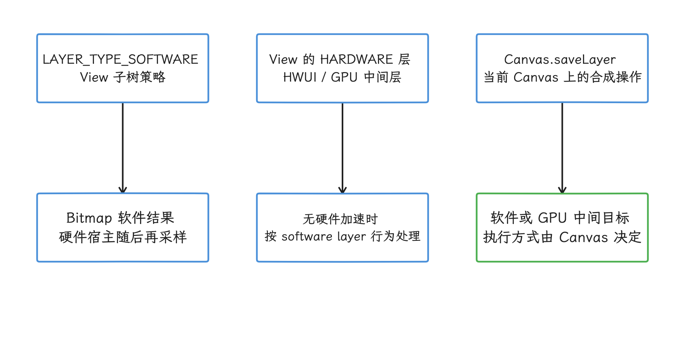

图：分清 View 缓存策略与当前 Canvas 的中间合成操作。 中间资源可复用或被优化，不能按 API 调用次数推算 FBO 数。

GPU 驱动错误、Surface 失效或资源不足各有各自的恢复和错误处理路径，把它们笼统写成“系统会自动把整个窗口降级为软件渲染”，等于跳过了对入口的确认。如果 trace 显示软件路径，我们回到窗口配置、Canvas 类型、`setLayerType()` 和调用栈逐一确认。

<!-- gracker-diagram: ch13-02-07-hardware-queries -->
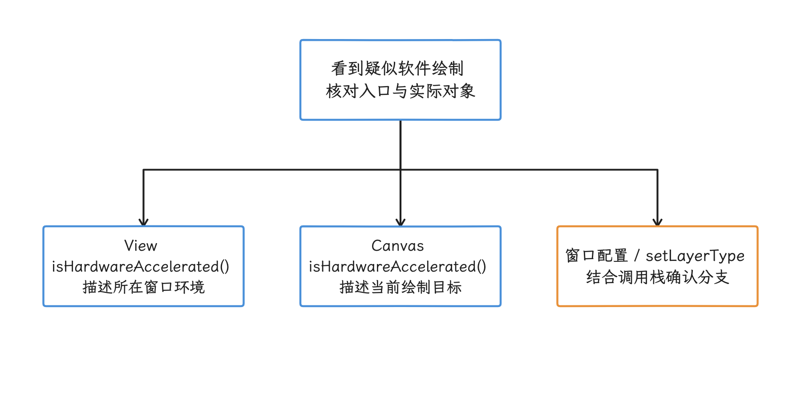

图：先核对实际 Canvas，再解释软件路径的来源。 GPU 错误、Surface 失效或资源不足不等于自动降级整个窗口。

### 完整执行流程

#### 整窗口 `drawSoftware()` 主链

CPU 直写窗口 Surface 的完整调用链如下：

```text
ViewRootImpl.drawSoftware(...)
  → Surface.lockCanvas(dirty)
    → android_view_Surface.nativeLockCanvas(...)
      → Surface::lock(...)
        → dequeueBuffer(...)
        → GraphicBuffer::lockAsync(..., fenceFd)
  → View.draw(canvas)
  → Surface.unlockCanvasAndPost(canvas)
    → Surface::unlockAndPost()
      → GraphicBuffer::unlockAsync(&fenceFd)
      → queueBuffer(buffer, fenceFd)
```

这条链不用 App HWUI RenderThread 绘制窗口 buffer，但仍受 BufferQueue slot、release fence、内存映射和下游消费速度约束。CPU 栅格化只发生在 lock 成功到 unlock 之间，覆盖不了整条提交和显示路径，所以归因时我们把 lock、draw、post 这几段分开计时。

<!-- gracker-diagram: ch13-02-08-cpu-lock-draw-post -->
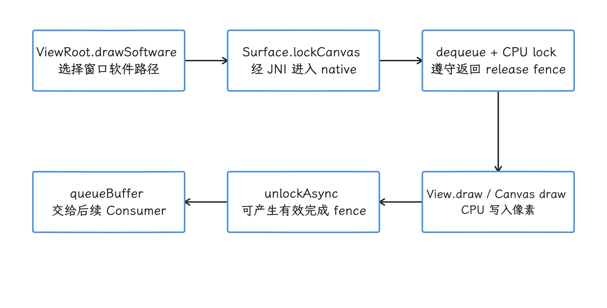

图：CPU 像素生产只是一段，前后仍有队列和同步工作。 图按主要依赖排序；lock 可包含 copyback，post 也可能发生等待或失败。

#### Lock：取得可写 buffer

`Surface::lock()` 先以 `NATIVE_WINDOW_API_CPU` 连接 Surface，通过 `dequeueBuffer()` 取得候选 `GraphicBuffer` 和 fence fd（承载同步 fence 的文件描述符），再调用 `GraphicBuffer::lockAsync()`。这一步可能撞上三类成本：

- 没有满足约束的 FREE slot，Producer 只能等 Consumer 释放；
- slot 已返回，但 release fence 尚未允许 CPU 写入；
- buffer 首次映射、page fault（访问页尚未映射）或 reclaim（内存回收）拖慢了映射路径。

`lockCanvas()` 的耗时没有跨设备通用的正常值：它除了可能执行 mmap（把 buffer 映射到进程地址空间），还要先经过 dequeue、fence 等步骤。16KB page size（内存页大小）可能改变页表和 fault 行为，但要判断某次 GraphicBuffer 映射的快慢，还得把图形 buffer 分配器 gralloc（图形 buffer 分配器）、buffer 复用、访问模式和内存压力一起放进测量，页大小只是其中一个变量。

<!-- gracker-diagram: ch13-02-09-lock-wait-causes -->
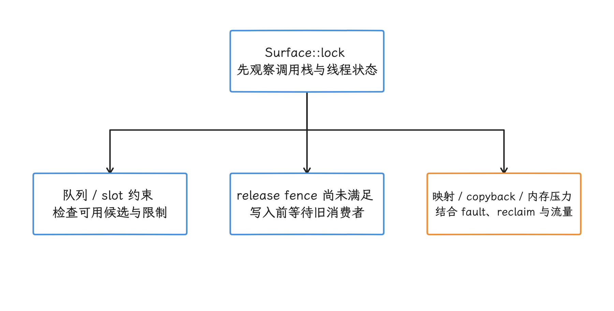

图：选槽、同步和内存访问都可能出现在 lock 路径。 无槽不保证只等待；还可能超时、非阻塞失败或数量上限报错。

#### Draw：CPU 生成像素

software Canvas 的 `drawPath()`、`drawText()`、`drawBitmap()` 等操作由 Skia 的 CPU 后端栅格化，在当前线程直接写入锁定的像素内存；硬件 Canvas 走的是另一条路：先录制宿主窗口 DisplayList，再由 RenderThread 提交 GPU draw。

CPU 栅格化成本由脏区面积、像素格式、混合、裁剪区域、路径复杂度、文字与图片采样共同决定。“每条命令逐像素串行执行”是对它的常见误解：Skia 和 vendor（设备或芯片厂商）库可以动用 SIMD（单条指令并行处理多个数据）、专用实现或内部任务。不过反过来也一样，别据此假设 Android View 的 software Canvas 会自动把一帧均匀分摊到多个 CPU。

<!-- gracker-diagram: ch13-02-10-cpu-raster-work -->
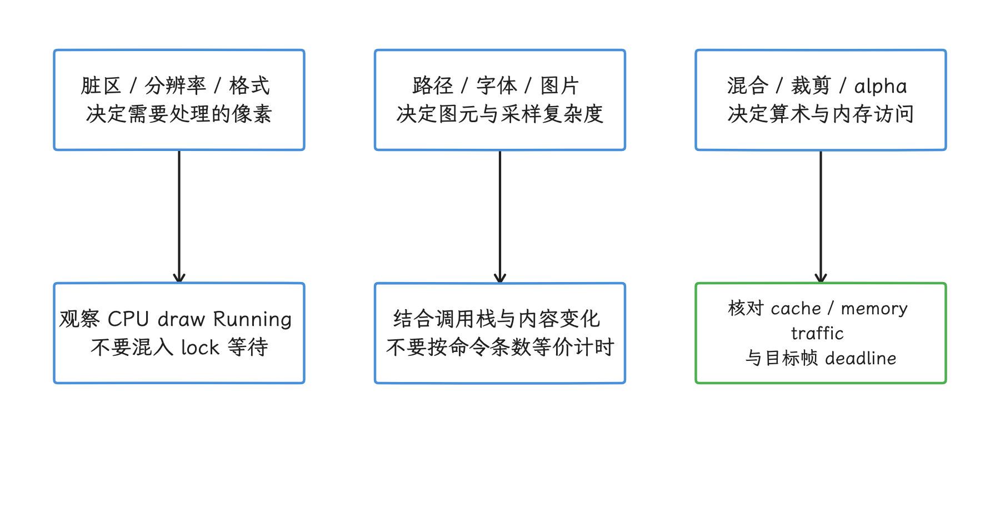

图：像素面积、混合与图元复杂度共同影响 CPU 绘制。 可用 SIMD 或专用实现，但不保证每帧自动均匀分摊到多个 CPU。

#### Unlock & Post：把 buffer 交给 Consumer

`Surface::unlockAndPost()` 调用 `GraphicBuffer::unlockAsync(&fd)`，再用该 fd 构造 fence 并 `queueBuffer()`。CPU 路径没有 HWUI 的 GPU draw completion fence（完成同步信号），但 gralloc unlock 仍可能返回有效 fd，所以软件渲染同样可能携带同步 fence。

下游把 Producer 完成信号作为 acquire（取得可读输入）边界，Consumer 读取 buffer 前必须遵守它；SurfaceFlinger/HWC 完成消费后，再通过 release fence 约束 Producer 何时可以复用旧 buffer。

下面的时序图以 App Window 的 `drawSoftware()` 为主，把 CPU 生产、BLAST/SF transaction 和显示消费分开：

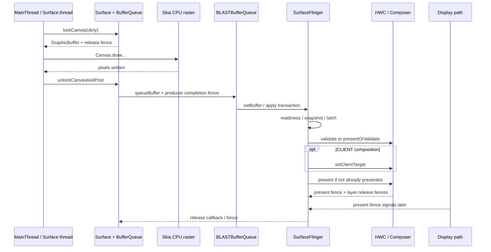

看图时我们记住两点：`queueBuffer()` 返回了，buffer 未必已经上屏；latch 发生了，panel（物理显示面板）也未必完成扫描。CPU buffer 可能被 HWC 直接消费，也可能由 RenderEngine 采样进 client target（GPU 合成后的显示目标）；走哪条路，由 format（像素格式）、dataspace（颜色空间与范围）、transform（变换）、crop（裁剪）、alpha（透明度）、保护属性、设备能力和本轮其他 layer 共同决定。

<!-- gracker-diagram: ch13-02-12-cpu-display-consumption -->
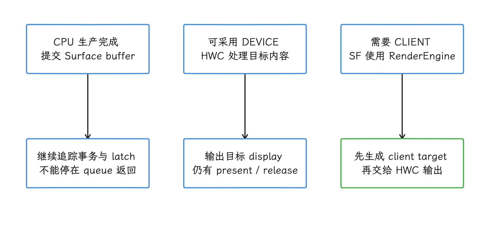

图：CPU 写入与最终采用 DEVICE/CLIENT 是不同决策。 路径由目标 display 的内容、格式、几何和设备能力协商，不由 Producer 名称保证。

自定义 Surface Producer 可能连接自己的 BufferQueue/layer，未必经过图中同一个 App Window BLAST adapter（适配层），它的生产线程和节奏也要单独确认。

<!-- gracker-diagram: ch13-02-11-post-completion-fence -->
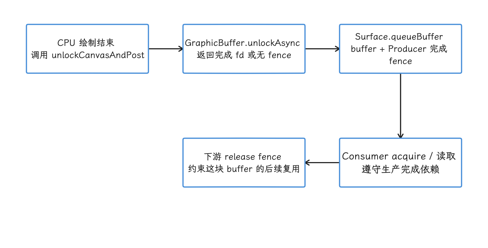

图：gralloc unlock 可返回完成 fence，Consumer 读取前仍须遵守。 没有 HWUI GPU draw 不等于没有同步；queue 返回也不证明已显示。

#### Dirty Rect 与 copyback（从旧 buffer 补回复用区域）

software Canvas 支持 dirty region（需要重画的区域），也就是只重画需要更新的部分；不过分析要往下再走一步，看看保留的旧像素是怎么补回来的。`Surface::lock()` 比较的是本轮的 back buffer（待写入的后备 buffer）与上一块已提交的 `mPostedBuffer`：

- 尺寸和 format 兼容时，计算上一轮有效区域与本轮新脏区的差集，通过 `copyBlt()` 执行 copyback，把需要保留的像素复制到当前 back buffer；
- copyback 补不回旧 buffer 里的复用区域时，把新脏区扩成整个 bounds（buffer 边界），并清理 slot 的 dirty-region 状态；
- 随后用最终 dirty bounds 执行 `lockAsync()`。

所以小脏区是一笔双向的账：CPU 重画可能少了，旧 buffer 到新 buffer 的内存复制却可能多了。尺寸变化、format 变化、Surface 重建、buffer 被丢弃或大范围脏区都会削弱收益。要判断 Dirty Rect 是否有效，我们同时测量 CPU draw 与 copyback 的内存流量。

<!-- gracker-diagram: ch13-02-13-copyback-decision -->
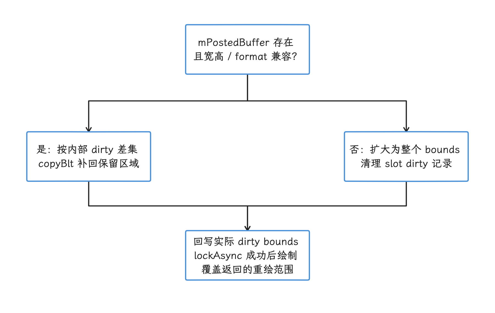

图：有兼容的已提交 buffer 时，补回内部 dirty 记录中本轮不重画的区域。 无兼容前 buffer 才扩大全量 dirty；不能推导任意 copyBlt 失败都自动全量重绘。

<!-- gracker-diagram: ch13-02-14-dirty-costs -->
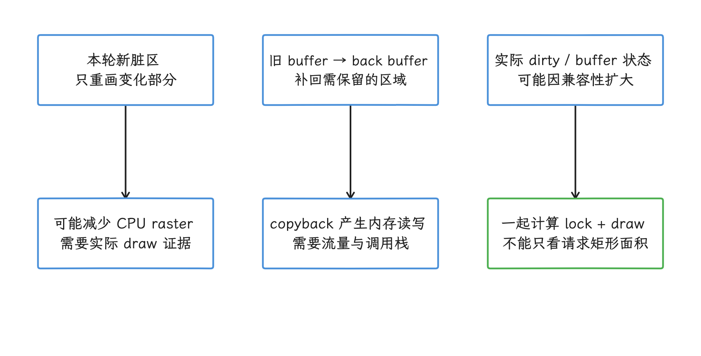

图：同时比较 CPU 重画和保留像素的复制成本。 尺寸、format 和 Surface 生命周期变化可能削弱局部更新收益。

#### 单 View software layer 的链路

宿主窗口开启硬件加速时，单个 software layer 可以概括为：

`View 子树 → CPU Bitmap 栅格化/缓存 → 宿主 RenderNode/DisplayList 引用 → RenderThread/GPU 采样 → App Window buffer`

这条路径 CPU 和 GPU 成本并存，两边要一起看：RenderThread 在跑，可能同时还有 software layer 的 Bitmap 工作；Bitmap draw 出现，窗口其余部分也仍可能在 HWUI 里。缓存有效时可以直接复用结果；频繁 invalidate、尺寸变化或大面积内容变化，则会带来重复的栅格化和上传。

<!-- gracker-diagram: ch13-02-15-software-cache-reuse -->
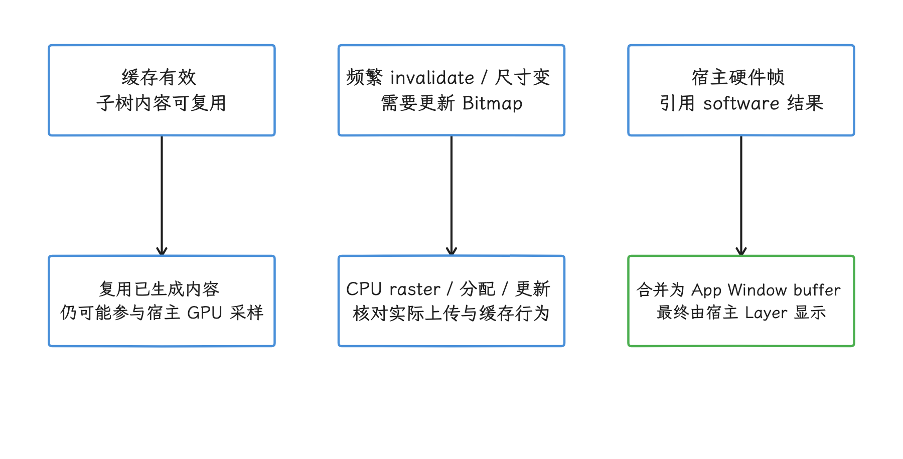

图：缓存可减少重画，频繁失效则重复 CPU 栅格化与后续采样工作。 Bitmap 工作与宿主 RT/GPU 可同时存在，上传 slice 名称并不固定。

#### GPU 离屏与 `HardwareBuffer`

`HardwareBufferRenderer` 属于 GPU 离屏生产，与整窗口 software Canvas 是两回事：它把 RenderNode 输出到调用方持有的 `HardwareBuffer`，completion fence（生产完成信号）只证明像素生产结束，结果有没有送显，还要到显示链上找证据。复用、清屏、所有权和后续提交的完整规则统一见 [13.6 SurfaceControl 与 HardwareBufferRenderer](06-surfacecontrol-hardwarebuffer-renderer.md)；本节只借它说明“离屏”与“软件”是两个独立维度。

<!-- gracker-diagram: ch13-02-16-hbr-result-fence -->
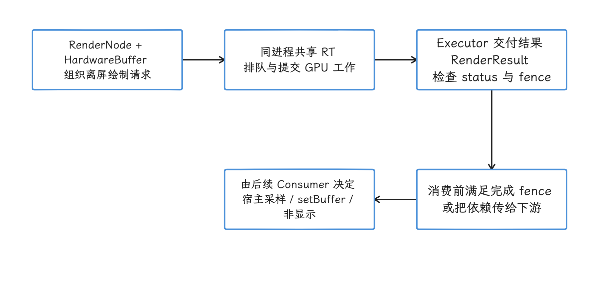

图：RenderNode 在同进程共享 RT 上输出到调用方 HardwareBuffer。 先检查结果 status；收到 callback 不等于 fence 已完成，离屏结果也不自动送显。

#### `SurfaceControl.Transaction#setBuffer()` 直接提交

`Transaction#setBuffer()` 可以绕过该 layer 的常规 `dequeueBuffer()` / `queueBuffer()` 循环，但绕不过 SurfaceFlinger：仍在生产的 buffer 要携带 production/acquire fence，连续复用还要等待 release callback。usage（buffer 的允许用途标志）只声明这块 buffer 允许被哪些消费者使用，离“HWC 选择 DEVICE（显示硬件合成） composition”还差一轮协商。完整提交与回收协议由 [13.6 SurfaceControl 与 HardwareBufferRenderer](06-surfacecontrol-hardwarebuffer-renderer.md) 维护。

<!-- gracker-diagram: ch13-02-17-direct-buffer-reuse -->
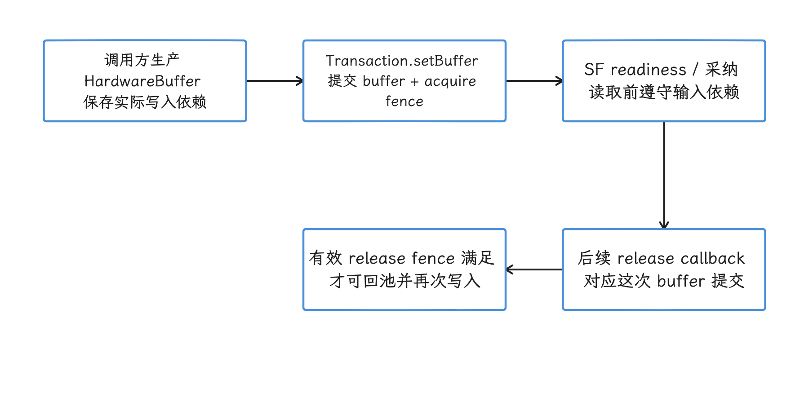

图：直接 buffer transaction 可以替代该 Layer 的普通生产队列循环。 production fence 约束读取，release 通知携带的有效 fence 仍须满足后才能复用。

### 与硬件加速路径的核心差异

我们把“CPU 直写可见 Surface”和标准 HWUI App Window 放在一起对比：差异集中在像素生产和等待点上；单 View software layer 则混合了两者。

| 维度 | CPU 直写可见 Surface | 标准 HWUI App Window |
|---|---|---|
| 窗口像素生产者 | App 线程上的 Skia CPU raster | HWUI RenderThread / GPU |
| 主线程职责 | 整窗口软件 draw 时直接生成像素 | 更新状态、measure/layout、录制 RenderNode/DisplayList |
| RenderThread | 窗口 buffer 生产不依赖 HWUI RenderThread | 执行 sync、draw 与 GPU submission |
| 主要 Producer 等待 | `dequeueBuffer()`、release fence、CPU buffer lock | UI↔RT sync、dequeue、GPU queue/fence |
| 提交后 | 仍经 BLAST/SF/HWC 显示 | 经 BLAST/SF/HWC 显示 |
| 部分更新 | dirty region 可能触发 copyback | RenderNode/display list 复用、damage（内容变化区域）与 GPU/HWC 策略 |
| 适合的证据 | App 线程 Running、lock/post、CPU memory traffic | `doFrame`、`syncAndDrawFrame`、`DrawFrame`、GPU、queue |

选路径时我们还要算上 GPU 的初始化、同步和资源转换成本。极小、低频、一次性的 Bitmap 生成交给 CPU 可能更划算；持续窗口动画、大面积混合、模糊和高分辨率重绘通常更适合硬件路径。最终结论要由目标设备的 CPU/GPU 时间、内存流量、功耗和 deadline（截止时间）数据支持。

#### 三类 fence 的分工

| fence | 保护的边界 | 典型等待方 |
|---|---|---|
| production / acquire fence | Producer 已写完，Consumer 可以读 | 宿主 GPU、SurfaceFlinger、编码器或算法模块 |
| display present fence | 本轮 display frame 到达显示 present 边界 | SurfaceFlinger 显示时间线 |
| layer release fence | Consumer 不再读取该 buffer，可以回池复用 | Producer / buffer pool |

纯离屏任务通常只有生产完成与消费者 release 这两条边界；没有可见 layer，也就没有该结果对应的 SF latch、HWC present 和 display present fence。

<!-- gracker-diagram: ch13-02-18-visible-vs-offscreen-fences -->
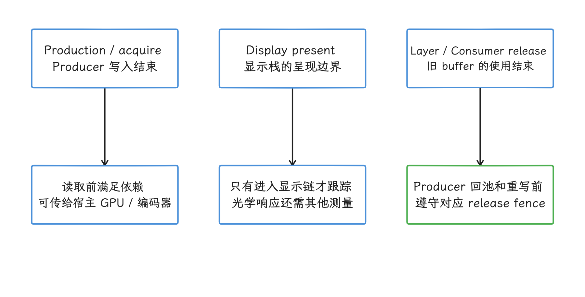

图：三类同步边界各自回答不同阶段的问题。 纯离屏结果没有自动对应的 display present，fence 对象或通知到达也不代表完成。

进入内核后，共享图形 buffer 通常由 dma-buf 表示，生产与消费依赖 dma-fence，sync_file 把 fence 暴露为 fd。上层 `SyncFence`、native fence fd 和内核 dma-fence 位于同一条同步路径的不同接口层，各自保护哪个生命周期阶段，要根据调用上下文判断。

### Trace 视角

固定“`lockCanvas < 1ms`、draw 占 80%、`doFrame < 16ms`”这类门槛，换一组刷新率、分辨率、设备或业务就可能不成立。我们拿到一段 Perfetto，先问四个问题：

1. 谁生产像素：MainThread、Surface thread、HWUI RenderThread、App GL/Vulkan thread，还是外部硬件？
2. 结果写到哪里：可见 Surface buffer、Bitmap、GPU render target 还是 `HardwareBuffer`？
3. 谁消费结果：宿主窗口、SurfaceFlinger、编码器、ImageReader、算法模块还是缓存？
4. 结果是否进入显示链：有没有目标 layer 的 transaction、latch、composition 与 present？

#### 识别整窗口软件路径

较强的组合证据包括：

- 窗口配置关闭硬件加速，或调用栈进入 `ViewRootImpl.drawSoftware()`；
- MainThread traversal（测量、布局和绘制遍历）内出现 `Surface.lockCanvas()`、`mView.draw()`、`unlockCanvasAndPost()`；
- 目标 App Window 仍有 buffer transaction / latch；
- 同一窗口帧没有对应 HWUI `DrawFrame` 和 GPU window draw。

其中“没有 `DrawFrame`”单独拿出来不够：trace 可能漏采，窗口可能没有重绘，主体也可能来自 SurfaceView、游戏引擎、Camera 或视频 Producer。

<!-- gracker-diagram: ch13-02-19-trace-identification -->
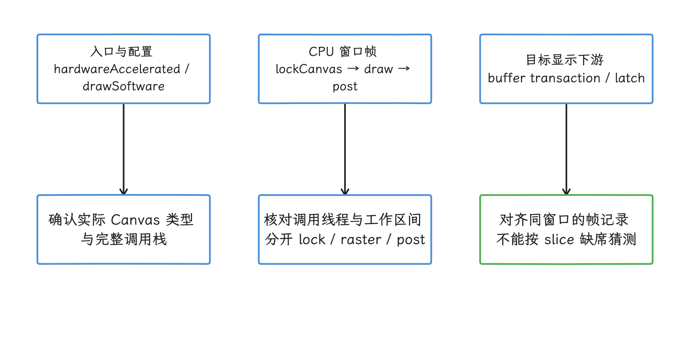

图：窗口配置、drawSoftware 调用和目标 Layer 提交共同确认路径。 缺少 RT slice 可由漏采、未重绘或独立 Producer 造成，不能单独定案。

#### 识别单 View software layer

这类路径应同时出现宿主 HWUI 帧和前置 CPU Bitmap 工作，可关注：

- software layer 的创建、缓存失效和 Bitmap 分配；
- App 线程 CPU raster、Bitmap upload 或 texture update；
- 宿主 `syncAndDrawFrame` / RenderThread `DrawFrame`；
- 最终 App Window 的 transaction、latch 和 present。

slice 名会随渲染后端、vendor 和 trace 配置变化。找不到固定 `uploadToTexture` 字符串时，我们改用调用栈、buffer/texture id、线程和明确的相邻时序来建立证据链。

<!-- gracker-diagram: ch13-02-20-trace-software-layer -->


图：把 Bitmap 的创建/更新与宿主硬件帧连到同一份内容。 不要求出现固定 uploadToTexture 名称；用对象、调用栈和时序补证。

#### 拆开 lock、draw 与 post

`lockCanvas()` 变长时先看线程状态：

- Sleeping/blocked 且落在 dequeue、futex（线程同步原语）或 fence wait：优先查 slot、release 和 Consumer 节奏；
- Running 且伴随 page fault、reclaim 或高内存流量：查映射、copyback 和内存压力；
- lock 成功后 `View.draw()` / Canvas draw 长时间 Running：再归因到 CPU 栅格化与业务绘制。

把 `unlockCanvasAndPost()` 变长直接写成“CPU 画慢”同样草率；我们要检查的是 gralloc unlock、queueBuffer、Binder/transaction、队列是否因 Consumer 处理较慢而阻塞，以及线程调度。

<!-- gracker-diagram: ch13-02-21-lock-draw-post-attribution -->
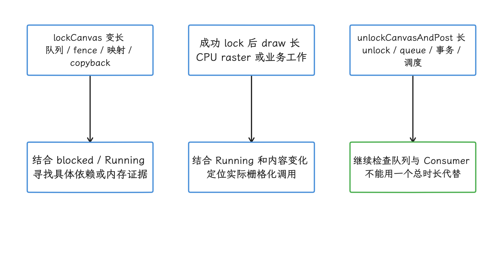

图：先按调用区间和线程状态找实际工作与等待。 post 变长不能直接归成 CPU 画慢；每类等待还要对上 buffer 与 Consumer。

#### 离屏结果的证据链

`HardwareBufferRenderer` callback 变晚时，先区分 common RenderThread 排队、GPU 执行与 completion fence signal 三段。`setBuffer()` 已 apply 但 layer 未更新时，我们再依次检查 production fence、transaction readiness（事务是否满足处理条件）、desired present time（期望呈现时间）是否已到、layer 可见性，以及旧 buffer 是否被沿用。

纯离屏任务没有目标 SF layer 属于正常现象；这时我们去找编码器、ImageReader、缓存或算法 Consumer，用 buffer id、fence 和 request/callback 把生产和消费关联起来。

<!-- gracker-diagram: ch13-02-22-offscreen-callback-delays -->
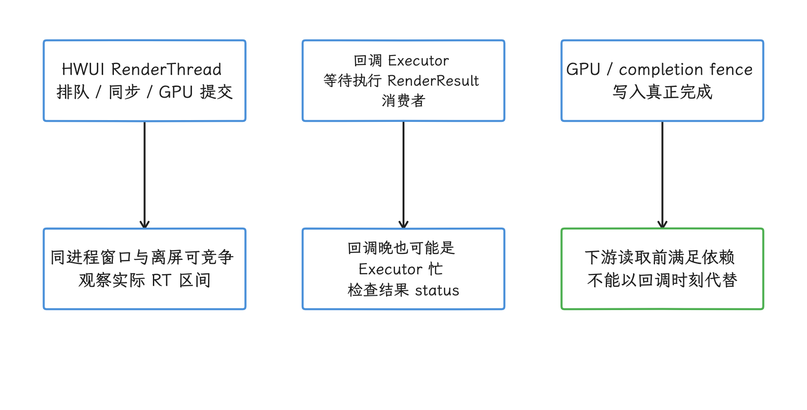

图：共享 RT 排队、回调 Executor 和 GPU fence 可以各自延后。 这不是三段固定串行时长；回调可以早于 GPU 完成，最终按依赖取证。

<!-- gracker-diagram: ch13-02-23-callback-before-fence -->
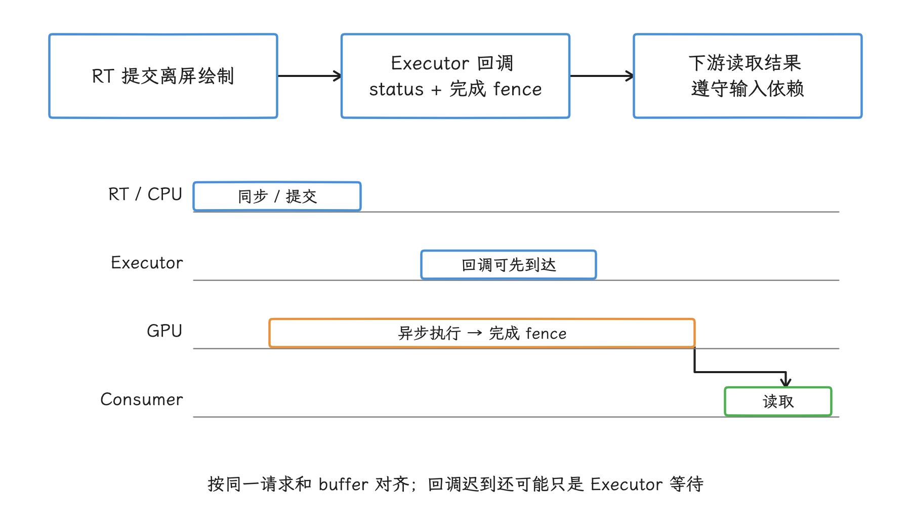

图：RT 提交后，回调执行与 GPU 完成是不同的异步事件。 轨道仅示意依赖，不是实测时长；下游读取前必须满足对应完成 fence。

#### 连续帧量化

量化至少覆盖多帧的请求、拿到可写 buffer、生产完成、提交、latch、present 和 release 时间，并用 buffer id、frame number、SurfaceFrame token 或 transaction id 关联同一份内容，这样才能区分四种情况：

<!-- gracker-diagram: ch13-02-24-multi-frame-lifecycle -->
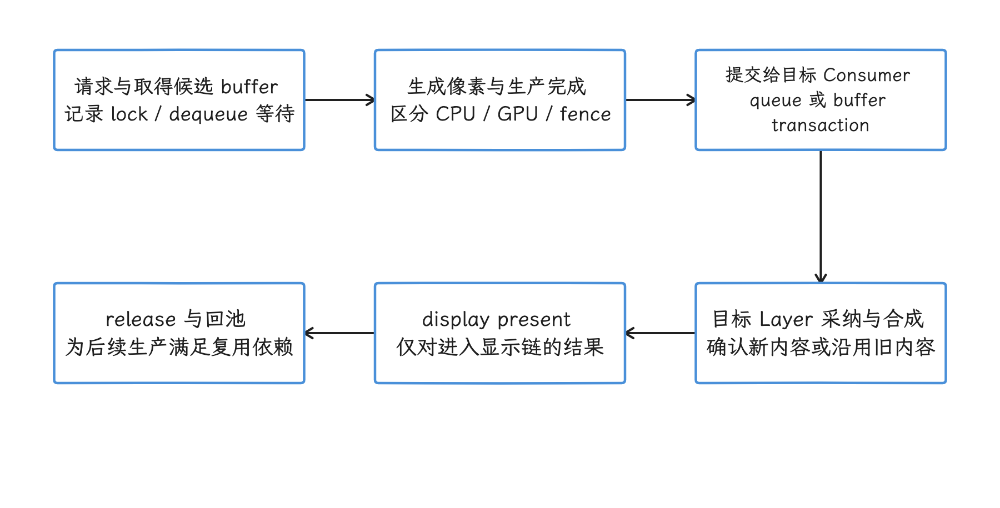

图：按同一 buffer 和明确帧标识记录完整周转。 相邻帧可重叠，纯 Bitmap 或离屏 pass 不自动获得显示 FrameTimeline。

- Producer 工作变慢；
- Consumer 间隔变长；
- buffer 池耗尽后迫使 Producer 等待；
- App 按时提交，但 SF/HWC/display 后段错过 deadline。

FrameTimeline 只覆盖进入相应可见 SurfaceFrame/DisplayFrame 的部分。Bitmap、纯离屏 GPU pass（一次离屏渲染过程）或编码输入生成完成，并不会自动得到 FrameTimeline present 结论。

### 性能特征与适用场景

#### 先估算像素存储

估算从像素存储入手：RGBA_8888 的红、绿、蓝、透明度通道各占 8 bit，每个像素占 4 byte，可以用下式估算：

`width × height × 4 × 同时存活的 buffer 数`

1440 × 3200 的单块 RGBA_8888 buffer 约为 17.6 MiB；若某个具体配置同时存活三块，像素存储约 52.7 MiB。这里的“三块”只是示例，BufferQueue 或 buffer pool 未必固定就是三缓冲。

像素存储之外，还可能有 dirty copyback、CPU 写入、纹理上传、GPU 采样、client target 和编码/算法 Consumer 的开销。单块 buffer 的字节数只表示存储容量，一帧在各阶段读写的总内存流量往往比它大得多。

<!-- gracker-diagram: ch13-02-25-pixel-storage -->
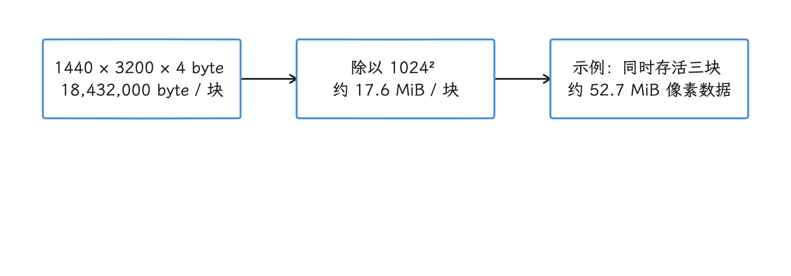

图：先估紧密像素数据，再查实际 buffer 分配与存活数量。 未计 stride、对齐、布局元数据和额外目标；三块仅是示例。

#### 常见成本

- 大面积 CPU raster：路径、模糊、复杂 clip（裁剪区域）、图片缩放和多层 alpha 会增加算术与访存；
- copyback：小脏区减少重画时，也可能产生旧 buffer 到新 buffer 的内存复制；
- software layer 失效：重复生成 Bitmap、CPU draw、上传，以及 GC 或 native 分配带来的回收与分配开销；
- GPU 离屏 pass：中间 render target 过大、渲染次数过多或 completion fence 较晚；
- buffer 池过深：内存占用和在途 buffer 的延迟一起增加；
- format/transform/alpha 不匹配：可能增加 RenderEngine CLIENT（SurfaceFlinger 使用 GPU 合成） composition。

另外，要写 thermal throttling（温控降频）结论，光有 CPU 高占用还不够，应同时看到温度/thermal event、频率上限变化、调度状态和持续负载；单帧 CPU raster 只证明该帧存在 CPU 绘制工作。

<!-- gracker-diagram: ch13-02-26-work-vs-backlog -->
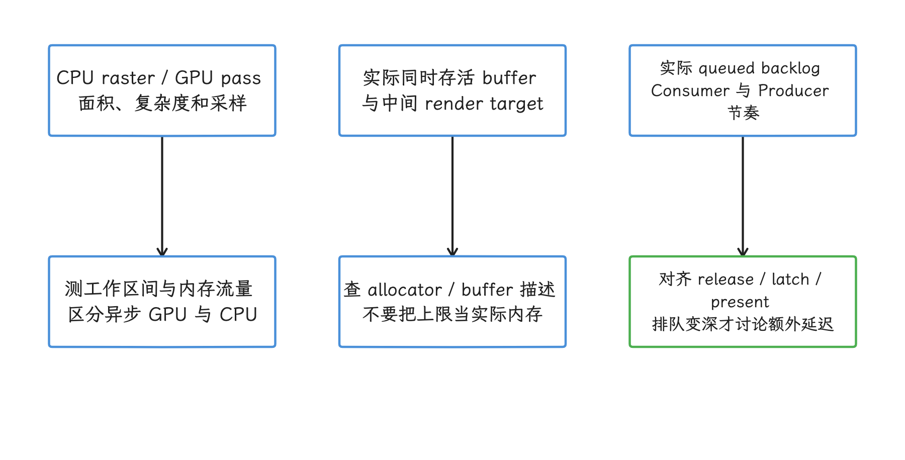

图：算术负载、实际分配数和在途积压各有证据。 提高池上限不保证增加分配或延迟；温控归因还需设备热与限制证据。

#### CPU 与离屏路径的适用场景

可以合理使用 CPU software 或离屏路径的场景包括：

- 生成小尺寸、低频、一次性的 Bitmap 快照；
- 兼容性验证，需要比较 software 与 hardware Canvas 行为；
- 明确由 CPU 算法写入、随后交给非显示 Consumer 的 buffer；
- 简单、低刷新率的独立 Surface 绘制，且实测满足功耗和 deadline；
- 需要 `HardwareBufferRenderer`、EGL/Vulkan 离屏或 `setBuffer()` 直接提交的系统级处理路径。

反过来，两条常见误用要避免：仅为解决一次硬件绘制问题就长期关闭整个窗口硬件加速，把 `LAYER_TYPE_SOFTWARE` 当作通用性能开关。发现意外软件路径时，我们检查 Manifest/Activity 的 `hardwareAccelerated`、`setLayerType()`、实际 Canvas 类型和 Surface Producer 调用栈。

<!-- gracker-diagram: ch13-02-27-cpu-offscreen-choice -->
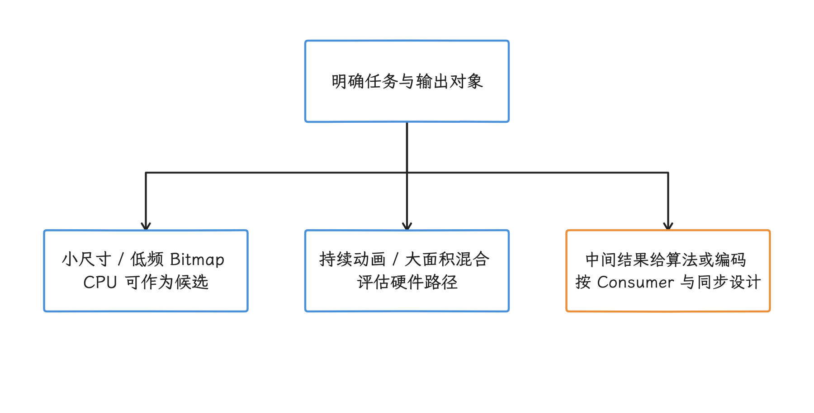

图：选择建立在实际内容、Consumer 和目标设备测量上。 软件层不是通用性能开关，一次兼容性问题不等于应长期关闭整个窗口硬件加速。

#### Android 12—17 版本边界

| 平台 | 相关公开能力 | 诊断影响 |
|---|---|---|
| Android 12 / API 31 | CPU Surface、View software layer、HWUI 离屏路径已成熟；`RenderEffect` 公开 | BLAST/FrameTimeline 是现代显示分析背景，纯离屏结果仍没有显示时间线 |
| Android 13 / API 33 | `SurfaceControl.Transaction#setBuffer()`、`SyncFence` 与 Java release callback 公开 | 可用公开 Java API 表达 production fence 和 buffer 回收 |
| Android 14 / API 34 | `HardwareBufferRenderer` 公开 | `RenderNode → HardwareBuffer` 可通过 common HWUI render thread 完成 |
| Android 15 / API 35 | `setFrameTimeline()`、`setDesiredPresentTimeNanos()`、transaction listener 进入公开 API，并受 flag/API 条件约束 | 直接提交可以表达目标显示周期；事务反馈仍不等于 buffer release |
| Android 16 / API 36 | NDK `ASurfaceTransaction_setBufferWithRelease()` | Native producer 获得专门的 buffer release callback |
| Android 17 / API 37 | 源码基线；四条主路径延续，SF 使用当前 FrontEnd snapshot、CompositionEngine 与 AIDL（Android Interface Definition Language，接口定义语言）Composer 流程 | 方法名与 flag 按 `android-17.0.0_r1` 解读，不用旧 HWC2 教程替代当前完整路径 |

<!-- gracker-diagram: ch13-02-28-public-api-boundaries -->
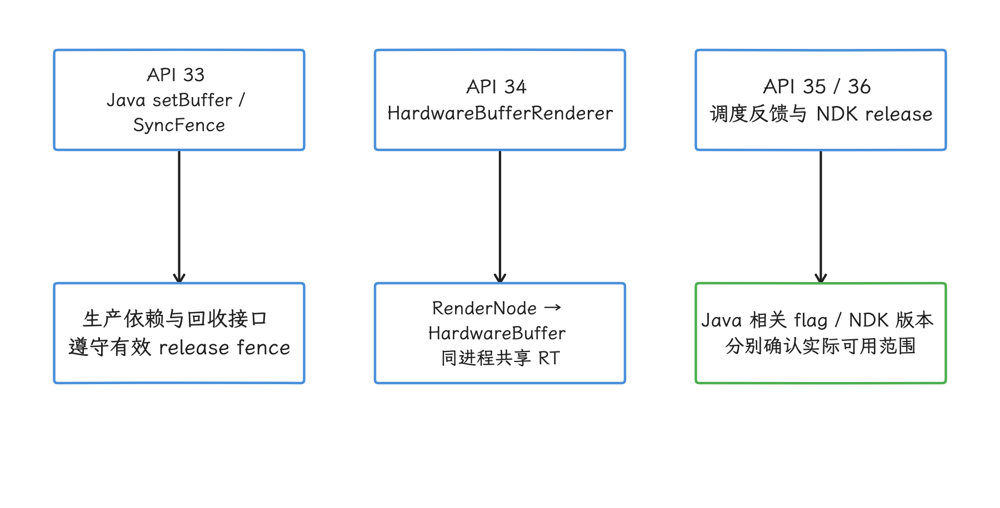

图：按公开 API、固定 tag 与当前 flag 分别核对。 API 存在不能证明设备开关已开启，离屏完成仍不等于显示完成。

<!-- gracker-diagram: ch13-02-59-mixed-api-versions -->
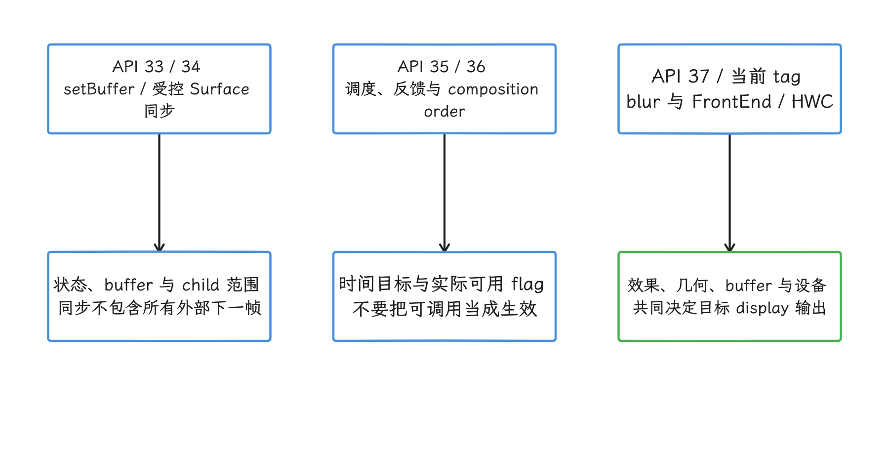

图：接口首引版本、当前源码 flag 与现场实现分别验证。 当前 tag 不能独立证明所有旧版本或设备默认行为，具体入口以固定来源复核。

#### Android 17 源码入口

平台源码统一固定到 `android-17.0.0_r1`：

- [`ViewRootImpl.java`](https://android.googlesource.com/platform/frameworks/base/+/android-17.0.0_r1/core/java/android/view/ViewRootImpl.java)：`drawSoftware()`、窗口 Surface lock/draw/post；
- [`Surface.java`](https://android.googlesource.com/platform/frameworks/base/+/android-17.0.0_r1/core/java/android/view/Surface.java) 与 [`android_view_Surface.cpp`](https://android.googlesource.com/platform/frameworks/base/+/android-17.0.0_r1/core/jni/android_view_Surface.cpp)：Java Canvas 到 native Surface；
- [`Surface.cpp`](https://android.googlesource.com/platform/frameworks/native/+/android-17.0.0_r1/libs/gui/Surface.cpp) 与 [`GraphicBuffer.cpp`](https://android.googlesource.com/platform/frameworks/native/+/android-17.0.0_r1/libs/ui/GraphicBuffer.cpp)：dequeue、copyback、`lockAsync()`、`unlockAsync()`、queue；
- [`View.java`](https://android.googlesource.com/platform/frameworks/base/+/android-17.0.0_r1/core/java/android/view/View.java) 与 [View layer 官方说明](https://developer.android.com/develop/ui/views/graphics/hardware-accel)：`LAYER_TYPE_SOFTWARE` 的 Bitmap 语义和 Canvas 判断；
- [`HardwareBufferRenderer.java`](https://android.googlesource.com/platform/frameworks/base/+/android-17.0.0_r1/graphics/java/android/graphics/HardwareBufferRenderer.java)：common render thread、completion fence、清屏和所有权边界；
- [`SurfaceControl.java`](https://android.googlesource.com/platform/frameworks/base/+/android-17.0.0_r1/core/java/android/view/SurfaceControl.java)：`setBuffer()`、usage、production fence、release callback 和 present-time API；
- [`include/android/surface_control.h`](https://android.googlesource.com/platform/frameworks/native/+/android-17.0.0_r1/include/android/surface_control.h)：NDK acquire fence 与 API 36 `ASurfaceTransaction_setBufferWithRelease()`；
- [`SurfaceFlinger.cpp`](https://android.googlesource.com/platform/frameworks/native/+/android-17.0.0_r1/services/surfaceflinger/SurfaceFlinger.cpp) 与 [`HWComposer.cpp`](https://android.googlesource.com/platform/frameworks/native/+/android-17.0.0_r1/services/surfaceflinger/DisplayHardware/HWComposer.cpp)：可见 layer 的 transaction、composition、present 和 release。

Kernel 固定到 `android17-6.18-2026-06_r6`：

- [`Documentation/driver-api/dma-buf.rst`](https://android.googlesource.com/kernel/common/+/refs/tags/android17-6.18-2026-06_r6/Documentation/driver-api/dma-buf.rst)：共享 buffer；
- [`Documentation/driver-api/sync_file.rst`](https://android.googlesource.com/kernel/common/+/refs/tags/android17-6.18-2026-06_r6/Documentation/driver-api/sync_file.rst) 与 [`drivers/dma-buf/sync_file.c`](https://android.googlesource.com/kernel/common/+/refs/tags/android17-6.18-2026-06_r6/drivers/dma-buf/sync_file.c)：dma-fence 到 fence fd；
- [`mm/`](https://android.googlesource.com/kernel/common/+/refs/tags/android17-6.18-2026-06_r6/mm/)：page fault、reclaim、PSI（Pressure Stall Information（PSI，压力停顿信息），压力停顿信息）等内存侧证据。实际 gralloc、GPU driver 和 dma-buf heap 行为仍需用目标设备补充证据。

交叉阅读：

- [13.1 Android View 渲染管线与分析方法](01-android-view-pipeline-analysis.md)
- [13.6 SurfaceControl 与 HardwareBufferRenderer](06-surfacecontrol-hardwarebuffer-renderer.md)
- [2.8 BufferQueue、Gralloc 与 Sync Fence](../../part1-fundamentals/ch02-rendering/08-bufferqueue-gralloc-sync-fence.md)
- [2.7 GPU 渲染与图形 API 选型](../../part1-fundamentals/ch02-rendering/07-gpu-rendering-graphics-api.md)

#### 小结

CPU `lockCanvas()` 可以直接生成可见 Surface buffer；`LAYER_TYPE_SOFTWARE` 只把 View 子树栅格化成 Bitmap；硬件 Canvas、`HardwareBufferRenderer`、EGL/Vulkan 生成 GPU 离屏结果；`Transaction#setBuffer()` 把 `HardwareBuffer` 接入独立 layer。

定位问题时，我们按 Producer、中间 buffer、Consumer、可见 layer 的顺序收集证据，再分别核对 production fence、display present fence 和 layer release fence 各自约束的是哪一段，这样才能区分像素生成、buffer 等待、Consumer 处理与 SF/HWC/display 后段延迟。

## CPU、GPU 与多 Surface 混合

离屏结果进入最终窗口后，可能与 HWUI、SurfaceView 或 GPU 内容共同合成，这时我们要明确每块内容的生产者和同步信号。混合渲染页面可能包含普通 View、Compose、`TextureView`、`SurfaceView`、嵌入式 `SurfaceControlViewHost`、视频、Camera、地图或游戏引擎等多种内容路径。

AOSP 能证明的是公共接口与系统合成行为；目标应用采用哪种 Producer、buffer format（像素格式）和 layer 拓扑，还要根据当前 trace、实际图层层级和业务配置确认。

### 什么是混合渲染

“混合渲染”是我们的诊断分类，Android framework 里没有对应的类。页面满足下面两个条件时，适用这里的方法：

- 存在两条以上能区分 Producer 或 Consumer 的内容路径；
- 这些路径共同影响同一屏的可见结果。

只看到多个线程、多个 `queueBuffer()` 或多个 SurfaceFlinger layer 还不够，SystemUI、壁纸、输入法和导航栏本来就会参与 display composition（显示合成）；我们关注的是目标页面自身引入的多路内容关系。

#### 三种拓扑

##### 宿主采样型

外部 Producer 把 buffer 交给 `SurfaceTexture`，应用进程内的 HWUI Consumer 取得最新纹理内容，再采样进宿主 App Window——`TextureView` 是典型入口。走这条路，外部内容最终成为宿主窗口 buffer 的一部分。

正因为外部内容是先被宿主取走、再写进窗口 buffer 的，SurfaceFlinger 通常只看到最终宿主 layer，看不到与该 Texture 输入一一对应的独立可见 layer；错帧可能发生在外部 queue、宿主 acquire、GPU 采样或 host BLAST 提交中的任一阶段。

##### 独立 layer 型

`SurfaceView`、应用自管 `SurfaceControl` 或嵌入式 Surface hierarchy（图层层级）保留独立 buffer layer。宿主与独立内容各自提交，SurfaceFlinger/HWC 决定目标 display frame 使用哪块 buffer，以及哪组位置、裁剪等几何状态。

<!-- gracker-diagram: ch13-02-29-mixed-two-topologies -->
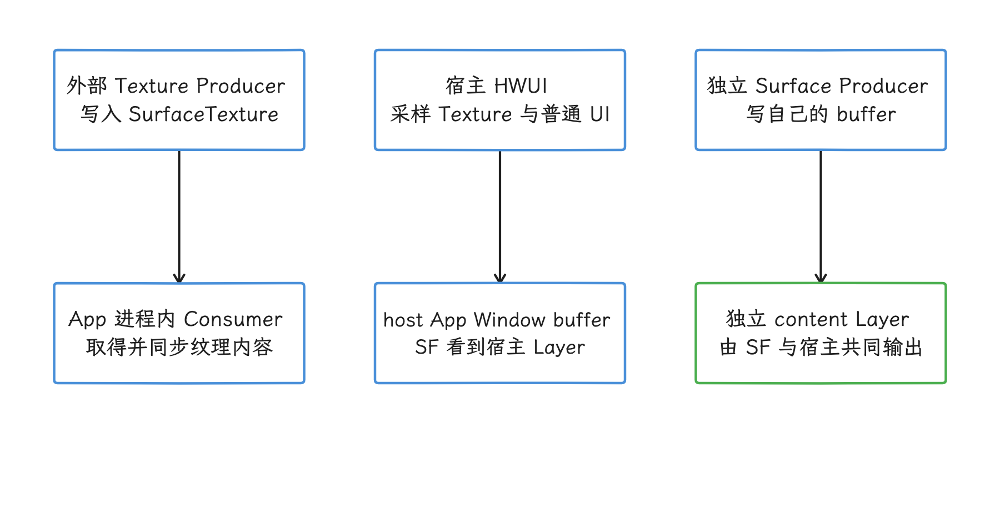

图：Texture 输入先成为宿主像素，独立 Surface 保留自己的输出 Layer。 这里以硬件加速 TextureView 宿主为前提，具体拓扑以现场对象确认。

##### 组合型

页面既有由宿主采样的 Texture 输入，也有独立 layer。宿主 buffer 已经包含多路输入，SurfaceFlinger 又把宿主与独立内容组合起来，此时至少有三个 deadline 要盯：

1. Texture buffer 是否在宿主 RenderThread acquire 前准备完成；
2. 宿主 App Window 是否赶上目标 SF display frame；
3. 独立 layer 的 buffer 与几何是否赶上同一个 display frame。

下面的拓扑图用于区分“由宿主采样”和“保持独立 layer”：

<!-- gracker-diagram: ch13-02-30-mixed-deadlines -->
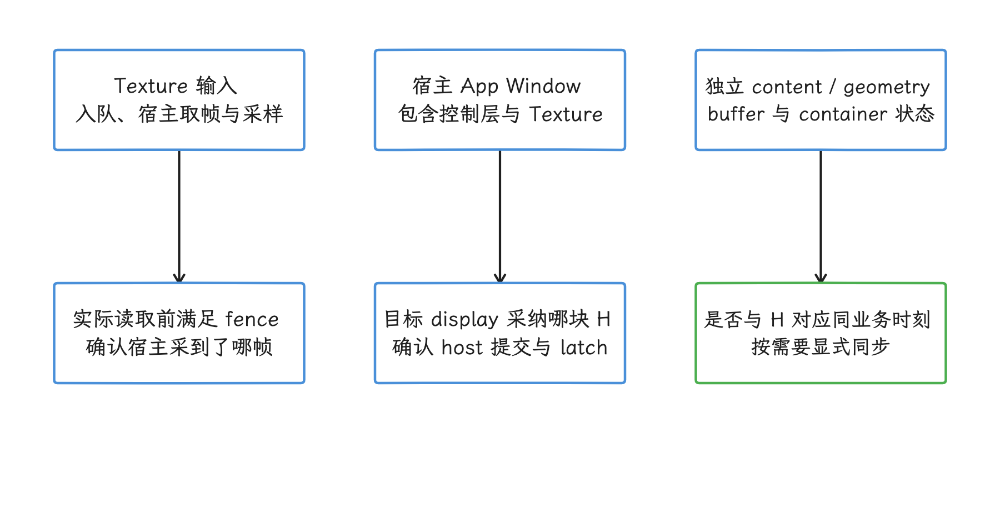

图：Texture 输入、宿主输出和独立 Layer 要各自赶上需要的时刻。 这是业务目标的依赖关口，不是系统自动提供的统一业务帧。

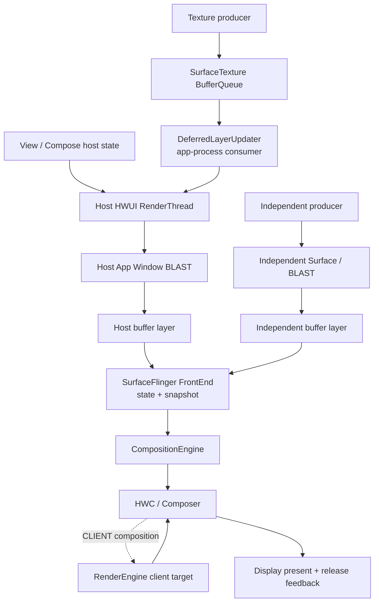

图中 Texture 输入在 App RenderThread 中变成宿主窗口像素，独立 Surface 保持单独的 SF buffer layer。分析前我们先判断每路内容走的是哪条路径。

#### 一次 display 更新怎样汇合

以“宿主控制层 + TextureView 地图 + SurfaceView 视频”为例，一次可见更新要经过这些阶段：

1. 地图 Producer 向 `SurfaceTexture` 提交 buffer，frame-available（新帧可用）回调借此请求宿主更新；
2. 宿主 MainThread 在 `Choreographer#doFrame()` 中更新 View/Compose 状态和 RenderNode；
3. RenderThread 在 `DrawFrameTask::syncFrameState()` 处理待更新的 `DeferredLayerUpdater`，取得 Texture 输入的最新可用 buffer；
4. HWUI 将地图、普通 View、遮罩和控制层画入宿主 App Window buffer；
5. 宿主 BLAST 把 host buffer transaction 交给 SurfaceFlinger；
6. 视频 Producer 按自己的 cadence（输出间隔）向 SurfaceView BLAST child 提交独立 buffer 和 acquire fence；
7. SurfaceView container（控制位置和层级的容器 layer）的 position、crop、alpha、visibility 与 relative Z（相对其他 layer 的叠放顺序）都由相应 Transaction 更新；
8. SurfaceFlinger FrontEnd 处理各路状态和 buffer readiness（buffer 是否具备处理条件）；没有选中新 buffer 的 layer 可以沿用此前已选中的内容；
9. CompositionEngine/HWC 针对整屏可见 layer 集合协商 DEVICE 合成还是 CLIENT 合成，前者交给显示硬件，后者在必要时由 SurfaceFlinger 用 RenderEngine 生成 client target；
10. present 路径返回 display 级 present fence 和各 layer 的 release fence，信号稍后异步完成。

这十步没有共享的“业务帧”对象：目标 present 可能组合新宿主与旧视频，也可能让新视频配上旧 container 几何。需要同步的业务关系，必须由应用或受控 Surface 的同步机制明确表达。

<!-- gracker-diagram: ch13-02-31-display-merge -->
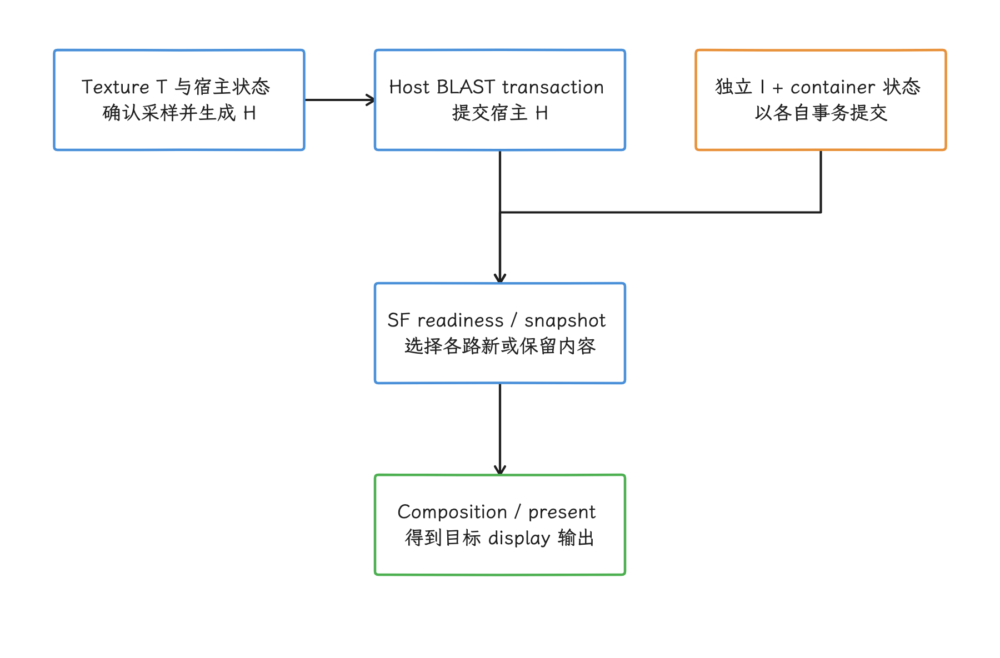

图：多路 Producer 独立推进，在 SF 对目标 display 的状态和内容选择中汇合。 可能合法组合新旧内容，系统不能从像素推断字幕、遮罩与视频的业务对应关系。

#### 常见组合

| 页面组合 | SurfaceFlinger 侧常见形态 | 诊断入口 |
|---|---|---|
| 普通 View + `TextureView` | 通常只有宿主 App Window 主体 layer | 外部 queue、SurfaceTexture acquire、宿主 GPU、host BLAST |
| 普通 View + `SurfaceView` | 宿主 layer + SurfaceView container/content hierarchy | 宿主帧、独立 buffer、几何、hole-punch（在宿主中清出透明区域）、每个 layer 的内容选择 |
| `TextureView` + `SurfaceView` | Texture 内容进入宿主，另有独立 SurfaceView layer | 两套输入队列、宿主采样、独立 layer、HWC |
| 多个 `SurfaceView` / `SurfaceControl` | 宿主 + 多个独立 layer | parent/Z-order、每路 `BufferTX`、同步组、composition type |
| `SurfaceControlViewHost` 嵌入 | 宿主 hierarchy 下有跨进程 child | `SurfacePackage`（跨进程传递 Surface 层级的对象）、`AttachedSurfaceControl`（宿主提供的附着点）、sync group、可见性 |
| WebView / Flutter / 游戏 + 原生 Surface | 取决于引擎承载模式 | 先恢复真实 layer/BufferQueue 拓扑，再分析引擎线程 |

框架名定拓扑是常见误区：同一个播放器可能在不同模式下使用 `TextureView` 或 `SurfaceView`，同一个 Camera 页面也可能输出到预览 Surface、ImageReader 和编码 Surface。

#### 生命周期会改变拓扑

播放器切换承载模式、Camera 重建 output、WebView 进入全屏视频、Surface hierarchy 改变父子关系（reparent）都会让旧 trace 对象失效。

| 对象 | 生命周期信号 | 常见失败 |
|---|---|---|
| `SurfaceView` | `surfaceCreated/Changed/Destroyed`、lifecycle strategy（Surface 保留或销毁策略） | Producer 仍写旧 Surface、container 已显示但承载内容的 child layer 无首帧 |
| `TextureView` | `onSurfaceTextureAvailable/Destroyed`、visibility、`setSurfaceTexture()` | Producer 已换队列，分析仍跟旧 `SurfaceTexture` |
| `SurfaceControlViewHost` | `SurfacePackage` attach/clear/reparent、远端 Binder | child hierarchy 断开、同步组对象退出 |
| Media/Camera output | session/output config（会话/输出配置）、codec surface switch、secure 属性 | 切换期无 buffer、旧 buffer 保留、保护能力不匹配 |
| App Window | attach/detach、relayout、window Surface replacement | host layer id、BLAST queue、FrameTimeline token 改变 |

<!-- gracker-diagram: ch13-02-32-lifecycle-identity -->
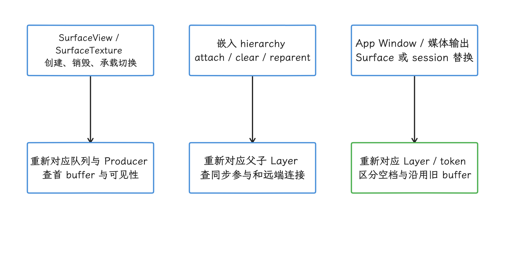

图：承载切换和重建后，重新确认 Producer、队列与 Layer 身份。 surfaceCreated 或 attach 完成不证明首 buffer 已显示，旧 trace id 不能盲目沿用。

黑屏排查按“对象存在 → Producer 连接 → 首 buffer 提交 → acquire fence 完成 → layer 可见 → HWC 接受”的顺序检查。`surfaceCreated()` 已回调只说明对象生命周期走到该阶段，离“有可显示 buffer”还有后面几步。

<!-- gracker-diagram: ch13-02-33-black-screen-gates -->
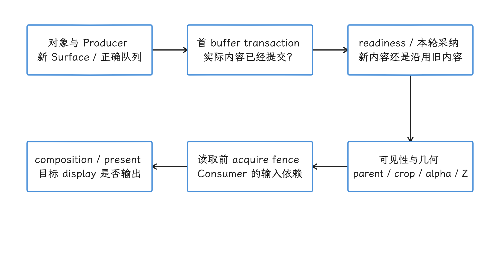

图：从对象和连接继续追到首内容、可见性与显示输出。 图为排查顺序，事件可异步交错；fence signal 不必先于允许的 latch。

### 并行生产机制

以“宿主控制层 + TextureView 地图 + SurfaceView 视频”为例，三路内容各有各的节奏，我们逐路看。

#### 宿主 View / Compose

宿主按 `vsync-app` 驱动 MainThread 与 RenderThread：

1. `Choreographer#doFrame()` 处理 INPUT、ANIMATION、INSETS_ANIMATION、TRAVERSAL、COMMIT；
2. View/Compose 更新 RenderNode/DisplayList；
3. RenderThread 生成宿主窗口 buffer；
4. host BLAST 把 buffer transaction 送到 SurfaceFlinger。

<!-- gracker-diagram: ch13-02-34-host-path -->
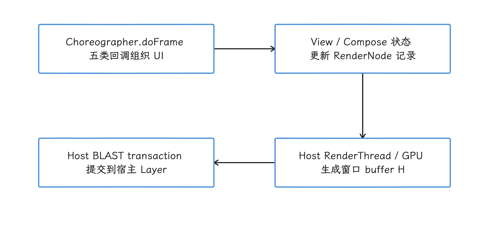

图：宿主按帧组织 UI，再提交独立的 host buffer。 宿主帧不自动绑定外部 Texture 或独立 Producer 的下一业务帧。

#### TextureView 由宿主采样

地图或视频 Producer 向 `SurfaceTexture` queue buffer。`TextureView` 在 frame-available 回调中安排 layer update 和 View invalidation（请求重绘），宿主硬件 draw 记录 `TextureLayer`。进入宿主绘制后，`DrawFrameTask::syncFrameState()` 遍历 pending（待更新）layer 并调用 `DeferredLayerUpdater::apply()`，由该方法通过 `ASurfaceTexture_dequeueBuffer()` 取得当前内容。

源码注释明确指出，`ASurfaceTexture_dequeueBuffer()` 会丢弃此前尚未消费的帧，只保留最新一帧。所以外部 Producer 已经 queue buffer，证明不了宿主本帧采到了它；我们逐段对齐 frame-available、宿主 traversal、`DeferredLayerUpdater` acquire 与 host draw 的时序。

<!-- gracker-diagram: ch13-02-35-texture-latest -->
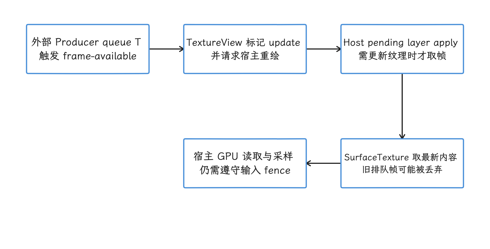

图：frame-available 请求宿主更新，真正取帧发生在后续纹理更新中。 需要更新时可丢弃旧排队帧，仅取最新内容；已 queue 不证明宿主本帧采到了它。

#### 独立 Surface

视频、Camera、游戏或嵌入式 UI 可以向独立 Surface 提交 buffer。它可能由应用线程、codec、provider/HAL（服务提供进程或硬件抽象层）、引擎或远端进程生产，未必统一经过 App UI Thread、HWUI RenderThread 或同一个 BLAST adapter（适配层）。

内容节奏可以是 24/30/60 fps、sensor（传感器）节奏或引擎 VSync，与宿主 `vsync-app` 不同，但几路内容仍共享：

- SurfaceFlinger/HWC 的 display composition；
- overlay plane（硬件叠加平面）、scaler（硬件缩放器）、bandwidth（内存带宽）等硬件资源，以及 GPU 与内存；
- container 的 position、crop、alpha、visibility 和 Z-order；
- display mode、present 与 release 节奏。

所以“两路独立”只指 Producer 和队列可以分别推进，资源与状态上的依赖仍然存在。主线程卡顿时视频解码未必停止，但遮罩、container 几何、hole-punch 或可见性可能停留在旧状态。

<!-- gracker-diagram: ch13-02-36-independent-production -->
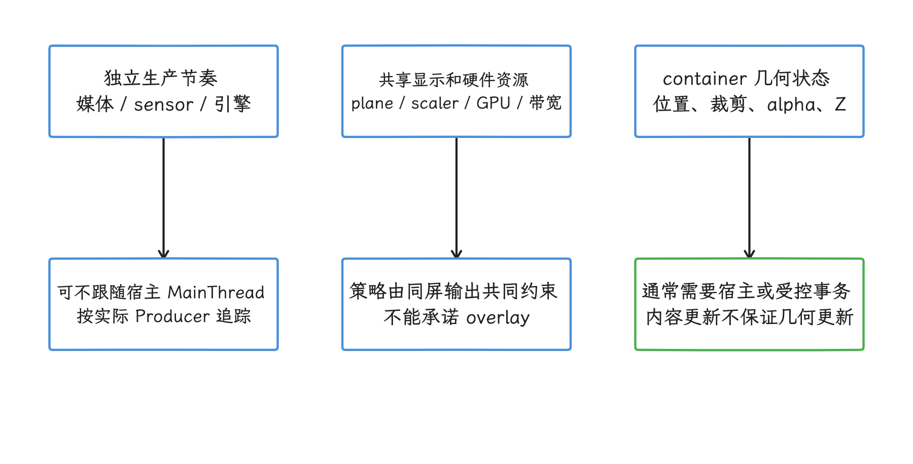

图：独立线程和队列不代表独占显示硬件或完全脱离宿主状态。 主线程停顿时独立视频可继续，但遮罩、几何与可见性可能保留旧状态。

#### 谁生产、写到哪里、谁消费

分析混合页从建立对象清单开始，每条内容路径至少记录一行：

| 字段 | 要记录的内容 | 常用证据 |
|---|---|---|
| 内容 | 视频、预览、地图、控制层、远端 UI | 页面结构、layer name、业务配置 |
| Producer | 应用线程、codec、camera provider/HAL、引擎、远端进程 | BufferQueue connect、queue、调用栈、进程/线程 |
| Consumer | HWUI SurfaceTexture Consumer、BLAST/SF、ImageReader、编码器 | layer tree、BufferQueue 名、源码路径 |
| 最终 SF layer | 宿主、独立 content child、color/effect layer（纯色/效果图层） | layer trace、dumpsys |
| 几何所有者 | ViewRoot、SurfaceView container、应用 Transaction、远端 host | parent、crop、matrix（变换矩阵）、relative-Z transaction |
| 帧节奏 | `vsync-app`、媒体 timestamp（内容时间戳）、sensor cadence、引擎 VSync | Choreographer、Producer timestamp、业务 trace |
| fence | acquire/release 属于哪块 buffer 和哪条队列 | fence fd、sync wait、release callback、driver trace |
| 同步约束 | 同一 Transaction、SurfaceSyncGroup、frame number、desired present | API 调用、transaction id、sync trace |

Producer 进程没有固定名单可查。可靠的路径是从目标 BufferQueue connection、queue 调用和 completion fence 反向查找，进程名只能帮助缩小范围。

<!-- gracker-diagram: ch13-02-37-content-inventory -->
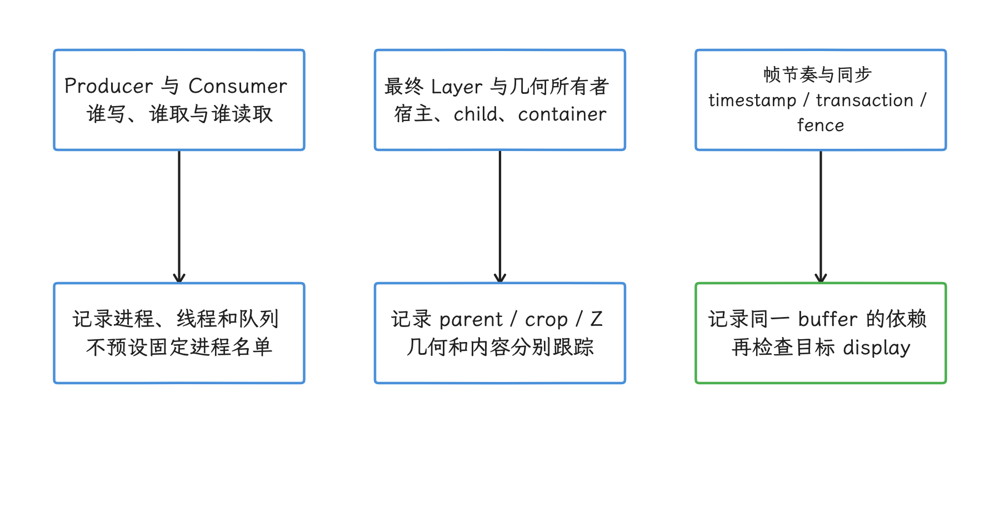

图：每一路内容对应执行者、消费关系和最终输出对象。 进程名只缩小范围，最终按队列连接、buffer 和 completion fence 反查。

### 宿主透明区域与合成

#### SurfaceView 的 hole-punch

默认位于宿主下方的 SurfaceView，需要把宿主窗口对应区域清成透明，这一步就是 hole-punch。行为可以从源码直接确认：`SurfaceView.draw()` / `dispatchDraw()` 在 `mDrawFinished` 且 Surface 位于 parent 下方时调用 `clearSurfaceViewPort()`，后者通过 `Canvas.punchHole()` 处理矩形或圆角区域及 alpha。

`mDrawFinished` 在 `surfaceRedrawNeededAsync` 的回调集合完成后置为 `true`，它表示 Framework 认为 Surface redraw 回调阶段已经结束。Producer 是否已提交首个 buffer、该 buffer 是否被 latch 或 present，还要继续检查 Producer connection、首个 buffer transaction、acquire fence、layer 可见性和目标 present。

<!-- gracker-diagram: ch13-02-38-hole-punch -->
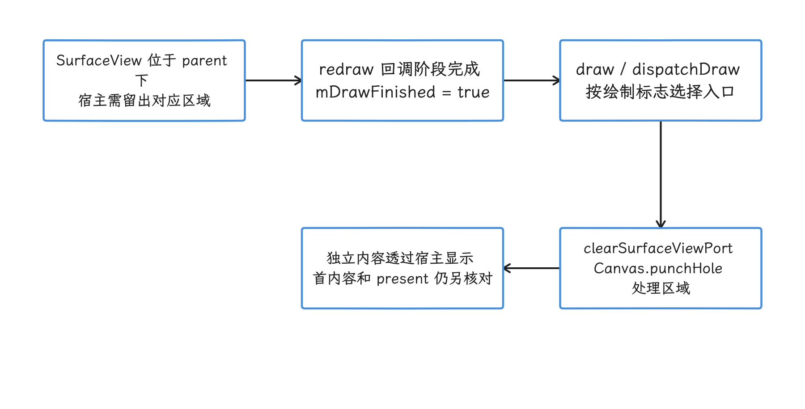

图：宿主下方内容需要通过宿主中的透明区域被看到。 mDrawFinished 表示 redraw 回调阶段结束，不证明首 buffer 已提交、latch 或 present。

SurfaceView 内部还要分清三个对象：

- `mSurfaceControl`：container，管理位置、裁剪、透明度、blur 等状态；
- `mBlastSurfaceControl`：承载 Producer buffer 的 BLAST content child；
- `mBackgroundControl`：按 format、Z-order 和配置决定显隐的背景纯色 color layer（纯色图层）。

container 的 position 更新了，content child 未必用上了新 buffer——position update listener（位置更新监听器）还会把 parent scale、child buffer scale 与 crop 同步提交，以降低缩放和移动时的闪烁。把两个对象分开看，才不会误判更新已生效。

<!-- gracker-diagram: ch13-02-39-surfaceview-objects -->
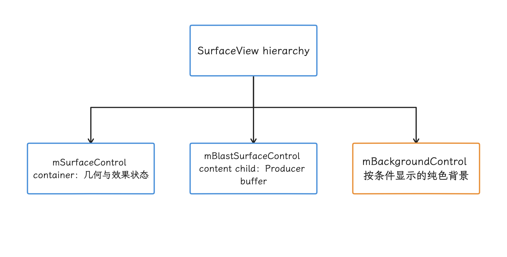

图：把几何容器、Producer 内容和可选背景 Layer 分开对应。 几何更新不证明 child 用上新 buffer；背景显隐依格式、Z-order 和配置。

SurfaceView 位于宿主上方时无需对宿主打洞；API 34 起 alpha 规则也区分 Z-above 与 Z-below。`TextureView` 没有独立可见 SurfaceView child：它的内容被宿主 GPU 采样，也就没有这套打洞问题。

<!-- gracker-diagram: ch13-02-40-z-alpha-host -->
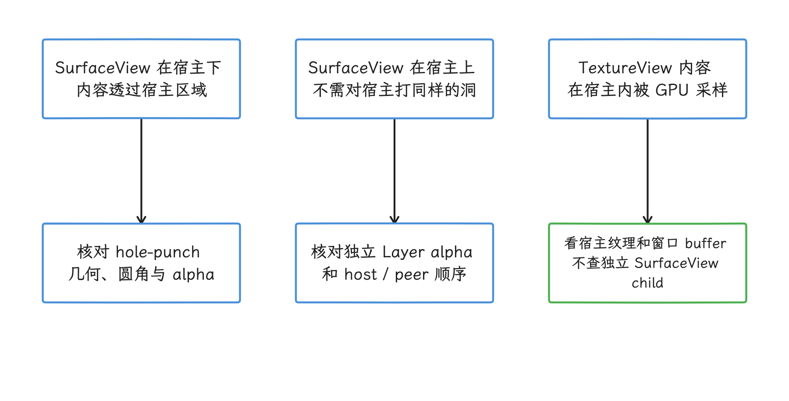

图：宿主上下关系与 Canvas 路径影响透明区域及 alpha 处理。 API 34 起的 alpha 规则仍需结合实际 Z 和重叠内容；TextureView 没有同一套独立 child 打洞路径。

#### SurfaceFlinger/HWC 合成

SurfaceFlinger 先为当前 display 构造可见 layer 集合，再由 HWC 协商 DEVICE/CLIENT composition。CPU/GPU 生产者类型、YUV format 或 `SurfaceView` 名称，都保证不了该 layer 获得 overlay 硬件平面。

影响 composition strategy（各 layer 采用硬件还是 GPU 合成）的条件包括：

- format、modifier（buffer 内存布局修饰信息）、dataspace、HDR metadata（HDR 元数据）；
- protected/secure usage（受保护内容用途标志）与目标 display 的保护能力；
- crop、destination frame（输出目标矩形）、scale、rotation、alpha、blend（混合方式）；
- overlay plane、scaler、bandwidth 和 vendor 限制；
- 同屏其他 layer 对硬件资源的占用；
- display mode、color mode 与全局 color transform（颜色变换）。

新增 layer 可能让视频从宿主 GPU 采样改为 DEVICE composition，也可能占用 plane，把其他 layer 挤到 CLIENT。成本也未必随 layer 数线性增长，所以“最多 4～8 个 overlay”这类阈值跨设备套用没有意义。

<!-- gracker-diagram: ch13-02-41-hwc-strategy -->
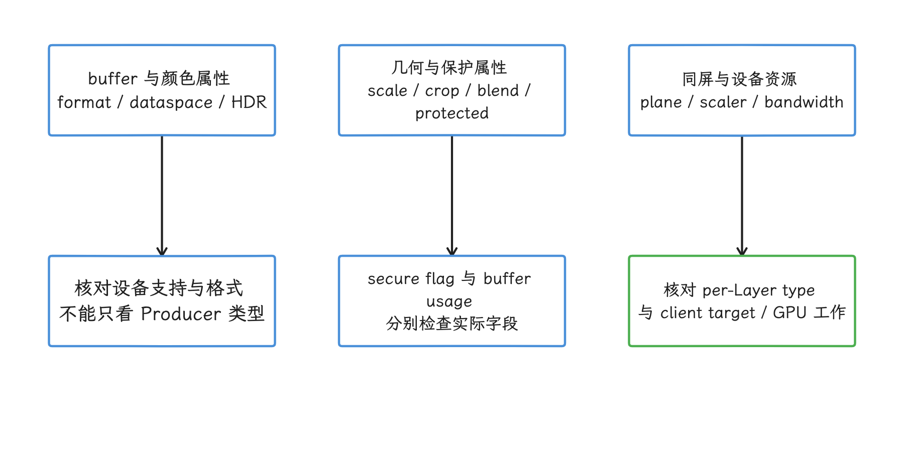

图：每个 Layer 的 DEVICE/CLIENT 结果由目标 display 实际协商。 CPU/GPU Producer、YUV 或 SurfaceView 名称都不保证获得 overlay plane，成本也不随数量线性增长。

protected 内容用不了目标设备的受保护路径时，没有“改交给普通的非保护 RenderEngine 合成”这条退路。黑屏或合成失败时我们检查 usage、secure flag、display capability 与 vendor Composer 结果。

<!-- gracker-diagram: ch13-02-42-protected-path -->
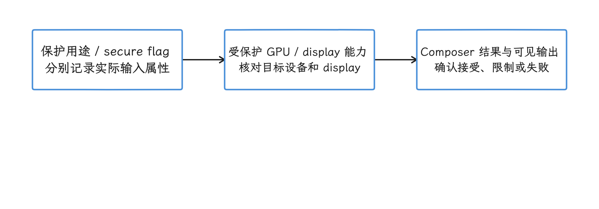

图：受保护输入需要匹配的消费和输出能力。 普通非保护 RenderEngine fallback 不能绕过这些约束；具体失败由设备实现取证。

### 渲染时序图

下面的时序图同时画出 Texture 回流、宿主窗口和独立 Surface：

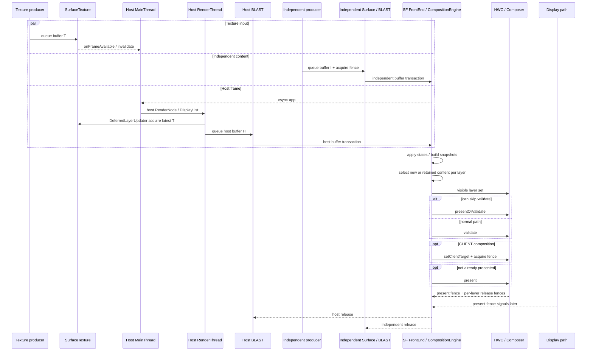

同一个 display frame 可以合法地组合“新宿主 + 旧独立内容”或“旧宿主 + 新独立内容”。如果宿主中还包含 TextureView，还要注明宿主 buffer H 采到了哪个 Texture buffer T：业务上的字幕、遮罩、位置与内容可能要求同一逻辑时刻，而系统没法从像素推断这种关系，只能靠应用自己表达。

<!-- gracker-diagram: ch13-02-43-new-old-combinations -->
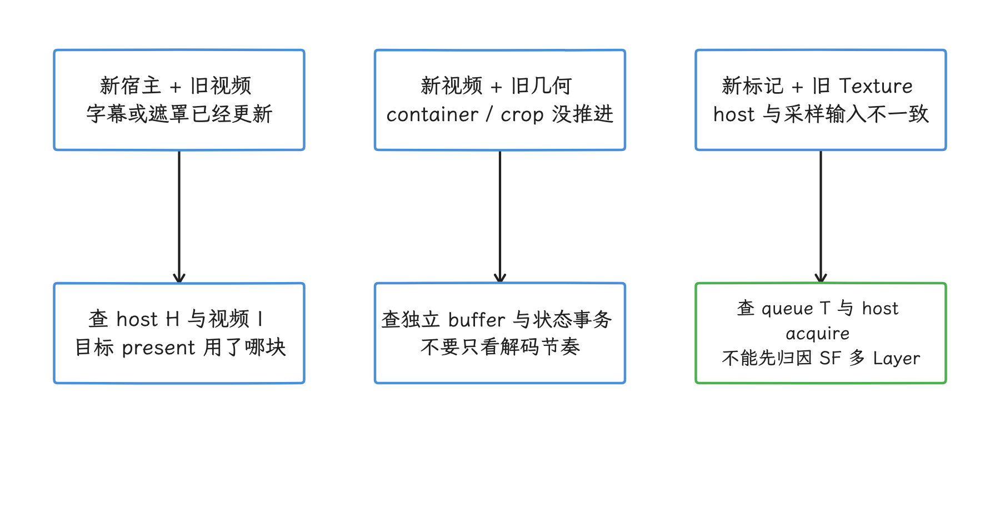

图：宿主、独立内容和宿主内部 Texture 各有自己的更新边界。 业务要求同一逻辑时刻时须显式表达，同屏出现不保证属于同一业务帧。

`presentOrValidate()` 的 `PresentSucceeded` 只表示该 Composer/HWC 调用已执行 present 分支并保存了 fences，证明不了物理显示面板已完成扫描。`Validated` 或普通 validate 路径还要处理 composition changes，必要时生成 client target，再调用 present。

### 跨 Surface 同步机制

混合页的同步问题分四类：状态原子提交、等待受控 Surface、调度目标、buffer 生命周期。每类 API 只解决其中一类，选型前我们先想清楚手头是哪一类问题。

#### 同一 Transaction

`SurfaceControl.Transaction` 可以同时更新多个 SurfaceControl 的 position、crop、alpha、layer、reparent，也可以通过公开 `setBuffer()` 提交调用方掌握的 `HardwareBuffer`。加入同一次 `apply()` 的状态会原子提交，外界观察不到其中一部分先单独生效。

下面的职责模型用于区分同一 Transaction 内的状态与外部 BufferQueue 事件；它只表达边界，不是可编译代码：

```text
Transaction T
  setPosition(surfaceA)
  setCrop(surfaceA)
  setAlpha(surfaceB)
  optional setBuffer(surfaceC, hardwareBuffer, acquireFence)
  apply T atomically

external producer
  queueBuffer(surfaceB)
  remains a separate BufferQueue event
```

`surfaceB` 的 alpha 属于 Transaction T，外部 Producer 之后提交的 buffer 仍是另一项事件。若业务要求新 alpha、新几何和新内容出现在同一逻辑帧，还要把对应 buffer transaction 纳入控制，或使用能够等待目标 Surface 的同步机制。

原子性只覆盖已经加入 Transaction 的状态：Camera、codec 或游戏 Producer 之后向另一个 BufferQueue queue 的“下一帧”会留在 Transaction 外。所以两个 container 几何同帧生效、某个 child 仍沿用旧 buffer，还说明不了 Transaction 丢了状态。

<!-- gracker-diagram: ch13-02-44-transaction-scope -->
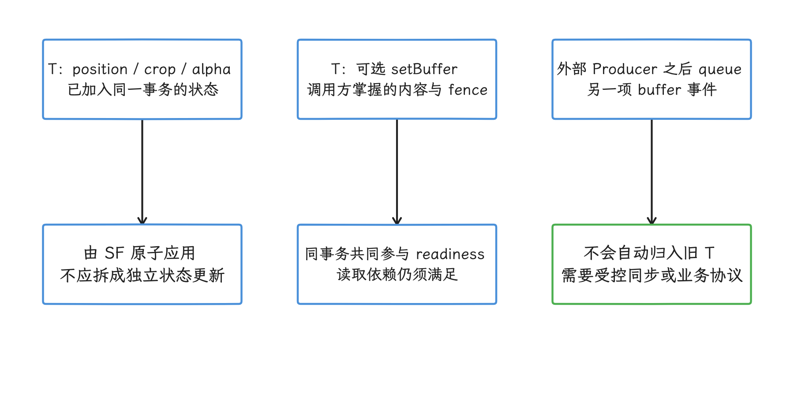

图：事务原子性只覆盖实际加入的几何、属性和 buffer 状态。 之后独立 queue 的外部下一帧仍在事务外，跨 display 物理扫描也无同纳秒承诺。

#### SurfaceSyncGroup

API 34 的 `SurfaceSyncGroup` 可以收集 `AttachedSurfaceControl`、`SurfaceControlViewHost.SurfacePackage` 和附加 Transaction，也能协调跨进程 child sync。调用 `markSyncReady()` 后，同步组会等已注册 child 都给出结果，再应用合并后的 merged transaction（合并后的事务）。

它等待的只是加入组的对象。MediaCodec、Camera HAL 或引擎 Producer 若没有通过受控 Surface 的同步接口进入组，系统也替业务预测不了它何时生成下一逻辑帧。`SurfaceView` 的部分直接 sync 接口属于 framework/internal 路径，对普通应用不是公开契约。

<!-- gracker-diagram: ch13-02-45-sync-group-branches -->
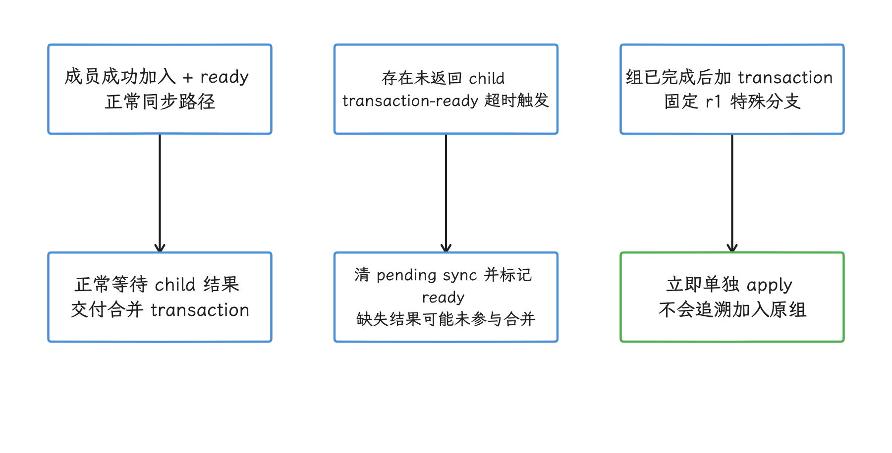

图：正常组等待已注册 child 的结果，故障超时可主动结束等待。 组完成不是全部 Producer 成功返回或 GPU 完成，必须检查成员注册与超时证据。

<!-- gracker-diagram: ch13-02-46-sync-participation -->
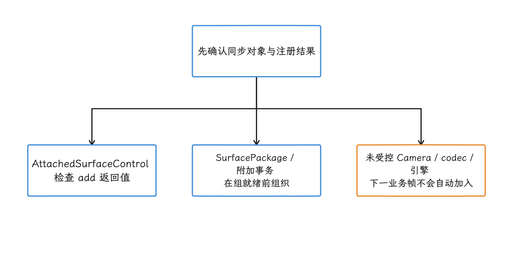

图：受控 Surface、附加事务和外部 Producer 的参与范围不同。 SurfaceView 部分直接同步接口是 internal；普通应用需按公开契约组织。

#### committed、completed 与 release

| 回调/信号 | 能证明什么 | 不能证明什么 |
|---|---|---|
| API 33 committed listener | transaction 已应用，update 已具备后续呈现条件 | display 已 present、buffer 已 release |
| API 35 completed listener | transaction 已 presented，并返回包含完成信息的 `TransactionStats` | panel 光学响应完成、旧 buffer 可无条件写 |
| buffer release callback/fence | Consumer 不再读取目标 buffer，可以按 fence 复用 | 新内容已在目标时间显示 |
| display present fence | 本轮 display 到达 Android 显示栈 present 边界 | panel 扫描/像素响应完成 |

<!-- gracker-diagram: ch13-02-47-callback-levels -->


图：状态应用、呈现反馈与 buffer 归还属于不同观察层次。 completed 的 stats 生命周期和有效 fence 仍须遵守，不能以任一回调替代面板光学响应。

#### desired present 与 FrameTimeline

API 35 的 `setDesiredPresentTimeNanos()` 请求 transaction 在指定 monotonic clock（不受系统时间校准影响的单调时钟）时间或之后显示；`setFrameTimeline(vsyncId)` 把 Choreographer 提供的 VSync id 交给 SurfaceFlinger，选择对应的 expected presentation timeline（预期呈现时间线）。

这两个 API 提供的是调度目标：buffer 仍要业务自己生成，fence wait 也仍然存在。Android 17 Java 文档明确要求：desired present time 再早，也要等所有 acquire fence 发出 signal 后 transaction 才能显示。相关 API 仍受平台 flag 与设备构建配置约束。

<!-- gracker-diagram: ch13-02-48-schedule-not-production -->


图：请求目标时刻或 VSync timeline 不会代替生产与同步。 固定 r1 相关 flag 关闭时可直接返回；过期 id 被忽略，早目标不能抢占前面较晚事务。

#### 三类 fence

| fence | 粒度 | 回答的问题 |
|---|---|---|
| acquire / production fence | 每块输入 buffer | Producer 何时写完，Consumer 何时可读 |
| release fence | 每个被消费的 layer/buffer | Consumer/HWC 何时不再读取，旧 buffer 何时可复用 |
| present fence | 每个 display present | 本轮 display 何时到达显示栈 present 边界 |

TextureView 回流多一套 SurfaceTexture acquire/release，宿主窗口还有 host BLAST acquire/release。报告里的 fence 必须注明队列、layer、buffer 与方向，否则读者无从对号。

<!-- gracker-diagram: ch13-02-49-nested-fence-queues -->


图：Texture 输入的周转和宿主窗口输出的周转分别对应 buffer 与 fence。 每个 fence 写清队列、Layer、buffer 和方向，句柄或回调到达不等于完成。

#### AutoSingleLayer 的适用范围

Android 13 的 `AutoSingleLayer` latch-unsignaled 模式只适用于满足条件的单 layer 简单 buffer update，跨 layer、几何变化和 sync transaction 恰好是它的限制所在。

它可以把某次 acquire-fence wait 后移到内容读取阶段，但多个 Producer 的逻辑帧不会因此自动一致，跨 Surface 同步仍要靠 Transaction 或 SurfaceSyncGroup。

<!-- gracker-diagram: ch13-02-50-latch-unsignaled-scope -->


图：受限单 Layer 简单更新可先采纳未完成内容，读取仍受 fence 保护。 多 Layer、几何与 sync transaction 有额外限制；Producer 的业务帧不会因此自动一致。

### SurfaceFlinger 在多 Layer 时的 latch 行为

#### FrontEnd 的对象模型

收到 transaction 后，SurfaceFlinger 把请求合入 `RequestedLayerState`，由 `LayerLifecycleManager` 管理 layer 生命周期和 hierarchy，再由 `LayerSnapshotBuilder` 生成本轮的可见性、几何和效果 snapshot（本轮状态快照）。buffer layer 的 transaction readiness（处理条件检查）、buffer readiness 与 fence 还要单独判断。

旧资料把流程简化成 `SurfaceFlinger::commit()` 逐层调用 `Layer::latchBuffer()`，已经不足以解释 container/content child、FrontEnd state 与 snapshot 这些现状，读旧教程时要留意。

<!-- gracker-diagram: ch13-02-51-frontend-state -->


图：当前 SF 分开管理请求状态、生命周期/层级和本轮快照。 buffer readiness、fence 与内容选择还要另查，不能仅套逐个旧 Layer latch 的模型。

#### 旧内容的沿用

SurfaceFlinger 并未要求每个可见 layer 在每个 display frame 都有新 buffer。某一路没有新内容时，可以继续使用已选中的上次内容；低帧率视频与高刷新率 UI 的组合会自然出现这种复用。

视觉错位通常来自业务对象没有在同一逻辑时刻更新，把它归因于“SF 必须等待所有 layer”并不成立。典型组合有三种：

<!-- gracker-diagram: ch13-02-52-retained-content -->


图：低帧率内容与高刷新率 UI 可以合法使用不同更新频率。 SF 不要求每个可见 Layer 每个 display frame 都提供新 buffer，业务错位需按对象确认。

- 新宿主 UI + 旧视频：字幕或遮罩已经更新，视频仍是上一帧；
- 新视频 + 旧宿主几何：内容推进，container/crop 仍在旧位置；
- 新地图标记 + 旧 Texture 输入：宿主 UI 与被采样底图属于不同业务时刻。

定位时我们要回答目标 present 对每个对象使用了什么：

1. 宿主 App Window 使用哪次 `BufferTX`；
2. 每个独立 content child 使用新 buffer，还是沿用上次选中的内容；
3. container position/crop/relative-Z 是否已更新；
4. 宿主内部的 TextureView 采到了哪个输入 buffer；
5. 哪些 layer 为 DEVICE，哪些进入 CLIENT。

`BufferTX - <layerName>` 只表示 SurfaceFlinger 侧待处理 buffer transaction 的计数变化。计数增加，说明不了 acquire fence、sync barrier（同步屏障）、desired present 或 HWC strategy 的完整状态，还要继续往下游查。

<!-- gracker-diagram: ch13-02-53-per-present-inventory -->


图：逐个对象记录新旧 buffer、几何和合成类型，再解释异常画面。 BufferTX 是 SF 待处理 buffer 更新计数，不能替代 fence、ready 或 present 证据。

#### transaction ready 与 fence 的先后

SurfaceFlinger 可能因 sync group、barrier、desired present、acquire fence 或其他条件推迟更新。满足 latch-unsignaled 条件时，transaction 可以先通过部分 readiness 检查，不必等 fence 全部就绪；RenderEngine 或 HWC 读取 buffer 前仍要遵守 fence。

所以 transaction committed、`BufferTX` 增加或 snapshot 更新，都证明不了目标 display 已使用新 buffer，判定还要看 fence 与实际读取。

<!-- gracker-diagram: ch13-02-54-ready-latch-read -->


图：事务可因多种条件推迟，允许的先采纳也不消除输入同步。 committed、BufferTX 增加或 snapshot 更新都不证明目标 display 已使用新 buffer。

#### HWC present 路径

`HWComposer::getDeviceCompositionChanges()` 只有在本轮没有 client composition、且满足 earliest-present 条件时，才尝试 `presentOrValidate()`：

- PresentSucceeded：本次组合调用已执行 present，保存 present/release fences，并把 `validateWasSkipped` 置为 true；
- Validated：validate 已完成，随后读取 changed composition types/requests 并 `acceptChanges()`；
- 不满足 skip 条件：走普通 `validate()`，再处理 changes 与 `acceptChanges()`。

存在 CLIENT layer 时，RenderEngine 生成 client target，`setClientTarget()` 携带 output acquire fence。`presentAndGetReleaseFences()` 走 fast path（前一步已完成 present 的快速路径）时只需提交积累的 commands；其他路径调用 present 并取得 release fences。

<!-- gracker-diagram: ch13-02-55-hwc-fast-present -->


图：无 CLIENT 且时间条件允许时，组合调用可能直接完成 HAL present。 fast-present 成功和重新生成 CLIENT target/再 present 是互斥路径；HAL 返回不等于面板已扫描完。

### 性能特征与陷阱

#### 共享的显示资源

独立 Producer 的价值是内容生产可以不跟随宿主 MainThread：主线程短暂卡顿时，如果 Surface 已建立且几何状态稳定，视频仍可能继续更新；反过来，视频解码迟到，也未必会拖住宿主按钮动画。

但几路内容共享显示和硬件资源，container 状态通常仍由宿主控制。“视频帧率稳定”推不出“主线程问题与视频无关”，“UI 帧率稳定”同样推不出独立 layer 已按时 present。

#### 常见故障

| 现象 | 优先检查 | 不应直接下的结论 |
|---|---|---|
| 新字幕配旧视频 | host buffer、视频 child buffer、目标 present | SF 会自动理解逻辑帧关系 |
| 视频已动，遮罩位置旧 | container geometry（位置和裁剪等几何状态）、hole-punch、sync transaction | 视频 Producer 慢 |
| 地图标记与底图错位 | Texture queue、宿主 acquire、标记所在 host frame | SF 多 layer latch 错 |
| 首屏局部黑 | lifecycle、Producer connect、首 buffer、visibility | 主线程已画完，所以所有内容已存在 |
| GPU 功耗跳升 | DEVICE→CLIENT、client target、透明/transform/layer 集合 | layer 数增加必然线性增成本 |
| Producer dequeue 很长 | 对应队列 slot 与 release fence | 所有 Producer 被同一个 display fence 卡住 |
| committed 后画面未变 | completed/present、buffer readiness、目标 display | committed 等于 present |
| desired present 仍迟到 | acquire fence、cadence、transaction 顺序、display mode | API 会强制在指定纳秒显示 |
| protected 视频黑屏 | secure/protected path、display、HWC capability | 改走普通 GPU fallback（备用路径）就能解决 |

<!-- gracker-diagram: ch13-02-56-diagnostic-symptoms -->


图：字幕、地图和局部黑屏各有不同的起查对象。 UI 正常、视频帧率稳定或主线程已画完，都不能独立证明全部内容已按时显示。

#### Perfetto 复原顺序

从用户看到异常的 display present 开始，沿显示路径向 Producer 检查，比从最长 CPU slice 开始更容易识别错帧组合：

1. 锁定异常 present time 与 `display_frame_token`；
2. 列出该 display 的可见 layer、parent 和 hierarchy；
3. 标记每个 layer 使用的新/旧 buffer 与几何状态；
4. 展开宿主 buffer 内的 TextureView、WebView functor（把 WebView 绘制接入宿主 HWUI 的桥接对象）或引擎纹理；
5. 对齐 Transaction、SurfaceSyncGroup、desired present 和 FrameTimeline；
6. 标明每个 acquire/release/present fence 的所有者；
7. 比较 DEVICE/CLIENT strategy、client target、display mode 和 color mode；
8. 找到最早偏离业务期望的 Producer 或同步边界。

判断 App Window 用 FrameTimeline 的 host SurfaceFrame，判断整屏用 SF DisplayFrame。独立 Surface 或 TextureView 输入未必有完整的 app actual slice（应用实际帧记录），需要补充 `BufferTX`、queue/acquire、fence、layer 与 HWC 证据。

<!-- gracker-diagram: ch13-02-57-reverse-trace -->


图：先还原输出，再向 Producer 追踪具体内容和同步依赖。 host SurfaceFrame 与 SF DisplayFrame 作用不同，缺 App slice 时需补 queue/fence/Layer 证据。

#### 对比 HWC strategy 变化前后

发生 GPU、功耗或延迟跳变时，选择变化前后相邻 display frame，记录：

- 可见 layer 集合与 Z-order；
- format、dataspace、protected、alpha、transform、crop；
- 每个 layer 的 DEVICE/CLIENT composition type；
- client target 面积和 GPU duration；
- display mode、刷新率、color mode；
- vendor Composer request、error 或 fallback（备用处理路径）。

静止与动画期间可能使用不同 strategy，测试要覆盖出现问题的动态状态。

<!-- gracker-diagram: ch13-02-58-strategy-comparison -->


图：对比相邻异常前后帧时，同时记录内容属性、资源策略和显示模式。 静止与动画可使用不同策略，功耗、GPU 或延迟变化不能只按 Layer 数解释。

#### Android 12—17 版本边界

| 平台 | 混合出图相关变化 | 诊断影响 |
|---|---|---|
| Android 12 / API 31 | BLAST 与 FrameTimeline 构成现代窗口/Surface 基线 | 可用 host SurfaceFrame、SF DisplayFrame、layer/`BufferTX` 复原多路显示 |
| Android 13 / API 33 | Composer HAL 转向 AIDL（Android Interface Definition Language，接口定义语言）；`AutoSingleLayer` 默认；committed listener 与 Java `setBuffer()` 公开 | Binder/trace 入口变化；latch-unsignaled 不解决跨 layer 同步 |
| Android 14 / API 34 | `SurfaceSyncGroup`、SurfaceView lifecycle strategy 与任意 alpha 公开 | 受控跨进程 Surface 可同步；保留/销毁与半透明规则改变 |
| Android 15 / API 35 | desired present、transaction FrameTimeline、completed listener、desired HDR headroom（SDR 白场以上的 HDR 亮度余量） | 调度和完成反馈更明确，buffer/fence 与设备能力仍决定结果 |
| Android 16 / API 36 | `SurfaceView.setCompositionOrder(int)` 公开 | 负值在宿主下，非负值在宿主上；同值的同级（peer）Surface 顺序未定义 |
| Android 17 / API 37 | SurfaceView blur region API；固定到当前 FrontEnd、BLAST、CompositionEngine/HWC | blur、crop、transform、位置和 flag 状态要一起检查 |

历史边界可从这些一手入口复核：[Android 13 release notes](https://source.android.com/docs/whatsnew/android-13-release)、[unsignaled buffer latch](https://source.android.com/docs/core/graphics/unsignaled-buffer-latch)、[API 33 Transaction diff](https://developer.android.com/sdk/api_diff/33/changes/android.view.SurfaceControl.Transaction)、[API 34 SurfaceSyncGroup diff](https://developer.android.com/sdk/api_diff/34/changes/android.window.SurfaceSyncGroup)、[API 35 Transaction diff](https://developer.android.com/sdk/api_diff/35/changes/android.view.SurfaceControl.Transaction)、[API 36 SurfaceView diff](https://developer.android.com/sdk/api_diff/36/changes/android.view.SurfaceView) 与 [API 37 SurfaceView diff](https://developer.android.com/sdk/api_diff/37/changes/android.view.SurfaceView)。

#### Android 17 源码入口

平台固定到 `android-17.0.0_r1`：

- [`ViewRootImpl.java`](https://android.googlesource.com/platform/frameworks/base/+/android-17.0.0_r1/core/java/android/view/ViewRootImpl.java) 与 [`Choreographer.java`](https://android.googlesource.com/platform/frameworks/base/+/android-17.0.0_r1/core/java/android/view/Choreographer.java)：宿主 traversal、VSync 与 window transaction；
- [`TextureView.java`](https://android.googlesource.com/platform/frameworks/base/+/android-17.0.0_r1/core/java/android/view/TextureView.java) 与 [`DeferredLayerUpdater.cpp`](https://android.googlesource.com/platform/frameworks/base/+/android-17.0.0_r1/libs/hwui/DeferredLayerUpdater.cpp)：SurfaceTexture frame-available、App Consumer 与宿主 GPU 采样；
- [`SurfaceView.java`](https://android.googlesource.com/platform/frameworks/base/+/android-17.0.0_r1/core/java/android/view/SurfaceView.java)：container/BLAST child、hole-punch、几何、lifecycle、composition order 与 blur；
- [`BLASTBufferQueue.cpp`](https://android.googlesource.com/platform/frameworks/native/+/android-17.0.0_r1/libs/gui/BLASTBufferQueue.cpp)：buffer transaction、frame-number merge 与 release；
- [`SurfaceControl.java`](https://android.googlesource.com/platform/frameworks/base/+/android-17.0.0_r1/core/java/android/view/SurfaceControl.java) 与 [`SurfaceComposerClient.cpp`](https://android.googlesource.com/platform/frameworks/native/+/android-17.0.0_r1/libs/gui/SurfaceComposerClient.cpp)：multi-Surface state、listeners、desired present、FrameTimeline 与 fence；
- [`SurfaceSyncGroup.java`](https://android.googlesource.com/platform/frameworks/base/+/android-17.0.0_r1/core/java/android/window/SurfaceSyncGroup.java)：child sync、跨进程 `SurfacePackage` 与 merged transaction；
- [SurfaceFlinger FrontEnd](https://android.googlesource.com/platform/frameworks/native/+/android-17.0.0_r1/services/surfaceflinger/FrontEnd/)、[`SurfaceFlinger.cpp`](https://android.googlesource.com/platform/frameworks/native/+/android-17.0.0_r1/services/surfaceflinger/SurfaceFlinger.cpp)：state、lifecycle、snapshot 与 transaction readiness；
- [CompositionEngine](https://android.googlesource.com/platform/frameworks/native/+/android-17.0.0_r1/services/surfaceflinger/CompositionEngine/)、[`HWComposer.cpp`](https://android.googlesource.com/platform/frameworks/native/+/android-17.0.0_r1/services/surfaceflinger/DisplayHardware/HWComposer.cpp) 与 [`HWC2.cpp`](https://android.googlesource.com/platform/frameworks/native/+/android-17.0.0_r1/services/surfaceflinger/DisplayHardware/HWC2.cpp)：visible layer（可见图层）、DEVICE/CLIENT、present/release fence。

Kernel 固定到 `android17-6.18-2026-06_r6`：

- [`drivers/dma-buf/sync_file.c`](https://android.googlesource.com/kernel/common/+/refs/tags/android17-6.18-2026-06_r6/drivers/dma-buf/sync_file.c)：fence fd；
- [`drivers/dma-buf/dma-fence.c`](https://android.googlesource.com/kernel/common/+/refs/tags/android17-6.18-2026-06_r6/drivers/dma-buf/dma-fence.c)：signal、callback 与 wait；
- [`drivers/dma-buf/dma-buf.c`](https://android.googlesource.com/kernel/common/+/refs/tags/android17-6.18-2026-06_r6/drivers/dma-buf/dma-buf.c)：dma-buf attach/map 与引用管理。

common kernel 解释不了 vendor GPU、codec、Camera 或 DPU（Display Processing Unit，显示处理单元）的 fence 创建和 signal 原因，这部分需要目标设备驱动与 vendor trace。

交叉阅读：

- [13.1 Android View 渲染管线与分析方法](01-android-view-pipeline-analysis.md)
- [13.3 SurfaceView 与 TextureView 渲染管线](03-surfaceview-textureview-pipelines.md)
- [2.9 SurfaceFlinger 合成、FrontEnd 与事务队列](../../part1-fundamentals/ch02-rendering/09-surfaceflinger-frontend-transaction.md)
- [2.4 MainThread、RenderThread 与 Hardware Layer](../../part1-fundamentals/ch02-rendering/04-main-render-thread-hardware-layer.md)

## 小结

软件渲染由 CPU 生成像素，离屏渲染把结果写入中间目标，两者可以组合，也可以分别出现。分析时先确认输出是可见 Surface 还是离屏资源，再追踪它的 Consumer；离屏任务完成只证明中间结果可用，画面有没有呈现，要看显示链上的证据。

混合页按内容对象分析：每个对象确认 Producer、Consumer、最终 SF layer、几何所有者、帧节奏、buffer 与 fence；宿主窗口内部还可能包含 TextureView 等需要再次采样的输入。

同一 Transaction 保证已加入状态的原子应用，`SurfaceSyncGroup` 等待已注册的受控 Surface，desired present 与 FrameTimeline 提供调度目标；这三者都管不到外部 Producer 的下一帧。

定位错帧时，我们从异常 display present 开始，列出每个 layer 使用的新旧 buffer 与几何状态，再检查宿主内部输入，直到找到最早偏离业务期望的 Producer 或同步边界。

<!-- gracker-diagram: ch13-02-60-content-to-display -->


图：把 Producer、中间结果、Consumer 与最终 Layer 连回用户看到的画面。 软件/离屏是不同维度；业务帧一致性仍由应用或受控同步机制明确表达。
