# SurfaceView 与 TextureView 渲染管线

SurfaceView 拥有独立 Surface 和 layer，TextureView 把外部纹理合入宿主 View。这一节我们把两条管线各走一遍：前者利于独立合成，后者便于 View 变换；代价分别落在窗口同步和宿主 GPU 合成。

## SurfaceView 的独立 Layer 与同步

### 为什么需要 SurfaceView

SurfaceView 让主体内容无须先画进宿主窗口的 buffer。这里的宿主窗口，指包含 SurfaceView 和其他普通 View 的 App Window；视频解码器、Camera 或 EGL/Vulkan 渲染线程等 Producer（内容生产方）向另一条独立的 buffer 队列提交内容，控制条、遮罩等普通 View 则仍由宿主窗口的主线程与 RenderThread 生成。我们用下面的简图区分这两条内容生产线：

```text
宿主窗口：Choreographer → UI Thread → RenderThread → Host BufferQueue
主体内容：Codec / Camera / EGL / Vulkan Producer → SurfaceView BufferQueue
                                                    ↓
                                      SurfaceFlinger → HWC → Display
```

这张简图划分的是像素归属。先把“独立”说准：SurfaceView 页面仍有主线程、RenderThread 和宿主窗口，“独立”指的是主体像素拥有自己的 Surface、BufferQueue 和 SF layer；页面本身仍受 ViewRoot 管理，内容 Producer 也可能就在应用进程内。

这套结构带来三项直接收益：

- 主体内容可以采用与宿主 UI 不同的帧率。低帧率视频无须迫使宿主窗口按同样节奏重画，宿主窗口刷新时也不要求视频每轮都提供新 buffer。
- 主体内容不经过宿主 RenderThread 的纹理采样。对视频、相机等大面积内容，这可能减少 GPU 工作和内存带宽。
- SurfaceFlinger 能把主体作为独立 layer 交给 HWC（Hardware Composer，硬件合成器） 评估。设备条件满足时可使用 DEVICE composition，由显示硬件直接参与合成；条件不满足时则可能进入 CLIENT composition，由 RenderEngine 先生成整屏合成所需的 client target。

这些收益各有适用范围。回到 trace 上，主线程卡住时，已有视频帧仍可能继续更新，但 SurfaceView 的布局、裁剪、透明洞、控制条和生命周期处理可能停在旧状态；独立 layer 拿到的也只是被 HWC 单独评估的机会，Overlay（硬件叠加层）是否用得上、功耗和时延是否更低，都要看设备的具体条件。所以分析时我们分别回答三个问题：内容是否继续生产、宿主几何是否更新、本轮采用何种合成方式。

<!-- gracker-diagram: ch13-03-02-sv-three-questions -->
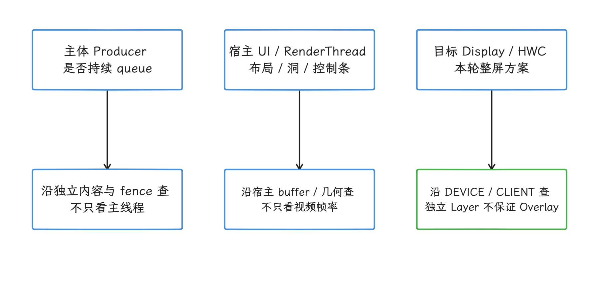

图：内容继续更新、几何是否跟上与是否 DEVICE 是三个问题。 主线程卡住时视频仍可更新，但不能据此证明布局、透明洞或交互正常。

SurfaceView 适合主体像素由独立 Producer 持续提供的场景，例如：

- MediaCodec 或 Codec2 的视频输出；
- Camera preview stream（相机预览流）；
- 游戏、地图或可视化引擎的 EGL/Vulkan 输出；
- 需要 secure/protected（防截取并受硬件保护）显示链路的内容；
- 通过 `SurfaceControlViewHost` 嵌入的远端 View 层级。

反过来，内容需要频繁参与普通 View 的旋转、复杂裁剪、着色器效果或父子透明度动画时，TextureView 往往更容易实现。选型时我们回到三件事：像素归属、变换需求和目标设备的合成能力；“视频用 SurfaceView、动画用 TextureView”这类口诀，当作固定规则会出错。

<!-- gracker-diagram: ch13-03-01-sv-two-producers -->
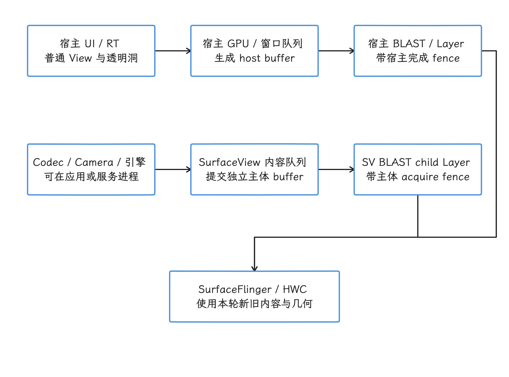

图：宿主 UI 与主体内容分别生产 buffer，在显示系统汇合。 以现代硬件加速宿主为例；软件宿主可由 CPU 生成 host buffer，两路不要求每个显示帧都更新。

### 独立 Surface 与挖洞机制

#### SurfaceView 的对象层次

`SurfaceView.createBlastSurfaceControls()` 维护的主要对象如下：

```text
ViewRootImpl bounds layer
  └─ mSurfaceControl：SurfaceView container
       ├─ mBlastSurfaceControl：BLAST buffer layer
       └─ mBackgroundControl：background color layer
```

这张层次图要区分组织层和内容层。`mSurfaceControl` 本身不携带像素，它作为 container 负责 SurfaceView 子树的位置、变换、裁剪、相对层级和部分视觉状态；承载 Producer buffer 的是 `mBlastSurfaceControl` 内容层；`mBackgroundControl` 则是 container 下方的纯色背景层。

背景层的显隐有一条明确的条件链：`updateBackgroundVisibility()` 要求 `mSubLayer < 0`（内容位于宿主下方）、内容层带 `OPAQUE`（不透明） 标志且背景层未被禁用，同时满足才显示；`mBlastBufferQueue` 再通过 `update()` 把内容层的尺寸、格式与生产端 `Surface` 关联起来。

<!-- gracker-diagram: ch13-03-04-sv-background -->
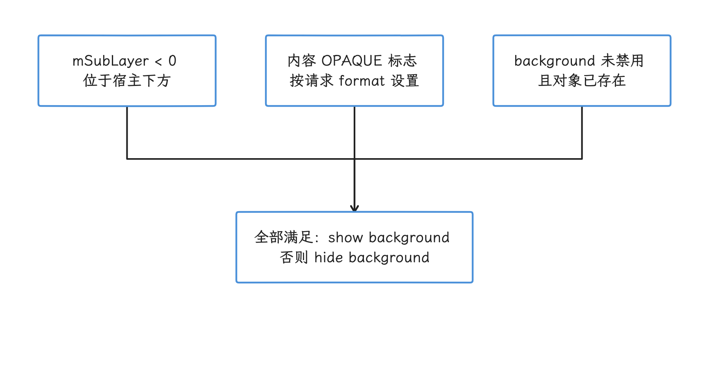

图：背景层只在指定 Z、opaque 与启用条件同时满足时显示。 它不是视频 buffer，也不能凭背景颜色推断主体首帧已提交。

Java `SurfaceView` 位于应用进程，但 buffer 填充者不一定也在该进程：应用内游戏线程可以直接使用 `Surface`，MediaCodec、Camera 或嵌入式层级也可能由系统服务和厂商组件参与生产。确认 Producer 身份时，我们沿目标 BufferQueue 的 connect、dequeue（取出）、queue（放回待消费队列）、fence 和 layer id 回溯；拿常见进程名当依据，只是猜测。

<!-- gracker-diagram: ch13-03-03-sv-object-tree -->
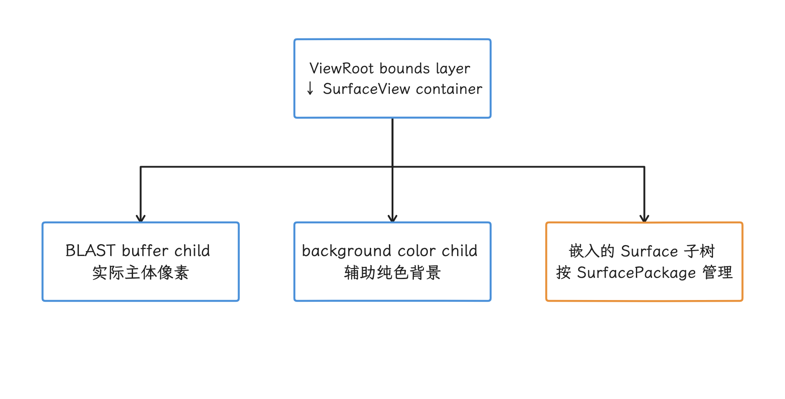

图：container 组织子树，BLAST child 承载主体 buffer。 parent-child 与相对宿主的 Z 顺序不同；background 也是 container 的 child。

#### 默认 Z-below 与透明洞

SurfaceView 默认采用 Z-below，即内容层位于宿主窗口下方。宿主窗口若仍在同一矩形内绘制不透明像素，下面的内容就会被遮住，所以 HWUI 要在宿主 buffer 中留出透明区域，也就是 hole-punch（挖洞）。关键实现包括：

- `gatherTransparentRegion()` 把 SurfaceView 的可见矩形加入宿主窗口的透明区域；
- `draw()` 或 `dispatchDraw()` 在 `mDrawFinished && !isAboveParent()` 时调用 `clearSurfaceViewPort()`；
- `clearSurfaceViewPort()` 使用 `Canvas.punchHole()` 清理对应像素，并把圆角、clip bounds 与 alpha 纳入透明区域参数；
- `mDrawFinished` 为 `false` 时不会打洞；`surfaceRedrawNeededAsync` 要求的所有重绘回调结束后，该字段才会变为 `true`。

“挖洞”既没有创建一个黑色 View，也没有把视频像素复制到宿主窗口；它只是在宿主 buffer 的对应区域保留透明度，剩下的交给 SurfaceFlinger 按 layer 层级合成宿主与 SurfaceView 内容。

<!-- gracker-diagram: ch13-03-05-sv-hole-punch -->
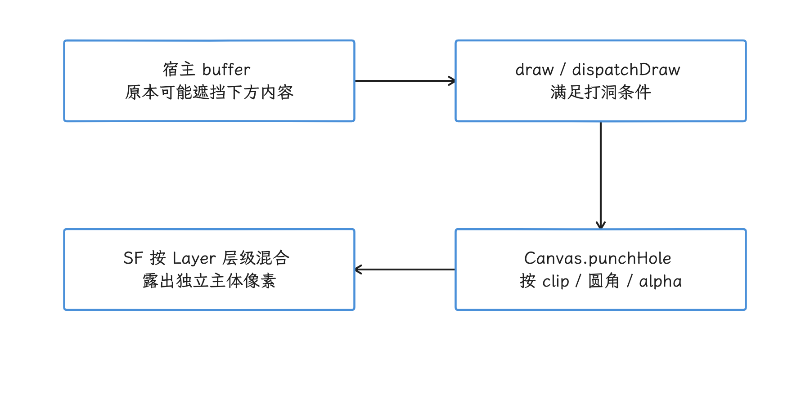

图：宿主清理对应区域的透明度，主体像素仍留在独立 layer。 圆角、clip 与 alpha 影响透明洞；不发生把视频拷入宿主的操作。

`mDrawFinished` 能证明的只有一点：framework 认为 redraw callback 阶段已经结束。至于 Producer 是否已 queue 第一块 buffer、SurfaceFlinger 是否已经 latch（为本次合成选中）该 buffer、HWC 是否已 present，要另行确认；我们分析首帧时，依次检查 Producer connection、第一笔 buffer transaction、acquire fence、layer 可见性和目标 Display 的 present。

<!-- gracker-diagram: ch13-03-06-sv-redraw-first-frame -->
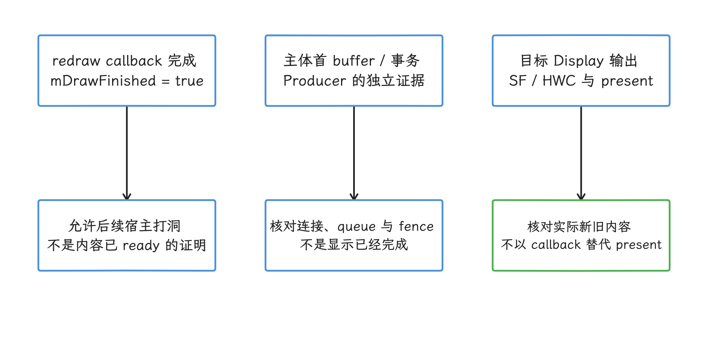

图：mDrawFinished 只标记 framework 的 redraw callback 阶段。 Producer queue、读取 fence、可见性与目标 present 仍需分别证明。

Z-above 时，SurfaceView 位于宿主窗口之上，无须在宿主 buffer 中打洞；相应地，宿主窗口里的普通 View 也盖不到它上面。层叠关系推荐用 `setCompositionOrder(int)` 表达：负数位于宿主下方，非负数位于宿主上方；同级 SurfaceView 之间，数值更大的那个层级更高，数值相同的顺序未定义。旧的 `setZOrderMediaOverlay()` 与 `setZOrderOnTop()` 已标记为 deprecated，阅读遗留代码时仍需理解其语义。

<!-- gracker-diagram: ch13-03-07-sv-composition-order -->
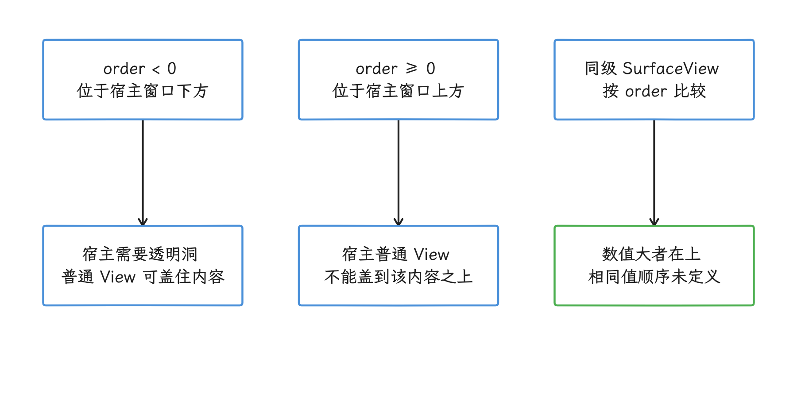

图：负值在宿主下方，非负值在宿主上方，同级值越大越靠上。 API 36 首引及固定 r1 flag 需核对；相同 order 未定义顺序。

#### alpha、HDR、composition order 与 blur

Android 12 到 Android 17 的现代主线可按下表理解：

| 平台 | SurfaceView 相关变化 | 分析含义 |
|---|---|---|
| Android 12 / API 31 | container、BLAST child、background 与 RenderNode 位置同步成为稳定分析基线 | 几何 transaction 与内容 buffer 要按不同 layer 观察 |
| Android 13 / API 33 | 主体结构延续 | 设备差异仍要核对厂商 Composer、gralloc（图形内存分配器）与 Producer，不能预设 AOSP 拓扑已经换代 |
| Android 14 / API 34 | 支持任意 alpha；公开 `setSurfaceLifecycle()` | Z-below 的 alpha 调节透明洞的混合比例，Z-above 的 alpha 作用于 Surface 内容；生命周期可以跟随 visibility 或 attachment |
| Android 15 / API 35 | 增加 `setDesiredHdrHeadroom()` | 该值表达 SurfaceView 期望的 HDR 亮度余量，结果仍受面板、bit depth（位深）、环境和系统策略约束 |
| Android 16 / API 36 | 增加 `setCompositionOrder()` | 多个 SurfaceView 的相对关系可以用整数表达；相同 order 没有稳定顺序 |
| Android 17 / API 37 | 增加 `setBlurRegions()` | blur 坐标相对 SurfaceView bounds，尺寸变化后调用方需要更新；最终位置还受 scale、crop 与几何 transaction 影响 |

Z-below 的 alpha 作用于宿主透明洞与内容层之间的混合比例，内容 buffer 中的 alpha 通道保持原样。多个位于宿主下方的 SurfaceView 相互重叠时，混合结果也和普通 View 按父子顺序逐层混合不同。所以排查叠加异常时，我们同时记录 composition order、宿主 hole-punch、内容层 alpha 与 HWC composition type（DEVICE 或 CLIENT 等合成类型）。

<!-- gracker-diagram: ch13-03-08-sv-alpha-boundary -->
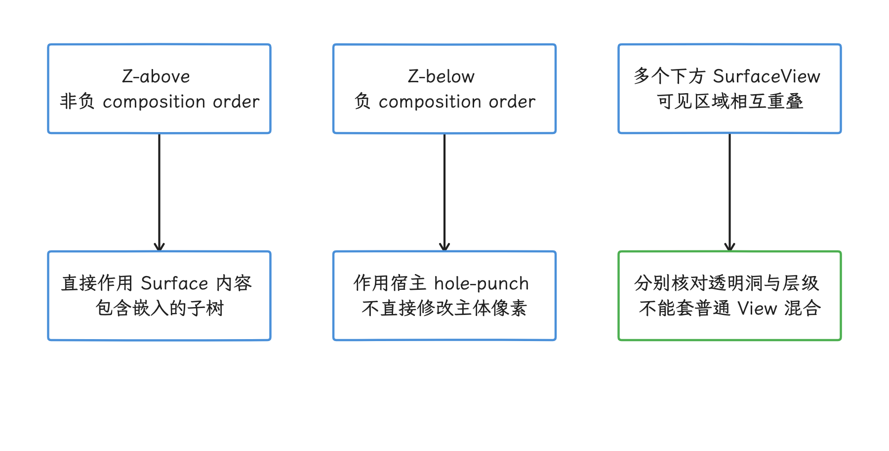

图：alpha 的作用对象由相对宿主的合成顺序决定。 下方重叠 SurfaceView 的混合不等同普通 View 顺序混合；buffer alpha 通道不被改写。

#### 生命周期是 Producer 的硬边界

我们先把三个状态分开：Activity 可见、View 已 attach（接入 View 层级）、底层 `Surface` 有效。Producer 只能在 `surfaceCreated()` 到 `surfaceDestroyed()` 之间使用当前 Surface；`surfaceDestroyed()` 返回后，渲染线程必须停止访问它。Producer 若位于工作线程或远端服务，销毁回调就要等到旧连接停止使用 Surface 再返回，只异步发送一条 stop 消息是不够的。

<!-- gracker-diagram: ch13-03-09-sv-lifecycle -->
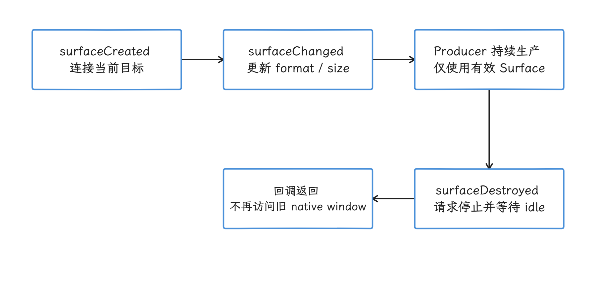

图：Producer 使用当前 Surface 的有效期由 created/destroyed 回调限定。 Activity 可见、View attach 与 Surface 有效是三个状态；销毁回调返回前停止旧目标访问。

下面的代码用应用自有接口表达所有权划分，`FrameProducer` 不是 Android SDK 类型：

```kotlin
private interface FrameProducer {
    fun attach(surface: Surface)
    fun resize(width: Int, height: Int, format: Int)
    fun detachAndWaitUntilIdle()
}

surfaceView.holder.addCallback(object : SurfaceHolder.Callback {
    override fun surfaceCreated(holder: SurfaceHolder) {
        producer.attach(holder.surface)
    }

    override fun surfaceChanged(
        holder: SurfaceHolder,
        format: Int,
        width: Int,
        height: Int,
    ) {
        producer.resize(width, height, format)
    }

    override fun surfaceDestroyed(holder: SurfaceHolder) {
        producer.detachAndWaitUntilIdle()
    }
})
```

这段骨架强调 `detachAndWaitUntilIdle()` 必须同步等到旧 Surface 不再被使用：EGL/Vulkan 线程停止对旧 native window 的 swap/present，MediaCodec 或 Camera 撤销旧 output，具体停止 API 取决于 Producer。Android 14 的 attachment 生命周期策略允许 Surface 在 View 暂时不可见时继续存在，代价是 buffer、连接和硬件资源的持有时间也被拉长。

### 完整渲染路径

#### 从 Producer 到显示设备

一块 SurfaceView 内容 buffer 会依次经过以下阶段：

<!-- gracker-diagram: ch13-03-10-sv-buffer-to-display -->
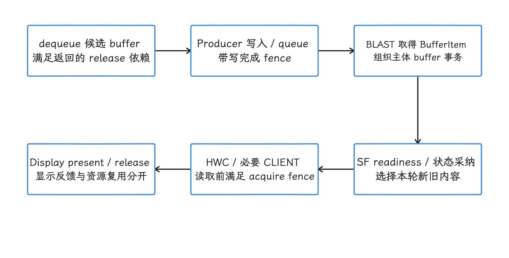

图：dequeue 的候选、写入依赖、buffer transaction 与显示输出各有边界。 图是主要依赖；present 可走快路径，release 返回约束对应旧 buffer 的复用。

1. Producer 从目标 Surface 对应的 BufferQueue `dequeue` 一块可写 buffer。
2. Codec、Camera、CPU、GLES 或 Vulkan 填充内容，并生成描述写入完成条件的 fence。
3. Producer 把 buffer `queue` 回待消费队列，同时提交时间戳、crop、transform、dataspace（颜色空间等解释信息）和 HDR metadata。
4. BLAST consumer 取得描述该帧的 `BufferItem`，在 `BLASTBufferQueue::acquireNextBufferLocked()` 周围把 buffer、acquire fence、frame number 与 layer 状态写入 `SurfaceComposerClient::Transaction`。
5. SurfaceFlinger 接收 transaction，更新 FrontEnd 的 requested state（请求状态）、layer hierarchy 与 snapshot，再根据当前 latch 条件选用新 buffer 或继续使用旧 buffer。
6. CompositionEngine 为目标 Display 构造可见 layer 集合，HWC 对整屏合成方案执行 validate；CLIENT layer 由 RenderEngine 先合成到 client target，DEVICE layer 交由显示硬件处理。
7. HWC present 后返回 present fence 与每个 layer 的 release fence。release fence 沿 BLAST/BufferQueue 返回对应 Producer，决定该 buffer 何时可以安全复用。

下面的时序图把宿主几何和内容提交画在两条线上：

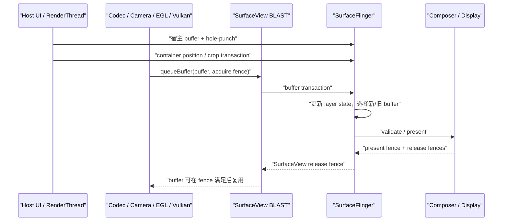

图中三次提交各有各的节奏：宿主 buffer、container 几何和主体 buffer 可以有不同的 frame number 与更新节奏。分析问题时，我们要确认的是用户看到的那次 Display present 用了哪一组状态。

#### 内容节奏的时钟来源

内容从哪套时钟来，各家 Producer 各有答案：MediaCodec 可以按媒体时间戳释放输出帧，Camera 受 sensor 与 HAL stream 节奏约束，游戏线程可能由 `Choreographer`、`AChoreographer`、Swappy 或引擎时钟驱动。SurfaceView 对 Producer 走不走宿主的 `ViewRootImpl#doTraversal()` 也没有要求；某个 Producer 是否跟随 VSync 或 Choreographer，取决于它用哪套 pacing（供帧节奏控制）机制。

宿主刷新率与内容帧率不同很常见。看到多个 DisplayFrame 使用同一块视频 buffer，我们先别急着判丢帧：要确认的是新内容是否在目标 present deadline 前可用、旧 buffer 是否符合媒体节奏，以及控制层与主体是否使用相容的几何状态。

<!-- gracker-diagram: ch13-03-11-sv-clock-pacing -->
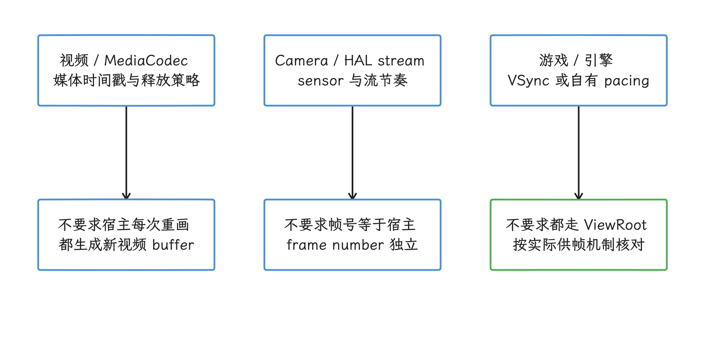

图：一个 Display present 可以继续使用符合媒体节奏的旧内容 buffer。 重复使用旧 buffer 不自动等于掉帧，要核对目标 deadline 与业务节奏。

#### 几何 transaction 与内容 transaction

常见的对齐方式至少有三种：

<!-- gracker-diagram: ch13-03-12-sv-transaction-binding -->
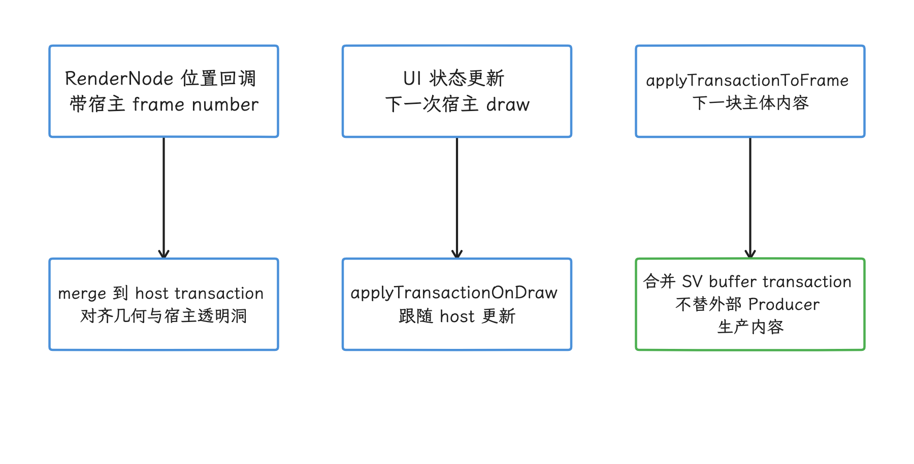

图：先确认事务要与哪个输出 buffer 对齐。 前两项是 framework 宿主同步路径；内容帧绑定公开 API 从34起且有停帧条件。

- `SurfaceViewPositionUpdateListener` 从记录 View 绘制属性的 RenderNode 取得宿主 frame number，再通过 `ViewRootImpl.mergeWithNextTransaction()`，把 container 的 position、matrix、crop 等状态与对应的宿主 buffer transaction 合并。
- UI 线程发起的部分状态更新通过 `ViewRootImpl.applyTransactionOnDraw()`，绑定到宿主窗口的下一次 draw。
- 公共 API `applyTransactionToFrame()` 通过 `mBlastBufferQueue.mergeWithNextTransaction()`，把 transaction 绑定到 SurfaceView 的下一块内容 buffer。

第三种方式有明确限制：连续渲染时，API 不保证 transaction 对应哪一帧；调用后一直没有新内容帧，transaction 也可能长期得不到应用。低帧率视频暂停期间，如果把窗口位置变化全部绑定到“下一块内容”，几何更新就可能长时间等待。所以位置和裁剪通常应跟随宿主帧；只有必须与某块主体 buffer 同时生效的 child transaction，才适合绑定到内容帧。

<!-- gracker-diagram: ch13-03-13-sv-next-content-conditions -->
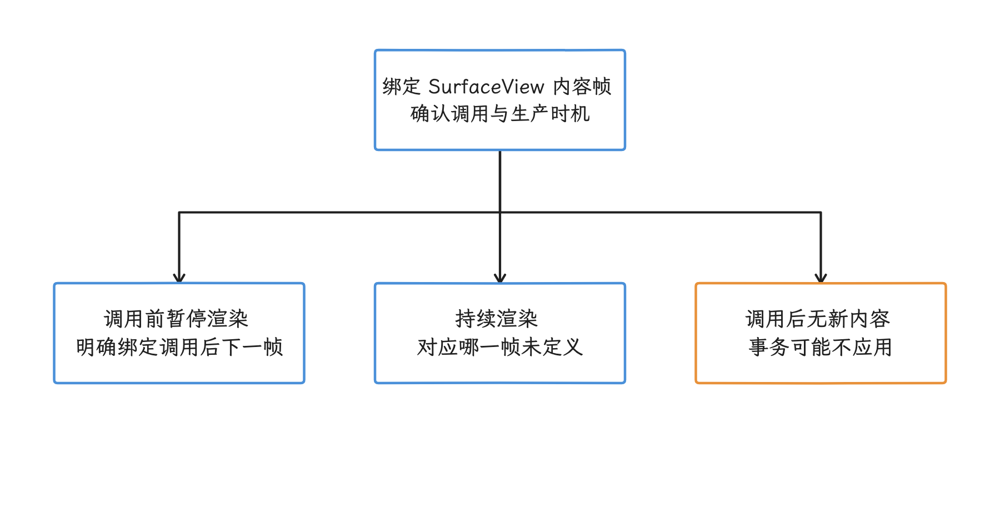

图：内容帧绑定需确认是否停帧、持续生产或没有后续内容。 目标已被 BLAST acquire 时也可直接 apply；不能推导每次都要等新 queue。

#### fence：fd、依赖与所有权

`queueBuffer()` 返回时，像素未必已经可读：Producer 可以随 buffer 提交一个尚未 signal（触发） 的完成 fence，从 BLAST 或 SurfaceFlinger 的角度看，这就是 acquire fence。SurfaceFlinger 使用 buffer 前必须先满足该依赖；即使启用了允许 unsignaled latch 的受限优化，开始硬件读取前 fence 仍要满足。

我们把这三类 fence 分开看，它们各管一段同步边界：

<!-- gracker-diagram: ch13-03-14-sv-fence-directions -->
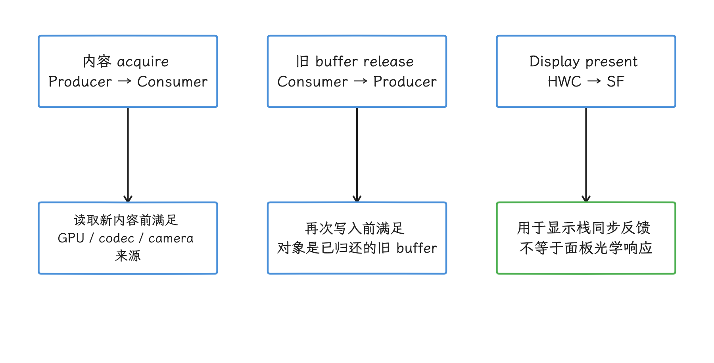

图：以内容读取、旧 buffer 重用与 Display 呈现反馈区分 fence。 句柄传递或回调返回不等于 signal；CLIENT release 可能合并 GPU 依赖。

- acquire fence：说明上游 Producer 何时写完这块内容 buffer，消费者何时可以读取；
- per-layer release fence：说明 HWC 或合成路径何时用完某个 layer buffer，Producer 何时可以复用；
- present fence：标记一次 Display present 的同步完成边界，用于显示时序反馈；面板光学扫描何时完成，要另找测量手段。

在内核基线 `android17-6.18-2026-06_r6` 中，`drivers/dma-buf/sync_file.c` 负责把 fence 暴露为 fd（文件描述符），`drivers/dma-buf/dma-fence.c` 提供 signal、callback 与 wait 等基础语义。这两个文件讲清的是同步机制本身；GPU、codec、camera 或 DPU（Display Processing Unit，显示处理单元）中的哪项工作延迟了 signal，要结合用户空间 Producer、厂商 HAL、驱动 timeline 与调度轨迹才能定位。

### BufferQueue 行为与 Triple Buffering

“Triple Buffering”标题沿用目录名称；Android 17 没有适用于所有 SurfaceView 场景的固定三槽模型。

`BufferQueueCore` 维护一组 slot（记录 buffer 所有权的槽位），每个 slot 记录一块 GraphicBuffer 的所有权和状态；`mMaxDequeuedBufferCount`、`mMaxAcquiredBufferCount`、`mAsyncMode`、`mDequeueBufferCannotBlock` 与配置上限会共同决定当前队列可使用多少块 buffer。源码中的 `NUM_BUFFER_SLOTS` 只是 slot 表的最大容量，单个 SurfaceView 同时分配、流转的 GraphicBuffer 未必有这么多；某段 trace 里出现三块活跃 buffer，说明的是该连接在当时表现为三缓冲，仅此而已。

#### 状态与背压

通用状态流如下：

```text
FREE → DEQUEUED → QUEUED → ACQUIRED → FREE
          Producer          Consumer
```

这个状态图展示 buffer 所有权的变化：Producer 取出可写 buffer 后进入 DEQUEUED，提交后进入 QUEUED；Consumer（消费方） 取得它时进入 ACQUIRED。buffer 从 ACQUIRED 回到可复用状态还受 release fence 约束，所以“Consumer 已执行 release”和“Producer 已能安全写入”可能是两个时间点。

Producer 阻塞在 `dequeueBuffer()`，说明当前配置下没有可以立即返回的可写 slot，或者相关 release 条件尚未满足。常见原因包括：

- Consumer/HWC 仍在使用 buffer，release fence 迟到；
- GPU、codec 或 camera 的前序工作使队列周转变慢；
- Producer 生成速度长期高于 Display/Consumer 的消费能力；
- resize、格式变化或重新分配期间出现额外等待；
- queue 要求保留帧顺序，旧帧走不了异步丢弃这条路。

看到一条较长的 `dequeueBuffer` slice，先别直接归因于“队列深度太小”；下结论前，我们要核对目标 layer 的 queued/acquired 状态、release fence、Consumer 消费节奏、Producer timestamp，以及当时是否正在分配 buffer。

<!-- gracker-diagram: ch13-03-16-sv-ownership-cycle -->
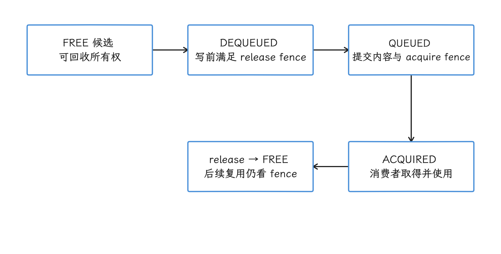

图：主要非 shared-buffer 路径按 dequeue、queue、acquire、release 周转。 省略 cancel、drop、detach/attach；FREE 或已 release 不自动表示有效 fence 已完成。

<!-- gracker-diagram: ch13-03-17-sv-dequeue-causes -->
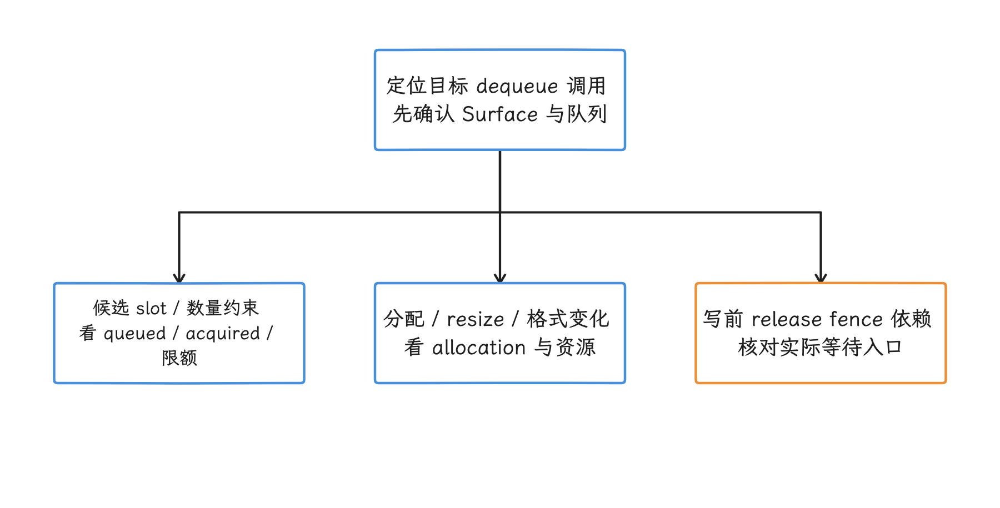

图：候选 slot 等待、分配与写前 fence 依赖必须按调用栈区分。 无槽可等待、超时或失败；max-dequeued 违规也可能报错，不能只增加深度。

#### 两套队列独立，但仍共享设备资源

宿主窗口与 SurfaceView 内容拥有各自的 Producer/Consumer 状态和 release fence 返回路径。宿主 `dequeueBuffer()` 发生等待时，SurfaceView 队列仍可以照常流转；SurfaceView Producer 遭遇背压，即生产速度受消费速度限制，宿主按钮也仍可以照常刷新。

当然，两条队列仍共享系统资源：CPU 调度、GPU、内存带宽、SurfaceFlinger、HWC plane/scaler、Display deadline 与功耗策略都可能相互影响。所以这句话要分两半说：队列所有权和背压状态相互独立，资源竞争与最终合成仍然相关。

<!-- gracker-diagram: ch13-03-18-sv-independent-shared -->
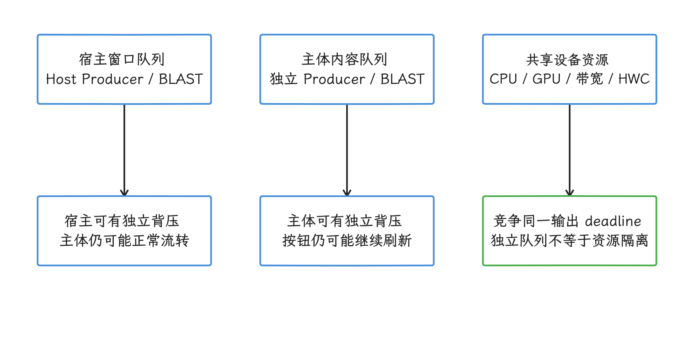

图：所有权、背压与 fence 分别维护，CPU/GPU 和显示资源仍共享。 一路等待不保证另一条必慢或必快，要把队列状态与资源竞争分别举证。

增加可用 buffer 数量可能降低 Producer 阻塞概率，也可能增加内存占用和排队时延。实时交互更关注旧帧是否堆积，离线处理更关注 Producer 是否会被短暂抖动打断。调整 buffer count 或 async 行为前，要先确定业务优先保障吞吐、时延还是逐帧顺序。

<!-- gracker-diagram: ch13-03-15-sv-slot-counts -->
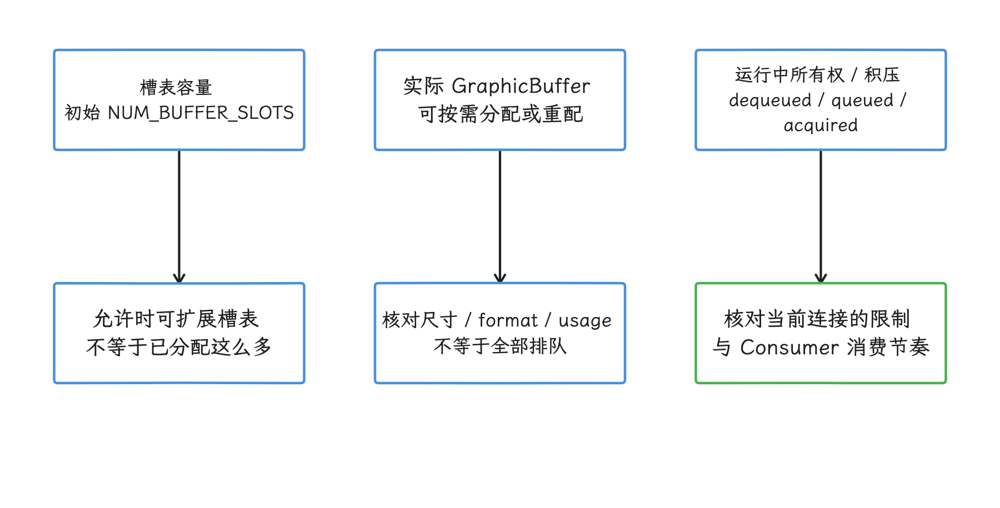

图：默认槽表与可用 buffer 数量由不同配置约束。 当前 r1 默认禁止扩展，Consumer 明确允许后有扩展路径；不是固定三槽模型。

### SurfaceView vs TextureView

两者都会向应用提供一个 `Surface` 供 Producer 使用，主要差异在于谁消费这条内容流，以及主体像素最终落在哪个 buffer 中：

```text
SurfaceView:
Producer → SurfaceView BufferQueue → BLAST buffer transaction
         → SurfaceFlinger 独立 layer → HWC / Display

TextureView:
Producer → SurfaceTexture BufferQueue → App RenderThread 纹理采样
         → Host Window BufferQueue → SurfaceFlinger 宿主 layer → HWC / Display
```

TextureView 路径的附加工作，是宿主 RenderThread 对输入纹理采样，再把结果绘入宿主 buffer；这通常不是 CPU 逐像素拷贝，成本落在 GPU 采样、颜色转换、混合和宿主 buffer 写出，具体代价取决于分辨率、变换、格式、刷新率和 GPU 实现。

| 维度 | SurfaceView | TextureView |
|---|---|---|
| 主体像素的最终位置 | 独立的 BLAST child layer | 通常进入宿主窗口 buffer |
| 宿主 RenderThread | 不采样主体内容；仍负责普通 View 和几何相关工作 | 消费 SurfaceTexture，并把它作为 TextureLayer 参与宿主绘制 |
| 帧节奏 | 内容可与宿主不同；SF 可复用旧内容 buffer | 新内容要经过宿主 draw 才能出现在新的宿主 buffer 中 |
| 变换与混合 | 受 SurfaceControl、composition order、crop 和 hole-punch 语义约束 | 作为 View/纹理参与父层变换、alpha、clip 和效果 |
| HWC 视角 | 主体 layer 可独立判断 DEVICE/CLIENT | HWC 通常只看到已包含主体像素的宿主窗口 layer |
| secure/protected 内容 | 可以建立独立的受保护显示链路 | 受宿主纹理采样和保护能力限制，不能假定两者等价 |
| trace 重点 | host、container、BLAST child、两套 buffer 与 fence | Producer queue、SurfaceTexture 更新、RenderThread 和 host buffer |

选型时我们按下面的顺序判断：

<!-- gracker-diagram: ch13-03-20-sv-choice -->
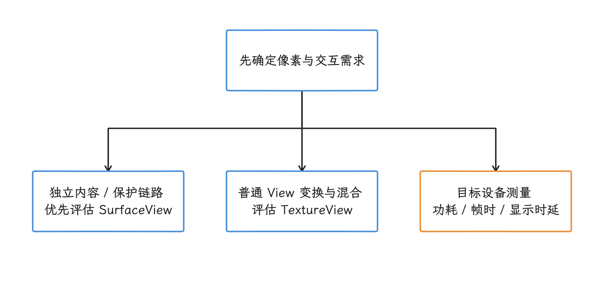

图：先确认业务结构需求，再用目标设备数据验证代价。 secure、protected、Overlay、普通 View 变换和宿主依赖是不同条件。

1. 主体是否必须成为独立 secure layer，或者是否希望 HWC 单独评估大面积视频/相机内容？优先评估 SurfaceView。
2. 是否需要普通 View 语义下的连续旋转、复杂裁剪、shader 效果或父子透明度？评估 TextureView。
3. 主体更新能否接受等待宿主 RenderThread？等不起时，SurfaceView 的独立内容流更合适。
4. 页面是否大量依赖普通 View 覆盖内容？SurfaceView 的 Z-below 允许宿主 View 覆盖，但要验证 hole-punch、alpha 与设备合成代价；Z-above 会让宿主 View 盖不到内容上方。
5. 是否已有目标设备 trace 和功耗数据？数据到手前，“SurfaceView 一定省电”或“TextureView 一定卡”都只是预设。

<!-- gracker-diagram: ch13-03-19-sv-vs-tv-topology -->
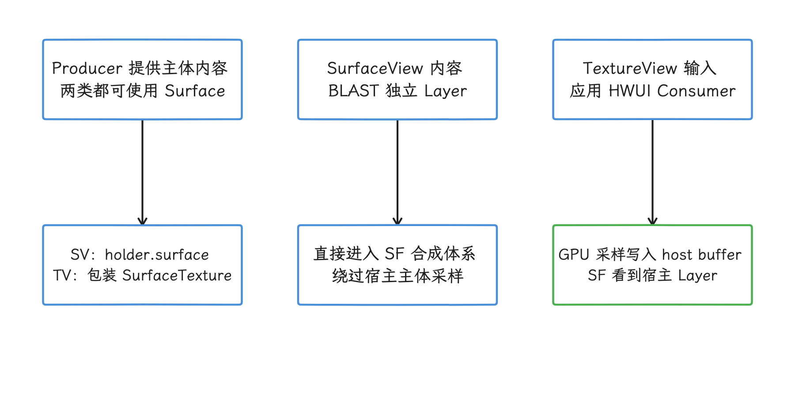

图：两者差异在 Consumer 位置和像素最终写入的 buffer。 RT 是组织与提交方，纹理采样由 GPU 执行；不按组件名断言性能高低。

### HWC Overlay 与合成策略

SurfaceView 提供独立 layer，HWC 因此可以单独评估其 buffer；这只代表该 layer 拿到了使用硬件 Overlay plane 的机会，最终用不用由整屏条件决定。HWC 的 validate 面向整屏可见 layer 集合，判断会受以下条件共同影响：

- buffer format、内存布局 modifier、用途标志 usage、颜色解释 dataspace 与 HDR metadata；
- source crop（源裁剪区域）、destination frame（屏幕目标区域）、缩放、旋转、alpha 与 blending；
- secure/protected 要求和外接显示保护状态；
- 同屏其他 layer 对 plane、scaler、bandwidth 和颜色处理单元的占用；
- Display mode、刷新率、面板能力与厂商 Composer 限制。

YUV 内容经常适合硬件视频 plane，但格式本身定不了 HWC 的最终选择。SurfaceView 上方存在控制条，同样不必然导致 CLIENT composition：有些硬件可以叠加多个 plane，某些变换或混合条件则会让部分 layer 进入 client target。Overlay plane 的数量和能力属于设备实现细节，写死“三到四个”没有依据。

<!-- gracker-diagram: ch13-03-21-sv-hwc-inputs -->
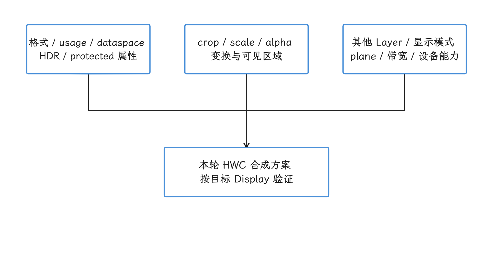

图：buffer 属性、几何混合与其他 layer 的资源需求共同决定策略。 YUV、控制条或 SurfaceView 名称都不能单独证明 Overlay 或 CLIENT。

普通 layer 用不上 DEVICE composition 时，SurfaceFlinger 可以让 RenderEngine 先把 CLIENT layers 合成到 client target，再交给 HWC。protected buffer 没有普通 RGBA 内容那种无条件改走非保护 GPU 路径的选项；设备建立合规保护链路失败时，可能黑屏、拒绝显示或播放失败。

<!-- gracker-diagram: ch13-03-22-sv-client-protected -->
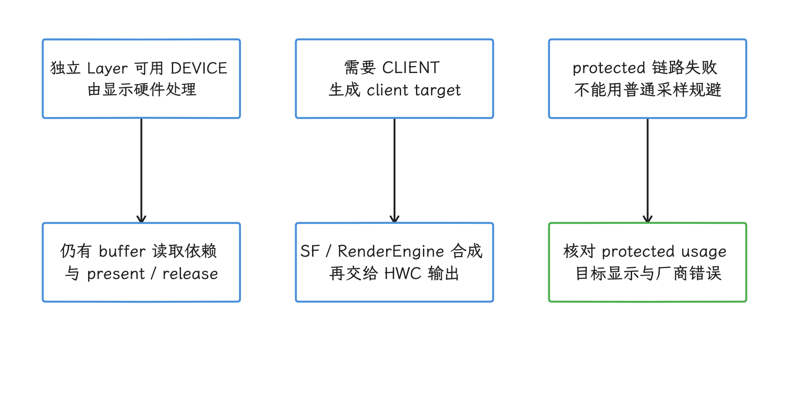

图：普通内容可评估 RenderEngine 合成，protected 仍须满足保护要求。 安全显示策略不等于受保护内存分配，普通非保护 GPU 路径不能绕过 DRM 限制。

SF 侧入口集中在 `HWComposer::getDeviceCompositionChanges()` 周围的 `presentOrValidate()`、`validate()` 和 `present()`；ComposerHal 对应 `presentOrValidateDisplay()`、`validateDisplay()` 和 `presentDisplay()`。`presentOrValidate()` 可能直接进入 present，也可能只返回 validated 结果。函数返回或 present fence 创建，只说明显示栈越过了相应的软件/硬件同步边界；面板有没有完成物理扫描，要另找测量手段。

#### 怎样验证 composition type

一次 `dumpsys SurfaceFlinger` 只能给出采样时刻的状态，适合快速确认 layer 树和 composition type；分析动画或瞬时回退时，应使用 layer trace/HWC 轨迹。下面的命令先在设备上保存完整输出，再拉到主机，避免用硬编码 layer 名的 `grep` 漏掉 BLAST child：

```bash
adb shell 'dumpsys SurfaceFlinger > /data/local/tmp/sf.txt'
adb pull /data/local/tmp/sf.txt
```

第一行的单引号让 `>` 交给设备端 shell 处理；第二行把设备文件复制到主机当前目录。主机与设备端 shell 会分别解释命令参数，引用规则见 [ADB shell 文档](https://developer.android.com/tools/adb#shellcommands)。

在输出中应先根据 parent-child 关系、buffer 尺寸、dataspace 和 layer id 确认目标 `mBlastSurfaceControl`，再读取 DEVICE、CLIENT 或 SOLID_COLOR 等类型。composition type 发生变化时，我们要比较同一 DisplayFrame 的整屏 layer 条件；只比较 SurfaceView 自身属性，会漏掉整屏条件的变化。

<!-- gracker-diagram: ch13-03-23-sv-hwc-branches -->
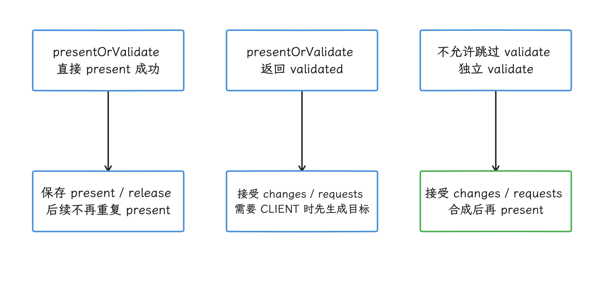

图：无 CLIENT 且时间条件允许时，组合调用可直接完成 HAL present。 直接成功后不重复 present；HAL 返回或 fence 创建不证明面板扫描完成。

<!-- gracker-diagram: ch13-03-24-sv-dump-identity -->
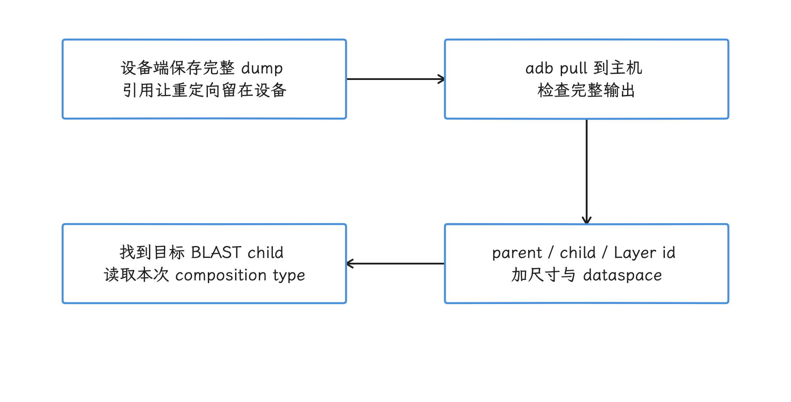

图：先利用层级和 buffer 属性确认 BLAST child，再看当时的合成类型。 一次 dump 是采样快照；动态回退要用同一显示帧的整屏证据。

### Trace 视角

#### 采集前提与支持边界

我们建议同时采集应用 `gfx/view` 事件、线程调度、SurfaceFlinger transactions/layers、FrameTimeline、sync/fence，以及与场景对应的 GPU、codec、camera、Binder 或厂商数据源。Perfetto 官方文档说明 FrameTimeline 尚未完整覆盖 SurfaceView；trace 里缺少主体内容独立的 App FrameTimeline slice 时，先别断定 Producer 没有提交新帧。

主体内容的时间线要通过 layer trace、目标 BufferQueue/BLAST、Producer queue、acquire fence、SurfaceFlinger 状态和 Display present 共同复原。宿主窗口和 SurfaceFlinger 的 FrameTimeline 仍可用来定位宿主帧与最终显示帧。

#### 建立 layer 身份表

trace 分析应先记录对象身份：

| 对象 | 建议记录 | 用途 |
|---|---|---|
| Host App Window | layer id、name、buffer layer、parent | 对齐普通 View、hole-punch 与宿主 buffer |
| SurfaceView container | layer id、parent、relative-Z（相对层级）、position、crop | 对齐布局和几何 transaction |
| SurfaceView BLAST child | layer id、parent、buffer size、dataspace、composition type | 对齐主体 buffer 与 Producer |
| background/embedded child | layer id、parent、visible region | 避免把辅助层误认为主体 |

layer 名可能包含 Java tag、`(BLAST)`、SurfaceFlinger 分配的序号或 transaction 前缀；不同 trace 配置下，slice 名也可能变化。识别对象时，我们依赖的是 parent-child 关系、buffer 属性、Producer connection、frame number 和 transaction id；固定字符串在这里算不上稳定 API。

<!-- gracker-diagram: ch13-03-25-sv-trace-identity -->
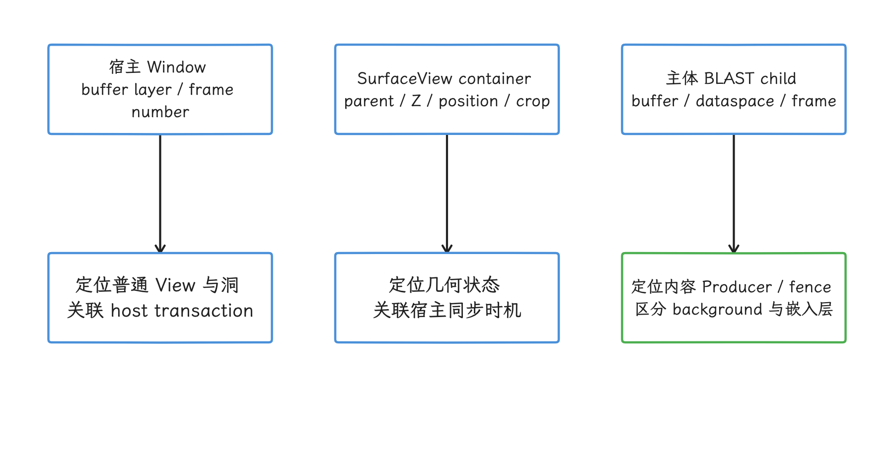

图：layer 名是线索，parent、buffer 与事务身份才用于对齐具体对象。 宿主、container、内容 child 与辅助背景层不能靠固定字符串互相替代。

#### 分开观察宿主组和内容组

宿主组关注：

- `Choreographer#doFrame`、Input/Animation/Traversal；
- `syncAndDrawFrame`、RenderThread 与宿主 GPU work；
- 宿主窗口的 buffer transaction；
- SurfaceView position/crop transaction；
- 包含 hole-punch 的宿主 buffer。

内容组关注：

- Codec、Camera、EGL/Vulkan 或其他 Producer 的工作；
- 目标 Surface 的 connect、dequeue 与 queue；
- BLAST child 的 buffer transaction；
- buffer frame number、timestamp、dataspace、crop、transform；
- acquire fence 与对应 layer 的 release fence。

宿主与视频内容按相同帧号配对并不可靠，因为视频、相机和宿主刷新可能处于不同节奏。分析一次异常显示帧时，我们至少要确认：宿主使用哪块 buffer、container 使用哪组几何、主体使用哪块 buffer、对应 acquire fence 何时 ready，以及 HWC 选择了哪种 composition type。

<!-- gracker-diagram: ch13-03-26-sv-present-inventory -->
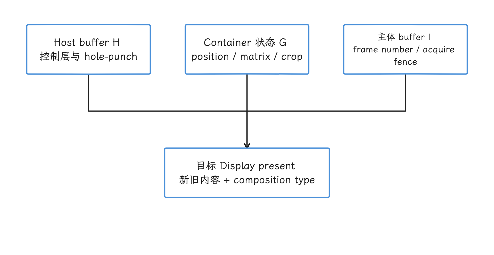

图：在同一 Display present 中分别记录宿主、几何与主体内容。 三者 frame number 不可直接相等配对；合法的旧 buffer 也可被重复显示。

#### 常见证据模式

| 现象 | 需要对照的证据 | 容易误判的点 |
|---|---|---|
| 控制条卡，视频继续更新 | main/RenderThread、宿主 BufferTX、SV BufferTX | 视频流畅不代表布局与 hole-punch 也在更新 |
| 视频卡，按钮流畅 | Producer queue、SV acquire fence、BLAST child buffer | 主线程空闲无法排除 codec、camera、GPU、SF 或 HWC 问题 |
| resize 时错位 | Traversal bounds、PositionUpdateListener frame、宿主透明洞、container transaction、内容 buffer | Android 7 以前的异步窗口模型不能解释所有现代错位 |
| Producer 长时间 dequeue | 目标队列状态、release fence、HWC/Consumer 节奏 | 较长的 slice 无法证明固定三槽数量不够 |
| 功耗升高 | 每层的 DEVICE/CLIENT、RenderEngine、client target 面积和 Display mode | composition type 变化是结果，还要查明触发条件 |
| 首帧黑屏 | SurfaceHolder callbacks、Producer connect、first queue/fence、layer show、background | `surfaceCreated()` 只代表 Surface 有效，不代表已有可显示 buffer |

#### fence wait 的读法

遇到 `sync_wait` 或 fence timeline 时，应依次确认：

1. 等待者属于哪个线程和 layer；
2. fence 是内容 acquire、client target acquire、per-layer release，还是 Display present；
3. fence 创建者来自 GPU、codec、camera、RenderEngine，还是显示设备；
4. signal 时刻是否越过目标 present deadline；
5. 同期 CPU 线程是正在 running（正在运行）、runnable（可运行但在等 CPU） 等 CPU，还是 blocked（等待依赖） 等依赖。

“线程在等 fence”只说明它依赖上游工作完成，责任归属要靠下面的对照来定：内容 acquire fence 迟到，指向 Producer 或其上游工作没有及时完成；HWC release fence 迟到，则会延后 Producer 复用旧 buffer。两者都可能让画面或 Producer 变慢，排查方向却不同。

<!-- gracker-diagram: ch13-03-27-sv-fence-wait-proof -->
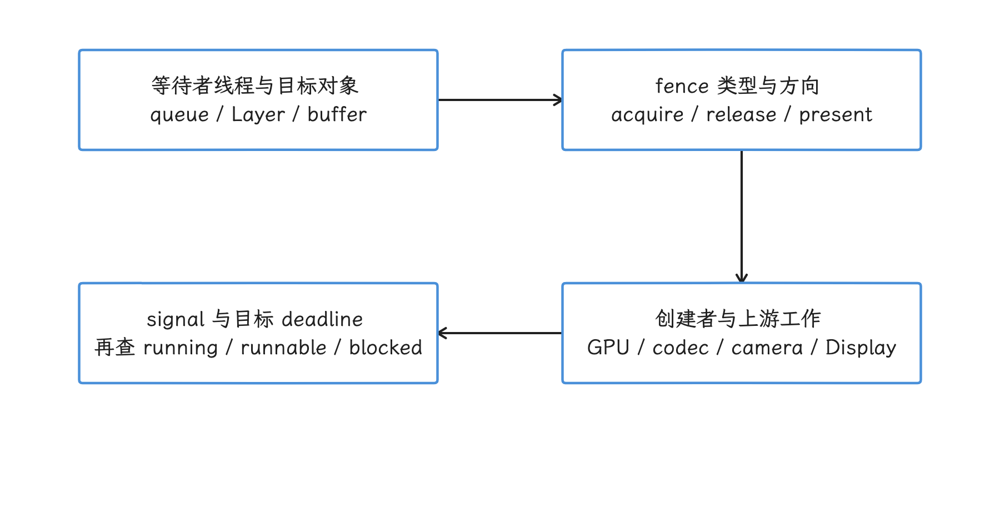

图：先确认等待哪种 fence，再把责任追到对应 Producer 或合成路径。 CPU blocked、runnable 与 GPU dependency 含义不同，不能只按一条 wait slice 定责。

### 常见性能问题与优化

#### 主线程卡住，内容仍动

这种现象说明主体内容这条生产线没被宿主 draw 卡住；我们还要逐项检查页面状态：宿主控制层是否停止更新、container 是否还在使用旧几何、hole-punch 是否匹配当前位置。此时通常要优化的是主线程工作、宿主 RenderThread 或布局更新；视频还在播，交互卡顿也还在。

<!-- gracker-diagram: ch13-03-28-sv-symptom-split -->
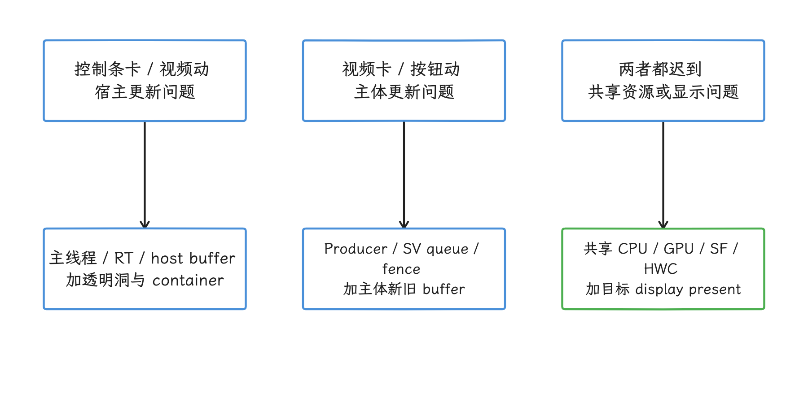

图：宿主卡而视频继续动，只能证明独立内容没有被这次宿主 draw 卡住。 主体、宿主、几何与显示合成仍须分别检查。

#### Producer 阻塞或主体掉帧

先确认阻塞发生在目标 SurfaceView 队列，排除宿主窗口队列。随后对齐 `dequeueBuffer()`、queue timestamp、acquire/release fence、BLAST child 是否采用新 buffer，以及 HWC present 周期。降低 Producer 帧率、减少 GPU/codec 工作或调整队列行为都可能有效，选哪一种要看上面的对照结果；盲目增加 buffer 数量，可能用更高的显示时延换取较少的阻塞。

#### resize、滚动和转场错位

把以下三个对象放到同一时间轴上：

1. 宿主 buffer 中透明洞的新位置；
2. container 的 position/matrix/crop transaction；
3. BLAST child 的新 buffer 和 destination frame。

BLAST 提供 transaction 同步能力；Producer 是否按时给出新尺寸内容、各状态是否绑定到同一帧，仍要调用方自己保证。频繁 resize 时，应减少没有实际作用的尺寸往返，明确 Producer 切换 buffer size 的时刻，并用宿主 frame number 验证几何 transaction 与哪一帧合并。

<!-- gracker-diagram: ch13-03-29-sv-resize-sync -->
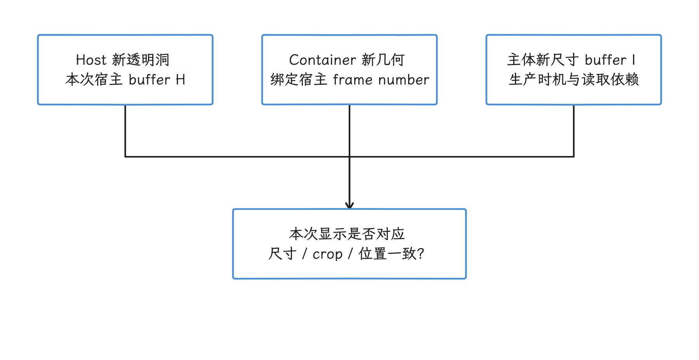

图：透明洞、container 几何与新尺寸内容要按具体宿主帧关联。 BLAST 不替 Producer 按时生成新尺寸内容，也不创建业务层跨队列帧号。

#### 首帧延迟和生命周期竞态

Android 12—17 的 SurfaceView 首帧会经过以下阶段：

```text
ViewRoot/bounds layer 就绪
→ SurfaceControl 与 BLASTBufferQueue 创建
→ SurfaceHolder callback
→ Producer connect
→ 第一块 buffer queue 与 acquire fence ready
→ layer 可见并进入一次 display present
```

这条路径用于定位首帧耗时。应分别测量每个阶段，避免把整段时间都归给 `surfaceCreated()` 或 SurfaceFlinger。`surfaceDestroyed()` 后仍向旧 Surface 提交、重建后复用旧 EGLSurface/ANativeWindow，或者只在 `onResume()` 启动 Producer，都可能造成生命周期竞态：回调顺序与异步生产线程的实际状态不一致。

<!-- gracker-diagram: ch13-03-30-sv-first-visible -->
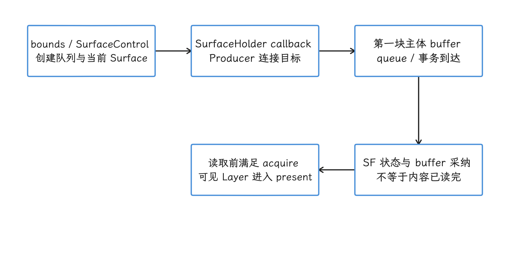

图：分别测量创建、连接、首 buffer、采纳和实际输出。 surfaceCreated 不保证已有像素；销毁重建后旧 EGLSurface 不能继续当新目标使用。

#### Z-order、alpha、圆角与 blur 异常

先记录 composition order 的正负和值，再判断 alpha 作用于内容层还是 hole-punch。圆角和 clip 同时涉及宿主透明洞与 container crop；API 37 的 blur region 还要随 SurfaceView bounds 更新。`setZOrderOnTop(true)` 会让宿主普通 View 盖不住内容，算不上通用的性能修复。

#### DEVICE 变成 CLIENT

对比变化前后的整屏 layer 集合、buffer format/dataspace、alpha、crop、scale、rotation、HDR、secure flag、Display mode 和厂商 HWC 日志。弹幕、圆角或 YUV 这类单一条件，单独哪一个都证明不了原因。业务允许时，可以尝试减小 client target 面积、降低混合复杂度或调整层级结构；是否值得采用，要根据目标设备的 GPU、带宽、功耗和视觉要求验证。

#### protected 内容黑屏

检查 secure/protected usage、目标 Display 的保护能力、HDCP（数字内容保护协议）/外接屏状态、HWC composition 和厂商错误。普通的非保护 CLIENT composition 规避不了此类问题。如果同一内容在内屏正常、外接屏黑屏，应优先排查显示设备的内容保护能力与系统策略。

<!-- gracker-diagram: ch13-03-31-sv-protection -->
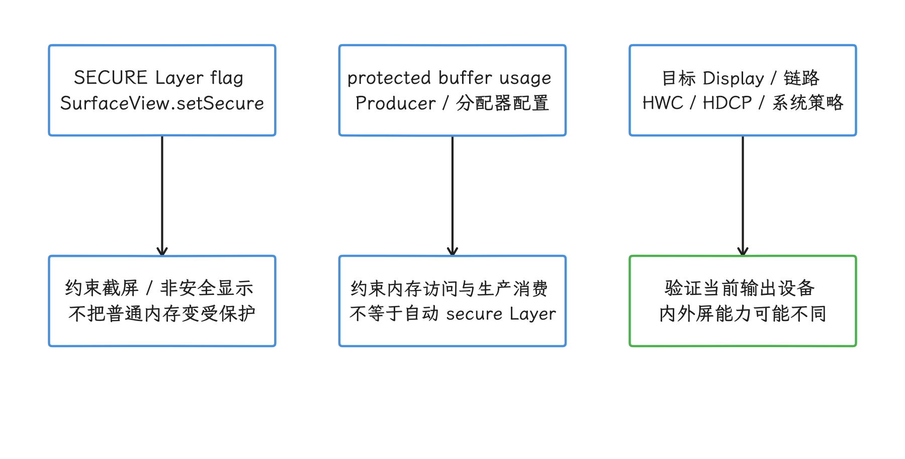

图：layer 防截取策略和 buffer 保护分配是两项独立配置。 setSecure 不自动创建 protected buffer，也不能替代 DRM/codec 配置。

#### 输入延迟

SurfaceView 改变的是内容生产和合成拓扑，不会绕过 InputDispatcher 到应用窗口的输入路径。端到端输入时延应分为：

- InputDispatcher 到应用主线程；
- 主线程把输入状态交给内容 Producer；
- Producer 生成并 queue 下一块受影响的 buffer；
- acquire fence 满足、SF latch、HWC present，直至画面可见。

游戏或地图的 Producer 可能受 frame pacing 约束；视频和 Camera 的内容节奏通常不会因一次触摸而改变。完整的输入到显示时延，要回到上面几段分别看，`doFrame` 或 `queueBuffer` 的单段耗时只覆盖其中一段。

<!-- gracker-diagram: ch13-03-32-sv-input-latency -->
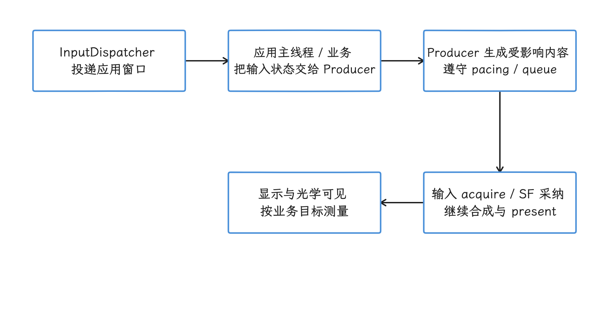

图：按输入投递、业务交接、内容生产和最终呈现分解输入时延。 queue 或 doFrame 只覆盖一段，光学可见还需显示端证据。

#### 复核清单

每次分析至少回答这些问题：

1. 主体像素是否位于独立 BLAST child，而非宿主 buffer？
2. Producer 是谁，在哪个线程或服务填充 buffer？
3. 当前 Surface 的有效期由哪套 callback 与 lifecycle strategy 控制？
4. 宿主 hole-punch 在哪里形成，何时随 draw 更新？
5. container 的 parent、position、crop 与 composition order 是什么？
6. 几何跟宿主 frame 对齐，还是绑定到下一块内容 buffer？
7. acquire、release 与 present fence 分别属于哪个对象？
8. SurfaceFlinger 本轮采用新 buffer 还是复用旧 buffer？
9. HWC 把主体判为 DEVICE 还是 CLIENT，前后条件有何变化？
10. 用户看到的异常对应哪次 display present？

这些问题都有源码或 trace 佐证后，才能把“SurfaceView 卡了一帧”定位到 Producer、宿主、BLAST/SF、HWC 或显示设备中的具体环节。

#### Android 17 源码锚点

源码以平台版本 `android-17.0.0_r1` 和内核版本 `android17-6.18-2026-06_r6` 为准：

- [`SurfaceView.java`](https://android.googlesource.com/platform/frameworks/base/+/refs/tags/android-17.0.0_r1/core/java/android/view/SurfaceView.java)：hole-punch、container/BLAST/background 创建、生命周期、位置回调、composition order、blur 和 transaction 对齐；
- [`BLASTBufferQueue.cpp`](https://android.googlesource.com/platform/frameworks/native/+/refs/tags/android-17.0.0_r1/libs/gui/BLASTBufferQueue.cpp)：buffer acquire、buffer transaction、`mergeWithNextTransaction()` 与 release callback；
- [`BufferQueueCore.cpp`](https://android.googlesource.com/platform/frameworks/native/+/refs/tags/android-17.0.0_r1/libs/gui/BufferQueueCore.cpp)、[`BufferQueueProducer.cpp`](https://android.googlesource.com/platform/frameworks/native/+/refs/tags/android-17.0.0_r1/libs/gui/BufferQueueProducer.cpp)：队列容量计算、dequeue 与背压；
- [`SurfaceFlinger.cpp`](https://android.googlesource.com/platform/frameworks/native/+/refs/tags/android-17.0.0_r1/services/surfaceflinger/SurfaceFlinger.cpp) 与 [`FrontEnd`](https://android.googlesource.com/platform/frameworks/native/+/refs/tags/android-17.0.0_r1/services/surfaceflinger/FrontEnd/)：transaction、layer state、snapshot 与 hierarchy；
- [`HWComposer.cpp`](https://android.googlesource.com/platform/frameworks/native/+/refs/tags/android-17.0.0_r1/services/surfaceflinger/DisplayHardware/HWComposer.cpp)、[`HWC2.cpp`](https://android.googlesource.com/platform/frameworks/native/+/refs/tags/android-17.0.0_r1/services/surfaceflinger/DisplayHardware/HWC2.cpp)：validate、present、composition type 与 fences；
- [`sync_file.c`](https://android.googlesource.com/kernel/common/+/refs/tags/android17-6.18-2026-06_r6/drivers/dma-buf/sync_file.c)、[`dma-fence.c`](https://android.googlesource.com/kernel/common/+/refs/tags/android17-6.18-2026-06_r6/drivers/dma-buf/dma-fence.c)：内核 fence fd（文件描述符） 与等待语义；
- [Perfetto FrameTimeline](https://perfetto.dev/docs/data-sources/frametimeline)：SurfaceView 支持范围；
- [Android Graphics Architecture](https://source.android.com/docs/core/graphics/architecture) 与 [BufferQueue/Gralloc](https://source.android.com/docs/core/graphics/arch-bq-gralloc)：平台图形模型。

相关章节：

- [13.4 OpenGL ES、EGL 与 ANGLE](04-opengl-egl-angle.md)
- [13.5 Vulkan 原生管线与 HWUI 多队列](05-vulkan-hwui-multi-queue.md)
- [2.8 BufferQueue、Gralloc 与 Sync Fence](../../part1-fundamentals/ch02-rendering/08-bufferqueue-gralloc-sync-fence.md)
- [2.9 SurfaceFlinger 合成、FrontEnd 与事务队列](../../part1-fundamentals/ch02-rendering/09-surfaceflinger-frontend-transaction.md)


## TextureView 的 SurfaceTexture 与宿主合成

SurfaceView 的 buffer 直接形成独立 layer，TextureView 的 buffer 先成为纹理再进入宿主 DisplayList。把两者放在一起比较时，我们看的是变换需求、延迟和合成方式。

### 为什么要理解 TextureView 的链路

TextureView 参与普通 View 的布局与绘制顺序，可以跟随父布局应用 alpha、scale、rotation、clip 和 transition，也能与兄弟 View 混合。不过，它显示的主体像素不由普通 `onDraw()` 直接生成：Camera、MediaCodec、EGL/Vulkan 或其他 Producer 先向 `SurfaceTexture` 背后的 BufferQueue 提交 buffer，宿主 HWUI 再把选中的输入作为纹理采样，绘入 App Window buffer。

因此，一次可见更新包含两次 buffer 生产：外部 Producer 生成输入内容，宿主 HWUI 再生成包含该内容的最终窗口 buffer。

```text
外部内容：Producer → SurfaceTexture BufferQueue
宿主窗口：SurfaceTexture → HWUI / RenderThread → App Window BufferQueue
```

这张简图区分了两套队列，两个同名调用含义并不相同：外部的 `queueBuffer()` 表示内容进入应用侧 Consumer 的输入队列，宿主的 `queueBuffer()` 表示最终窗口 buffer 已交给 SurfaceFlinger。从外部 queue 到用户看到新内容，中间还要经过宿主帧调度、输入 acquire fence、HWUI 采样、宿主 GPU 绘制、SurfaceFlinger/HWC 合成和 Display present。

<!-- gracker-diagram: ch13-03-33-tv-two-productions -->
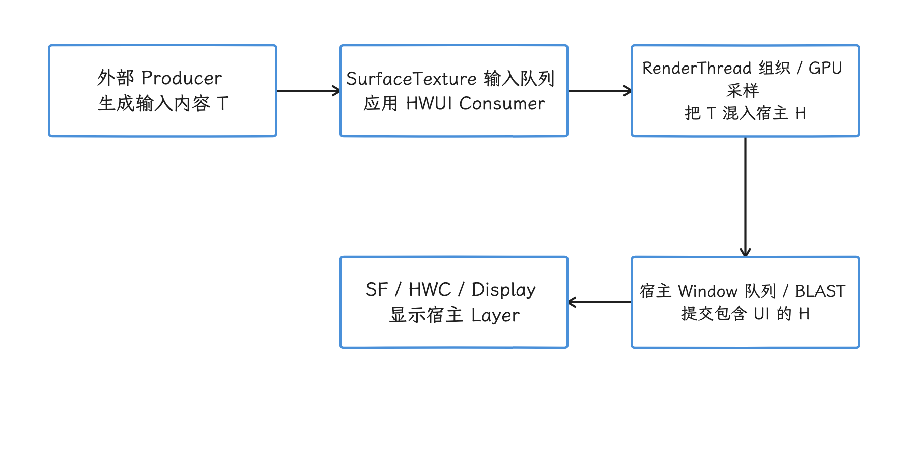

图：外部 queue 到应用输入，宿主 queue 才把最终窗口交给显示系统。 两次 buffer 生产不等于固定两帧延迟，时延取决于调度、取帧与 fence。

TextureView 的价值是让外部内容遵循普通 View 的合成语义。业务需要连续旋转、父级裁剪、交叉淡入淡出、滤镜，或者要把内容与 UI 一起截图时，这种结构比独立 Surface 更直接。相应成本也来自这条宿主合成链路：

- 新内容需要等待宿主 View 帧把 TextureLayer 更新送到 RenderThread；
- 宿主 GPU 要读取外部 image，再写出包含 TextureView 的窗口 buffer；
- SurfaceFlinger 只能看到最终的 App Window layer，其中的 TextureView 区域再也分不出独立 video overlay（视频硬件叠加层）；
- 输入队列与宿主窗口队列各有 fence、slot 和背压，任一段迟到都可能导致旧内容被复用，或者整个窗口延迟提交。

所以这两种组件没有固定的性能排名：小尺寸、低帧率 TextureView 的采样成本可能很低，SurfaceView 也可能因为整屏 layer 条件复杂而进入 CLIENT composition。选型时我们比较目标分辨率、帧率、视觉变换、protected 内容要求、功耗，以及设备的 HWC/GPU 能力。

#### 硬件加速是前提

`TextureView` 只能在硬件加速窗口中显示内容。`onAttachedToWindow()` 会在硬件加速关闭时记录警告，`draw()` 也只在 `canvas.isHardwareAccelerated()` 返回 `true` 时创建并绘制 `TextureLayer`。

即使 TextureView 显示不出来，外部 Producer 仍可能继续 queue，“Camera/codec 正常输出”排除不了 TextureView 黑屏。排查时我们同时确认这几项：Window/ViewRoot 是否启用硬件加速、SurfaceTexture 是否处于有效生命周期、Producer 是否正确连接，以及宿主窗口是否绘制。

<!-- gracker-diagram: ch13-03-35-tv-hardware-required -->
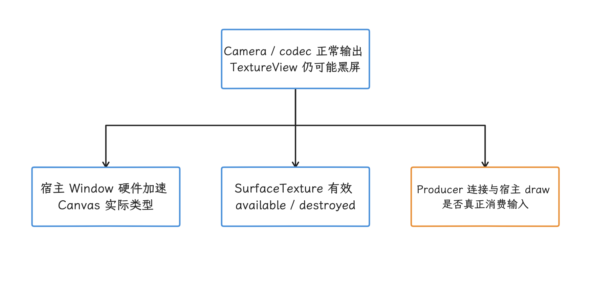

图：Producer 正常输出与宿主能够绘制 TextureLayer 是两项证据。 软件 Canvas 分支不会绘制主体；同时核对生命周期与连接。

### 三阶段链路详解

#### 第一阶段：外部 Producer

Producer 可以是 Camera、codec、GLES、Vulkan、Canvas 或业务引擎。它从 `SurfaceTexture` 背后的 BufferQueue 取得可写 buffer，填充内容，再随时间戳、crop、transform、dataspace、HDR metadata 和完成 fence 一起提交。从应用侧 Consumer 的角度看，这个说明写入何时完成的同步条件就是输入 acquire fence。

Producer 没有统一的线程或进程模式。MediaCodec、Camera 的生产链路可能跨越应用、系统服务、provider/HAL 和厂商组件；EGL/Vulkan Producer 也可能就在应用进程内。识别责任对象时，我们沿目标 BufferQueue、frame number 和 fence 回溯；固定进程名当不了依据。

#### 第二阶段：TextureView 与宿主 HWUI

消费过程分两段，UI 线程记录更新，RenderThread 实际取得并绘制输入：

1. 新 buffer 触发 `SurfaceTexture.OnFrameAvailableListener`。
2. `TextureView` 把 listener 绑定到 `mAttachInfo.mHandler`，也就是宿主 ViewRoot 所在线程的消息处理器。
3. listener 调用 `updateLayer()` 与 `invalidate()`：前者设置 `mUpdateLayer` 待更新标志，后者把 View 标记为需要重绘。
4. 宿主 `Choreographer#doFrame()` 进入 traversal；`TextureView.draw()` 在硬件 Canvas 上执行 `applyUpdate()`。
5. `TextureLayer.updateSurfaceTexture()` 通过 `HardwareRenderer.pushLayerUpdate()`，把 native updater 加入 RenderThread 的 pending layer updates（待处理 layer 更新） 列表。
6. `DrawFrameTask::syncFrameState()` 处理这些待更新对象；`DeferredLayerUpdater::apply()` 调用 `ASurfaceTexture_dequeueBuffer()` 取得输入 `AHardwareBuffer`，即可以跨图形组件共享的硬件 buffer。
7. HWUI 按 slot 建立或复用 `SkImage`，应用 crop、transform、dataspace、HDR metadata、alpha 和过滤，再把内容与其他 View 一起绘入 App Window buffer。

这里有两个容易混淆的入口。公共 `SurfaceTexture.updateTexImage()` 适用于应用自行管理 GLConsumer 的路径；Android 12—17 中，HWUI TextureView 的主要消费入口则是 `DeferredLayerUpdater::apply()` 与 `ASurfaceTexture_dequeueBuffer()`。`onSurfaceTextureUpdated()` 发生在 UI 线程执行 `applyUpdate()` 之后，到那时 RenderThread 未必已经取得新 buffer，用户有没有看到新帧，从这一刻也判断不出来。

<!-- gracker-diagram: ch13-03-36-tv-notification-to-rt -->
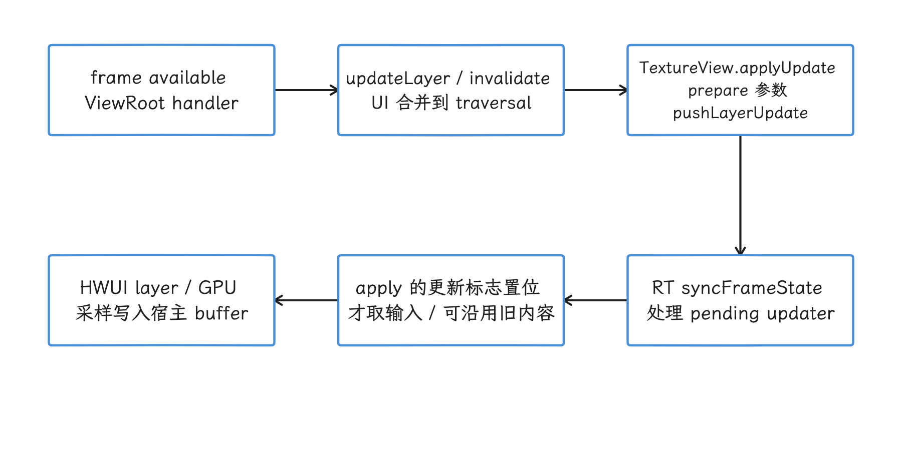

图：listener 标记更新，UI 提交 updater，RT 再选择并组织输入绘制。 公共 updateTexImage 是应用自管 GLConsumer 路径；不能当成 HWUI 固定入口。

#### 第三阶段：宿主 BLAST、SurfaceFlinger 与 HWC

RenderThread 完成宿主窗口绘制后，把 App Window buffer 和完成 fence 交给宿主 BLAST。SurfaceFlinger 服务端收到的是宿主 layer 的 buffer transaction；外部 SurfaceTexture stream 只在应用内被消费，没有成为独立可见的 SF layer。

SurfaceFlinger 更新 FrontEnd layer state 和 snapshot，再选择宿主的新 buffer，或者继续使用旧 buffer，随后由 CompositionEngine/HWC 处理整屏 layer 集合。HWC 可以把整个 App Window layer 判为 DEVICE 或 CLIENT composition，却没法只为窗口内部的 TextureView 矩形分配独立 Overlay plane。

下面的时序图把外部提交和宿主提交放在同一条时间线上：

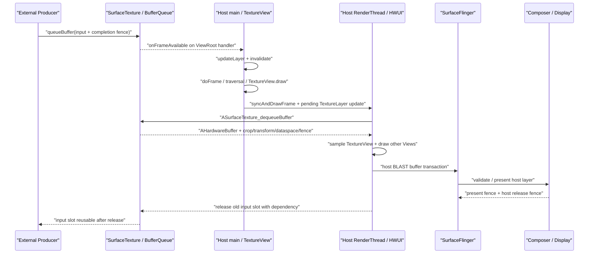

图中的 `onFrameAvailable()`、RenderThread acquire 和宿主 `BufferTX` 是三个不同的检查点。通知先由 UI `applyUpdate()` 提交为待消费更新，RenderThread 随后从输入队列取帧。判断新内容能否进入当前宿主帧，我们分别核对 UI 提交更新和 RenderThread 取帧的时刻。

<!-- gracker-diagram: ch13-03-38-tv-host-output -->
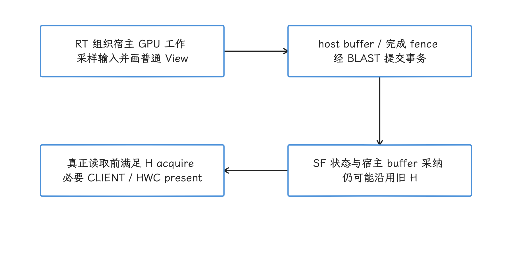

图：宿主 buffer 带完成 fence 交出，消费者读取前满足依赖。 RT 提交工作、queue 返回、GPU 完成、latch 和 present 不能合成一个时间点。

<!-- gracker-diagram: ch13-03-37-tv-updated-not-present -->
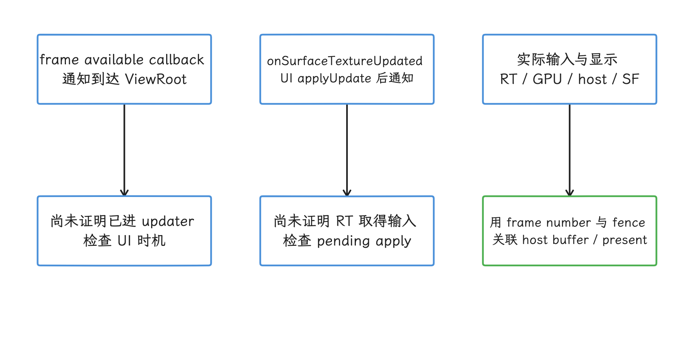

图：通知、UI 更新、RT 取帧与宿主显示分别举证。 Updated callback 不证明 acquire、GPU 完成或可见性；帧号也不与通知一一对应。

### SurfaceTexture 机制深入

#### 两套 Producer/Consumer

TextureView 页面至少有两套 buffer 周转：

```text
External Producer
  → SurfaceTexture BufferQueue
  → app-process HWUI Consumer / DeferredLayerUpdater
  → GPU image sampling
  → App Window buffer Producer
  → host BLASTBufferQueue
  → SurfaceFlinger / HWC
```

第一套队列由应用进程中的 HWUI 消费，第二套队列负责把宿主窗口交给显示系统，两套队列各有自己的 frame number、slot、acquire/release fence 和背压状态。也正因为独立，两边要分开读：宿主 `BufferTX` 回答的是宿主队列的状况，SurfaceTexture 输入队列是否堆积要另行检查；外部 Producer 的 `dequeueBuffer()` 出现等待，也只说明第一套队列在背压，宿主 BLAST 是否缺可写 buffer 另查。

<!-- gracker-diagram: ch13-03-39-tv-queue-ownership -->
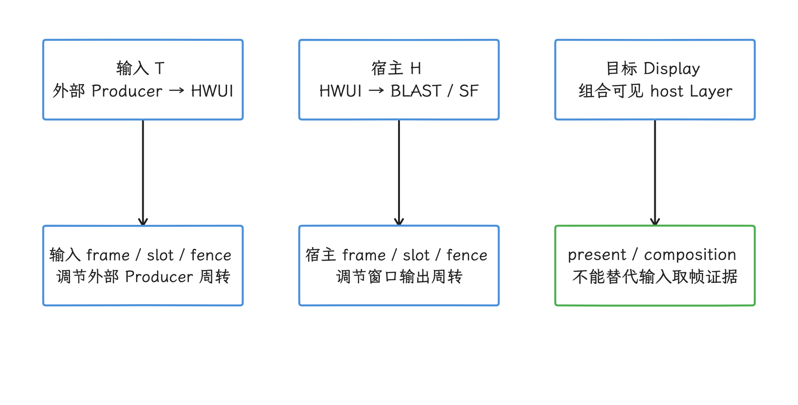

图：输入队列与宿主输出队列各有 Producer、Consumer 和背压。 外部 dequeue 与宿主 dequeue 不是同一目标，host BufferTX 也不能度量输入积压。

#### TextureView 链路的对象分工

- `TextureView`：管理 View 生命周期、dirty（待重绘）状态、listener、opaque（不透明）、内容变换和绘制入口。
- `SurfaceTexture`：向 Producer 提供 BufferQueue 的生产端，并向应用发送 frame-available 通知。
- `TextureLayer`：Java 层的 HWUI 对象，持有 native `DeferredLayerUpdater`，通过 `pushLayerUpdate()` 把更新交给 RenderThread。
- `DeferredLayerUpdater`：取得输入 `AHardwareBuffer`，按 slot 维护对应的 `SkImage` 包装，并处理 crop、transform、dataspace、buffer format 和 HDR 最大亮度。
- App Window `Surface`/BLAST：接收宿主 HWUI 生成的最终 buffer，再把宿主 layer 提交给 SurfaceFlinger。

HWUI `TextureLayer` 属于应用内的绘制对象，SurfaceFlinger layer 则属于系统合成树。两者名称都含有 “layer”，位置却在不同进程和 Consumer 体系里；所以我们写 trace 报告时，注明对象属于应用 HWUI 还是系统合成。

<!-- gracker-diagram: ch13-03-40-tv-object-roles -->
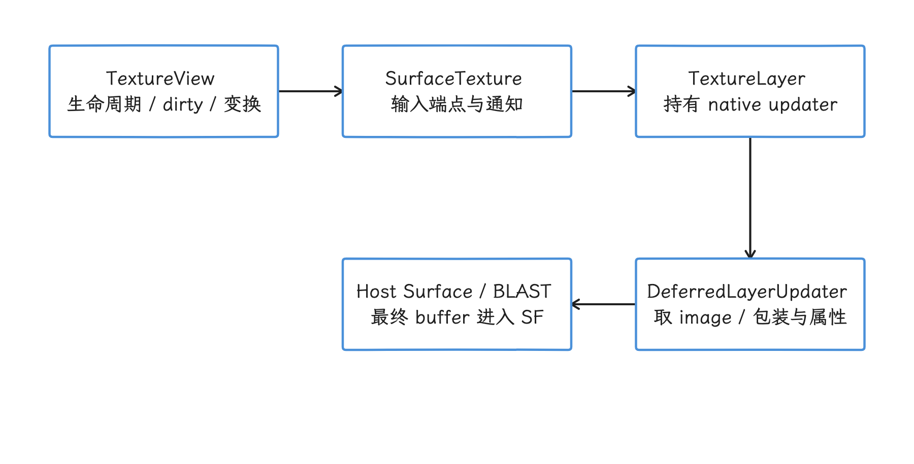

图：应用中的 View、SurfaceTexture 和 updater 协作生成宿主 buffer。 HWUI layer 不自动对应 SurfaceFlinger 可见层，命名时注明所属体系。

#### 最新帧选择

取帧的目标是拿最新：`DeferredLayerUpdater` 使用 `ASurfaceTexture_dequeueBuffer()` 循环取帧，尝试跳过旧的 pending frame（已排队待消费帧），减少旧输入的积压。同步模式也走这条路径，调用方不需要提前判断队列模式。

取帧循环还受 acquire fence 限制：`ImageConsumer::dequeueBuffer()` 取得的 buffer 若带有尚未 signal 的 fence，会先把 `outQueueEmpty` 设为 `true`，再交给 `fenceWait()` 处理依赖；外层循环据此停止继续取帧，避免等待期间 Producer 持续入队、取帧循环停不下来。`LegacyImageConsumer` 也有相同保护。一次调用可能跳过旧输入，但不保证总能取到返回时队列中最新的 buffer，端到端时延也要另行测量。

以下环节仍可能增加延迟：

<!-- gracker-diagram: ch13-03-42-tv-slot-identity -->
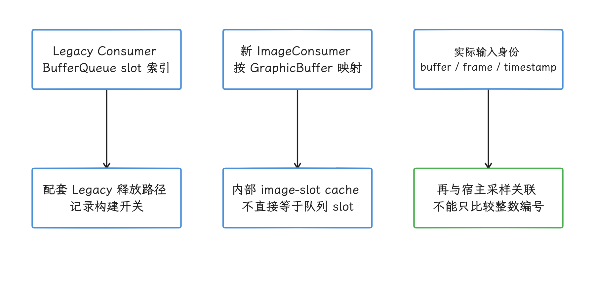

图：比较输入时必须记录构建分支、buffer 身份及实际 frame。 wb_surfacetexture 选择新旧 Consumer；image cache 编号不能与另一分支的 BQ slot 混用。

- Producer 在目标时间之后才 queue；
- frame-available 回调被宿主线程上的其他工作延迟；
- 通知晚于 UI `applyUpdate()`，且此前没有其他待消费更新；
- 输入 acquire fence 迟到；
- image import（把硬件 buffer 映射为 GPU 可采样图像）、颜色处理、缩放或宿主 GPU 过载；
- App Window BLAST/HWC 尚未释放宿主 buffer；
- Display present 使用了上一块宿主 buffer。

丢弃旧 pending frame 的行为也说明了它适合什么任务：TextureView 的目标是显示最新内容。需要每一输入帧都被显示或处理的任务，应选择具有明确 acquire 语义的 ImageReader、MediaCodec buffer 模式或应用自管队列。

<!-- gracker-diagram: ch13-03-41-tv-latest-loop -->
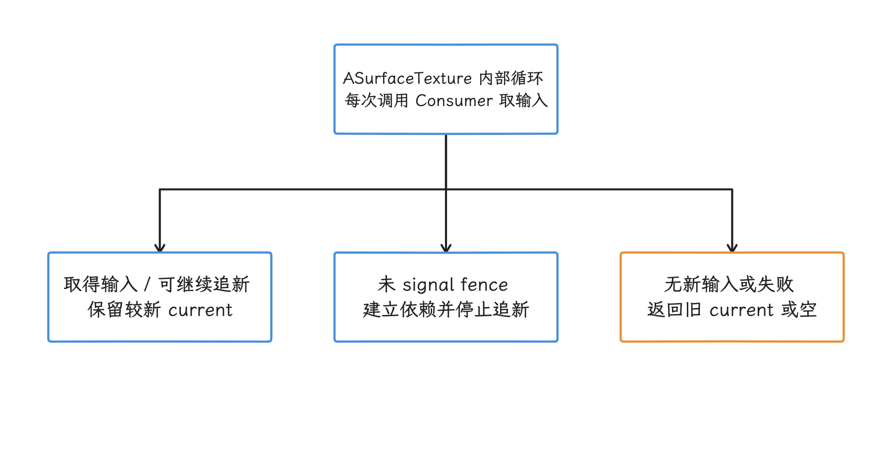

图：循环可以跳过旧输入，也可因队列空、未 signal fence 或失败停止。 outQueueEmpty 是外层停止保护提示，不保证物理队列为空；无新输入可返回 current。

#### image import、GL 与 Vulkan

输入 buffer 通常通过 `AHardwareBuffer` 导入为 GPU 可采样 image，从而避免 CPU 逐像素复制整帧。`DeferredLayerUpdater` 同时支持 SkiaGL 与 SkiaVulkan：

- SkiaGL 分支通过 `EglManager` 建立 wait/release fence；
- SkiaVulkan 分支通过 `VulkanManager` 建立 wait/release fence，并管理 image 的 queue ownership（队列所有权）；
- 两条分支最终都把输入 image 交给 HWUI layer，再写入宿主窗口。

所以 TextureView 没有固定的 OES/SkiaGL 后端。应用自行管理 `SurfaceTexture.updateTexImage()` 时常用 `GL_TEXTURE_EXTERNAL_OES`；HWUI 路径更准确的描述是 `ASurfaceTexture_dequeueBuffer()`、`AHardwareBuffer`、Skia image 和当前 `RenderPipelineType`。切换 GL/Vulkan backend 不会消除宿主采样这项结构成本，但会改变 image import、同步、shader/颜色处理和驱动行为。

<!-- gracker-diagram: ch13-03-43-tv-gl-vulkan -->
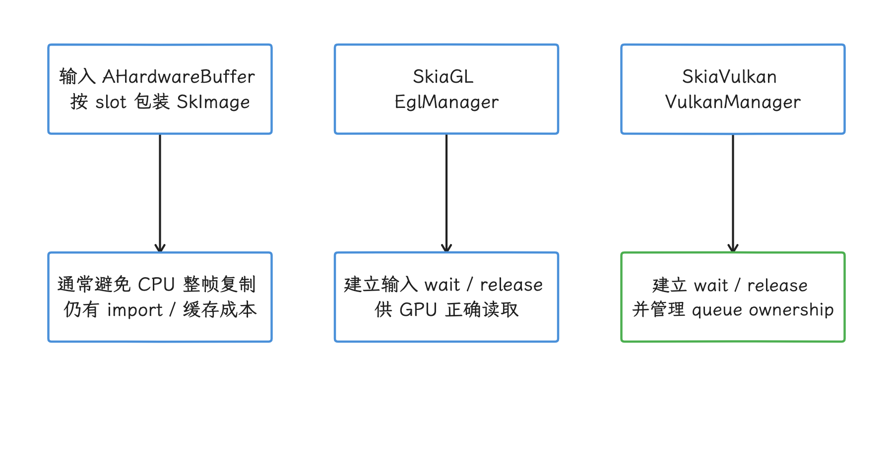

图：当前 RenderPipelineType 决定 image、wait 和 release 的后端实现。 改变后端不消除宿主 GPU 采样和最终 buffer 写出。

#### 生命周期与所有权

`TextureView.SurfaceTextureListener` 是应用可用的生命周期边界：

| 回调 | 含义 | 应用责任 |
|---|---|---|
| `onSurfaceTextureAvailable()` | 当前 SurfaceTexture 及其尺寸可用 | 创建并保存 `Surface`，连接一个 Producer |
| `onSurfaceTextureSizeChanged()` | View 尺寸改变，默认 buffer size 已更新 | 更新输出尺寸、viewport、crop 或内容变换 |
| `onSurfaceTextureUpdated()` | UI 线程已把 TextureLayer update 加入宿主流程 | 只能作为更新请求通知，不能当作 acquire、GPU 完成或画面可见时刻 |
| `onSurfaceTextureDestroyed()` | TextureView 将放弃当前 SurfaceTexture | 返回 `true` 时由 TextureView release；返回 `false` 时由调用方接管并负责 release |

同一个 TextureView 在同一时刻只连接一个 Producer；Camera preview、MediaCodec output 和 `lockCanvas()` 也要串行使用同一 SurfaceTexture。

下面的代码用应用自有接口表达停止与资源释放，`FrameProducer` 不是 Android SDK 类型：

```kotlin
private interface FrameProducer {
    fun attach(surface: Surface, width: Int, height: Int)
    fun resize(width: Int, height: Int)
    fun detachAndWaitUntilIdle()
}

private var producerSurface: Surface? = null

textureView.surfaceTextureListener = object : TextureView.SurfaceTextureListener {
    override fun onSurfaceTextureAvailable(st: SurfaceTexture, width: Int, height: Int) {
        producerSurface = Surface(st).also {
            frameProducer.attach(it, width, height)
        }
    }

    override fun onSurfaceTextureSizeChanged(st: SurfaceTexture, width: Int, height: Int) {
        frameProducer.resize(width, height)
    }

    override fun onSurfaceTextureUpdated(st: SurfaceTexture) = Unit

    override fun onSurfaceTextureDestroyed(st: SurfaceTexture): Boolean {
        frameProducer.detachAndWaitUntilIdle()
        producerSurface?.release()
        producerSurface = null
        return true
    }
}
```

这段骨架强调两项所有权责任：destroyed 回调返回前，Producer 必须停止访问旧目标；应用创建的 `Surface` 也要由应用 release。如果 destroyed 返回 `false`，TextureView 不会释放 SurfaceTexture，调用方必须保存该对象，并在不再使用时自行释放。

`setSurfaceTexture(newTexture)` 是另一个容易出现所有权错误的入口：TextureView 会立即 release 旧对象，也不会为旧对象调用 `onSurfaceTextureDestroyed()`；传入的新对象同样不会触发 `onSurfaceTextureAvailable()`。调用前，新对象必须从所有 GL context detach，旧 Producer 也要先停止使用旧目标。

<!-- gracker-diagram: ch13-03-45-tv-replace -->
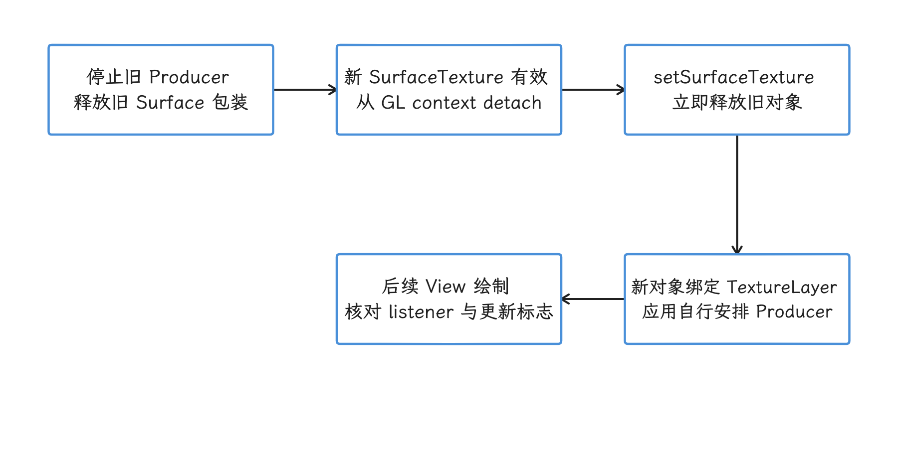

图：替换前停止旧目标并准备 detached 的新对象，替换后自行管理新连接。 旧对象立即 release；不调用旧 destroyed，也不调用新 available。

TextureView 不可见时，`onVisibilityChanged()` 会移除内部 frame-available listener；重新可见时再注册，并调用 `updateLayerAndInvalidate()`。Producer 在不可见期间继续 queue，宿主未必跟着持续消费。Tab、RecyclerView 或前后台切换后卡在旧帧时，应同时检查 listener 是否恢复、SurfaceTexture 是否被替换、Producer 是否重连，以及队列中的最新 buffer。

<!-- gracker-diagram: ch13-03-44-tv-lifecycle-ownership -->
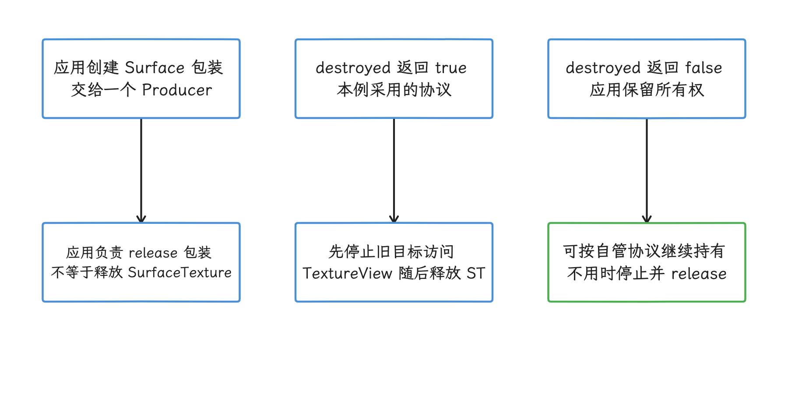

图：返回 true 走停止 Producer 后由 TextureView 释放，false 则应用接管。 应用自建 Surface 包装另行负责释放；接管后仍须自管停止和最终 release。

<!-- gracker-diagram: ch13-03-46-tv-visibility -->
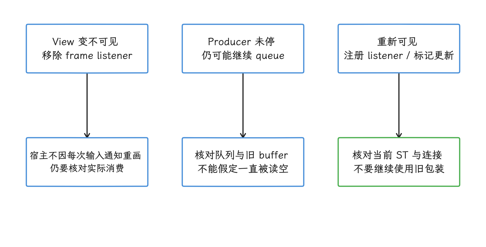

图：可见性控制内部 frame-available listener 与后续更新请求。 不可见不等于 Producer 自动停止，继续供帧可能背压或丢帧。

### 额外纹理采样的性能代价

#### 采样与宿主 render pass

TextureView 的额外成本通常不是 CPU 把整块像素 `memcpy` 到宿主窗口。常见路径会把 `AHardwareBuffer` 导入为 GPU image，再由 HWUI 采样，成本主要来自：

- image import、缓存和所有权转换；
- 输入 acquire fence 等待；
- 纹理过滤、缩放、rotation、crop 和其他内容变换；
- buffer format/dataspace 相关的颜色转换；
- alpha、blend、clip、color filter 和其他 View 的组合；
- 高分辨率输入的读取带宽；
- 宿主 App Window render pass（一次渲染过程）和最终 buffer 写出。

这条路径的形态随输入而变：可能是多平面 external format、RGBA 或驱动支持的其他形式；队列中的 buffer 数量、宿主尺寸、像素格式、保留策略和 GPU 缓存都会改变内存占用。所以估算时我们直接读取目标设备上的实际 buffer format、尺寸、slot 状态和 `gfx/meminfo` 数据，“每帧上传 YUV”“内存翻倍”这类固定描述都靠不住。

<!-- gracker-diagram: ch13-03-47-tv-gpu-costs -->
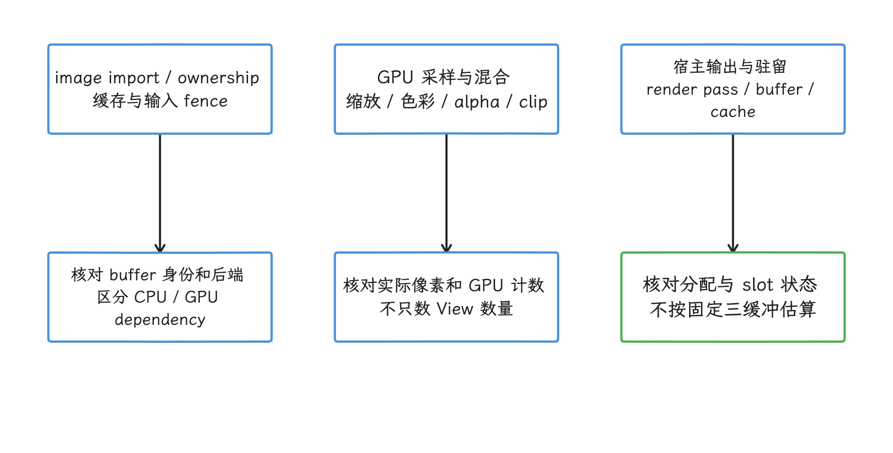

图：内存与 GPU 成本由实际尺寸、格式、缓存及宿主刷新决定。 不能固定写成每帧 CPU 上传、内存翻倍或三份相同 RGBA。

#### 宿主调度门槛

我们从 `onFrameAvailable()` 看起：它只会设置待更新标记并调用 `invalidate()`。宿主已有 pending traversal（待执行的遍历） 时，请求可以合并；没有的话，ViewRoot 会申请下一次 VSync。通知驱动的更新要先赶上 UI `applyUpdate()`，把待更新对象送入 RenderThread；随后由 `ASurfaceTexture_dequeueBuffer()` 从输入队列取帧。

`DrawFrameTask::syncFrameState()` 处理待更新对象后才会解除 UI 线程的同步等待，内部 listener 又运行在同一 ViewRoot 线程，同一次 traversal 中没有机会排到这个同步阶段之后。外部 Producer 则可继续并发 queue；updater 已有待消费更新时，RenderThread 可能取得比触发通知的那一帧更新的 buffer。

TextureView 增加的等待有多长，取决于通知与取帧的相对时机：通知及时触发 UI 更新、输入又赶上当前 RenderThread 取帧时，额外等待可能小于一个刷新周期；本次没有待消费更新，或新输入在取帧结束后才入队时，新内容就要等待后续宿主 draw。

<!-- gracker-diagram: ch13-03-48-tv-ui-rt-gate -->
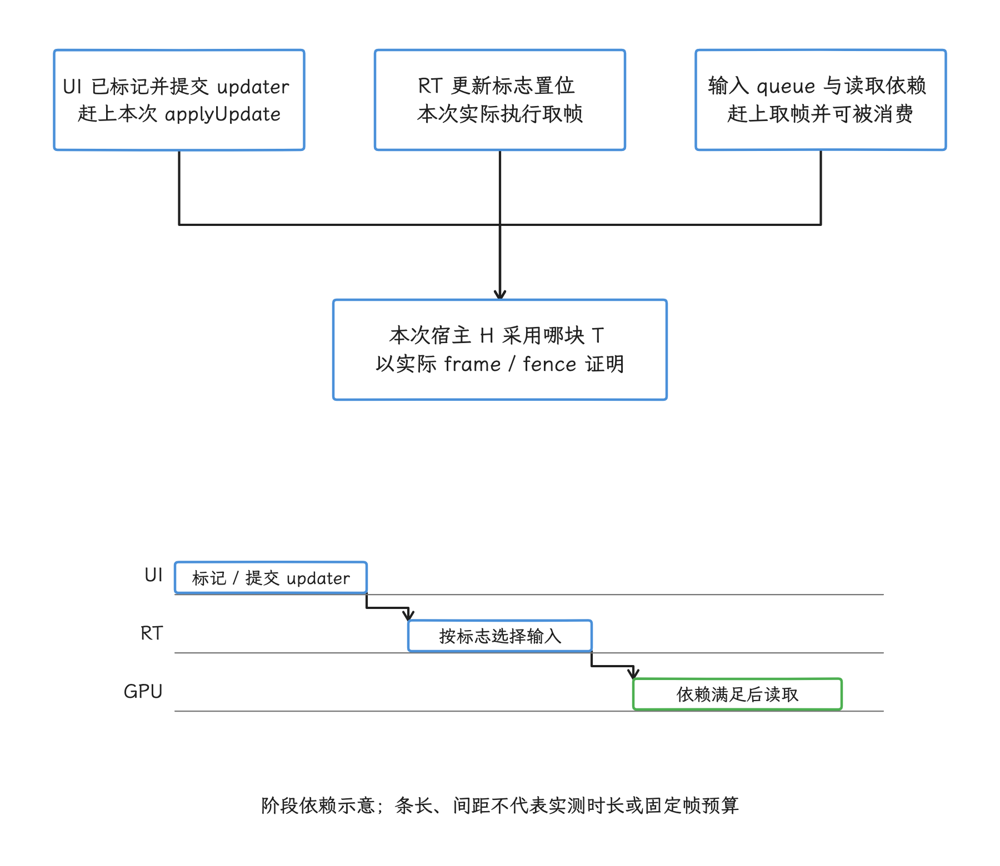

图：本次 updater 已进入同步阶段且输入赶上取帧，才可能进入当前宿主输出。 没有固定多一帧时延；正常消息循环中 listener 不能在 UI 等 RT 时插入执行。

#### 两套同步与背压

四类 fence 各管一段同步，需要分开读：

<!-- gracker-diagram: ch13-03-49-tv-fence-scope -->
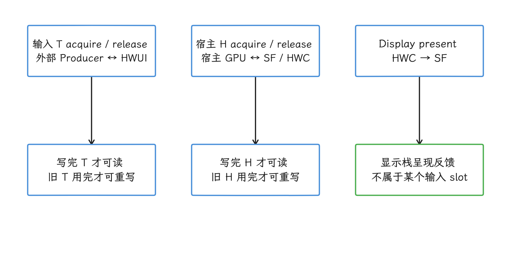

图：输入复用由 HWUI 读取依赖约束，宿主复用由系统合成依赖约束。 输入归还以 Legacy 路径示意；新 Consumer 的固定 r1 实现边界见正文，不能只凭回调推定 fence 已传出。

- 输入 acquire fence：外部 Producer 何时完成当前内容 buffer；
- 输入 release fence：HWUI 何时不再读取旧输入 slot，Producer 何时可以复用；
- 宿主 acquire/release fence：宿主 GPU 何时写完 App Window buffer，以及 SF/HWC 何时不再读取；
- present fence：一次 Display present 的显示栈同步边界，属于 Display，不属于某个 TextureView 输入 slot。

同一可见帧可能先等待外部 acquire fence，又受到宿主 GPU 和 App Window release 返回路径的约束。所以我们写报告时，把等待者、创建者和对应队列的所有权一并写清，责任才定位得下来；只写一句“GPU fence 慢”，这些信息就都丢了。

这一层仍是内核里那两个文件：`drivers/dma-buf/sync_file.c` 提供 fence fd 接口，`drivers/dma-buf/dma-fence.c` 提供 signal、callback 和 wait 语义，讲的只是同步机制本身；某台设备上的 GPU、codec、camera 或 Display fence 为何迟到，还要结合驱动 timeline、vendor service 和硬件轨迹才能回答。

#### Android 12—17 的版本边界

| 平台 | 已核实变化 | 分析含义 |
|---|---|---|
| Android 12 / API 31 | `DeferredLayerUpdater` 已使用 `ASurfaceTexture_dequeueBuffer()`、`AHardwareBuffer` 与 `SkImage` | Android 12 已是当前 HWUI 消费模型的基线，不能只用旧 `updateTexImage()` 名称描述 |
| Android 13 / API 33 | 增加 CTA-861.3 / SMPTE 2086 HDR metadata 读取 | HDR 分析还要检查 dataspace、metadata、宿主颜色策略和 Display 能力 |
| Android 14 / API 34 | listener→TextureLayer→DeferredLayerUpdater→App Window 主拓扑延续 | SurfaceView 的 API 34 alpha/lifecycle 变化不能套到 TextureView |
| Android 15 / API 35 | flag 启用后，`OnSetFrameRateListener` 可把输入流请求传给 View requested frame rate | 这是传递刷新率提示的桥梁，不保证系统切换到指定刷新率 |
| Android 16 / API 36 | AHardwareBuffer/SkImage 消费与 frame-rate bridge 延续 | 跨版本差异应核对应用、Skia backend、驱动和刷新率策略 |
| Android 17 / API 37 | 当前实现继续处理 crop、transform、dataspace、HDR 和 slot image cache | 现有机制延续到 API 37，不代表它们都在 API 37 新增 |

<!-- gracker-diagram: ch13-03-50-tv-version-boundaries -->


图：API 31 已有 AHardwareBuffer/SkImage 消费，后续 HDR 与帧率桥梁有各自版本。 当前对象在17仍存在不代表17首引；历史固定 r1 与公开API证据分开。

### 链路级对比：SurfaceView vs TextureView

两者都能向 Producer 提供 `Surface`，差异在于谁消费主体像素，以及它们何时进入 SF layer：

```text
SurfaceView:
Producer → independent BufferQueue/BLAST child → SurfaceFlinger → HWC

TextureView:
Producer → SurfaceTexture → app HWUI sampling → host App Window
         → SurfaceFlinger → HWC
```

这张对比图表明，TextureView 增加的是应用内 Consumer 与宿主采样阶段，通常不会增加一次 CPU 逐像素拷贝。SurfaceView 的主体保持为独立 layer，TextureView 的主体则进入宿主窗口 buffer。

| 维度 | SurfaceView | TextureView |
|---|---|---|
| 主体最终可见对象 | 独立 BLAST child layer | 宿主 App Window buffer 中的一部分 |
| 宿主 RenderThread | 不采样主体；仍处理普通 View 与几何相关工作 | acquire 输入 image，并与其他 View 一起绘制 |
| View 变换 | 受 SurfaceControl、composition order、crop 和 hole-punch 语义约束 | 支持普通 View 的 transform、alpha、clip 与绘制顺序 |
| 帧节奏 | 内容可与宿主 UI 不同 | 新内容要经过一次宿主 HWUI frame |
| HWC | 可以独立评估主体采用 DEVICE 或 CLIENT composition | 只能评估整个宿主 layer |
| protected 内容 | 可建立 secure/protected 独立路径 | 普通 HWUI Consumer 通常不适合读取受保护 buffer |
| 队列 | 内容队列与宿主队列在 SF 汇合 | 输入队列先由应用消费，再生成宿主队列 |
| trace 重点 | host、container、BLAST child、HWC | 输入 queue、listener、TextureLayer、RT acquire、host BufferTX |

SurfaceView 不一定更快，TextureView 的额外等待也随时机浮动。迁移前应回答：

1. 是否需要普通 View 级的旋转、裁剪、滤镜和交叉混合？
2. 是否要求 protected/secure 内容？
3. 主体分辨率和更新频率带来的宿主 GPU/带宽成本能否接受？
4. 页面是否需要主体内容绕开宿主 UI 卡顿继续更新？
5. 目标设备上的 SurfaceView 能否满足层级和动画要求，HWC composition type 是否稳定？

游戏引擎、WebView、Flutter、React Native 或地图框架的名称，说明不了渲染路径：它们可能使用 TextureView、SurfaceView、普通 App Window 或嵌入式 SurfaceControl。我们先确认 layer/BufferQueue 拓扑，再分析引擎线程。

<!-- gracker-diagram: ch13-03-51-tv-migration -->


图：引擎名称不能证明实际渲染拓扑，迁移前确认像素去向。 需要普通 View 混合、保护链路与独立更新是不同需求，要结合目标设备测量。

### onFrameAvailable 回调模型

内部 listener 骨架如下：

```text
SurfaceTexture.setOnFrameAvailableListener(mUpdateListener, mAttachInfo.mHandler)

mUpdateListener.onFrameAvailable(surfaceTexture)
  updateLayer()   // mUpdateLayer = true
  invalidate()    // mark TextureView dirty
```

这段结构说明回调会投递到宿主 ViewRoot 的 handler。回调到达只代表通知到了 UI 侧，RenderThread 是否已 acquire 输入、系统是否产生了独立的 VSync 回调，都要另行确认。应用直接使用裸 SurfaceTexture 时可以自行选择 listener handler；讨论 TextureView 内部行为时，则以 `mAttachInfo.mHandler` 为准。

<!-- gracker-diagram: ch13-03-52-tv-callback-chain -->


图：输入通知只设置更新与 dirty，不等于 RT 已取得输入。 裸 SurfaceTexture 可自选 handler；TextureView 内部按 ViewRoot handler 解释。

#### invalidate 的合并

`invalidate()` 把 dirty region（待重绘区域）交给 ViewRoot。已有 traversal 时，新请求可以并入该帧；没有 pending frame 时，`scheduleTraversals()` 会注册 traversal 回调，再由 Choreographer 申请下一次 VSync。一次外部 queue 不会产生一条独立的 `vsync-app`。

常见时序如下：

- 通知先于 UI `applyUpdate()`，更新被送入 RenderThread，取帧时输入已入队，本轮可能采到新内容；
- 通知晚于 UI `applyUpdate()`，且此前没有其他待消费更新，本轮继续使用旧输入，等待后续宿主 draw；
- 已有待消费更新时，Producer 在 RenderThread 取帧期间又 queue 新 buffer，消费者可能选择更新的输入；通知与输入 frame number 不保证一一对应；
- 宿主当时没有 pending frame，回调触发下一次宿主帧。

判断新输入能否赶上当前宿主帧，要先确认待更新对象已进入本次 `syncFrameState()`，再核对 `ASurfaceTexture_dequeueBuffer()` 取得的 frame number。`queueBuffer()`、回调到达或 `Choreographer#doFrame()` 的单个时间点，都替代不了这两项检查。

<!-- gracker-diagram: ch13-03-53-tv-coalesced-notification -->


图：先确认本次 updater，再确认 Consumer 实际选中的 frame number。 已有 pending 更新时 RT 可追到更晚输入；一个外部 queue 不生成独立 vsync-app。

#### 尺寸、opaque 与 transform

`onSizeChanged()` 会调用 `SurfaceTexture.setDefaultBufferSize()`、标记 layer 更新，并通知 `onSurfaceTextureSizeChanged()`。这只能设置 BufferQueue 建议使用的默认 buffer size；Producer 仍需按自身 API 更新输出，避免长期生成与 View bounds 相差很大的 buffer。

TextureView 默认假设内容 opaque。`setOpaque(false)` 会改变 HWUI 的 blending 方式，但不会替 Producer 生成正确的 alpha 通道。`setTransform()` 只改变内容在 TextureView bounds 内的采样变换，不改变 View layout 或触摸命中区域；Camera 方向、镜像、center-crop 和触摸坐标应使用同一套映射关系。

<!-- gracker-diagram: ch13-03-54-tv-size-transform -->


图：默认 buffer size 是建议值，内容 transform 不改变 View 的布局和命中区域。 opaque=false 不替 Producer 生成 alpha；方向、crop 与触摸应共用映射依据。

#### frame-rate hint

Android 15—17 在相关 flag 开启时会注册 `SurfaceTexture.OnSetFrameRateListener`，把输入流的 frame-rate 请求转换为 TextureView 的 requested frame rate 与 compatibility。该机制只向系统刷新率策略提供提示，不保证 Display mode 会切换到请求值。我们在 trace 里同时检查 flag、Producer 请求、Window requested rate、FrameRateOverride、Display mode 和其他 layer 的请求。

<!-- gracker-diagram: ch13-03-55-tv-frame-rate-hint -->


图：输入流的请求被桥接到 View requested rate，再由系统做刷新率决策。 toolkitSetFrameRateReadOnly 为注册条件；请求不是目标 Display mode 的承诺。

### Trace 视角

#### 证明 TextureView 拓扑

要确认实际用的是 TextureView 宿主合成链路，下面几项要组合起来看：

1. 外部 Producer 的目标是 SurfaceTexture 或由它创建的 `Surface`；
2. 应用 HWUI 中存在 `TextureView`、`TextureLayer`、pending layer update 或 `DeferredLayerUpdater` 相关行为；
3. 新输入沿 `onFrameAvailable → updateLayer/invalidate → 宿主 frame` 传播；
4. RenderThread 取得输入 image，再提交宿主 App Window buffer；
5. SurfaceFlinger layer tree 中没有与该输入 stream 对应的独立可见 buffer layer。

单独出现 SurfaceTexture、EGL swap、MediaCodec、Camera 或宿主 GPU 繁忙，确认不了这条拓扑：普通 HWUI 页面也可能只有一个 App Window layer，应用自行管理的 GLConsumer 同样会使用 SurfaceTexture。

<!-- gracker-diagram: ch13-03-56-tv-trace-topology -->


图：输入端点、应用 HWUI 消费与宿主输出一起证明拓扑。 只有 Camera、EGL 或一个 host Layer 都不足以证明使用 TextureView。

#### 建立对象与时间表

| 对象 | 身份字段 | 时间点 |
|---|---|---|
| 外部 Producer | 进程/线程、目标 queue、frame number | dequeue、填充、queue 和 completion fence |
| SurfaceTexture 队列 | Producer/Consumer、slot、queued/acquired | frame available、实际 acquire 的 frame 和 release old |
| TextureView/TextureLayer | ViewRoot、handler、updater | callback、invalidate、applyUpdate、pending update |
| Host App Window | layer id/name、BLAST queue | doFrame、DrawFrame、宿主 queue、BufferTX 和 latch |
| DisplayFrame | Display token、composition | validate、client target、present/release fence |

SurfaceFlinger layer tree 通常只能帮助确认宿主窗口，列不出应用内的 SurfaceTexture slot。第一套队列要从应用/Producer trace、BufferQueue 名、frame callback 或业务 instrumentation（插桩记录）中回溯。

<!-- gracker-diagram: ch13-03-57-tv-trace-identities -->


图：应用内输入队列与系统可见宿主 Layer 使用不同身份字段。 SF Layer tree 通常列不出输入 image slot，要补应用或 Producer 插桩。

#### 对齐两次生产

把以下时间点放在同一条时间轴上：

1. 外部 Producer queue；
2. frame-available callback；
3. `invalidate()` / `scheduleTraversals()`；
4. 宿主 `Choreographer#doFrame()`；
5. UI `TextureView.draw()` / `applyUpdate()`；
6. RenderThread `syncFrameState()` 与 pending layer apply；
7. `ASurfaceTexture_dequeueBuffer()` 选择的输入 frame；
8. 宿主 GPU draw 与 host queue；
9. 宿主 BufferTX、SF/HWC 与 Display present。

回调较早到达时，仍要检查待更新对象是否进入目标宿主帧，以及取帧循环实际返回了哪个输入 frame。acquire fence 决定已取得的 buffer 何时可读；尚未 signal 的 fence 还会触发取帧循环的停止条件，应把等待依赖和选择输入分开记录。通知晚于 UI `applyUpdate()`、且该帧没有其他待消费更新时，新请求要等后续宿主 draw。

<!-- gracker-diagram: ch13-03-58-tv-two-production-trace -->


图：用输入 queue、RT 选帧、宿主 GPU 和 host transaction 连到最终输出。 acquire fence 约束读取并可停止追新；不把 callback 当作 GPU 完成或显示证据。

#### 分开等待位置

| 等待位置 | 所属队列 | 常见上游 |
|---|---|---|
| 外部 Producer dequeue/swap | SurfaceTexture 输入队列 | HWUI 消费较慢、旧 slot release fence 未完成、Producer 生产过快 |
| RenderThread input wait/import | SurfaceTexture 输入队列 | codec/camera/GPU 未完成、driver ownership/import |
| 宿主 RenderThread dequeue | App Window BLAST 队列 | SF/HWC 未释放宿主 buffer、Display 消费形成背压 |
| SF/HWC 等宿主 acquire fence | App Window BLAST 队列 | 宿主 GPU 尚未完成 TextureView 与 UI 绘制 |

报告“卡在 `dequeueBuffer()`”时，必须注明目标队列和 layer；报告“等待 fence”时，必须注明 acquire/release/present 类型和创建者。两套背压可以在同一个可见帧中同时出现。

<!-- gracker-diagram: ch13-03-59-tv-wait-location -->


图：外部 Producer、RT 输入消费和宿主输出分别对应不同上游。 一个可见帧可以同时受两套背压影响，报告需注明 buffer 与 fence 创建者。

#### FrameTimeline 与 HWC

FrameTimeline 主要覆盖宿主 App Window 与 SurfaceFlinger DisplayFrame。它能回答宿主帧是否 late、是否出现 buffer stuffing（提交过多帧造成排队），以及哪个 `surface_frame_token` 对应哪个 `display_frame_token`。外部 SurfaceTexture 输入 frame 仍要用 queue frame number、timestamp、回调和 fence 关联。

<!-- gracker-diagram: ch13-03-60-tv-frametimeline-scope -->


图：host SurfaceFrame 可连接到 SF DisplayFrame，外部输入仍需 queue/fence 身份。 宿主 DEVICE 不给内部视频矩形独立 Overlay，present HAL 成功也不证明选中了新输入。

TextureView 没有独立的 composition type。宿主 layer 显示 DEVICE，只说明 HWC 把已经包含 TextureView 像素的整个窗口作为一个 layer 处理，视频矩形是否获得 Overlay，单看这一条看不出来。`presentOrValidate()` 返回 `PresentSucceeded`，也只说明 Composer HAL 调用已经执行 present 并保存 fence，显示面板是否完成扫描还要另行确认。

### 常见性能问题与优化

#### Producer 已 queue，画面仍旧

依次检查回调是否进入宿主 handler、View 是否可见、`invalidate()` 是否并入目标 traversal、UI 是否执行 `applyUpdate()`、RenderThread 选择了哪个输入 frame，以及输入 acquire fence 何时 ready。Producer 按时 queue，只能证明第一套队列已经收到内容。

<!-- gracker-diagram: ch13-03-61-tv-old-frame-diagnosis -->


图：从通知到宿主输出逐段定位旧输入在哪里被保留。 外部 queue 只证明输入已提交，不能证明已进入当前宿主 H。

#### 主线程或宿主帧迟到

TextureView 的新内容要经过宿主帧，因此主线程 I/O、锁竞争、GC 和复杂布局都会延迟 listener 与 traversal。优化时应先定位具体的主线程工作；如果业务不需要 View 级混合，也可以根据目标设备数据评估 SurfaceView。`doFrame` 的预算不是固定的 16 ms：高刷新率与动态刷新率设备具有不同 deadline，应使用 FrameTimeline 的 expected/actual 时间判断。

#### RenderThread 或输入 fence 慢

先区分 CPU slice、GPU wait 和 driver queue。`DeferredLayerUpdater::fenceWait()` 会根据 SkiaGL/SkiaVulkan 使用不同的 manager；等待可能直接出现在 CPU 上，也可能表现为 GPU-side dependency（GPU 任务间依赖）。随后沿 fence 创建方继续检查 codec、camera、外部 GPU 或 image import；只优化 TextureView draw，覆盖不了这些来源。

<!-- gracker-diagram: ch13-03-62-tv-main-and-rt-delay -->


图：先区分 UI 工作、RT CPU 与 GPU/输入依赖，再找具体创建者。 doFrame 预算以 expected deadline 为准；一条 GPU wait 不能直接证明 TextureView draw 本身慢。

#### 外部 Producer dequeue 变长

检查 SurfaceTexture 输入 slot、旧 buffer 的 release fence 和 HWUI 消费节奏。宿主不可见时，内部 listener 会被移除；Producer 继续全速输出，可能改变输入队列的阻塞或丢帧行为。盲目增加 buffer 数量会增加内存占用或旧帧排队，应先确定业务更重视吞吐还是时延。

#### 宿主窗口背压

如果宿主 RenderThread 卡在 App Window dequeue，问题位于第二套队列。应检查宿主 release fence、SF/HWC composition、Display mode、buffer stuffing（应用持续提交过多帧造成排队） 和其他窗口；此时外部输入队列可能完全正常。

<!-- gracker-diagram: ch13-03-63-tv-two-backpressures -->


图：输入缓冲归还给外部 Producer，宿主缓冲归还给窗口 Producer。 增加可用数量不必然降低端到端时延，先确认哪路旧内容积压。

#### 高分辨率内容导致 GPU/带宽上升

读取输入 buffer 的尺寸、format、dataspace、缩放比例和宿主刷新率，并结合 GPU counter（硬件性能计数器）与功耗测量判断。减少无效超采样、按 View 尺寸配置 Producer、降低不必要的 alpha/滤镜，或迁移到独立 Surface，都可能有效。固定的“1080p 每帧多少 MB × 三缓冲”估算，代替不了设备上的实测数据。

#### 黑屏、旧帧与生命周期泄漏

黑屏时优先检查硬件加速、SurfaceTexture available/destroyed 状态、Producer connection、Surface 是否已 release、View visibility 和 protected usage。destroyed 返回 `false` 后一直没有 release，会保留 native 队列与 GraphicBuffer；调用 `setSurfaceTexture()` 前未停止旧 Producer，则可能留下无效连接或引发生命周期竞态。

<!-- gracker-diagram: ch13-03-64-tv-resource-leaks -->


图：硬件加速、目标生命周期、Producer 连接和资源释放分别核对。 destroyed=false 后应用必须最终 release；替换前停止旧 Producer，避免旧对象继续被使用。

普通 HWUI TextureView Consumer 通常不适合读取 protected DRM buffer。播放器可能拒绝配置、显示黑屏，或者切换到 secure SurfaceView；具体行为取决于 DRM、codec、gralloc 和设备能力，没有统一的错误表现。

#### 预览跳帧但交互延迟较低

核对 `ASurfaceTexture_dequeueBuffer()` 是否持续选择最新 frame，以及 Producer 供帧频率是否高于宿主消费频率。对于显示预览，这可能是主动丢弃过时内容；对于逐帧处理，则说明 API 选型不合适。中间 frame 没有显示，不足以证明 BufferQueue 损坏。

<!-- gracker-diagram: ch13-03-65-tv-skipped-preview -->


图：高频输入可以被 HWUI 取帧循环跳过，预览不保证逐帧显示。 仍要核对停止条件与选中 frame；逐帧处理需要明确的 acquire/队列协议。

#### HDR、折叠与坐标错位

HDR 要同时检查 buffer format、dataspace、CTA-861.3/SMPTE 2086 metadata、宿主 Window color mode、Skia backend 和 Display policy。折叠、多窗口或 cutout（屏幕挖孔） 不会为 TextureView 增加专用渲染路径；Window bounds 变化仍通过普通 View layout 与 `onSizeChanged()` 传播。排查画面方向、crop 和触摸坐标时，要一起核对 View layout、TextureView content transform 与 Producer transform。

<!-- gracker-diagram: ch13-03-66-tv-hdr-coordinates -->


图：输入颜色属性、宿主策略与 Display 能力共同影响 HDR；几何另核对多套矩阵。 折叠与多窗口仍沿普通 View 尺寸传播，不产生专用 TextureView 渲染路径。

#### 复核清单

1. TextureView 是否处于硬件加速窗口？
2. 谁创建 SurfaceTexture、谁创建并 release `Surface`？
3. destroyed 返回值与资源所有权是否一致？
4. 同一时刻是否只有一个 Producer？
5. 输入 buffer 尺寸、format、dataspace、crop 与 View bounds 是否匹配？
6. frame-available 投递到哪个 Looper，是否被宿主线程延迟？
7. 输入 frame 是否赶上目标 RenderThread layer apply？
8. 输入、宿主与 display 三类 fence 分别属于谁？
9. HWC 看到哪个宿主 layer，是否有人把它误称为 TextureView Overlay？
10. 结论是否限定到具体 Android、应用和 vendor 版本，并有源码或 trace 佐证？

#### Android 17 源码锚点

TextureView 部分沿用同一组平台与内核版本锚点，重点查阅以下对象：

- [`TextureView.java`](https://android.googlesource.com/platform/frameworks/base/+/refs/tags/android-17.0.0_r1/core/java/android/view/TextureView.java)：硬件加速、listener、lifecycle、draw/applyUpdate、visibility 和 frame-rate bridge；
- [`SurfaceTexture.java`](https://android.googlesource.com/platform/frameworks/base/+/refs/tags/android-17.0.0_r1/graphics/java/android/graphics/SurfaceTexture.java)：公共 Producer/Consumer、callback、release 和应用自管 GLConsumer 的语义；
- [`TextureLayer.java`](https://android.googlesource.com/platform/frameworks/base/+/refs/tags/android-17.0.0_r1/graphics/java/android/graphics/TextureLayer.java)：native updater、`pushLayerUpdate()` 与 SurfaceTexture 绑定；
- [`DeferredLayerUpdater.cpp`](https://android.googlesource.com/platform/frameworks/base/+/refs/tags/android-17.0.0_r1/libs/hwui/DeferredLayerUpdater.cpp)：输入 buffer、AHardwareBuffer/SkImage、SkiaGL/SkiaVulkan fence、crop、transform、dataspace 和 HDR；
- [`surface_texture.cpp`](https://android.googlesource.com/platform/frameworks/native/+/refs/tags/android-17.0.0_r1/libs/nativedisplay/surfacetexture/surface_texture.cpp)、[`ImageConsumer.cpp`](https://android.googlesource.com/platform/frameworks/native/+/refs/tags/android-17.0.0_r1/libs/nativedisplay/surfacetexture/ImageConsumer.cpp)、[`LegacyImageConsumer.cpp`](https://android.googlesource.com/platform/frameworks/native/+/refs/tags/android-17.0.0_r1/libs/nativedisplay/surfacetexture/LegacyImageConsumer.cpp)：循环取帧、acquire fence 与停止条件；
- [`DrawFrameTask.cpp`](https://android.googlesource.com/platform/frameworks/base/+/refs/tags/android-17.0.0_r1/libs/hwui/renderthread/DrawFrameTask.cpp)、[`CanvasContext.cpp`](https://android.googlesource.com/platform/frameworks/base/+/refs/tags/android-17.0.0_r1/libs/hwui/renderthread/CanvasContext.cpp)：pending layer updates、prepareTree、draw 和宿主 swap；
- [`BufferQueueProducer.cpp`](https://android.googlesource.com/platform/frameworks/native/+/refs/tags/android-17.0.0_r1/libs/gui/BufferQueueProducer.cpp)、[`BufferQueueConsumer.cpp`](https://android.googlesource.com/platform/frameworks/native/+/refs/tags/android-17.0.0_r1/libs/gui/BufferQueueConsumer.cpp)：输入队列 slot、acquire/release 与背压；
- [`BLASTBufferQueue.cpp`](https://android.googlesource.com/platform/frameworks/native/+/refs/tags/android-17.0.0_r1/libs/gui/BLASTBufferQueue.cpp)、[SurfaceFlinger FrontEnd](https://android.googlesource.com/platform/frameworks/native/+/refs/tags/android-17.0.0_r1/services/surfaceflinger/FrontEnd/)、[`HWComposer.cpp`](https://android.googlesource.com/platform/frameworks/native/+/refs/tags/android-17.0.0_r1/services/surfaceflinger/DisplayHardware/HWComposer.cpp)：宿主 BufferTX、layer state、validate/present 和 fence；
- [`sync_file.c`](https://android.googlesource.com/kernel/common/+/refs/tags/android17-6.18-2026-06_r6/drivers/dma-buf/sync_file.c)、[`dma-fence.c`](https://android.googlesource.com/kernel/common/+/refs/tags/android17-6.18-2026-06_r6/drivers/dma-buf/dma-fence.c)：内核 fence fd 与等待语义；
- [Perfetto FrameTimeline](https://perfetto.dev/docs/data-sources/frametimeline)：宿主 SurfaceFrame、DisplayFrame、expected/actual 与 jank 字段。

相关章节：

- [13.4 OpenGL ES、EGL 与 ANGLE](04-opengl-egl-angle.md)
- [2.8 BufferQueue、Gralloc 与 Sync Fence](../../part1-fundamentals/ch02-rendering/08-bufferqueue-gralloc-sync-fence.md)
- [2.9 SurfaceFlinger 合成、FrontEnd 与事务队列](../../part1-fundamentals/ch02-rendering/09-surfaceflinger-frontend-transaction.md)

<!-- gracker-diagram: ch13-03-34-tv-pixel-reference -->


图：TextureView 的绘制记录与实际输入像素分别流转。 DisplayList 不存整帧视频像素；输入流也不会因此产生独立 SF Layer。

## 小结

SurfaceView 让主体内容保留独立 BufferQueue 和 SurfaceFlinger layer，TextureView 则让外部内容先经 SurfaceTexture 被宿主 HWUI 采样。前者的关键在内容 buffer、container 几何与 hole-punch 的同步，后者的关键在输入队列、宿主帧与第二次 buffer 提交。

<!-- gracker-diagram: ch13-03-67-sv-tv-final-boundary -->


图：SurfaceView 的独立内容在系统合成汇合，TextureView 的输入先写入宿主。 两者都需确认资源生命周期、实际选中内容和目标 display present。

选型时我们先确认 protected/secure、View 级变换、独立节奏和目标设备 HWC 能力；诊断时分别对齐 Producer、两套队列、acquire/release fence、宿主或独立 layer 与 display present。组件名直接推断不出 Overlay、固定延迟或性能高低。
