# OpenGL ES、EGL 与 ANGLE

OpenGL ES（GLES）定义应用如何向 GPU 描述绘制，EGL 则把 GLES context 与 Android `Surface` 对应的 native window 连接起来。我们从应用发出 draw call 的地方看起：GPU 开始或完成执行、window buffer 进入 BufferQueue、SurfaceFlinger 选中新内容、HWC present，这四件事各有各的时间点。耗时归因时只要把其中两步合并来看，后面的结论就会出错。

<!-- gracker-diagram: ch13-04-01-four-boundaries -->
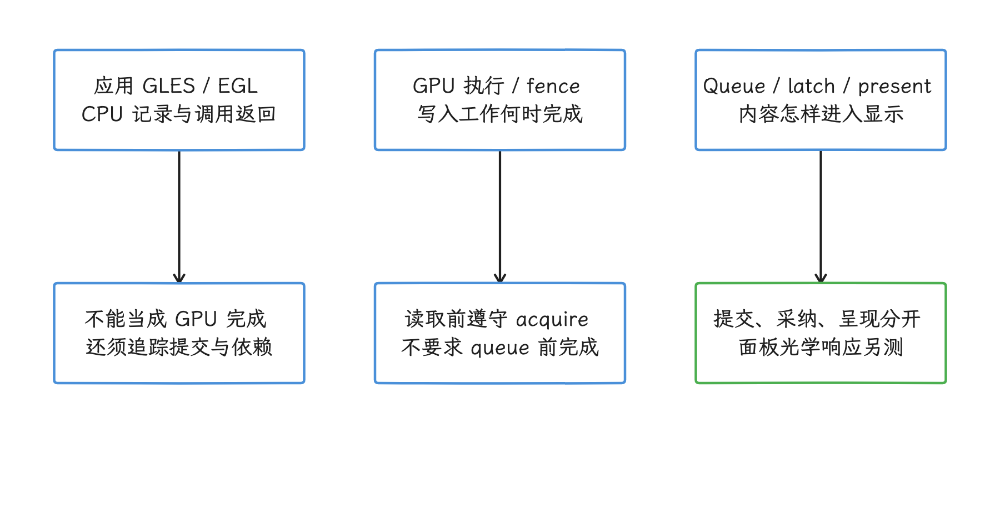

图：分别辨认 API 调用、GPU 完成、buffer 提交和显示呈现。 图中并列边界没有固定串行顺序，queue 可以早于 GPU 完成。

> 源码基线：AOSP `android-17.0.0_r1`；内核 `android17-6.18-2026-06_r6`。厂商 EGL/GLES 驱动、GPU job scheduler（硬件任务调度器） 和 Composer 实现不由 AOSP 统一提供，调用阻塞与硬件完成时刻要用目标设备的 trace 补齐。

平台里同时存在两条实现路径：一条是 EGL 负责显示连接、上下文和 Surface，OpenGL ES 直接提交图形命令；另一条是 ANGLE 在兼容入口下把 GLES 翻译为 Vulkan。两者共享应用 API 的一部分，但驱动、同步和着色器处理不同。本文前半部分沿第一条路径展开，从 EGL 上下文和 swap 讲到 BufferQueue 与 fence；后半部分再走 ANGLE 的选路、翻译与同步。

<!-- gracker-diagram: ch13-04-02-native-angle -->
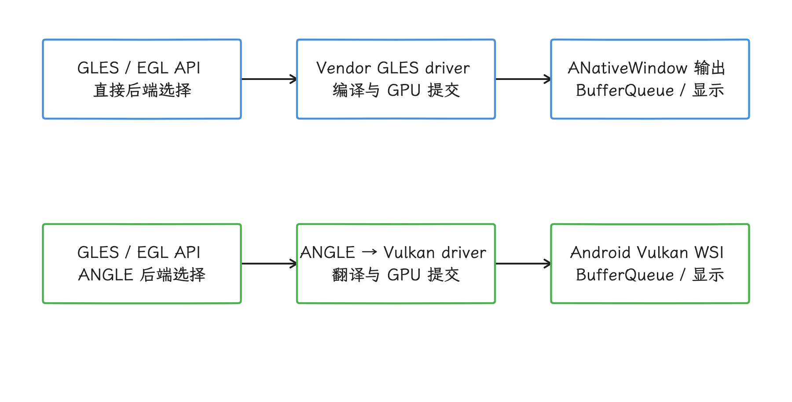

图：两条路径在图形前端不同，窗口输出继续进入 Android 显示系统。 只画职责路径；实际图形库、版本与合成方式须用设备证据确认。

## EGL 上下文、Swap 与 GLES 提交

这一部分我们走应用直接调用厂商 GLES 驱动的路径：先看 EGL 对象怎样和 Android Surface 接上，再看一帧从 draw 到 present 跨过哪些进程和缓冲，最后落到 swap、BufferQueue 和 fence 的观测方法。

### 核心架构

#### EGL 对象与 Android Surface

EGL 是 GLES 与 native window system 之间的绑定层。读代码时，我们要先分清三个核心对象：

<!-- gracker-diagram: ch13-04-03-egl-objects -->
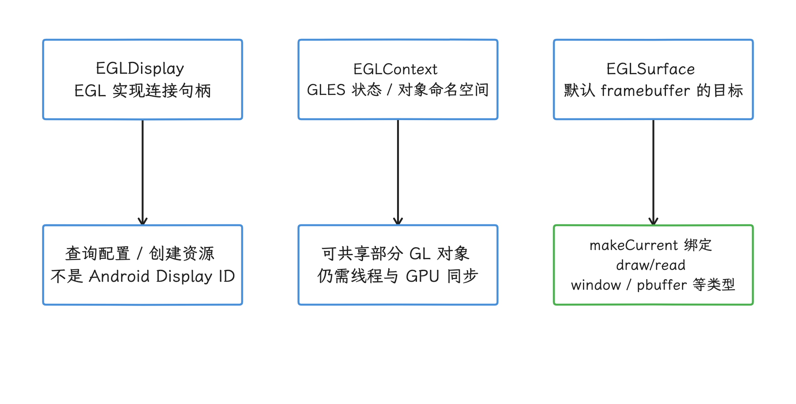

图：Display、Context 和 Surface 各自承担连接、状态与默认目标职责。 EGLDisplay 不是物理 Display ID；GL FBO 不等于 EGLSurface。

- `EGLDisplay`：连接 EGL 实现的句柄，用于查询配置和创建资源，它表示 EGL display connection，不能把此句柄当作 Android 的物理 Display ID；
- `EGLContext`：保存 GLES 状态与资源命名空间。共享 context 可以共享部分 GL 对象，但线程绑定、同步和资源生命周期仍由应用管理。
- `EGLSurface`：通过 `eglMakeCurrent()` 绑定 context 的默认 framebuffer draw/read surface。window surface 连接 `ANativeWindow`，pbuffer 等用于离屏；应用另绑的 FBO 是 GL 对象，并不是新的 EGLSurface。

Android `Surface` 可以通过 JNI/NDK 转换为 `ANativeWindow`。AOSP 的 `android::Surface` 实现 native window 接口，并把 dequeue/queue 请求转交给 BufferQueue Producer；EGL window surface 由此取得可供 GPU 写入的 GraphicBuffer。

下面的结构图用于区分 API、承载对象与显示后半段：

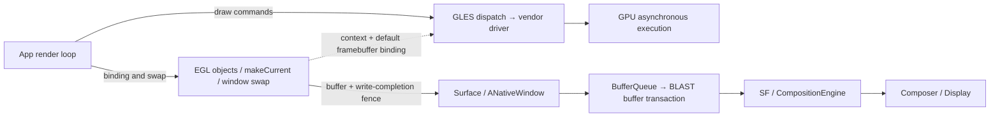

图中的 GLES 命令路径与 EGL 绑定/swap 路径分别表达两种职责。驱动把 buffer 和 GPU 写入完成依赖交给 native window；GPU 可以尚未完成，CPU 已完成 queue。GLES draw call 本身不直接调用 SurfaceFlinger。

<!-- gracker-diagram: ch13-04-04-window-output -->
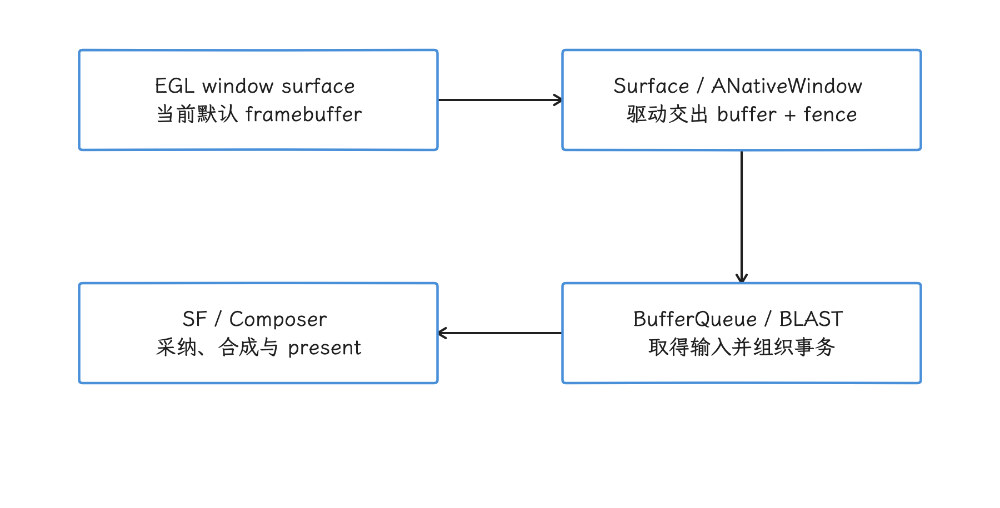

图：窗口驱动把 buffer 与写入完成依赖交给 native window，再经 BLAST 事务进入 SF。 GLES 命令通过图形驱动执行，GPU 本身不直接调用 queueBuffer。

#### GLES 的 Producer 角色与承载方式

GLES 只描述内容怎样生产；这些内容由哪种 Android 组件承载，取决于应用的集成方式。常见组合包括：

- `GLSurfaceView`：该类继承 `SurfaceView`，GLThread 向独立的 child Surface 提交内容；
- 原生 EGL + `SurfaceView`/GameActivity/NativeActivity：应用自行维护 render loop（渲染循环） 和 window lifecycle；
- EGL 写入由 TextureView 的 SurfaceTexture 创建的 `Surface`：GLES 输出先成为 TextureView 输入，之后还要由宿主 HWUI 采样；
- pbuffer、FBO（Framebuffer Object，帧缓冲对象）、HardwareBuffer 等离屏目标：结果未必直接显示，还要确认后续 Consumer。

用 Perfetto 确认拓扑时，我们要同时回答两个问题：谁发出 GLES 工作，EGLSurface 连接的是哪个 Consumer。看到 `eglSwapBuffers()`，先检查返回值和 surface 类型；pbuffer 等非后缓冲窗口目标的 swap 没有发布窗口内容的效果。对于成功的 window swap，目标 native window 属于独立可见 Surface、TextureView 输入还是其他消费者，要另行确认，之后才能判断 SurfaceFlinger 中是否存在独立的 SurfaceView layer。

<!-- gracker-diagram: ch13-04-05-carrier-targets -->
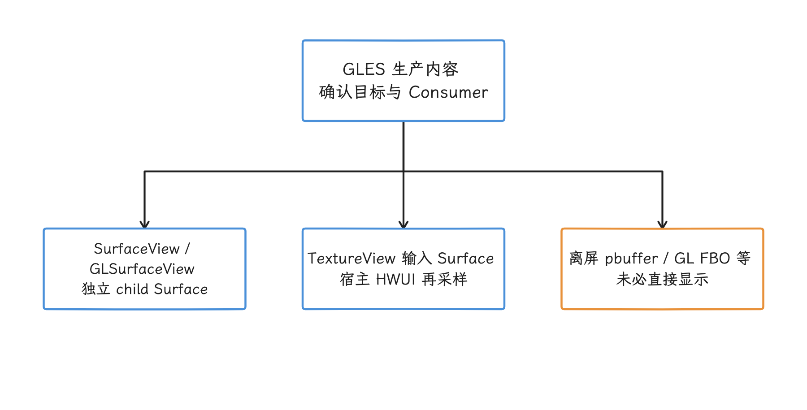

图：先确认输出 Consumer，再判断是否存在独立可见 Layer。 pbuffer swap 不发布窗口；FBO 或 HardwareBuffer 的后续 Consumer 另查。

#### GLSurfaceView 的 GLThread

`GLSurfaceView` 在调用 `setRenderer()` 后启动 `GLThread`，由这条线程负责：

- 创建和销毁 EGLContext 与 EGLSurface；
- 在 Surface 可用、尺寸非零并且没有暂停时调用 Renderer；
- 执行 `onSurfaceCreated()`、`onSurfaceChanged()`、`onDrawFrame()`；
- 调用 `EglHelper.swap()`，后者进入 `eglSwapBuffers()`；
- 处理 `EGL_CONTEXT_LOST`、无效 Surface、pause/resume、detach 和重建。

渲染回调在独立线程执行，生命周期和输入状态仍从主线程传入。SurfaceHolder 创建或销毁、View attach/detach、`onPause()`/`onResume()`、`queueEvent()` 与业务状态一旦同步不当，GLThread 就可能停止、重建，或者读到旧状态。

<!-- gracker-diagram: ch13-04-06-glthread-lifecycle -->
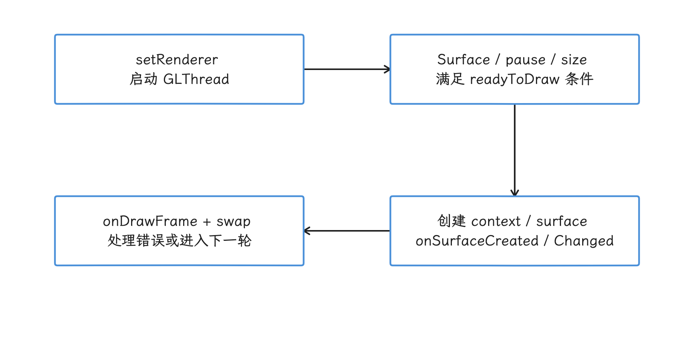

图：主线程传入 Surface 和生命周期状态，GLThread 管理 EGL 与 Renderer。 回调示意省略等待/错误分支；独立线程仍需协调共享状态。

独立线程隔离的只是执行队列；UI 状态、Surface 生命周期和显示资源，仍要靠应用自己协调。

`EGLContext` 同一时刻只能 `current` 到符合 EGL 规则的线程/surface 组合。多线程资源加载如果使用共享 context，还需要显式同步 GL 资源的可见性；Java 线程的执行先后本身保证不了 GPU 资源已经可用。

<!-- gracker-diagram: ch13-04-07-context-sharing -->
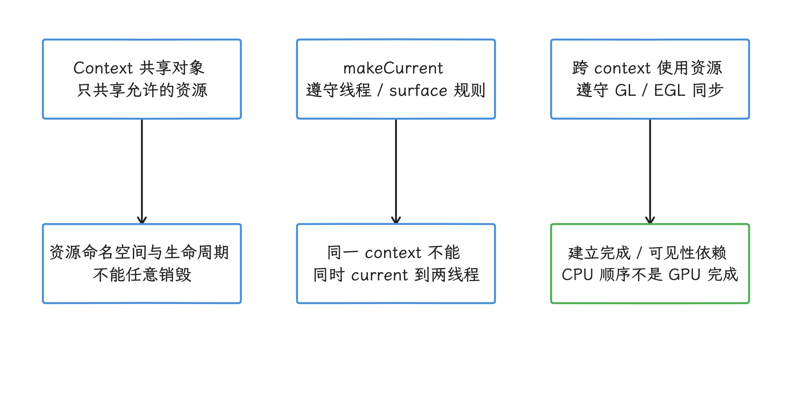

图：共享对象、current 绑定和 GPU 可见性是三项不同约束。 Java 线程先后不能独立保证 GPU 资源已完成。

### 渲染循环时序

#### Continuous 与 When Dirty

`GLSurfaceView` 有两种 render mode：

| 模式 | `GLThread.readyToDraw()` 的触发 | 适合场景 | 风险 |
|---|---|---|---|
| `RENDERMODE_CONTINUOUSLY` | Surface/context 就绪后持续满足绘制条件 | 游戏、持续动画、相机特效 | 未做 pacing（提交节奏控制）时容易过量提交，增加功耗与排队 |
| `RENDERMODE_WHEN_DIRTY` | `mRequestRender=true`；可由初始状态、`requestRender()`、恢复、resize/redraw 申请触发 | 静态图表、事件驱动更新 | 业务漏发请求会停在旧帧，过晚请求会错过目标周期 |

Continuous 模式下，`GLThread` 默认不会由 `Choreographer#doFrame()` 逐帧直接唤醒，它会持续执行 draw/swap，实际节奏可能受 swap interval、BufferQueue backpressure（消费者较慢形成的背压）、驱动、Swappy 或业务 scheduler 约束。When Dirty 模式仍须满足未暂停、Surface 有效、尺寸非零等条件，并消费绘制请求；GLThread 初始就带有一次请求，恢复和尺寸变化等也会置位，不只依赖业务调用 `requestRender()`。业务请求可以来自 Choreographer、传感器、网络或其他线程。

<!-- gracker-diagram: ch13-04-08-render-modes -->
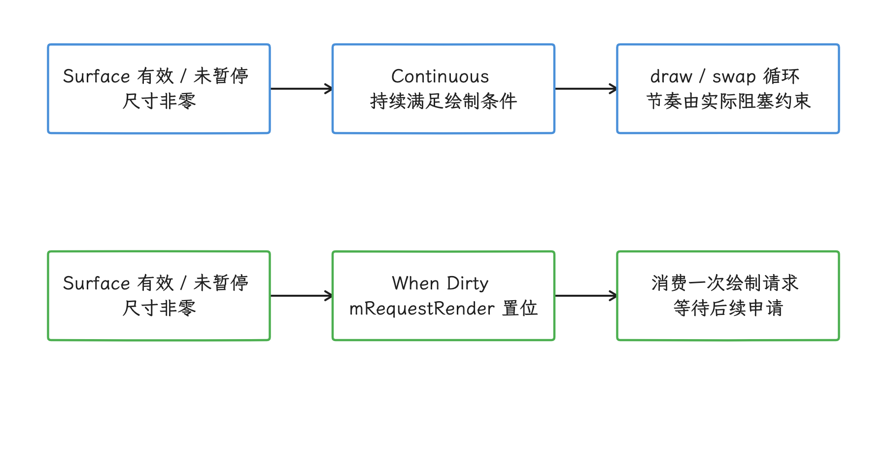

图：两种模式共用就绪条件，区别在持续绘制还是消费请求。 When Dirty 初始、恢复与 resize 也可置位请求；Continuous 仍会受背压或 pacing 约束。

#### 一帧的 CPU、GPU 与显示边界

下面的时序图以 `GLSurfaceView + SurfaceView` 为例；若 EGLSurface 连接 TextureView 或离屏目标，swap 之后的 Consumer 会不同：

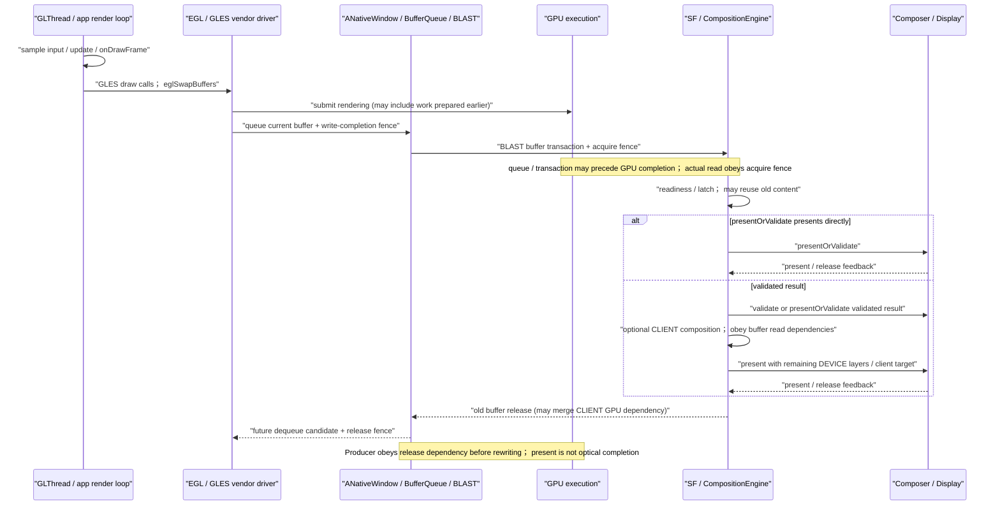

draw call 返回，通常只说明命令已经记录或交给驱动；`eglSwapBuffers()` 返回，通常说明当前 image 已按 EGL/驱动规则交给 window system。至于 GPU 是否执行完、SurfaceFlinger 是否已为本次合成选中该 buffer、HWC 是否 present、面板是否扫描到该帧，都要另外确认。

<!-- gracker-diagram: ch13-04-09-async-frame -->
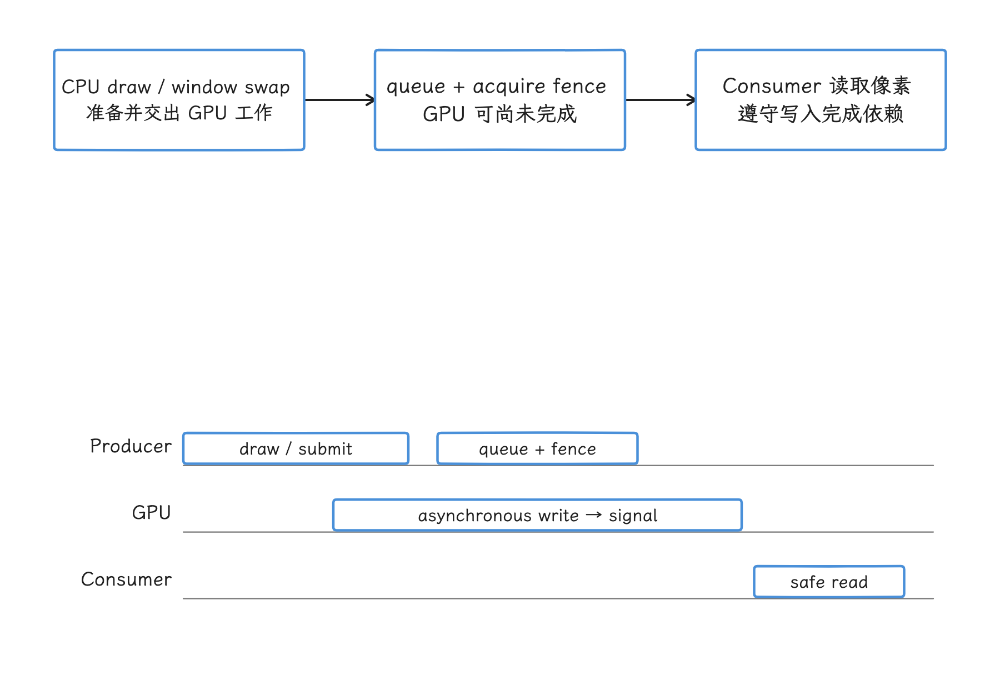

图：CPU 交接与 GPU 执行重叠，读取方通过 acquire fence 保证依赖。 轨道为合法依赖示意；不规定实测时长、latch 或 GPU 开始的固定位置。

<!-- gracker-diagram: ch13-04-10-hwc-branches -->
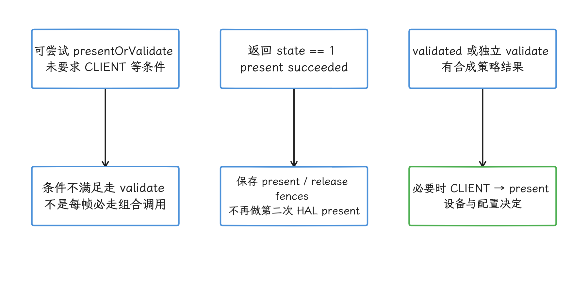

图：组合调用可能已完成 HAL present，否则取得 validated 结果后再组织输出。 只有 validated 路径才可能需要新的 CLIENT 绘制；HAL present 返回不是光学完成。

#### frame pacing 与 queue-stuffing


如果 render loop 按最大速度持续提交，就可能在消费者释放 buffer 前积累多个 in-flight frame（已经开始、尚未完成显示的帧）；队列到达高水位后，线程开始周期性阻塞在 swap 或下一次 dequeue。这时显示帧率可能仍然稳定，但输入状态采自更早的帧，触控到显示的时延会随排队变长。

<!-- gracker-diagram: ch13-04-11-pacing-backpressure -->
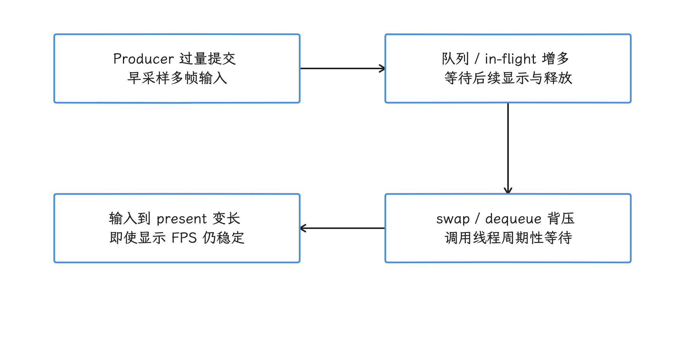

图：过量生产消耗排队空间，背压会把等待传回 Producer。 高水位不自动证明根因；需同队列与 input→present 关联。

Frame Pacing library 中的 Swappy 属于 AGDK 库，不在 `android-17.0.0_r1` 平台源码内。GLES 入口 `SwappyGL_swap()` 包装 `eglSwapBuffers()`，综合 Choreographer、presentation timestamp 和 sync fence 控制提交节拍。我们在 trace 里看到 Swappy 主动等待时，应同时比较目标 present、队列深度和输入时延：这段等待可能正是在避免 queue-stuffing，也就是生产端持续把过多帧塞进队列。

业务自研 pacing 也应区分：

- 内容目标帧率：应用希望按什么节奏生成新内容；
- Display refresh-rate hint：`Surface.setFrameRate()`/native window frame-rate API 向系统提供的显示模式选择提示；
- submit timing：当前帧应在哪个显示周期的截止点前交付；
- in-flight 数量：CPU、GPU 和 BufferQueue 中允许同时存在多少个尚未完成的帧。

只修改 refresh-rate hint，输入采样时刻、提交节拍和队列深度都不会随之自动调整。

<!-- gracker-diagram: ch13-04-12-pacing-knobs -->
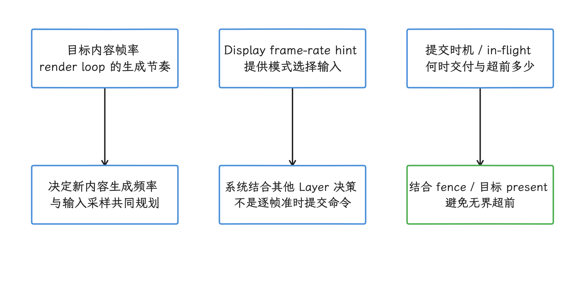

图：生成节奏、显示模式提示和在途数量需要分别控制。 setFrameRate 的提示不自动调整输入采样、提交时刻或队列深度。

### eglSwapBuffers 详解

#### libEGL 的分发职责

AOSP `libEGL` 的 `eglSwapBuffersImpl()` 会进入 `eglSwapBuffersWithDamageKHRImpl()`。平台层先验证 display/surface，处理 surface metadata 和 damage（本帧更新区域），再把调用分发给已经选中的 EGL 实现：

<!-- gracker-diagram: ch13-04-13-egl-dispatch -->
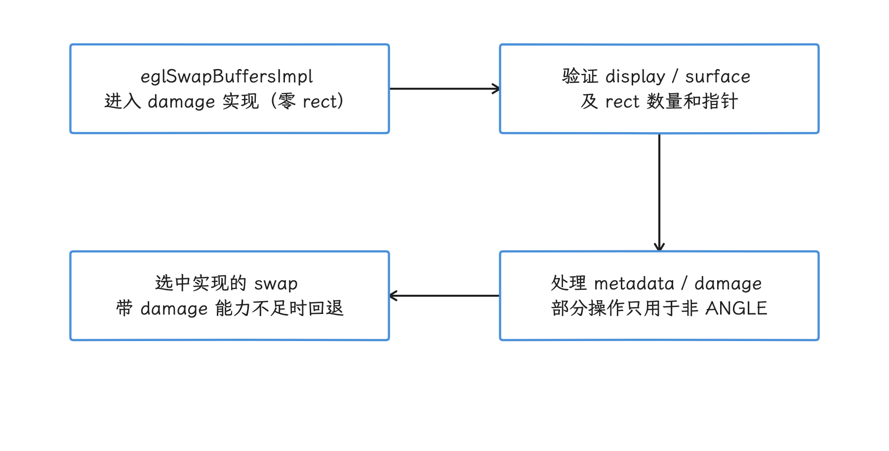

图：平台层验证参数并按选中实现分发；damage 路径也受能力与参数约束。 没有适用于所有厂商驱动和调试配置的统一内部调用栈。

- native GLES 路径进入厂商 EGL 实现；
- ANGLE 路径进入 ANGLE 的 EGL；
- 扩展可用时，带 damage 的调用进入 `eglSwapBuffersWithDamageKHR()`；扩展不可用时使用普通 swap。

AOSP wrapper 承担平台验证与分发，但并非始终没有同步工作：固定 r1 的 `traceGpuCompletion` 分支会创建 EGL fence 并交给完成线程，`finishOnSwap` 分支甚至通过 1×1 `glReadPixels()` 强制完成。通常的 dequeue 时机、GPU flush/submit、swap interval 和 fence 生成仍位于 ANGLE 或厂商实现中，所以不存在适用于所有设备和调试配置的固定 swap 内部调用栈。

<!-- gracker-diagram: ch13-04-14-swap-debug -->
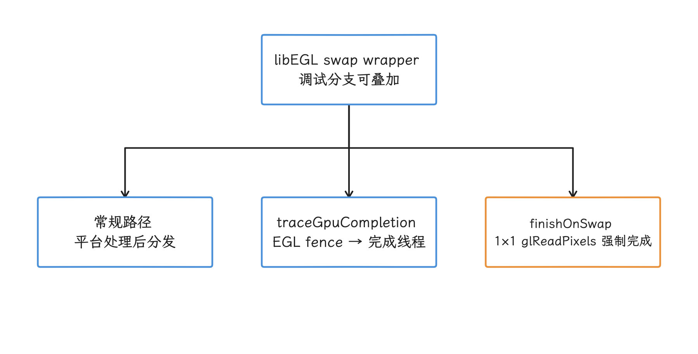

图：跟踪完成与强制完成是额外分支，可能改变 swap 测量成本。 分支存在不代表目标设备启用；需要保存实际配置。

调用的职责可用下面的概念骨架理解：

```text
eglSwapBuffers(display, windowSurface)
  validate EGL objects
  propagate metadata / damage when supported
  enter selected EGL implementation
    implicitly flush rendering; completion is not generally guaranteed
    hand current image and producer completion dependency to ANativeWindow
    obey swap interval / pacing / available-buffer constraints
```

这份骨架只标出职责；dequeue 具体落在 swap 函数的哪一行并没有保证，部分实现可能提前取得下一块 buffer，也可能等到后续渲染开始时再处理。

#### swap 耗时的构成

`eglSwapBuffers()` 的 wall time 可能包含：

- 应用/驱动尚未提交完当前命令；
- 驱动内部串行执行或 GPU queue 限制；
- 没有可用 BufferQueue slot；
- 返回的旧 buffer release fence 尚未满足；
- swap interval 或 presentation timestamp 等待；
- 实现在 EGL 调用内部的 pacing 等待；若计时范围包住外层 `SwappyGL_swap()`，还可能包含 Swappy 在内层 `eglSwapBuffers()` 前后的等待；
- Surface resize、重分配、context/surface 错误恢复；
- ANGLE 状态处理和 Vulkan backend（生成 Vulkan 工作的后端） 工作。

所以 swap 耗时较长时，先别急着归因给 GPU shader，也别预设大部分时间花在 dequeue；我们要把线程状态、子 slice、BufferQueue、fence、GPU stage 和 pacing marker 放到同一条时间轴上再看。

<!-- gracker-diagram: ch13-04-15-timing-scope -->
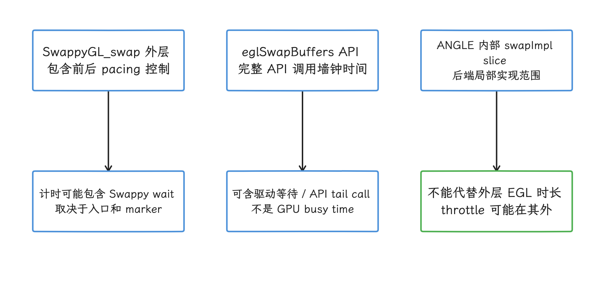

图：先标清计时范围，再把等待归到对应实现阶段。 Swappy 外层等待不能无条件算进内层 eglSwapBuffers；ANGLE tail-call 也可能位于内部 slice 外。

#### damage 与 buffer age

`eglSwapBuffersWithDamageKHR()` 提供相对上一已提交帧的 surface damage 提示；它不自动修复 back buffer。`EGL_EXT_buffer_age` 返回当前 back buffer 的年龄：age=0 时旧内容不可依赖，应完整重绘；age=N>0 时，修复区域通常包含本帧 damage 与之前 N−1 帧 damage 的并集，还要覆盖尺寸/有效区域等变化。只有正确维护历史并完成修复，才能安全复用旧内容。

<!-- gracker-diagram: ch13-04-16-damage-age -->
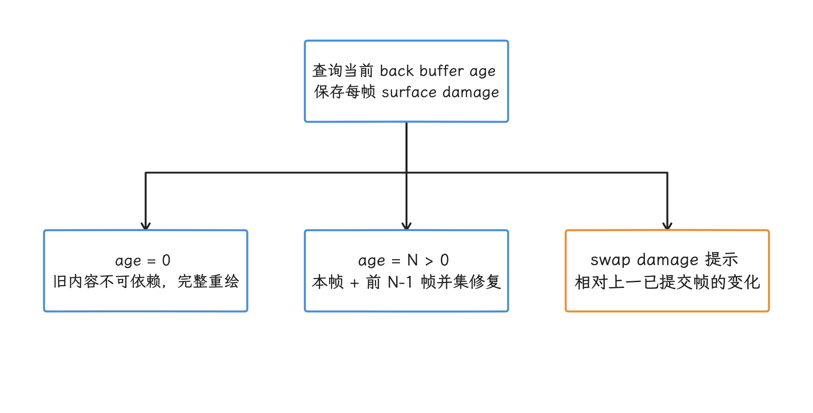

图：先修复当前 back buffer，再提供提交 damage；两个区域口径不同。 age=N 的历史并集须结合有效区域与尺寸变化，不保证硬件只读指定矩形。

局部 damage 可能减少 tile/load/store 或后续合成工作，但系统不一定只读取指定矩形，HWC composition type 也可能变化。旋转、缩放、透明混合、颜色处理和设备实现都可能扩大最终有效的 damage 区域。

#### 错误与生命周期

`GLSurfaceView` 对 swap 返回值做了明确区分：

- `EGL_SUCCESS`：本次 swap 调用成功，可以进入下一轮；
- `EGL_CONTEXT_LOST`：销毁并重建 context/surface，Renderer 需要在 `onSurfaceCreated()` 中重建 GL 资源；
- 其他错误：将 Surface 标记为 bad，等待生命周期变化后恢复。

原生 EGL 集成同样要处理 `EGL_BAD_SURFACE`、context lost、窗口销毁和尺寸变化。只在 Activity `onResume()` 时创建一次 EGLSurface 是不够的：Surface 完全可能在 Activity 仍存活时被单独替换。

<!-- gracker-diagram: ch13-04-17-swap-errors -->
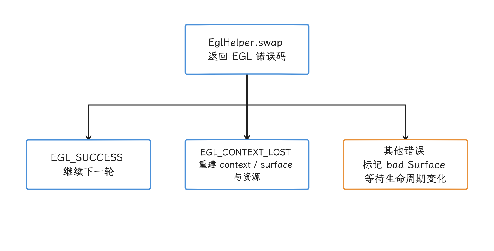

图：GLSurfaceView 按成功、context lost 与其他错误分别恢复。 原生 EGL 要自行协调窗口变化和资源重建，Activity 存活不保证 Surface 不变。

### Buffer 流转与 Triple Buffering

“Triple Buffering”这个标题沿用目录名称；GLES window surface 并没有适用于所有设备和模式的固定三 buffer 规则。

`BufferQueueCore` 根据 `mMaxDequeuedBufferCount`、`mMaxAcquiredBufferCount`、async/non-blocking 状态和配置上限计算可用数量。slot 是记录 buffer 所有权和状态的槽位，slot 表容量和同时分配的 GraphicBuffer 数量是两回事；EGL 实现、shared buffer mode、Consumer 和应用设置都可能改变活跃 buffer 的数量。

通用所有权可以简化为：

```text
FREE → DEQUEUED → QUEUED → ACQUIRED → FREE
       Producer         BQ Consumer（此例为 BLAST）
后续经 transaction 交给 SF；HWC 不直接持有本地 BQ slot 状态
```

上面的环只画普通提交/消费流程，省略 cancel、drop、attach/detach 与 shared-buffer 等分支。状态回到 FREE 时，前序 Consumer 的硬件工作未必已经完成。dequeue 返回的 fence 可能仍要求 Producer 在写入前等待；queue 当前 buffer 时，Producer 又会把 GPU 的完成依赖交给 Consumer。

<!-- gracker-diagram: ch13-04-18-slot-cycle -->
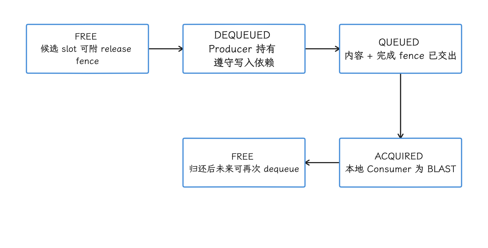

图：Producer 取得 slot、提交，再由本例的 BLAST Consumer 获取并归还。 省略 cancel/drop/shared/attach 分支；FREE 仍可能带未 signal 的 release fence。

#### 为什么 buffer 数量影响吞吐与时延

较少的 buffer 会更早把显示背压传回 Producer，缩小排队空间，但可能让 CPU/GPU 更容易等待；较多的 buffer 能吸收短时抖动，也允许更多帧同时处于处理中，也可能增加实际分配和排队延迟；配置数量变大并不代表所有 buffer 已分配、已排满或输入时延必然增加。选择时应衡量目标设备上的稳定帧率、时延、内存和功耗，直接拿“GLES 默认三缓冲”当前提会跳过该做的分析。

<!-- gracker-diagram: ch13-04-19-buffer-budget -->
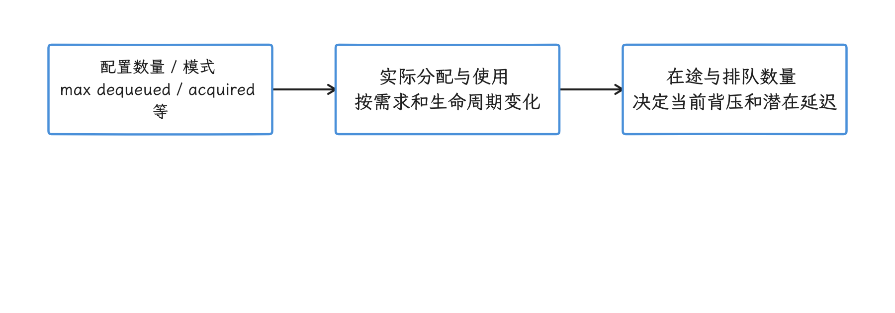

图：配置扩大容纳能力，实际分配和积压还要看运行状态。 不能把容量变大直接当成所有 buffer 已分配或输入延迟必然增加。

#### 诊断等待

Producer 在 dequeue/swap 中等待时，依次核对：

<!-- gracker-diagram: ch13-04-20-dequeue-outcomes -->
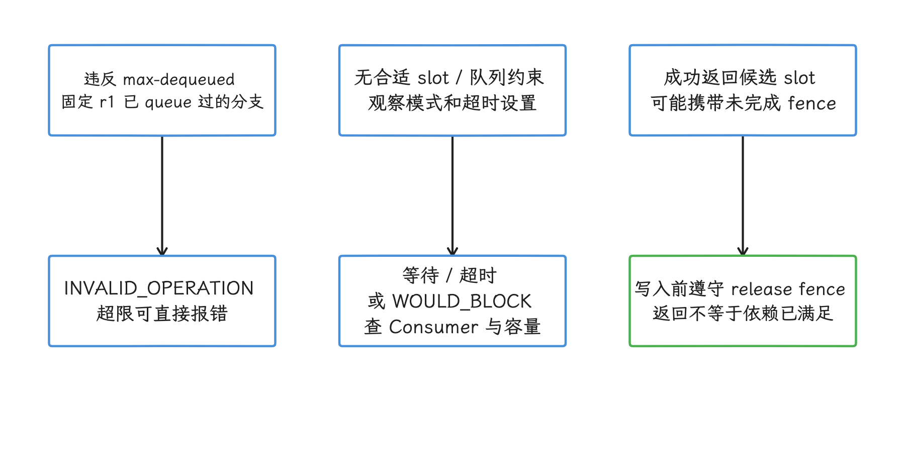

图：先区分调用结果，再解释返回之后的安全写入依赖。 无槽行为受阻塞/超时/模式影响；超限错误分支有已 queue 过等条件。

1. 是否违反最大 dequeued 限制；固定 r1 已 queue 过后的超限分支可直接返回 `INVALID_OPERATION`，并非一定阻塞；
2. 是否没有可用 slot；
3. Consumer 是否仍 ACQUIRED；
4. per-layer release fence 是否迟到；
5. buffer 是否因尺寸/格式变化重分配；
6. swap interval 或 pacing 是否有意等待；
7. Surface 是否正在重建或不可见。

队列长期高水位、Producer 过量提交、swap/acquire 周期性等待和输入时延上升，是支持 queue-stuffing 的一组证据。它们不是四项缺一不可的规范定义；应沿同一输出队列和帧关联验证，排除 GPU 变慢、显示节拍和资源重建等原因。

### Fence 机制

共享 buffer 句柄传递存储，fence 约束异步访问顺序；二者分工不同。下面从 dequeue 和 queue 两端看它各保证什么。

<!-- gracker-diagram: ch13-04-21-storage-sync -->
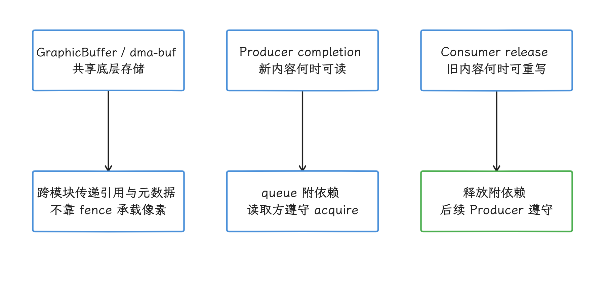

图：buffer 句柄共享存储，fence 只约束异步访问的先后。 共享句柄本身不证明内容已完成，fence 也不替代存储或进程传输。

#### dequeue fence：旧消费者何时完成

Android `Surface::dequeueBuffer()` 从 `IGraphicBufferProducer` 取得 slot、GraphicBuffer 和 fence fd（文件描述符）。这个 fence 说明前序 Consumer 何时停止读取该 buffer；Producer 在安全写入前必须满足这项依赖。调用线程仍阻塞在 dequeue，和 dequeue 已返回但 fence 尚未 signal，是两个不同阶段，要分别观察。

#### queue fence：新 Producer 何时写完

GLES 驱动可以把 GPU 尚未完成写入的 buffer 连同完成 fence 一起 queue 给 BufferQueue。对 SurfaceFlinger 和 BLASTBufferQueue（经 buffer transaction 提交 buffer 的队列）而言，这项依赖就是 acquire fence，合成路径真正读取像素前必须保证它已经满足；允许 unsignaled latch（为本次合成选中） 的受限路径同样消除不了硬件读取依赖。

DEVICE 路径的 HWC release fence 经 SF 返回；CLIENT 路径还可能合并 RenderEngine GPU 的读取完成依赖。反馈对应被替换/释放的旧 buffer，不能简单挂到当前正在 present 的新 buffer。present fence 是整个 Display 的呈现时间基准，既不等于某块 GLES buffer 的写入完成 fence，也不能代替该 buffer 的安全复用依赖。

<!-- gracker-diagram: ch13-04-22-three-fences -->
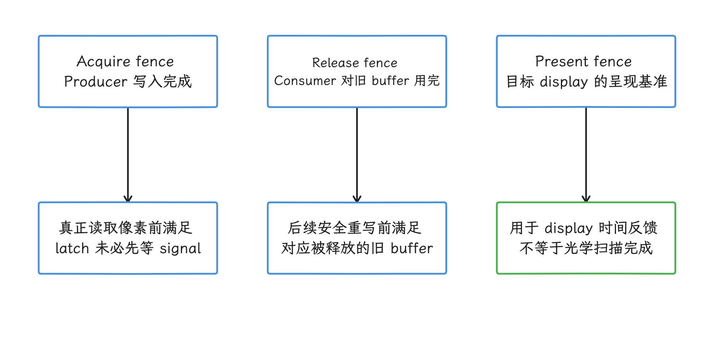

图：新内容可读、旧 buffer 可重写和 display 呈现各有不同证据。 CLIENT 释放可合并 RenderEngine GPU 依赖；present 不代替单块 buffer 的复用依赖。

#### EGL sync 与平台 buffer fence

应用可以用 `EGL_KHR_fence_sync`、`EGL_ANDROID_native_fence_sync` 等扩展建立额外同步，但必须先查询当前实现是否支持对应 extension。三种操作的语义不同：

- `eglClientWaitSyncKHR()` 让调用方在 CPU 上等待；
- `eglWaitSyncKHR()` 需要 `EGL_KHR_wait_sync` 等对应能力，让当前 client API 后续命令等待 sync；它不要求 CPU 先等到 signal；
- `eglDupNativeFenceFDANDROID()` 返回新 fd，由调用方在不再使用时 close；把 fd 传入 native-fence sync 创建接口则按扩展转交 EGL，若还要使用原引用须先 dup。

创建 sync 后，如果要保证前序 GL 命令已经送入驱动，还要按扩展要求执行 flush。导出 fd 和让 CPU 阻塞等待是两种操作，别混成一个同步步骤。普通 window swap 的平台 fence 通常由 EGL/驱动与 ANativeWindow 的集成层维护，应用无须每帧手工导出 fence 再交回同一个 Surface。

<!-- gracker-diagram: ch13-04-23-egl-sync-roles -->
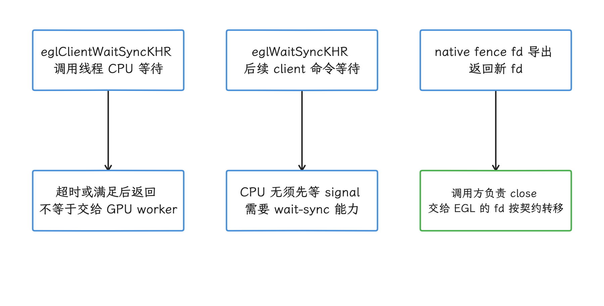

图：CPU 等待、命令依赖和 fd 所有权是三项不同操作。 先查询所需扩展，生成前序 fence 时按规范 flush；普通 window fence 通常由集成层维护。

#### kernel 边界

在 `android17-6.18-2026-06_r6` 中：

- `drivers/dma-buf/dma-buf.c` 提供跨子系统共享 buffer 的基础机制；
- `drivers/dma-buf/sync_file.c` 把 fence 暴露为 fd；
- `drivers/dma-buf/dma-fence.c` 提供 signal、callback 与 wait 原语。

common kernel 只能解释通用同步语义；某项 Adreno、Mali、Immortalis 或其他 GPU 工作何时完成，仍取决于厂商驱动的 job scheduler、频率、抢占、内存和硬件队列。

<!-- gracker-diagram: ch13-04-24-kernel-boundary -->
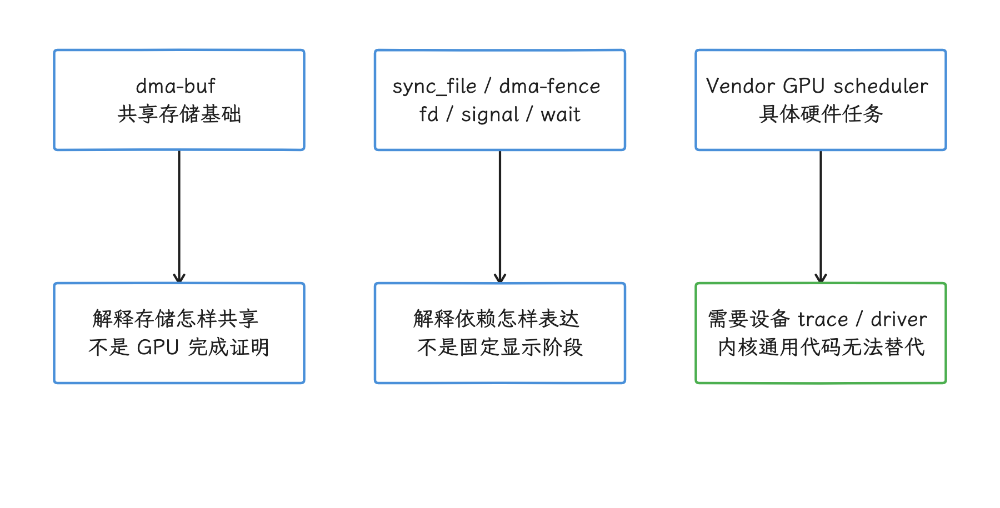

图：通用内核对象解释共享与完成信号，具体 GPU 完成仍依赖厂商实现。 从 common kernel 文件存在不能推导某台 GPU 的调度、频率或时长。

### ANGLE 路径

ANGLE 可以让应用继续调用 GLES/EGL，同时把命令翻译到 Vulkan 等 backend。应用可见的提交点仍是 `eglSwapBuffers()`，底层则可能出现 Vulkan command buffer、queue submit、pipeline cache 和 Vulkan 驱动工作。

ANGLE 没有因为某个 Android 版本而在所有应用中强制启用；实际选择受设备配置、开发者选项、应用 manifest、graphics driver 包、系统属性和厂商策略影响。

Android 15 提供 ANGLE 开发者测试入口。Android 17 新增 manifest 元数据 `com.android.graphics.driver.prefer_angle=true`，用于表达应用对 ANGLE 的偏好。

`queryAngleChoice()` 先形成 angle/native/default 意图，`setupAngle()` 再按平台 flag 和系统属性决定是否配置 ANGLE。因此 denylist、manifest 被跳过或查询返回 native，都不直接证明最终使用厂商 GLES；例如系统只读默认本身就是 ANGLE 时，仍可能保留 ANGLE。选择 ANGLE 后若实际库加载失败，固定 r1 loader 还存在 fatal 分支，并不保证平滑回退。应按「怎样确认 backend」核实当前 context。

<!-- gracker-diagram: ch13-04-25-selection-proof -->
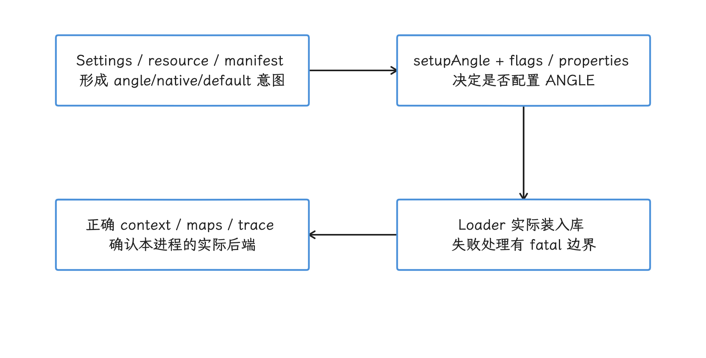

图：选路意图要经过 setup 和实际库加载，最终用当前 context 验证。 native 查询不是最终厂商 GLES 证明；已要求 ANGLE 的库加载失败可触发 fatal。

#### 怎样确认 backend

建议组合以下证据：

- `glGetString(GL_VENDOR/GL_RENDERER/GL_VERSION)` 和 EGL vendor/version；
- Graphics Driver/ANGLE 日志和包选择信息；
- 进程已加载库；
- Perfetto/atrace 中 ANGLE marker、Vulkan driver queue 和 GPU submission；
- 同一设备上 native/ANGLE 的 A/B trace。

看到 `vkQueueSubmit()`，说明的只是进程中存在 Vulkan 工作，应用也可能同时运行其他 Vulkan 模块。要确认 ANGLE 路径，我们要把该次 submit 与 GLES frame、ANGLE context 和目标 Surface 对齐。

<!-- gracker-diagram: ch13-04-26-backend-correlation -->
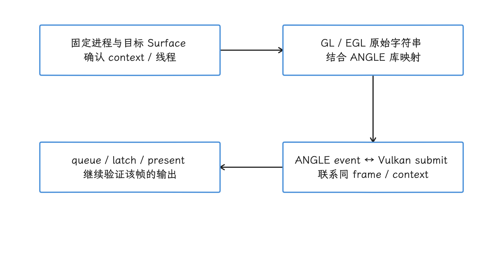

图：以配置、当前 context、已加载库和同帧事件共同确认 ANGLE。 单独看到 Vulkan submit 也可能来自 HWUI、原生 Vulkan 或进程内其他模块。

#### 分段归因

ANGLE 性能应拆成：

1. 应用 GLES 调用与状态切换；
2. ANGLE validation、state tracking、shader/pipeline 转换与缓存；
3. Vulkan driver 与 GPU 执行；
4. window swap、BufferQueue 与显示后半段。

大量细碎状态切换、同步 shader 编译或 pipeline cache 未命中，可能增加 ANGLE 的 CPU 成本；在另一台设备上，也可能因为 Vulkan 驱动更稳定而获得收益。所以要用目标设备的 A/B 数据判断，别预设 ANGLE 一定更快或更慢。

<!-- gracker-diagram: ch13-04-27-cost-segments -->
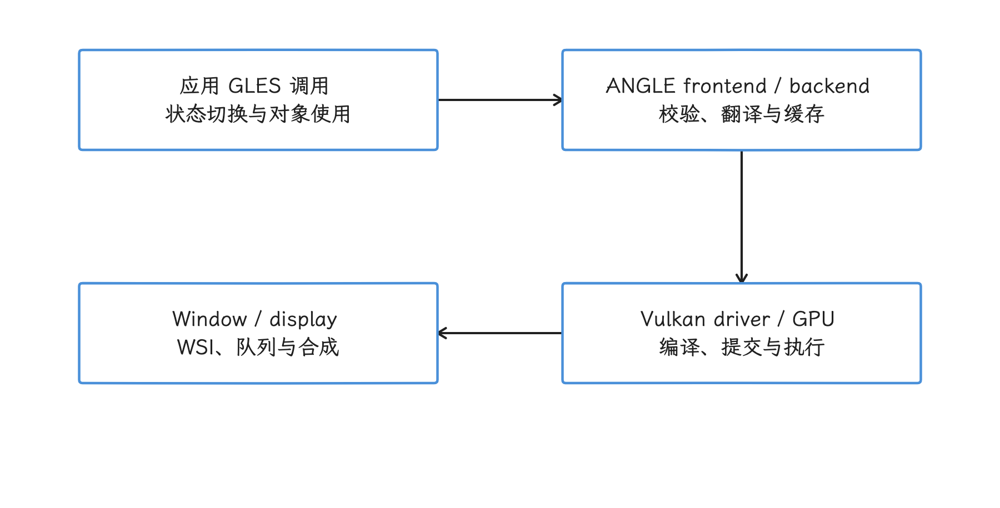

图：逐段区分应用调用、ANGLE 转换、厂商驱动/GPU 与窗口显示。 结构图不提供快慢结论；设备、workload 与 cache 状态决定实测结果。

### Trace 视角

#### 从目标 Surface 找 Producer

先在 SurfaceFlinger layer tree 中找到主体画面对应的可见 Surface，再回到应用进程定位管理该 Surface 的 render thread。`GLThread <id>` 是 `GLSurfaceView` 的常见线程名，原生引擎可能使用 Render、RHI（Render Hardware Interface，渲染硬件接口） 或自定义名称。线程名只能作为线索，`eglMakeCurrent()`、GLES marker、swap 和 BufferQueue connection 更可靠。

<!-- gracker-diagram: ch13-04-28-trace-identity -->
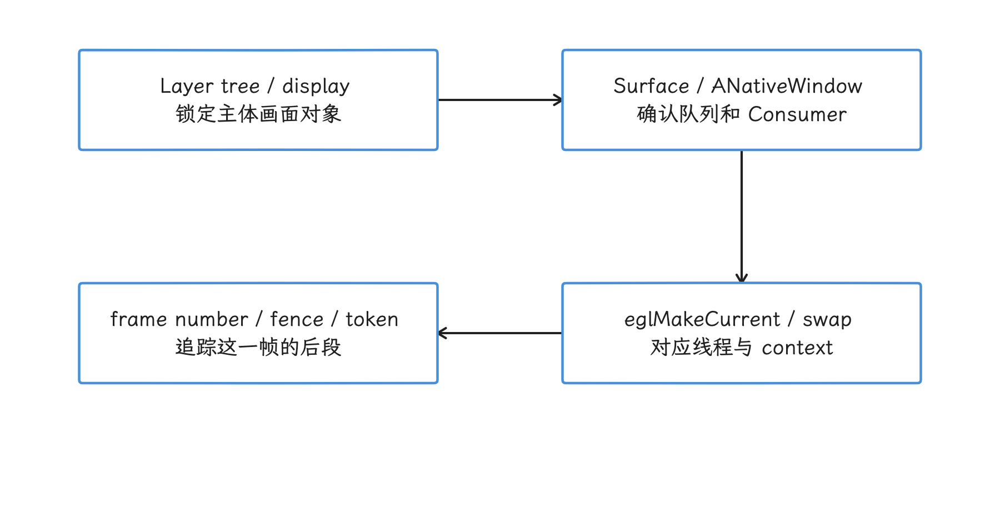

图：先固定输出对象，再用绑定、提交与帧标识关联执行者。 GLThread 或 Render 等线程名只是线索，多个 context / Surface 要分别核对。

每帧建议标出：

```text
CPU / submission: input → update → GLES preparation → submit / window swap → queue / BLAST transaction
GPU dependency:   submit → asynchronous execution → acquire fence signal → allowed pixel read
Display path:     transaction readiness / latch → composition strategy → optional CLIENT → present feedback
Reuse path:       old buffer release / fence → future dequeue → safe rewrite
(queue may precede GPU completion; constrained latch-unsignaled may precede acquire signal)
```

这条时间线用于避免把 CPU API 返回误认为 GPU 或显示已经完成。缺少某个标准 slice 时，可以用 engine frame id、buffer id、frame number、fence 和 FrameTimeline token 补齐关联。

#### 常见等待的证据表

| 现象 | 候选原因 | 应补证据 |
|---|---|---|
| `eglSwapBuffers()` 耗时长 | driver flush、可用 slot、release fence、swap interval、Surface 重建；外层计时另看 Swappy | 线程状态、swap 子 slice、BufferQueue 状态、fence 和 pacing marker |
| GL draw API 的 CPU 时间长 | 状态验证、shader 编译、驱动工作、ANGLE translation | 调用栈、shader/pipeline cache 和 CPU sampling |
| CPU 很快，GPU fence 迟到 | fragment/compute 负载、带宽、overdraw（重复绘制）、驱动队列、温控 | GPU stage/counter、频率、job queue 和 fence signal |
| buffer 已 queue，SF 仍使用旧内容 | acquire fence 未 ready、目标显示时刻未到、layer 不可见、transaction 条件未满足 | layer trace、fence、desired present 和 FrameTimeline |
| SF 已采用新 buffer，present 仍晚 | CLIENT composition、HWC validate、Display 资源竞争 | composition type、RenderEngine、HWC/present fence |
| swap 周期性阻塞且输入延迟升高 | queue-stuffing | pending buffer 数量、in-flight frame 数量和 input→present 时延 |

#### FrameTimeline 与 composition

[Perfetto FrameTimeline 文档](https://perfetto.dev/docs/data-sources/frametimeline)明确注明 SurfaceView 尚不在支持范围。不能仅凭 Producer 传递了 token/desired-present 就断言 GLSurfaceView 独立 child 具有完整 App expected/actual 时间线；系统版本、Producer 和采集配置也要记录。用 buffer frame number、layer latch、HWC present 与 fence 补齐判断，缺 expected slice 本身不能证明掉帧。

<!-- gracker-diagram: ch13-04-29-frametimeline-scope -->
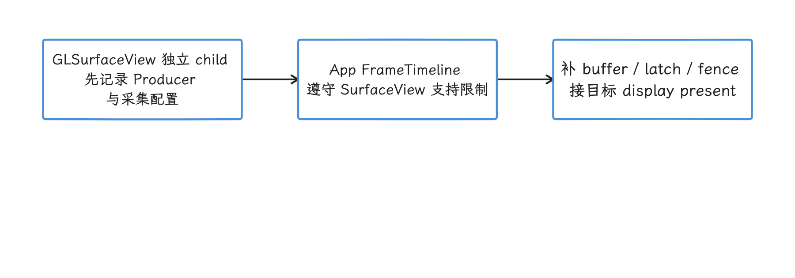

图：SurfaceView 的独立 child 不能直接假定有完整 App expected/actual。 官方文档注明 SurfaceView 尚未支持；缺 expected slice 不能独立证明掉帧。

GLES 生成的 layer 不一定使用 DEVICE composition。alpha、crop、rotation、scale、HDR/SDR、protected usage、同屏其他 layer 和 HWC 资源都会影响策略。如果 GLES 主体已经由 GPU 渲染，又被 SurfaceFlinger 作为 CLIENT layer 采样进 client target，就会增加一段 RenderEngine 工作和相应带宽。

<!-- gracker-diagram: ch13-04-30-composition-choice -->
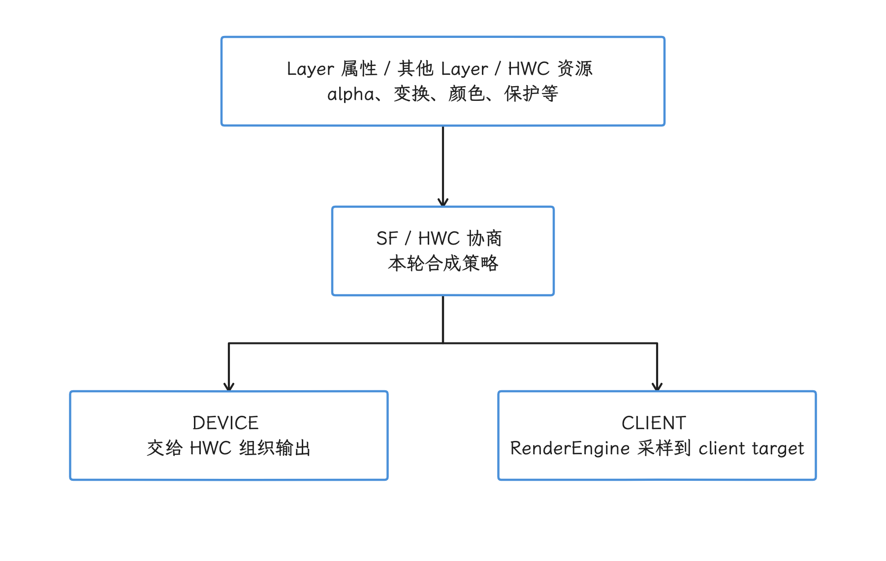

图：SF/HWC 决定合成类型，必要的 CLIENT 会增加 RenderEngine 工作。 DEVICE 不保证独占 overlay plane；alpha、变换、颜色与资源均可能改变策略。

HWC 主链路上还要区分 SF 侧的 `presentOrValidate()`、`validate()`、`present()` 与 ComposerHal 的 `*Display()` 调用。固定 r1 `HWComposer.cpp` 中 `state == 1`（注释为 present succeeded）表示组合调用已经执行 HAL present 并保存 fence，当前流程无须再做第二次 present；面板扫描是否完成，还要靠后续显示反馈确认。

#### GLSurfaceView 与原生 EGL

`GLSurfaceView` 适合单一 Surface、标准生命周期和简化的 EGL 管理；原生 EGL 适合需要多个 surface/context、共享资源、定制 pacing、明确控制错误恢复，或使用引擎自有线程模型的场景。原生实现需要自行处理：

- `ANativeWindow` 引用计数和 SurfaceHolder/NativeActivity 生命周期；
- config/context/surface 创建与销毁；
- context lost 和 bad surface 的恢复；
- 跨 context 资源同步；
- swap interval、frame-rate hint、damage 和 pacing；
- 所有 EGL/GL 错误检查。

原生 EGL 本身不会自动提升性能，它的收益来自更细的控制能力，代价是应用要承担更多生命周期与同步责任。

<!-- gracker-diagram: ch13-04-31-egl-integration -->
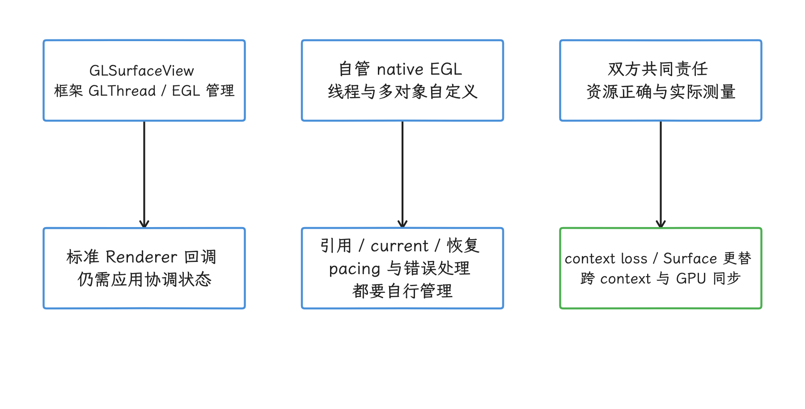

图：更细控制同时要求自行管理生命周期、同步与错误恢复。 改用原生 EGL 本身不能保证性能提升。

#### Android 12—17 边界

| 平台 | 相关变化 | 分析重点 |
|---|---|---|
| Android 12 / API 31 | BLAST/FrameTimeline 成为现代显示诊断基线；刷新率选择继续演进 | 区分 Producer、SF 和 Display 分别在哪一阶段迟到 |
| Android 13 / API 33 | HWC HAL 开始提供 AIDL 接口，HIDL 版本 deprecated；不代表所有升级设备已迁移；Game Mode/FPS intervention 可能限制游戏帧率 | 判断目标帧率时要包含系统 intervention（干预） |
| Android 14 / API 34 | EGL→ANativeWindow→BufferQueue 主结构延续 | 不要寻找虚构的 API 34 swap 重构 |
| Android 15 / API 35 | 引入 ARR，应用侧文档限定 Android 15 QPR1+ 且需相应 HAL（composer3 v3）支持；ANGLE 可选测试入口；AOSP 开始支持 16 KB 页设备 | backend 和 native `.so` 兼容性要分开验证 |
| Android 16 / API 36 | 新增 CPU/GPU headroom API；GPU syscall filtering 文档针对 Mali Pixel 6–9 的特定 IOCTL，OEM 可选择采用；不影响受支持 GLES/Vulkan 或 AGI/Streamline 正常路径 | 应用 API 路径与 profiling 工具要分别验证 |
| Android 17 / API 37 | 增加 `com.android.graphics.driver.prefer_angle` manifest 偏好信号；GLES/EGL、ANGLE 与 Vulkan 继续并存 | 检查选择优先级和实际 renderer，不能把驱动偏好写成强制使用 ANGLE |

<!-- gracker-diagram: ch13-04-32-version-gates -->
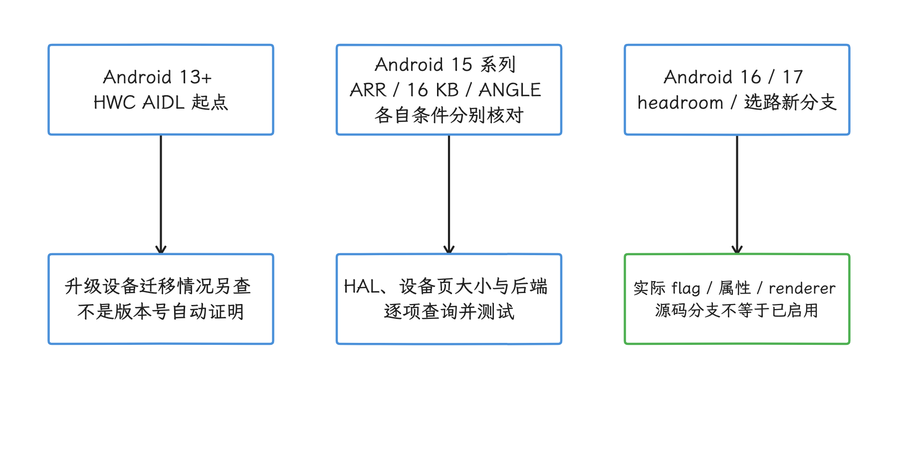

图：平台版本、HAL 支持与发布兼容要求要分开取证。 表列的是相关边界，不能推导每台设备已迁移 AIDL、启用 ARR 或默认 ANGLE。

#### Android 17 源码锚点


- [`GLSurfaceView.java`](https://android.googlesource.com/platform/frameworks/base/+/refs/tags/android-17.0.0_r1/opengl/java/android/opengl/GLSurfaceView.java)：GLThread、render mode、Renderer 回调、swap、pause/resume 和 context lost；
- [`GraphicsEnvironment.java`](https://android.googlesource.com/platform/frameworks/base/+/refs/tags/android-17.0.0_r1/core/java/android/os/GraphicsEnvironment.java)：ANGLE driver 选择优先级、denylist 与 API 37 manifest 偏好信号；
- [`egl_platform_entries.cpp`](https://android.googlesource.com/platform/frameworks/native/+/refs/tags/android-17.0.0_r1/opengl/libs/EGL/egl_platform_entries.cpp)：libEGL validation、damage、native/ANGLE 分发；
- [`Surface.cpp`](https://android.googlesource.com/platform/frameworks/native/+/refs/tags/android-17.0.0_r1/libs/gui/Surface.cpp)、[`Surface.h`](https://android.googlesource.com/platform/frameworks/native/+/refs/tags/android-17.0.0_r1/libs/gui/include/gui/Surface.h)：ANativeWindow、dequeue/queue、buffer age 与 fences；
- [`BufferQueueCore.cpp`](https://android.googlesource.com/platform/frameworks/native/+/refs/tags/android-17.0.0_r1/libs/gui/BufferQueueCore.cpp)、[`BufferQueueProducer.cpp`](https://android.googlesource.com/platform/frameworks/native/+/refs/tags/android-17.0.0_r1/libs/gui/BufferQueueProducer.cpp)：buffer 数量、slot 和背压；
- [`BLASTBufferQueue.cpp`](https://android.googlesource.com/platform/frameworks/native/+/refs/tags/android-17.0.0_r1/libs/gui/BLASTBufferQueue.cpp)、[SurfaceFlinger FrontEnd](https://android.googlesource.com/platform/frameworks/native/+/refs/tags/android-17.0.0_r1/services/surfaceflinger/FrontEnd/)、[`HWComposer.cpp`](https://android.googlesource.com/platform/frameworks/native/+/refs/tags/android-17.0.0_r1/services/surfaceflinger/DisplayHardware/HWComposer.cpp)：buffer transaction、layer state、composition 和 present；
- [`dma-buf.c`](https://android.googlesource.com/kernel/common/+/refs/tags/android17-6.18-2026-06_r6/drivers/dma-buf/dma-buf.c)、[`sync_file.c`](https://android.googlesource.com/kernel/common/+/refs/tags/android17-6.18-2026-06_r6/drivers/dma-buf/sync_file.c)、[`dma-fence.c`](https://android.googlesource.com/kernel/common/+/refs/tags/android17-6.18-2026-06_r6/drivers/dma-buf/dma-fence.c)：共享 buffer 和 fence fd；
- [Android Frame Pacing](https://developer.android.com/games/sdk/frame-pacing)、[ANGLE for Android](https://chromium.googlesource.com/angle/angle/+/HEAD/doc/DevSetupAndroid.md)：库级 pacing 和 backend 的验证范围。

相关章节：

- [13.3 SurfaceView 与 TextureView 渲染管线](03-surfaceview-textureview-pipelines.md)
- [13.5 Vulkan 原生管线与 HWUI 多队列](05-vulkan-hwui-multi-queue.md)
- [2.8 BufferQueue、Gralloc 与 Sync Fence](../../part1-fundamentals/ch02-rendering/08-bufferqueue-gralloc-sync-fence.md)
- [2.7 GPU 渲染与图形 API 选型](../../part1-fundamentals/ch02-rendering/07-gpu-rendering-graphics-api.md)


## ANGLE 选择、翻译与同步

看完 GLES 直接驱动的路径，我们再来看 ANGLE 这套另一路的实现后端：它何时被启用、把 GLES 翻译成什么、同步如何转换，这些决定了兼容性与性能。

本节讨论 Android 上最常见的组合：OpenGL ES/EGL frontend（接收并解释应用 API 的前端） 搭配 Vulkan backend，ANGLE 源码位于 AOSP `external/angle`。ANGLE 也支持其他平台和 backend，它们不属于本文的 Android runtime path。

从应用接口看，代码仍调用 GLES 和 EGL；向下看驱动接口，ANGLE 会维护 GLES 状态、翻译 shader、记录 Vulkan 命令，再经 Android Vulkan WSI（Vulkan 与窗口系统的连接层）提交显示。ANGLE 减少的是 GLES frontend 的厂商实现差异，厂商 Vulkan 驱动、GPU 和显示硬件仍在执行路径里。

### ANGLE 解决什么问题

Android 应用面对的 GLES 实现，来自不同 GPU 厂商、驱动版本和 OEM 集成。我们即使完全遵守规范，也可能撞上 shader compiler、扩展行为和驱动缺陷方面的差异；要是应用还依赖规范未定义的行为，换设备后更容易暴露问题。

ANGLE 提供由 Google 维护的 GLES/EGL 实现，把规范校验、状态跟踪、shader 翻译和大量兼容处理集中在同一套 frontend 中。在 Android 的 Vulkan backend 路径下，设备仍由厂商提供 Vulkan 驱动：

```text
App 的 GLES / EGL 调用
        ↓
ANGLE frontend、状态跟踪、shader translator
        ↓
ANGLE Vulkan backend
        ↓
Android Vulkan loader / vendor Vulkan driver
        ↓
GPU、BufferQueue、SurfaceFlinger、HWC
```

这条路径上有两点要记住：

<!-- gracker-diagram: ch13-04-33-angle-layers -->
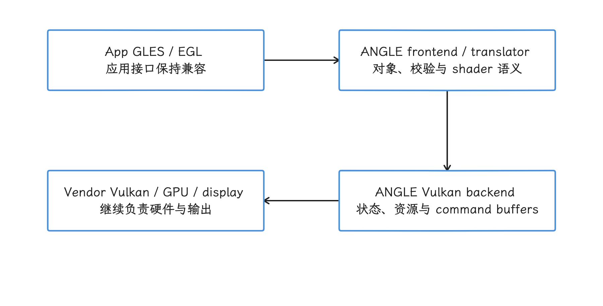

图：统一 GLES 语义后仍经厂商 Vulkan 驱动和硬件执行。 ANGLE 能减少部分 GLES 实现差异，不能消除设备和驱动差异。

- ANGLE 能绕过部分厂商 GLES frontend 的问题；底层的厂商 Vulkan compiler、内核 GPU 驱动和硬件仍在执行路径上。
- ANGLE 让 GLES 行为在不同设备上更加一致；性能则要按 workload（工作负载）逐场景测量，换过去不一定更快。

使用 ANGLE 的应用仍然通过 GLES API 编程，Vulkan descriptor、render pass 或 queue 这些对象由 ANGLE backend 管理，通常不把这些内部对象作为应用可控制的原生 Vulkan 资源暴露；特定 interop/扩展需另行查询，不能从 GLES API 推断可任意控制。如果新引擎需要完整控制 Vulkan 资源、命令和同步，应直接使用原生 Vulkan API。

### 翻译层架构

#### 四层职责

ANGLE 内部怎样分工？下面的结构图把 API 语义、shader、Vulkan 命令和窗口展示分成四层。

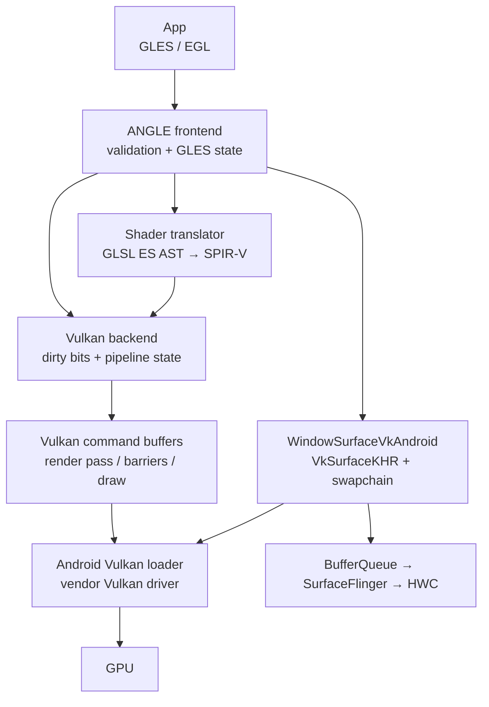

图中 App 下方的 ANGLE frontend，负责 GLES 对象、错误检查和状态机。Vulkan backend 的 `ContextVk::syncState()` 读取 GLES dirty bits（标记状态已变化的位），把 viewport、blend、depth/stencil、program、texture、vertex array 等 Vulkan 状态更新到位，随后准备 pipeline 和 draw。

<!-- gracker-diagram: ch13-04-34-dirty-state -->
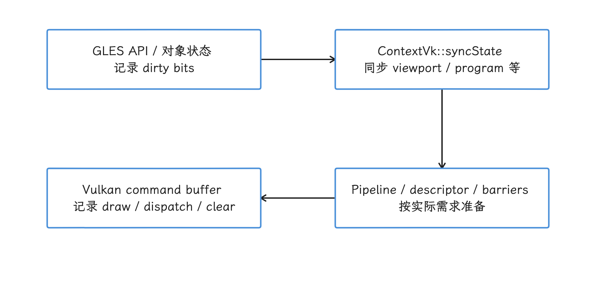

图：前端积累状态，后端在需要执行时准备 Vulkan 状态与命令。 语义上的阶段关系不意味着每次 GL 状态修改都即时发出 Vulkan 命令。

#### GLES draw 与 Vulkan 命令的对应关系

`ContextVk::drawArrays()` 的普通分支会准备状态并记录 draw，但特殊 primitive 和兼容处理可能改变命令形态。例如 `GL_LINE_LOOP` 分支会生成或复用索引数据，再记录 indexed draw；deferred clear（延后执行的清理）、format conversion、framebuffer fetch emulation 和 render-pass 切换，也可能在 draw 前后插入额外命令。

下面这种写法只适合做概念图：

```text
glDrawArrays()  →  ANGLE 状态同步与兼容处理  →  一组 Vulkan 命令
```

所以，把每个 GLES 调用一一映射成同名、同数量的 `vkCmd*` 调用是行不通的；分析 frame capture 时，我们要按 GLES draw、ANGLE event 和 Vulkan command buffer 三个层级建立关联。

<!-- gracker-diagram: ch13-04-35-draw-not-one -->
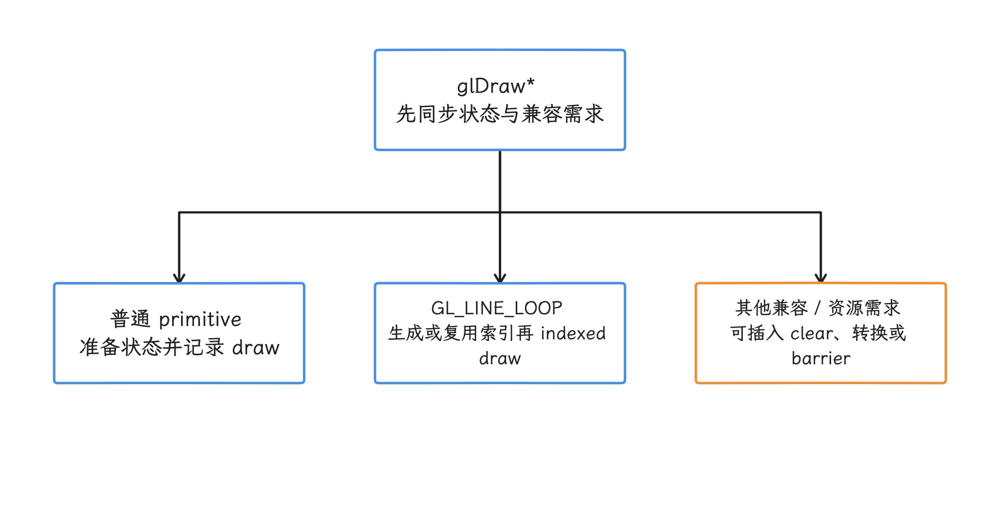

图：按语义和 frame 关联命令，不能按调用名与数量一一对应。 GL_LINE_LOOP 是源码中的具体例子；兼容 pass 取决于功能和设备配置。

#### GLSL ES 到 SPIR-V

`CompilerVk::getTranslatorOutputType()` 返回 `SH_SPIRV_VULKAN_OUTPUT`，说明 Vulkan backend 选择 SPIR-V translator 输出：

```cpp
ShShaderOutput CompilerVk::getTranslatorOutputType() const
{
    return SH_SPIRV_VULKAN_OUTPUT;
}
```

`CodeGen.cpp` 随后为该 output type 创建 `TranslatorSPIRV`。translator 会处理 GLES 语义、注入 driver uniform（由 ANGLE/驱动维护的统一参数）、改写部分 AST，并输出 SPIR-V blob。厂商 Vulkan 驱动仍要结合 pipeline state，把 SPIR-V 编译为设备可执行形式。

<!-- gracker-diagram: ch13-04-36-shader-stages -->
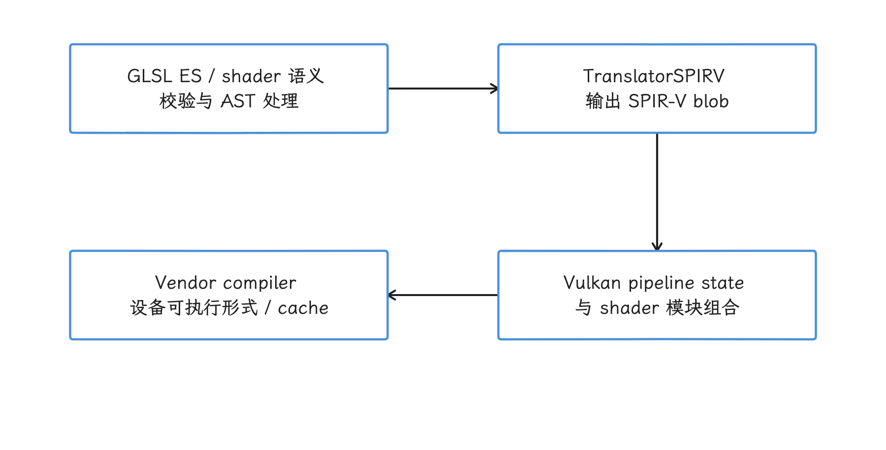

图：ANGLE 先输出 SPIR-V，厂商 Vulkan 驱动再结合 pipeline 编译设备代码。 编译、link、cache 恢复和 pipeline 准备分阶段发生，不是每个 draw 从文本重编。

这段工作发生在 shader 编译、program link、cache 恢复或 pipeline 准备阶段，并不会在每次 `glDraw*` 时都从 GLSL ES 文本重新开始。

### Android 17 的运行时选路

#### 决策发生在应用进程启动阶段

我们先看选路发生在什么时候。`GraphicsEnvironment.setup()` 在应用进程初始化图形环境时调用 `setupAngle()`；类注释明确说明，相关 Settings 改动只影响尚未完成 setup 的进程。因此每次修改驱动选择后，都要停止并重启目标应用——只重建 EGLContext，Java 侧的选路并不会重新执行。

<!-- gracker-diagram: ch13-04-37-process-setup -->
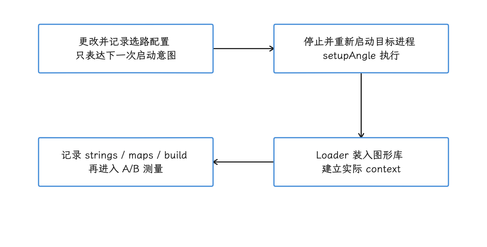

图：Settings 修改后重启目标进程，再确认实际装入结果。 只重建 EGLContext 不会让已经完成的 Java GraphicsEnvironment.setup 重新执行。

`queryAngleChoice()` 在 `android-17.0.0_r1` 中按以下顺序检查：

<!-- gracker-diagram: ch13-04-38-query-priority -->
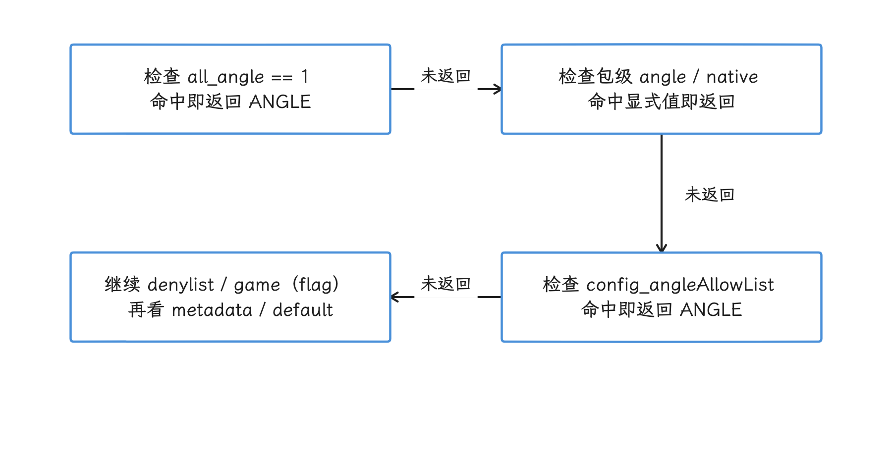

图：全局请求、成对包级选择和 allowlist 先于 flag 控制的 denylist。 命中提前返回，箭头仅在未返回时继续；metadata 不受 denylist/game 的 flag 包围，查询结果仍是意图。

| 优先级 | 来源 | 结果 |
|:---:|:---|:---|
| 1 | `angle_gl_driver_all_angle=1` | 为后续启动的 Java runtime 应用进程请求 ANGLE |
| 2 | 包名列表与取值列表 | 当前包可指定 `angle`、`native` 或继续默认 |
| 3 | `config_angleAllowList` | 命中包请求 ANGLE |
| 4 | flag 控制的 device/global/dynamic denylist | 命中包返回 native 意图，后续仍看 `setupAngle()` |
| 5 | 同一 flag 分支下的 game 策略 | 可由调试属性或设备资源为 game 请求 ANGLE |
| 6 | Android 17 manifest metadata | 满足平台条件时请求 ANGLE |
| 7 | 无匹配项 | 返回 default |

denylist 和 game 分支受 `enableAngleDenyList` flag 控制。另一个 `useQueryAngleChoice` flag 决定如何使用查询结果：启用时，angle 直接请求配置；native 跳过 persist 但仍检查 `ro.hardware.egl` 是否为 angle；default 先查可用的 `persist.graphics.egl`，再查只读默认。旧分支在 `ro.hardware.egl=angle` 时直接配置 ANGLE，甚至不运行查询表。目标设备需记录两项 flag 与属性，不能把表里的 native 当作最终厂商 GLES 证明。

<!-- gracker-diagram: ch13-04-39-setup-flags -->
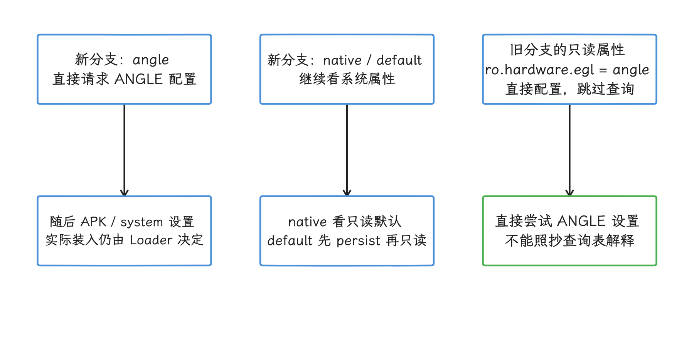

图：先核对 useQueryAngleChoice，再解释属性与查询结果的组合。 native 跳过 persist 但仍可保留只读系统 ANGLE；旧分支可绕过查询表。

#### Android 17 manifest 偏好

Android 17 允许应用在 manifest 中请求 ANGLE。下面是官方面向 game 的写法。

```xml
<application
    android:appCategory="game">
    <meta-data
        android:name="com.android.graphics.driver.prefer_angle"
        android:value="true" />
</application>
```

这个元数据表达的是应用偏好，平台保留最终决定权。遇到 essential-tier SoC、low-RAM 设备或 `ro.vendor.api_level < 202604` 时，`GraphicsEnvironment` 会跳过该请求；更高优先级的显式选择和 denylist 也会先决定结果，这里限制的是 metadata 分支，不推翻更早已返回的 ANGLE 请求。示例按官方 game 用法标注；当前 r1 metadata 检查本身位于 game category 判断之外。最终驱动仍须运行时确认。

<!-- gracker-diagram: ch13-04-40-manifest-gates -->
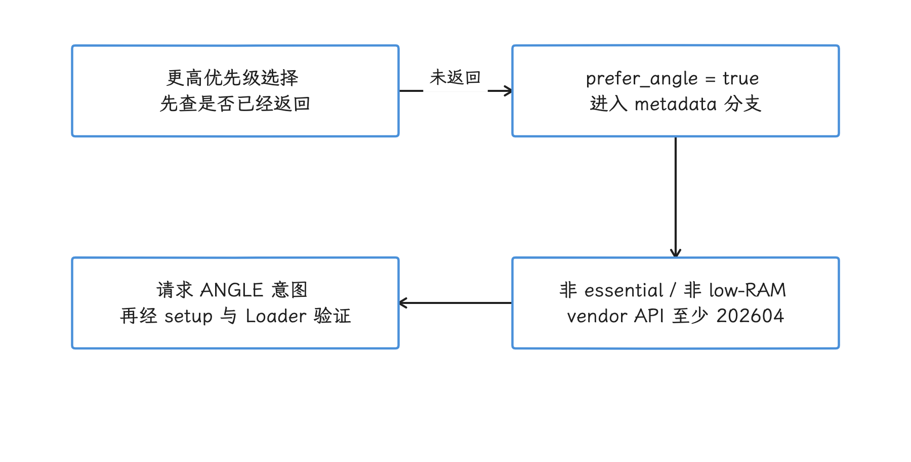

图：更早的显式选择先返回，metadata 分支再检查设备条件。 示例按 game 用法；固定 r1 的 metadata 检查位于 game category 判断之外。

#### ANGLE APK、system ANGLE 与 vendor updatable driver

选择结果要求使用 ANGLE 时，`setupAngle()` 会先调用 `setupAngleFromApk()`，失败后再尝试 `setupAngleFromSystem()`：

1. debuggable 应用或 debuggable 设备可以通过 `angle_debug_package` 指定开发包；
2. 否则根据 `android.app.action.ANGLE_FOR_ANDROID` 查询唯一的 system app；
3. Android 17 的 AOSP manifest 对应包名为 `com.android.angle`；
4. APK 设置未成功时，Java 尝试配置 system ANGLE；真正加载还会由 loader 检查 APK namespace 与 system 库。`setupAngleFromSystem()` 返回成功不等于库已经装入。

ANGLE package 与 vendor updatable graphics driver 是两套独立机制。前者提供 GLES-over-Vulkan 实现；后者通过 `ro.gfx.driver.*`、独立 linker namespace（动态库加载隔离空间）和厂商 driver package 更新 GLES/Vulkan 驱动。看到 “driver from APK” 时，必须先确认它来自 ANGLE namespace 还是 updatable driver namespace。

EGL loader 的 `attempt_to_load_angle()` 会装入 ANGLE 的 `libEGL`、`libGLESv1_CM` 和 `libGLESv2` 实现。源码注释中的 “ANGLE doesn't ship with GLES library”，指的是不提供旧式合并库 `libGLES.so`；拆分库提供 GLES 1.x 与 GLES 2/3 入口，具体 GLES 版本和扩展仍由运行时查询。固定 r1 在已要求 ANGLE 却未装入 EGL 实现时执行 fatal 检查，不能承诺自动回退厂商驱动。

<!-- gracker-diagram: ch13-04-41-apk-system-loader -->
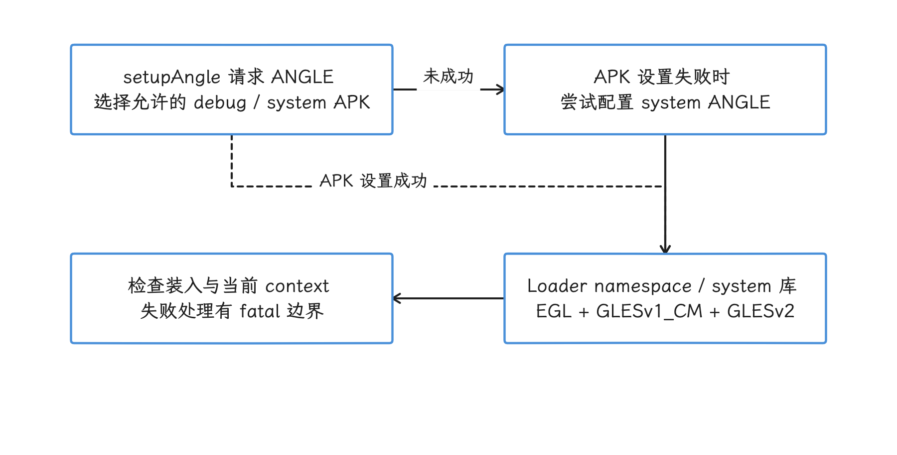

图：Java 先组织 APK 或 system ANGLE 配置，Loader 才装入拆分实现库。 APK 设置失败可试 system；已要求 ANGLE 却未装入实现时固定 r1 可 fatal，不能承诺 native 回退。

#### 用 ADB 做包级 A/B

下面是**原先两个包级列表均不存在**时的最小示例。先用 `adb shell settings get global angle_gl_driver_selection_pkgs`、对应 `values` 和 `angle_gl_driver_all_angle` 记录当前值；已有列表时应备份并成对保留其他包条目，测试后精确恢复。以下 `put` 会替换整个列表，不能直接用于已有多人/多包配置。设置后停止并重新启动目标进程。

```bash
adb shell settings put global angle_gl_driver_selection_pkgs com.example.game
adb shell settings put global angle_gl_driver_selection_values angle
adb shell am force-stop com.example.game
```

仅当前述两个 key 原先均不存在时，测试结束后用以下命令恢复不存在状态；原先有值则恢复所备份的原值。重新启动应用并复核 backend，不能把删除设置等同于已切回 native。

```bash
adb shell settings delete global angle_gl_driver_selection_pkgs
adb shell settings delete global angle_gl_driver_selection_values
adb shell am force-stop com.example.game
```

多个包共用列表时，`pkgs` 与 `values` 必须按逗号一一对应，两者长度不同会被 `GraphicsEnvironment` 忽略；量产设备还可能限制 Settings 写入或包级覆盖。命令执行成功，说明的只是配置写入成功，ANGLE 是否真的加载要另行确认。

<!-- gracker-diagram: ch13-04-42-adb-restore -->
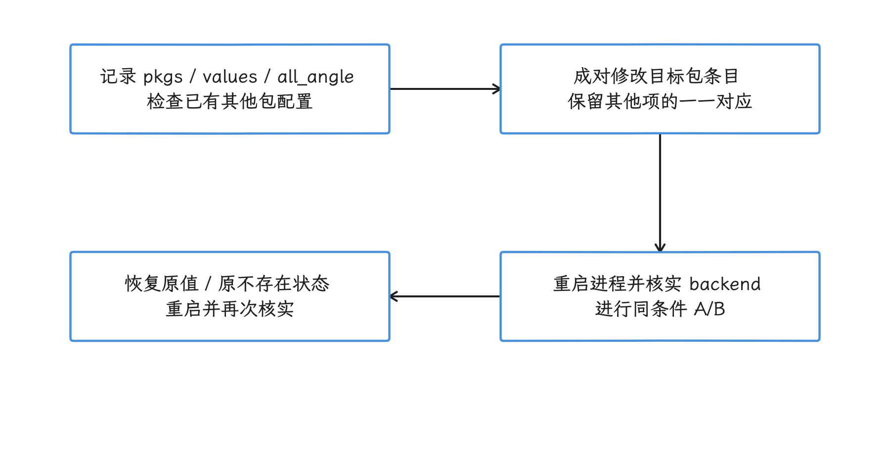

图：先保存原列表，成对修改目标条目，测试后精确恢复。 put 替换整个全局列表；只有原先 key 不存在时才用 delete 恢复。

### 一帧怎样从 GLES 走到显示

下面把一帧拆成 draw 和 swap 两段，先看 CPU 侧每次调用发生了什么，再看 buffer 与 fence 在哪里交接。

#### Draw 阶段

应用的 render loop 仍然调用 `glUseProgram()`、`glBind*()` 和 `glDraw*()`。ANGLE frontend 先记录 GLES 对象与状态，Vulkan backend 通过 dirty bits 延后处理许多变化，直到 draw、dispatch、clear 等需要实际执行的命令到来时才同步到 Vulkan 状态。

这种延迟处理可以解释我们在 trace 里常见的一个现象：某个看似轻量的 `glDrawArrays()` 在 CPU trace 中耗时很长，时间未必来自 draw 编码本身，也可能包含此前积累的 texture、framebuffer、pipeline 或 shader 准备工作。

<!-- gracker-diagram: ch13-04-43-deferred-cost -->
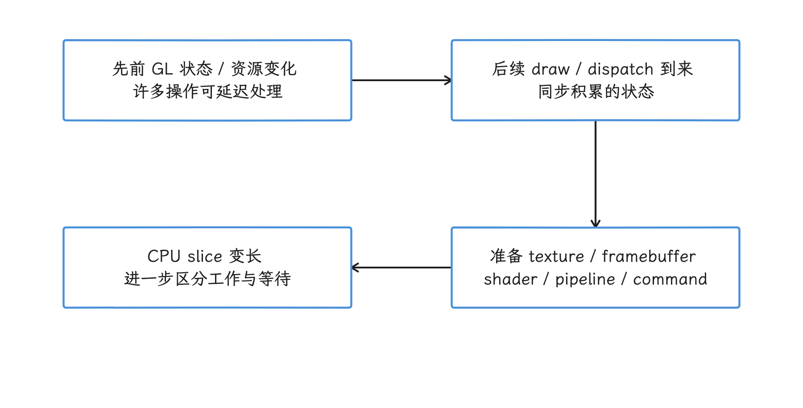

图：耗时归属要沿 dirty-state、资源和 pipeline 的因果链回查。 长 draw CPU slice 不直接证明 GPU draw 很慢，也可能包含等待。

#### Swap 阶段

Android 上的 `WindowSurfaceVkAndroid::createSurfaceVk()` 会把 `ANativeWindow` 交给 `vkCreateAndroidSurfaceKHR()`。`eglSwapBuffers()` 进入 ANGLE 的 `WindowSurfaceVk` 后，可能执行：

- 结束或提交当前 render pass；
- 处理 present layout transition；
- 等待或取得下一块 swapchain image；
- 进行 CPU throttle 或 swap interval pacing；
- 由 `Renderer::queuePresent()` 提交 Vulkan present；固定 r1 在 present 后可把 CPU throttle 放入 unlocked tail call，因此该等待可能不嵌套在 `swapImpl` slice 内，仍在对应 EGL API 返回前发生。

下面的时序图刻意保留了 ANGLE、Vulkan WSI 和 Android 显示端之间的分界。

<!-- gracker-diagram: ch13-04-44-wsi-swap -->
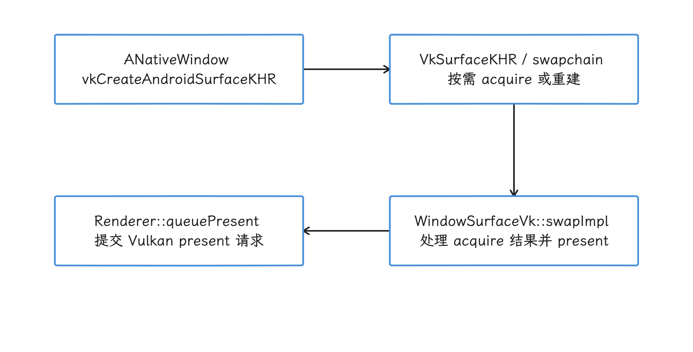

图：Android surface 建立 VkSurfaceKHR，swap 管理 acquire、submit 与 present。 acquire 可延迟或在更早阶段处理；throttle tail call 可能在 swapImpl slice 外。

```mermaid
sequenceDiagram
    participant App as "App render thread"
    participant Angle as "ANGLE frontend / Vulkan backend"
    participant Vk as "Vulkan loader / driver / WSI"
    participant GPU as "GPU execution"
    participant BQ as "ANativeWindow / BufferQueue / BLAST"
    participant SF as "SF / CompositionEngine"
    participant HWC as "Composer / Display"
    App->>Angle: "GLES state + glDraw*"
    Angle->>Angle: "sync dirty state; record Vulkan commands"
    App->>Angle: "eglSwapBuffers"
    Angle->>Vk: "submit + present request with wait semaphore"
    Vk->>GPU: "asynchronous rendering"
    Vk->>BQ: "WSI queues buffer + acquire dependency"
    BQ->>SF: "buffer transaction / readiness"
    Note over GPU,SF: queue / latch may precede GPU completion; actual pixel read obeys acquire dependency
    alt presentOrValidate presents directly
        SF->>HWC: "presentOrValidate"
        HWC-->>SF: "present / release feedback"
    else validated result
        SF->>HWC: "validate / validated result"
        SF->>SF: "optional CLIENT composition"
        SF->>HWC: "present"
        HWC-->>SF: "present / release feedback"
    end
    SF-->>BQ: "old buffer release; may merge CLIENT GPU dependency"
    BQ-->>Vk: "future dequeue + release dependency"
    Note over App,Angle: optional unlocked CPU throttle before EGL returns; may sit outside swapImpl slice
```

`vkQueuePresentKHR()` 返回，说明 present 请求已经处理到 Vulkan WSI 规定的交接处；屏幕是否已经扫描出该帧，还要看后面的过程：SurfaceFlinger 选择可展示的内容，与 HWC 协商 composition，完成 Display present。

<!-- gracker-diagram: ch13-04-45-wsi-async -->
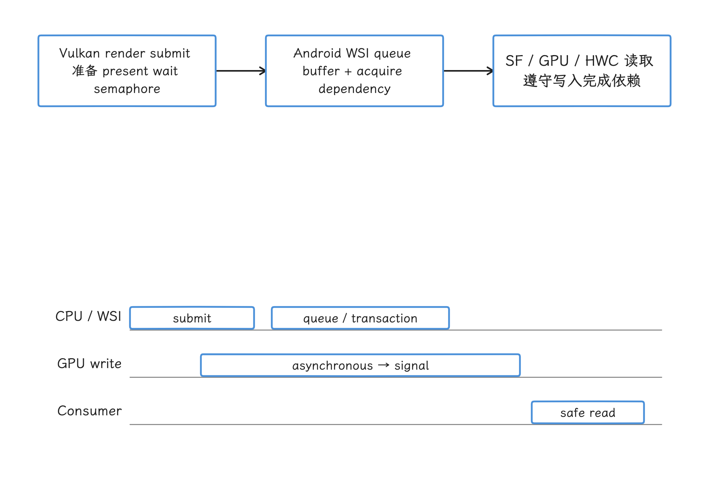

图：present 请求交接不要求 CPU 已等到 GPU 完成，像素读取仍遵守依赖。 条长为示意；vkQueuePresentKHR 返回不能证明 SurfaceFlinger 已采纳或面板已显示。

SurfaceFlinger 接收到的是目标 Layer、buffer、dataspace、damage、几何、时间信息和 acquire fence。对显示系统而言，上游用的是厂商 GLES、ANGLE Vulkan 还是原生 Vulkan，这些合成输入的基本形式都一样。

### Shader、program 与 pipeline cache

ANGLE Vulkan 路径上至少有三层缓存，常被统称为“shader cache”；排查时先要把三层分开：

| 层级 | 缓存对象 | 主要减少什么 |
|:---|:---|:---|
| ANGLE program/blob cache | 编译、链接后的 program 数据 | 重复的 frontend 翻译和 program 恢复工作 |
| ANGLE graphics pipeline cache | pipeline 描述到 Vulkan pipeline 的映射 | 同一进程内重复的 pipeline 查找与创建 |
| Vulkan pipeline cache data | vendor compiler 可复用的数据 | 驱动侧 pipeline 编译成本，实际收益由驱动决定 |

`ProgramExecutableVk` 在这一版里包含 per-program pipeline cache、global cache 合并、warm-up（预热） 和序列化分支，具体策略取决于 ANGLE feature 与驱动能力。看到 `VkPipelineCache`，别据此推断每次启动都会完整持久化；cache 命中也不会消除全部 CPU 翻译和状态处理成本。

<!-- gracker-diagram: ch13-04-46-cache-layers -->
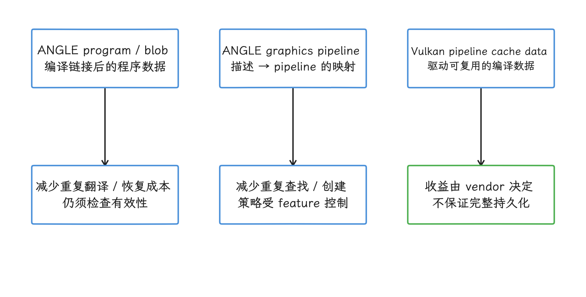

图：program 数据、图形 pipeline 对象映射和驱动 cache data 分层检查。 cache 命中不消除所有校验、状态处理、命令记录和 WSI 等待。

cache 命中仍可能保留：

- GLES 参数校验与对象查找；
- dirty-state 同步；
- descriptor/dynamic state 更新；
- command buffer 记录；
- render-pass 边界和资源 barrier；
- WSI acquire、present 和 fence 等待。

评估首帧和场景切换时，要同时测量 cold（无可用缓存） 和 warm 两种状态：

1. cold：清理应用可控 cache 或使用全新安装，并记录具体清理范围；全新安装不保证驱动/系统 cache 全冷。记录 shader compile、program link 和 pipeline creation；
2. warm：保持相同 App、ANGLE package、vendor driver 和资源版本再次运行；
3. 比较相同场景的 CPU slice、GPU stage、present 间隔与 cache 命中情况，只看平均 FPS 会漏掉差异。

应用更新 shader、ANGLE 更新、vendor driver 更新、GPU 型号变化或 pipeline state 改变，都可能让旧 cache 不再适用。

<!-- gracker-diagram: ch13-04-47-cold-warm -->
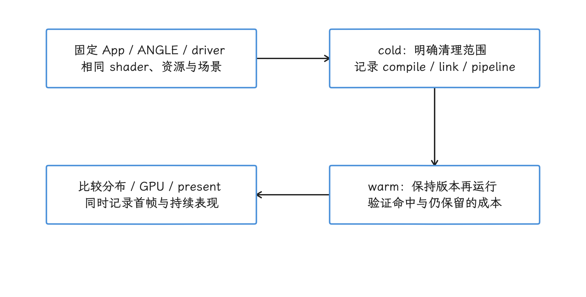

图：固定版本和场景，分别记录可控 cache 的清理范围与复用情况。 全新安装不保证驱动或系统 cache 全冷；平均 FPS 会漏掉首帧和切换抖动。

### Native fence 与 Vulkan 同步

EGL 侧的 fence 同步到了 ANGLE 里，要落成 Vulkan semaphore 和内核 fence 的组合；先看 GPU 侧的 server wait，再看 CPU 侧的 client wait。

#### server wait：把 sync fd 导入临时 semaphore

`EGL_ANDROID_native_fence_sync` 让 EGL/GLES 与 Android native fence 互操作。ANGLE 的 `SyncHelperNativeFence::serverWait()` 先检查 fence；已 signal 则直接返回，未完成时才为下一次 Vulkan submit 准备 binary semaphore，并导入一份 duplicated sync fd（复制出的文件描述符）。这里的 server wait 把依赖交给后续 GPU submit，当前 CPU 线程无须先等 fence 完成。

下面摘自 `serverWait()` 的核心路径，省略 semaphore 创建和结构初始化等前文；它是源码片段，不能独立编译。实际 `importFd()` 成功后才把 semaphore 加入后续 submit。

<!-- gracker-diagram: ch13-04-48-server-wait -->


图：未 signal 时导入 duplicated fd 并把 binary semaphore 加到后续 submit。 已 signal 会快速返回；server wait 不要求 CPU 先阻塞到依赖完成。

```cpp
importFdInfo.flags =
        VK_SEMAPHORE_IMPORT_TEMPORARY_BIT_KHR;
importFdInfo.handleType =
        VK_EXTERNAL_SEMAPHORE_HANDLE_TYPE_SYNC_FD_BIT_KHR;
importFdInfo.fd = dup(mExternalFence->getFenceFd());
ANGLE_VK_TRY(contextVk, waitSemaphore.get().importFd(device, importFdInfo));

contextVk->addWaitSemaphore(
        waitSemaphore.get().getHandle(),
        VK_PIPELINE_STAGE_ALL_COMMANDS_BIT);
contextVk->addGarbage(&waitSemaphore.get());
```

Vulkan **成功导入**后接管 duplicated fd，调用方不得继续操作它；导入失败不发生成功转移，需由相应错误清理路径处理。`mExternalFence` 的原 fd 仍由 ANGLE 管理。SYNC_FD 采用 temporary payload import，而非永久共享 semaphore；不能把 client wait 返回或 CPU 不阻塞理解为整个 GPU 依赖已经完成。

<!-- gracker-diagram: ch13-04-49-fd-ownership -->


图：ANGLE 保留原 fd，Vulkan 成功导入后接管用于导入的副本。 导入失败不发生成功所有权转移；错误清理须按实际路径处理。

#### client wait：调用线程仍在等待

`SyncHelperNativeFence::clientWait()` 会先检查 signal 和 timeout，必要时把等待放入 `UnlockedTailCall`。tail call 在释放 frontend 锁后、对应 EGL API 返回前执行，`SyncHelper::clientWait()` 对 GL sync 使用类似设计。这样可以避免等待期间一直持有 ANGLE 全局/display 锁，但调用线程本身仍然阻塞，等待不会自动转移到异步 GPU worker。

该等待使用 `poll()`，把纳秒 timeout 转换成毫秒，非零且小于 1 ms 的 timeout 会提升为 1 ms。这里描述的是 ANGLE 用户态的等待方式，fd 的底层同步语义仍由内核 sync_file/dma-fence 提供。

<!-- gracker-diagram: ch13-04-50-client-wait -->


图：未完成且 timeout 非零时，等待放入 API 返回前的 unlocked tail call。 解锁不等于异步 worker；非零小于 1 ms 的 timeout 在此实现提升为 1 ms。

`serverWait()` 本身没有 `ANGLE_TRACE_EVENT`，在 Perfetto 中搜索函数名通常找不到对应 slice，需要结合 Vulkan submit、调用栈采样和后续 GPU 执行确认；`clientWait` 与 `clientWait block (unlocked)` 则带有 `gpu.angle` event。

### 性能特征与 A/B 方法

同一款游戏换到 ANGLE，可能提速也可能掉帧；要判断属于哪种，先把成本和收益放进同一张表。

#### 成本与收益的对照

| 观察维度 | ANGLE 可能增加的工作 | ANGLE 可能带来的收益 |
|:---|:---|:---|
| CPU frontend | GLES validation、状态映射、命令编码 | 统一实现和一致的错误处理 |
| Shader/pipeline | GLSL ES → SPIR-V、pipeline 准备 | cache、并行编译和持续维护的 workaround（兼容修复） |
| GPU | 兼容 pass、格式转换、额外 barrier | 更合适的 Vulkan 驱动路径或驱动优化 |
| 同步/WSI | acquire、throttle、native-fence 转换 | 较统一的 present 与 fence 实现 |
| 兼容性 | 更严格暴露应用未定义行为 | 避开部分 vendor GLES 缺陷 |

ANGLE 变快还是变慢，我们从架构图上直接推不出来。CPU-bound（主要受 CPU 限制） 的 GLES 游戏可能受益于更成熟的 Vulkan 驱动，也可能被高频状态切换和 pipeline churn（反复创建切换 pipeline）拖慢。

GPU-bound 场景可能几乎不受 frontend 成本影响，也可能因为兼容 pass 或格式选择改变 GPU 工作量。

#### 公平对比的固定项

对比 native GLES 与 ANGLE 时，至少固定以下条件：

- 设备、系统 build、ANGLE package 和厂商驱动版本；
- 分辨率、刷新率、Game Mode、帧率上限和 thermal 状态；
- 相同场景，以及相同的 shader/texture cache 冷热状态；
- 前台窗口、Surface 尺寸、色彩空间和 swap interval；
- 运行时 backend 证据。

指标应包含 CPU frame time 分布、GPU stage、present-to-present 间隔、p95/p99 frame-time（注明 CPU 或 present 间隔的统计口径；若报告 1% low，另写清计算方法）、输入延迟、内存和持续温度。只测几十秒的平均 FPS，容易遗漏 pipeline warm-up 和热降频问题。

<!-- gracker-diagram: ch13-04-51-ab-controls -->


图：后端证据与设备、场景、缓存及热状态一起保存，再比较多项指标。 frame-time 与 present 间隔统计口径要注明，1% low 需要给出计算方法。

#### 常见优化顺序

1. 修正 GLES 未定义行为、shader 编译错误和扩展依赖；
2. 合并没有实际作用的细碎状态切换，减少 program/FBO/texture 反复切换；
3. 控制 shader variant 和 pipeline state 数量；
4. 使用应用与 EGL 提供的 cache 能力，并验证恢复是否命中；
5. 避免同步 readback（GPU 结果回读到 CPU）、无界 `glFinish()` 和过长 client wait；
6. 重新测量 swap、GPU 和 SurfaceFlinger 显示段，确认成本没有转移。

ANGLE 拒绝某段 GLSL ES 时，先检查 shader 是否符合目标 GLES 版本对 precision、layout、extension 和 link 的约束。依赖厂商驱动宽松行为的代码本身就不具备可移植性，这类问题别直接记到 ANGLE 头上。

<!-- gracker-diagram: ch13-04-52-optimize-order -->


图：先确认规范与扩展，再减少状态/pipeline churn 和不必要同步。 优化后重看 GPU、WSI 与显示端，不能只凭某个 CPU slice 变短验收。

### 启用检测与调试

选路配置只表达意图；进程里实际加载了什么，要靠运行时检查。

#### 确认 ANGLE 的三类证据

确认 ANGLE 时，我们应组合检查配置意图、进程实际加载和 API 字符串三类信息：

| 证据 | 能说明什么 | 局限 |
|:---|:---|:---|
| Settings / manifest / platform resource | 系统为何请求某个 driver | 请求可能失败或被更高优先级覆盖 |
| `/proc/<pid>/maps` 中的 ANGLE library | 目标进程实际装入 ANGLE 实现 | 非 debuggable 进程可能无权读取 |
| `GL_VENDOR`/`GL_RENDERER`、`EGL_VENDOR` | 当前 context/display 的实现标识 | 必须在正确的 context 和线程查询 |
| `gpu.angle` trace event | ANGLE Vulkan backend 正在执行对应代码 | category 未启用时看不到 |

下面是 NDK 片段：在有效 EGLContext current 的线程调用，链接 `EGL`、`GLESv2` 与 `log`；这里使用公开 NDK 日志 API。

```cpp
// 放在应用的诊断函数内；头文件放在文件顶部：
// #include <EGL/egl.h>
// #include <GLES2/gl2.h>
// #include <android/log.h>
const char* glVendor =
        reinterpret_cast<const char*>(glGetString(GL_VENDOR));
const char* glRenderer =
        reinterpret_cast<const char*>(glGetString(GL_RENDERER));
const char* eglVendor = eglQueryString(eglGetCurrentDisplay(), EGL_VENDOR);

__android_log_print(ANDROID_LOG_INFO, "BackendCheck",
                    "GL_VENDOR=%s", glVendor ? glVendor : "<null>");
__android_log_print(ANDROID_LOG_INFO, "BackendCheck",
                    "GL_RENDERER=%s", glRenderer ? glRenderer : "<null>");
__android_log_print(ANDROID_LOG_INFO, "BackendCheck",
                    "EGL_VENDOR=%s", eglVendor ? eglVendor : "<null>");
```

ANGLE renderer 字符串通常包含 `ANGLE`、vendor、GPU 和 Vulkan 版本信息，但格式不是稳定 ABI，不要依赖固定的逗号位置解析；用于遥测时，应保存原始字符串和系统 build。

<!-- gracker-diagram: ch13-04-53-detect-context -->


图：字符串在正确 current context 查询，maps 只证明库装入进程。 字符串格式不是稳定 ABI；未匹配 maps 也可能是权限、PID 或命名问题。

debuggable 应用可以用下面的命令检查映射。`run-as` 失败时不要通过放宽系统安全策略来做日常验证。

```bash
pid=$(adb shell pidof -s com.example.game | tr -d '\r')
case "$pid" in
    ''|*[!0-9]*) printf '%s\n' '目标进程未运行或 PID 无效' >&2; exit 1 ;;
esac
adb shell run-as com.example.game cat "/proc/$pid/maps" \
    | grep -E 'lib(EGL|GLES).*angle'
```

上述 `grep` 在主机执行；无匹配只能说明这次未找到对应库名，不能独立证明 native（也可能是权限、进程选择或命名问题）。`angle_debug_package` 只对允许加载调试 package 的进程生效，修改后仍要重启目标进程，并核对 ABI、system app/debug app 身份和实际 maps。

#### 回归范围

ANGLE 与 native GLES 都要覆盖：

- GLES 版本和扩展查询；
- external image、camera/video texture；
- protected content 和 wide color/HDR；
- context loss、后台恢复和 Surface 重建；
- shader cache 升级与 driver 更新；
- RenderDoc/AGI 等调试工具注入；
- 32/64 位 ABI 和 Android 15+ 的 16 KB page-size 设备。

厂商私有 `GL_*` 扩展在 ANGLE 下的可用性没有保证，应用应在运行时查询，并为扩展缺失准备符合规范的替代路径。

<!-- gracker-diagram: ch13-04-54-regression -->


图：从渲染能力、生命周期和发布环境三方面覆盖两条后端。 扩展必须运行时查询；16 KB 支持与驱动选择是独立的验证项。

### 在 Perfetto 中识别 ANGLE

#### backend 判定与 slice 解释

我们在 Perfetto 里单独看到 `vkQueueSubmit` 或 Vulkan GPU stage，还确认不了 GLES 正在通过 ANGLE 运行：原生 Vulkan、HWUI Vulkan 和其他库也会产生 Vulkan 工作。Perfetto 的结论应同时具备：

1. 目标进程的 GL/EGL 字符串或已加载 library；
2. `gpu.angle` category 中的 ANGLE event；
3. 同一进程的 Vulkan submit / GPU stage；
4. 对应 App Surface 的 BufferQueue、FrameTimeline 和 Display present。

较有辨识度的 event 包括：

| Event | 说明 | 误读风险 |
|:---|:---|:---|
| `ContextVk::flushAndSubmitCommands` | ANGLE 正在准备或提交 Vulkan 工作 | 无法证明 GPU 已经完成 |
| `CommandQueue::submitCommands`/`queueSubmitLocked` | command queue 提交阶段 | 需要结合线程状态和驱动调用 |
| `WindowSurfaceVk::swapImpl` | EGL swap 的 Vulkan backend 实现 | 范围可能包含 acquire、submit 和 pacing |
| `WindowSurfaceVk::present` | ANGLE 组织 present | 无法证明 Display 已经显示该帧 |
| `acquireNextSwapchainImage` | 取得下一张 swapchain image | 长等待可能是 backpressure / pacing |
| `WindowSurfaceVk::throttleCPU` | ANGLE 主动限制 CPU 超前 | 不能直接标成无效卡顿 |
| `SyncHelperNativeFence::clientWait block (unlocked)` | 调用线程在无 frontend 锁状态等待 | 不是异步 GPU worker |
| `CreateMonolithicPipelineTask`、`ProgramExecutableVk::warmUpGraphicsPipelineCache` | pipeline 创建或预热 | 要区分 cold/warm；任务可能在工作线程 |

具体 event 取决于 build、ANGLE revision 和 trace category。trace 里找不到某个名称时，回到调用栈、API marker 和 buffer 时间；缺 slice 只说明没有采集到该事件，代码有没有执行要另行判断。

<!-- gracker-diagram: ch13-04-55-trace-events -->


图：submit、present 与 throttle 分别说明 CPU 正执行哪一类代码。 slice 有无受 revision/category/build 影响，名称本身不证明 GPU 或显示完成。

#### 用 SQL 限定目标进程

下面的 Perfetto SQL 只列出目标进程中常见 ANGLE Vulkan event，适合确认耗时集中在哪一类操作。

```sql
SELECT
  p.name AS process,
  t.name AS thread,
  s.name,
  ROUND(s.dur / 1e6, 3) AS dur_ms
FROM slice s
JOIN thread_track tt ON s.track_id = tt.id
JOIN thread t ON tt.utid = t.utid
JOIN process p ON t.upid = p.upid
WHERE p.name = 'com.example.game'
  AND s.dur >= 0  -- 排除未闭合 slice（dur = -1）
  AND (
    s.name GLOB 'WindowSurfaceVk::*'
    OR s.name GLOB 'ContextVk::*'
    OR s.name GLOB 'CommandQueue::*'
    OR s.name GLOB 'SyncHelperNativeFence::*'
    OR s.name GLOB 'SyncHelper::*'
    OR s.name GLOB 'ProgramExecutableVk::*'
    OR s.name IN ('acquireNextSwapchainImage', 'CreateMonolithicPipelineTask')
  )
ORDER BY s.ts;
```

查询结果是目标进程线程轨上的完整 CPU event **墙钟时长**，包含被抢占和等待，不等于 CPU busy time；嵌套 slice 也不能直接求和。同名进程可能有多次生命周期，正式统计应再限定 `p.upid`/时间窗；名称筛选只产生候选，仍需库/当前 context 与 category 佐证。GPU 繁忙另看 GPU render stage/counter，buffer 显示另看 SF/layer 与 Display present；SurfaceView 的 FrameTimeline 支持限制仍适用。

<!-- gracker-diagram: ch13-04-56-sql-scope -->


图：进程线程轨加源码名称筛选得到候选完整事件，时长为墙钟时间。 排除 dur=-1；正式统计限定 upid/时间窗，嵌套 slice 不可直接相加。

#### 按等待位置归因

| 长段位置 | 优先核对 | 可能的根因 |
|:---|:---|:---|
| shader link/pipeline task | cold/warm、variant、驱动 compiler | shader 或 pipeline churn |
| `syncState` 附近 | 之前积累的 dirty state | 高频 state/FBO/resource 变化 |
| `clientWait block (unlocked)` | 谁创建 fence、timeout、CPU thread state | 显式同步或 readback |
| acquire/throttle | queue depth、release fence、swap interval | CPU 超前、Display backpressure |
| queue submit 后 GPU stage 长 | GPU counter、频率、thermal | shader、带宽、overdraw 或降频 |
| ANGLE present 正常，FrameTimeline 晚 | SF latch、composition、HWC present | 显示端或 acquire fence |

一帧可按“App GLES → ANGLE state/command → Vulkan submit → WSI queue/transaction → SF 采纳 → 合成/Display present”追踪提交路径；GPU 执行与这条 CPU 路径异步，acquire fence 在真正读取前约束依赖，不能固定画成 GPU completion 之后才 WSI queue。HWC 快 present 与 validated/可选 CLIENT 是不同分支，release 还要对应旧 buffer。依据不足的阶段保留为待验证。

<!-- gracker-diagram: ch13-04-57-wait-attribution -->


图：编译、显式同步与背压分别对应不同证据和修复方向。 显示后段仍须遵守异步 acquire 与旧 buffer release，不能按时间接近直接认定因果。

### Android 10—17 的版本边界

最后把各版本的差异收拢一下；分析旧设备时，别拿新版本的行为倒推。

#### Android 10—14

早期 Android 已具备 ANGLE 集成和包级调试选择能力，但 system image、ANGLE build、device policy 和 OEM 支持差异较大。平台源码里有这个开关，说明系统具备该机制；零售设备是否把 ANGLE 当作常规受支持的 GLES 驱动，还要逐机型确认。

#### Android 15

Android 官方把 ANGLE 描述为 Android 15+ 可选的 GLES-over-Vulkan 层，并提供开发者选项与包级 ADB 测试方式。这是当前做兼容性和性能 A/B 的公开基线；是否默认用上 ANGLE，仍由各设备的选路决定。

#### Android 16

`GraphicsEnvironment` 注释明确把 `config_angleAllowList` 作为 Android 16 起的平台包名单。Android 17 源码还包含由 flag 控制的 denylist 和 game 默认策略；分析 Android 16 设备时要阅读对应 tag，别把 Android 17 分支倒推到旧 build。

#### Android 17

Android 17 增加 manifest 请求 `com.android.graphics.driver.prefer_angle`。平台仍保留显式 Settings、platform resource、system property、ANGLE package 和 system ANGLE 多层选择；最终要通过运行时字符串和进程 maps 确认实际结果。

厂商 Vulkan userspace 与 GPU 内核驱动不在 AOSP 通用源码中，设备上的结论还要记录 vendor build 才可复现。

<!-- gracker-diagram: ch13-04-58-history-evidence -->


图：历史 tag 验证机制的存在，目标设备证据验证是否可用或启用。 Android 10/15/16/17 的源码与公开支持边界各自核对，不能从当前分支倒推。

### Android 17 源码索引

- [Android 官方 Vulkan / ANGLE 说明](https://developer.android.com/games/develop/vulkan/overview)：Android 15+ 可选 ANGLE、包级 ADB 测试和 Android 17 manifest 请求。
- [`GraphicsEnvironment.java`](https://android.googlesource.com/platform/frameworks/base/+/android-17.0.0_r1/core/java/android/os/GraphicsEnvironment.java)：包级选择、platform resource、manifest 偏好和 APK/system 设置。
- [`Loader.cpp`](https://android.googlesource.com/platform/frameworks/native/+/android-17.0.0_r1/opengl/libs/EGL/Loader.cpp)：system driver、ANGLE namespace 和 updatable driver 各自从哪里加载。
- [`AndroidManifest.xml`](https://android.googlesource.com/platform/external/angle/+/android-17.0.0_r1/android/AndroidManifest.xml)：AOSP ANGLE system package 和 intent action。
- [`CompilerVk.cpp`](https://android.googlesource.com/platform/external/angle/+/android-17.0.0_r1/src/libANGLE/renderer/vulkan/CompilerVk.cpp) 与 [`TranslatorSPIRV.cpp`](https://android.googlesource.com/platform/external/angle/+/android-17.0.0_r1/src/compiler/translator/spirv/TranslatorSPIRV.cpp)：Vulkan backend 的 SPIR-V 输出。
- [`ContextVk.cpp`](https://android.googlesource.com/platform/external/angle/+/android-17.0.0_r1/src/libANGLE/renderer/vulkan/ContextVk.cpp)：dirty-state 同步、draw 和 command submit。
- [`WindowSurfaceVkAndroid.cpp`](https://android.googlesource.com/platform/external/angle/+/android-17.0.0_r1/src/libANGLE/renderer/vulkan/android/WindowSurfaceVkAndroid.cpp) 与 [`SurfaceVk.cpp`](https://android.googlesource.com/platform/external/angle/+/android-17.0.0_r1/src/libANGLE/renderer/vulkan/SurfaceVk.cpp)：Android `VkSurfaceKHR`、swapchain acquire 和 present。
- [`ProgramExecutableVk.cpp`](https://android.googlesource.com/platform/external/angle/+/android-17.0.0_r1/src/libANGLE/renderer/vulkan/ProgramExecutableVk.cpp)：pipeline cache 初始化、warm-up、合并与序列化。
- [`SyncVk.cpp`](https://android.googlesource.com/platform/external/angle/+/android-17.0.0_r1/src/libANGLE/renderer/vulkan/SyncVk.cpp)：native fence、client wait 和 server wait。
- 内核 [`sync_file.c`](https://android.googlesource.com/kernel/common/+/refs/tags/android17-6.18-2026-06_r6/drivers/dma-buf/sync_file.c) 与 [`dma-fence.c`](https://android.googlesource.com/kernel/common/+/refs/tags/android17-6.18-2026-06_r6/drivers/dma-buf/dma-fence.c)：sync fd、signal、callback 和 wait。

## 小结

原生 GLES 与 ANGLE 共享 EGL/ANativeWindow → BufferQueue → SurfaceFlinger/HWC 的显示后半段，差异集中在图形前端和驱动实现：前者进入厂商 GLES，后者把 GLES 状态与 shader 翻译成 Vulkan 工作。`eglSwapBuffers()` 或 `vkQueuePresentKHR()` 的返回，都推不出“GPU 已完成、画面已经上屏”。

诊断时，我们沿应用调用、厂商驱动或 ANGLE 状态处理、GPU submit/fence、队列、latch 与 display present 逐段对齐。归因给 ANGLE 之前先把实际 backend 确认下来，单凭某个 Vulkan slice 不足以下结论。

相关章节：

- [13.5 Vulkan 原生管线与 HWUI 多队列](05-vulkan-hwui-multi-queue.md)
- [13.6 SurfaceControl 与 HardwareBufferRenderer](06-surfacecontrol-hardwarebuffer-renderer.md)
- [13.12 Android 17 游戏引擎渲染链路](12-game-engine.md)
- [2.7 GPU 渲染与图形 API 选型](../../part1-fundamentals/ch02-rendering/07-gpu-rendering-graphics-api.md)
