# Vulkan 原生管线与 HWUI 多队列

Vulkan 把资源、命令和同步的管理责任交给应用，但 Android 的显示后半段仍然存在。App 要通过 `VK_KHR_android_surface` 把代表显示目标的 `VkSurfaceKHR` 连接到 `ANativeWindow`；swapchain image（循环用于渲染和显示的图像） 仍映射到 Android GraphicBuffer/BufferQueue，提交之后还要经过 SurfaceFlinger、HWC 和 Display present。

> 源码基线：AOSP `android-17.0.0_r1` 的 Android WSI（窗口系统集成层）与 SurfaceFlinger/RenderEngine；内核 `android17-6.18-2026-06_r6` 的 dma-buf/dma-fence。Vulkan 驱动和 GPU job scheduler 由设备厂商实现，AOSP 只能说明接口与所有权；GPU 工作何时完成，要在目标设备上确认。

Vulkan 应用自行管理实例、设备、交换链、命令缓冲区和同步；HWUI 的 Vulkan 后端则由 framework 组织这些对象。多队列优化改变的是提交并行度，最终 buffer 和 fence 的交接方式没有变。我们先看原生 Vulkan 这条路径，再看 HWUI 内部的多队列，两条线最后都收束到 BufferQueue、SurfaceFlinger 与 present。

## 交换链、命令提交与呈现

我们先从应用为什么选择 Vulkan 讲起，再沿 acquire、record/submit、present 把一帧走完；同步对象、present mode、pacing 和 trace 归因放在后面几节。

### 为什么选择 Vulkan

#### 显式控制带来的价值

OpenGL ES 把较多状态验证、资源转换和同步决策放在驱动中；Vulkan 则要求应用预先描述 pipeline（固定功能与着色器状态组合）、descriptor（着色器访问资源的绑定）、resource usage、command buffer 和执行依赖。pipeline 是固定功能与着色器状态的组合，descriptor 描述着色器如何绑定资源。组织得当时，Vulkan 可以：

- 降低高 draw-call 场景中的 CPU 驱动开销；
- 把 shader/pipeline 创建从关键帧移到加载或缓存阶段；
- 用多个 command pool（命令缓冲分配池）并行准备命令；
- 精确表达执行依赖、内存可见性和 image layout（图像当前用途对应的状态）；
- 让帧内 GPU 工作和错误更容易通过 Validation Layer/AGI（Android GPU Inspector）定位。

这些能力要兑换成性能收益，前提是引擎把它们用好。引擎如果频繁创建 pipeline、把提交切得过碎、设置过度保守的 barrier，或者积压太多 in-flight frame（已提交但尚未完成显示的帧），Vulkan 同样会产生较高 CPU 开销、GPU bubble（依赖导致的硬件空闲间隙）和输入延迟。我们比较 GLES 与 Vulkan 时，要保持内容、分辨率、pacing 和设备温度一致。

<!-- gracker-diagram: ch13-05-02-explicit-value -->
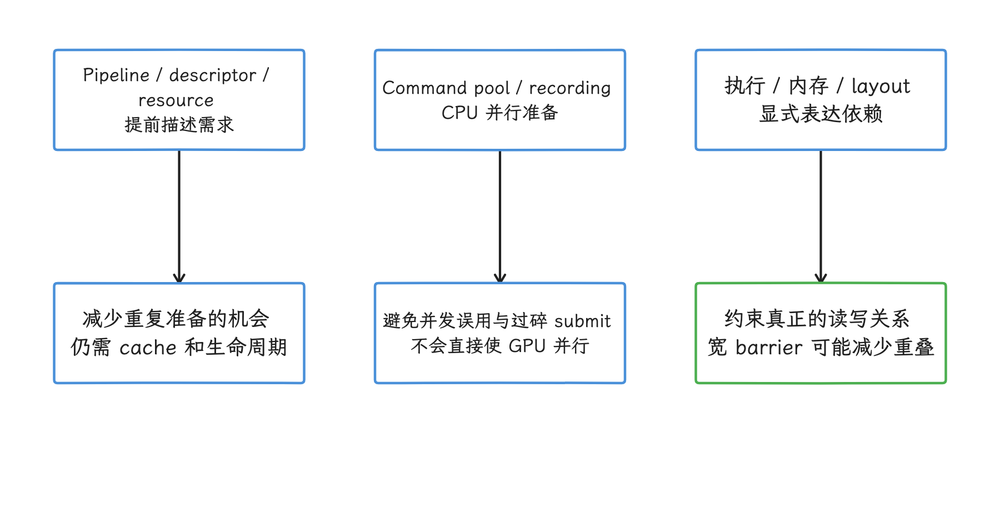

图：资源与提交组织得当才可能降低成本，过碎提交和过度依赖也会引入开销。 相同内容、分辨率、pacing 和热状态下测量，API 名称本身不提供性能结论。

#### 应用侧的责任

| 领域 | 应用需要管理的内容 |
|---|---|
| 资源 | 内存 allocation/binding、生命周期、aliasing（内存复用）和预算 |
| 命令 | command pool/buffer、record/reset 和 queue submit |
| 同步 | semaphore、fence、stage/access mask 和 queue ownership |
| 图像 | format、usage、layout、subresource（图像的 mip/layer 子范围）和 compression |
| 窗口 | surface capabilities、swapchain、resize、rotation、present mode |
| 节奏 | 输入采样、目标 present、in-flight 数量和刷新率提示 |
| 恢复 | `OUT_OF_DATE`、`SUBOPTIMAL`、surface lost、device lost |

Validation Layer 能发现许多 API、同步和对象生命周期误用；性能是否达标、跨帧业务所有权是否正确，还要靠 Release 构建上的 trace、GPU counter、内存预算和长时间温度测试来验证。

<!-- gracker-diagram: ch13-05-03-app-responsibility -->
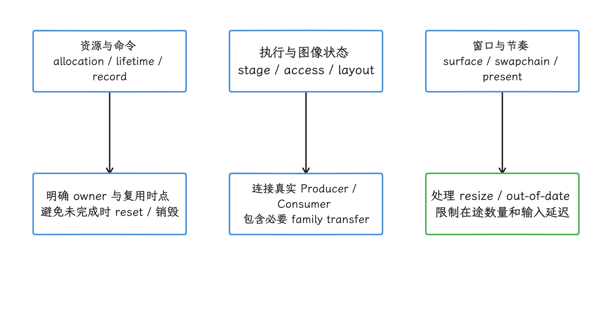

图：资源命令、同步状态与窗口节奏分别管理，再用工具检查。 Validation 覆盖 API 误用，不能代替 Release 性能与业务生命周期验证。

#### Vulkan 与承载结构是两个维度

Vulkan 描述 Producer（buffer 生产方） 如何生成内容。它可以绘制到 SurfaceView/GameActivity/NativeActivity 提供的独立 Surface，也可以写入 TextureView 的输入 Surface 或离屏 `AHardwareBuffer`（可跨系统组件共享的图形缓冲区）。SurfaceFlinger 能否看到独立 layer，取决于目标 `ANativeWindow` 连接到哪个 Consumer（buffer 消费方）；API 名本身给不出这个答案。

常见游戏页面会同时包含 Vulkan 主体 Surface、宿主 HWUI、系统栏和弹窗。如果引擎 HUD（抬头显示界面） 已经画入同一个 swapchain image，SurfaceFlinger 看到的仍只有一个主体 buffer layer；画面里出现按钮，同样推不出额外的 SF layer。

<!-- gracker-diagram: ch13-05-04-target-topology -->
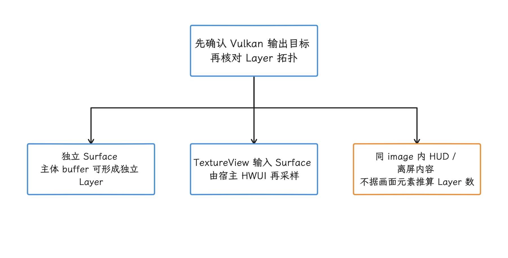

图：同一 swapchain 中的 HUD 不自动成为独立 SF layer。 目标 native window 的 Consumer 决定拓扑，离屏内容未必直接显示。

### Android Vulkan Profile (AVP)

Vulkan Profile 是一组可以由工具检查的 extension、feature、property、format 和 limit，工程可以用它表达所需的能力集合。至于具体设备的 GPU 能力，仍要在运行时查询里确认：安装同一 Android 版本的设备，GPU 能力也未必相同。

#### 兼容性 profile 与要求 profile

这里要区分两类 profile：面向存量设备的兼容性 profile，和面向新芯片的要求 profile。

- `VP_ANDROID_vulkan_profile_2025`：Android Vulkan Profile 2025，面向广泛的现役设备能力，延续原 Android Baseline Profile 的兼容性用途。
- `VP_ANDROID_17_requirements`：由 `android-17.0.0_r1` 中 `vulkan/vkprofiles/profiles/VP_ANDROID_17_requirements.json` 定义，也称 VRA17；其 label 为 “Vulkan Minimum Requirements for Android 17”，面向随 Android 17 发布或续期 Google Requirements Freeze 的芯片。

`VP_ANDROID_17_requirements` 的 `api-version` 是 Vulkan 1.4.335，并以 `VP_ANDROID_vulkan_profile_2025` 为父 profile。它包含 `VK_KHR_present_id2`、`VK_KHR_present_wait2`、`VK_EXT_present_timing` 和 `VK_EXT_present_mode_fifo_latest_ready` 等要求。该文件约束的是相应的新芯片档位；升级到 Android 17 的旧设备支持多少，仍以运行时查询结果为准。

<!-- gracker-diagram: ch13-05-05-profiles -->
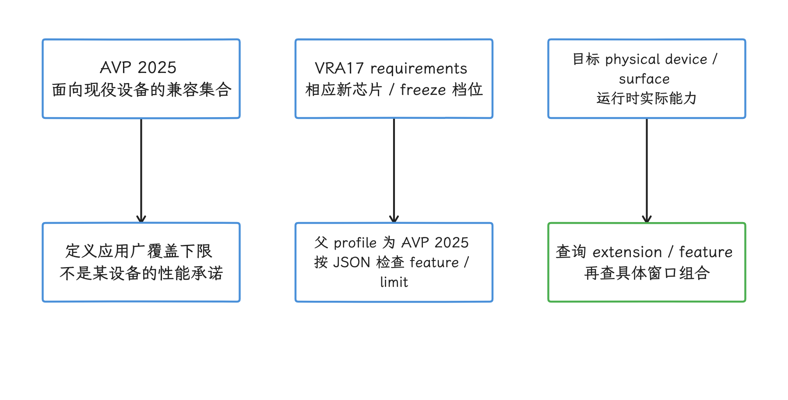

图：兼容性能力集合、指定芯片要求和现场能力查询各有作用。 VRA17 的 Vulkan 1.4.335 要求不意味着所有升级到 Android 17 的旧设备均支持。

#### 工程使用方式

建议把能力分三层：

1. 用目标市场的兼容性 profile 定义广覆盖的能力下限；
2. 对 Android 17 新芯片档位检查 `VP_ANDROID_17_requirements`；
3. 继续在运行时查询应用必需的 extension/feature/format/limit，并为缺失能力设计 fallback（降级路径） 或明确拒绝启动。

Profile 检查通过，说明的只是能力集合这一层；具体某个 surface、format、present mode 或 protected 路径可用与否，属于物理设备与 `VkSurfaceKHR` 的组合，仍要调用 surface capability/format/present-mode query 获取运行时结果。

<!-- gracker-diagram: ch13-05-06-capability-gates -->
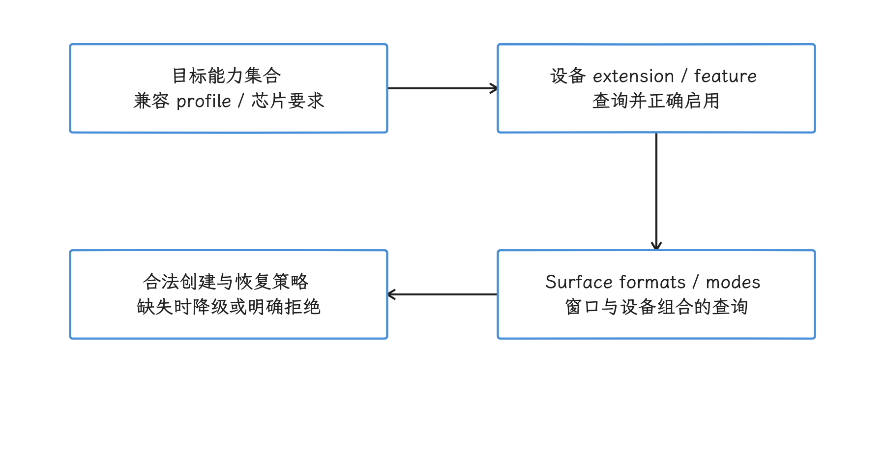

图：集合符合、feature 启用和特定 surface 支持需要分别确认。 进入 core 不代表带独立 feature bit 的能力自动启用。

#### Dynamic Rendering（无须预先创建 RenderPass/Framebuffer 的渲染方式） 例子

某项功能进入 Vulkan core version 后，还要应用在创建设备时显式启用。以 Dynamic Rendering 为例，它免去预先创建 RenderPass/Framebuffer 的步骤，但应用仍要通过 `VkPhysicalDeviceVulkan13Features` 或对应 extension feature 查询 `dynamicRendering`，并在 device creation feature chain 中显式打开。Profile JSON 是否要求该 bit，以实际文件为准；API version 单独给不出这个答案。

### 渲染流程详解

#### 创建 surface 与 swapchain

进入帧循环前，应用至少要完成以下初始化：

<!-- gracker-diagram: ch13-05-07-swapchain-init -->
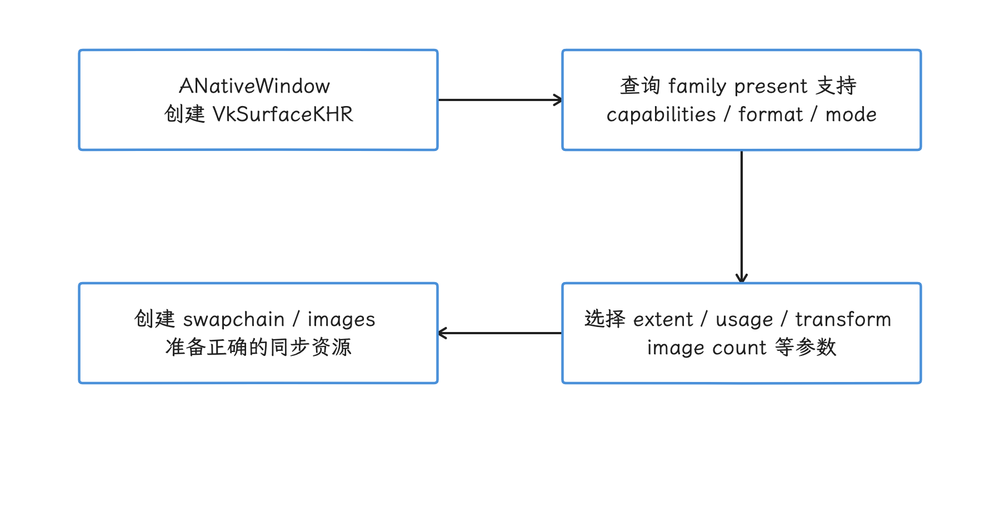

图：先查 present 支持和窗口能力，再决定合法交换链参数。 queue family 是接口能力分组；image 数应创建后再查，不能预设固定双/三缓冲。

1. 用 `VK_KHR_android_surface` 从 `ANativeWindow` 创建 `VkSurfaceKHR`；
2. 查询 queue family（具有相同能力的一组硬件队列）是否支持向该 surface present；
3. 查询 surface capabilities、formats 和 present modes；
4. 选择 extent（图像尺寸）、format/colorspace、usage、preTransform、compositeAlpha 和 image count；
5. 创建 swapchain 并取得 images；
6. 为每个 in-flight frame 准备 command buffer、acquire semaphore、render-finished semaphore 和供 CPU 查询完成状态的 fence。

`minImageCount` 只能在 `minImageCount..maxImageCount` 范围内选择；`maxImageCount == 0` 表示规范未给出显式上限，实际数量仍由实现决定。Android WSI（Window System Integration，Vulkan 与窗口系统的连接层） 还受 native window 的 min-undequeued/max-buffer-count 约束，swapchain 具体几个 buffer，要按设备和 surface 的实际约束来定，双缓冲、三缓冲这类固定说法套不上。

<!-- gracker-diagram: ch13-05-08-resource-indices -->
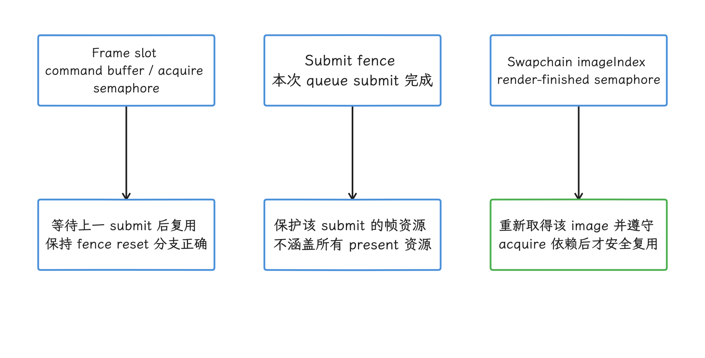

图：submit 资源按 frame slot 复用，present 等待信号量需要自己的安全复用证明。 submit fence 不证明 present 已消费 semaphore；按 imageIndex 配置是通用方案之一。

#### 第一阶段：Acquire

典型调用通过 semaphore 或 fence 接收 image 可用信号：

```c
VkResult result = vkAcquireNextImageKHR(
    device,
    swapchain,
    timeoutNs,
    imageAvailableSemaphore,
    VK_NULL_HANDLE,
    &imageIndex
);
```

这段调用只负责取得一块可用于后续渲染和 present 的 image。`timeoutNs == 0` 时可能返回 `VK_NOT_READY`，使用有限 timeout 时可能返回 `VK_TIMEOUT`；窗口变化还可能导致 `VK_ERROR_OUT_OF_DATE_KHR`。

普通 swapchain 的 `AcquireNextImageKHR()` 在 WSI 内部会：

1. 把 Vulkan timeout 映射为 native window 的 dequeue timeout；
2. 调用 `ANativeWindow::dequeueBuffer()`，取得 buffer 和 dequeue fence fd；
3. 找到或绑定对应 swapchain image；
4. 把 fence fd 的副本交给驱动私有入口 `AcquireImageANDROID()`；
5. 由驱动把该依赖连接到应用提供的 semaphore/fence。

`AcquireImageANDROID()` 是 Android loader 与驱动之间的集成钩子，调用发生在 loader 与驱动之间；这条 fd 也由 loader 负责导入，应用手工再 import 一遍，得到的只是一份重复的同步关系。

Acquire 耗时较长，可能因为没有可用 image、native window release 较慢、FIFO 节拍限制、surface 正在重新配置，或者驱动内部处理。dequeue fence 来自该 buffer 的前序 Consumer 完成依赖，但 `vkAcquireNextImageKHR()` 的 wall time 里还叠着其他因素。我们观察时把两件事分开：dequeue 调用本身是否阻塞，以及返回后 fence/GPU 依赖何时满足。

<!-- gracker-diagram: ch13-05-09-acquire-result -->
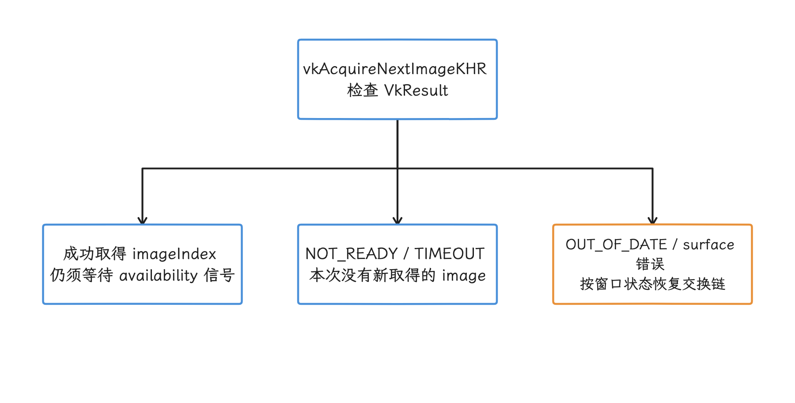

图：先判断返回码，成功索引也不等于旧使用已完成。 后续访问必须遵守 acquire semaphore/fence，失败时不得使用本次未取得的索引。

<!-- gracker-diagram: ch13-05-10-wsi-acquire -->
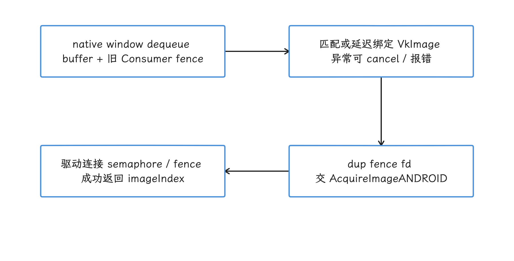

图：WSI 从 native window 取得 buffer/fence，再由私有驱动入口连接同步对象。 dup 失败可走 CPU sync_wait；驱动私有导入不是应用重复 import 的接口。

<!-- gracker-diagram: ch13-05-11-acquire-waits -->
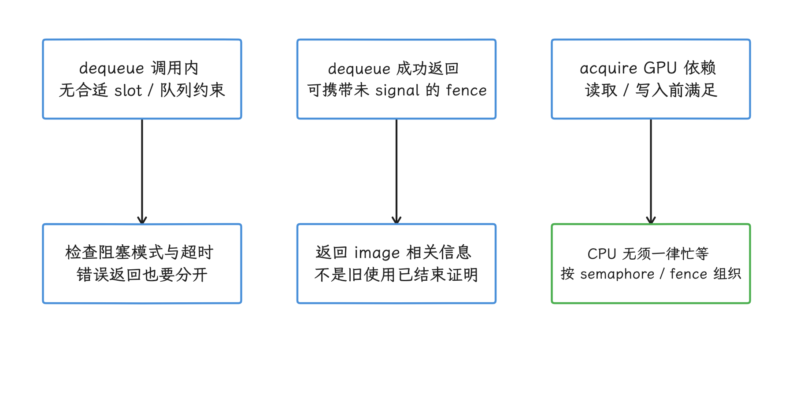

图：CPU 取得候选与后续安全访问是不同阶段。 长 acquire 还可能包含窗口重配置、驱动工作或队列约束，不能只归因旧 fence。

#### 第二阶段：Record 与 Submit

Command Buffer recording 是 host 侧的 CPU 工作，只负责记录命令和对象引用，此时 GPU 还没有执行这些命令。并行录制时要遵守 Vulkan 的 external synchronization（由应用负责的线程同步）规则：

- 每个 worker 线程使用独立的 `VkCommandPool`；
- 同一 `VkCommandBuffer` 的 begin/record/end/reset 不得并发；
- 同一 `VkQueue`（向设备提交命令批次的接口）的 host access 需要由应用串行保护；
- descriptor pool、query pool 和其他标记为 externally synchronized 的对象也要按规范加锁或分离所有权。

下面的 synchronization2 骨架等待 acquired image，并在渲染完成后 signal present semaphore：

```c
VkSemaphoreSubmitInfo acquireWait = {
    .sType = VK_STRUCTURE_TYPE_SEMAPHORE_SUBMIT_INFO,
    .semaphore = imageAvailableSemaphore,
    .stageMask = VK_PIPELINE_STAGE_2_COLOR_ATTACHMENT_OUTPUT_BIT,
};

VkCommandBufferSubmitInfo commandInfo = {
    .sType = VK_STRUCTURE_TYPE_COMMAND_BUFFER_SUBMIT_INFO,
    .commandBuffer = commandBuffer,
};

VkSemaphoreSubmitInfo renderSignal = {
    .sType = VK_STRUCTURE_TYPE_SEMAPHORE_SUBMIT_INFO,
    .semaphore = renderFinishedSemaphore,
    .stageMask = VK_PIPELINE_STAGE_2_ALL_COMMANDS_BIT,
};

VkSubmitInfo2 submit = {
    .sType = VK_STRUCTURE_TYPE_SUBMIT_INFO_2,
    .waitSemaphoreInfoCount = 1,
    .pWaitSemaphoreInfos = &acquireWait,
    .commandBufferInfoCount = 1,
    .pCommandBufferInfos = &commandInfo,
    .signalSemaphoreInfoCount = 1,
    .pSignalSemaphoreInfos = &renderSignal,
};

vkQueueSubmit2(graphicsQueue, 1, &submit, frameFence);
```

这段代码只展示依赖关系，还称不上完整的 renderer。`frameFence` 让 CPU 判断本次 submit 何时完成，以便安全复用这一帧的 command/descriptor 资源；`renderFinishedSemaphore` 则让 present engine 等待 GPU 渲染完成。前者连接 GPU 与 CPU，后者连接 GPU 工作与 present。

<!-- gracker-diagram: ch13-05-12-host-threading -->
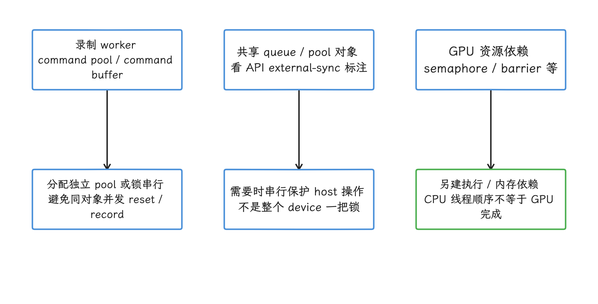

图：并行录制采用独立 pool 或外部锁，队列和对象按各 API 同步要求访问。 内部同步 queue 扩展是条件例外；本文 HWUI queue flags=0，且 host 同步不代替 GPU 依赖。

<!-- gracker-diagram: ch13-05-13-submit-present -->
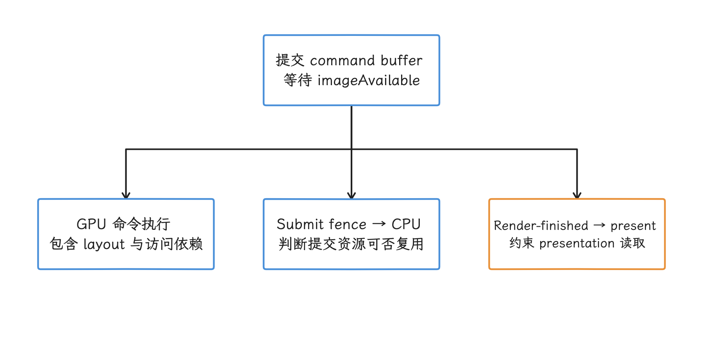

图：同一次 submit 的 fence 与 render-finished semaphore 服务不同消费者。 frame fence signal 不代表 presentation 已完成；失败 submit 不能继续假定 fence 会 signal。

#### 第三阶段：Present

Present 把 image index 和需要等待的 semaphore 交给 presentation engine（负责把 swapchain image 送入窗口系统的实现），由它把 swapchain image 送入窗口系统：

```c
VkPresentInfoKHR present = {
    .sType = VK_STRUCTURE_TYPE_PRESENT_INFO_KHR,
    .waitSemaphoreCount = 1,
    .pWaitSemaphores = &renderFinishedSemaphore,
    .swapchainCount = 1,
    .pSwapchains = &swapchain,
    .pImageIndices = &imageIndex,
};

VkResult presentResult = vkQueuePresentKHR(presentQueue, &present);
```

`PresentOneSwapchain()` 会调用驱动的 `QueueSignalReleaseImageANDROID()`，把 present waits 转换为 producer completion fence；随后设置 damage/timing 等 native window 状态，并由 CPU 调用 `queueBuffer(buffer, fence)`。`queueBuffer()` 接管 fence fd 的所有权，SurfaceFlinger/BLAST 再把它作为 buffer acquire dependency，等待 Producer 完成写入。

<!-- gracker-diagram: ch13-05-14-present-handoff -->
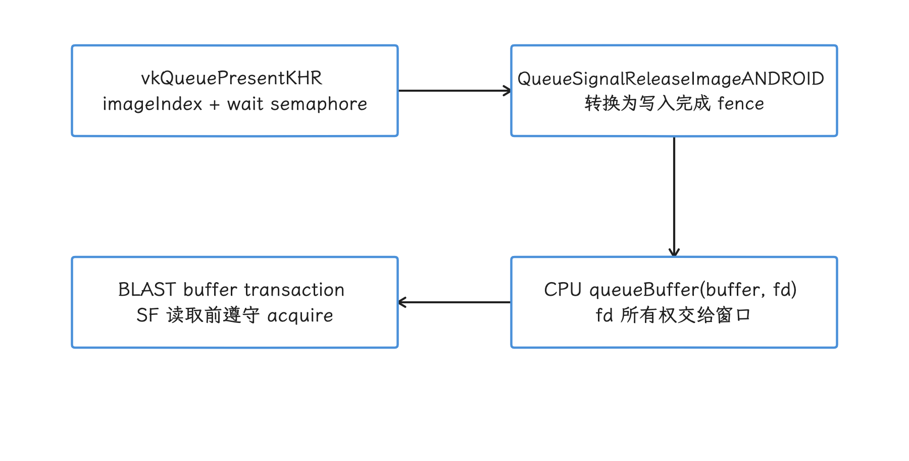

图：私有驱动入口导出 Producer 完成 fence，再由 CPU queueBuffer 交出窗口内容。 fence 可未 signal；queueBuffer 接管 fd 不代表 GPU 完成或显示已经发生。

`vkQueuePresentKHR()` 返回时，用户通常还没有看到画面。应用仍需处理 `VK_ERROR_OUT_OF_DATE_KHR`、`VK_SUBOPTIMAL_KHR` 和 surface lost；显示时序还要继续追踪 SF latch、HWC validate/present 和 Display fence。Android WSI 当前只在 window transform/rotation 变化时返回 `VK_SUBOPTIMAL_KHR`；其余 extent 变化是否触发该返回值，以实际返回码为准。

<!-- gracker-diagram: ch13-05-15-window-recovery -->
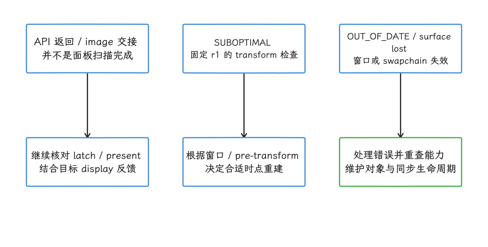

图：先处理实际返回码和窗口变化，再追踪显示端。 固定 r1 的 SUBOPTIMAL 检查来自 transform hint；extent 变化不产生该 SUBOPTIMAL 分支。

#### 完整时序

下面的图按 CPU API、GPU 依赖和 Android queue 三条线描述一帧：

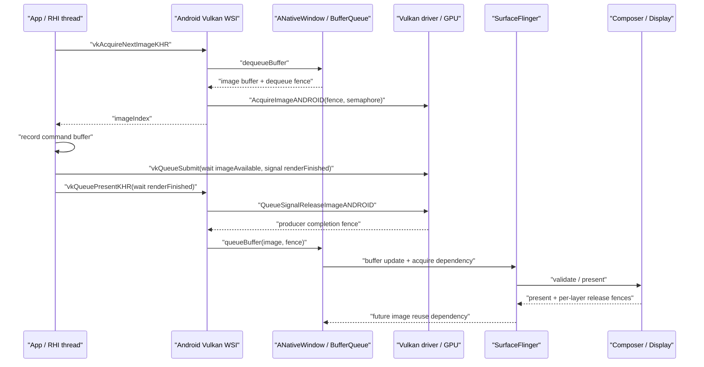

图中 WSI 调用驱动取得 fence 后，再由 CPU 调用 `queueBuffer()`。GPU 通过 semaphore/fence 表达完成依赖，CPU 负责发起 API 调用和转移 fd 所有权；`queueBuffer()` 不是 GPU 自行执行的操作。

<!-- gracker-diagram: ch13-05-16-async-wsi -->
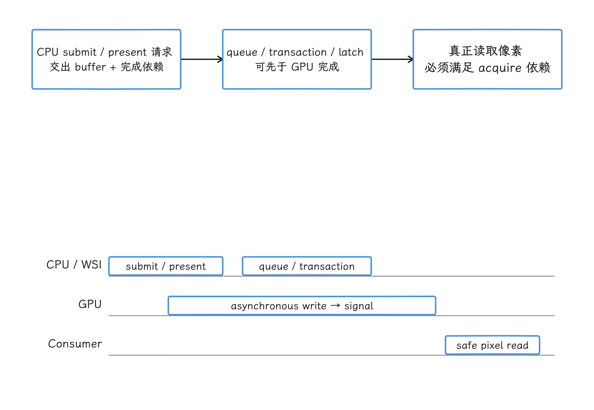

图：queue 是 CPU 交接，GPU 完成依赖在真正读取前满足。 轨道只示意合法依赖，latch-unsignaled 受策略限制，不表示实测条长或固定时间点。

### Pipeline Barrier 与 Image Layout

#### 三种同步对象解决不同问题

- Semaphore：连接 queue submit、acquire 和 present 等 GPU/WSI 执行依赖；
- Fence：把某次 queue 工作的完成状态暴露给 host（CPU）；
- Pipeline barrier/event：在 command stream 内定义执行顺序、内存可见性、image layout 和 queue-family ownership。

Semaphore signal 只能表达执行依赖，代替不了 image layout transition；barrier 也代替不了 present 对 render-finished semaphore 的等待。分析同步时我们要同时看三件事：execution dependency（谁先执行）、memory dependency（写入何时对读取可见）、resource state（资源处于哪种 layout/ownership）。

<!-- gracker-diagram: ch13-05-17-sync-roles -->
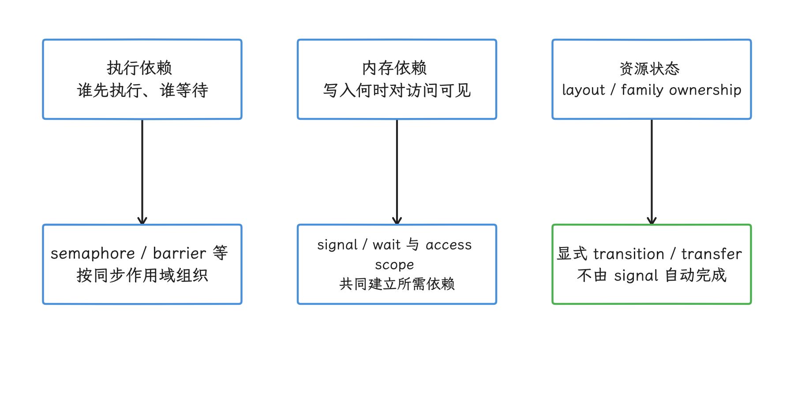

图：semaphore 可以建立执行和内存依赖，layout/ownership 仍需正确的状态转换。 不能把 semaphore 简化成只管执行，也不能用 barrier 自动代替 present wait。

#### acquired image 的 layout

swapchain image 会被循环复用。第一次使用且应用明确丢弃旧内容时，可以从 `VK_IMAGE_LAYOUT_UNDEFINED` 转换到颜色附件 layout；后续 acquire 到的 image 通常要从 `VK_IMAGE_LAYOUT_PRESENT_SRC_KHR` 转回渲染所需 layout。把 `oldLayout` 设为 `UNDEFINED` 的前提，是旧内容允许完全丢弃且符合规范与渲染设计；满足这个前提，每帧照写才是规范允许的用法。

一次常见的 layout 序列是：

```text
acquire
PRESENT_SRC_KHR（或首次 UNDEFINED）
→ COLOR_ATTACHMENT_OPTIMAL
→ PRESENT_SRC_KHR
present
```

这条序列只覆盖最简状态变化；MSAA resolve、transfer、compute post-process 或多 queue ownership 涉及进来时，还要增加对应的 layout transition 与 queue-family transfer。

<!-- gracker-diagram: ch13-05-18-layout-cycle -->
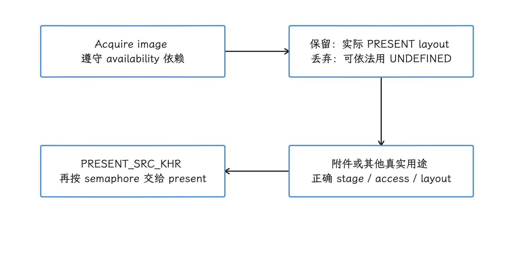

图：按内容保留需求选择实际旧 layout，渲染后转换到可 present 状态。 允许丢弃时 UNDEFINED 不限首次使用；transfer/compute/MSAA 等要补相应状态与依赖。

#### synchronization2 barrier

下面的 barrier 把颜色附件写入收束到 present layout：

```c
VkImageMemoryBarrier2 toPresent = {
    .sType = VK_STRUCTURE_TYPE_IMAGE_MEMORY_BARRIER_2,
    .srcStageMask = VK_PIPELINE_STAGE_2_COLOR_ATTACHMENT_OUTPUT_BIT,
    .srcAccessMask = VK_ACCESS_2_COLOR_ATTACHMENT_WRITE_BIT,
    .dstStageMask = VK_PIPELINE_STAGE_2_NONE,
    .dstAccessMask = 0,
    .oldLayout = VK_IMAGE_LAYOUT_COLOR_ATTACHMENT_OPTIMAL,
    .newLayout = VK_IMAGE_LAYOUT_PRESENT_SRC_KHR,
    .srcQueueFamilyIndex = VK_QUEUE_FAMILY_IGNORED,
    .dstQueueFamilyIndex = VK_QUEUE_FAMILY_IGNORED,
    .image = swapchainImages[imageIndex],
    .subresourceRange = {
        VK_IMAGE_ASPECT_COLOR_BIT, 0, 1, 0, 1
    },
};

VkDependencyInfo dependency = {
    .sType = VK_STRUCTURE_TYPE_DEPENDENCY_INFO,
    .imageMemoryBarrierCount = 1,
    .pImageMemoryBarriers = &toPresent,
};

vkCmdPipelineBarrier2(commandBuffer, &dependency);
```

这段示例适用于 graphics/present 使用同一 queue family，并且颜色附件写入是最后一项操作的简化场景。如果两类 queue family 不同，应按 surface sharing mode 和 ownership transfer 设计；如果后续还有 transfer/compute，`srcStageMask` 和 `srcAccessMask` 必须覆盖真正的最后一次写入。Validation Layer 只能发现部分错误，仍需使用 GPU-assisted validation 和目标设备测试补充验证。

<!-- gracker-diagram: ch13-05-19-barrier-scope -->
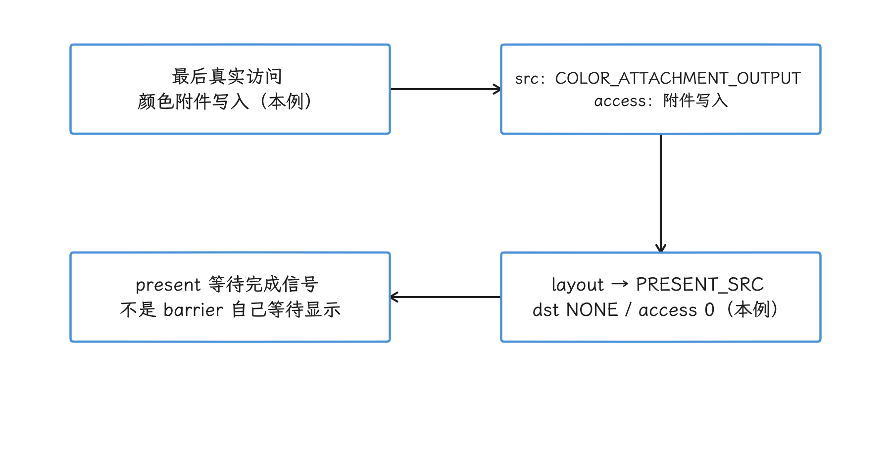

图：示例只收束同 queue family、最后为颜色附件写入的路径。 跨 family 或后续 transfer/compute 必须重新设计 scope 与 ownership，不能照抄片段。

#### 过度同步

把 stage mask 一律设为 `ALL_COMMANDS`、频繁调用 queue idle、每个 pass 都使用 host fence，或者在没有依赖需要时拆成多个 submit，都会减少 GPU 可并行执行的空间。优化时按下面的步骤走：

1. 画出资源的生产者和消费者；
2. 找到必须等待该资源的最早 Consumer stage；
3. 让 access mask 只覆盖真实的写入和读取；
4. 合并无意义的小 submit；
5. 用 GPU trace 验证 bubble 是否减少。

<!-- gracker-diagram: ch13-05-20-over-sync -->
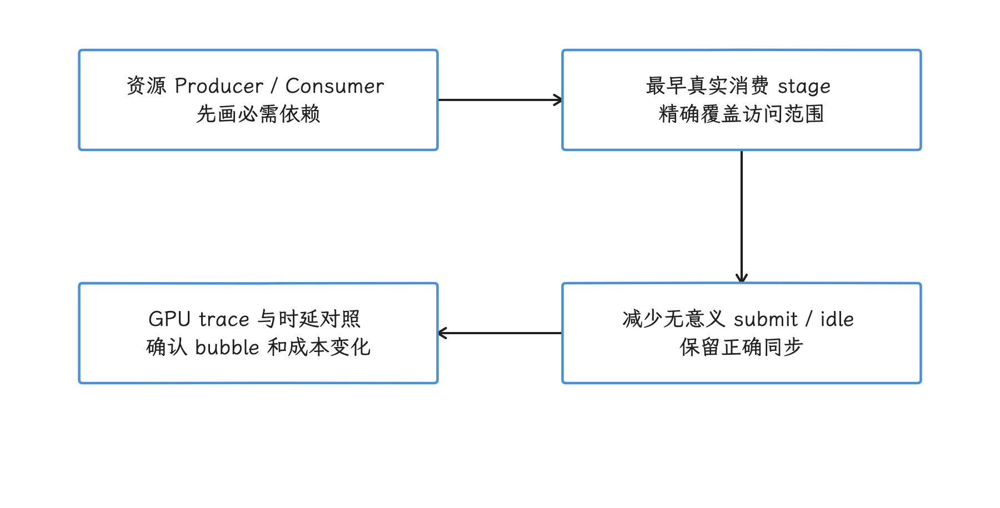

图：先找生产者与最早消费者，再验证 barrier 和提交组织的实际收益。 附带 fence 不自动阻塞 CPU；ALL_COMMANDS 或小 submit 的成本取决于依赖与实现。

### Presentation Mode

Vulkan 规范定义了多种 present mode，但应用只能使用 `vkGetPhysicalDeviceSurfacePresentModesKHR()` 为当前 surface 实际枚举出的模式。

AOSP native WSI 的普通 surface 路径如下：

| Mode | Android 17 返回条件 | 语义与边界 |
|---|---|---|
| `FIFO_KHR` | 始终加入返回集合 | 按顺序显示队列中的 image；Vulkan 规范要求支持 |
| `MAILBOX_KHR` | `min_undequeued_buffers + 1 < max_buffer_count` | 新 image 可以替换尚未显示的旧 image；仍需评估 pacing、功耗与 in-flight 数量 |
| `FIFO_LATEST_READY_EXT` | `present_mode_fifo_latest_ready_ext2` flag 开启 | 从 FIFO 中选择已经 ready 的较新 image；必须通过枚举确认支持 |
| `SHARED_DEMAND_REFRESH_KHR` / `SHARED_CONTINUOUS_REFRESH_KHR` | physical-device presentation properties 报告 `sharedImage` | 使用共享 image 的专用模式，生命周期不同于普通 swapchain |

普通 Android Surface 路径返回的集合里没有 `IMMEDIATE_KHR` 和 `FIFO_RELAXED_KHR`，桌面 Vulkan 的常见选型建议要经枚举确认后才能搬到 Android。

<!-- gracker-diagram: ch13-05-21-present-modes -->
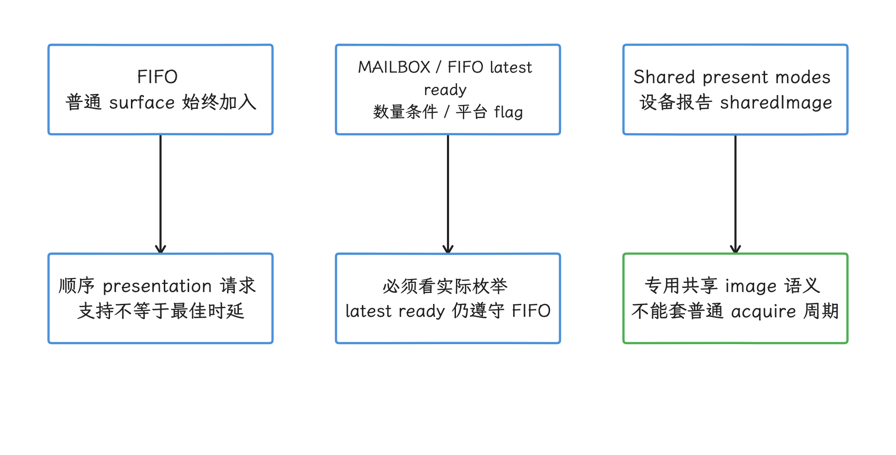

图：选择前查询实际 surface 返回的 mode，不能套用桌面固定选型。 普通固定 r1 路径不列 IMMEDIATE/FIFO_RELAXED；shared 模式有不同生命周期。

#### 运行时选择

选择流程应包括：

1. 枚举 modes；
2. 结合业务目标选择 FIFO、MAILBOX 或 FIFO latest ready；
3. 用 surface capabilities 选择合法 image count；
4. 记录 swap interval/present mode 和 Display refresh mode；
5. 在目标设备测量 input-to-present、帧间隔、功耗和丢帧；
6. surface 重建后重新查询，不要一直沿用上一窗口的能力结果。

MAILBOX 未必带来最低时延，更多可用 image 也未必更流畅：应用过早采样输入并持续积压工作时，即使 presentation engine 丢弃旧帧，CPU/GPU 仍然会为这些帧付出成本。

<!-- gracker-diagram: ch13-05-22-mode-budget -->
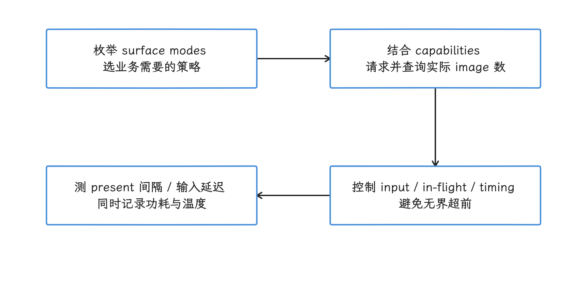

图：mode 影响展示队列，过早采样和多余 GPU 工作仍需单独控制。 丢弃旧展示结果不退还已付出的 CPU/GPU 成本，更多 image 不保证更流畅。

#### Android 17 present timing

`android-17.0.0_r1` 增加了 `VK_EXT_present_timing` 平台支持，并把它列入 `VP_ANDROID_17_requirements`。AOSP WSI 可以查询 queue-operations-end、request-dequeued、image-first-pixel-out 和 image-first-pixel-visible 等显示阶段时间。应用还要完成以下步骤：

- 枚举并启用 extension；
- 查询 `VkPhysicalDevicePresentTimingFeaturesEXT`；
- 按规范启用 `VK_KHR_present_id2` 等依赖；
- 查询具体 surface 的 timing capabilities；
- 创建 swapchain 时设置 `VK_SWAPCHAIN_CREATE_PRESENT_TIMING_BIT_EXT`；
- 处理 timing queue full 和查询结果延迟到达。

该扩展提供的是 Android 显示链路中的阶段反馈；用户实际看到的光学显示时间，仍要靠外部仪器测量。旧设备可以继续评估 `VK_GOOGLE_display_timing`；两套 API 支持的阶段和时间域不同，应分开使用。

<!-- gracker-diagram: ch13-05-23-present-timing -->
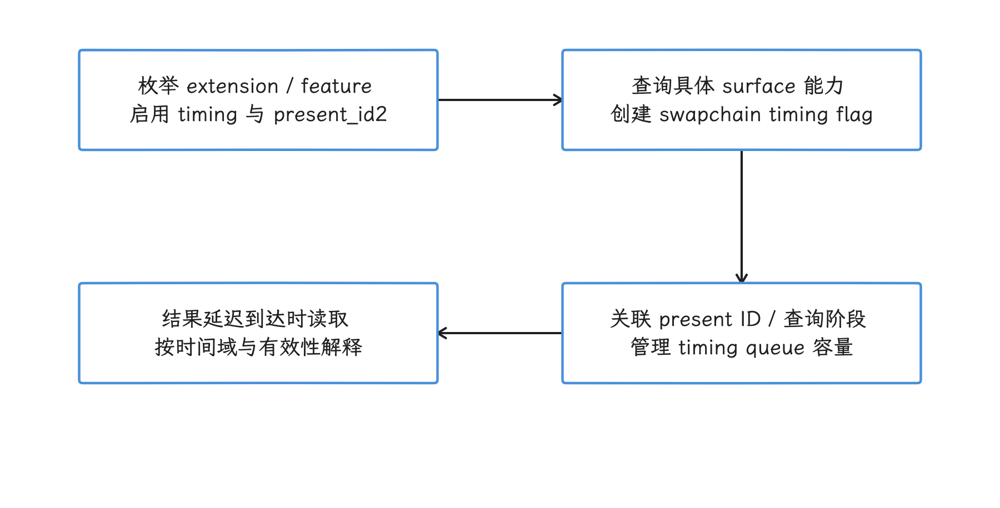

图：扩展、feature、依赖与 swapchain flag 都满足后，按实际 timing 能力查询反馈。 Android 两套 timing 的相关时间戳使用 CLOCK_MONOTONIC；系统反馈不能替代光学测量。

### Swappy Frame Pacing

Swappy 是 Android Game Development Kit（AGDK）中的帧节奏库，不属于平台源码 `android-17.0.0_r1`。应用打包的 Swappy 版本、初始化结果和运行时配置都会影响行为，因此记录系统版本时还要单独记录库版本。

#### 它解决什么

Swappy Vulkan 接口包装 `vkQueuePresentKHR()`，结合 Display refresh、presentation timestamp、Choreographer 和 sync fence 调整提交节奏。它主要用于：

- 避免 Producer 持续过早提交造成 queue-stuffing（待显示帧长期积压）；
- 让目标帧率与显示周期形成稳定关系；
- 在需要时调整 pipeline mode 和 swap interval；
- 为多刷新率设备提供可复用的 pacing 机制。

Swappy 中出现等待，不一定代表卡顿。如果它在合适的位置暂停 render thread，减少 in-flight frame 并推迟输入采样，端到端时延反而可能下降。判断时我们比较等待前后的 present 间隔、missed frame、queue depth、GPU idle 和 input-to-present 时延。

<!-- gracker-diagram: ch13-05-24-swappy -->
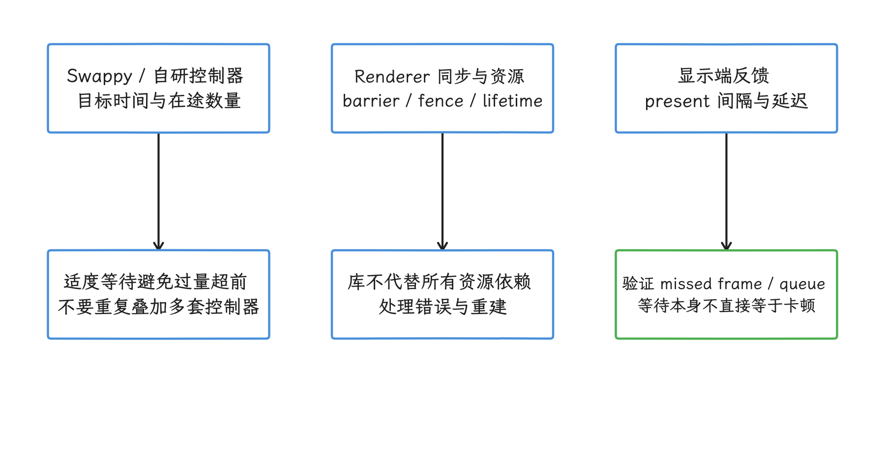

图：主动调节节奏可能减少排队，但图形依赖和对象复用仍由 renderer 管理。 Swappy 外层等待不自动属于内层 vkQueuePresent；收益需比较输入到显示与帧间隔。

#### 接入要点

每个 swapchain 都要单独完成 Swappy 初始化，并在重建时更新对应状态。`SwappyVk_queuePresent()` 仍会返回 `VkResult`，应用必须处理 `OUT_OF_DATE`/`SUBOPTIMAL`；初始化失败时，也要切换到自研 pacing 或明确的降级策略。

下面的骨架只展示调用位置，具体签名与配置以应用锁定的 AGDK 版本为准：

```text
create swapchain
  → initialize Swappy for this swapchain
  → configure target swap interval / auto mode

per frame
  acquire → record → submit
  → SwappyVk_queuePresent(...)

swapchain recreate
  → destroy/reinitialize Swappy state
```

这份骨架说明 Swappy 只控制 present 附近的节奏；resource barrier、command buffer fence 和业务线程同步，仍由应用自己管理。

<!-- gracker-diagram: ch13-05-25-swappy-lifecycle -->
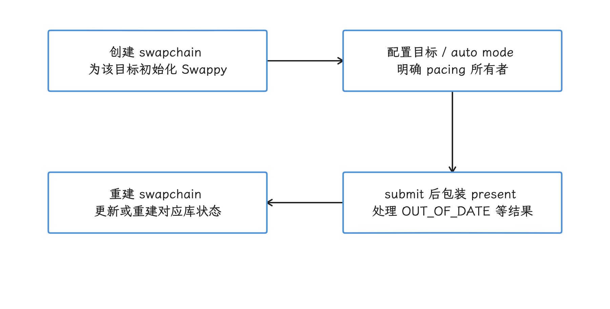

图：为每个 swapchain 初始化并在重建时更新库状态，仍处理 VkResult。 骨架不是完整库调用协议；具体 hook、签名和配置须锁定 AGDK 版本。

#### 自研 pacing 与 Swappy

Vulkan 应用可以使用 `VK_EXT_present_timing`、`VK_GOOGLE_display_timing`、present id/wait、frame-rate hint 和引擎时钟自行实现 pacing。同一个 swapchain 最好只交给一套 pacing 控制器调度；接入 Swappy 后，要明确由谁决定目标时间、由谁等待，以及由谁统计历史 present。

### Trace 视角

#### 建立逐帧证据

从目标 Surface 和 Producer tid 开始，每帧至少记录：

```text
input sample
→ logic/update
→ command recording
→ vkAcquireNextImageKHR result + image index
→ vkQueueSubmit + GPU execution
→ producer completion fence
→ vkQueuePresentKHR / queueBuffer
→ SF buffer selection
→ HWC validate/present
→ display timing / present fence
→ per-layer release
```

我们用这条时间线把 CPU API、GPU execution 和显示阶段分开。带有调用名的 slice 可能来自应用 marker、Vulkan layer、AGI 或驱动数据源；没有标准 slice 时，可以用 present id、buffer/frame number、fence 和 FrameTimeline token 补齐关联。

<!-- gracker-diagram: ch13-05-26-trace-correlation -->
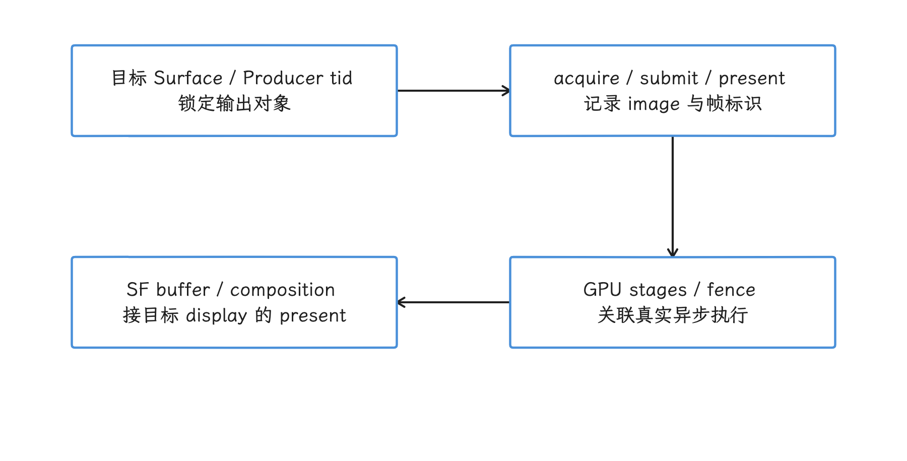

图：先固定 Surface 与 Producer，再以帧、buffer 和 fence 标识连接阶段。 同一时间出现不能单独证明因果，API marker 也不等于 GPU busy 时间。

#### 等待归因

| 现象 | 候选原因 | 证据 |
|---|---|---|
| `vkAcquireNextImageKHR()` 耗时长 | 没有 available image、FIFO cadence、Consumer release 较晚、surface resize | image count、BufferQueue state、dequeue/release fence 和返回码 |
| command recording 迟到 | logic/RHI/worker 依赖、pipeline 编译、CPU 调度 | worker slice、Runnable latency（可运行线程等待 CPU 的时间）和 pipeline cache |
| `vkQueueSubmit*()` host 调用耗时长 | queue 外部同步竞争、驱动工作、过多小 submit | host mutex、调用栈和 submit 数量 |
| submit 较早但 GPU fence 迟到 | shader、overdraw、带宽、barrier bubble、温控/频率 | GPU stages/counters、job queue 和 fence signal |
| `vkQueuePresentKHR()` 耗时长 | 驱动/WSI、Swappy、present waits、window queue | Swappy marker、QueueSignalReleaseImage 和 BufferQueue queue |
| buffer 已 queue 但 SF 使用旧帧 | Producer fence 未 ready、目标显示时刻未到、visibility/transaction 条件 | layer trace、fence 和 present timing |
| SF 已选新帧但 present 仍晚 | CLIENT composition、HWC/Display 资源竞争 | RenderEngine、composition type 和 HWC/present fence |

`vkAcquireNextImageKHR()` 和 `vkQueuePresentKHR()` 管理的是 swapchain image 的取得与交付；业务线程同步和通用 GPU 同步要另选原语。它们的阻塞行为会随驱动、present mode 和 presentation engine 状态变化。

<!-- gracker-diagram: ch13-05-27-wait-localization -->
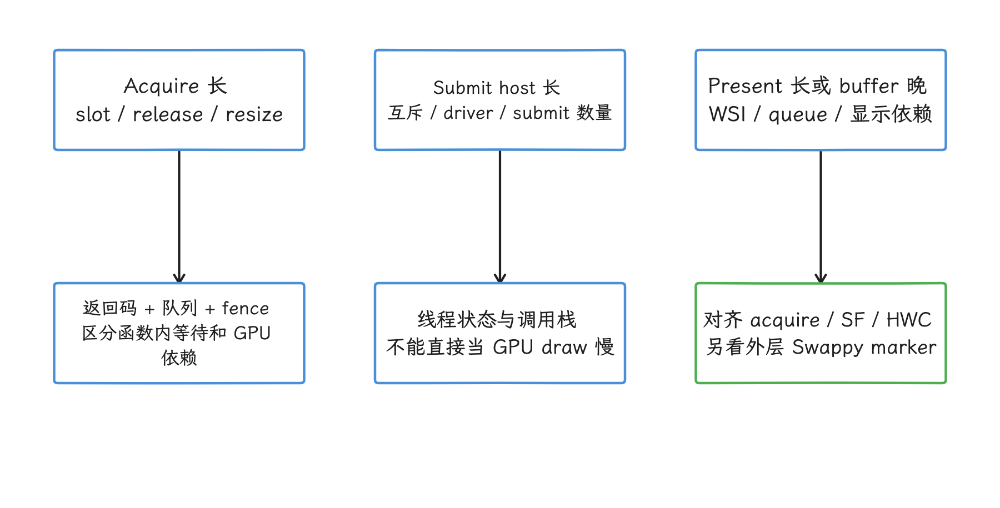

图：acquire、submit、present 的长段分别寻找 CPU 工作、同步和窗口约束。 外层 pacing 与内层 API 时长分开；缺少 GPU 数据时保留未验证范围。

#### queue-stuffing

在 trace 里看到 pending/in-flight 数量长期高位、应用仍按最大速度 acquire/submit/present、随后周期性等待 available image，而帧率接近目标、input-to-present 时延持续上升，就是 queue-stuffing 的典型形态。修复方向包括：

<!-- gracker-diagram: ch13-05-28-queue-stuffing -->
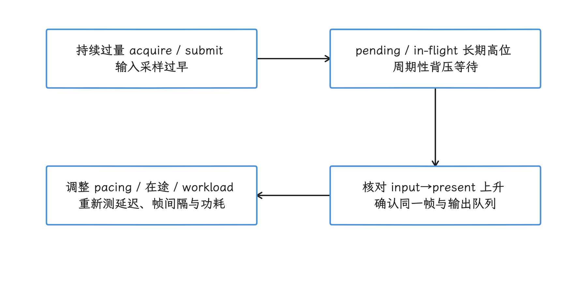

图：用同队列在途数量、等待与输入时延证明过量超前，再调整节奏。 候选形态不代替根因验证，GPU workload 过重与显示约束也要排查。

- 用 Swappy 或自研 timing 控制 submit；
- 降低 in-flight frame 数；
- 把输入采样推迟到更靠近目标帧；
- 减少 GPU workload，确保 Producer fence 在 deadline 前 ready；
- 选择经设备验证的 present mode/image count。

#### FrameTimeline、present timing 与光学时间

FrameTimeline 可以帮助对齐 App SurfaceFrame 与 SurfaceFlinger DisplayFrame，但独立 native Surface 是否提供完整的 expected/actual 信息，取决于 Producer 传入的 timeline/desired-present 数据和 trace 配置。`VK_EXT_present_timing` 提供 WSI/Display 各阶段的反馈，present fence 提供显示栈同步完成的时点；用户实际看到光线变化的光学时间，这三者都提供不了，要靠外部仪器测量。

<!-- gracker-diagram: ch13-05-29-frametimeline-limits -->
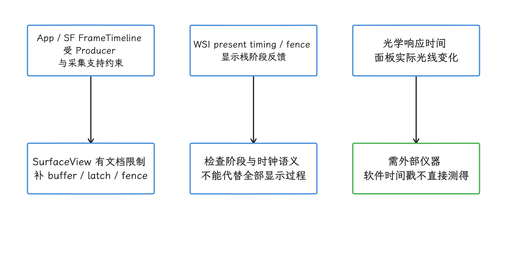

图：受支持的 App 时间线、WSI timing 和光学响应是不同证据层。 官方注明 SurfaceView 尚未支持完整 FrameTimeline，不能仅凭 token 推断已经覆盖。

#### SurfaceFlinger Graphite 不属于 App WSI

SurfaceFlinger RenderEngine 包含可选的 Graphite Vulkan backend；`RenderEngine::SkiaBackend` 仍以 Ganesh 为默认值，是否启用 Graphite 取决于 flag、property 和 OEM 配置。`RenderEngineThreaded` 会尝试使用 `SFRenderEnginePolicy` 和实时调度策略 `SCHED_FIFO` priority 2，在 `primeCache`（预热渲染缓存）期间暂时切回普通策略 `SCHED_OTHER`。

这条 Vulkan 工作只在 SurfaceFlinger 需要 RenderEngine 生成 client target、blur、tone-map 等内容时出现。它与 App 的 `vkQueueSubmit()`/swapchain 使用不同的 device、context、queue 和线程。如果主体 layer 使用 HWC DEVICE composition，SF 未必会通过 RenderEngine 重绘它。我们 trace 分组时把 App queue、`REThreaded::drawLayers`、Graphite/Ganesh submit 和 HWC present 分开看，SF Graphite 的时间要留在 App command recording 之外。

Graphite 的 `flushAndSubmit()` 使用 Recording、wait/signal backend semaphores 和导出的 sync fd 表达 RenderEngine GPU 何时完成。这是 SF CLIENT composition 生成 client target 时的输出 fence，与 App swapchain 的 `VkFence` 无关。

<!-- gracker-diagram: ch13-05-31-sf-thread-policy -->
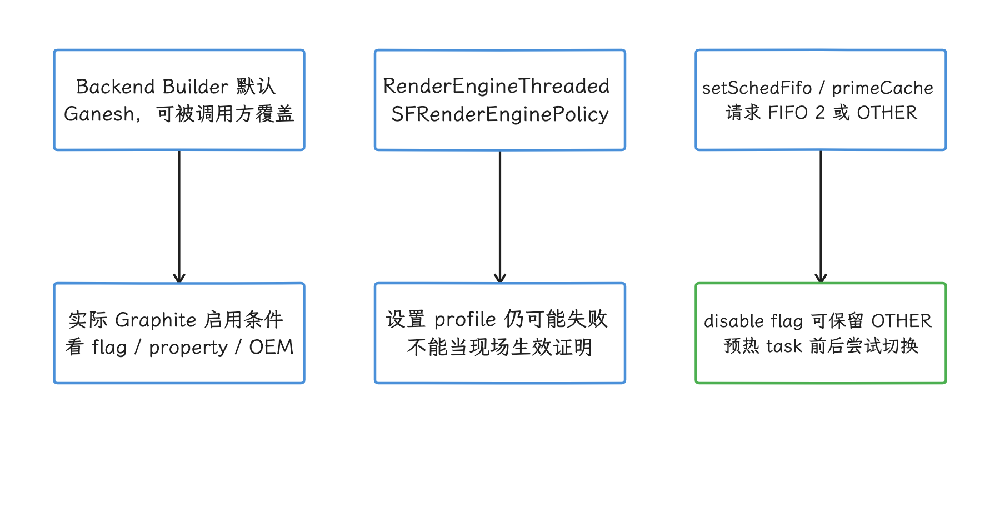

图：Builder 默认、实际 backend 与 CPU 线程策略都要核对现场配置。 请求 SCHED_FIFO 受 disable_sched_fifo_re 与系统调用结果约束，不是 GPU queue priority。

<!-- gracker-diagram: ch13-05-30-sf-separate -->
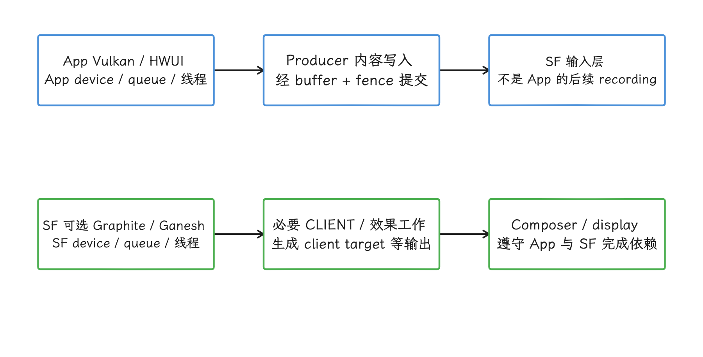

图：SF RenderEngine 使用另一套对象，必要 CLIENT 工作要和 App 提交分组。 两个进程仍可能竞争同一物理 GPU 和带宽；DEVICE 层未必经 RenderEngine 重绘。

<!-- gracker-diagram: ch13-05-32-sf-recording -->
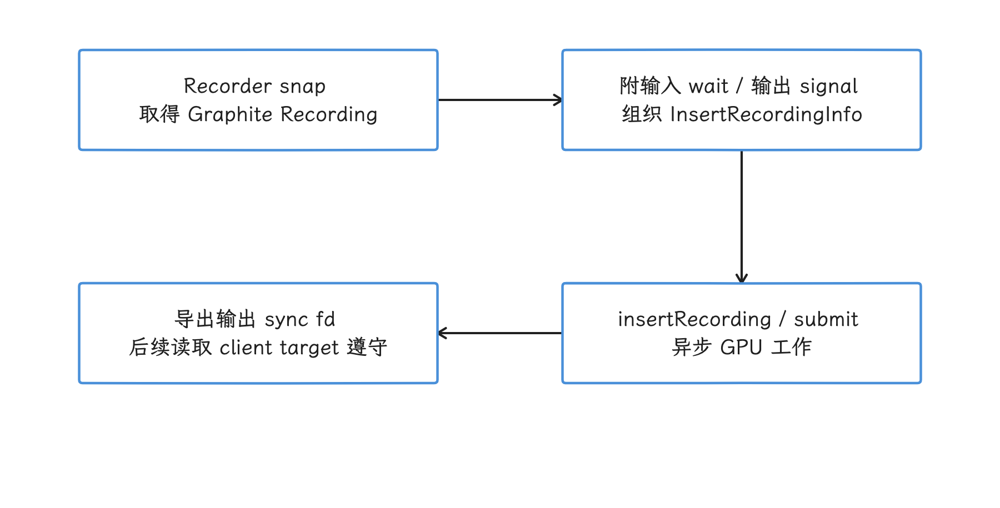

图：Recording 携带 wait/signal semaphore 提交，正常路径导出 sync fd 保护后续读取。 SF 输出依赖与 App submit fence 是不同对象，但可处于同一帧的因果链中。

#### Validation 与工具

- Validation Layers：在开发构建中检查 API、同步和对象生命周期；按 Android 官方 GPU debug layers 流程打包和启用，不使用未经版本核实的全局属性片段。
- AGI：关联 Vulkan API、GPU queue、counter 和 frame capture。
- RenderDoc：在目标设备和构建支持时，检查单帧资源与 DrawCall。
- Perfetto：关联线程调度、BufferQueue、SurfaceFlinger、FrameTimeline、fence 和 HWC。

这些工具会改变 CPU/GPU 成本。确定性能基线时，应关闭 validation/capture 后重新测量。

<!-- gracker-diagram: ch13-05-33-tool-scopes -->
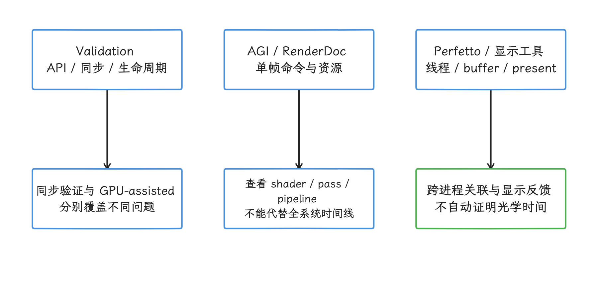

图：按问题选择 API 校验、单帧资源分析或系统显示时序，并记录采集影响。 性能基线需关闭 validation/capture 后重测，工具支持受设备和版本约束。

#### Android 12—17 版本对照

| 平台 | 变化 | 分析重点 |
|---|---|---|
| Android 12 / API 31 | BLAST 与 FrameTimeline 形成现代显示诊断基线 | 区分 App submit、SF latch 和 Display present |
| Android 13 / API 33 | Composer AIDL（稳定的进程间接口定义）成为主线；Game Mode/FPS intervention 可能改变游戏帧率 | 判断目标 cadence 时要包含系统 intervention（干预） |
| Android 14 / API 34 | Android WSI acquire/queue 主结构延续 | 不要虚构 API 34 专属 present 流程 |
| Android 15 / API 35 | 年度 Vulkan requirements/profile 体系继续推进；16 KB page-size 兼容影响 native 库发布 | 能力 profile 与应用可运行性要分开验证 |
| Android 16 / API 36 | ADPF（Android Dynamic Performance Framework）、性能 headroom 与 ARR（Adaptive Refresh Rate）能力扩展，Vulkan 主链不变 | workload 自适应无法替代正确的 pacing |
| Android 17 / API 37 | 增加 `VP_ANDROID_17_requirements`、`VK_EXT_present_timing` 和有条件支持的 FIFO latest ready；SF 包含可选 Graphite backend | 运行时查询 surface/feature，并把 App WSI 与 SF RenderEngine 分组分析 |

<!-- gracker-diagram: ch13-05-34-version-conditions -->
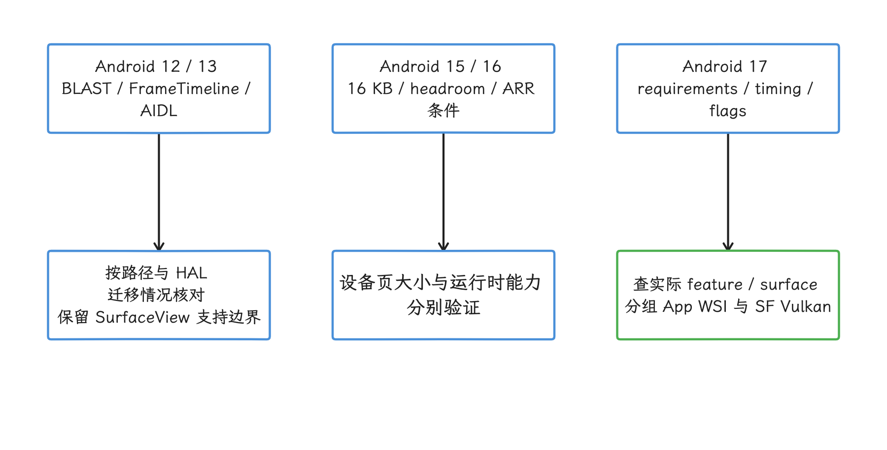

图：profile、扩展、HAL 与设备页大小各自查询，避免把版本号当成能力保证。 新芯片要求不覆盖所有升级设备，AIDL 与 ARR 的部署条件另查。

#### Android 17 源码锚点

- [`swapchain.cpp`](https://android.googlesource.com/platform/frameworks/native/+/refs/tags/android-17.0.0_r1/vulkan/libvulkan/swapchain.cpp)：surface capabilities、present modes、AcquireImageANDROID、QueueSignalReleaseImageANDROID、queueBuffer 和 present timing；
- [`VP_ANDROID_17_requirements.json`](https://android.googlesource.com/platform/frameworks/native/+/refs/tags/android-17.0.0_r1/vulkan/vkprofiles/profiles/VP_ANDROID_17_requirements.json)：Android 17 芯片要求 profile 和 Vulkan 1.4.335 能力集合；
- [`Surface.cpp`](https://android.googlesource.com/platform/frameworks/native/+/refs/tags/android-17.0.0_r1/libs/gui/Surface.cpp)、[`BufferQueueProducer.cpp`](https://android.googlesource.com/platform/frameworks/native/+/refs/tags/android-17.0.0_r1/libs/gui/BufferQueueProducer.cpp)：dequeue/queue、slot、fence 和 buffer age；
- [`SurfaceFlinger.cpp`](https://android.googlesource.com/platform/frameworks/native/+/refs/tags/android-17.0.0_r1/services/surfaceflinger/SurfaceFlinger.cpp)、[`HWComposer.cpp`](https://android.googlesource.com/platform/frameworks/native/+/refs/tags/android-17.0.0_r1/services/surfaceflinger/DisplayHardware/HWComposer.cpp)：buffer selection、composition 和 present；
- [`RenderEngine.h`](https://android.googlesource.com/platform/frameworks/native/+/refs/tags/android-17.0.0_r1/libs/renderengine/include/renderengine/RenderEngine.h)、[`GraphiteVkRenderEngine.cpp`](https://android.googlesource.com/platform/frameworks/native/+/refs/tags/android-17.0.0_r1/libs/renderengine/skia/GraphiteVkRenderEngine.cpp)、[`RenderEngineThreaded.cpp`](https://android.googlesource.com/platform/frameworks/native/+/refs/tags/android-17.0.0_r1/libs/renderengine/threaded/RenderEngineThreaded.cpp)：SF 可选 Graphite、threaded task 和 client-target fence；
- [`dma-buf.c`](https://android.googlesource.com/kernel/common/+/refs/tags/android17-6.18-2026-06_r6/drivers/dma-buf/dma-buf.c)、[`sync_file.c`](https://android.googlesource.com/kernel/common/+/refs/tags/android17-6.18-2026-06_r6/drivers/dma-buf/sync_file.c)、[`dma-fence.c`](https://android.googlesource.com/kernel/common/+/refs/tags/android17-6.18-2026-06_r6/drivers/dma-buf/dma-fence.c)：共享 buffer 和 fence fd；
- [Android Vulkan Profiles](https://developer.android.com/ndk/guides/graphics/android-vulkan-profile)、[Native/proprietary engine Vulkan guide](https://developer.android.com/games/develop/vulkan/native-engine-support)、[Android Frame Pacing](https://developer.android.com/games/sdk/frame-pacing)：profile、WSI 同步和 Swappy 的官方边界。

相关章节：

- [13.4 OpenGL ES、EGL 与 ANGLE](04-opengl-egl-angle.md)
- [13.6 SurfaceControl 与 HardwareBufferRenderer](06-surfacecontrol-hardwarebuffer-renderer.md)
- [2.8 BufferQueue、Gralloc 与 Sync Fence](../../part1-fundamentals/ch02-rendering/08-bufferqueue-gralloc-sync-fence.md)
- [2.7 GPU 渲染与图形 API 选型](../../part1-fundamentals/ch02-rendering/07-gpu-rendering-graphics-api.md)


## HWUI Vulkan 多队列与帧边界

原生 Vulkan 由应用显式管理队列，HWUI 多队列由框架在渲染任务之间分配并行度。我们诊断时先分清：哪些是应用自己的队列，哪些是 HWUI 内部队列。

HWUI 的 Vulkan 后端会从同一个 graphics queue family 取得两条 `VkQueue`。queue 0 服务 RenderThread 的窗口绘制，queue 1 服务 `HardwareBitmapUploader` 的 AHardwareBuffer 上传。二者共享同一个逻辑设备 `VkDevice`，并分别绑定一个 Skia `GrDirectContext`；后者是 Skia 管理 GPU 资源与提交工作的上下文。

<!-- gracker-diagram: ch13-05-35-two-queues -->
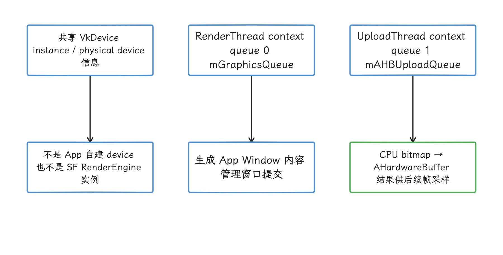

图：同一逻辑 device 与 graphics family，两个 queue 分别绑定两个 GrDirectContext。 这是独立接口对象，不能把两个 queue 直接画成两套物理 GPU 引擎。

源码能证明 HWUI 创建了两条 queue，也能证明 CPU 线程可以分别向它们执行 host submission（主机侧命令提交）；GPU 是否并行执行这些命令，由驱动与硬件决定，GPU 引擎、依赖、内存带宽、频率和调度策略都可能让工作交错或串行。我们分析时把结论分成三层：接口保证、由源码推导的结论，以及仍需 trace 验证的硬件行为。

<!-- gracker-diagram: ch13-05-36-three-evidence-levels -->
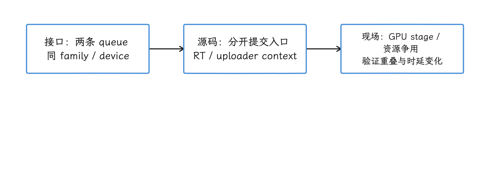

图：源码证明接口与提交关系，硬件执行重叠必须另外采集。 两个 VkQueue 可以交错或串行，带宽、cache、频率与依赖都会影响窗口帧。

对 `android-14.0.0_r1` 至 `android-17.0.0_r1` 的 `VulkanManager.cpp` 做标签对比后，可以确认双 queue 在 Android 14 基线中已经存在。本文源码取 Android 17，只是跟随当前平台版本；双 queue 的来历要写到 Android 14，不该记到 Android 17 头上。

### 复核基线

| 层级 | 基线 | 负责内容 |
| --- | --- | --- |
| Android 平台 | Android 17 / API 37 / `android-17.0.0_r1` | HWUI、VulkanManager、SkiaVulkanPipeline、ANativeWindow、FrameTimeline |
| Android 内核 | `android17-6.18-2026-06_r6` | CPU 线程调度、dma-buf、dma-fence 与 sync_file；厂商 GPU 调度仍由具体驱动实现，内核不包含 `VulkanManager` 或 Skia 逻辑 |
| 历史对照 | `android-14.0.0_r1`、`android-15.0.0_r1`、`android-16.0.0_r1` | 判断双 queue 与 frame-boundary 代码何时已出现 |

分析范围限定为 HWUI 选择 `SkiaVulkan` 的应用进程。应用自行创建的 Vulkan device/queue、SurfaceFlinger 的 RenderEngine Vulkan 上下文，以及厂商 GPU 服务，都不属于这里的 `VulkanManager` 实例。

### 完整路径

下面的流程图标出两条 queue 在 HWUI 以及窗口显示路径中的位置：

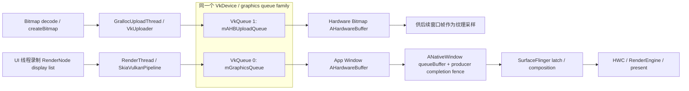

应用进程生产窗口 buffer，SurfaceFlinger 负责 latch（选定本轮合成使用的 buffer）与合成决策，HWC/显示设备完成 present。图中只展开应用进程内的 HWUI Vulkan 双 queue，后半段仍沿用 BufferQueue、SurfaceFlinger 与显示路径。

<!-- gracker-diagram: ch13-05-38-hwui-path -->
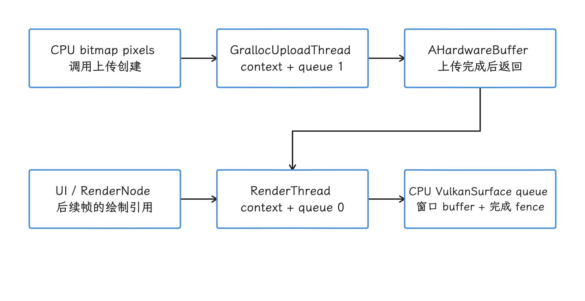

图：queue 1 生成 hardware bitmap，后续 queue 0 采样并交出窗口 buffer。 两条 queue 不共同 present 同一窗口帧；CPU queue 可早于窗口 GPU 写入完成。

queue 1 负责把 CPU 侧 bitmap 像素复制进新分配的 AHardwareBuffer，窗口帧仍由 queue 0 生成。上传完成的 hardware bitmap 后续可以作为纹理由 queue 0 采样；两条 queue 不会共同 present 同一个 App Window 帧。

### VulkanManager：共享 device，分别持有 Skia context

`VulkanManager` 通过进程内弱引用缓存，让 RenderThread 与上传线程复用仍然存活的 Vulkan device。弱引用不延长对象生命周期，但可以在对象仍存活时取得它。下面的代码展示实例获取规则：

```cpp
static wp<VulkanManager> sWeakInstance = nullptr;
static std::mutex sLock;

sp<VulkanManager> VulkanManager::getInstance() {
    std::lock_guard _lock{sLock};
    sp<VulkanManager> manager = sWeakInstance.promote();
    if (!manager.get()) {
        manager = new VulkanManager();
        sWeakInstance = manager;
    }
    return manager;
}
```

RenderThread、`VkUploader` 以及各 `GrDirectContext` 会持有强引用，确保使用期间 manager 不被销毁；`createContext()` 还通过 context delete callback 增减 `VulkanManager` 的强引用。只要上传 context 仍存活，RenderThread 即使释放自己的引用，也不会另建一份 manager。所有强引用都释放后，下一次 `getInstance()` 才会创建新实例。

<!-- gracker-diagram: ch13-05-39-manager-lifetime -->
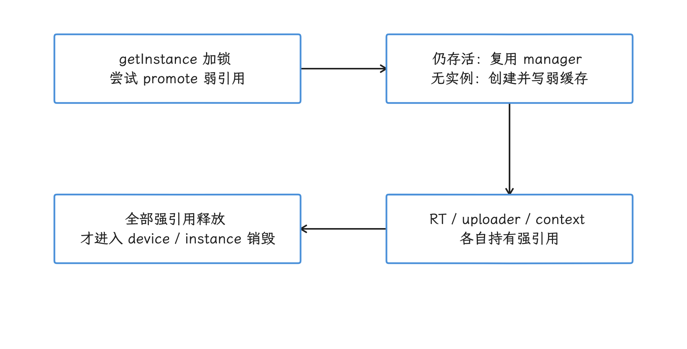

图：弱缓存不延寿，RenderThread、上传者和 context callback 的强引用维持 device。 所有强引用释放后才可能销毁；下一次获取按当前弱引用状态复用或重建。

共享范围包括：

- `VkInstance`；
- `VkPhysicalDevice`；
- `VkDevice`；
- graphics queue family index；
- 已启用的 Vulkan extension 与 feature 信息。

隔离范围包括：

- RenderThread 和 UploadThread 各自的 `GrDirectContext`；
- 两个 context 各自创建的 Skia Vulkan memory allocator（GPU 内存分配器）；
- device-lost（Vulkan 设备不可继续使用）回调中的上下文标签；
- queue 0 与 queue 1 各自的提交顺序。

`SkiaVMA::Options{.fThreadSafe = false}` 只表示每个 context 的 allocator 各自独立、不负责协调多线程并发访问；整个 `VkDevice` 的跨线程同步责任仍在调用方。共享 Vulkan 对象、queue 和跨 queue 资源依赖仍要遵守 external synchronization（由调用方避免并发访问同一对象） 规则，并使用 semaphore 或 fence 表达执行依赖。

<!-- gracker-diagram: ch13-05-40-shared-isolated -->
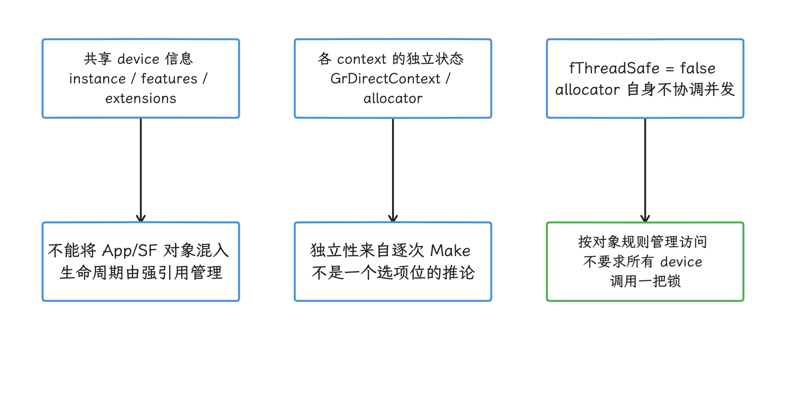

图：每次 createContext 调用各建 allocator，线程安全选项不等于全 device 串行。 按各 API 同步共享对象；跨 queue 资源仍要建立执行/内存依赖。

### 两条 graphics queue 如何创建

#### 同一 queue family，两个 queue index

`setupDevice()` 选中第一个带 `VK_QUEUE_GRAPHICS_BIT` 的 family，并要求该 family 至少提供两个 queue。下面的缩写代码保留能力检查、请求数量和取得 queue handle 的关键点：

```cpp
constexpr uint32_t kRequestedQueueCount = 2;

for (uint32_t i = 0; i < queueFamilyCount; i++) {
    if (queueProps[i].queueFamilyProperties.queueFlags & VK_QUEUE_GRAPHICS_BIT) {
        mGraphicsQueueIndex = i;
        LOG_ALWAYS_FATAL_IF(
            queueProps[i].queueFamilyProperties.queueCount < kRequestedQueueCount);
        break;
    }
}

VkDeviceQueueCreateInfo queueInfo{
    .queueFamilyIndex = mGraphicsQueueIndex,
    .queueCount = kRequestedQueueCount,
    .pQueuePriorities = queuePriorities,
};

mGetDeviceQueue(mDevice, mGraphicsQueueIndex, 0, &mGraphicsQueue);
mGetDeviceQueue(mDevice, mGraphicsQueueIndex, 1, &mAHBUploadQueue);
```

<!-- gracker-diagram: ch13-05-41-family-creation -->
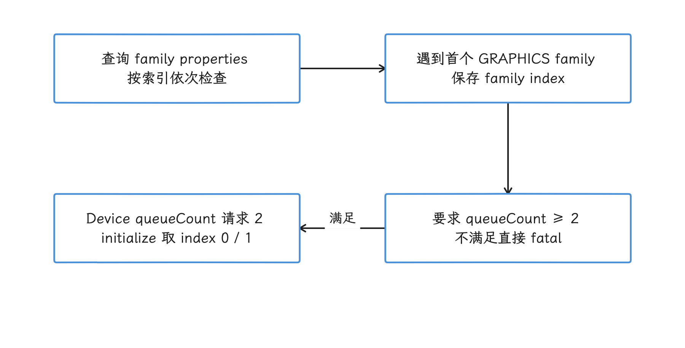

图：第一个具备 GRAPHICS 能力的 family 还必须满足 queueCount 至少为 2。 不满足会 fatal；这里没有尝试另一个 family 或复用 queue 0 的降级分支。

两条 queue 具有相同 capability 和同一个 family index，因此跨 queue 使用资源时不涉及 queue-family ownership 转移。`setupDevice()` 里也没有 queue 数量不足时复用 queue 0 的分支；HWUI 一旦进入这段 Vulkan device 初始化，能力不满足就会触发 fatal 并中止进程。至于某台设备是否运行 Vulkan HWUI，由更上层的设备配置与进程策略决定，这段代码能回答的只有初始化要求。

<!-- gracker-diagram: ch13-05-42-same-family -->
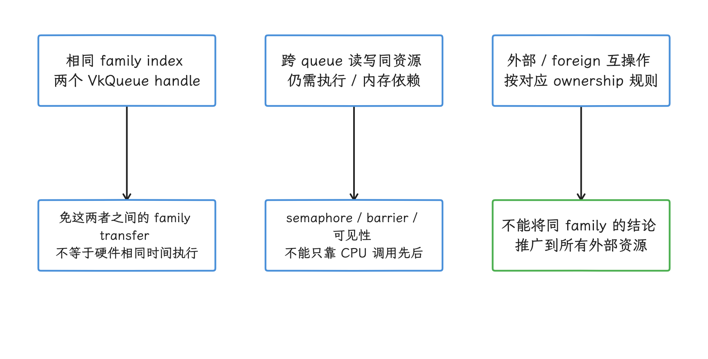

图：queue 0/1 的接口 capability 相同，普通资源在二者间不需 family 转移。 外部 AHardwareBuffer/foreign ownership 另查；同 family 不取消读写依赖。

#### 两个 Skia context 绑定不同 queue

`createContext(ContextType)` 把同一组 device 信息交给 Skia，只替换 `fQueue`：

- `kRenderThread` → `mGraphicsQueue`；
- `kUploadThread` → `mAHBUploadQueue`。

直接效果是把主机侧提交顺序分开：硬件位图上传不会进入 RenderThread 所用 queue 的顺序链。实际性能收益仍取决于驱动和硬件：

<!-- gracker-diagram: ch13-05-43-queue-context -->
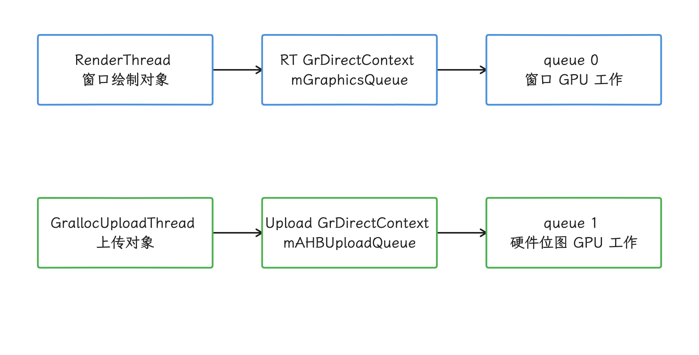

图：RenderThread 与 uploader 分开 host submission，同时仍受同一硬件资源限制。 单 queue 内也不意味着所有 GPU 命令全串行；双 queue 不自动创建依赖。

- GPU 有可重叠的 copy/graphics 执行资源时，上传可能与窗口绘制部分重叠；
- 两条 queue 争用内存带宽、cache 或同一图形引擎时，驱动可能交错甚至串行；
- AHardwareBuffer 上传涉及的分配、页映射和 cache 维护也可能拖慢窗口渲染；
- 两条 queue 使用同一个 global priority 请求，queue 1 没有天然的低优先级。

双 queue 提供的是独立提交能力，减少的是同一 queue 内的顺序约束；它不保证硬件并行，也隔离不了上传引起的全部资源争用。

<!-- gracker-diagram: ch13-05-44-gpu-contention -->
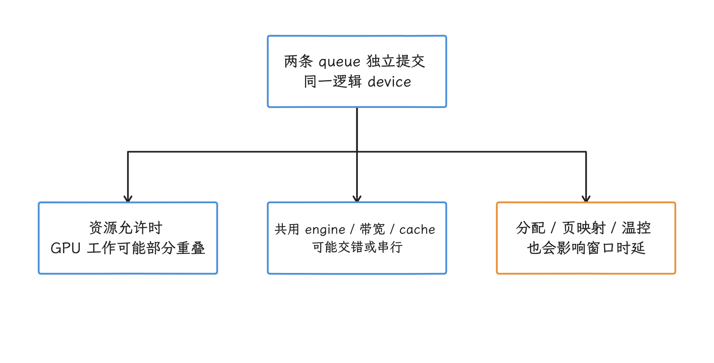

图：用 GPU stage 与计数器验证重叠，而不是用 queue 数量推断硬件并行。 queue 1 没有天然低优先级；资源分配、cache 和带宽可能拖慢窗口。

### HardwareBitmapUploader 的上传路径与等待

#### CPU 像素会被复制

`Bitmap.Config.HARDWARE` 的这条创建路径先分配带 `AHARDWAREBUFFER_USAGE_GPU_SAMPLED_IMAGE` 的 AHardwareBuffer，再调用 `SkImages::TextureFromAHardwareBufferWithData()` 把 `SkPixmap` 数据写入。`Bitmap.cpp` 也明确把 `allocateHardwareBitmap()` 描述为复制 bitmap contents。

因此，已有像素要经过这条路径的一次搬运才成为 GPU 纹理：首次创建仍要把 CPU 源像素传输到 gralloc 分配的图形 buffer；AHardwareBuffer 能避免的，是后续再创建一份应用可见的像素存储。

<!-- gracker-diagram: ch13-05-45-upload-copy -->
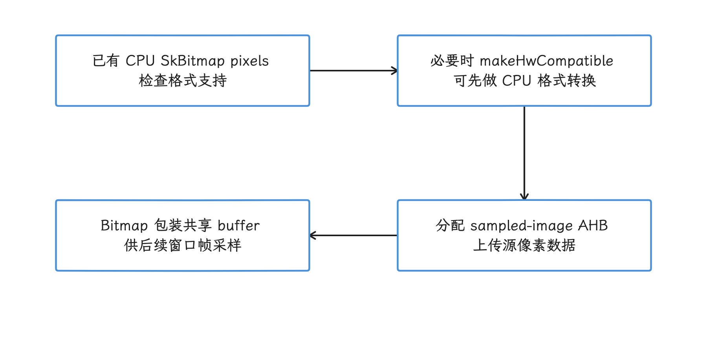

图：CPU 数据经过必要转换和传输写进新 AHardwareBuffer，再供 GPU 采样。 AHardwareBuffer 不保证零复制、恰好一次内部搬运或没有 staging 存储。

#### GrallocUploadThread 与调用方等待

Vulkan 上传在 `GrallocUploadThread` 上执行：

1. 取得或创建共享 `VulkanManager`；
2. 创建绑定 queue 1 的 `GrDirectContext`；
3. 调用 `TextureFromAHardwareBufferWithData()` 记录上传；
4. 执行 `mGrContext->submit(GrSyncCpu::kYes)`；
5. `runSync()` 返回后，`uploadHardwareBitmap()` 才把结果交回调用方。

`GrSyncCpu::kYes` 表示上传线程会等待 GPU 完成。这样可以保证返回的 hardware bitmap 已经写完，但调用仍是同步的。主线程若同步创建大图，仍可能依次等待解码、AHB（AHardwareBuffer）分配、上传和 GPU 完成。

<!-- gracker-diagram: ch13-05-46-upload-blocking -->
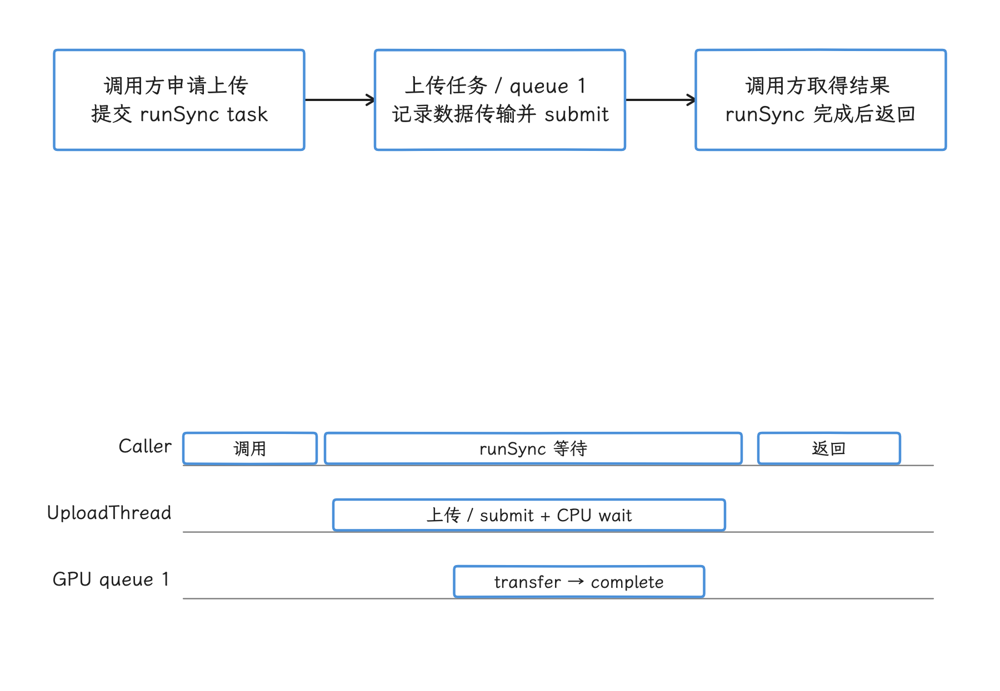

图：upload thread 的同步 GPU submit 完成后，runSync 才让调用方返回。 单独 queue 不代表调用异步；主线程同步创建大图仍可能被阻塞，条长非实测。

queue 1 与 queue 0 在这段时间可以分别提交工作；GPU 资源争用有没有拉长 RenderThread 的 queue 0 工作，我们仍要通过 trace 验证。

#### 60 秒闲置回收

`HardwareBitmapUploader.cpp` 把 `kThreadTimeout` 设为 60000 ms。没有 pending upload（待处理上传）且空闲时间超过该值后，`VkUploader::onIdle()` 会释放上传 `GrDirectContext` 与 manager 强引用；下一次上传再按需重建。

源码能证明的是上传 context 及其持有资源被释放；具体回收多少 GPU 内存，还取决于驱动、Skia cache、AHardwareBuffer 的其他持有者和设备内存策略，这里没有固定数值可给。

<!-- gracker-diagram: ch13-05-47-upload-idle -->
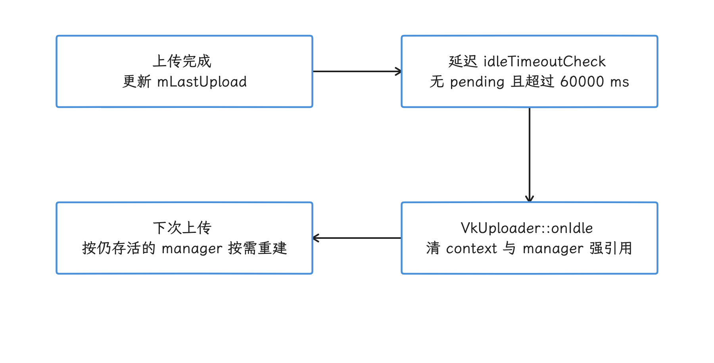

图：延迟检查满足无 pending upload 和闲置阈值时清理上传 context/强引用。 60000 ms 是检查阈值，不保证精确到时回收或固定 GPU 内存回收量；不等于线程必然退出。

### Global priority 的请求语义

`Properties::contextPriority` 默认值为 0。只有系统代码在 Vulkan context 创建前通过隐藏的 `HardwareRenderer.setContextPriority()` 设置 EGL priority 常量，`VulkanManager` 才会尝试映射到：

- `VK_QUEUE_GLOBAL_PRIORITY_LOW_EXT`；
- `VK_QUEUE_GLOBAL_PRIORITY_MEDIUM_EXT`；
- `VK_QUEUE_GLOBAL_PRIORITY_HIGH_EXT`。

源码仅在 `contextPriority != 0` 且识别到 `VK_EXT_global_priority` v2 时附加 `VkDeviceQueueGlobalPriorityCreateInfoEXT`。如果 global-priority query 可用，代码会先确认选中的 queue family 是否报告了目标档位；不支持时记录 warning，但继续创建 device。

还要注意三点：

<!-- gracker-diagram: ch13-05-49-priority-fallback -->
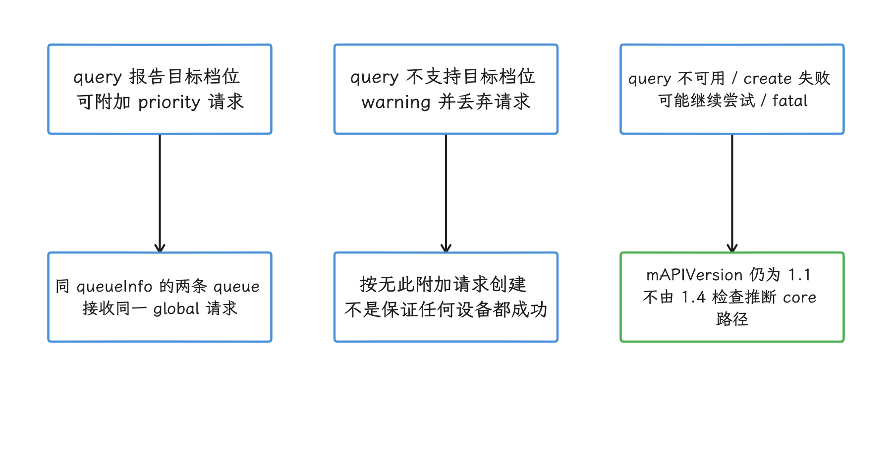

图：query 不支持目标档位时可丢弃请求，createDevice 失败则是另一条 fatal 边界。 query 不可用时仍可能尝试 priority；不能把所有失败都称为自动降到低优先级。

- `mAPIVersion` 固定为 Vulkan 1.1；源码检查 `VK_API_VERSION_1_4`，从这一点推不出 HWUI 在用 Vulkan 1.4 core priority；
- 两条 queue 来自同一个 `VkDeviceQueueCreateInfo`，global priority 请求对这次创建的两条 queue 一起生效；
- global priority 是提交给驱动的队列调度请求，还受系统权限控制。它与 Linux 线程实时优先级无关，也不承诺具体的 GPU 抢占时延。

<!-- gracker-diagram: ch13-05-48-priority-map -->
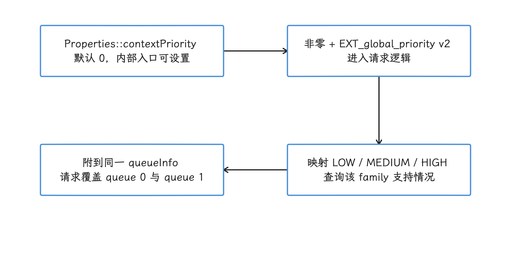

图：初始化前的非零 EGL priority 常量，满足扩展检查后映射为 Vulkan global priority。 请求对同一 queueInfo 创建的两条 queue 生效，不保证设备允许该优先级。

<!-- gracker-diagram: ch13-05-50-priority-vs-cpu -->
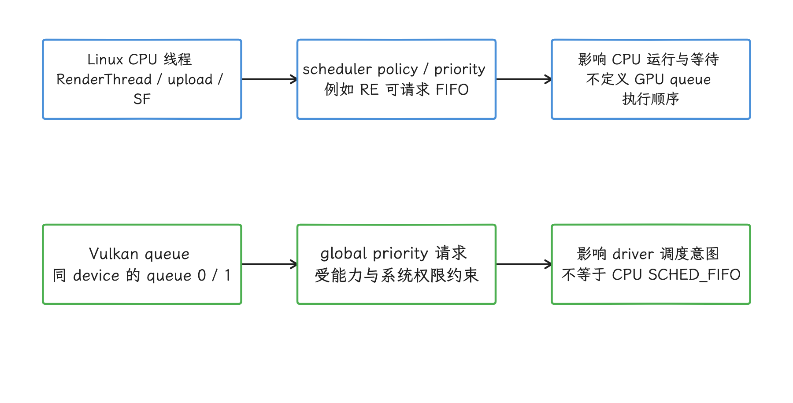

图：CPU 线程调度请求与 GPU queue 调度请求属于不同层。 两者都不承诺固定 GPU 抢占时延或实际并行；权限和现场策略须另查。

### 两种“帧边界”记录不同对象

#### Vulkan frame-boundary 的用途

`finishFrame()` 在提交 Skia 工作时有两条帧标记路径：

1. AGI capture layer 提供私有 `VK_ANDROID_frame_boundary` 时，HWUI 把本帧的 signal semaphore（GPU 完成后置位的同步对象）和 render-target image 传给 `vkFrameBoundaryANDROID()`；
2. 该私有入口不存在时，HWUI 设置 `GrSubmitInfo.fMarkBoundary = Yes` 与进程内递增的 `fFrameID`，由 Skia 和可用的 `VK_EXT_frame_boundary` 支持向工具描述 frame boundary。

Khronos `VK_EXT_frame_boundary` 给 queue submission 附加应用定义的 frame ID、结果 image/buffer 和工具 tag。它是给分析工具看的标注：新的执行依赖不会因它产生，present semaphore 的等待也仍由 present 流程承担。

`VK_ANDROID_frame_boundary` 在 AOSP 头文件中被明确描述为 AGI 专用扩展，由 AGI Vulkan capture layer 在抓帧时提供。普通运行时查不到该 proc pointer（Vulkan 函数入口指针）属于预期情况。

<!-- gracker-diagram: ch13-05-51-boundary-branches -->


图：私有 AGI 入口可用时传 semaphore/image，否则向 Skia 提供边界标志和内部 frame ID。 这些是工具标注，不自动建立执行依赖；普通运行不提供 AGI 私有入口属预期范围。

#### FrameTimeline 的窗口时间线

FrameTimeline 的 `vsyncId` 走另一条路径。`CanvasContext::draw()` 取得 `FrameTimelineVsyncId`，构造 `ANativeWindowFrameTimelineInfo`，再由 render pipeline 在 `queueBuffer()` 前设置给 ANativeWindow。SurfaceFlinger 用它关联 App `SurfaceFrame` 和显示 `DisplayFrame` 的 expected/actual 时间线。

<!-- gracker-diagram: ch13-05-53-timeline-handoff -->


图：CanvasContext 取得有效 vsyncId 后组织窗口时间线信息，再经 pipeline 交给 native window。 无有效 vsyncId 或无相应 render target 时有条件分支，不能假定每次 draw 都产生完整时间线。

两类 ID 的差异如下：

| 对象 | 生成位置 | 主要消费者 | 是否直接表示 expected present |
| --- | --- | --- | --- |
| Vulkan `currentFrameID` | HWUI `VulkanManager::finishFrame()` 的进程内计数器 | Skia、Vulkan 工具、AGI capture | 否 |
| FrameTimeline `vsyncId` | Choreographer / 平台帧时间线传入 HWUI | ANativeWindow、SurfaceFlinger、Perfetto FrameTimeline | 是 |
| BufferQueue frame number | Producer queue 次序 | BLAST、SurfaceFlinger、transaction/trace | 不单独表示 |

AOSP 没有把 `currentFrameID` 赋值为 `FrameTimelineVsyncId`。工具可以根据时间、submission、render target 或其他元数据关联两者；两个数值本身，要当作相互独立对待。

<!-- gracker-diagram: ch13-05-52-id-domains -->


图：工具提交分组、窗口预测关联和 Producer queue 序号使用不同标识。 vsyncId 是关联 token 而非时间戳；不能按数值相等直接 join 三类记录。

#### Frame boundary 到 present 的距离

Vulkan frame-boundary 标记发生在 queue submission 附近，离屏幕显示仍有以下步骤：

- GPU 完成对窗口 image 的写入；
- producer completion fence signal；
- `ANativeWindow::queueBuffer()`；
- BLAST buffer transaction；
- SurfaceFlinger latch；
- HWC DEVICE 或 RenderEngine CLIENT 合成；
- display present。

GPU 工具把 draw call 归到某帧，回答的只是这些 GPU 命令属于哪组提交工作；用户何时看到结果，我们仍要结合 FrameTimeline 与 present fence 判断。

<!-- gracker-diagram: ch13-05-54-boundary-distance -->


图：边界标注只把工作归组，后续交接、读取依赖和显示结果还需单独追踪。 queue 可先于 GPU 完成，受限 latch 可先于 signal；标记不保证画面赶上目标周期。

### dequeue fence 与 producer completion fence

#### dequeue fence：等待旧消费者释放 buffer

`VulkanSurface::dequeueNativeBuffer()` 从 App Window 的 ANativeWindow 取得 buffer 和 dequeue fence。该 fence 表示 Consumer 何时结束对这块旧 buffer 的使用；Producer 要等它 signal 后才能安全复用并写入。

当 fence 尚未 signal 时，`VulkanManager::dequeueNextBuffer()` 会尝试：

1. `dup()` fence fd；
2. 创建 `VkSemaphore`；
3. 以 `VK_EXTERNAL_SEMAPHORE_HANDLE_TYPE_SYNC_FD_BIT` 和 `VK_SEMAPHORE_IMPORT_TEMPORARY_BIT` 把 fd 临时导入 semaphore；
4. 让 Skia surface 的后续 GPU 工作等待该 semaphore；
5. 立即调用 `FlushAndSubmit()`，确保 wait 进入 GPU submission。

导入或创建失败时，源码改由 CPU 调用 `sync_wait()`。这条 fence 的方向是 Consumer/HWC 把旧 buffer 释放给 App Producer 复用，与“SurfaceFlinger 作为 Producer 通知 App 新内容就绪”的方向正好相反。

<!-- gracker-diagram: ch13-05-55-hwui-dequeue -->


图：成功查询到 status != 1 时复制并导入旧 Consumer fence，及时提交 wait。 这是 queue 0 写入前依赖，不是 CPU 已等到 GPU 结束；源码对额外 flush 留有 workaround 注释。

<!-- gracker-diagram: ch13-05-56-import-fallback -->


图：dup、创建和导入失败会尝试 CPU sync_wait；状态查询失败不进入同一 pending 分支。 成功导入后 Vulkan 接管副本 fd；缺少等待 slice 不是 fence 已完成的独立证明。

#### finishFrame：导出本轮 GPU 完成 fence

queue 0 的窗口绘制工作准备提交时，`finishFrame()` 创建可导出为 sync-fd 的 semaphore，并把它放入 `GrFlushInfo.fSignalSemaphores`。flush/submit 后，代码通过 `vkGetSemaphoreFdKHR()` 取得 fd。sync-fd 是用户空间传递内核 `dma_fence` 的文件描述符封装。`VulkanSurface::presentCurrentBuffer()` 再把这个 fd 传给 `ANativeWindow::queueBuffer()`。

这个 fd 在 BufferQueue 消费侧成为当前 buffer 的 acquire fence。SurfaceFlinger 可以先接收 buffer 元数据，但读取像素前必须等待 fence signal，确认 GPU 已经写完。`presentCurrentBuffer()` 的函数名容易误导；这里执行的是 queue buffer，屏幕 present 还在后面的链路里。

<!-- gracker-diagram: ch13-05-57-finish-export -->


图：窗口 submit 的 exportable semaphore 导出 sync fd，queue 后成为 acquire 依赖。 presentCurrentBuffer 只表示交出 buffer；fd 可未 signal，不能把名称当成显示已完成。

创建可导出 semaphore 失败、导致 `sharedSemaphore` 为空时，`finishFrame()` 会调用 `mQueueWaitIdle(mGraphicsQueue)`，保守地等待 queue 0 空闲；若 GPU 已成功提交、但后续 `vkGetSemaphoreFdKHR()` 导出 fd 失败，源码只记录错误并返回无效 fd。这两类失败各有各的处理，没有共用的 fallback。正常路径下，RenderThread 无需在 CPU 上等待整帧 GPU 完成。

下面的时序图按 buffer 所有权变化标出 fence 方向：


由此可以解释两个现象：`queueBuffer()` 可以在 GPU 完成前返回；下一次 `dequeueBuffer()` 也可能因旧 buffer 仍被 GPU/HWC 使用而等待。

<!-- gracker-diagram: ch13-05-58-finish-failures -->


图：无 signal semaphore、导出 fd 失败和调试 waitIdle 是三种不同情况。 无效 fd 不自动证明写入完成；固定 r1 没有为所有失败统一补 CPU 等待。

<!-- gracker-diagram: ch13-05-59-reuse-vs-submit -->


图：旧 Consumer 的释放保护 Producer 重写，新 Producer 的完成保护 Consumer 读取。 FREE / 成功 dequeue 可仍携带未 signal release fence，present fence 也不是这两者的替代。

### Buffer age 与 partial update

当 `Properties::enablePartialUpdates` 和 `Properties::useBufferAge` 同时开启时，`VulkanManager` 使用 `SwapBehavior::BufferAge`。buffer age 表示一块 buffer 距离上次成功入队经历了多少次窗口提交。`VulkanSurface` 根据本进程的 present count 与该 buffer 上次成功入队时的 count 计算 age；新 buffer、内容无效或 transform 改变时返回 0。

<!-- gracker-diagram: ch13-05-60-hwui-age -->


图：成功 queue 计数与每块 buffer 的上次提交记录共同决定 age。 新 buffer、无效内容与 transform 等变化可使 age 为 0；它不是当前显示年龄或时长。

HWUI 会结合 buffer age 与 swap history，计算本次需要恢复的 damage（发生变化、需要更新的区域），再通过 `native_window_set_surface_damage()` 把窗口 damage 交给 ANativeWindow。这里有三个限制：

- buffer age 只表示内容可复用历史，不能保证系统仅执行脏矩形内的 GPU 指令；
- age 为 0 时需要按完整内容处理；
- driver、tile 架构、offscreen layer、blend 和 SurfaceFlinger 合成仍会影响最终带宽。

因此，partial update 的收益要结合 GPU counter、render stage 与功耗数据评估。`bufferAge != 0` 本身证明不了 fill rate（每秒实际填充的像素量）已按 damage 面积同比例下降。

<!-- gracker-diagram: ch13-05-61-two-damages -->


图：先保存窗口新变化，再合并历史修复 back buffer，提交区域沿另一变量传递。 age 为 0 或历史不足时完整绘制；surface damage 提示不代替前面的像素修复。

<!-- gracker-diagram: ch13-05-62-partial-update-measure -->


图：内容历史证明可复用范围，性能收益仍须 GPU、带宽与功耗测量。 bufferAge 非零不能证明 fill rate 按 damage 面积同比下降。

### VkFunctor 与 WebView 私有互操作

`getVkFunctorInitParams()` 会向 HWUI 的 WebView Vulkan functor 回调提供 `VkInstance`、`VkPhysicalDevice`、`VkDevice`、queue 0、queue family index 和已启用的 feature/extension。这里的 functor 是 WebView 与 HWUI 之间的私有绘制回调对象；`VkFunctorDrawable` 明确持有 `WebViewFunctor::Handle`，并在 RenderThread 上调用它。

它只服务于 WebView 与 HWUI 之间的私有互操作；SurfaceView 的自定义渲染复用不到这套 device，普通 native renderer 也拿不到。应用自己的 instance、device、queue 与同步对象，应通过公开 Vulkan/ANativeWindow API 管理。

<!-- gracker-diagram: ch13-05-63-webview-interop -->


图：HWUI 向 WebView 私有回调提供 queue 0 等对象，普通 native renderer 自建公开对象。 此私有互操作不是通用应用获取 HWUI device 的公开 API。

### 与 SkiaGL 的对比

一种常见误解是 SkiaGL 只有一个 context，因此 hardware bitmap 上传必然与 RenderThread 串行。但 `HardwareBitmapUploader` 在 GL 路径同样使用独立的 `EGLUploader`、`GrallocUploadThread` 与 EGL context，并通过 EGL fence 等待上传完成。

两种后端的可观察差异如下：

<!-- gracker-diagram: ch13-05-64-gl-vk-upload -->


图：两种后端都有上传线程，实际 GPU 完成等待所在的 CPU 线程不同。 GL client wait 有有限超时且异常处理须核对；两种后端均不保证硬件同时执行上传与窗口绘制。

| 维度 | SkiaVulkan | SkiaGL |
| --- | --- | --- |
| HWUI 明确管理的提交对象 | 同一 VkDevice 上两条 graphics `VkQueue` | RenderThread 与 uploader 各自的 EGL/GL context；驱动内部 queue 拓扑不可由 GL API 直接得知 |
| AHB 上传完成等待 | UploadThread `GrSyncCpu::kYes` | UploadThread `eglClientWaitSyncKHR()` |
| 窗口完成 fence | Vulkan semaphore 导出 sync fd | EGL/GL native fence 路径 |
| GPU frame annotation | 可使用 `VK_EXT_frame_boundary` 或 AGI 私有扩展 | 依赖 GL/驱动/工具支持，不能概括成“无分析能力” |
| 是否保证上传与绘制并行 | 否 | 否 |

Vulkan API 会显式表达 queue、semaphore 与外部句柄之间的关系，便于建立同步证据，但同一负载不会因此自动变快。做性能对比时，我们仍要固定设备、内容、刷新率与热状态。

### 性能观测：分清 queue、GPU 与 present

#### Perfetto

建议同时采集以下证据，并用 submission ID、时间区间和 frame token（关联同一帧的标识）串起各数据源：

- Main thread 与 RenderThread 调度、`syncAndDrawFrame`、`Vulkan finish frame`、`flush commands`；
- `GrallocUploadThread` 的 hardware bitmap 上传 slice；
- `dequeueBuffer` / `queueBuffer` duration；
- FrameTimeline expected/actual 与 jank type；
- `gpu.renderstages`：设备 producer 支持时，可以通过 `hw_queue_iid`、context、submission ID 与 render stage 查看 GPU 活动；
- `gpu.counters`：设备支持时查看频率、busy、带宽、cache 等计数器；
- GPU/DRM ftrace 与 dma-buf/fence 事件：用来判断驱动调度和 fence 等待。

Perfetto 的 GPU data source 由设备或驱动侧 producer（向 Perfetto 写入 trace 数据的组件）提供，名称可能带 `.adreno`、`.mali` 等后缀，可用字段也因设备而异。HWUI 创建两条 `VkQueue`，不保证 trace 会显示两条可独立命名的硬件 queue。

<!-- gracker-diagram: ch13-05-65-trace-queue-identity -->


图：以 device producer 提供的 context/submission/queue 信息关联 HWUI 工作。 HWUI 两条 VkQueue 不保证 trace 显示两条可独立命名的硬件队列。

#### AGI

AGI frame profiling 可以检查单帧中的 Vulkan API call、render pass、shader、texture、pipeline state 与资源。抓取 HWUI 渲染时，`VK_ANDROID_frame_boundary` 由 AGI capture layer 注入，用于帮助工具划分窗口帧。

AGI 适合解释单帧 GPU 命令做了什么；系统层面的 FrameTimeline、BufferQueue、SurfaceFlinger、HWC 与 present timing，仍要通过 Perfetto、dumpsys 或厂商显示工具观察。

<!-- gracker-diagram: ch13-05-66-capture-system -->


图：单帧 API/资源解释与跨进程显示时序要相互关联。 工具 frame ID 不等于 FrameTimeline token，抓帧也会改变工作成本。

#### 常见症状与证据

| 症状 | 先看 | 避免的误判 |
| --- | --- | --- |
| hardware bitmap 创建卡住调用线程 | decode、AHB allocation、GrallocUploadThread、`GrSyncCpu` wait | 看到 queue 1 就认定调用异步返回 |
| RenderThread 慢且 upload 同期发生 | queue 0/1 submission、GPU busy、带宽、频率、调度 | 把两个 queue 直接当成两套 GPU 引擎 |
| `dequeueBuffer` 长等待 | 上一轮 release fence、buffer 数量、SF/HWC/GPU 使用期 | 直接归因于 Vulkan command recording |
| `queueBuffer` 按时但帧晚 | acquire fence、SF latch、composition、present | 把 queue 时间当上屏时间 |
| AGI 有清晰 frame boundary，Perfetto token 对不上 | Vulkan frame ID 与 FrameTimeline vsyncId 分开对齐 | 假设两个 ID 数值相同 |
| partial update 开启但 GPU 仍重 | buffer age、damage、offscreen layer、overdraw、tile load/store | 认为 surface damage 会裁掉所有上游工作 |

<!-- gracker-diagram: ch13-05-67-symptom-proof -->


图：调用方阻塞、RT/upload 同期和 buffer 晚分别寻找对应阶段证据。 队列数、时间接近或 queue 按时都不能单独证明硬件并行、根因或上屏。

### 源码核对索引

- [`VulkanManager.cpp`](https://android.googlesource.com/platform/frameworks/base/+/refs/tags/android-17.0.0_r1/libs/hwui/renderthread/VulkanManager.cpp) / [`VulkanManager.h`](https://android.googlesource.com/platform/frameworks/base/+/refs/tags/android-17.0.0_r1/libs/hwui/renderthread/VulkanManager.h)：device、两条 queue、context、global priority、frame boundary、fence 导入导出；
- [`HardwareBitmapUploader.cpp`](https://android.googlesource.com/platform/frameworks/base/+/refs/tags/android-17.0.0_r1/libs/hwui/HardwareBitmapUploader.cpp) / [`Bitmap.cpp`](https://android.googlesource.com/platform/frameworks/base/+/refs/tags/android-17.0.0_r1/libs/hwui/hwui/Bitmap.cpp)：GL/Vulkan 上传线程、首次内容复制、CPU 等待与 60 秒 idle timeout；
- [`SkiaVulkanPipeline.cpp`](https://android.googlesource.com/platform/frameworks/base/+/refs/tags/android-17.0.0_r1/libs/hwui/pipeline/skia/SkiaVulkanPipeline.cpp)：dequeue、draw、finishFrame、swapBuffers 的调用关系；
- [`VulkanSurface.cpp`](https://android.googlesource.com/platform/frameworks/base/+/refs/tags/android-17.0.0_r1/libs/hwui/renderthread/VulkanSurface.cpp)：ANativeWindow buffer、dequeue fence、buffer age、surface damage 与 queueBuffer；
- [`CanvasContext.cpp`](https://android.googlesource.com/platform/frameworks/base/+/refs/tags/android-17.0.0_r1/libs/hwui/renderthread/CanvasContext.cpp)：FrameTimeline info、damage history、dequeue/queue duration；
- 历史标签：[`android-14.0.0_r1`](https://android.googlesource.com/platform/frameworks/base/+/refs/tags/android-14.0.0_r1/libs/hwui/renderthread/VulkanManager.cpp)、[`android-15.0.0_r1`](https://android.googlesource.com/platform/frameworks/base/+/refs/tags/android-15.0.0_r1/libs/hwui/renderthread/VulkanManager.cpp)、[`android-16.0.0_r1`](https://android.googlesource.com/platform/frameworks/base/+/refs/tags/android-16.0.0_r1/libs/hwui/renderthread/VulkanManager.cpp)：双 queue、frame-boundary 与 global-priority query 的版本对照；
- [Khronos `VkFrameBoundaryEXT`](https://registry.khronos.org/vulkan/specs/latest/man/html/VkFrameBoundaryEXT.html)：Vulkan frame annotation 的规范语义；
- [内核 `dma-fence.c`](https://android.googlesource.com/kernel/common/+/refs/tags/android17-6.18-2026-06_r6/drivers/dma-buf/dma-fence.c) / [`sync_file.c`](https://android.googlesource.com/kernel/common/+/refs/tags/android17-6.18-2026-06_r6/drivers/dma-buf/sync_file.c)：`android17-6.18-2026-06_r6` 的 fence 与 sync-file 边界；
- [Perfetto GPU data sources](https://perfetto.dev/docs/data-sources/gpu)：GPU counter、render stage 与设备 producer 的观察口径；
- [Perfetto FrameTimeline](https://perfetto.dev/docs/data-sources/frametimeline)：expected/actual 时间线与 jank 分类；
- [AGI Frame Profiler](https://developer.android.com/agi/frame-trace/frame-profiler)：单帧 Vulkan/GL 调用和 GPU 资源分析。


<!-- gracker-diagram: ch13-05-37-historical-dual -->


图：固定 release tag 对照证明 Android 14 r1 已有双 queue。 样本不能确定首次合入日期，历史主线起点仍需 Git history。

## 版本与实现边界

双 queue 与 frame-boundary、global priority 代码从哪个版本开始存在，固定 release tag 的对照能给出一部分答案；下表陈述的就是这种对照能够证明的结果：

| 平台标签 | 双 graphics queue | frame-boundary 相关代码 | global-priority 相关代码 |
| --- | --- | --- | --- |
| `android-14.0.0_r1` | 已有 queue 0 + AHB upload queue 1 | 本次对照未见 Android 17 形态的 boundary 分支 | 已有 `VK_EXT_global_priority` 请求 |
| `android-15.0.0_r1` | 保持双 queue | 本次对照未见 Android 17 形态的 boundary 分支 | 保持 extension 请求 |
| `android-16.0.0_r1` | 保持双 queue | 已有 `VK_EXT_frame_boundary`、AGI 私有扩展与 `fFrameID` | 增加 global-priority query/KHR 相关处理 |
| `android-17.0.0_r1` | 保持双 queue | 保持两条 boundary 路径 | 保持 query 与不支持时的降级处理 |

这张表能说明 Android 17 固定 tag 中有哪些实现，也能证明双 queue 至少在 Android 14 基线已经存在。若要定位某个提交首次进入主线，还需继续检查相关开发分支与 Git history，仅凭四个 release tag 推断不出精确日期。


<!-- gracker-diagram: ch13-05-68-history-boundaries -->


图：Android 14/15 已有 AGI 私有 boundary，16/17 增加或保持另一套标注与 query 逻辑。 固定 tag 样本证明已存在的形态，不证明精确首次合入日期。

## 结论

原生 Vulkan 与 HWUI Vulkan 的显示后半段最终都收束到 Android buffer/fence、SurfaceFlinger 与 Display present。原生路径由应用管理 swapchain、submit、barrier 和 pacing；HWUI 路径则由 framework 管理窗口 buffer、Skia context 与内部队列。两条路径上，API 返回、GPU frame boundary 或 `queueBuffer()` 都还称不上已经上屏。

HWUI Vulkan 的双 queue 架构可以概括为四点：

1. queue 0 供 RenderThread 生成 App Window 帧，queue 1 供 GrallocUploadThread 上传 hardware bitmap；
2. 两条 queue 共享 VkDevice，但使用独立 Skia context 与 allocator，可以独立提交，硬件同时执行没有保证；
3. Vulkan frame-boundary 是 GPU 工具标记，FrameTimeline `vsyncId` 才关联窗口的 expected/actual present；
4. dequeue fence 保护旧 buffer 的安全复用，`queueBuffer()` 携带的 producer completion fence 保护 SurfaceFlinger 的安全读取，二者方向相反。

分析问题时，我们把 RenderThread、GrallocUploadThread、两条 queue、GPU completion fence、BufferQueue、FrameTimeline 与 present 放进同一时间区间。queue 数量说明的只是可独立提交的接口结构；硬件并行度、卡顿原因或用户看到帧的时刻，要靠这些证据一起回答。

<!-- gracker-diagram: ch13-05-01-public-private -->


图：原生应用使用 VkSwapchainKHR，HWUI VulkanSurface 直接管理窗口 buffer。 两条路径最终都交出 Android buffer/fence；HWUI 双 queue 不证明 GPU 硬件并行。
