# SurfaceControl 与 HardwareBufferRenderer

`ASurfaceControl` 从 Android 10（API 29）起向 NDK 开放。它解决的问题很具体：组件已经有原生渲染器和硬件 buffer 池，或者需要自己管理跨进程嵌入的层级。普通 View 页面通常无须绕过 HWUI 直接使用这组 API。

> 源码基线：AOSP `android-17.0.0_r1`；内核 `android17-6.18-2026-06_r6`。

上手 SurfaceControl，我们先把四类对象分开看：`ASurfaceControl` 是 Layer 节点的句柄，`AHardwareBuffer` 携带像素，`ASurfaceTransaction` 收集一批要原子应用的状态变更，fence 说明 buffer 何时可以读取或复用。这四类对象的生命周期和所有权各管各的，后面会反复回到这一点。

本文前半讲 SurfaceControl 的 Layer 树、transaction（事务） 提交和 fence 同步，后半讲 HardwareBufferRenderer（HBR）如何把 RenderNode 场景树画进调用方持有的 HardwareBuffer。两者能接起来用：HBR 产出 buffer，SurfaceControl 把它作为独立 Layer 提交给 SurfaceFlinger 合成；中间的 buffer 所有权、fence 方向和回调生命周期由应用自己维护。

<!-- gracker-diagram: ch13-06-01-overview -->


图：先把像素生产、共享存储、Layer 交付和显示消费连起来。 事务与 fence 交接由应用维护；HWC 不保证给该 Layer 分配 overlay。

## Layer 创建与 SurfaceControl Transaction

这一节回答的问题是：不经过 View 树和 HWUI 窗口，一块像素怎样变成屏幕上独立合成的一个 Layer。我们按使用顺序过一遍：先分清各类对象，再创建节点、提交 transaction，最后处理 fence 与生命周期。

### 核心概念

#### 五类对象各管什么

| 对象 | 职责 | 不负责什么 |
|:---|:---|:---|
| `ANativeWindow` | 面向 Producer 的 dequeue/queue 入口，通常由 Java `Surface` 桥接而来 | 不代表一个新建的 SurfaceFlinger Layer |
| `ASurfaceControl` | 指向可由 transaction 修改的 Layer 节点 | 不提供绘制命令，也不等同于 BufferQueue |
| `ASurfaceTransaction` | 收集一批 Layer 状态，调用 `apply()` 后异步提交 | 不等待该帧真正显示 |
| `AHardwareBuffer` | 持有可在 CPU、GPU、编解码器和合成器间共享的图形内存 | 不包含 acquire/release 时序 |
| sync fence fd | 描述 Producer 写完或 Consumer 用完的同步边界 | 不会延长业务对象或回调上下文的生命周期 |

从实现上看，`frameworks/base/native/android/surface_control.cpp` 里公开的 `ASurfaceControl*` 会转换为 framework native 的 `SurfaceControl*`，`ASurfaceTransaction*` 会转换为 `SurfaceComposerClient::Transaction*`。我们拿到的是 opaque handle（不透明句柄）：能调用的只有公开函数，内部字段随时可能变化，裸指针也当不了跨进程的 Binder 参数。

<!-- gracker-diagram: ch13-06-02-object-roles -->
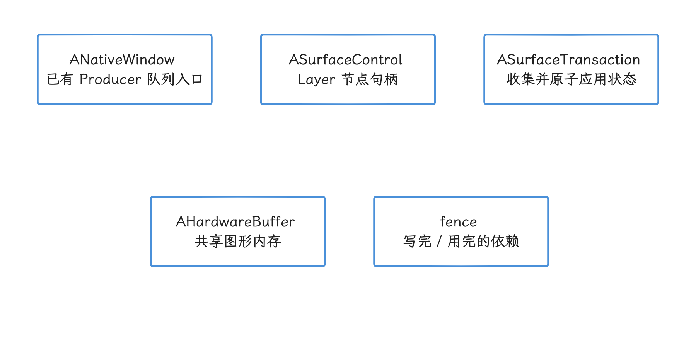

图：窗口入口、Layer 句柄、事务、存储与同步分别管理。 句柄是同进程不透明对象；引用计数不证明访问时序完成。

#### 创建的是父节点下面的新 Layer

`ASurfaceControl_createFromWindow(parent, name)` 从 `ANativeWindow` 取得已有的 SurfaceControl handle，再在该节点下面创建一个新的 Layer。原来的 window 原样保留，新节点不复用原 window 的 BufferQueue。新节点创建时带 `eFXSurfaceBufferState` 标志，因此可以直接接收 `setBuffer()` 提交的 `AHardwareBuffer`。

已经持有 `ASurfaceControl*` 时，改用 `ASurfaceControl_create(parent, name)`，它会在同一个 `SurfaceComposerClient` 连接下创建子节点。两种创建函数都把新引用的所有权交给调用方：失败返回 `nullptr`，成功后要配对调用 `ASurfaceControl_release()`。

<!-- gracker-diagram: ch13-06-03-create-child -->
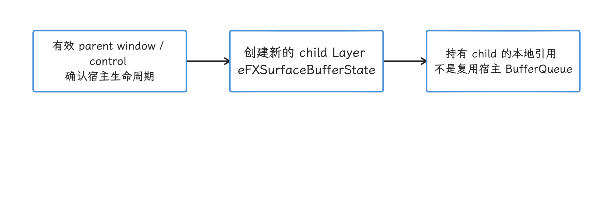

图：创建 child 与向宿主 BufferQueue 生产是两种操作。 createFromWindow 新建 client/child，create 使用 parent client；成功返回的新引用均需 release。

NDK 创建的节点和 “Buffer Layer、Color Layer、Container Layer” 三分法对不上：公开 C API 的创建函数没有 Java `SurfaceControl.Builder` 那样的 layer type 选项。以 `ASurfaceTransaction_setColor()` 为例，它最终调用 `setBackgroundColor()`，只设置 buffer 透明区域下方的背景色，并不会新建独立的 Color Layer。一个节点可以只用来组织子树、从不提交 buffer，但它仍然是这组 NDK 创建函数生成的 buffer-state 节点。

<!-- gracker-diagram: ch13-06-04-layer-kind -->
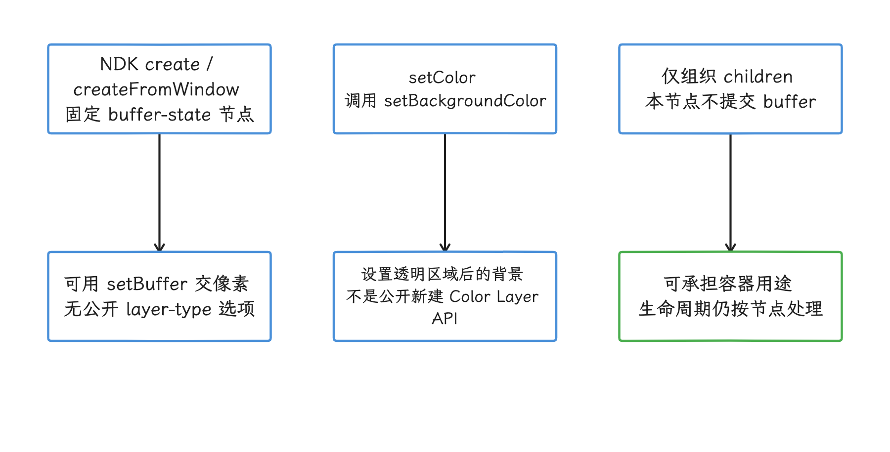

图：公开 NDK 创建的是 buffer-state 节点，setColor 修改背景属性。 没有 Java Builder 的 layer type 选项；只组织子树也不改变创建时类型。

#### Java 与 NDK 句柄桥接

Android 14（API 34）增加了 `android/surface_control_jni.h`：

- `ASurfaceControl_fromJava()` 从有效的 Java `SurfaceControl` 取得一份本地强引用；用完后必须调用 `ASurfaceControl_release()`。
- `ASurfaceTransaction_fromJava()` 返回 Java `SurfaceControl.Transaction` 内部 transaction 的 borrowed pointer（借用指针），只在 Java 对象存活且未 `close()` 时有效；`ASurfaceTransaction_delete()` 不适用于它。

这两个函数只解决同一进程内 Java 与 native 对象的桥接。跨进程传递仍要通过 Java `SurfaceControl` 的 `Parcelable` 能力、`SurfaceControlViewHost.SurfacePackage` 或系统服务完成。

<!-- gracker-diagram: ch13-06-05-jni-ownership -->
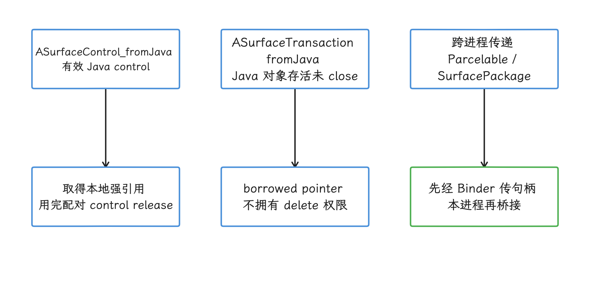

图：control 桥接取得强引用，transaction 桥接借用 Java 内部对象。 两者都是同进程桥接；借用 transaction 不能用 NDK delete。

#### Transaction 的原子性保证

一个 `ASurfaceTransaction` 可以同时修改多个节点。头文件保证 transaction 中的更新原子应用，SF 不会只应用其中一部分；同一线程调用 `apply()` 的多个 transaction 也会按提交顺序应用。不过这些保证到 SurfaceFlinger 接收并应用状态为止，再往后的几件事都要另行确认：

- `apply()` 返回时 buffer 是否已被 latch（选入某次合成）；
- 事务能否赶上调用后的第一个 VSync；
- acquire fence 尚未 signal 的 buffer 能否立即读取；
- 系统是否会自动识别多个独立 Producer 提交的哪些 buffer 属于同一业务帧。

transaction 提交之后，还要经过 Binder、SurfaceFlinger 调度、buffer 就绪判断、合成策略选择和 Display present。我们定位问题时沿着这条时间线往下追，`apply()` 返回只是起点。

<!-- gracker-diagram: ch13-06-06-atomicity -->
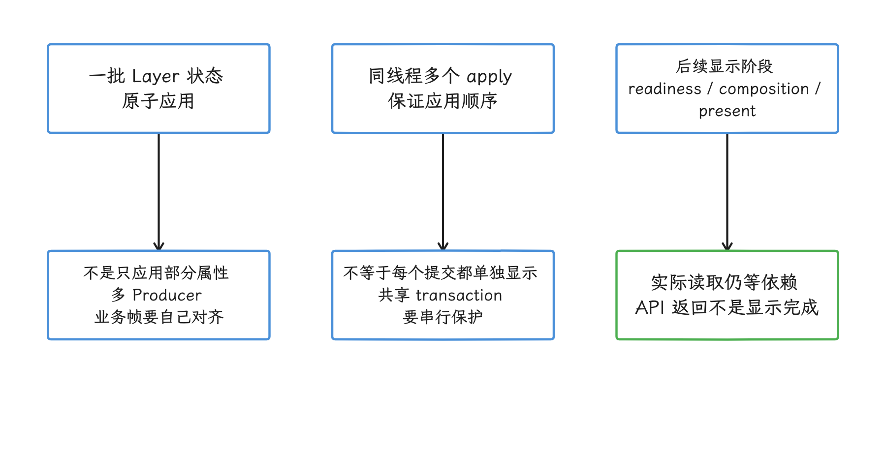

图：原子应用保证一批状态一致，后续读取与显示仍受独立条件约束。 同线程应用有序；这不保证赶上下一 VSync，也不免除 acquire fence。

### 与 BLAST 的关系

BLAST 与 NDK SurfaceControl 最终都使用 `SurfaceComposerClient::Transaction` 向 SurfaceFlinger 交付 buffer 和 Layer 状态，但入口与 buffer 队列所有者不同。

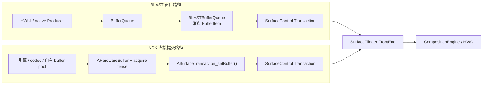

BLAST 路径通常由 Producer 先通过 BufferQueue `dequeueBuffer()`/`queueBuffer()`，再由 `BLASTBufferQueue` 的 Consumer 取得 `BufferItem`，把 buffer、acquire fence 和几何状态放进 transaction。NDK 直接提交路径不会为调用方创建公开的 BufferQueue；应用把自己管理的 `AHardwareBuffer` 和 fence 直接放入 transaction。

<!-- gracker-diagram: ch13-06-07-blast-direct -->
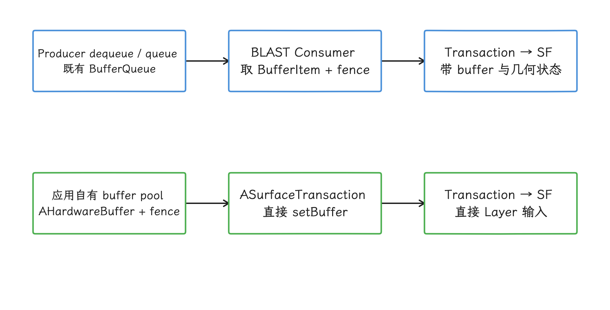

图：BLAST 管队列消费，直接路径由应用管理 buffer 池。 两条路径汇入 transaction；创建 child 不接管原 window 的队列。

两条路径只在 transaction 层汇合。`ASurfaceControl` 与 `BLASTBufferQueue` 是不同对象，`ASurfaceControl_createFromWindow()` 也不会接管 parent window 的队列。排查时可以通过三个问题区分：

1. Producer 是在调用 `queueBuffer()`，还是直接调用 `ASurfaceTransaction_setBuffer()`？
2. buffer slot（buffer 池中的一项） 和 release 节奏由 BufferQueue 管理，还是由应用自己的池管理？
3. Perfetto 中要查的是 BLAST queue 的 frame number，还是应用 transaction 中的独立 Layer/buffer？

同一 transaction 中的几何和 buffer 状态会一起生效，但显示时刻仍受 acquire fence 与调度目标约束。多个 Producer 各自提交 transaction 时，哪些 buffer 属于同一业务帧要靠上层同步协议说明；SurfaceControl 自身没有这套协议，跨 Producer 的时序对齐由业务完成。

### 典型使用流程

#### 从 Java Surface 建立子 Layer

下面的 Java 代码只负责把当前有效的 `Surface` 交给 native。`SurfaceView` 生命周期结束或底层 Surface 被替换后，原对象可能失效，因此 native 层也要跟随 `surfaceCreated`、`surfaceChanged` 和 `surfaceDestroyed` 更新资源。

```java
Surface surface = surfaceView.getHolder().getSurface();
nativeCreateChild(surface);
```

native 侧先取得 `ANativeWindow`，再在该 window 对应的 Layer 下创建子节点。下面的代码只展示引用关系，不包含错误处理后的业务回调。

```c
#include <android/native_window_jni.h>
#include <android/surface_control.h>

static ASurfaceControl* g_child;

void nativeCreateChild(JNIEnv* env, jobject javaSurface) {
    ANativeWindow* window = ANativeWindow_fromSurface(env, javaSurface);
    if (window == NULL) {
        return;
    }

    ASurfaceControl* child =
            ASurfaceControl_createFromWindow(window, "native-overlay");
    ANativeWindow_release(window);

    if (child == NULL) {
        return;
    }
    g_child = child;
}
```

`ANativeWindow_fromSurface()` 会增加 window 引用计数，示例在创建子节点后立即释放这份引用。`ASurfaceControl_createFromWindow()` 返回的 child 是另一类资源，用 `ASurfaceControl_release()` 释放，`ANativeWindow_release()` 管不到它。

<!-- gracker-diagram: ch13-06-08-native-refs -->
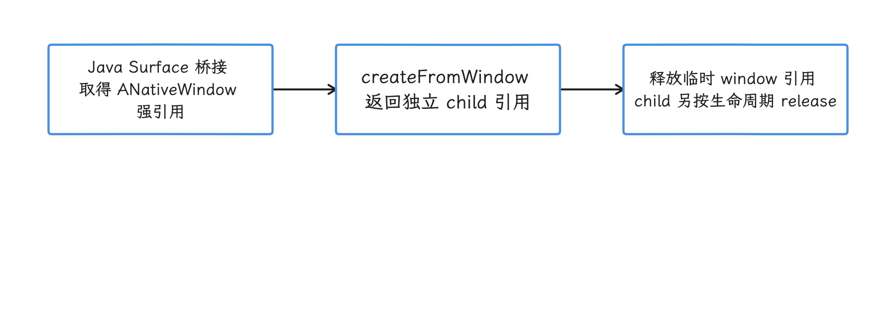

图：先借 Surface 取得 window 引用，再取得独立的 child 引用。 示例为串行生命周期；宿主重建前须移除、释放旧 child 并清空句柄。

#### 提交 buffer 和几何状态

下面的 C 示例把一块已经由 Producer 写好的 `AHardwareBuffer` 提交给 child。`acquireFenceFd` 为 `-1` 时表示没有需要等待的 fence；大于等于 0 时，`setBuffer()` 会把这份 fd 的所有权一并移交给 framework，后续的关闭与复用都交给 framework，调用方不要再动这份 fd。

```c
void submitBuffer(
        ASurfaceControl* child,
        AHardwareBuffer* buffer,
        int acquireFenceFd,
        int32_t bufferWidth,
        int32_t bufferHeight,
        int32_t x,
        int32_t y) {
    ASurfaceTransaction* tx = ASurfaceTransaction_create();

    ARect crop = {
        .left = 0,
        .top = 0,
        .right = bufferWidth,
        .bottom = bufferHeight,
    };

    ASurfaceTransaction_setBuffer(tx, child, buffer, acquireFenceFd);
    ASurfaceTransaction_setCrop(tx, child, &crop);
    ASurfaceTransaction_setPosition(tx, child, x, y);
    ASurfaceTransaction_setVisibility(
            tx, child, ASURFACE_TRANSACTION_VISIBILITY_SHOW);

    ASurfaceTransaction_apply(tx);
    ASurfaceTransaction_delete(tx);
}
```

`setCrop()` 和 `setPosition()` 从 API 31 开始可用。如果 `minSdk` 低于 31，需要按运行系统版本选择接口，或者在 API 29—30 使用已废弃的 `setGeometry()` 兼容旧设备。transaction 对象在 `apply()` 后可以删除，但提交到显示系统的工作仍会异步继续。

<!-- gracker-diagram: ch13-06-09-submit-buffer -->
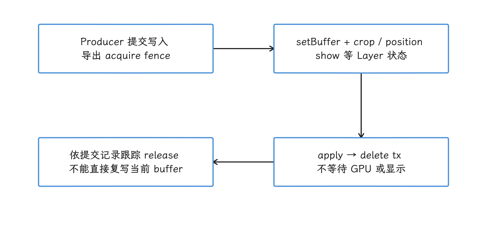

图：先绑定 buffer/fence，再一起提交所需几何与可见性。 crop/position 需 API31；apply 后可删除本地 transaction，异步工作继续。

`AHardwareBuffer` 必须包含 `AHARDWAREBUFFER_USAGE_GPU_SAMPLED_IMAGE`，因为 SurfaceFlinger 可能选择 GPU CLIENT composition。Producer 使用 Vulkan 写入时，还要根据图像用途增加 GPU color output 等 usage；CPU 需要 lock 这块 buffer 时，则要增加相应的 CPU read/write usage。usage 声明哪些模块可以怎样访问内存，fence 只负责访问顺序，两件事各管各的。

<!-- gracker-diagram: ch13-06-10-usage-contract -->
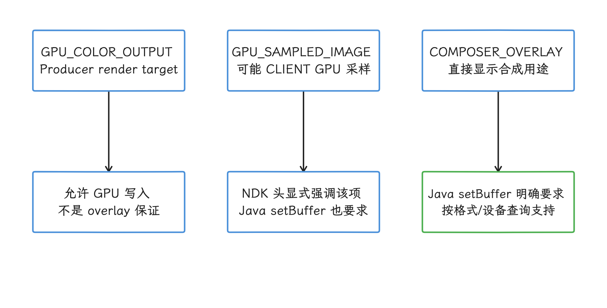

图：写入、GPU 采样与显示合成用途都要匹配实际 consumer。 usage 不建立读写顺序；fence 不补足未声明或不支持的 usage。

#### 提交后的系统路径

下面的时序图把 `apply()` 异步返回、buffer 就绪、系统合成和回收通知放在同一条时间线上。

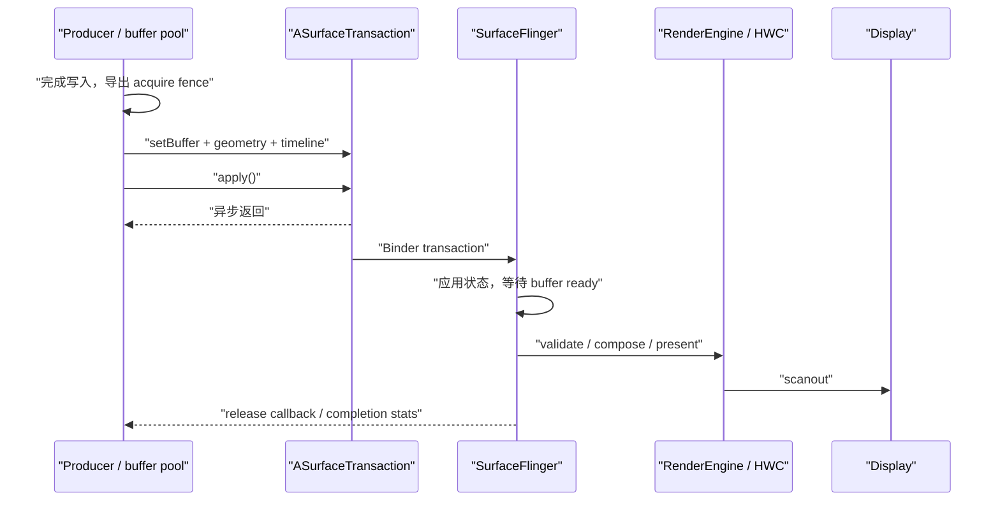

从 `apply()` 到 release 回调的间隔随调度和合成负载浮动。要判断 buffer 何时可复用，可靠的依据是 API 36 的 per-buffer release callback，或者 API 29—35 的 transaction completion stats（事务完成统计）。

<!-- gracker-diagram: ch13-06-11-async-system -->
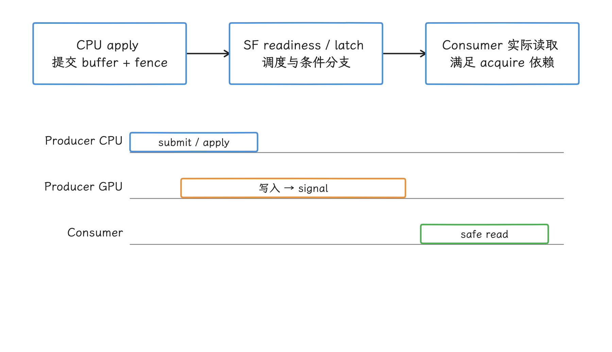

图：buffer 与完成依赖可先交给系统，实际读取再遵守 fence。 轨道仅为依赖示意；受限 latch-unsignaled 不表示可提前读取像素。

### 关键 API 详解

#### 公开能力与版本范围

| API | 级别 | 用途与边界 |
|:---|:---:|:---|
| `createFromWindow()` / `create()` | 29 | 在已有 window 或 control 下创建子节点 |
| `reparent()` / visibility / Z | 29 | 修改树结构、子树可见性和兄弟节点相对层级 |
| `setBuffer()` / color / alpha / dataspace / damage | 29 | 提交像素及合成属性 |
| `setDesiredPresentTime()` | 29 | 请求 transaction 不早于给定时间展示 |
| `setFrameRate()` | 30 | 向系统声明内容帧率，不会替应用控制产帧节奏 |
| crop / position / scale / transform | 31 | 拆分设置几何；优先于已废弃的 `setGeometry()` |
| `setOnCommit()` / backpressure | 31 | transaction 节奏反馈和服务端排队策略 |
| `setFrameTimeline()` | 33 | 把事务关联到 Choreographer 给出的 `vsyncId` |
| `fromJava()` / `clearFrameRate()` | 34 | Java / native 桥接和清除帧率投票 |
| `setDesiredHdrHeadroom()` | 35 | 为标准 HDR 内容声明期望 headroom |
| `setBufferWithRelease()` / LUT | 36 | per-buffer 回收回调和显示用 Look-Up Table（查找表） |

`android-17.0.0_r1` 的公开头文件没有新增标记为 API 37 的 SurfaceControl C 函数；表中沿用的旧接口，签名、实现和 SurfaceFlinger 行为都按这条基线复核过。

<!-- gracker-diagram: ch13-06-15-ndk-versions -->
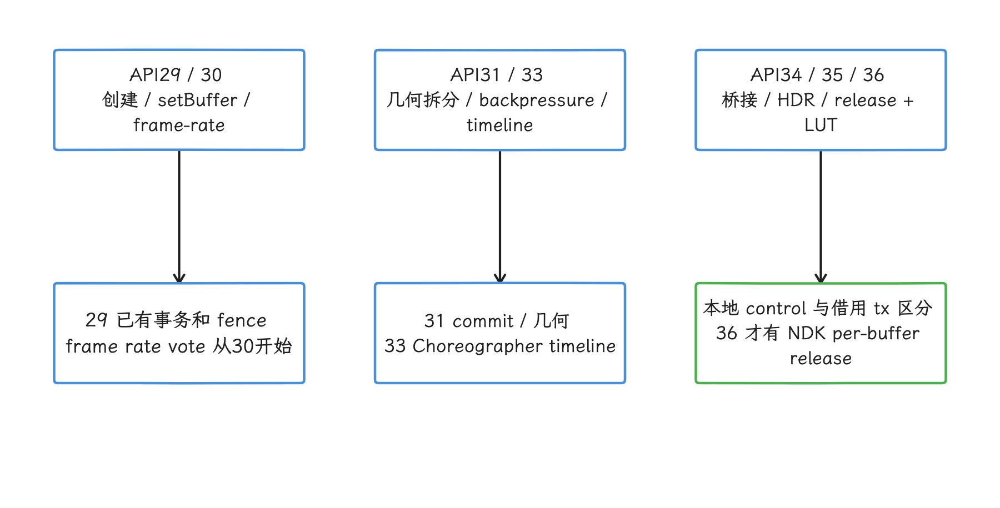

图：创建、几何、调度、桥接与逐 buffer release 在不同 API 开放。 固定 r1 头没有新增 API37 C 函数；旧入口不保证旧系统支持新签名。

#### Buffer、几何和颜色

`ASurfaceTransaction_setBuffer()` 把 `AHardwareBuffer` 与 acquire fence 一起绑定到 Layer。framework 会为已经应用的 buffer 状态持有引用；应用仍要管理自己在 buffer pool（缓冲池） 中的引用，等所有 release fence 与回调都走完，这块 buffer 才能再次写入。

几何属性的坐标空间容易混淆：

<!-- gracker-diagram: ch13-06-16-geometry -->
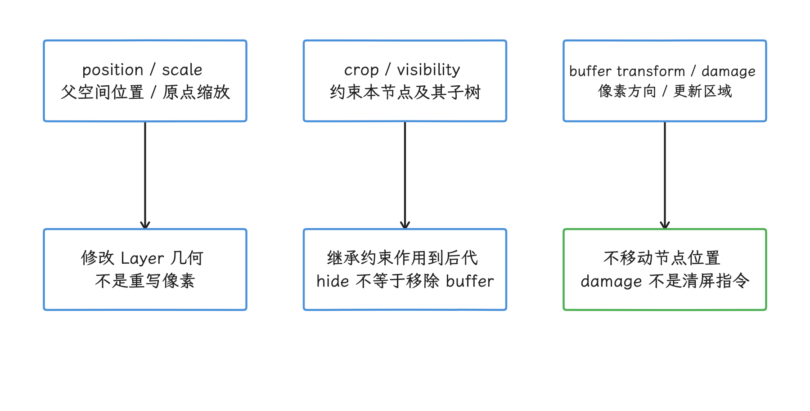

图：先分清父空间、节点及子树、buffer 内容三个坐标对象。 Z 只比较兄弟节点；同 Z 无稳定顺序，scale 必须大于0。

- `setPosition()` 使用父节点的坐标空间；
- `setCrop()` 限制该节点及其子树的可见区域；
- `setScale()` 以 `(0, 0)` 为缩放中心，缩放值必须大于 0；
- `setZOrder()` 只在兄弟节点之间比较，相同 Z 的顺序未定义；
- `setBufferTransform()` 描述 buffer 内容的旋转或翻转，不会移动 Layer 节点本身；
- `setDamageRegion()` 提示哪些内容区域发生了更新，传错可能造成显示错误，或者失去局部更新收益。

`setBufferAlpha()` 使用 premultiplied alpha（颜色通道已经乘过 alpha 的表示）。如果通过 `setBufferTransparency(...OPAQUE)` 声明完全不透明，buffer 范围内每个像素都要满足这个条件；把带透明像素的内容标为 OPAQUE，可能造成错误合成。

`setColor()` 设置背景色、alpha 和 dataspace。带 buffer 的 Layer 还应通过 `setBufferDataSpace()` 描述 buffer 色彩空间；HDR 内容还要按格式提供相应静态元数据或 headroom（高光亮度余量）。像素格式或色域写错了要回到 Producer 侧修，这些颜色接口帮不上忙。

<!-- gracker-diagram: ch13-06-17-alpha-color -->
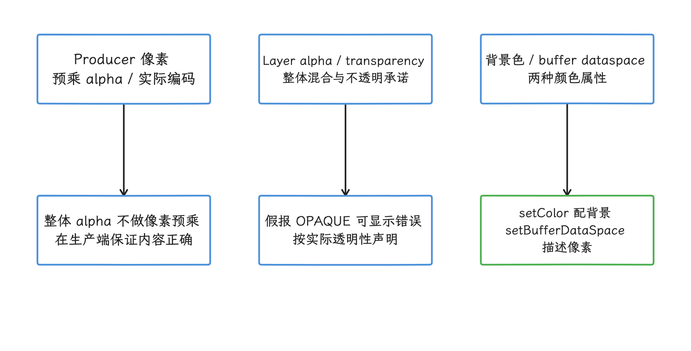

图：Producer 像素、Layer 混合和 dataspace 都要遵守各自契约。 标 OPAQUE 前须确认全部像素不透明；颜色属性不会修复错误像素编码。

#### `OnCommit`、`OnComplete` 与 release callback

| 回调 | API | 能证明什么 | 不能证明什么 |
|:---|:---:|:---|:---|
| `ASurfaceTransaction_OnCommit` | 31 | transaction 已应用，更新已进入可展示状态；后续 transaction 不会再合并进同一帧 | buffer 已释放、present fence 已可读取 |
| `ASurfaceTransaction_OnComplete` | 29 | 包含该 transaction 更新的帧已展示，可以读取 latch/present/previous release 统计 | 所有 previous release fence 都已经 signal |
| `ASurfaceTransaction_OnBufferRelease` | 36 | 对应 `setBufferWithRelease()` 的 buffer 已进入可复用流程 | 回调 fd 大于等于 0 时，fence 已经 signal |

`OnCommit` 先于 `OnComplete` 到达，适合用作 transaction pacing 的反馈；在该回调中查询 present fence 或 previous release fence 会失败，回收 buffer 也不适合放在这里。

<!-- gracker-diagram: ch13-06-12-callbacks -->
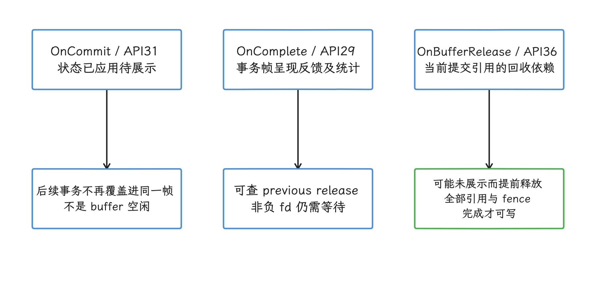

图：回调对应不同阶段，buffer 复用最后仍要检查 release 依赖。 OnCommit 不能查 present/release；release callback 也不证明显示过或 fence 已 signal。

`OnComplete` 传入的 `ASurfaceTransactionStats*` 只在回调执行期间有效。`getPresentFenceFd()` 和 `getPreviousReleaseFenceFd()` 返回的有效 fd 归调用方所有，需要由调用方等待并关闭。`getAcquireTime()` 已废弃，因为回调到达时 acquire fence 仍可能没有 signal；排障时应保留 Producer fence 与提交时间。

API 36 起优先使用 `setBufferWithRelease()`。它把回收通知直接绑定到本次 buffer 提交，应用无须再从“上一块 buffer”的 transaction stats 反推池状态。

<!-- gracker-diagram: ch13-06-13-stats-query -->
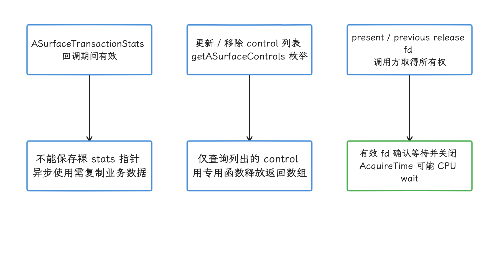

图：在正确 callback 和 control 映射下取得统计，再移交独立 fd。 stats 只在回调内有效；当前实现错误 control 或 OnCommit 查询 release 会 fatal。

<!-- gracker-diagram: ch13-06-30-all-refs -->
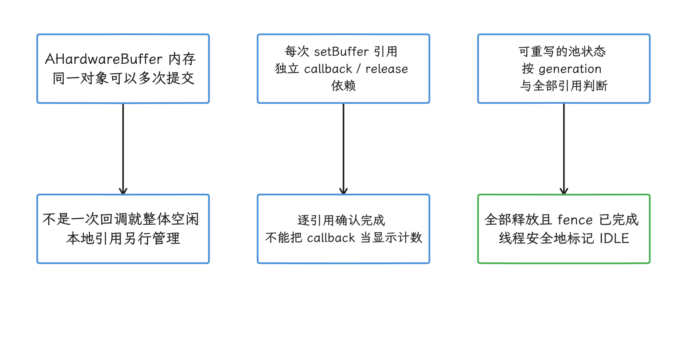

图：buffer、一次提交引用和回调计数必须分开记录。 per-buffer 回收不能再同时用 OnComplete 重复回收；同一内存也可能被多个 Layer 持有。

#### Backpressure 与丢帧

NDK 创建的节点默认关闭 backpressure（服务端保留每次提交的策略）。在上一块 buffer 的回调到达前继续提交时，新 buffer 可能覆盖尚未展示的旧 buffer。这适合优先降低时延、允许丢弃中间帧的场景。

`ASurfaceTransaction_setEnableBackPressure(..., true)` 要求每个 buffer 在释放前都先展示，服务端可能因此暂存更多提交。它可以保留帧序，也可能增加排队与内存压力。引擎已经有可靠的 N-buffer 池和 release pacing 时，看到中间帧消失先判断这些中间帧是否具有业务价值，再决定要不要开启。

<!-- gracker-diagram: ch13-06-14-backpressure -->
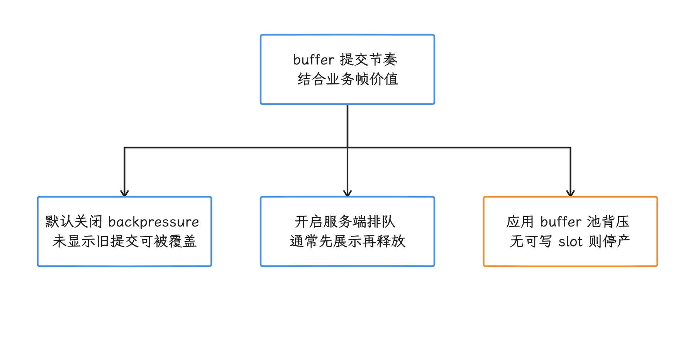

图：按业务决定是否保留中间 buffer，并同时控制应用池的生产节奏。 移除整个节点和本地未 apply 覆盖是边界；开启不保证每块内容都曾显示。

### Layer 层级管理

#### 用树描述所有权

下面的结构适合视频编辑器或自绘播放器：视频、字幕和调试信息的更新频率不同，因此各自使用少量独立 Layer。

```text
Host Window
└── Native Container
    ├── Video Buffer Layer      Z = 0
    ├── Subtitle Buffer Layer   Z = 10
    └── Debug Buffer Layer      Z = 20
```

父节点的位置、裁剪和可见性会作用于整个子树。`setVisibility(HIDE)` 会隐藏节点及其后代；`reparent(child, newParent)` 更换 child 的父节点时，其原有后代仍跟随 child；`reparent(child, NULL)` 则让整个子树脱离显示树。

相同 Z 值的兄弟节点顺序未定义，不能依赖创建先后。需要稳定顺序时给出不同 Z 值，并把层级变更和相关几何更新放进同一事务。

<!-- gracker-diagram: ch13-06-18-layer-tree -->


图：用父子树统一移动、裁剪和隐藏少量独立更新的 Layer。 图表示显示层级；业务对象所有权和 buffer 生命周期另行约定。

#### 跨进程传递的路径

Java `android.view.SurfaceControl` 从 API 29 起实现 `Parcelable`，系统组件可以经 Binder 传递可恢复的句柄，再在目标进程创建本地引用。普通应用嵌入远端 View 时，更常见的公开封装包括：

- 提供方用 `SurfaceControlViewHost` 托管远端 View；
- 接收方取得封装远端 Surface 层级与输入信息的 `SurfacePackage`，并把它附着到 `SurfaceView`；
- API 34 起可用 `SurfaceSyncGroup` 收集参与者的同步结果；
- native 代码需要操作已经传到本进程的 Java control 时，再用 `ASurfaceControl_fromJava()` 桥接。

公开 NDK 没有 `ASurfaceControl_writeToParcel()`，`ASurfaceControl*` 只是当前进程地址空间里的句柄，跨进程传递要走上面这些 Java 封装。跨进程双方还要约定谁创建节点、谁执行 reparent、谁在 Binder death（远端进程死亡）后清理，以及服务退出时如何让 callback context 失效。

<!-- gracker-diagram: ch13-06-19-ipc-controls -->
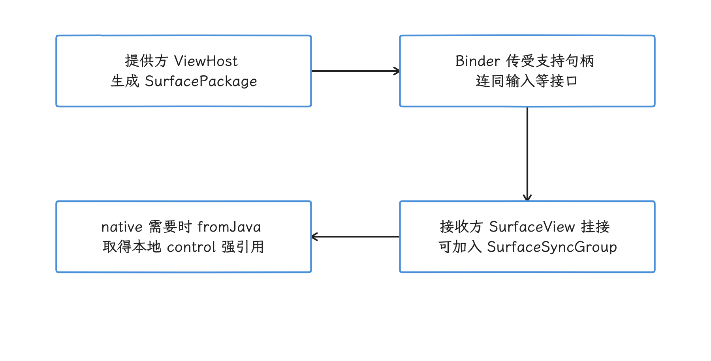

图：跨进程先传受支持的 Binder/Parcelable 对象，再取得本地引用。 不能把 ASurfaceControl 裸地址传到另一进程；参与者同步需显式接入。

#### 销毁分为“离开显示树”和“释放本地引用”

`ASurfaceControl_release()` 只减少调用方持有的本地强引用。头文件明确说明，只要父节点仍在显示树中，surface 及其 children 就仍可能留在屏幕上。

需要移除一棵子树时，可以按以下顺序处理：

1. 在 transaction 中隐藏节点，或者调用 `reparent(node, NULL)`；
2. 提交 transaction，并在需要严格确认显示状态时等待 `OnComplete`；
3. 停止 Producer，处理尚未返回的 buffer release；
4. 释放 `ASurfaceControl`、buffer pool 和回调上下文。

这四步分别处理显示树状态、transaction 完成、像素所有权和本地引用，跳过任何一步都会留下一类清理没做：只调用 `release()` 或只隐藏节点，其余三类清理仍然悬着。

<!-- gracker-diagram: ch13-06-20-destroy -->
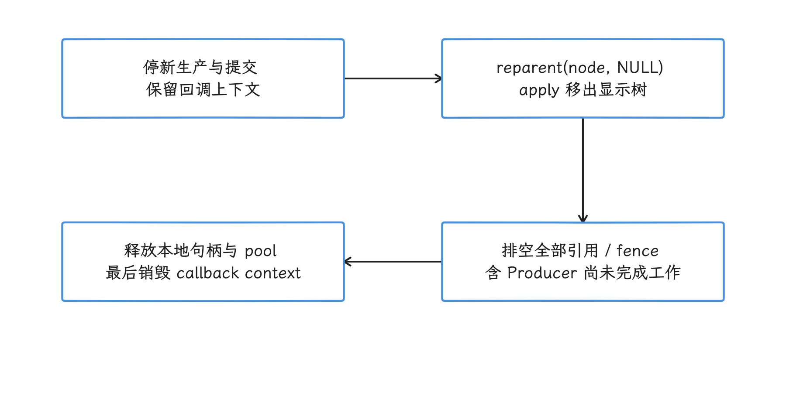

图：先停新提交，再移出树，排空异步依赖后关闭本地资源。 HIDE 可保留当前 buffer；release 本地句柄也不等于从显示树移除。

#### Layer 数量的权衡

每个独立 buffer Layer 都会增加状态遍历、buffer/fence 跟踪和合成策略输入。HWC 能直接处理多少 Layer，取决于像素格式、缩放、旋转、alpha、HDR、secure 属性、分辨率和厂商硬件限制；“超过 N 层必然 GPU 合成”这样的通用阈值并不存在，结论要落到具体设备的合成数据上。

拆分 Layer 时，重点判断两个条件：内容是否需要独立更新节奏，是否需要独立生命周期。如果两个元素总是一起生产、移动和销毁，把它们绘入同一个 buffer 往往更简单。

<!-- gracker-diagram: ch13-06-21-layer-cost -->


图：独立更新和生命周期有价值时，再检查合成侧新增成本。 没有跨设备通用的 Layer 数阈值；DEVICE/CLIENT 按当帧能力与资源决定。

### FrameTimeline API

#### NDK 中的 FrameTimeline 选择流程

Android 12 引入系统侧 FrameTimeline 诊断能力；NDK 中完整的选择和绑定流程到 Android 13（API 33）才开放，包括 `AChoreographer_postVsyncCallback()`、`AChoreographerFrameCallbackData_*()` 和 `ASurfaceTransaction_setFrameTimeline()`。

VSync callback 会提供多条候选 timeline。每条包含：

- `vsyncId`：用于把 transaction 与 SurfaceFlinger 目标帧关联的标识；
- `expectedPresentationTimeNanos`：预计展示时刻，也可以用于推进动画时钟；
- `deadlineNanos`：buffer 要赶上该次展示所必须满足的就绪期限。

callback data 只在回调执行期间有效，但从中取出的 `AVsyncId`、时间戳和索引值可以保存。选择 timeline 时，我们既看业务期望的展示时刻，也估算渲染能否赶上 deadline。

<!-- gracker-diagram: ch13-06-22-timeline-fields -->
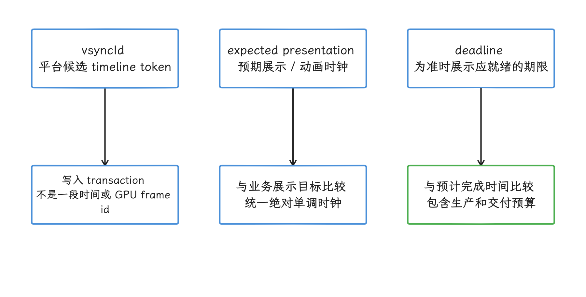

图：候选数据在回调内读取，保存值并基于就绪预算选目标。 vsyncId 是关联标识，时间是预测目标；二者都不保证实际准时显示。

下面的示例选取一条不早于业务目标、且 deadline 晚于预计完成时间的 timeline。代码省略了 GPU 提交，只展示选择和事务绑定位置。

```c
#include <android/choreographer.h>
#include <android/surface_control.h>

typedef struct FrameContext {
    AChoreographer* choreographer;
    int64_t desiredPresentTimeNanos;
    int64_t predictedReadyTimeNanos;
} FrameContext;

static size_t chooseTimeline(
        const AChoreographerFrameCallbackData* data,
        int64_t desiredPresentTimeNanos,
        int64_t predictedReadyTimeNanos) {
    size_t count =
            AChoreographerFrameCallbackData_getFrameTimelinesLength(data);
    size_t preferred =
            AChoreographerFrameCallbackData_getPreferredFrameTimelineIndex(data);

    for (size_t i = preferred; i < count; ++i) {
        int64_t expected =
                AChoreographerFrameCallbackData_getFrameTimelineExpectedPresentationTimeNanos(
                        data, i);
        int64_t deadline =
                AChoreographerFrameCallbackData_getFrameTimelineDeadlineNanos(
                        data, i);
        if (expected >= desiredPresentTimeNanos
                && deadline >= predictedReadyTimeNanos) {
            return i;
        }
    }
    return count - 1;
}

static void onVsync(
        const AChoreographerFrameCallbackData* data,
        void* opaque) {
    FrameContext* ctx = (FrameContext*)opaque;
    size_t index = chooseTimeline(
            data,
            ctx->desiredPresentTimeNanos,
            ctx->predictedReadyTimeNanos);
    AVsyncId vsyncId =
            AChoreographerFrameCallbackData_getFrameTimelineVsyncId(data, index);

    ASurfaceTransaction* tx = ASurfaceTransaction_create();
    ASurfaceTransaction_setFrameTimeline(tx, vsyncId);
    /* renderFrameAndAttachBuffer(tx, vsyncId); */
    ASurfaceTransaction_apply(tx);
    ASurfaceTransaction_delete(tx);

    AChoreographer_postVsyncCallback(
            ctx->choreographer, onVsync, ctx);
}
```

连续渲染时，每次 callback 都要再次注册下一帧。`AChoreographer_getInstance()` 必须在带有 `ALooper`（NDK 消息循环）的线程中调用。示例假定 callback 至少提供一条 timeline；工程代码还要处理上下文销毁、渲染取消和 buffer 提交失败。

`setFrameTimeline()` 已经把 transaction 关联到候选 timeline 的 expected presentation time 和 deadline，无须机械地把同一个 expected time 再填入 `setDesiredPresentTime()`。后者是 API 29 起的独立调度请求，适用于没有 `vsyncId`，或者业务明确要求“不早于某时刻”展示的场景。如果同时使用两个请求，应保证它们的目标一致；过期或无效的 `vsyncId` 会被忽略。

`setFrameRate()` 和 FrameTimeline 分工不同：它向系统声明内容帧率，可能影响显示刷新率选择；产帧节奏仍要靠 Choreographer、swapchain pacing 或 release callback 自己控制。

<!-- gracker-diagram: ch13-06-23-timeline-selection -->


图：从 preferred 开始检查时间条件，成功才绑定 token 与 buffer。 没有可行候选时重注册并跳过；不把最后一个已错过 deadline 的候选当作满足。

<!-- gracker-diagram: ch13-06-24-timeline-rate -->
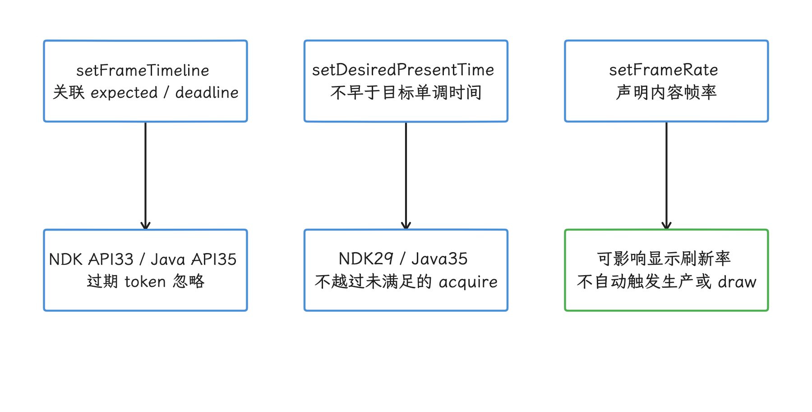

图：一个指定目标候选，一个请求不早于时间，一个声明内容帧率。 请求不是显示保证；同时使用时应一致，实际产帧仍需 pacing。

#### Trace 中怎样解释 FrameTimeline

FrameTimeline 提供的是“计划”和“结果”的对应关系。分析一帧时至少记录：

| 字段 | 回答的问题 |
|:---|:---|
| expected presentation | 应用选择的目标展示时刻 |
| deadline | buffer 最晚应在何时准备好 |
| actual presentation | 该 SurfaceFrame/DisplayFrame 实际何时展示 |
| present type / jank type | 平台如何归类早、准时或迟到 |
| Layer / token 映射 | 这条 timeline 对应哪个内容对象 |

光有 `vsyncId` 解释不了卡顿，我们要把 GPU fence、SurfaceFlinger latch 和 Display present 关联到同一帧看。

<!-- gracker-diagram: ch13-06-25-frametimeline-limits -->
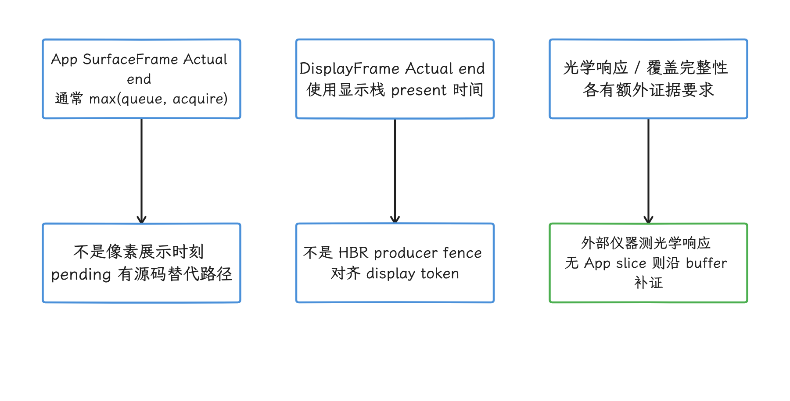

图：先确认目标 Layer 覆盖，再区分 App 完成与显示栈呈现时间。 官方仍列 SurfaceView 完整 FrameTimeline 未支持；token 不能补齐独立 HBR 的 App 时段。

### Fence 处理与生命周期

#### 一块 buffer 的同步方向

下面的方向图只描述一块 buffer 的读写同步，不表示对象引用关系。

```text
Producer 写入
    │
    ├── acquire fence ──> SurfaceFlinger / HWC 等待后读取
    │
    └── buffer 保持不可复写
                         │
                         └── release fence ──> Producer 等待后复用
```

acquire fence 保证 Producer 写完后 Consumer 才读取，release fence 保证 Consumer 读完后 Producer 才重新写入。两者方向相反，并且都独立于 `AHardwareBuffer` 的引用计数：对象引用拿在手里，只说明内存还在自己名下，同步条件要看 fence。

<!-- gracker-diagram: ch13-06-26-fence-directions -->
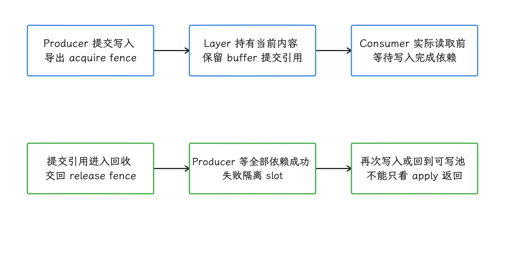

图：同一块存储先保护 Consumer 读取，再保护 Producer 重写。 引用计数只保护对象存活；fd 转移与 buffer 引用是不同所有权。

调用 `setBuffer()` 或 `setBufferWithRelease()` 后，framework 会接管传入的 acquire fence fd。如果调用方还要保留同一 fence 用于诊断，必须在调用前通过 `dup()` 创建另一份 fd；所有权转移后，原 fd 就不要再关闭或复用了。

内核版本 `android17-6.18-2026-06_r6` 中，`drivers/dma-buf/sync_file.c` 把 dma-fence 暴露为 fd，`drivers/dma-buf/dma-fence.c` 提供 signal、callback 和 wait 原语。这套机制是通用的；某台设备的 GPU、codec 或 Display fence 为什么迟到，要结合厂商驱动 timeline 和目标 buffer 的所有权才能归因。

#### API 36：按 buffer 接收 release

release callback 可能在任意线程执行；更稳妥的做法是回调里只做移交，把 slot 和 fence fd 交给专门的回收队列处理。

```c
static void onBufferRelease(void* opaque, int releaseFenceFd) {
    BufferSlot* slot = (BufferSlot*)opaque;
    enqueueForRecycle(slot, releaseFenceFd);
}

void attachBuffer(
        ASurfaceTransaction* tx,
        ASurfaceControl* child,
        BufferSlot* slot,
        int acquireFenceFd) {
    ASurfaceTransaction_setBufferWithRelease(
            tx,
            child,
            slot->hardwareBuffer,
            acquireFenceFd,
            slot,
            onBufferRelease);
}
```

回收线程看到 `releaseFenceFd >= 0` 时，要等 fence signal 后关闭 fd，再把 slot 放回可写队列；值为 `-1` 表示 buffer 已经可以复用。回调上下文 `BufferSlot*` 必须存活到回调执行完毕，组件销毁时要先停止新提交，再排空未完成回调。

头文件还规定：如果同一 transaction 中的 buffer 在 `apply()` 前又被一次 `setBuffer()` 替换，被替换 buffer 的回调会立即执行；其他情况会在 buffer 展示后、`OnComplete` 前执行。所以池状态要按回调实际到达维护，每个回调未必对应一块显示过的 buffer。

<!-- gracker-diagram: ch13-06-27-buffer-release -->
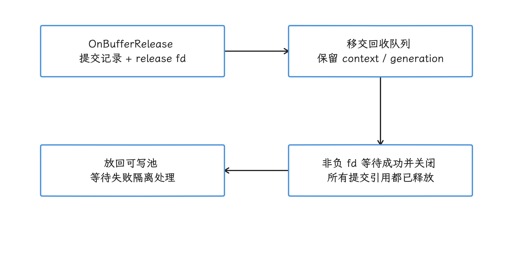

图：回调交出 slot/提交记录和 fd，专用队列确认全部依赖后再复用。 非负 fd 仍可能 pending；回调不是显示过的证明，context 必须活到不再被访问。

<!-- gracker-diagram: ch13-06-28-local-overwrite -->


图：本地覆盖会安排 release 回调，旧 GPU 工作仍可能继续。 本进程由专用线程派发；条长仅为依赖示意，不是覆盖调用栈同步回调。

#### API 29—35：从完成统计取得上一块 buffer

旧系统使用 `setBuffer()`，并在 `OnComplete` 中调用：

```c
int fd = ASurfaceTransactionStats_getPreviousReleaseFenceFd(stats, control);
if (fd >= 0) {
    enqueuePreviousBufferForRecycle(control, fd);
} else {
    recyclePreviousBufferNow(control);
}
```

该 fd 描述此 Layer 的上一块 buffer。每次把 buffer 应用到某个 surface，framework 都将其视为一次独立引用；同一个 `AHardwareBuffer` 被多次提交时，第一次 callback 到达只释放其中一个引用，要等所有待处理引用都释放后才能复写。

<!-- gracker-diagram: ch13-06-29-legacy-previous -->


图：提交 B 时保存 A→B 映射，用 B 的完成统计回收上一提交引用 A。 当前 B 留待未来替换/移除；control 必须来自该 stats 的合法列表。

#### 常见错误

| 错误 | 后果 | 修正 |
|:---|:---|:---|
| `apply()` 返回后立即复写 buffer | 撕裂、花屏或同步错误 | 等待 per-buffer callback/previous release fence |
| 把 acquire fd 传入后再次 `close()` | framework 等到无效或复用 fd | 调用前按需 `dup()`，明确所有权转移 |
| 在 `OnCommit` 查询 present / release fence | 查询失败 | 在 `OnComplete` 查询，或使用 API 36 release callback |
| callback context 提前销毁 | use-after-free（释放后继续访问） | 停止提交并排空回调后再销毁池 |
| callback 线程直接长时间等待 | 回调拥塞，后续 release 延迟 | 把 fence 移交给回收线程 |
| 只释放 `ASurfaceControl`，未移除子树 | Layer 仍可能显示 | 先 hide/reparent-null，再释放句柄 |

<!-- gracker-diagram: ch13-06-31-callback-lifetime -->
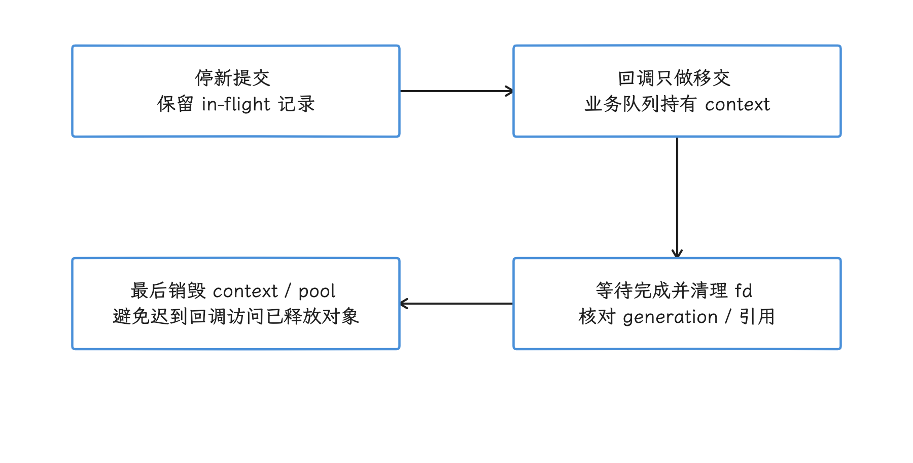

图：回调上下文要覆盖派发、等待与回池任务的完整生命周期。 在 callback 线程长等会阻塞反馈；关闭 fd 不是完成依赖的替代。

### 实战场景

#### 自绘引擎与视频编辑器

SurfaceControl 适合把更新节奏不同的少量内容拆开：主画面逐帧更新，字幕只在文本变化时更新，调试层只在采样点刷新。引擎负责生产 `AHardwareBuffer`、提交 acquire fence、处理 release callback；SurfaceFlinger 把这些 Layer 与其他窗口一起合成。

收益要同时用应用侧和显示侧的数据验证。App GPU 工作减少后，额外 Layer 仍可能因为缩放、alpha、HDR 或硬件限制进入 CLIENT composition；如果 App RenderThread 负载降下来，SurfaceFlinger/RenderEngine 负载却升上去，成本只是转移到了系统合成阶段。

<!-- gracker-diagram: ch13-06-32-engine-cost -->
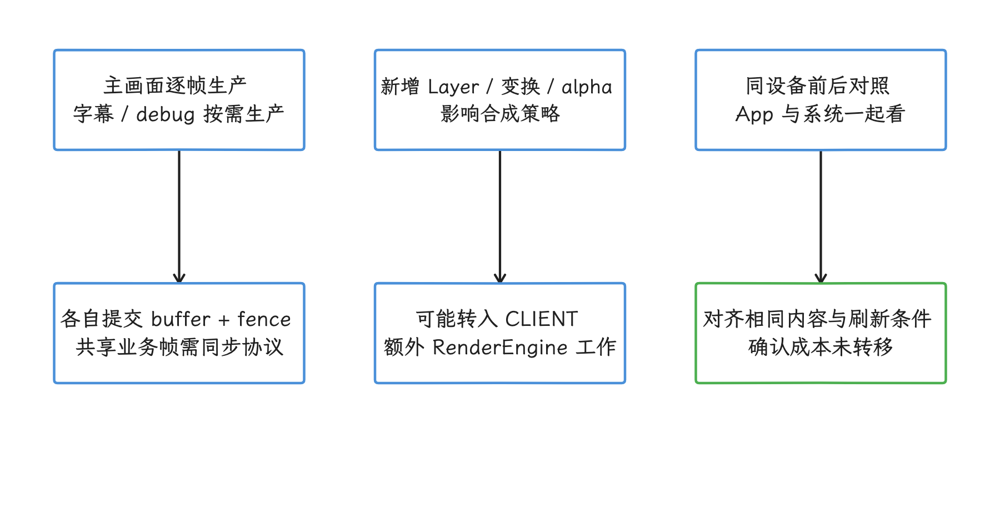

图：独立 Layer 可减少宿主重绘，也会改变系统合成输入。 App 成本下降不自动等于总 GPU、功耗或延迟下降。

#### SurfaceView 宿主

`SurfaceView` 提供独立 Surface 与 Layer 生命周期。native 组件可以从其 Java `Surface` 取得 `ANativeWindow`，再通过 `createFromWindow()` 创建受宿主裁剪和可见性影响的子节点。宿主销毁或重建 Surface 后，旧 parent handle 就对应不上新的树根了，需要重新创建。

需要直接向 `SurfaceView` 的 BufferQueue 渲染时，应使用该 `ANativeWindow` 的 EGL/Vulkan/MediaCodec Producer 路径；只有需要在宿主节点下组织额外 Layer 时，才使用 `ASurfaceControl_createFromWindow()`。前者向现有队列生产内容，后者创建新的子 Layer，两者是不同操作。

<!-- gracker-diagram: ch13-06-33-surfaceview-host -->
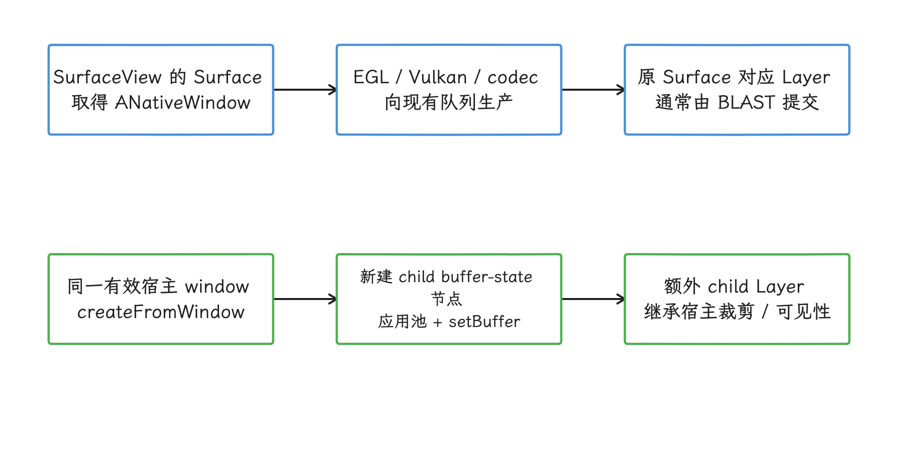

图：先判断目标是现有 SurfaceView 队列，还是宿主下新增 Layer。 宿主 Surface 替换后旧 parent 不能自动对应新树根，需重建 child。

#### WebView

标准 WebView 主体通常由 Chromium 准备 compositor frame（合成器帧），再通过宿主进程的 HWUI functor 合入 App Window buffer。renderer 进程独立，说明的只是内容生产跨了进程；网页主体有没有独立的 SurfaceFlinger Layer，要另找依据。

视频、受保护内容或 provider 选择的 overlay 可能产生额外 SurfaceControl Layer。判断设备上的真实路径时，要检查 WebView provider revision、SurfaceFlinger Layer 树、宿主 RenderThread 和媒体 Producer；仅看到 Viz/Compositor 线程，不足以证明网页已经独立合成。

<!-- gracker-diagram: ch13-06-34-webview-scope -->
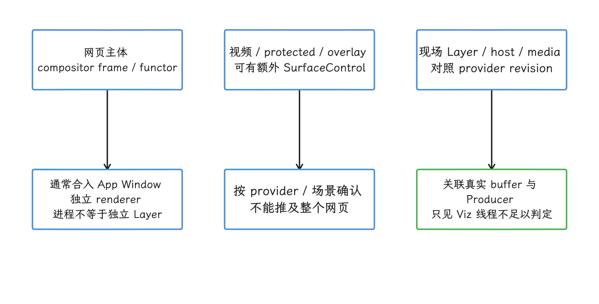

图：线程和 renderer 进程说明生产位置，独立 Layer 要看实际目标。 主体 functor 与媒体/受保护 overlay 可并存；随 provider revision 变化。

#### 画中画与系统动画

进入 PiP 时，WindowManager Shell 通常持有任务 leash（承载过渡动画属性的临时父 Layer）和 PiP container，并通过 Java/framework transaction 修改位置、裁剪、圆角和层级。普通应用负责提交视频内容；把自己的 Layer 任意 reparent 到系统私有容器，公开 NDK API 做不到。

分析 PiP 卡顿时，我们把问题拆开看：

- Shell / WMS 的几何事务是否按时；
- 视频 Producer 的 buffer 与 acquire fence 是否按时；
- PiP 圆角、阴影和其他窗口是否改变 HWC composition；
- transition 结束后旧 leash / Layer 是否被清理。

旧 buffer 与新几何同时生效时，可能出现拉伸或黑边。内容迟到与动画 transaction 迟到要按 token 和 Layer 分开定位。

<!-- gracker-diagram: ch13-06-35-pip-domains -->
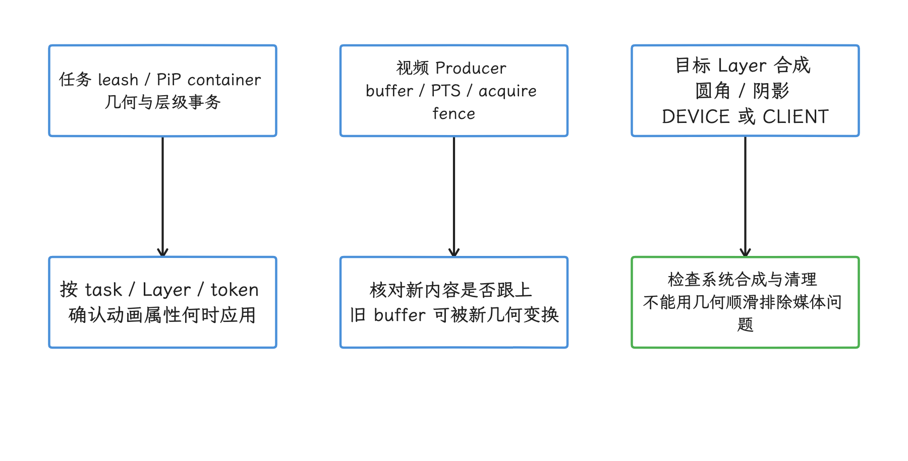

图：把 Shell/WMS 动画事务、媒体生产和显示合成分成三组证据。 公开 NDK 无法任意取得系统私有容器；内容迟到不等于动画事务迟到。

#### 跨进程 View 与 Flutter Platform View

分析跨进程 View 时，优先从 `SurfaceControlViewHost`、`SurfacePackage` 和 `SurfaceSyncGroup` 的公开生命周期入手。Flutter Platform View 可能走 hybrid composition（原生 View 与 Flutter 内容分层合成），也可能走 Texture 路径或 SurfaceProducer，实际拓扑随 Flutter engine、Android 版本和插件实现变化。框架名称本身说明不了是否存在独立 SurfaceControl Layer。

我们先把“内容 Producer → 消费位置 → 宿主 buffer 或独立 Layer → SurfaceFlinger”的对象关系画出来，再讨论优化。只按进程名或框架名判断，很容易把应用内的宿主纹理合成误写成系统 overlay。

<!-- gracker-diagram: ch13-06-36-framework-topology -->
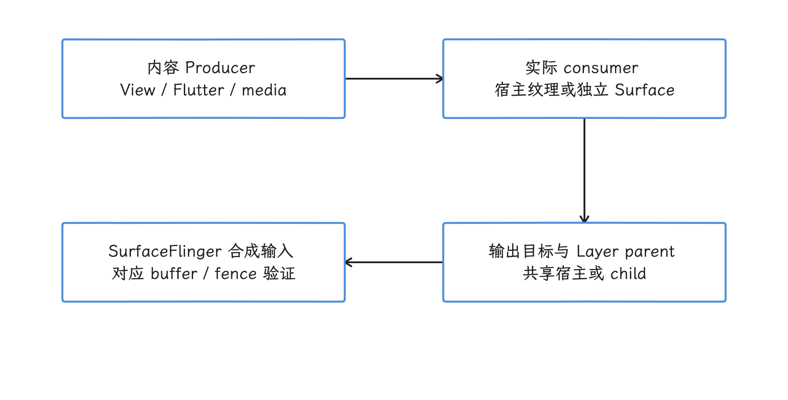

图：从 Producer、消费位置和宿主关系确认真实拓扑。 框架名、进程名不保证独立 Layer；插件和 engine 版本需固定。

### Trace 视角

#### 先建内容对象表

分析混合出图时，我们先按内容对象归档，再谈应用和线程。SurfaceControl 场景可以先填写这张表：

| 内容 | Producer | 提交入口 | SF Layer / parent | buffer 标识 | acquire / release | FrameTimeline |
|:---|:---|:---|:---|:---|:---|:---|
| 主画面 | 引擎 RenderThread | `setBufferWithRelease()` | `game-main`/host | pool slot + frame id | GPU → SF/SF → pool | vsyncId |
| 字幕 | UI raster worker | `setBuffer()` | `subtitle` / container | subtitle generation | CPU ready / previous release | 可选 |
| 视频 | codec | `queueBuffer()` 或独立 bridge | `video` / host | codec PTS + frame number | codec → consumer | media timing |

这张表可以发现同名 Layer 已经重建、误用宿主 FrameTimeline 解释独立视频、把 release fence 归到错误 buffer 等问题。

<!-- gracker-diagram: ch13-06-37-object-table -->
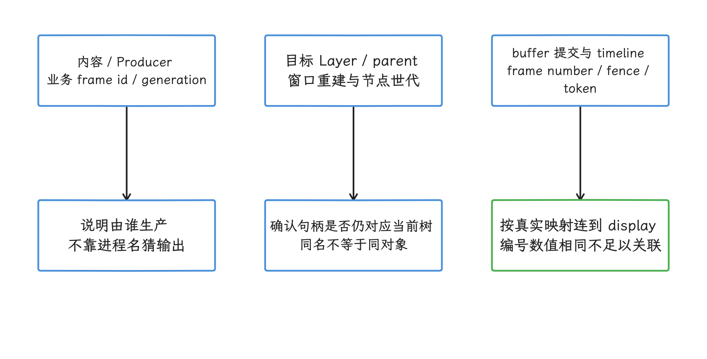

图：同一内容的提交编号、Layer 世代和同步记录一起保存。 不要用同名 Layer、宿主 token 或 codec PTS 直接替代其他对象的标识。

#### 应用侧 trace 标记

NDK 的 `ASurfaceTransaction_apply()` 只调用 native transaction 的 `apply()`。源码并没有承诺一定生成名为 `ASurfaceTransaction_apply` 的 trace slice；`setTransactionState`、`latchBuffer` 等内部 slice 也可能随版本和 trace 配置变化。

应用可以在提交点加入自己的稳定 marker。下面的标记只圈出 API 调用发生的位置；transaction 是否 commit、内容是否上屏，要结合系统侧数据确认。

```c
#include <android/trace.h>

ATrace_beginSection("SC submit: subtitle frame=42");
ASurfaceTransaction_apply(tx);
ATrace_endSection();
```

把业务 frame id 写入自定义 marker 后，再用 transaction、Layer、buffer 和 FrameTimeline 数据源向显示端关联。marker 结束时刻是应用调用返回的时刻，present time 要从显示端取。

<!-- gracker-diagram: ch13-06-38-trace-markers -->
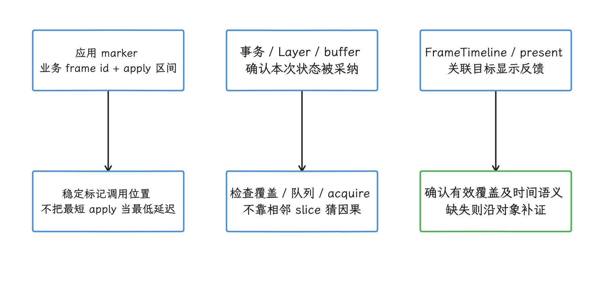

图：marker 记录提交调用区间，系统反馈记录后续 commit 与显示结果。 内部 slice 名称不跨版本保证；marker 结束不是 GPU 或上屏时刻。

#### 一次卡顿分析的最小链路

一次 SurfaceControl 卡顿分析至少覆盖五段：

<!-- gracker-diagram: ch13-06-39-diagnostic-chain -->
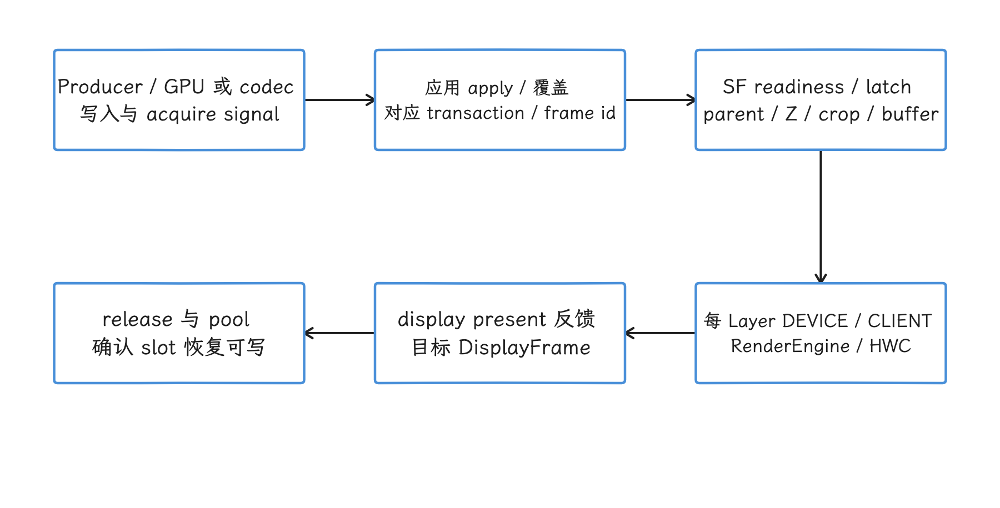

图：沿同一内容依次核对生产、提交、采纳、合成和回收。 DEVICE/CLIENT 是 per-Layer 结果；某段等待要沿 fence 找真实依赖。 图表示排查顺序，不表示 GPU 必须先 signal 才能 apply。

1. Producer 何时开始和结束写 buffer，GPU/codec fence 何时 signal；
2. 应用何时提交 transaction，该提交是否被后续 transaction 覆盖；
3. SurfaceFlinger 看到哪个 Layer、parent、Z、crop、buffer 和 frame token；
4. 该 DisplayFrame 选择 DEVICE 还是 CLIENT composition，RenderEngine/HWC 花费多少；
5. actual present 和 release fence 何时发生，buffer pool 是否及时恢复可写 slot。

下面的命令用于核对当前 Layer 名称。不同版本的详细 dump 格式可能变化，自动化脚本解析时以字段名为准，跳过固定列位置。

```bash
adb shell dumpsys SurfaceFlinger --list
adb shell dumpsys SurfaceFlinger
```

Perfetto 配置应包含应用 atrace、线程调度、Binder、gfx/view、SurfaceFlinger、FrameTimeline 和场景所需的 GPU 数据源。厂商 GPU/HWC counter 是否可见取决于设备；缺少 counter 时，结论里要写清哪些硬件阶段本次没有覆盖到。

#### 从现象到检查项

| 现象 | 优先检查 | 不要直接下的结论 |
|:---|:---|:---|
| `apply()` 很快，画面仍晚 | acquire fence、目标 timeline、SF/HWC present | SurfaceControl 没有生效 |
| 中间帧消失 | backpressure、连续 `setBuffer()`、Producer 频率 | SurfaceFlinger 随机丢帧 |
| Layer 数量上升后耗时增加 | parent 树、CLIENT/DEVICE、RenderEngine | 超过固定 Layer 数量上限 |
| WebView renderer 很忙 | renderer/functor/host/media overlay 各自路径 | 网页主体一定是独立 Layer |
| PiP 几何顺、内容卡 | codec buffer、acquire fence、视频 Layer | Shell 动画慢 |
| 内存只增不降 | 未完成 release、buffer pool、旧 Layer/callback context | 单纯 Java heap 泄漏 |

<!-- gracker-diagram: ch13-06-40-symptom-proof -->
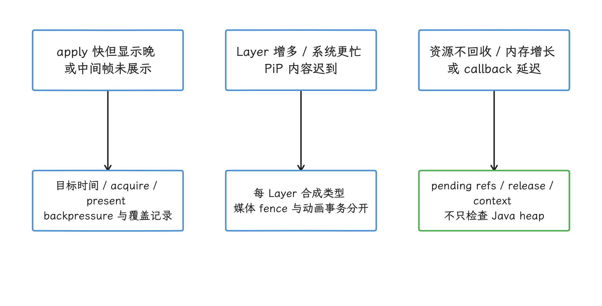

图：把症状转成对象和阶段证据，再做性能归因。 快 API、同名线程或更多 Layer 都不能直接证明显示及时或 overlay 方式。

#### 源码索引

- [`surface_control.h`](https://android.googlesource.com/platform/frameworks/native/+/android-17.0.0_r1/include/android/surface_control.h)：公开 API、级别、fd 所有权和 callback 语义。
- [`surface_control_jni.h`](https://android.googlesource.com/platform/frameworks/native/+/android-17.0.0_r1/include/android/surface_control_jni.h)：API 34 Java/native 桥接及所有权差异。
- [`surface_control.cpp`](https://android.googlesource.com/platform/frameworks/base/+/android-17.0.0_r1/native/android/surface_control.cpp)：NDK 到 `SurfaceControl`/`Transaction` 的实现映射。
- [`SurfaceControl.java`](https://android.googlesource.com/platform/frameworks/base/+/android-17.0.0_r1/core/java/android/view/SurfaceControl.java)：Java Layer 树、`Parcelable` 和 Transaction。
- [`BLASTBufferQueue.cpp`](https://android.googlesource.com/platform/frameworks/native/+/android-17.0.0_r1/libs/gui/BLASTBufferQueue.cpp)：BLAST 消费 BufferQueue 并生成事务的路径。
- [`SurfaceComposerClient.cpp`](https://android.googlesource.com/platform/frameworks/native/+/android-17.0.0_r1/libs/gui/SurfaceComposerClient.cpp)：transaction 状态收集和提交。
- [`SurfaceFlinger.cpp`](https://android.googlesource.com/platform/frameworks/native/+/android-17.0.0_r1/services/surfaceflinger/SurfaceFlinger.cpp) 与 [`FrameTimeline.cpp`](https://android.googlesource.com/platform/frameworks/native/+/android-17.0.0_r1/services/surfaceflinger/Scheduler/FrameTimeline.cpp)：transaction 应用、帧调度和展示结果。
- [`sync_file.c`](https://android.googlesource.com/kernel/common/+/refs/tags/android17-6.18-2026-06_r6/drivers/dma-buf/sync_file.c) 与 [`dma-fence.c`](https://android.googlesource.com/kernel/common/+/refs/tags/android17-6.18-2026-06_r6/drivers/dma-buf/dma-fence.c)：内核 fence fd、signal、callback 和 wait 语义。

相关章节：

- [13.1 Android View 渲染管线与分析方法](01-android-view-pipeline-analysis.md)
- [13.3 SurfaceView 与 TextureView 渲染管线](03-surfaceview-textureview-pipelines.md)
- [13.5 Vulkan 原生管线与 HWUI 多队列](05-vulkan-hwui-multi-queue.md)
- [13.9 Android 17 WebView 渲染管线](09-webview-rendering.md)
- [2.8 BufferQueue、Gralloc 与 Sync Fence](../../part1-fundamentals/ch02-rendering/08-bufferqueue-gralloc-sync-fence.md)
- [2.9 SurfaceFlinger 合成、FrontEnd 与事务队列](../../part1-fundamentals/ch02-rendering/09-surfaceflinger-frontend-transaction.md)


## HardwareBuffer 渲染与提交

SurfaceControl 管 Layer 状态、transaction 提交和 fence 同步；像素内容由谁画进 buffer，是这一半要回答的问题。HardwareBufferRenderer 负责把内容画进调用方提供的 `HardwareBuffer`，两者通过一块 buffer 和它两端的 fence 交接。

### HBR 解决什么问题

HBR 把一棵 `RenderNode` 场景树光栅化到**调用方拥有的 `HardwareBuffer`**。这块 buffer 之后交给 `SurfaceControl`、其他进程、GPU 还是媒体 consumer，由调用方自己决定，同步与复用也自己负责。我们记住这条分界，再看它和另外两个 Canvas API 的差别：`lockCanvas()` 与 `lockHardwareCanvas()` 都把内容写进 `Surface` 背后的 BufferQueue，输出目标由 Surface 侧决定。

先看基线 `Surface.lockCanvas()`。它让 CPU 直接绘制到 `Surface`：调用方从 `BufferQueue` 取得可写 buffer，Skia software backend 在 CPU 上完成光栅化（把矢量绘制命令转成像素），`unlockCanvasAndPost()` 再把 buffer 提交回队列。复杂 Path、大尺寸缩放、滤镜或高分辨率离屏内容会吃掉不少 CPU 时间，这正是 HBR 要接手的场景之一。

把 HBR 当成 `lockCanvas()` 的硬件加速开关是常见误会——硬件加速的 Canvas 另有入口：`Surface.lockHardwareCanvas()` 已经用上 HWUI/GPU，输出目标仍是 `Surface`。三者的分工如下：

| API | 光栅化执行者 | 输出目标 | 提交与 buffer 复用 |
| --- | --- | --- | --- |
| `Surface.lockCanvas()` | CPU / Skia software | `Surface` 背后的 buffer | 由 `unlockCanvasAndPost()` 和 BufferQueue 协作 |
| `Surface.lockHardwareCanvas()` | HWUI / GPU | `Surface` 背后的 buffer | 仍沿用 Surface / BufferQueue；每帧必须完整覆盖目标 |
| `HardwareBufferRenderer` | HWUI RenderThread / GPU | 调用方提供的 `HardwareBuffer` | 调用方选择 consumer，并管理 presentation fence、release fence 和 buffer 池 |

`Surface.java` 明确规定，`lockHardwareCanvas()` 不保留前一帧内容，调用方每次都要完整覆盖。HBR 在 draw 前**不会自动清空**目标，未被本次绘制覆盖的像素会继续保留——这是局部更新的能力，也可能成为残留旧像素的来源。[AOSP: `Surface.lockHardwareCanvas()`](https://android.googlesource.com/platform/frameworks/base/+/refs/tags/android-17.0.0_r1/core/java/android/view/Surface.java) [AOSP: `HardwareBufferRenderer`](https://android.googlesource.com/platform/frameworks/base/+/refs/tags/android-17.0.0_r1/graphics/java/android/graphics/HardwareBufferRenderer.java)

<!-- gracker-diagram: ch13-06-41-canvas-targets -->
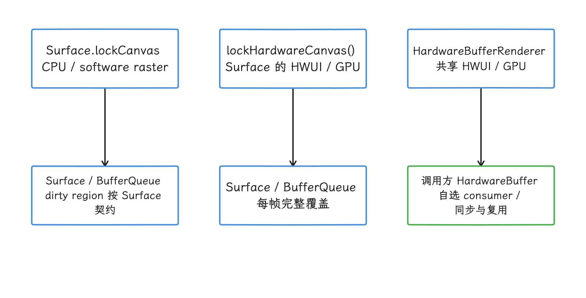

图：CPU Canvas、Surface GPU Canvas 与独立 HardwareBuffer 使用不同目标模型。 GPU 光栅化不自动把 Surface 队列变成调用方持有的 buffer 池。

如果已经有一个正常消费的 `Surface`，需求只是 GPU Canvas，`lockHardwareCanvas()` 或面向 Surface 的 `HardwareRenderer` 通常更合适。

<!-- gracker-diagram: ch13-06-42-preserve-clear -->
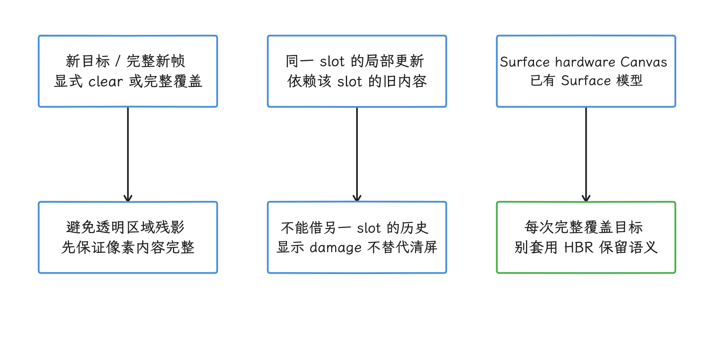

图：HBR 保留未覆盖像素，调用方明确选择全量覆盖或局部更新。 保留内容不等于自动正确缓存；Surface hardware Canvas 的完整覆盖契约不同。

### HBR 的生命周期约束

HBR 是 Android 14 / API 34 加入的 Java API。它复用 HWUI 的基础设施，没有为离屏内容另建一套渲染系统，生命周期上要遵守下面这些约束：

<!-- gracker-diagram: ch13-06-43-shared-renderthread -->
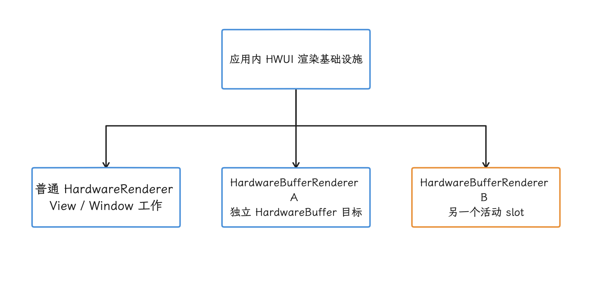

图：实例数增加的是输出上下文与目标管理，底层 RenderThread/GPU 仍可争用。 首次资源建立成本与稳态分开测；共享不表示另建独立 GPU 引擎。

- 所有 `HardwareBufferRenderer` 与 `HardwareRenderer` 共享应用进程中的 RenderThread、GPU context 和 GPU 资源。HBR 的工作量可能与普通 View 硬件渲染争用 RenderThread 和 GPU。
- 进程首次创建 HBR 时可能需要初始化 GPU context，冷启动成本要单独统计，别混入稳态单帧数据；后续实例通常只承担较小的增量成本。
- 预期用法是每个活动中的 `HardwareBuffer` 对应一个 HBR 实例。连续渲染若有三块 in-flight buffer，通常也维护三个 renderer/slot。HBR 没有把同一 renderer 临时改绑到另一块 buffer 的 API。
- `close()` 只释放 renderer 资源，不会替调用方关闭构造时传入的 `HardwareBuffer`；两个对象各有自己的所有权。
- `setContentRoot()` 会让内部根节点记录一次 `drawRenderNode(content)`。RenderNode 的 display list 保存已经录制的绘制命令；之后修改这棵树的显示列表或属性，不必重复调用 `setContentRoot()`，下一次 render request 会同步最新状态。
- `obtainRenderRequest()` 返回内部复用的请求对象。每次调用都会把 color space 重置为 sRGB、transform 重置为 identity；该对象不是线程安全的，调用 `draw()` 后也不能继续修改或长期持有。

<!-- gracker-diagram: ch13-06-45-request-reset -->
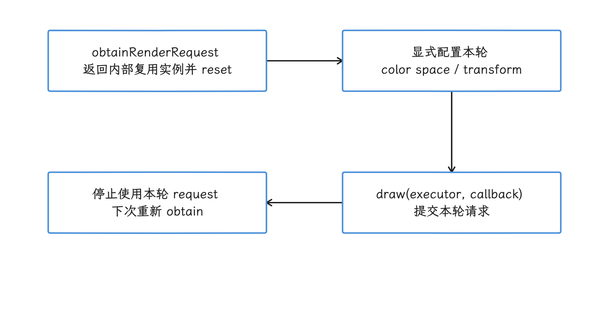

图：每轮取得并配置 request，draw 后结束对该对象的本轮使用。 obtain 会重置 sRGB / identity；不线程安全，也不能跨轮保留并改写。

这些行为都能直接在 [`HardwareBufferRenderer.java`](https://android.googlesource.com/platform/frameworks/base/+/refs/tags/android-17.0.0_r1/graphics/java/android/graphics/HardwareBufferRenderer.java) 中核对。

<!-- gracker-diagram: ch13-06-44-slot-renderer -->


图：为每个活动 slot 保存固定目标、renderer 和同步状态。 HBR 没有公开改绑目标 API；renderer.close 不关闭传入 buffer wrapper。

`draw()` 之后的 native 调用链可以在 `android-17.0.0_r1` 中逐段对应：

1. `RenderRequest.draw()` 调用 `nRender()`。
2. `android_graphics_HardwareBufferRenderer.cpp` 把尺寸、旋转变换、color space 和 callback 写入 `HardwareBufferRenderParams`，再调用 `RenderProxy::syncAndDrawFrame()`。
3. `DrawFrameTask` 同步 RenderNode 树，并让 HWUI pipeline 写入构造时绑定的 `AHardwareBuffer`。
4. pipeline `flush()` 导出 producer fence，JNI 再把对应 fd 包装成 `RenderResult.getFence()` 返回。

HBR 的 JNI 在构造 `UiFrameInfo` 时使用 `INVALID_VSYNC_ID`，因此一次 HBR draw 本身没有关联到有效的 App FrameTimeline VSync。若结果需要按 VSync 上屏，我们仍要通过 Choreographer 选择目标帧，并在 `SurfaceControl.Transaction` 上设置对应 FrameTimeline。

<!-- gracker-diagram: ch13-06-46-hbr-native -->
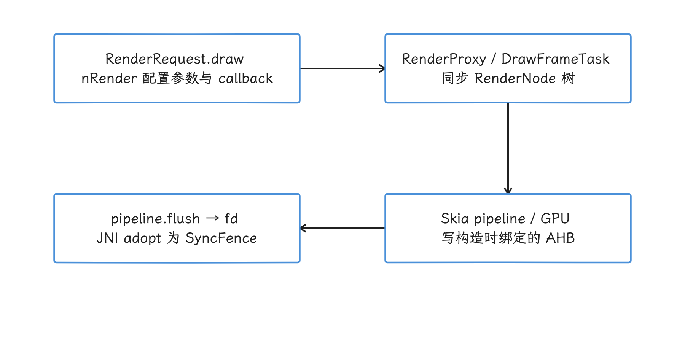

图：Java 请求经 JNI/RenderProxy 同步场景树，再由 pipeline 导出 producer fence。 DrawFrameTask 的回调交出 fd 与 status，Java 在指定 executor 交付，不保证 fence 已完成。

<!-- gracker-diagram: ch13-06-47-draw-blocking -->
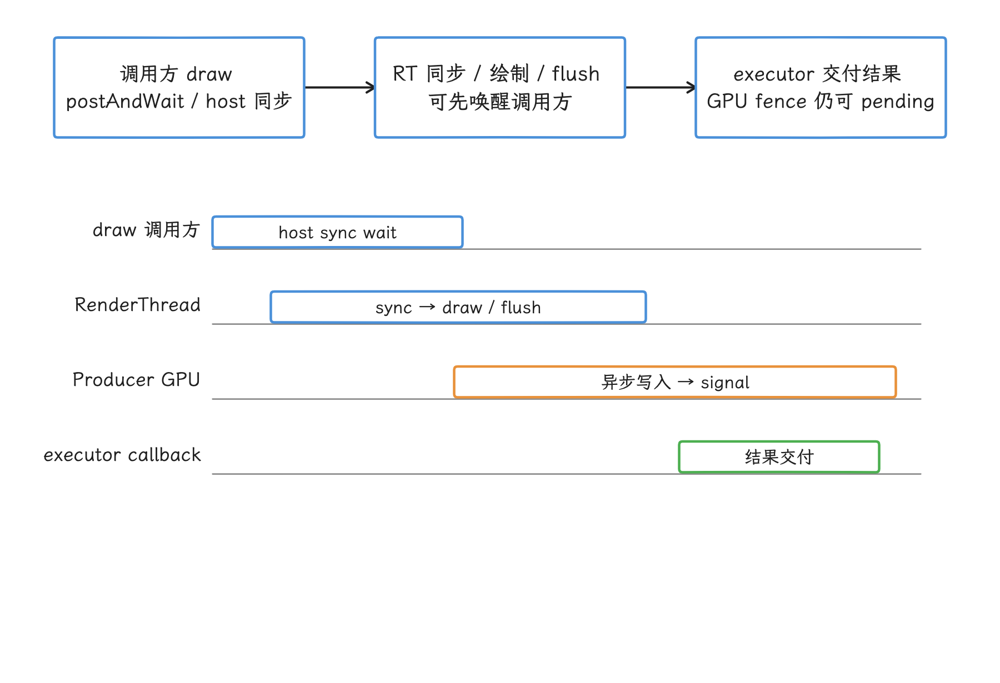

图：draw 需要等待场景同步边界，GPU 完成另由返回 fence 表达。 图示 canUnblockUiThread 允许较早返回的情况；条长不表示性能比例。

<!-- gracker-diagram: ch13-06-48-hbr-timeline -->
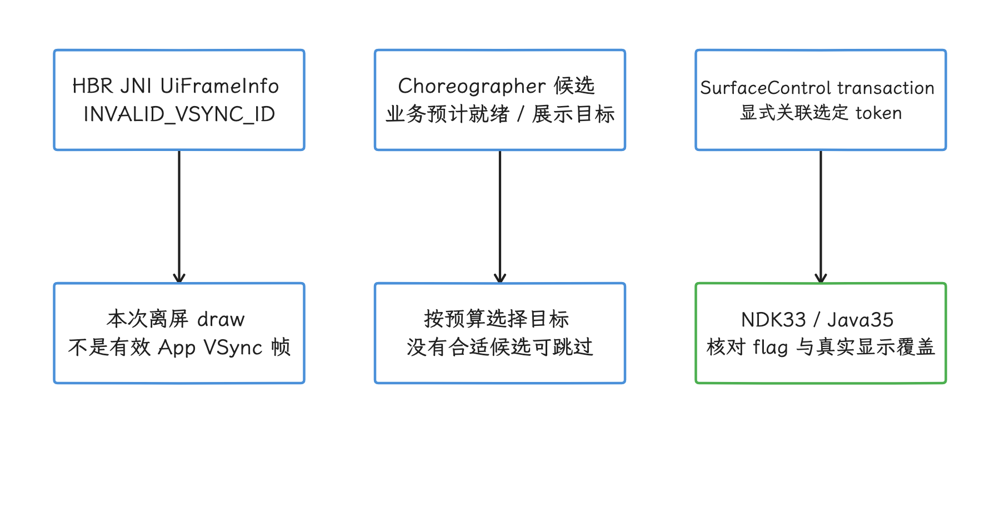

图：HBR draw 的生产时间线与后续显示事务的目标时间线分别接入。 Java35 的 timeline/desired-time 在 r1 有 flag 检查；token 不补齐 FrameTimeline 覆盖。

### 从 RenderNode 到屏幕的完整路径

HBR 只负责下图中间的 GPU 光栅化，buffer 分配、consumer 选择、显示提交和安全复用都由调用方管理：

```mermaid
flowchart LR
    A["记录或更新 RenderNode"] --> B["obtainRenderRequest()"]
    B --> C["draw(executor, callback)"]
    C --> D["RenderThread 同步场景树"]
    D --> E["GPU 写 HardwareBuffer"]
    E --> F["RenderResult: status + presentation fence"]
    F --> G["SurfaceControl.Transaction.setBuffer()"]
    G --> H["SurfaceFlinger 等 fence 后 latch"]
    H --> I["HWC 或 GPU 合成并显示"]
    I --> J["后续 transaction 替换/移除 buffer"]
    J --> K["release callback / release fence"]
    K --> B
```

这里有两个名称相近、方向相反的同步点，分别保护“producer 写完后 consumer 才能读”和“consumer 读完后 producer 才能重写”：

<!-- gracker-diagram: ch13-06-49-hbr-handoff -->
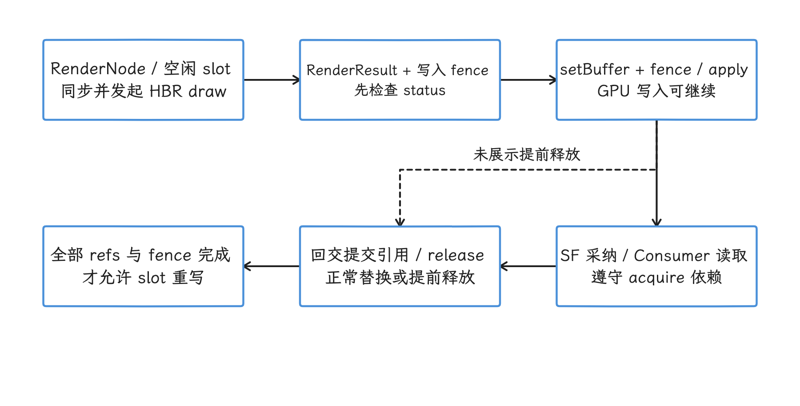

图：RenderResult 与 producer fence 先交接，Consumer 实际读取前满足依赖。 release 含未展示分支；图中正常读取路径不表示每次提交都显示。

1. **Presentation fence**：由 `RenderResult.getFence()` 返回，表示 producer 的 GPU 写入何时完成。consumer 在读取 buffer 前必须等待它。直接上屏时可将它传给 `Transaction.setBuffer()`，由 SurfaceFlinger 等待，应用无须先阻塞 CPU。
2. **Release fence**：由 `setBuffer(..., releaseCallback)` 的 callback 参数提供，表示 SurfaceFlinger/HWC 何时不再读取这块 buffer。只有该 fence signal 后，producer 才能再次写入。

`draw()` 的 callback 交付 `RenderResult` 时，其中的 `SyncFence` 未必已经 signal；API 注释要求先检查 `status == SUCCESS`，consumer 再等待或接收该 fence。把 callback 到达时间当成 GPU 完成时间，consumer 可能与 GPU 并发访问同一块 buffer。

<!-- gracker-diagram: ch13-06-50-fence-names -->


图：HBR 的 presentation fence 是 Producer 写入完成依赖，显示端 present 是另一边界。 名称相近也不能混用；release fence 才约束该提交引用再次可写。

release callback 要等 **后续 transaction** 替换或移除该 buffer 才触发：系统这时通过 callback 交回 release fence，应用等 fence signal 后才能复用。一块 buffer 一直作为 layer 当前内容留在屏上时，它就一直处于占用状态。

### Java API 提交骨架

下面的代码展示单个 buffer slot 的关键顺序。`surfaceControl`、线程池与 slot 状态机由上层持有；持续渲染时要避免只创建一个 slot 然后无条件循环覆写。

```java
long usage = HardwareBuffer.USAGE_GPU_COLOR_OUTPUT
        | HardwareBuffer.USAGE_GPU_SAMPLED_IMAGE
        | HardwareBuffer.USAGE_COMPOSER_OVERLAY;

if (!HardwareBuffer.isSupported(
        width, height, HardwareBuffer.RGBA_8888, 1, usage)) {
    throw new IllegalArgumentException("Unsupported HardwareBuffer configuration");
}

HardwareBuffer buffer = HardwareBuffer.create(
        width, height, HardwareBuffer.RGBA_8888, 1, usage);
HardwareBufferRenderer renderer = new HardwareBufferRenderer(buffer);

RenderNode root = new RenderNode("HbrContent");
RecordingCanvas canvas = root.beginRecording(width, height);
canvas.drawColor(Color.TRANSPARENT, PorterDuff.Mode.CLEAR);
// 记录本帧需要的 drawBitmap / drawText / drawPath ...
root.endRecording();
renderer.setContentRoot(root);

HardwareBufferRenderer.RenderRequest request = renderer.obtainRenderRequest();
request.setColorSpace(ColorSpace.get(ColorSpace.Named.SRGB));
request.draw(callbackExecutor, result -> {
    SyncFence presentationFence = result.getFence();
    if (result.getStatus()
            != HardwareBufferRenderer.RenderResult.SUCCESS) {
        releaseExecutor.execute(() -> {
            try (presentationFence) {
                if (presentationFence.isValid()) {
                    presentationFence.awaitForever();
                }
            }
            markSlotIdleAfterRenderFailure();
        });
        return;
    }

    try (SurfaceControl.Transaction transaction =
                 new SurfaceControl.Transaction()) {
        transaction
                .setDataSpace(surfaceControl, DataSpace.DATASPACE_SRGB)
                .setBuffer(
                        surfaceControl,
                        buffer,
                        presentationFence,
                        releaseFence -> releaseExecutor.execute(() -> {
                            try (releaseFence) {
                                if (releaseFence.isValid()) {
                                    releaseFence.awaitForever();
                                }
                            }
                            markSlotIdle();
                        }))
                .show(surfaceControl)
                .apply();
    } finally {
        // native transaction 已持有提交所需的 fence 引用。
        presentationFence.close();
    }
});
```

示例显式调用 clear，因为 HBR 不会替调用方清除旧像素。失败分支也会先处理返回的 fence，再把 slot 放回空闲队列，避免 GPU 仍在写入时复用目标。若业务能保证每次记录都覆盖整个 buffer，可以省略 clear；局部更新则要自行维护未覆盖区域的正确内容。

`android_view_SurfaceControl.cpp` 会让 transaction 通过 `sp<Fence>` 持有 native fence 引用，所以成功分支把 presentation fence 交给 `setBuffer()` 后就可以关闭 Java wrapper；继续保留 wrapper 只会额外占用一个 fd / native 资源。

<!-- gracker-diagram: ch13-06-54-fence-ref-ownership -->
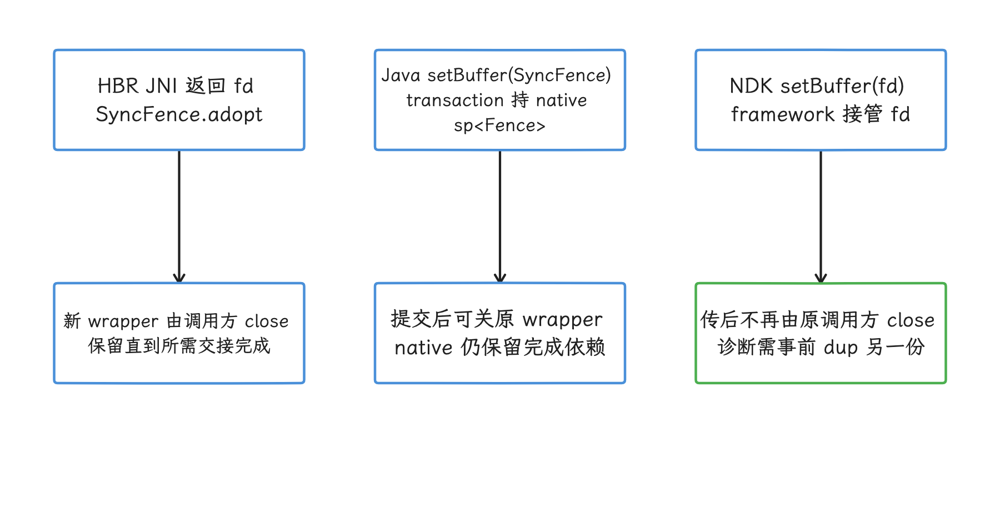

图：Java 提交时 native transaction 增持 Fence，wrapper 可以独立关闭。 NDK setBuffer 则接管传入 fd；任何一种 close 都不能代替等待完成。

三个 usage flag 声明不同的访问方式，allocator 会据此判断格式和内存配置是否可用：

<!-- gracker-diagram: ch13-06-51-allocation -->


图：先匹配格式/用途，再分配 buffer 并建立对应 renderer。 isSupported 不预留内存；实际分配仍可能失败，且不保证 DEVICE。

- `USAGE_GPU_COLOR_OUTPUT`：GPU 会把该 buffer 作为 render target 写入。
- `USAGE_GPU_SAMPLED_IMAGE`：SurfaceFlinger 可能通过 GPU 采样该 buffer 完成合成。
- `USAGE_COMPOSER_OVERLAY`：直接调用 `SurfaceControl.Transaction.setBuffer()` 时需要，HWC 也可能把该 buffer 作为 overlay layer 输入。

Java `setBuffer()` 文档同时要求 `GPU_SAMPLED_IMAGE` 和 `COMPOSER_OVERLAY`。gralloc（图形 buffer 分配器）会约束 format 与 usage 的组合；任意尺寸、FP16 与用途组合的支持情况因设备而异，分配前先调用 `HardwareBuffer.isSupported()` 确认。[AOSP: `HardwareBuffer`](https://android.googlesource.com/platform/frameworks/base/+/refs/tags/android-17.0.0_r1/core/java/android/hardware/HardwareBuffer.java) [AOSP: `SurfaceControl.Transaction.setBuffer()`](https://android.googlesource.com/platform/frameworks/base/+/refs/tags/android-17.0.0_r1/core/java/android/view/SurfaceControl.java)

#### RenderNode 更新与阴影

内容变化时，可以重新 recording 同一个 `RenderNode` 的 display list，也可以只修改 translation、alpha 等 RenderNode 属性，再发起新的 request。只有替换内容根节点时，才需要再次调用 `setContentRoot()`。

若场景使用 elevation 阴影，还要调用 `setLightSourceGeometry()` 与 `setLightSourceAlpha()`。光源坐标应保持在 display space（最终显示坐标系）中；窗口移动后若未更新光源位置，阴影方向会随窗口坐标发生偏移。

<!-- gracker-diagram: ch13-06-55-light-coordinates -->


图：阴影先配置 geometry/alpha，再按窗口位置与输出旋转维护光源。 传参 x/y 是经输出坐标换算的值；显示空间锚定不等于直接传全局坐标。

#### Transform 的四种直角旋转

HBR 源码只接受 identity、90°、180°、270° 四种 `BUFFER_TRANSFORM_*` 值；90°/270° 时内部会交换 render width 与 height。这个 transform 用于在输出阶段预旋转 buffer，RenderNode 上的任意缩放、镜像或透视变换要另外做。

公开 `RenderRequest` 文档因为参数标注为通用 `SurfaceControl.BufferTransform`，枚举列表还包含水平/垂直镜像；`HardwareBufferRenderer.java` 会对镜像值抛出 `IllegalArgumentException`。应用面向 API 37 时以这四个实际接受值为准，文档的通用枚举列表只当参考。

<!-- gracker-diagram: ch13-06-53-java-callback -->
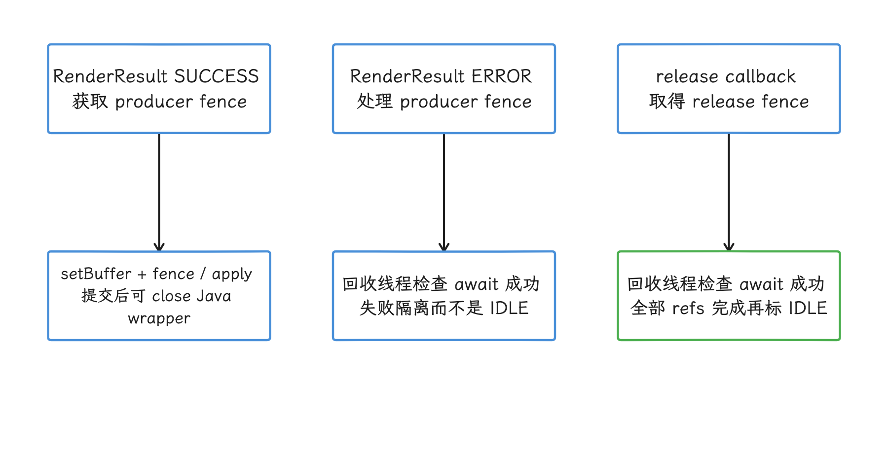

图：成功分支把完成依赖交给 consumer，回收分支检查 wait 成功后才回池。 等待失败应隔离 slot；示例外层仍需线程安全状态机与存活的 executors。

<!-- gracker-diagram: ch13-06-52-rendernode-recording -->
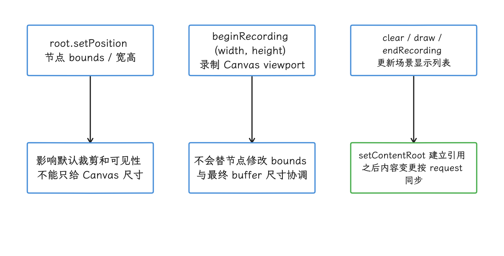

图：先设置 RenderNode 的实际尺寸，再记录内容并绑定内容根。 beginRecording(width,height) 只设置录制 viewport；默认 clipToBounds 为 true。

<!-- gracker-diagram: ch13-06-56-transform-values -->


图：实际接受值由 HBR Java 校验决定，90/270 交换逻辑宽高。 通用 BufferTransform 注解出现镜像值，不代表 HBR 接受；其他变换放 RenderNode。

### Buffer 池的复用规则

持续渲染时，“HBR 已经画完”只意味着 producer 阶段接近完成，buffer 还可能正在等待显示或被显示端读取。一个 slot 至少要经历下面的状态：

```text
IDLE
  -> HBR_DRAW_SUBMITTED
  -> PRESENTATION_FENCE_PENDING
  -> SUBMITTED_TO_SURFACE_CONTROL
  -> DISPLAY_IN_USE
  -> RELEASE_FENCE_PENDING
  -> IDLE
```

池中使用两块还是三块 buffer，由目标帧率、GPU 时间、合成延迟和允许的排队深度决定，“高帧率必须三缓冲”这样的预设靠不住。池太小时，producer 会频繁等待 release；池太大则会增加内存占用与排队延迟。

每个 slot 建议一起保存：

- `HardwareBuffer`
- 绑定该 buffer 的 `HardwareBufferRenderer`
- 当前 generation/frame id，用于识别回调属于哪一轮内容
- busy/idle 状态
- 尚未完成的 release fence 或 callback

release callback 可以在任意线程到达，回调线程里只做移交，把等 fence 的事交给专用 executor，再以线程安全的方式把 slot 放回空闲队列。renderer、buffer 和 `SurfaceControl` 也要在所有 in-flight callback 结束后关闭；`renderer.close()` 不会关闭 buffer，两个对象必须分别释放。

<!-- gracker-diagram: ch13-06-57-slot-cycle -->
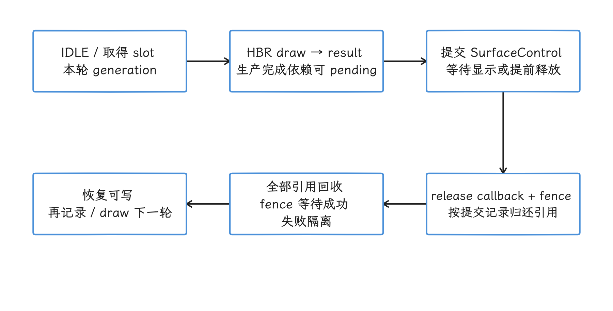

图：Producer 已提交或 callback 已到，都不足以让目标重新可写。 提交时 Producer fence 可以 pending；显示占用是可选分支，提前释放也要处理依赖。

<!-- gracker-diagram: ch13-06-58-pool-size -->
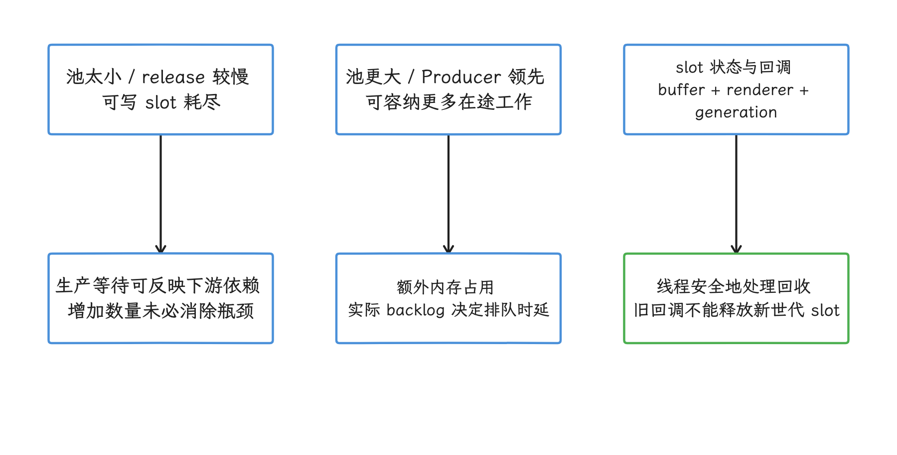

图：按每个 slot 的独立状态管理复用，再测生产与显示的排队关系。 容量只给出可能的在途数量；只有实际提前积压才会增加排队延迟。

### 与 NDK 的关系

公开 NDK 没有与 Java HBR 对应的 `AHardwareBufferRenderer_*` API。Native 代码可以把 `AHardwareBuffer` 导入 EGL/OpenGL ES 或 Vulkan，自行实现 GPU producer，再把结果交给 `ASurfaceTransaction`：

```text
AHardwareBuffer_allocate
    -> 导入 EGLImage 或 Vulkan external memory
    -> GPU 渲染
    -> 导出 acquire/presentation fence fd
    -> ASurfaceTransaction_setBuffer*
    -> release callback/fence 后复用
```

这条路径仍要显式处理 acquire/presentation fence、release fence 和 transaction 所有权。头文件按 API 级别给出的对应关系如下：

| API 范围 | 提交 API | 安全复用当前 buffer 的依据 |
| --- | --- | --- |
| API 26–28 | 有 `AHardwareBuffer`，没有公开的 `ASurfaceTransaction` buffer 提交 | 走 `ANativeWindow`/EGL/Vulkan 等对应 consumer 的同步规则 |
| API 29–35 | `ASurfaceTransaction_setBuffer()` | 在后续 transaction 的 `OnComplete` 中读取 **previous buffer** 的 release fence |
| API 36–37 | 优先 `ASurfaceTransaction_setBufferWithRelease()` | 与当前提交 buffer 一一对应的 `ASurfaceTransaction_OnBufferRelease` |

API 29–35 的 `ASurfaceTransactionStats_getPreviousReleaseFenceFd()` 返回被本次 transaction 替换或移除的上一块 buffer 的 fence，回收对象是上一块；本次刚提交的 buffer，要等未来某次 transaction 替换它之后，才会作为“上一块”出现在统计里。

<!-- gracker-diagram: ch13-06-59-ndk-producer -->


图：Java HBR 与 NDK AHardwareBuffer 生产路线是两套公开入口。 没有 AHardwareBufferRenderer API；EGL/Vulkan 导入、同步与显示用途仍需自行处理。

API 36–37 的 release callback 会直接关联当前提交的 buffer。若 callback 给出非负 fd，接收方取得该 fd 的所有权，必须等待并关闭；`-1` 表示无需等待。传给 `setBuffer*()` 的 acquire fence fd 则由 framework 接管并关闭。`ASurfaceTransaction_create()` 返回的 transaction 仍归调用方所有，`apply()` 后要调用 `ASurfaceTransaction_delete()`。[AOSP: `surface_control.h`](https://android.googlesource.com/platform/frameworks/native/+/refs/tags/android-17.0.0_r1/include/android/surface_control.h)

### 内核里的共享对象与同步原语

Java `HardwareBuffer` 在 native 侧映射到 `AHardwareBuffer` / `GraphicBuffer`，allocator 可通过 dma-buf 让 GPU、DPU 等设备共享同一块图形内存。`SyncFence` 和 NDK fence fd 通过 sync_file 跨进程传递，底层由 dma-fence 表达异步硬件任务的完成依赖。

在 `android17-6.18-2026-06_r6` 中，通用语义可从四个入口核对：

- `drivers/dma-buf/dma-buf.c`：buffer attachment（设备附着关系）、map 与跨设备共享；
- `drivers/dma-buf/dma-fence.c`：signal、callback 和 wait；
- `include/linux/dma-fence.h`：dma-fence 接口、上下文与序列号；
- `drivers/dma-buf/sync_file.c`：把一个或一组 dma-fence 封装成 sync_file fd。

内核层看不到 RenderNode、HBR request 或 SurfaceControl Layer 的业务含义：内核侧记录能说明共享对象和同步依赖是否成立，而 HWUI 是否按预期绘制、Layer 是否被 HWC 选为 `DEVICE`、release fence signal 时像素是否已经对用户可见，还要回到上层去回答。

<!-- gracker-diagram: ch13-06-60-kernel-scope -->


图：dma-buf 共享存储，dma-fence / sync_file 表达异步完成依赖。 内核通用原语不知道 RenderNode 或业务帧，也不能证明 DEVICE 或光学显示结果。

### 性能对比与实测

HBR 的收益取决于原有瓶颈。我们用下表筛选候选方案，最终要靠同设备、同内容的测量说话：

| 维度 | `lockCanvas()` | `lockHardwareCanvas()` | `HardwareBufferRenderer` |
| --- | --- | --- | --- |
| 光栅化 | CPU | GPU / HWUI | GPU / HWUI |
| 目标 | `Surface` | `Surface` | 调用方的 `HardwareBuffer` |
| 局部内容保留 | software Surface 支持 dirty region 语义 | 每帧完整覆盖 | 旧内容保留，是否 clear 由调用方决定 |
| 帧提交 | `unlockCanvasAndPost()` | `unlockCanvasAndPost()` | consumer 自定；直接显示常用 `SurfaceControl.Transaction` |
| 同步管理 | 多数由 Surface / BufferQueue 处理 | 多数由 Surface / BufferQueue 处理 | presentation 与 release 两端都要接好 |
| 主要风险 | CPU 光栅化占用、锁 buffer 等待 | RenderThread/GPU 争用、consumer 不及时 | 冷启动、共享 RenderThread/GPU、transaction 与 buffer 池错误 |

下面几类内容适合先用 HBR 实测：

- 大尺寸 Path、矢量场景、图片变换或复杂 RenderNode 场景，CPU software raster 已经是主要耗时。
- 结果本来就要作为独立 `HardwareBuffer` 继续消费，避免为了得到独立 buffer 再设计一套读回路径。
- 业务已有合法、稳定的 `SurfaceControl` layer，需要显式控制 buffer 与原子 transaction。

简单图形、低分辨率静态内容或 GPU 已饱和的场景，HBR 可能没有收益。HBR 使用与普通 UI 共享的 RenderThread/GPU，离屏任务过重时，View 动画和窗口帧也可能受影响。直接调用 `setBuffer()` 只让 buffer 成为独立 Layer 输入，HWC 仍会根据格式、变换、遮挡、带宽和硬件能力选择 `DEVICE` 或 `CLIENT` composition，并不保证分配 overlay plane。

基准测试至少要固定设备与 GPU、Android build、buffer format/size/usage、场景内容、清屏策略、目标帧率、buffer 池大小，以及冷启动或稳态条件。测量时把 CPU recording、RenderThread、GPU、transaction 到 latch 和 release 等待分开记录；只看单个总耗时，说不清回归来自哪个阶段。

<!-- gracker-diagram: ch13-06-61-benchmark -->


图：在同设备、同内容和相同池/色彩条件下比较生产到回收的各阶段。 共享 RT/GPU、CLIENT 合成与 readback 都可能抵消 CPU raster 节省。

### 适用场景与约束

#### CPU 软件光栅化吃紧的离屏内容

PDF 页、复杂图形卡片、自定义贴纸或缩略图生成，如果 CPU raster 已在 trace 中成为主要成本，可以评估 HBR。还要确认后续 consumer 能直接使用 `HardwareBuffer`；若最终仍要把结果读回 CPU，GPU readback（把 GPU 结果复制回 CPU 可访问内存）这一步可能抵消收益。

<!-- gracker-diagram: ch13-06-62-readback -->


图：先确认 CPU raster 是瓶颈，再确认结果是否能留在 HardwareBuffer 消费。 如果最终要读回 CPU，传输和同步成本也要计入同内容对照。

#### 跨进程 buffer 共享

`HardwareBuffer` 实现了 `Parcelable`。Binder 传递的是 native buffer handle/reference，不会把整幅像素复制进 Parcel。跨进程协议仍要同时定义：

- width、height、format、usage、color space/dataspace；
- producer 完成写入的 fence；
- consumer 用完后的 release 反馈；
- buffer id/generation，用于防止迟到的旧回调释放已经重新分配的 slot；
- 进程死亡和 binder 断连时的引用清理。

如果只传 `HardwareBuffer`、没有同时传递同步关系，consumer 可能读到尚未完成的 GPU 输出，producer 也可能在 consumer 使用期间覆写同一块内存。

<!-- gracker-diagram: ch13-06-63-buffer-ipc -->


图：共享句柄只传存储引用，读写同步和回收反馈另由协议定义。 Parcel 不复制整幅像素；没有 fence / generation 协议仍可发生并发访问或错回收。

#### Wide color 与 HDR

`RGBA_FP16` 只表示每个 RGBA 分量使用 16-bit 浮点存储，并不会自动把内容变成 HDR。完整颜色契约至少包括：

1. 用 `RenderRequest.setColorSpace()` 告诉 HBR 如何解释和生成像素；未设置时每次 request 都回到 sRGB。
2. 用 `Transaction.setDataSpace()` 告诉 SurfaceFlinger layer 中像素的编码含义。
3. 确认 buffer format/usage 组合由设备支持。
4. 确认显示、SurfaceFlinger 与 HWC 支持目标色域和传递函数，并准备 tone mapping（色调映射）或 SDR 回退。
5. HDR 内容可在 API 35–37 使用 `setDesiredHdrHeadroom()` 表达期望的 HDR/SDR 亮度比；它是合成 hint，不构成显示能力保证。

`DISPLAY_P3` 描述 wide color gamut（广色域），和 HDR 是两回事。FP16 是存储格式，P3 是色域，HLG/PQ 是 HDR 传递函数，HDR headroom 是亮度比提示；把它们混成一个开关，可能出现 buffer 精度足够、显示端解释却不正确的问题。[Android API: `setDesiredHdrHeadroom()`](https://developer.android.com/reference/android/view/SurfaceControl.Transaction#setDesiredHdrHeadroom(android.view.SurfaceControl,float))

<!-- gracker-diagram: ch13-06-64-hdr-contract -->


图：format、ColorSpace、dataspace、headroom 与显示能力共同决定输出。 FP16 不自动成为 HDR，P3 不等于 HLG/PQ；hint 不保证面板亮度。

#### 高帧率直接 layer 提交

HBR 允许应用按自己的节奏生成 buffer；接入 `Choreographer`、FrameTimeline 和显示刷新率策略，这些仍要自己做。高帧率场景还要处理：

- 基于 VSync 的生产节奏；
- `Transaction.setFrameTimeline()` 或系统提供的 frame timeline token；
- layer frame-rate vote 与显示模式切换；
- buffer 池背压，防止 producer 无限领先；
- GPU 预算与 UI 渲染争用。

选择 HBR 本身不会提高刷新率，也不会自动缩短显示管线。

<!-- gracker-diagram: ch13-06-65-pacing -->


图：生产节奏、目标 timeline、显示投票与可写 slot 一起控制在途工作。 HBR 本身不提高刷新率；共享 GPU 预算和设备模式切换仍需实测。

### Perfetto：按阶段定位

HBR 没有承诺跨版本、跨厂商一致的 trace slice 名。排查前我们可以在 `draw()`、transaction `apply()` 和 release callback 三处加入应用自己的 trace section，再按 frame id 与时间关联以下阶段：

1. **调用线程**：RenderNode recording 与 `RenderRequest.draw()` 发起时间。
2. **应用 RenderThread**：场景树同步和 HWUI 工作；它与普通 View 渲染共享。
3. **GPU queue**：对应离屏 raster 的 GPU 工作，以及 presentation fence signal 时间。
4. **SurfaceFlinger layer / transaction**：目标 layer 何时收到 buffer、是否在等 presentation fence、何时 latch。
5. **HWC / present fence**：合成与显示提交的完成时刻。
6. **release callback**：release fence 何时交回、slot 何时能再次进入 producer。

| 现象 | 更可能的证据 |
| --- | --- |
| `draw()` 发起很晚 | recording、业务调度或空闲 slot 获取慢 |
| callback 很快，layer 却很晚 latch | presentation fence 长时间未 signal，或 transaction 提交较晚 |
| GPU 忙而 CPU 很轻 | 离屏 raster 或系统其他 GPU 工作成为瓶颈 |
| producer 周期性停顿 | buffer 池耗尽，等待 release |
| HBR 任务与 UI 帧同时恶化 | 共享 RenderThread/GPU 出现争用 |

我们看到 BufferQueue/BLAST 轨道时，先确认它属于哪条路径：HBR API 只写目标 `HardwareBuffer`，BufferQueue 事件来自应用另外选择的 Surface consumer 路径。

### 常见错误

#### 把 draw callback 当成 GPU fence 已 signal

callback 只交付 `RenderResult`，consumer 仍要处理 `getFence()`。若另一个 GPU/CPU consumer 未接收或等待该 fence 就读取 buffer，会与 HBR 的 GPU 写入发生未同步的并发访问。

#### 用 presentation fence 判断 buffer 可写

presentation fence 约束 consumer 何时可读，release fence 约束 producer 何时可再次写。两者方向相反，各管一头。

#### 一块 buffer 连续提交

同一块 buffer 还在 layer 上显示时又发起 HBR draw，会让 producer 与 consumer 同时访问它。单 buffer 必须等 release fence signal 后才能再次写入；连续动画应维护带 backpressure（无空闲 slot 时停止生产）的 buffer 池。

#### 忘记 clear，或把旧内容当成完整帧缓存

HBR 会保留未覆盖像素。这允许调用方自行实现局部更新，也可能留下意外的旧内容；透明背景尤其需要明确清屏策略。

#### 一个 renderer 轮流“绑定”多块 buffer

HBR 在构造时固定输出 buffer，没有更换 target 的 API。buffer 池应让每个 slot 持有对应 renderer；如果 buffer 已经不再活动，应先安全关闭旧 renderer，再按需重建。

#### 只关闭 renderer

`HardwareBufferRenderer.close()` 不会关闭 `HardwareBuffer`。同样，在 renderer 或 in-flight transaction 仍可能访问时提前关闭 buffer 也不安全。需要分别定义两个对象的关闭方和关闭时机。

<!-- gracker-diagram: ch13-06-66-close-refs -->


图：为 renderer、Java wrapper、提交引用和 callback context 分别定义结束条件。 native transaction 持有 GraphicBuffer 引用；关闭 wrapper 不代表全部 GPU/Consumer 访问完成。

#### 把 `SurfaceControl.setBuffer()` 当成任意应用窗口入口

调用方必须拥有一个生命周期有效、已经正确挂入 layer tree 的 `SurfaceControl`。很多场景里，`SurfaceView`、`AttachedSurfaceControl`、`HardwareRenderer` 或 AndroidX Graphics 是更合适的选择；普通 View 业务无须只为用上 HBR 就绕开既有窗口渲染。

### 从 Android 13 到 Android 17 的公开能力

| 版本 | 与 HBR 直接相关的公开能力 |
| --- | --- |
| Android 13 / API 33 | Java `SyncFence`；`SurfaceControl.Transaction.setBuffer(HardwareBuffer, SyncFence, releaseCallback)` 提供 direct Layer 的 producer / consumer 同步 |
| Android 14 / API 34 | `HardwareBufferRenderer`、`RenderRequest` 与 `RenderResult` 公开，支持 RenderNode 到调用方 HardwareBuffer |
| Android 15 / API 35 | `Transaction.setFrameTimeline()`、`setDesiredPresentTimeNanos()` 与 `setDesiredHdrHeadroom()` 公开 |
| Android 16 / API 36 | NDK `ASurfaceTransaction_setBufferWithRelease()` 和逐 buffer release callback 公开 |
| Android 17 / API 37 | HBR 没有新增公开方法；按 `android-17.0.0_r1` 核对 request reset、四种直角旋转、JNI fence 和 SurfaceControl 提交语义 |

读这张表时注意方向：API 33 已具备 HardwareBuffer direct Layer 和 fence 基础能力，Java `HardwareBufferRenderer` 类仍要到 API 34 才能使用；旧版本有没有 HBR，以 API 34 这条线为准，从 33 的能力是反推不出来的。

<!-- gracker-diagram: ch13-06-67-public-history -->


图：Java direct-buffer、HBR 与 NDK 逐 buffer release 在不同版本开放。 固定17r1 只能证明当前实现，公开 API 历史另查 SDK/历史 tag 与 flag。

### Android 14 以下的降级

版本判断只能回答类是否存在，降级方案还要根据业务所需的输出目标和 consumer 选择：

```java
if (Build.VERSION.SDK_INT >= Build.VERSION_CODES.UPSIDE_DOWN_CAKE) {
    // API 34+: RenderNode -> HardwareBufferRenderer -> consumer
} else {
    // 已有 Surface：lockHardwareCanvas() 或 HardwareRenderer
    // 独立 GPU buffer：EGL/Vulkan + HardwareBuffer/平台兼容层
    // CPU 可接受：lockCanvas() 或软件 Bitmap
}
```

若目标只是绘制到 `Surface`，应优先保留 Surface 模型；若协议必须输出独立共享 buffer，再评估 EGL/Vulkan 或 AndroidX Graphics 的兼容封装。降级路径要保持 color space、同步和资源所有权语义，只替换类名是不够的。

<!-- gracker-diagram: ch13-06-68-fallback -->


图：先按所需 consumer 选择 Surface、独立 GPU buffer 或 software 目标。 降级还要保留 color space、fence 与资源所有权契约，不能只替换类名。

### 复核清单

- [ ] 已确认需要的是“RenderNode → 独立 HardwareBuffer”，不只是 GPU Canvas
- [ ] 用 `HardwareBuffer.isSupported()` 验证 format、尺寸和 usage
- [ ] 每个活动 buffer 有对应 renderer/slot
- [ ] 每次 request 都显式设置需要的 color space/transform
- [ ] 检查 `RenderResult.getStatus()`
- [ ] presentation fence 已传给 consumer 或被正确等待
- [ ] release callback/fence 后才把 slot 标为空闲
- [ ] 已定义全量覆盖或显式 clear 策略
- [ ] renderer、buffer、transaction、fence 都有清晰的关闭方
- [ ] 高帧率 producer 有 VSync pacing 和 buffer 池背压
- [ ] HDR 同时校验 format、color space、dataspace、headroom 与显示能力
- [ ] Perfetto 中把 app、RenderThread、GPU、SurfaceFlinger 和 release 串成同一帧


## 结论

- SurfaceControl 负责 Layer 树、buffer 状态和 transaction，HardwareBufferRenderer 负责把 RenderNode 内容写入调用方持有的 HardwareBuffer；二者通过 production/presentation fence 与 release fence 组成完整交接。
- Transaction 的原子应用、commit、complete 和 display present 各是独立阶段。直接提交 buffer 的应用还必须自行维护池、回收回调、FrameTimeline 与对象生命周期。
- HBR 把 RenderNode 场景树写入调用方拥有的 `HardwareBuffer`；若目标是现成 `Surface`，应同时比较 `lockHardwareCanvas()` 和 `HardwareRenderer`。
- Android 17 的 HBR 仍共享应用 RenderThread 和 GPU context，离屏任务会与普通 UI 渲染争用资源。
- `RenderResult` 的 presentation fence 约束 consumer 读取，SurfaceControl release fence 约束 producer 复用，两类 fence 方向相反、各管一段。
- 持续渲染需要按 slot 配置 buffer、renderer、generation 和 release 状态，池大小由 GPU 与显示延迟实测决定。
- Java HBR 从 API 34 开始提供；NDK 需要使用 AHardwareBuffer 加 EGL / Vulkan，并按 API 29–35 与 API 36–37 的不同 release 契约实现。
- HDR 需要同时匹配 format、color space、dataspace、headroom 与显示能力，单凭 `RGBA_FP16` 说明不了内容是 HDR。
- 源码只接受 identity 与三种直角旋转；公开文档列出的镜像 transform 落到 HBR request 上会被拒绝。


## 参考资料

- [Android API：HardwareBufferRenderer（API 34）](https://developer.android.com/reference/android/graphics/HardwareBufferRenderer)
- [Android API：HardwareBufferRenderer.RenderRequest](https://developer.android.com/reference/android/graphics/HardwareBufferRenderer.RenderRequest)
- [Android API：HardwareBuffer](https://developer.android.com/reference/android/hardware/HardwareBuffer)
- [Android API：SyncFence](https://developer.android.com/reference/android/hardware/SyncFence)
- [Android API：SurfaceControl.Transaction](https://developer.android.com/reference/android/view/SurfaceControl.Transaction)
- [AndroidX Graphics：CanvasBufferedRenderer](https://developer.android.com/reference/androidx/graphics/CanvasBufferedRenderer)
- [Android 17 AOSP：HardwareBufferRenderer.java](https://android.googlesource.com/platform/frameworks/base/+/refs/tags/android-17.0.0_r1/graphics/java/android/graphics/HardwareBufferRenderer.java) 与 [JNI](https://android.googlesource.com/platform/frameworks/base/+/refs/tags/android-17.0.0_r1/libs/hwui/jni/android_graphics_HardwareBufferRenderer.cpp)
- [Android 17 AOSP：DrawFrameTask.cpp](https://android.googlesource.com/platform/frameworks/base/+/refs/tags/android-17.0.0_r1/libs/hwui/renderthread/DrawFrameTask.cpp)
- [Android 17 AOSP：HardwareBuffer.java](https://android.googlesource.com/platform/frameworks/base/+/refs/tags/android-17.0.0_r1/core/java/android/hardware/HardwareBuffer.java)
- [Android 17 AOSP：Surface.java](https://android.googlesource.com/platform/frameworks/base/+/refs/tags/android-17.0.0_r1/core/java/android/view/Surface.java)
- [Android 17 AOSP：SurfaceControl.java](https://android.googlesource.com/platform/frameworks/base/+/refs/tags/android-17.0.0_r1/core/java/android/view/SurfaceControl.java) 与 [JNI](https://android.googlesource.com/platform/frameworks/base/+/refs/tags/android-17.0.0_r1/core/jni/android_view_SurfaceControl.cpp)
- [Android 17 AOSP：NDK surface_control.h](https://android.googlesource.com/platform/frameworks/native/+/refs/tags/android-17.0.0_r1/include/android/surface_control.h)
- [Kernel android17-6.18：dma-buf.c](https://android.googlesource.com/kernel/common/+/refs/tags/android17-6.18-2026-06_r6/drivers/dma-buf/dma-buf.c)、[dma-fence.c](https://android.googlesource.com/kernel/common/+/refs/tags/android17-6.18-2026-06_r6/drivers/dma-buf/dma-fence.c)、[dma-fence.h](https://android.googlesource.com/kernel/common/+/refs/tags/android17-6.18-2026-06_r6/include/linux/dma-fence.h)、[sync_file.c](https://android.googlesource.com/kernel/common/+/refs/tags/android17-6.18-2026-06_r6/drivers/dma-buf/sync_file.c)
