# Flutter 渲染管线：Engine、Impeller 与 Surface

Flutter 在 Android 上既遵循平台的 VSync、Surface 与合成规则，又有 Engine、Dart isolate 和 Impeller 自己的调度边界。定位掉帧时要先确认当前 RenderMode 和 external texture 路径，再把 UI、Raster、平台线程与显示帧对齐。

## 为什么 Flutter 的渲染链需要单独分析

Flutter framework 在 Dart 侧完成 widget 更新、layout、paint 和 scene 构建；Android View 体系主要负责承载 `FlutterView`、处理输入与生命周期、嵌入 PlatformView，以及提供最终输出对象。因此，原生 View 页面常用的 `ViewRootImpl.performTraversals()` → HWUI `DrawFrame` 观察法，只能覆盖 Flutter 页面的一部分链路。

诊断 Flutter 卡顿时至少要区分四段：

1. platform/Dart UI work 是否按时生成 scene；
2. Raster thread 是否按时把 layer tree/display list 转换为 GPU 工作；
3. Flutter root、external texture 和 PlatformView 分别写入什么 Android 对象；
4. SurfaceFlinger 是否按时 latch（选中用于本次合成）对应 buffer，并完成本次 Display present。

Dart frame callback 返回并不保证本轮一定提交新 scene；即使 framework 已交出 scene、Raster CPU 工作也已结束，仍不能据此证明画面已经显示。Root RenderMode、PlatformView 策略、GPU 完成和宿主窗口的消费节奏会继续改变后半段路径。

<!-- gracker-diagram: ch13-07-01-four-boundaries -->
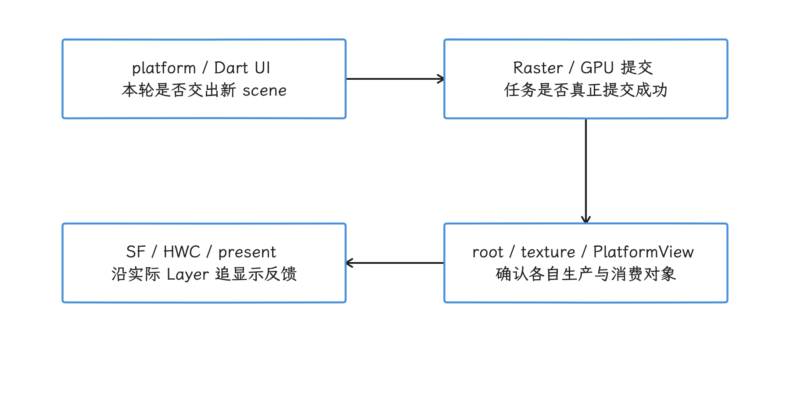

图：把 scene 生成、Raster 提交、输出对象与显示反馈分别取证。 Dart callback 或 Raster CPU 返回不能证明 GPU 完成或画面已显示。

## Android 与 Flutter 的双版本锚点

分析采用两套互相独立的版本坐标：

- Android 平台：Android 17/API 37/`android-17.0.0_r1`；
- kernel：`android17-6.18-2026-06_r6`；
- Flutter：官方版本号、App 携带的 engine revision（引擎代码版本）、Impeller backend 和插件版本。

Flutter framework、engine 和 Android embedding 不属于 AOSP，也不会随 Android 17 自动更新。同一台 Android 17 设备可以运行携带不同 Flutter engine 的 App。因此，分析报告只写 “Android 17 + Flutter” 仍缺少决定线程、renderer 和嵌入行为的版本信息。

<!-- gracker-diagram: ch13-07-02-version-coordinates -->
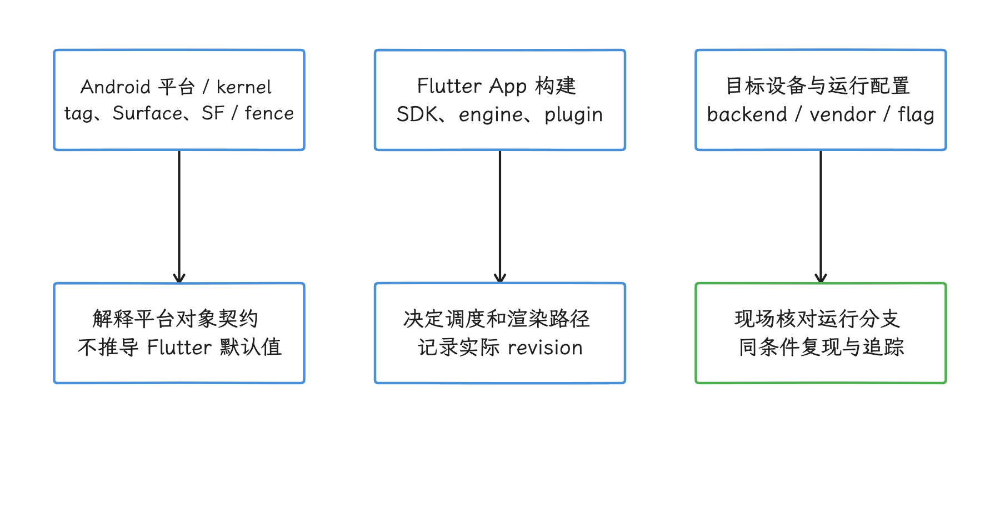

图：分别固定平台、App 引擎依赖与设备实现，才能解释同一设备上的不同管线。 Android 版本不会更新 App 携带的 engine，也不能替代 backend、插件与 vendor 条件。

### 三条容易混淆的 Flutter 版本线

| 能力 | 可靠边界 | 分析口径 |
|---|---|---|
| UI 与 platform thread 合并 | Flutter 3.27 release notes 已出现 Android/iOS 支持；当前架构文档写 3.29 起合并；Flutter issue #150525 的维护者更新则写 3.32 stable 起默认合并并可 opt-out | 以 3.32 stable+ 作为保守的默认合并基线；3.29—3.31 按 engine revision 和启动配置核对 |
| Android 默认启用 Impeller | Flutter 3.27，Android API 29+ | API 29+ 仍要核对 Impeller 是否被关闭，以及运行时选择 Vulkan 还是 GLES |
| HCPP | Flutter 3.44 起提供，当前为实验性 opt-in（显式选择加入） | 还需 Android API 34+、Impeller、Vulkan 和运行时 SurfaceControl swapchain 可用 |

本文以 3.32 stable 的默认合并模型为主线，与 issue #150525 的维护者说明一致；架构文档把合并起点写为 3.29。这些是发布与默认配置的不同口径，不能据此保证所有后续 engine 一直保留相同 opt-out。分析 3.29—3.31、定制 engine 或显式配置时，记录实际 revision，并在 Perfetto 中确认 Dart UI work 与平台回调的 tid。[来源：线程合并说明](https://github.com/flutter/flutter/issues/150525)

<!-- gracker-diagram: ch13-07-03-three-version-lines -->
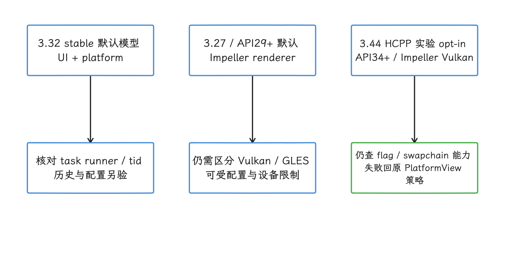

图：线程合并、默认 Impeller 和实验性 HCPP 各有条件。 这些是各自发布基线；不能据 OS 版本保证 HCPP 或未来 opt-out 行为。

## 一帧的公共前半段

下面的图概括普通 Flutter 帧从 VSync 调度到显示反馈的关系。Root mode 与 PlatformView 会决定 target 获取、绘制和提交方式，这些选择在 Raster 工作开始前或内部生效；图中从提交点展示下游分叉，不表示 GPU 工作结束后才选择输出 target。

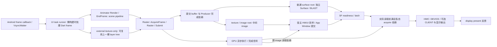

图中普通 root 在提交后分叉：`FlutterSurfaceView` 通常进入独立 Surface/BLAST layer；`FlutterTextureView` 与 `FlutterImageView` 先形成中间 image，再由宿主 HWUI 采样并生产 App Window buffer。CPU submit 和 GPU 完成可以重叠；SF 的 readiness/latch 也不能一概当成 acquire fence 已 signal。图不展开 HCPP 的 AHardwareBuffer/SurfaceControl 直接提交分支，后文单独说明。

<!-- gracker-diagram: ch13-07-04-root-fork -->
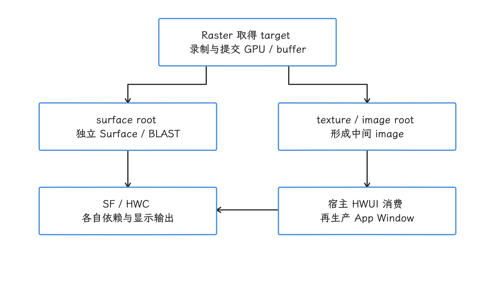

图：独立 Surface 与宿主采样路径在不同位置生产最终可见 buffer。 CPU submit 与 GPU 完成可重叠；HCPP direct AHB 分支在后文展开。

### Platform / Dart UI work

Engine 请求帧后，VSync callback 才驱动对应工作；并非每次系统 vsync 都重建 Widget tree。需要生成新 scene 时，Dart framework 处理 animation、build、layout 和 paint，`Animator::Render` 按 view id 收集 `LayerTree`，`Animator::EndFrame` 完成 producer continuation，把本轮任务交给 raster pipeline。`Animator::BeginFrame` 先申请 pipeline 空位；失败会记录 `PipelineFull` 并重新请求帧，不能把它的整个 slice 都视为 Dart build。[来源：Animator](https://github.com/flutter/flutter/blob/8a9f61cfd67396fb2f9afc3cd7854035e9cd6fc2/engine/src/flutter/shell/common/animator.cc)

<!-- gracker-diagram: ch13-07-05-new-scene -->
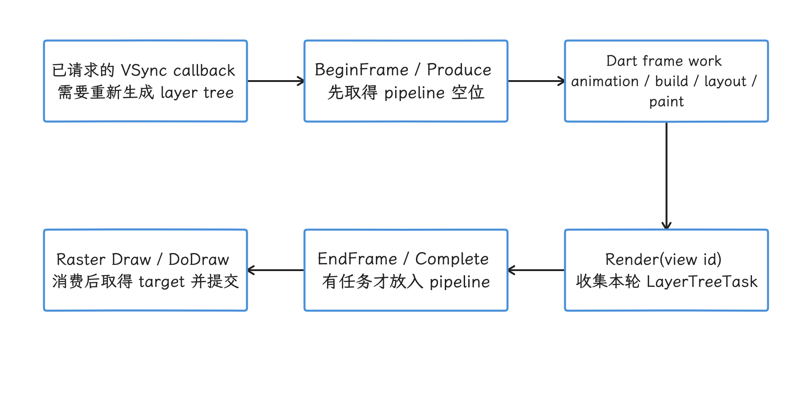

图：新 scene 需先取得 pipeline 空位，按 view 收集后才交给 Raster。 PipelineFull 可使 BeginFrame 早退；没有 Render 或重试不保证产生新 buffer。

在 3.32 stable+ 的主线模型中，UI task runner 与 Android platform task runner 都映射到宿主 Main thread。MethodChannel 回调、Activity 生命周期、输入事件和 Dart frame work 会在同一线程上串行竞争。耗时较长的插件回调会推迟 Dart build；过重的 Dart work 也会拖慢平台消息和输入处理。

Raster task runner 通常仍独立。`Rasterizer::Draw()` 从 pipeline 消费任务；随后 `DrawToSurfaces` 逐 view 处理，取得输出 frame，再经 compositor preroll/paint 与 `Submit()` 或 external-view embedder 提交。失败、discard 和 retry 分支并不保证产生新 buffer。IO task runner 负责图片或资源相关工作，解码、上传与实际使用仍可能存在跨线程依赖。仅 external texture 更新时，`Animator::DrawLastLayerTrees()` 还可以跳过本轮 Dart build，复用先前 layer tree 再绘制。[来源：Rasterizer](https://github.com/flutter/flutter/blob/8a9f61cfd67396fb2f9afc3cd7854035e9cd6fc2/engine/src/flutter/shell/common/rasterizer.cc)

<!-- gracker-diagram: ch13-07-06-texture-only-reuse -->
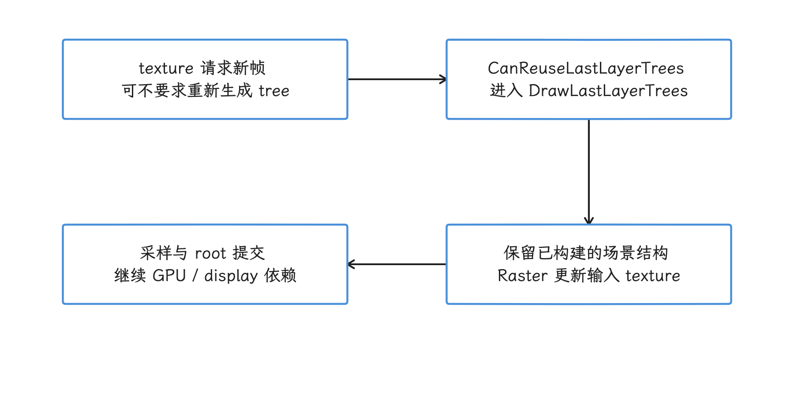

图：需要更新 texture 时可复用旧树，仍由 Raster 重绘 root。 这种复用不等于复用旧 root buffer；trace 缺少本轮 Dart build 也不代表没有绘制。

### 两种“线程合并”不要混为一谈

Flutter Android 上存在两个不同语境：

- 新版 engine 的 UI + platform 合并：Dart UI work 与 Android 平台工作共享 Main thread，Raster thread 通常保持独立；
- 原始 HC 的 raster + platform 动态合并：固定 embedder 在出现 platform layers 时使用 `MergeWithLease()`，把 raster tasks 转到 platform 线程，并可能先 skip/retry；在 UI 已与 platform 合并的模型下，才形成三类工作共享 Main 的竞争。它是 task queue 的动态协调，不是永久删掉 Raster thread。
- HCPP 的 embedder 明确返回 `SupportsDynamicThreadMerging() == false`；它仍有平台任务、事务同步和可能的初始化等待，不能把普通 HC 的 merge 直接套给 HCPP。

看到 “merged thread” 时，先确认上下文指的是哪一种合并。把两者画成同一个固定线程模型，会误判 PlatformView 页面上的主线程竞争来源。

<!-- gracker-diagram: ch13-07-07-two-merges -->
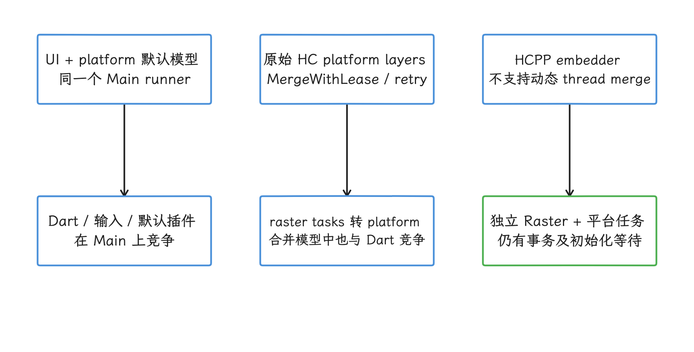

图：区分 Main 上的固定工作、原始 HC 动态迁移与 HCPP 的事务协调。 动态合并的是 task queue，不能把它画成所有 Flutter 页面永久没有 Raster thread。

### 与原生 Android HWUI 的边界

原生 View 页面的一般路径是：

```text
Choreographer
  → ViewRootImpl traversal
  → View measure / layout / draw
  → RenderNode / DisplayList
  → HWUI RenderThread
  → App Window buffer
```

纯 Flutter 的通常 surface-root 路径由 framework 生成 DisplayList、Flutter Raster/GPU 写入目标，Widget tree 绘制不走 Android View 的 `performTraversals()` → HWUI RenderThread。宿主 Main 仍处理输入、尺寸和生命周期；texture/image root、PlatformView 和宿主原生 UI 则可重新引入 View traversal/HWUI。不能把“Flutter 自绘”读成整个窗口都没有 Android traversal。

<!-- gracker-diagram: ch13-07-08-hwui-boundary -->
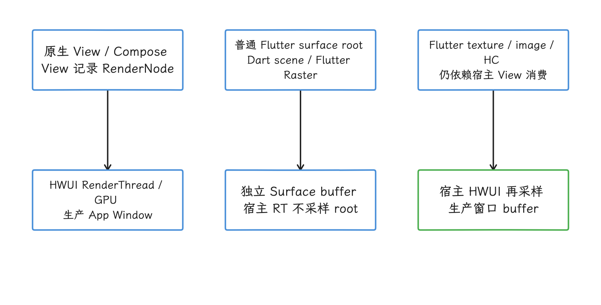

图：根据输出模式决定 HWUI 是窗口主绘制者还是中间 image 的消费者。 纯 Flutter Widget 绘制跳过原生 View 绘制链，不表示整个宿主没有 traversal。

两条路径仍共享 Android 显示后半段：

- 通常 root 通过 `Surface`/`ANativeWindow` 接入 BufferQueue/BLAST；HCPP 的 Impeller AHB swapchain 还可用 `SurfaceControl` transaction 直接设置 buffer，不能强制套用传统 dequeue/queue 链；
- SurfaceFlinger 按 readiness 规则采纳/latch 可见 layer 的 buffer；条件允许时可 latch 尚未 signal 的 acquire fence，但实际读取仍须满足对应写入依赖；
- SF/HWC 为各 Layer 确定合成类型；DEVICE 路径由显示硬件处理，使用 CLIENT 时由 RenderEngine 生成 client target。`presentOrValidate` 还可能走快速 present，不能把 validate 或 RenderEngine 画成每帧必经；
- dma-buf 负责在进程和设备之间共享 buffer，dma-fence 表示异步硬件工作完成与否，sync_file 则把 fence 封装成可跨进程传递的文件描述符。

PlatformView、`RenderMode.texture`、`RenderMode.image` 和宿主 Android UI 会重新引入 ViewRoot/HWUI，因此上述区别只适用于纯 Flutter root 主路径。

## Flutter 怎样接入 Android VSync

固定 Flutter 源码中的 `VsyncWaiterAndroid::AwaitVSync()` 会先判断 NDK `AChoreographer` 是否可用。符号可用时，它在 UI task runner 上注册 NDK frame callback；否则就在 platform task runner 上调用 Java `VsyncWaiter.asyncWaitForVsync()`，再由 `Choreographer.FrameCallback` 回调 `FlutterJNI.onVsync()`。

<!-- gracker-diagram: ch13-07-09-vsync-ingress -->
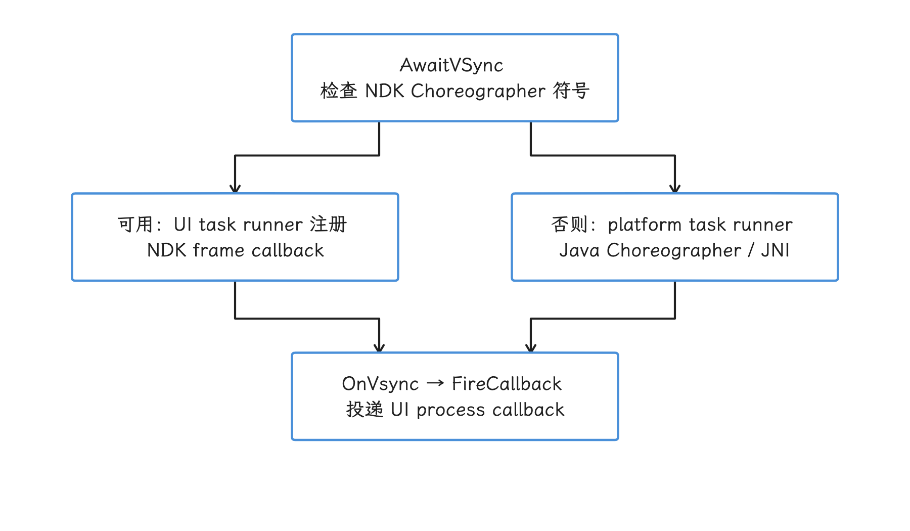

图：VSync 入口按符号选择，再汇合到同一 UI task runner 调度。 NDK target 是 frame start 加刷新周期的估计；不是 SF token 或 display 完成。

两条入口随后汇合到 `VsyncWaiter::FireCallback()`，由 `VsyncFireCallback` flow 关联到 UI task runner 上的 `VsyncProcessCallback`。回调再按需要进入 `Animator::BeginFrame` 或 `DrawLastLayerTrees`。固定 NDK 路径用 frame start 加当前刷新周期估计 target；这是 engine 的时序记录，不是已经取得 SF App FrameTimeline token，也不是显示完成时间。[来源：VsyncWaiterAndroid](https://github.com/flutter/flutter/blob/8a9f61cfd67396fb2f9afc3cd7854035e9cd6fc2/engine/src/flutter/shell/platform/android/vsync_waiter_android.cc)

可用下面这条调用关系检查 trace，箭头表示逻辑先后，不保证每个 slice 都紧挨出现：

<!-- gracker-diagram: ch13-07-10-vsync-task-overlap -->
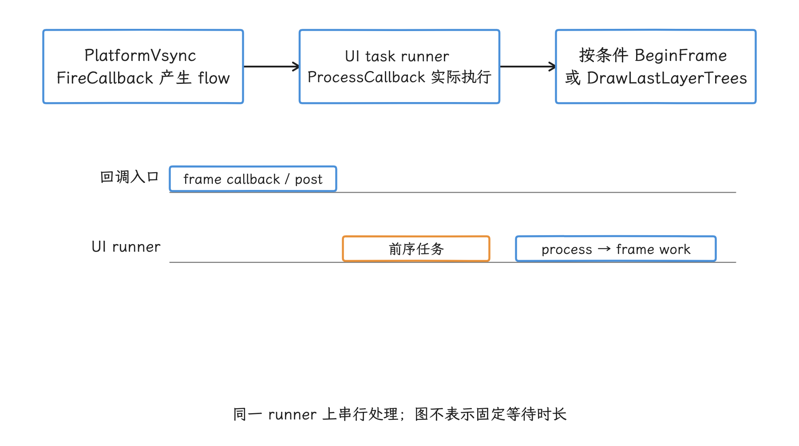

图：用 flow 联系平台回调与 UI 处理，再区分新构建和复用。 时序条仅表示依赖，长度非实测；回调不能抢占 Main 上正在运行的任务。

`PlatformVsync` → `VsyncFireCallback` → `VsyncProcessCallback` →（新 scene：`BeginFrame` / `Render` / `EndFrame`；或复用：`DrawLastLayerTrees`）→ Raster task → `Rasterizer::DrawToSurfaces`

如果 `PlatformVsync` 已经出现，而 `VsyncProcessCallback` 很晚才运行，应检查 UI task runner 所在线程的 Running/Runnable 状态和前序任务。如果 `Animator::BeginFrame` 及时开始，但 `Animator::Render` 很晚，问题更接近 Dart build/layout/paint；如果 Raster slice 很长，再检查 layer、shader、纹理上传和 GPU。

## Root RenderMode：surface、texture、image

固定源码中的 `io.flutter.embedding.android.RenderMode` 有 `surface`、`texture` 和 `image` 三个值。它描述 Flutter root 内容如何接入 Android View 与显示链路，不描述 PlatformView 的合成策略。

### `RenderMode.surface`

<!-- gracker-diagram: ch13-07-11-surface-lifecycle -->
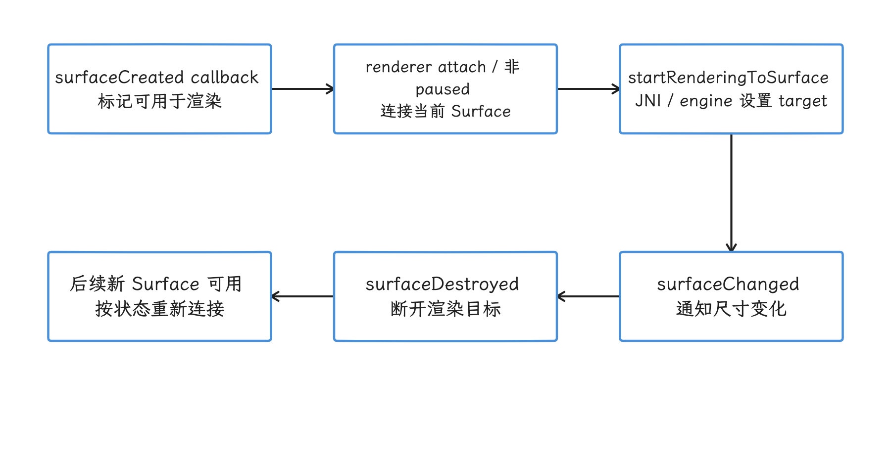

图：Surface 创建后才连接 renderer，尺寸与销毁回调继续控制 target 生命周期。 连接 Surface 不保证立即有 buffer；HCPP 还可能在其下建立 AHB/control 输出。

`FlutterSurfaceView` 持有 `SurfaceHolder`。`surfaceCreated()` 之后，embedding 把 `Surface` 交给 `FlutterRenderer.startRenderingToSurface()`，engine 直接向该 Producer target 渲染。Android 17 的 SurfaceView 对应独立 child layer，SurfaceFlinger 可以直接观察该 layer 的 buffer 更新。

这条路径少一次宿主 HWUI 的纹理采样，适合不透明的全屏 Flutter 页面。代价来自独立 layer：

- 无法像普通 View 那样自由夹在两个 Android View 之间；
- 任意 rotation、复杂 clip 与普通 View 不等价；但 Android 7+ 已同步平移/缩放，Android 14+ 支持任意 alpha，且 alpha 的作用对象受 Surface 的 composition order 影响，不能把这些能力全部写成“不支持”；
- Surface 创建、尺寸变化、暂停和销毁必须与 engine target 切换同步；
- z-order 调整会改变 SurfaceFlinger layer 关系。

透明 SurfaceView 是特殊配置。固定源码中的 `FlutterSurfaceView(renderTransparently=true)` 会设置透明 pixel format，并调用 `setZOrderOnTop(true)`。不过，`FlutterActivity` 使用透明背景时默认选择 `RenderMode.texture`；SurfaceView 支持透明，不代表透明 FlutterActivity 默认使用 SurfaceView。

<!-- gracker-diagram: ch13-07-12-modern-surface-capabilities -->
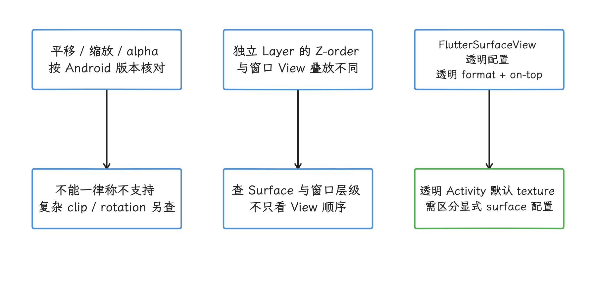

图：分别核对变换、层叠和透明配置，避免沿用旧版本的全禁结论。 Android 7+ 平移缩放同步、14+ alpha 仍受 composition order 语义约束；复杂 clip/任意旋转不等价。

### `RenderMode.texture`

<!-- gracker-diagram: ch13-07-13-texture-two-queues -->
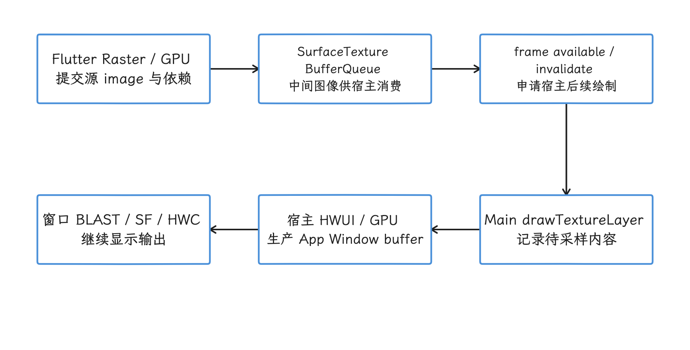

图：先生成中间 SurfaceTexture image，再由宿主采样生产窗口 buffer。 两段可异步重叠；画图中的先后表达数据依赖，不承诺一对一帧率。

`FlutterTextureView` 把底层 `SurfaceTexture` 包装成 `Surface`，再交给 `FlutterRenderer`。Flutter Raster/GPU 先生成 SurfaceTexture image，宿主 HWUI 随后把它作为 `TextureLayer` 采样并绘入 App Window buffer。

Android 17 `TextureView` 的 frame-available 回调标记 layer 需要更新并 `invalidate()`。宿主 Main 的 `TextureView.draw()` 通过 `RecordingCanvas.drawTextureLayer()` 记录绘制，后续宿主 HWUI/RenderThread/GPU 才消费纹理并生产窗口像素；不能把 Java `draw()` 返回当成纹理读取已完成。这也要求硬件加速窗口，软件 Canvas 下不会显示 TextureView 内容。[来源：TextureView](https://android.googlesource.com/platform/frameworks/base/+/android-17.0.0_r1/core/java/android/view/TextureView.java)

这条路径有两段独立的生产/消费节奏：

<!-- gracker-diagram: ch13-07-14-texture-record-read -->
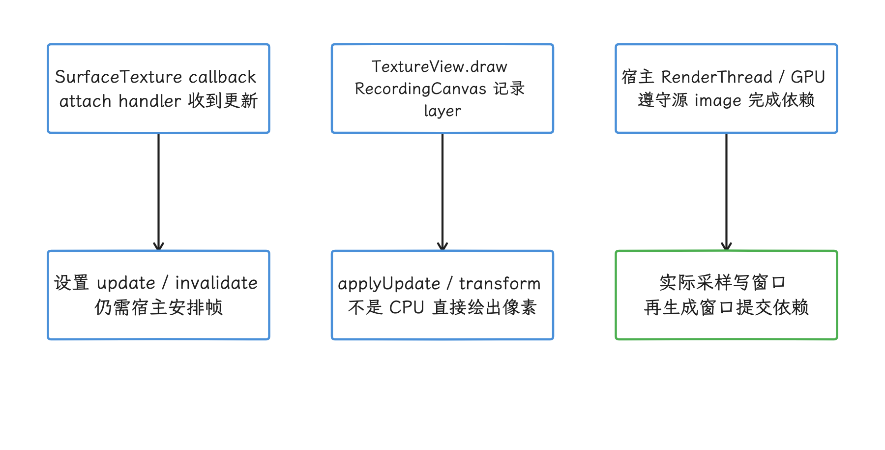

图：frame-available、Java draw 记录与 HWUI 实际采样是不同边界。 需要硬件加速窗口；Java draw 返回或 frame-available 不能证明实际采样完成。

1. Flutter Producer 让 SurfaceTexture 获得新 image；
2. 宿主 Main/RenderThread 在窗口帧中消费它并提交 App Window buffer。

TextureView 便于参与普通 View 的 alpha、rotation、scale、clip 和 z-order，也增加宿主 traversal、HWUI 采样与同步成本。Flutter Raster CPU 已提交而显示仍晚时，继续检查输入 image 的 GPU 完成依赖、`TextureView#draw()`、宿主 `DrawFrame`、窗口 queue 与显示后段；单凭 Raster slice 结束还不能断定根因已在宿主。

### `RenderMode.image`

`FlutterImageView` 使用 `ImageReader` 接收 engine 输出，再在 `onDraw()` 中把 image 绘回 Android Canvas。它主要服务 Hybrid Composition 的 root/overlay 转换和少数 embedding 场景，常规页面默认不会使用这一模式。

API 29+ 的固定源码会取得 `Image.getHardwareBuffer()`，再用 `Bitmap.wrapHardwareBuffer()` 包装为 hardware bitmap；这样可以避免 pre-29 分支中的逐像素 CPU copy，但仍存在 ImageReader acquire、image 生命周期管理、Canvas/HWUI 采样和宿主窗口提交成本，不能把它概括为零成本路径。

<!-- gracker-diagram: ch13-07-15-image-wrap-copy -->
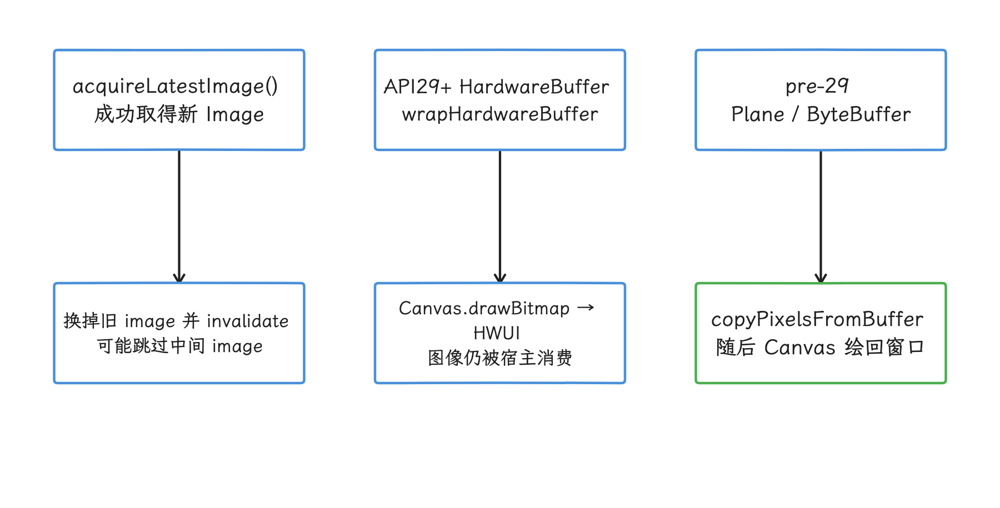

图：API 29+ 包装 HardwareBuffer，旧分支复制像素，两者都仍有宿主绘制成本。 hardware bitmap 包装避免旧 CPU 像素 copy，但不等于省去 acquire、采样与窗口提交。

### `FlutterActivity` 的默认选择

| `BackgroundMode` | 默认 `RenderMode` | 承载对象 |
|---|---|---|
| `opaque` | `surface` | `FlutterSurfaceView` |
| `transparent` | `texture` | `FlutterTextureView` |

这一映射来自 `FlutterActivity.getRenderMode()`。`FlutterFragment`、add-to-app 或直接构造 `FlutterView` 时，调用方可能显式选择其他模式，诊断时应从对象树确认。

<!-- gracker-diagram: ch13-07-16-activity-default -->
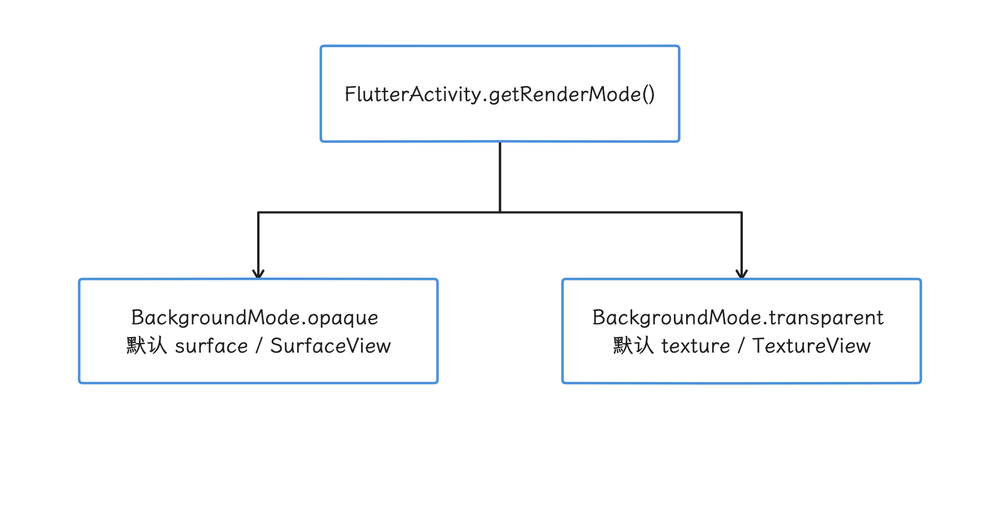

图：Activity 的背景模式决定默认 surface 或 texture。 Fragment、add-to-app 与显式构造可选择其他 root，最终以对象树为准。

### Root 模式对照

<!-- gracker-diagram: ch13-07-17-root-comparison -->
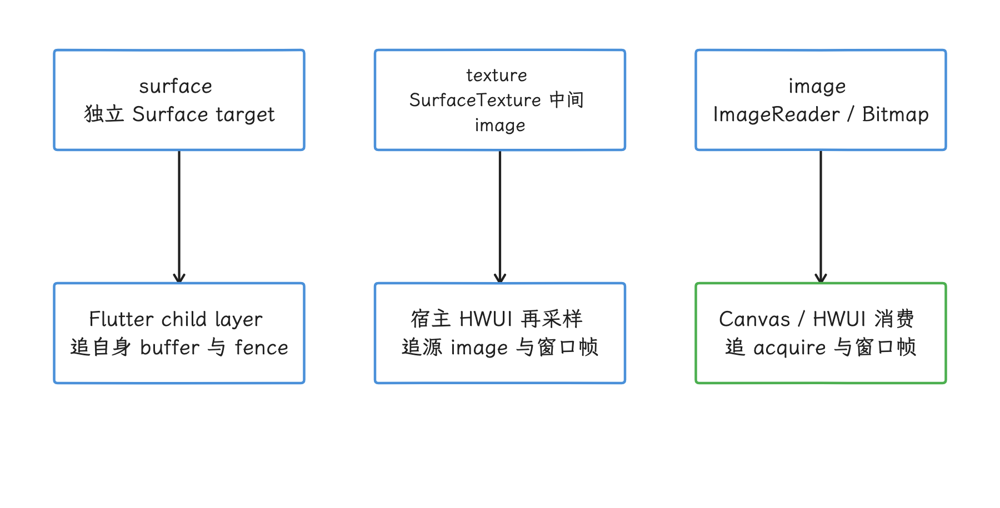

图：surface 直出独立 Layer，texture/image 都先经宿主生产窗口 buffer。 mode 不决定 PlatformView 策略，也不保证 DEVICE composition 或固定时延。

| Root mode | 中间对象 | SurfaceFlinger 侧主要对象 | 常见等待 |
|---|---|---|---|
| `surface` | 独立 Surface buffer | Flutter root child layer | dequeue、GPU completion fence、SF latch |
| `texture` | SurfaceTexture image | Host App Window | image ready、host invalidate/draw、HWUI sample、window queue |
| `image` | ImageReader image | Host App Window | image acquire、HardwareBuffer/Bitmap 包装、Canvas/HWUI、window queue |

## External texture 与 `SurfaceProducer`

相机、视频或 native renderer 可以通过 `TextureRegistry` 向 Flutter scene 提供 external texture。插件 Producer 先写入 Android `Surface`，Flutter Raster 在生成 root scene 时采样该 image，随后仍按 root RenderMode 输出最终内容。

这会形成两个生产阶段：

<!-- gracker-diagram: ch13-07-18-external-two-producers -->
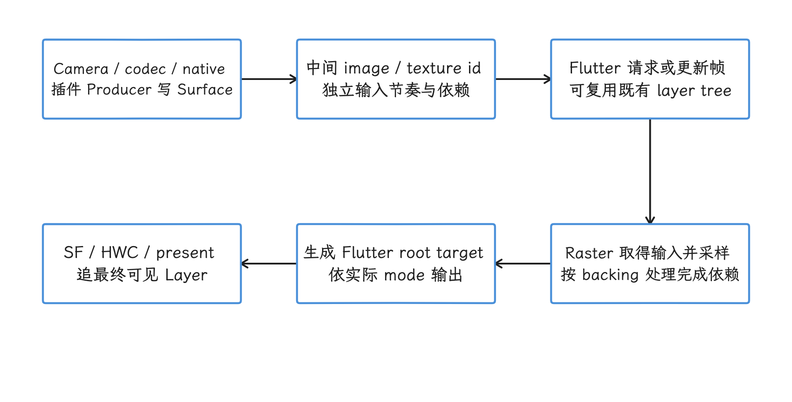

图：插件生成输入 image，Flutter 采样后再生成 root 内容。 输入 ready、Flutter 采样和最终显示不是同一时刻，输入与显示帧也未必一对一。

- 插件侧生成 camera、codec 或 native graphics buffer；
- Flutter engine 采样 external texture，再生产 root buffer。

插件帧率与 Flutter 帧率可以不同。相机 buffer ready 只说明输入可供消费，不代表 Flutter 已经采样；Flutter 触发新帧时，插件也未必恰好提供了新 image。

在固定 Flutter 源码中，`FlutterRenderer.createSurfaceProducer()` 的选择规则很明确：

<!-- gracker-diagram: ch13-07-19-surfaceproducer-backing -->
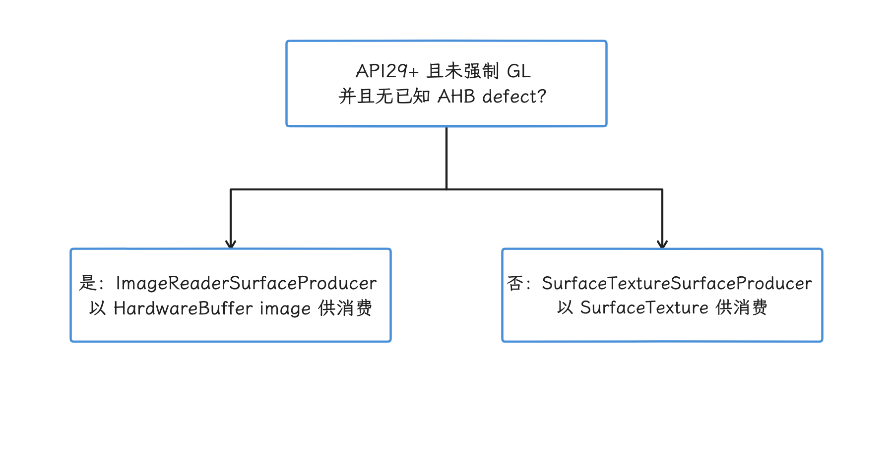

图：根据 API、测试开关与硬件缺陷判断底层实现。 这与 root RenderMode、Impeller 是否 Vulkan 以及 HC/VD fallback 都是不同选择。

- 未强制使用 GL texture、API 29+ 且设备不在已知 HardwareBuffer 缺陷列表时，使用 `ImageReaderSurfaceProducer`；
- 其他情况使用 `SurfaceTextureSurfaceProducer`。

`TextureRegistry.SurfaceProducer` 在 Flutter 3.22 进入源码，官方迁移文档把 3.24 定为插件可以采用的最低稳定版本。`onSurfaceAvailable()` 与 `handlesCropAndRotation()` 的新契约在 3.27 提供，`onSurfaceCleanup()` 在 3.29 取代旧的 `onSurfaceDestroyed()`。审计插件时，要核对其声明的 Flutter 最低版本和实际实现的回调，不能用当前 API 文档倒推旧插件行为。

`createSurfaceProducer()` 默认采用 `SurfaceLifecycle.manual`。固定实现只有请求 `resetInBackground` 且选中 ImageReader backing 时，才注册内存压力清理回调；`onSurfaceCleanup()` 在清理前通知调用方停用旧 Surface，恢复后再取得新 Surface。`SurfaceTextureSurfaceProducer.setCallback()` 是空实现。`getSurface()` 的契约要求按需重新取得，resize/重建后不能长期缓存旧 Surface；callback 也不是每次 resize 都一定发生。[来源：TextureRegistry](https://github.com/flutter/flutter/blob/8a9f61cfd67396fb2f9afc3cd7854035e9cd6fc2/engine/src/flutter/shell/platform/android/io/flutter/view/TextureRegistry.java)

<!-- gracker-diagram: ch13-07-20-surfaceproducer-lifecycle -->
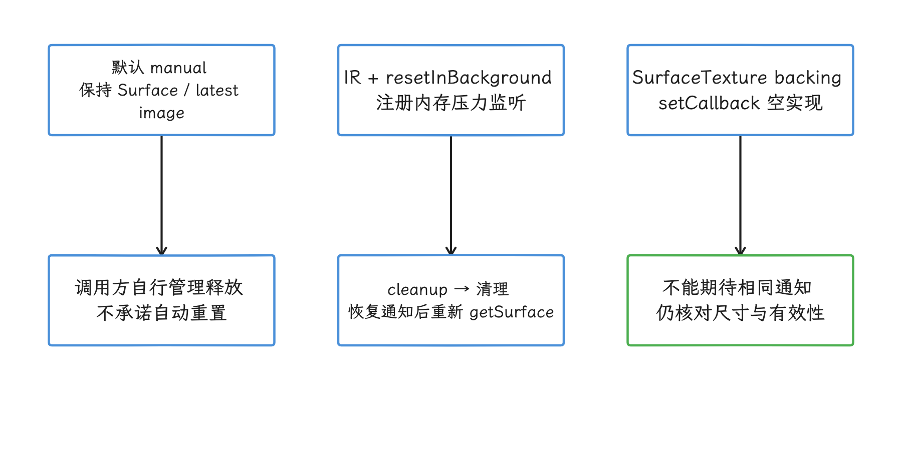

图：按 lifecycle 与 backing 管理旧 Surface，使用时重新取得当前目标。 cleanup 回调先停用旧对象；resize 不保证 callback，不能长期缓存 getSurface 返回值。

插件还要检查 `handlesCropAndRotation()`：ImageReader backing 返回 `false`，SurfaceTexture backing 返回 `true`。相机画面方向或裁剪错误可能来自插件没有遵守该契约，不能直接归因于 SurfaceFlinger transform。

<!-- gracker-diagram: ch13-07-21-crop-rotation -->
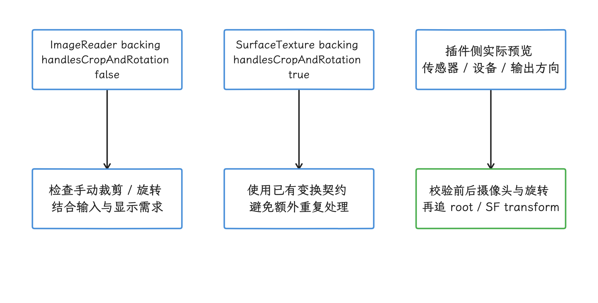

图：先查询 metadata 是否由 backing 处理，再决定插件侧变换。 false 需按实际相机与输出语义处理，不能直接归因 SF，也不能重复旋转。

在 Perfetto 中分析 external texture 卡顿时，分别记录 texture id、插件输入队列、engine frame 与 root buffer。中间 texture 通常只在 Flutter 内部被采样，未必作为独立可见 SF layer 出现。固定 ImageReader producer 在 API 33+ 的 `acquireLatestImage()` 路径还会调用 `Image.getFence().awaitForever()`，这可能形成 Raster 调用链中的 CPU 等待；API 29–32 没有同一 Java fence API，不能照搬这个调用名。安全读取依赖要按 backing 与 backend 分别核对。[来源：FlutterRenderer](https://github.com/flutter/flutter/blob/8a9f61cfd67396fb2f9afc3cd7854035e9cd6fc2/engine/src/flutter/shell/platform/android/io/flutter/embedding/engine/renderer/FlutterRenderer.java)

<!-- gracker-diagram: ch13-07-22-imagereader-cpu-fence -->
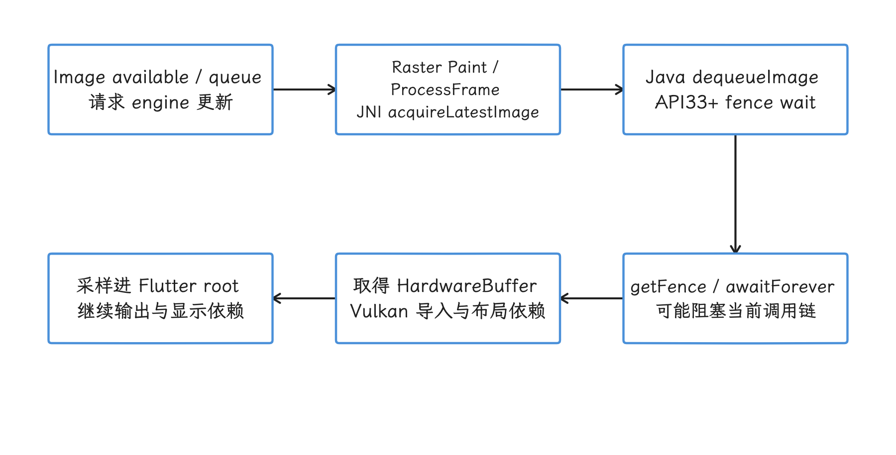

图：ImageReader producer 在 API33+ 的取图路径可进入 Java SyncFence 等待。 API29–32 缺少同一 Java API；CPU 等待只描述固定 backing，不能外推全部 external texture。

## Impeller 与 Skia：先辨认 renderer，再讨论成本

Flutter 3.27 起在 Android API 29+ 默认启用 Impeller。固定源码中的运行时选择并非简单的“Vulkan 不可用就改用 Skia”：

<!-- gracker-diagram: ch13-07-23-renderer-selection -->
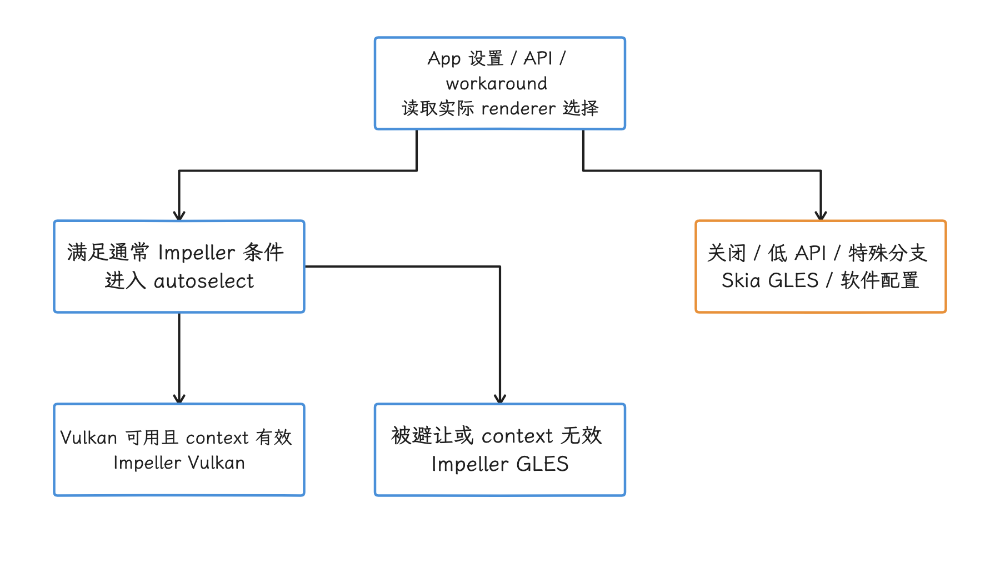

图：先确认 renderer 配置，再读动态 Vulkan/GLES 的运行分支。 通常构建还受 Vivante、软件互斥、调试强制 backend 与编译条件影响。

1. 通常构建中，Impeller 启用、API 29+ 且不是 Vivante workaround 分支时，`SelectedRenderingAPI()` 返回动态选择；非 release 还支持显式指定 GLES/Vulkan，需与默认 autoselect 区分；
2. `AndroidContextDynamicImpeller` 尝试创建 Vulkan context；
3. 模拟器、已知问题 SoC、缺失能力或无效 Vulkan context 会让它改用 **Impeller OpenGLES**；
4. 默认选择中的低 API、显式关闭 Impeller 或 Vivante workaround 可进入 Skia GLES；软件渲染需按配置与 Impeller 互斥检查，不能假定同时打开会自动正常回退。`SLIMPELLER` 等构建条件也会改变可选路径。

因此，没有 Vulkan backend 时仍可能使用 Impeller GLES。报告应分别记录 renderer 与 backend：`Impeller/Vulkan`、`Impeller/OpenGLES` 或 `Skia/OpenGLES`。还要固定 revision：本文 commit 对 MediaTek 优先读取 `ro.vendor.build.version.sdk`，缺失时用 OS API、以有效 API `< 32` 避让 Vulkan；`3.44.8` 对照则使用设备 API `< 31` 避让；旧系统版本或较新的 OS 都不能代替 vendor/engine 条件。[来源：固定 commit](https://github.com/flutter/flutter/blob/8a9f61cfd67396fb2f9afc3cd7854035e9cd6fc2/engine/src/flutter/shell/platform/android/android_context_dynamic_impeller.cc)、[3.44.8 对照](https://github.com/flutter/flutter/blob/3.44.8/engine/src/flutter/shell/platform/android/android_context_dynamic_impeller.cc)

<!-- gracker-diagram: ch13-07-24-mediatek-revision -->
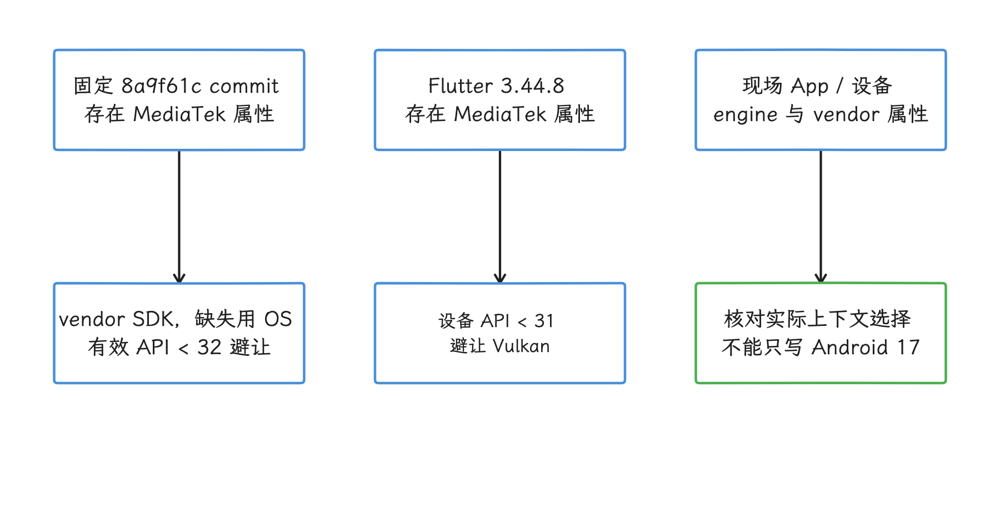

图：相邻源码锚点会改变 vendor/系统 API 的判断依据。 按真实条件表达差异，不把源代码注释或 OS 升级当成实际 backend 结果。

### Impeller 解决了什么

Impeller 的 shader 资产在 engine 构建期生成并打包。固定 Android Vulkan context 会把编入二进制的 shader mappings 交给 `ContextVK::Create()`，同时把 App cache directory 传给 pipeline cache。Vulkan cache 文件名是 `flutter.impeller.vkcache`，读取时会校验 driver version、vendor/device id、ABI 和 pipeline cache UUID，避免复用不兼容的数据。

<!-- gracker-diagram: ch13-07-25-impeller-cache -->
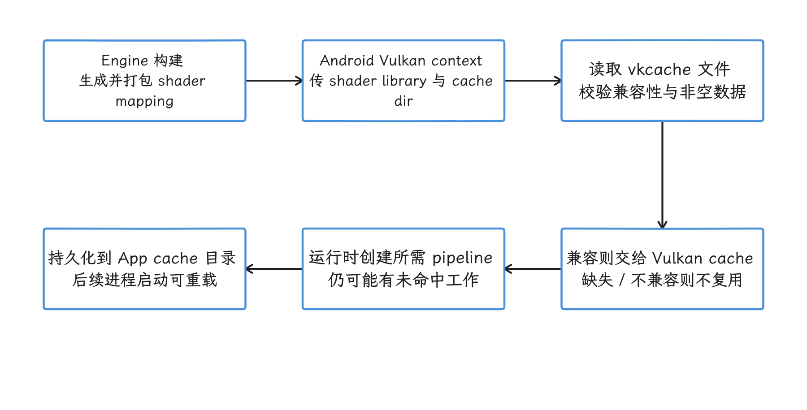

图：编入 shader 资产并重载兼容的磁盘 cache，减少重复工作。 cache 有 driver/device/ABI/UUID 校验，不能保证首次 pipeline 创建或 GPU 像素工作消失。

这些设计减少了不可预测的运行时 shader 工作，并允许同一 App 后续进程启动时从磁盘重载兼容的 Vulkan pipeline cache；这不表示跨 App 共享，也不承诺并发进程之间自动同步 cache。它们不会消除：

<!-- gracker-diagram: ch13-07-26-impeller-residual -->
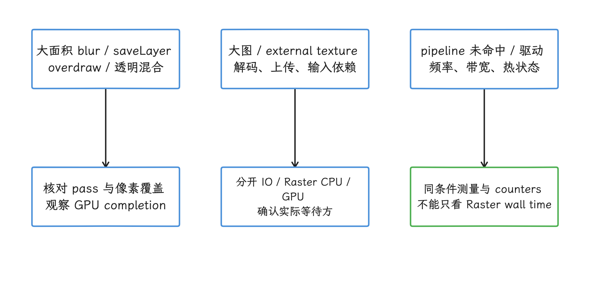

图：离线资产与 cache 改变准备方式，像素、资源与同步成本仍要独立取证。 不据 renderer 名称承诺固定帧率、cache 命中率或毫秒收益。

- blur、saveLayer、overdraw 与大面积半透明带来的像素成本；
- 大图解码、上传与 external texture 同步；
- 首次创建尚未命中的 pipeline；
- GPU 频率、带宽、thermal throttling（温控降频）和驱动 fence wait。

固定 shader 变体数量、固定毫秒耗时、固定帧率跌幅以及特定 GPU cache 命中率都没有一手基准支持，不能作为通用结论。这里仅讨论源码能够证明的编译、选择与缓存机制。

## PlatformView：TLHC、HC 与 HCPP

Flutter root RenderMode 与 PlatformView composition mode 是两组配置。一个页面可以使用 `FlutterSurfaceView` 作为 root，同时把 WebView 通过 TLHC 转成 texture；也可以在 HC/HCPP 中同时出现 Flutter image/overlay 和原生 View/Surface。

<!-- gracker-diagram: ch13-07-27-composition-families -->
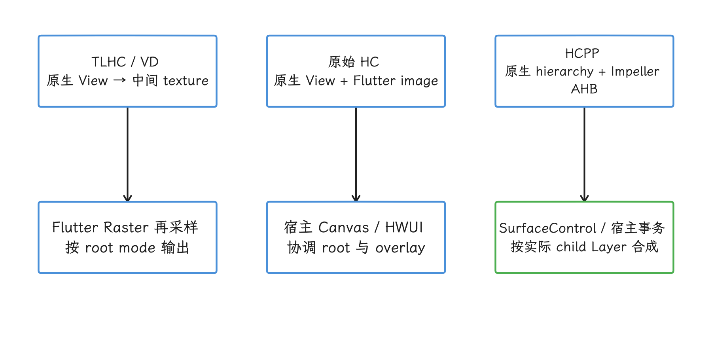

图：分别确认 Flutter root 和原生 View 内容如何进入显示链。 同一页面可混合多种对象；HCPP 普通 View 仍可处于宿主窗口。

下面的图用于区分三种 PlatformView 的主要数据流。图中省略输入和无障碍桥接，只关注像素如何进入最终显示链路。

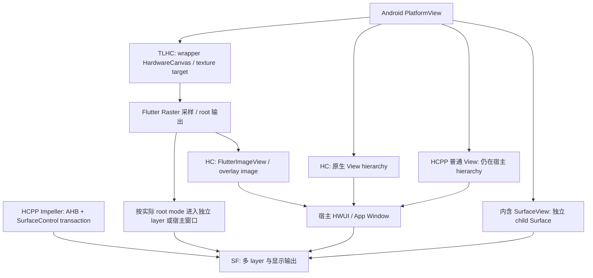

TLHC 把 PlatformView 结果绘入中间 target，交给 Flutter Raster 采样；原始 HC 保留原生 View hierarchy，并用 FlutterImageView/overlay 协调 Flutter 内容。HCPP 则让 Impeller 使用 AHB/SurfaceControl 提交并同步宿主事务，但普通 PlatformView 仍可绘在宿主窗口，只有实际独立 Surface 的对象才对应额外 layer。三者的中间 buffer、线程竞争与 fence 关系应分别核对。

### Texture Layer Hybrid Composition（TLHC）

固定源码中的 `configureForTextureLayerComposition()` 将 PlatformView 放入 `PlatformViewWrapper`；wrapper 的 `draw()` 对 render target 的 Surface 调用 `lockHardwareCanvas()`，将子树画到这个 Canvas，再 `unlockCanvasAndPost()`。普通子树仍由 Android View traversal 驱动，不能把它理解成原生 View 不再执行 draw。render target 按 API/flag 选择 SurfaceProducer、ImageReader 或 SurfaceTexture，SurfaceProducer 内部又有 backing 选择。[来源：PlatformViewWrapper](https://github.com/flutter/flutter/blob/8a9f61cfd67396fb2f9afc3cd7854035e9cd6fc2/engine/src/flutter/shell/platform/android/io/flutter/plugin/platform/PlatformViewWrapper.java)

<!-- gracker-diagram: ch13-07-28-tlhc-hardware-canvas -->
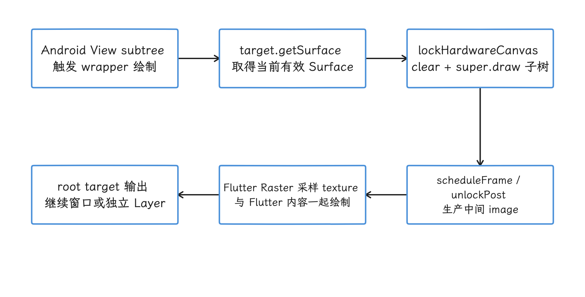

图：Android 子树被投影到 target Surface，再供 Flutter Raster 采样。 TLHC 仍需 Android traversal；它不等于把 Android View 变成 Dart Widget 或直接 SF Layer。

是否回退 HC/VD 是更前面的另一项判断：包含不支持 TLHC 的 View 类型时，按创建请求的 `TEXTURE_WITH_HYBRID_FALLBACK` 等模式选择；不能把 target backing 的切换直接画成 HC/VD fallback。

<!-- gracker-diagram: ch13-07-29-tlhc-selection -->
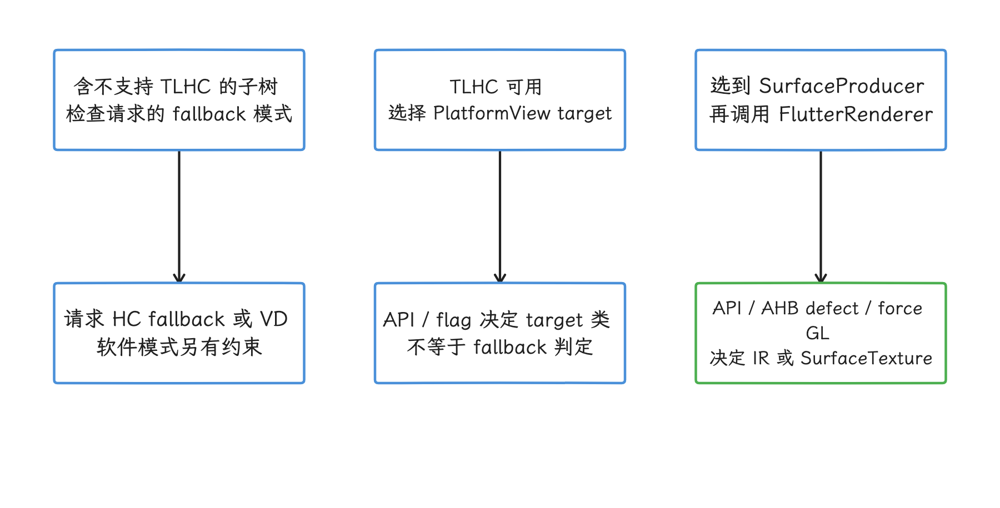

图：先决定 TLHC 是否可用，再为选中的 texture 路径选择 target 与 backing。 HC/VD fallback 由 View 类型和创建请求决定，不是 ImageReader 与 SurfaceTexture 的同一分支。

TLHC 的优点是 Flutter transform、clip 和 opacity 更容易保持一致，Flutter Raster 可以把 PlatformView texture 与其他 Flutter 内容一起合成。代价包括中间 buffer、texture acquire、invalidate、输入坐标映射和无障碍桥接。快速滚动 WebView 可能出现抖动；PlatformView 内含 `SurfaceView` 时，如何转接独立 Surface 像素与 accessibility 也更复杂。

### 原始 Hybrid Composition（HC）

HC 会把原生 View 加入 Android View hierarchy。固定源码中的 `PlatformViewsController` 在需要同步时调用 `FlutterView.convertToImageView()`，把 Flutter root 临时切换到 `FlutterImageView`；Flutter overlay 也通过 ImageReader-backed View 绘回宿主层级。`FlutterMutatorView` 负责对原生 View 应用位置、变换、裁剪和可见性。

<!-- gracker-diagram: ch13-07-30-hc-host-topology -->
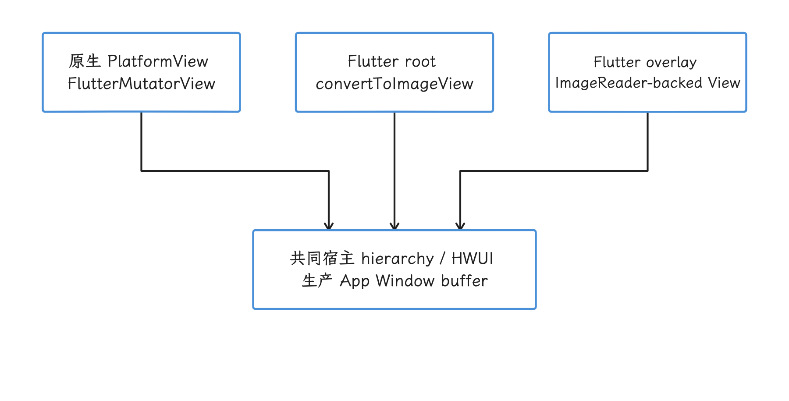

图：原生 View、Flutter root image 与 overlay image 共同进入宿主窗口绘制。 内部 SurfaceView 仍需另查 child Surface；本图不表示普通 HC 直接多 Surface 直出。

这条路径保留了较完整的原生 View 行为，但增加了 Flutter image、overlay、宿主 View 与 PlatformView 的同步。Flutter 官方文档还指出：

- 原始 HC 会把 raster tasks 动态合并到 platform runner；在 UI/platform 默认合并时，也与 Dart UI、OS message 和主线程插件竞争；
- Android 10 之前每帧存在 graphics memory → main memory → GPU texture 的往返 copy；
- 文档用 Android 10+ “copy 一次”概括相对旧 HC 的改进；固定 `FlutterImageView` 的 API 29+ 实际用 `Bitmap.wrapHardwareBuffer()`，避免 pre-29 的 `copyPixelsFromBuffer()`，后续仍需宿主 GPU 采样写窗口。不能据这句概述断言所有设备每帧固定做一次 CPU 像素拷贝或完整物理内存复制。

因此，Android 10+ 的普通 HC 不能按 SurfaceControl 多 Surface 直出理解。固定源码中，原始 HC 的 Java 主路径仍包含 `convertToImageView()`、ImageReader overlay 和宿主 View hierarchy。

<!-- gracker-diagram: ch13-07-31-hc-dynamic-merge -->
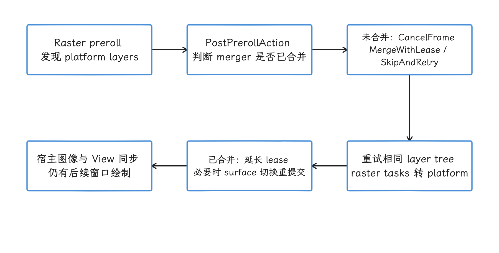

图：有 platform layers 时，动态合并 task queue 并可能重试当前 layer tree。 默认 UI/platform 合并时会与 Dart 竞争；lease 不是永久关闭 Raster 线程。

同步开启时，`finishFrame()` 还需确认本帧 root 与所有使用中的 overlay 都 acquire 到 image，才让本帧使用的原生 parent 可见；图像不齐时设为 `GONE`。这项完整性检查与 raster 动态合并是两类机制，不能用线程已合并推断 overlay 已准备好。[来源：PlatformViewsController](https://github.com/flutter/flutter/blob/8a9f61cfd67396fb2f9afc3cd7854035e9cd6fc2/engine/src/flutter/shell/platform/android/io/flutter/plugin/platform/PlatformViewsController.java)

<!-- gracker-diagram: ch13-07-32-hc-images-ready -->
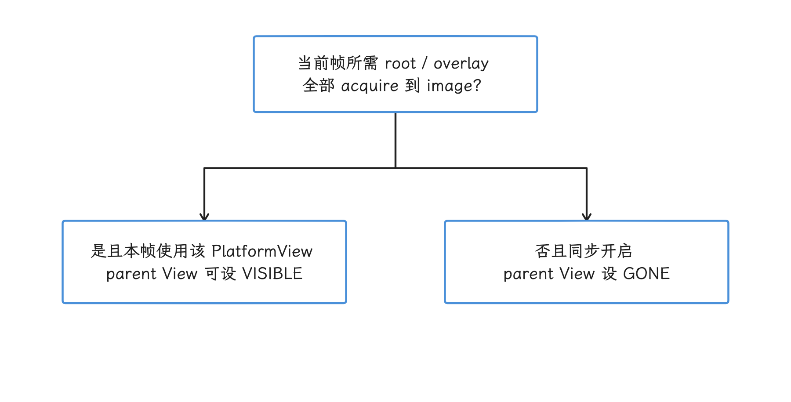

图：原始 HC 在帧结束检查所需 image，避免把不完整的 Flutter overlay 与原生 View 混合。 固定同步开启时，所需 root/overlay 图像未齐会隐藏本帧原生 parent；不是每次 endFrame 都可见。

### Hybrid Composition++（HCPP）

HCPP 从 Flutter 3.44 起提供，当前仍是实验性 opt-in。运行或测试时可以使用 `--enable-hcpp`；release 构建则应在 `<application>` 下设置 `io.flutter.embedding.android.EnableHcpp=true`。

配置存在只代表应用请求 HCPP，固定源码还会继续检查运行时条件：

<!-- gracker-diagram: ch13-07-33-hcpp-gates -->
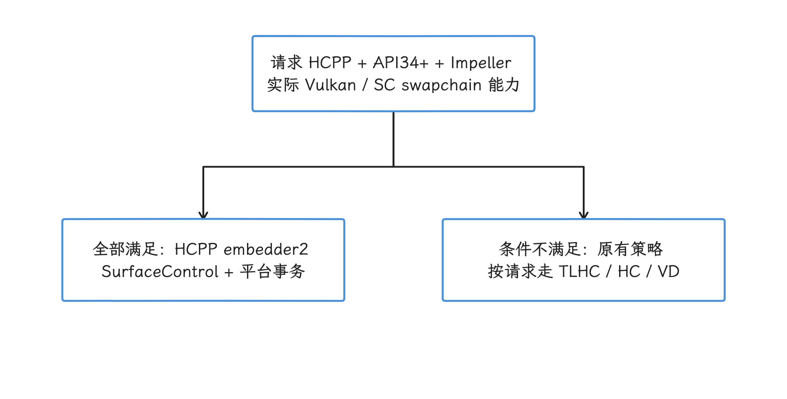

图：请求、API 与实际 Vulkan 能力共同决定是否走 HCPP。 条件失败回 App 原配置策略；API34+、Impeller 名称或 manifest 单独均不能证明启用。

- Android API 34+；
- Impeller 已启用；
- backend 是否为 `kImpellerVulkan`；
- Vulkan context 允许 SurfaceControl swapchain。

条件满足时，`PlatformViewsController2` 使用 `SurfaceControl.Transaction`、root `AttachedSurfaceControl` 与 overlay SurfaceControl；但它仍把普通 PlatformView 加入 `FlutterMutatorView` 和 `FlutterView`，普通 View 像素由宿主窗口承载，内部的 SurfaceView 才可有独立 child Surface。

<!-- gracker-diagram: ch13-07-34-hcpp-real-topology -->
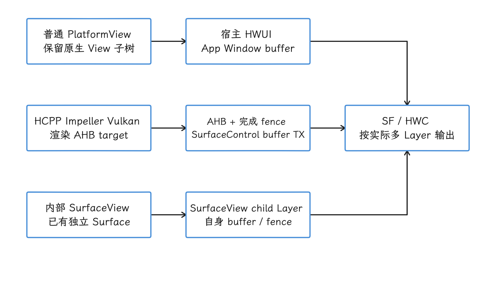

图：普通原生 View 仍在宿主窗口，Impeller AHB 和内部 SurfaceView 可作为独立 Layer。 不会为每个 PlatformView 强制创建独立 Surface；Layer 存在也不保证 DEVICE composition。

Impeller AHB swapchain 用 `ASurfaceTransaction_setBuffer()` 提交 root buffer 与完成 fence，Java 创建的借用 transaction 在 native `Apply()` 中只注册 completion callback，实际留给 Java 合并并通过 `applyTransactionOnDraw()` 与宿主绘制同步。条件不满足则回到原有 PlatformView 策略。[来源：PlatformViewsController2](https://github.com/flutter/flutter/blob/8a9f61cfd67396fb2f9afc3cd7854035e9cd6fc2/engine/src/flutter/shell/platform/android/io/flutter/plugin/platform/PlatformViewsController2.java)、[SurfaceTransaction](https://github.com/flutter/flutter/blob/8a9f61cfd67396fb2f9afc3cd7854035e9cd6fc2/engine/src/flutter/impeller/toolkit/android/surface_transaction.cc)

<!-- gracker-diagram: ch13-07-35-hcpp-deferred-transaction -->
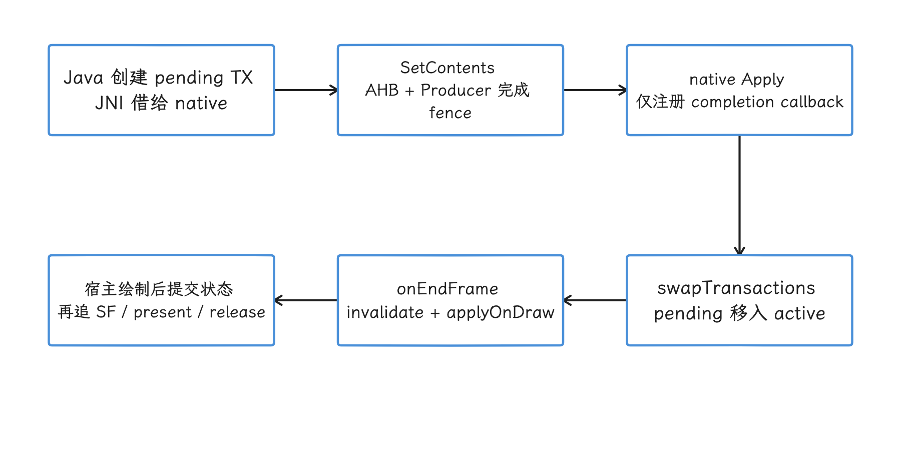

图：native 填入 buffer 和回调，Java 再把借用事务与宿主绘制同步。 native SurfaceTransaction.Apply 对借用 Java transaction 不直接调用 NDK apply；GPU 仍可未完成。

HCPP 可以降低原始 HC 的同步负担，并避免其动态 raster/platform 合并，但并非所有等待都消失：固定实现首次建立 overlay 还会把任务投递到 platform runner 并等待 latch。

当前 overlay 仅有单个顶层 Surface，使用 difference clip 模拟部分叠放；透明 PlatformView 的复杂穿插可能不正确。Android 14–17 不会替旧 Flutter App 自动启用 HCPP。[来源：HCPP embedder](https://github.com/flutter/flutter/blob/8a9f61cfd67396fb2f9afc3cd7854035e9cd6fc2/engine/src/flutter/shell/platform/android/external_view_embedder/external_view_embedder_2.cc)

<!-- gracker-diagram: ch13-07-37-hcpp-overlay-limit -->
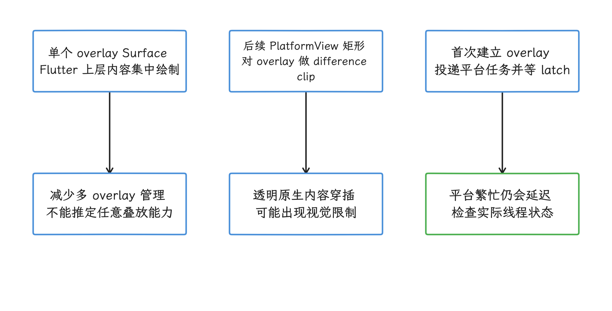

图：单个顶层 overlay 用 difference clip 模拟部分叠放，仍有透明与初始化边界。 图不保证所有透明内容正确穿插，也不把 HCPP 解释成完全没有同步等待。

AHB 池复用还要分清当前与上一块 buffer：提交 B 的 completion 中查询 previous A 的 release fence，将旧 A 连同 fence 放回池；以后重新取得 A 时把该 fd 导入 Vulkan semaphore，GPU 写入前遵守 Consumer 最后使用依赖。当前 B 不会因它自己的提交 callback 就成为可覆写对象，Producer 完成依赖也不能代替 release。[来源：AHB swapchain](https://github.com/flutter/flutter/blob/8a9f61cfd67396fb2f9afc3cd7854035e9cd6fc2/engine/src/flutter/impeller/renderer/backend/vulkan/swapchain/ahb/ahb_swapchain_impl_vk.cc)

<!-- gracker-diagram: ch13-07-36-hcpp-ahb-reuse -->
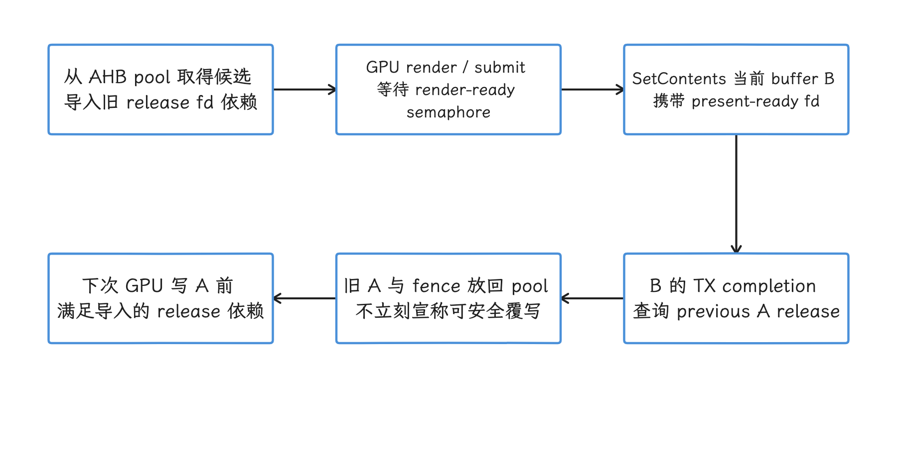

图：buffer 提交携带写完成依赖，旧 buffer 回池后仍需遵守 release 依赖。 OnComplete 对应 previous buffer，不能把当前 B 当成已释放；GPU wait semaphore 不等于 CPU 先等完。

### PlatformView 选型

| 模式 | 像素路径 | 长处 | 重点代价 |
|---|---|---|---|
| TLHC | Native View → texture → Flutter Raster → root | Flutter transform、clip、opacity 较完整；普通 Flutter 渲染性能较稳定 | 快速滚动可能抖动；存在中间 texture；SurfaceView、a11y（无障碍）、text magnifier 有限制 |
| HC | Native View 保留在宿主 hierarchy；Flutter root/overlay 可转 ImageReader View | 原生输入、无障碍与 View 行为较完整 | raster/platform 动态合并、Flutter image/overlay 同步；Android 10 前 copy 很重 |
| HCPP | 原生 View/child Surface + Impeller AHB/SurfaceControl → SF | 避免原始 HC 动态 merge，改善同步 | Flutter 3.44+ 实验性；API 34+、Impeller Vulkan；单 overlay 叠放限制 |
| VD fallback | Native View → VirtualDisplay → 中转 texture → Flutter | 兼容部分无法使用 TLHC 的对象 | buffer、内存、延迟和输入/a11y 桥接成本更高 |

### Z-order、手势与无障碍

Flutter widget tree 与 Android View hierarchy 是两套不同的对象树。PlatformView 的视觉位置、输入命中和无障碍节点需要分别协调：

- TLHC 由 Flutter scene 决定视觉叠放，触摸事件经过 Flutter hit test（命中测试）后映射回 Android View；
- HC 由 `FlutterMutatorView` 和宿主 View hierarchy 参与 z-order，Flutter overlay 还要遮盖 PlatformView 上方的 Flutter 内容；
- HCPP 还要检查 SurfaceControl layer 与 transaction，不能只看 View hierarchy；
- 嵌入 `SurfaceView` 的 PlatformView 拥有自己的 child Surface，普通 View 的 clip、alpha 与 accessibility 结论不能直接套用。

遇到画面位置正确、触摸位置错误时，应同时检查 Flutter transform、Android View bounds 和 MotionEvent 坐标映射。遇到视觉遮挡时，再对照 Flutter overlay、宿主 View z-order 和 SurfaceFlinger layer tree。

<!-- gracker-diagram: ch13-07-38-input-z-accessibility -->
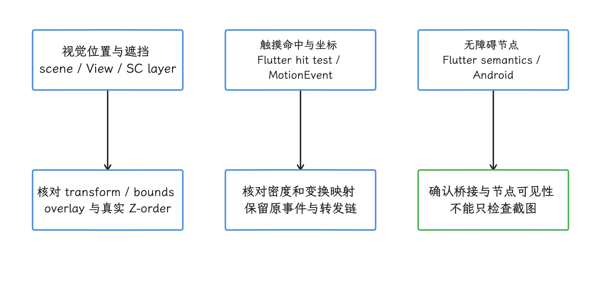

图：把 Flutter scene、View hierarchy 与 Layer tree 的视觉和输入关系分开验证。 内部 SurfaceView 的 clip/alpha 另有边界，位置正确不能证明触摸或无障碍映射正确。

## Android 17 的 buffer、fence 与显示边界

Android 17 的显示端仍需核对 Producer 写入依赖、SF readiness/latch、按 Layer 决定的合成类型和 display present 反馈；CPU 提交可以早于 GPU 完成，条件允许的 latch 也可早于 acquire signal。普通 Surface root 使用 BufferQueue/BLAST，而 HCPP 的 Impeller AHB swapchain 可通过 buffer transaction 直交 SF；两者都须遵守共享 buffer 的引用与同步，不能把传统 BufferQueue 当成所有输出的必经节点。

<!-- gracker-diagram: ch13-07-39-fence-three-roles -->
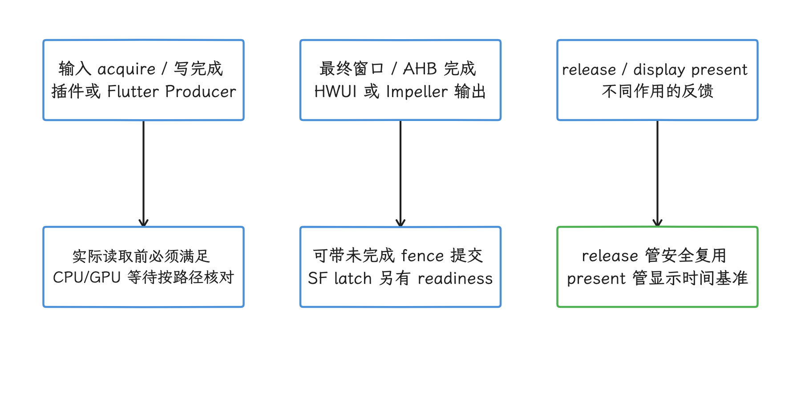

图：分别寻找源 image、最终 buffer 与复用/显示反馈的同步证据。 CPU 返回与 latch 都不是统一完成点；present 反馈也不是面板光学响应。

- `RenderMode.surface`：Flutter root 有独立 Producer queue、acquire fence 和 SurfaceFlinger layer；
- `RenderMode.texture`：SurfaceTexture 是中间 image，宿主 HWUI 采样后再为 App Window 生成新的 GPU completion fence；
- `RenderMode.image`/HC：ImageReader image 被宿主 Canvas/HWUI 消费，overlay 可能拥有额外 image 与 View；
- external texture：实际读取必须满足插件 Producer 的写入依赖，究竟在 CPU 等待还是 GPU 同步由 backing/backend 决定；不能把 CPU submit 读成写入完成；
- HCPP：Flutter root、PlatformView 与 overlay 可能各自拥有 SurfaceControl layer 和 transaction。

FrameTimeline 要按实际输出对象与覆盖解释。Perfetto 官方仍列出 SurfaceView 覆盖限制，独立 Flutter root/HCPP child 不能假定都有标准 HWUI App Expected/Actual；engine frame number、`PlatformVsync` target 与 SF token 也不是同一个 id。external texture 的中间 image 通常没有独立显示帧。先检查目标 Layer 是否有完整时间线，再按 engine frame、texture id、buffer id、layer id、明确依赖与时间窗口补证；缺少 slice 不能当成没有工作。[来源：FrameTimeline](https://perfetto.dev/docs/data-sources/frametimeline)

<!-- gracker-diagram: ch13-07-40-frametimeline-coverage -->
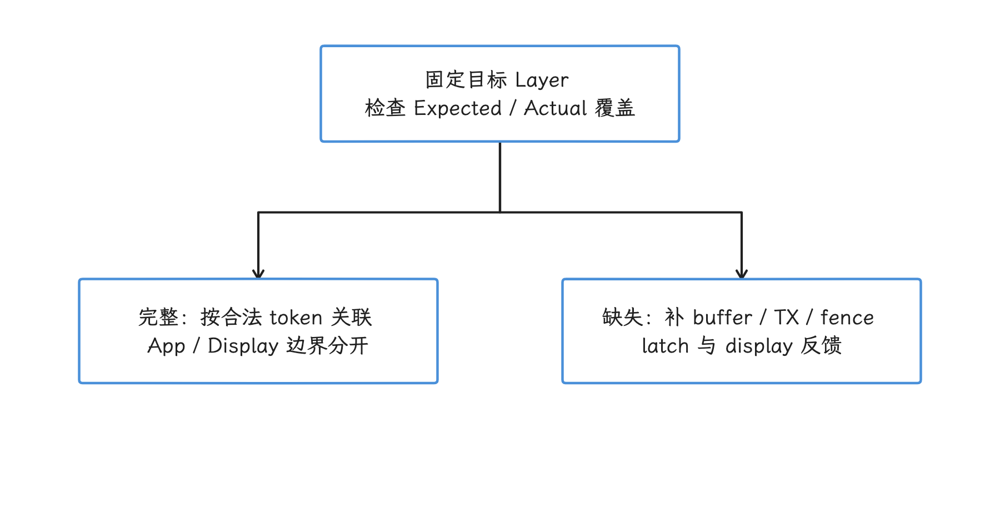

图：覆盖完整才使用对应时间线，独立 Surface 需准备其他同帧证据。 engine frame、vsync target、SF token 不可互换；官方仍有 SurfaceView 覆盖限制。

内核版本 `android17-6.18-2026-06_r6` 提供 dma-buf 和 dma-fence/sync_file 基础。GPU、camera、codec 和 HWC 驱动的具体 tracepoint 由设备实现决定。看到 fence wait 时，先确认等待者位于插件 Producer、Flutter GPU、宿主 HWUI、SurfaceFlinger 还是 HWC。

## 在 Perfetto 中识别 Flutter 渲染管线

### 采样前记录配置

建议使用 profile 或 release 构建复现问题，并记录：

- Android build fingerprint（系统构建标识）和刷新率；
- Flutter SDK 版本和 engine revision；
- UI/platform task runner 是否合并；
- renderer 和 backend；
- root RenderMode；
- PlatformView mode、HCPP flag 与插件版本；
- 复现页面是否包含相机、视频、WebView、地图或其他 external texture。

Flutter trace event 会随 build mode、engine revision 和 trace 配置变化。某个关键词没有出现，只能说明当前 trace 没有记录到该事件，不能单独证明对应阶段不存在。

<!-- gracker-diagram: ch13-07-41-trace-configuration -->
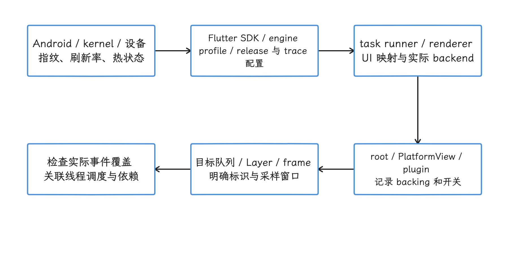

图：先固定 App 与对象，再解释当前采集实际覆盖的事件。 关键词缺失只能说明本次未记录，不能证明阶段或工作不存在。

### 从对象树决定观察对象

先看 Android View hierarchy 与 SurfaceFlinger layer tree：

- 出现独立 Flutter child layer 时，通常对应 `FlutterSurfaceView` 或 HCPP Surface；
- 只看到 Host App Window，而 Flutter 内容位于其中，通常是 TextureView/ImageView/HC 宿主消费路径；
- 有 WebView/Map/SurfaceView child layer，再确认它来自普通 HC、HCPP 或 PlatformView 内部 Surface；
- 相机或 codec 的 Producer layer 不一定直接可见，因为它可能只是由 Flutter Raster 消费的 external texture。

<!-- gracker-diagram: ch13-07-42-object-tree -->
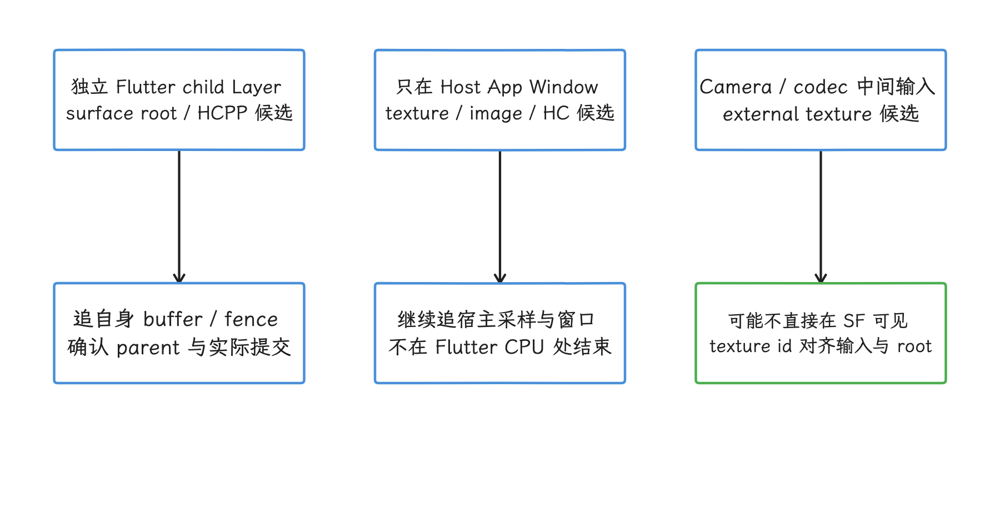

图：独立 Flutter Layer、宿主窗口与中间 texture 的证据位置不同。 Layer 名称只提供线索，需核对 parent、Producer 与真实 buffer 关系。

### Engine 侧常用事件


| 事件/轨道 | 源码含义 | 诊断用途 |
|---|---|---|
| `PlatformVsync` | NDK/Java VSync 入口记录 frame start/target | 判断帧时钟何时到达 engine |
| `VsyncFireCallback` / `VsyncProcessCallback` | callback flow 与 UI task runner 上的处理任务 | 判断任务排队和线程映射 |
| `Animator::BeginFrame` | 记录 build start 并申请 pipeline 空位，可能早退 | 结合 `PipelineFull` 再判断 Dart 是否执行 |
| `Animator::Render` | framework 把本帧 layer tree 交给 engine | 估算 build/layout/paint 区间 |
| `PipelineFull` | raster pipeline 没有空位 | 表示 Raster 侧尚未及时消费前序 scene |
| `GPURasterizer::Draw` / `Rasterizer::DoDraw` / `Rasterizer::DrawToSurfaces` | pipeline 消费与逐 target 绘制的不同范围 | 结合重试/提交结果判断；slice 结束不等于 GPU 完成 |
| Impeller/GPU events | render pass、command buffer、queue work | 区分 CPU 录制与 GPU 执行 |

新版 merged model 下，`VsyncProcessCallback` 和 `Animator::BeginFrame` 应位于 UI task runner 对应的宿主 Main thread；旧版、opt-out 或定制 engine 可能仍有独立 UI thread。线程名也可能被 engine 改写，因此应结合 tid、task runner 映射和相邻事件判断。

<!-- gracker-diagram: ch13-07-43-engine-event-scopes -->
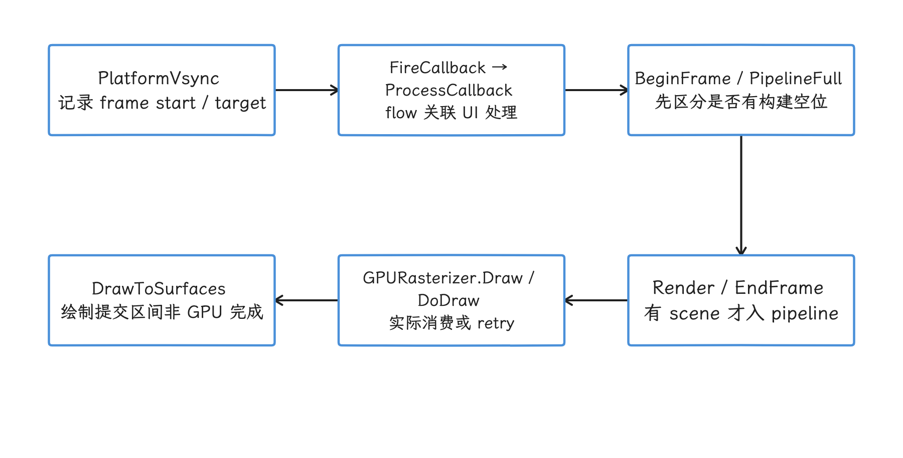

图：用事件范围识别 callback 排队、Dart scene 交付与 Raster 消费。 PipelineFull 可提前退出；reuse、discard、retry 会改变事件序列，名称不能代替结果。

### 五类常见卡顿的证据顺序

<!-- gracker-diagram: ch13-07-44-five-jank-paths -->
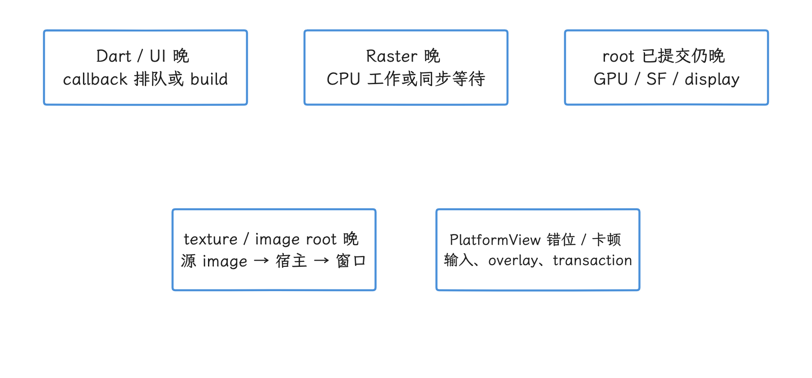

图：先给现象定位，再沿同帧标识查具体阶段依赖。 五类不是互斥根因；同一长帧可叠加多个阶段，不能仅按最长 slice 下结论。

| 现象 | 检查顺序 | 常见方向 |
|---|---|---|
| Dart/UI work 晚 | `PlatformVsync` → `VsyncProcessCallback` → `Animator::BeginFrame` → `Animator::Render` | Main Runnable/Running、plugin callback、build/layout/paint |
| Raster 晚 | `Animator::Render` → `Rasterizer::DrawToSurfaces` → GPU submit | saveLayer、blur、图片上传、pipeline 创建、raster pipeline 满 |
| Flutter 已提交但 root 晚 | root buffer/fence → SF latch → present | GPU fence、dequeue backpressure、SurfaceView lifecycle |
| Texture/Image root 晚 | 中间 image ready → host invalidate/draw → App Window buffer → SF | Host Main、RenderThread、TextureView/ImageReader acquire |
| PlatformView 错位或掉帧 | Flutter frame + host traversal + overlay/PlatformView layer + transaction | HC thread merge、image/overlay 缺帧、HCPP transaction、TLHC texture |

### SurfaceView 与 TextureView 的 trace 差异

`FlutterSurfaceView` 路径中，宿主 RenderThread 不负责采样 Flutter root。宿主 Main 仍会影响 VSync、Dart work、插件和生命周期，但 root buffer 可以直接进入独立 Surface layer。

`FlutterTextureView` 中，Producer 先提交 SurfaceTexture image；frame-available 在 View attach handler 上触发更新与 invalidation，宿主 HWUI 随后消费。若 Raster CPU slice 已结束而窗口未更新，仍需把该 image 的 GPU 完成时间与宿主调度、纹理采样、窗口提交分别对齐；不能仅由两个 CPU slice 的先后就断言瓶颈在宿主。

<!-- gracker-diagram: ch13-07-45-surface-texture-trace -->
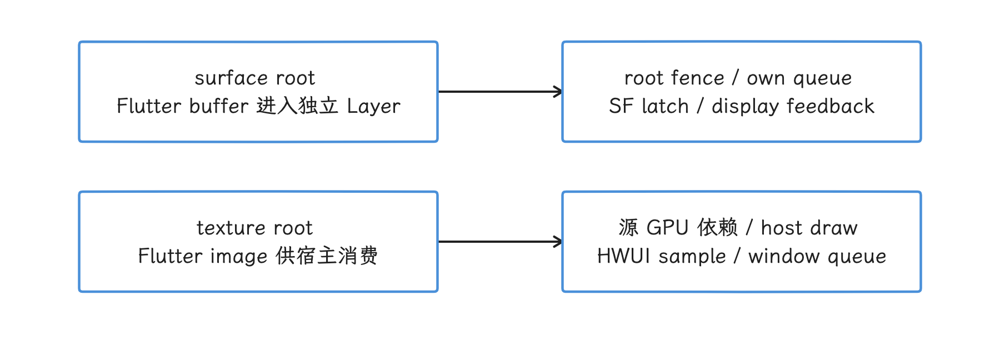

图：独立 root 与宿主消费 root 在不同队列追完成和提交。 Raster CPU 结束后仍需确认源 GPU 与显示后段；窗口未更新不独立证明宿主是根因。

### DevTools：先区分 Framework 与 Raster

性能对比使用 Profile 或 Release：DevTools Performance view 主要在 Profile 采集；Release 的系统 trace 能力须另行配置，不应假设保留 Profile 同样的 VM service/时间线。固定 Android engine 在启动时检测 ATrace，也可用 systrace 配置转发 Flutter/Dart 事件；Release 的 timeline handler 取决于 `trace_systrace`。Debug 的 JIT、assert 和工具开销会改变时序。[来源：DevTools](https://docs.flutter.dev/tools/devtools/performance)、[FlutterMain](https://github.com/flutter/flutter/blob/8a9f61cfd67396fb2f9afc3cd7854035e9cd6fc2/engine/src/flutter/shell/platform/android/flutter_main.cc)

DevTools 适合回答：

- 哪一帧的 UI/Framework 或 Raster 时间超预算；
- 哪些 Dart 函数占 CPU；
- Widget rebuild、layout、paint 是否异常；
- 内存/GC、图片与 shader 事件是否相关。

DevTools 的“帧完成”不等于 panel 已显示。它不能单独解释 CPU 调度、GPU fence、SurfaceFlinger、HWC 与 present。

<!-- gracker-diagram: ch13-07-46-devtools-system-scope -->
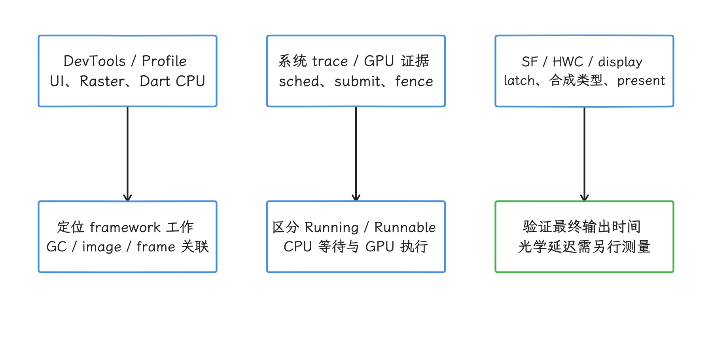

图：Profile 观察 Framework/Raster，系统 trace 继续验证调度、GPU 与显示端。 Release tracing 需明确配置；DevTools 帧完成不等于光学展示。

### 自定义 Trace：关联 Dart、Native 与系统事件

Dart 可用 `dart:developer` 标注业务阶段。同一同步调用栈内用 `Timeline.startSync()` / `finishSync()` 并以 `try/finally` 保证配对；跨 `await` 的任务使用 `TimelineTask` 的异步语义，不能让同步 slice 横跨任意异步间隔。标记覆盖解析、模型生成或插件往返等可核对边界，再用 request/frame id 关联其他语言和线程。[来源：Timeline.startSync](https://api.dart.dev/dart-developer/Timeline/startSync.html)、[TimelineTask](https://api.dart.dev/dart-developer/TimelineTask-class.html)

<!-- gracker-diagram: ch13-07-47-custom-timeline -->
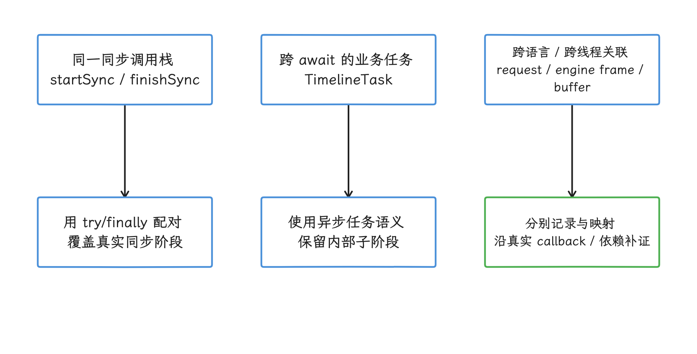

图：用与工作边界一致的同步或异步事件，再携带稳定关联标识。 同步 Timeline slice 不跨 await；request/frame id 需明确作用域，不自动等于系统 token。

事件名保持稳定，并附 request/frame id，才能与 native callback、buffer id 和 FrameTimeline 对齐。request/frame id 是把同一次业务请求和同一帧跨语言关联起来的标识。不要把整次交互包成一个大 slice，否则仍无法判断内部等待。

### 单变量 A/B 与验收

可控制的变量包括：

- Widget 更新范围；
- 图片 decode 尺寸；
- blur/saveLayer/opacity/clip；
- PlatformView 数量与策略；
- Impeller opt-out；
- root RenderMode；
- external texture 帧率与尺寸；
- 页面分辨率和刷新率。

比较 P50/P95/P99 frame time（分别有 50%、95%、99% 的帧不超过该耗时）、missed deadline（错过显示截止时间的次数）、input-to-present（从输入事件到画面显示的延迟）、内存、功耗和画面正确性。平均 FPS 会掩盖少量长帧。

<!-- gracker-diagram: ch13-07-48-ab-validation -->
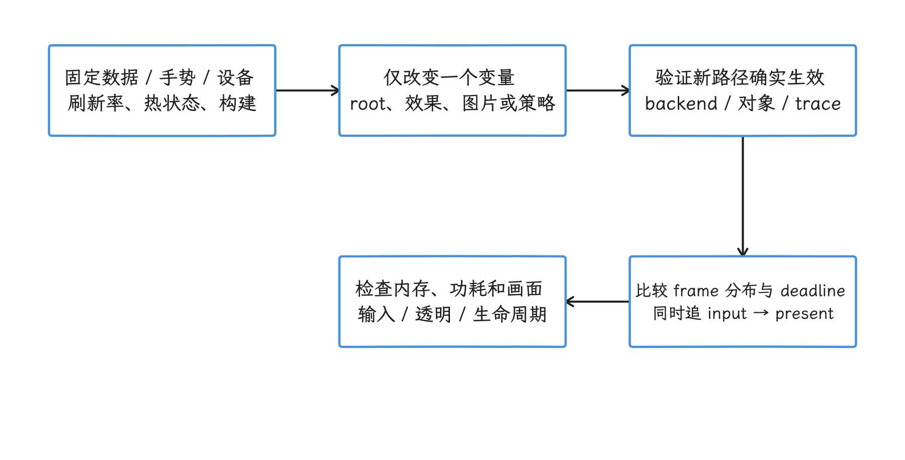

图：固定设备、场景与采集配置，一次改变一项后看完整分布和正确性。 平均 FPS 不能代替长帧、输入到显示延迟或功耗；系统 present 与光学边界也要区分。

## 从慢帧证据到优化动作

Trace 已经把延迟定位到 Framework、Raster、GPU、插件或宿主消费阶段后，再选择对应动作；先改代码再找证据，容易把等待转移到下一段。

### Widget rebuild 范围过大

先用 DevTools 的 rebuild/layout/paint 信息确认哪一阶段超时。常见修复包括：

- 把状态放到最小更新范围；
- 对稳定子树使用 `const`；
- 避免在构建阶段做同步 I/O、JSON 解析或大计算；
- 把大计算移到额外 isolate（独立 Dart 执行单元）前，评估消息复制与调度成本；
- 不为减少 rebuild 引入更昂贵的 layout 或 repaint。

rebuild 数量只是线索。一个很小但高频的 Widget rebuild 可能便宜，一个触发全屏 layout/paint 的单次更新可能更贵。

### 列表滚动卡顿

列表问题常混合多种成本：

- item build/layout 过重；
- intrinsic layout（为取得内容固有尺寸而增加的布局计算）或高度反复变化；
- 图片解码、缩放、上传和 cache miss；
- blur、clip、opacity、`saveLayer` 与大阴影；
- PlatformView、WebView 或地图；
- GC（垃圾回收）、Dart heap（Dart 对象堆）与 native/GPU 内存压力；
- 合并线程上的 Android 回调与插件竞争。

排查时固定列表数据与滚动手势，分别关闭图片、复杂效果、PlatformView 和业务计算。一次只改变一个变量，再比较 UI/Raster/GPU/display。

<!-- gracker-diagram: ch13-07-49-framework-list-cost -->


图：先确定 build/layout/paint 或资源成本，再缩小更新和绘制范围。 rebuild 次数不是成本；预取、const 或额外 isolate 都要检查实际工作量与传输开销。

### Raster 或 GPU 慢

Raster thread 上的长 slice（trace 中的一段持续事件）不一定表示 GPU 正在执行；线程也可能在准备 DisplayList、上传资源、创建 pipeline、提交工作或等待下游解除 back-pressure。

证据上要分开：

<!-- gracker-diagram: ch13-07-50-raster-gpu-async -->


图：沿 submit 和 fence 依赖分离 Raster wall time、GPU 工作与显示读取。 示意条长不是实测；latch 可早于 fence signal，实际读取必须遵守依赖。

- Raster CPU Running/Runnable；
- driver/pipeline 相关 slice；
- GPU submission（提交）与 completion（完成）；
- root producer fence；
- SurfaceFlinger latch 与 display present。

降低效果覆盖面积或 render target 像素数后，同一目标的 GPU completion 时间同步下降，支持像素相关成本参与瓶颈；仍需 pass、GPU counters 或进一步对照，才能区分 fragment 运算、带宽和其他成本。单凭 Raster thread 忙或分辨率 A/B，不能唯一归因于 fragment shader。

### Platform Channel 与 plugin

标准 MethodChannel 的 Dart 调用是异步消息/返回值，不能笼统称为“同步 Platform Channel”。消息编解码与平台 handler 仍有真实执行成本：默认 handler 在平台 Main，配置 TaskQueue 后可在后台线程，FFI 则通常占用调用它的 Dart isolate 所在线程。在默认 UI/platform 合并模型中，Main 上执行的插件代码与 Dart frame work 会竞争；不能把任意 native callback 都画到 Main。[来源：Platform channels](https://docs.flutter.dev/platform-integration/platform-channels)

<!-- gracker-diagram: ch13-07-51-channel-executors -->


图：分别确认消息返回语义和实际执行者，才能解释 Main 与 Dart 的竞争。 异步消息不自动减少编解码或 native 工作量；FFI/native callback 也不固定都在 Main。

需要记录：

- 调用方向与 payload（消息携带的数据）；
- serialization/deserialization（序列化与反序列化）；
- Dart 与 Java/Kotlin/native 执行时间；
- task 是否处于 Runnable、但尚未得到 CPU 的状态；
- 是否等待 Surface、Binder IPC、锁或 I/O。

异步 API 只能释放调用方等待，不会自动减少总工作量。高频小消息还可能被调度和序列化成本放大。

## 容易出现的误判

| 误判 | 应改成的检查方式 |
|---|---|
| Flutter 固定有独立 UI、platform、Raster 三线程 | 3.32 stable+ 先按 UI+platform 合并分析；3.29—3.31、opt-out 与定制 engine 查实际 task runner |
| `PlatformVsync` 出现就会立即执行 Dart | 继续看 `VsyncFireCallback`、`VsyncProcessCallback` 与 UI task runner 排队 |
| 没有 Vulkan 就一定回退 Skia | API 29+ 的当前动态选择可能使用 Impeller OpenGLES |
| Impeller 消除了所有 shader/pipeline 卡顿 | 区分离线 shader、运行时 pipeline、cache 命中与 GPU 像素成本 |
| `RenderMode.texture` 只有一条 BufferQueue | 分开 SurfaceTexture producer 与 Host App Window producer |
| Flutter Raster 结束就是上屏 | 继续追 target buffer、fence、SF latch 和 Display present |
| `AndroidView` 固定使用 HC | 核对 TLHC、VD fallback、HC、HCPP 与运行时回退 |
| Android 10+ 的 HC 等同于 HCPP | 原始 HC 仍可使用 FlutterImageView/overlay；HCPP 从 Flutter 3.44 起且需要显式启用 |
| Android 14+ 自动开启 HCPP | 还需 Flutter 3.44+、flag、API 34+、Impeller Vulkan 与 SurfaceControl swapchain |
| external texture 更新等于相机帧已显示 | 继续追踪 Flutter Raster 采样、root 提交和 Display present |

## Android 12—17 与 Flutter 的版本演进

Android 与 Flutter 的变化应分开记录。Android 决定 View、Surface、HWUI、SurfaceFlinger/HWC 和内核语义；Flutter 决定 engine、thread、renderer、embedding 和 PlatformView 策略。

<!-- gracker-diagram: ch13-07-52-version-evolution -->


图：平台能力、Flutter 发布策略与二进制兼容是三个不同维度。 OS 升级不会自动改变 App engine、HCPP flag 或 plugin 对齐；用对应版本源码与实机构建复核。

| 版本 | 相关边界 |
|---|---|
| Android 12 / API 31 | BLAST 与 FrameTimeline 已形成现代分析基线；仍不能用 OS 版本推断 Flutter renderer |
| Android 13 / API 33 | Image fence API 可供较新的 ImageReader Consumer 使用；是否采用仍由 App 携带的 Flutter engine 决定 |
| Android 14 / API 34 | 提供 HCPP 需要的 transaction synchronization 平台条件；不会自动启用 HCPP |
| Android 15 / API 35 | 16 KB page size 设备要求 Flutter engine 与 native plugin 满足 ELF/APK 对齐，完整检查统一见 [4.5 16 KB Page Size 与 Android 性能](../../part1-fundamentals/ch04-memory/05-16kb-page-size.md)；Flutter 3.27 同期默认启用 Impeller 属于 Flutter 发布决策 |
| Android 16 / API 36 | 旧 App 可保留旧线程/renderer。GPU IOCTL 策略要核对具体设备和 OEM 配置；官方说明标准 Vulkan/OpenGL API 不受影响，直接使用受限私有 IOCTL 的定制代码才需单独排查。[来源](https://developer.android.com/about/versions/16/behavior-changes-16#gpu-syscall-filtering) |
| Android 17 / API 37 | 平台锚点；按 `android-17.0.0_r1` 的 TextureView、SurfaceView、SurfaceFlinger 与 AIDL Composer 解释显示端 |
| Flutter 3.27 | Android API 29+ 默认启用 Impeller；Android/iOS 合并线程能力进入 release notes |
| Flutter 3.29—3.31 | 官方架构文档把 3.29 写为合并起点；对这段版本核对 engine revision 与 opt-out |
| Flutter 3.32 stable | issue #150525 明确写为 Android/iOS 默认合并且可 opt-out；作为保守分析基线 |
| Flutter 3.44 | HCPP 作为 API 34+、Impeller Vulkan 条件下的实验性 opt-in 能力 |

## 固定源码入口

### Flutter

本文的 Flutter 源码固定到 commit `8a9f61cfd67396fb2f9afc3cd7854035e9cd6fc2`。分析线上问题时，仍应切换到 App 实际携带的 engine revision。

- [`VsyncWaiterAndroid`](https://github.com/flutter/flutter/blob/8a9f61cfd67396fb2f9afc3cd7854035e9cd6fc2/engine/src/flutter/shell/platform/android/vsync_waiter_android.cc)、[`VsyncWaiter`](https://github.com/flutter/flutter/blob/8a9f61cfd67396fb2f9afc3cd7854035e9cd6fc2/engine/src/flutter/shell/common/vsync_waiter.cc) 与 [`Animator`](https://github.com/flutter/flutter/blob/8a9f61cfd67396fb2f9afc3cd7854035e9cd6fc2/engine/src/flutter/shell/common/animator.cc)：VSync、UI task runner 和 frame trace；
- [`Rasterizer`](https://github.com/flutter/flutter/blob/8a9f61cfd67396fb2f9afc3cd7854035e9cd6fc2/engine/src/flutter/shell/common/rasterizer.cc)：Raster 和 target 提交；
- [`RenderMode`](https://github.com/flutter/flutter/blob/8a9f61cfd67396fb2f9afc3cd7854035e9cd6fc2/engine/src/flutter/shell/platform/android/io/flutter/embedding/android/RenderMode.java)、[`FlutterSurfaceView`](https://github.com/flutter/flutter/blob/8a9f61cfd67396fb2f9afc3cd7854035e9cd6fc2/engine/src/flutter/shell/platform/android/io/flutter/embedding/android/FlutterSurfaceView.java)、[`FlutterTextureView`](https://github.com/flutter/flutter/blob/8a9f61cfd67396fb2f9afc3cd7854035e9cd6fc2/engine/src/flutter/shell/platform/android/io/flutter/embedding/android/FlutterTextureView.java) 与 [`FlutterImageView`](https://github.com/flutter/flutter/blob/8a9f61cfd67396fb2f9afc3cd7854035e9cd6fc2/engine/src/flutter/shell/platform/android/io/flutter/embedding/android/FlutterImageView.java)：root target；
- [`FlutterRenderer`](https://github.com/flutter/flutter/blob/8a9f61cfd67396fb2f9afc3cd7854035e9cd6fc2/engine/src/flutter/shell/platform/android/io/flutter/embedding/engine/renderer/FlutterRenderer.java)、[`TextureRegistry`](https://github.com/flutter/flutter/blob/8a9f61cfd67396fb2f9afc3cd7854035e9cd6fc2/engine/src/flutter/shell/platform/android/io/flutter/view/TextureRegistry.java) 与 [`SurfaceTextureSurfaceProducer`](https://github.com/flutter/flutter/blob/8a9f61cfd67396fb2f9afc3cd7854035e9cd6fc2/engine/src/flutter/shell/platform/android/io/flutter/embedding/engine/renderer/SurfaceTextureSurfaceProducer.java)：external texture backing 和 lifecycle；
- [`PlatformViewsController`](https://github.com/flutter/flutter/blob/8a9f61cfd67396fb2f9afc3cd7854035e9cd6fc2/engine/src/flutter/shell/platform/android/io/flutter/plugin/platform/PlatformViewsController.java) 与 [`PlatformViewsController2`](https://github.com/flutter/flutter/blob/8a9f61cfd67396fb2f9afc3cd7854035e9cd6fc2/engine/src/flutter/shell/platform/android/io/flutter/plugin/platform/PlatformViewsController2.java)：TLHC、HC、VD fallback 和 HCPP；
- [`AndroidContextDynamicImpeller`](https://github.com/flutter/flutter/blob/8a9f61cfd67396fb2f9afc3cd7854035e9cd6fc2/engine/src/flutter/shell/platform/android/android_context_dynamic_impeller.cc) 与 [`pipeline_cache_data_vk.cc`](https://github.com/flutter/flutter/blob/8a9f61cfd67396fb2f9afc3cd7854035e9cd6fc2/engine/src/flutter/impeller/renderer/backend/vulkan/pipeline_cache_data_vk.cc)：Impeller backend 选择和 Vulkan cache。

版本与行为说明以 [Flutter architecture](https://docs.flutter.dev/resources/architectural-overview)、[issue #150525](https://github.com/flutter/flutter/issues/150525)、[Impeller](https://docs.flutter.dev/perf/impeller) 和 [Android Platform Views/HCPP](https://docs.flutter.dev/platform-integration/android/platform-views) 为准。

### Android 17 与 kernel

- Android 17 [`TextureView.java`](https://android.googlesource.com/platform/frameworks/base/+/android-17.0.0_r1/core/java/android/view/TextureView.java) 与 [`SurfaceView.java`](https://android.googlesource.com/platform/frameworks/base/+/android-17.0.0_r1/core/java/android/view/SurfaceView.java)：宿主 View、SurfaceTexture 更新和独立 Surface；
- Android 17 [`SurfaceFlinger.cpp`](https://android.googlesource.com/platform/frameworks/native/+/android-17.0.0_r1/services/surfaceflinger/SurfaceFlinger.cpp)：latch、composition 和 present 主线；
- 内核 [`dma-buf.c`](https://android.googlesource.com/kernel/common/+/refs/tags/android17-6.18-2026-06_r6/drivers/dma-buf/dma-buf.c)、[`dma-fence.c`](https://android.googlesource.com/kernel/common/+/refs/tags/android17-6.18-2026-06_r6/drivers/dma-buf/dma-fence.c) 与 [`sync_file.c`](https://android.googlesource.com/kernel/common/+/refs/tags/android17-6.18-2026-06_r6/drivers/dma-buf/sync_file.c)：共享 buffer、fence signal/wait 和 sync_file fd 接口。

## 与其他章节的关系

- [13.3 SurfaceView 与 TextureView 渲染管线](03-surfaceview-textureview-pipelines.md)：Android 容器的源码细节；
- [13.9 Android 17 WebView 渲染管线](09-webview-rendering.md)：WebView 作为 PlatformView 时的 Chromium 与 Android 显示路径。
- [4.5 16 KB Page Size 与 Android 性能](../../part1-fundamentals/ch04-memory/05-16kb-page-size.md)：Flutter engine、AOT 与 native plugin 的 16 KB 兼容检查。

## 小结

Flutter 页面要按三组对象展开：

- root RenderMode 决定 Flutter 主画面使用独立 Surface，还是由宿主 View/HWUI 消费；
- external texture 增加插件 Producer 与 Flutter Raster 采样阶段；
- PlatformView 策略决定原生像素经中间 texture 进入 Flutter，还是与 Flutter 内容在宿主/显示端协调；HCPP 的普通 View 仍可在宿主窗口，Impeller AHB 与内部 SurfaceView 的独立 Layer 按真实对象树确认。

使用 Perfetto 分析时，先固定 Android 与 Flutter 两套版本，再确认 View/Surface/layer 对象树；随后对齐 VSync、platform/Dart UI work、Raster、GPU fence、root/host queue、SurfaceFlinger latch 和 Display present。这样才能区分 Flutter framework、Raster/GPU、插件 Producer、宿主消费和系统合成分别在哪一段变慢。


<!-- gracker-diagram: ch13-07-53-end-to-end -->


图：先确认 root、external texture 与 PlatformView，再连接同帧阶段证据。 不以 Dart/Raster 返回代替 GPU 或显示完成，缺失的覆盖须以明确依赖补证。