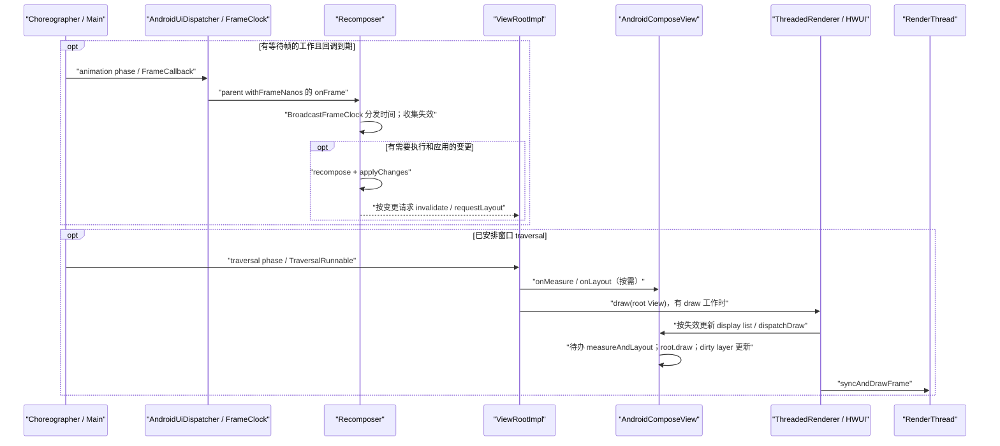
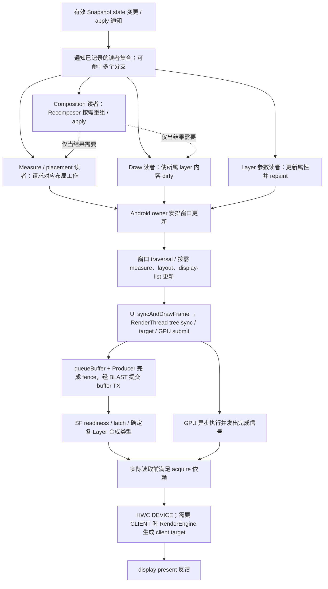

# Jetpack Compose 渲染管线：Composition、Layout 与 RenderNode

Compose 改变了 UI 的声明方式、状态追踪和节点更新，却仍使用 Android 的 App Window 渲染管线。App Window 指应用主窗口及其图形 buffer。对于开启硬件加速且没有额外独立 Surface 的普通 Compose 页面，像素仍依次经过 `ViewRootImpl`、HWUI、RenderThread、BLAST BufferQueue（协调窗口 buffer 与 SurfaceControl transaction 提交的队列机制）、SurfaceFlinger 和 HWC（Hardware Composer，硬件合成器）到达屏幕。

排查 Compose 卡顿，先要分清两层职责。Composition 根据 composable 调用生成和更新 UI 结构，Layout 负责测量与放置，Drawing 负责记录绘制内容，这三阶段属于 Compose；窗口 buffer 的生产、系统合成与 present（提交到显示设备）属于 Android 图形栈。只看 recomposition 次数，无法解释 RenderThread、GPU 或 SurfaceFlinger 导致的慢帧。

<!-- gracker-diagram: ch13-08-01-compose-window -->


图：Compose 决定 UI 内容，宿主窗口继续生产 buffer 并接入系统合成。 各阶段按需执行和复用；重组次数不能独立解释端到端慢帧。

## 复核基线与阅读边界

本次图文复核日期为 2026-10-24，仍固定使用下列 Compose 1.11.4 与 Android 17 源码基线；这不是“当前最新版”的声明。Android 平台、Jetpack Compose、Kotlin 编译器与内核版本分别记录；Android 版本不能代替 Compose 依赖版本。

<!-- gracker-diagram: ch13-08-02-version-axes -->


图：分别记录 App 依赖、Kotlin 编译器与平台内核版本。 图文固定 Compose 1.11.4 / Android 17 基线；系统升级不会自动替换 App 依赖。

| 层级 | 基线 | 说明 |
| --- | --- | --- |
| Android 平台 | Android 17 / API 37 / `android-17.0.0_r1` | `Choreographer`、`ViewRootImpl`、`ThreadedRenderer`、`HardwareRenderer`、HWUI、SurfaceFlinger |
| Jetpack Compose | Compose BOM `2026.06.01`，Runtime/UI/Foundation `1.11.4` | Compose 独立发布，不属于 `android-17.0.0_r1` 源码标签 |
| Android 内核 | `android17-6.18-2026-06_r6` | 调度、cpuset、cpufreq、dma-buf 与 fence 等机制；内核不包含 Composition 或 LayoutNode |

讨论范围限定为 Android 12 至 Android 17 上采用硬件加速的 App Window。软件 Canvas、截图或离屏捕获、Preview，以及 `SurfaceView`、`TextureView`、视频或相机等独立 Producer（buffer 生产方）都会改变局部路径，不能沿用单一窗口 buffer 的结论。

## Compose 改了什么，复用了什么

Compose 主要提供四组机制：

- `Snapshot` 为状态读写提供版本化视图，并通知读取过相应状态的观察者；
- `Recomposer` 对失效的 restart scope（编译器标出的可单独重新执行范围）执行 recomposition，再通过 `applyChanges` 把结果写入现有 UI 结构；
- `LayoutNode` 树承载 Compose UI 节点，执行测量、放置、绘制和语义处理；
- `OwnedLayer` / `GraphicsLayer` 保存可复用的绘制内容与 layer 属性。

<!-- gracker-diagram: ch13-08-03-runtime-roles -->


图：Snapshot 记录依赖，Recomposer 应用结构变化，节点与 layer 承载布局和绘制。 层级之间按变更传播；不表示一次写入必定重走所有机制。

窗口侧仍由 Android 平台负责：

- `AndroidComposeView` 作为 `ViewGroup` 接入 View 树；
- `ViewRootImpl` 安排 traversal，即窗口的 measure、layout、draw 遍历；
- UI 线程把 View/Compose 的绘制操作录入 RenderNode display list，即可复用的绘制指令列表；
- RenderThread 同步 RenderNode 树，通过 Skia 构建并提交 GPU 工作；
- App Window Producer 提交 buffer 及生产完成 fence；queue 时 GPU 写入可以尚未完成；
- SurfaceFlinger latch buffer，即选定本轮合成要使用的 buffer，再把合成状态交给 HWC 或 RenderEngine；
- 显示系统以选定 frame timeline 为目标安排 present；是否按时显示须看实际反馈，不能由目标时间保证。

“Compose 有独立渲染引擎”容易把职责说得过宽。Compose 拥有自己的 UI runtime 和节点系统；在 Android 的常规硬件加速窗口中，实际图形后端仍是 HWUI。

<!-- gracker-diagram: ch13-08-04-platform-backend -->


图：普通硬件加速窗口通过 AndroidComposeView 接入 HWUI 与系统显示链。 此处不包含独立 Surface Producer；queue 可以早于 GPU 完成。

## 两条帧驱动在同一主线程会合

Compose 与 View traversal 都使用 `Choreographer`，即主线程上的帧回调调度器，但两类回调承担不同工作：

1. `Recomposer` 有帧级工作时等待 parent frame clock；Android 默认接到 `AndroidUiFrameClock`，通常经 `AndroidUiDispatcher` 排入 Choreographer 帧回调。它先向 composition 的 BroadcastFrameClock 等待者分发帧时间，再处理本轮失效、recomposition 与变更应用。单个动画等待者并不一定各自注册一个平台回调。
2. `ViewRootImpl` 的 traversal callback 驱动窗口 measure、layout、draw 与 HWUI 提交。

下面的时序图标出两类回调的调用边界：

<!-- gracker-diagram: ch13-08-05-two-frame-drivers -->


图：两个入口共享主线程，职责与是否有工作分别判断。 及时安排可赶上同一 doFrame；图示不保证每个 vsync 都完整重组和绘制。



默认主线程 Choreographer 按 animation、traversal 等阶段处理到期 callback，因此及时安排的变更可以赶上同一 doFrame 的 traversal；晚到、被推迟或没有请求 traversal 时则不能保证。Recomposer 的 frame work 与窗口 traversal 各自按需执行，不能把图读成每个 vsync 都完整重组、测量和重录。这里讨论默认窗口接入，不排除 SubcomposeLayout 在测量时创建子 composition。

Compose 1.11.4 的 `AndroidUiFrameClock` 使用一次性回调。下面只摘出“未匹配 AndroidUiDispatcher”的直接注册分支，不能代表默认 dispatcher 路径的完整实现：

```kotlin
override suspend fun <R> withFrameNanos(onFrame: (Long) -> R): R =
    suspendCancellableCoroutine { continuation ->
        val callback = Choreographer.FrameCallback { frameTimeNanos ->
            continuation.resumeWith(runCatching { onFrame(frameTimeNanos) })
        }
        choreographer.postFrameCallback(callback)
        continuation.invokeOnCancellation {
            choreographer.removeFrameCallback(callback)
        }
    }
```

完整实现会优先使用同一 Choreographer 的 `AndroidUiDispatcher.postFrameCallback()`，取消时也从对应 dispatcher 移除。Dispatcher 先清理 trampolined tasks，再执行本批帧回调，并交换待执行队列，避免连续的 `withFrameNanos` 在同一帧反复立即恢复。一次调用不构成永久自循环；后续请求取决于新的等待者或工作。

<!-- gracker-diagram: ch13-08-06-frameclock-dispatcher -->


图：同一 Choreographer 的 AndroidUiDispatcher 聚合回调，否则直接注册。 取消从对应队列移除；一次 withFrameNanos 不代表永久自循环。

Recomposer 默认帧内顺序是：分发 BroadcastFrameClock 时间 → 发送待处理 Snapshot apply 通知 → 记录 composition 失效 → 按需 recompose → applyChanges / late changes / changesApplied。无动画等待者时可跳过前两步；有帧等待者也不保证发生重组。

<!-- gracker-diagram: ch13-08-07-recomposer-frame-work -->


图：先分发动画帧时间与通知，再处理本轮失效并应用结构变更。 无等待者或无失效时可跳过相应工作；不会在此默认入口直接执行整个窗口 draw。

## AndroidComposeView：Compose 与 ViewRoot 的连接点

`ComposeView` / `AbstractComposeView` 负责创建 composition，即一棵 composable 内容的运行实例；真正承载 Compose 节点树的是内部 `AndroidComposeView`。后者继承 `ViewGroup`，普通 Compose 子节点却不会各自变成 Android `View`。

<!-- gracker-diagram: ch13-08-08-host-tree -->


图：ComposeView 管理 composition，内部 AndroidComposeView 承载节点树。 普通 LayoutNode 不是独立 Android View；AndroidView 互操作有额外 holder。

Compose 1.11.4 的三个入口各有明确职责：

<!-- gracker-diagram: ch13-08-09-owner-entries -->


图：测量、布局和绘制分别从宿主 View 入口承接。 dispatchDraw 的 measureAndLayout 处理待办请求，不表示每次都会完整重测。

| Android 入口 | Compose 工作 | 需要注意的边界 |
| --- | --- | --- |
| `onMeasure()` | 把 View 的 `MeasureSpec` 转成 Compose `Constraints`，更新根节点约束并执行所需测量 | 仍受父 View 的测量契约约束 |
| `onLayout()` | 调用 `MeasureAndLayoutDelegate.measureAndLayout()`，完成待处理测量/放置并更新根边界 | Layout 不在 `AndroidUiFrameClock` 回调里直接完成 |
| `dispatchDraw()` | 再执行一次 `measureAndLayout()` 检查，调用 `root.draw()`，更新标记为 dirty、等待重录的 `OwnedLayer` | draw 前仍可完成刚产生的布局请求 |

硬件加速 draw 的调用顺序如下：Android 17 的 `ViewRootImpl.performDraw()` 进入 `ThreadedRenderer.draw()`，后者先通过 `updateRootDisplayList()` 更新 View 树的 display list（期间调用 `AndroidComposeView.dispatchDraw()`），随后执行 `syncAndDrawFrame()`。

<!-- gracker-diagram: ch13-08-10-hwui-call-stack -->


图：ThreadedRenderer.draw 内先更新 display list，随后进入 RenderThread 同步提交。 dispatchDraw 是否执行受失效与复用控制；不能画成先 dispatchDraw 再调用 renderer.draw。

上述宿主 draw 路径中，UI 线程录制 Compose 的 RenderNode display list，RenderThread 同步节点状态、准备目标并提交 Skia/GPU 工作。树、内容和 layer 属性可独立复用；一次 draw 入口不表示每个 Compose 节点都要重录。RenderThread 还可处理自身的渲染动画，不能把“Compose 内容在 Main 录制”扩大成全部图形工作都只在 Main。

## Composition、Layout、Drawing 可以分别失效

Composable 函数的一次执行不会直接包办 Composition、Layout、Drawing 三阶段。状态在哪个阶段读取，决定哪些观察范围收到失效通知；同一状态可同时被多个范围读取，所以这些分支可以同时触发。按 mutation policy 等价的写入未必产生有效变化；普通对象内部字段的变化也不会自动变成 Snapshot state 通知。

<!-- gracker-diagram: ch13-08-11-state-readers -->


图：状态读取位置决定收到通知的范围，同一变化可同时触发多条路径。 等价写入不一定产生变化；普通字段修改不会自动产生 Snapshot state 通知。

| 状态读取位置 | 变更后的主要工作 | 可能跳过的阶段 |
| --- | --- | --- |
| Composable 函数体 | Recomposition，随后按变更结果请求 Layout 或 Drawing | 无法预先保证 |
| 测量 lambda | 重新测量受影响节点和必要祖先/子树 | 可跳过 Recomposition |
| 放置 lambda | 重新放置相关节点 | 可跳过 Recomposition，常可跳过测量 |
| draw lambda | 重录所属 layer 的绘制内容 | 可跳过 Recomposition 和 Layout |
| `graphicsLayer {}` 属性 lambda | 更新 layer 属性 | 内容未变时可复用 display list |

下面的例子把状态读取放进布局和 layer 属性 lambda，使高频位置变化不必从 composable 函数体重新开始：

```kotlin
@Composable
fun MovingBadge(offsetPx: State<Int>) {
    Box(
        Modifier
            .offset { IntOffset(offsetPx.value, 0) }
            .graphicsLayer {
                alpha = if (offsetPx.value > 0) 1f else 0.6f
            }
    )
}
```

本例的 `offset {}` 在 placement block 读取状态，位置变化通常只请求重新放置；固定实现用 `placeRelativeWithLayer()` / `placeWithLayer()` 放置，避免简单移动必须重录子内容。`graphicsLayer {}` 则有独立的 layer 参数观察器，更新 alpha 等属性时可复用内部 display list。同一 `offsetPx` 建立两组观察关系；若它还被其他 composable 读取，那些 scope 仍可重组。是否更快需要在相同画面下用 trace / benchmark 验证。

<!-- gracker-diagram: ch13-08-12-moving-badge -->


图：offset 在 placement 读取位置，graphicsLayer 在参数观察中读取 alpha。 额外的 composable 读者仍可能重组；示例只解释边界，不保证性能收益。

### Recomposition 不等于重绘

Recomposition 重新执行需要更新的 composable scope，并计算对现有 UI 结构的变更。父 scope 执行时，满足跳过规则的未失效子调用可以复用；但子 scope 自己读取的 state 已失效时，参数相同不构成跳过它的充分条件。变更若只影响副作用或无障碍语义，也可能不产生新的绘制内容。

没有 Recomposition 也能更新画面：`Canvas` / `drawWithContent` 内的 state 变化会使所属绘制范围失效，重录相关 draw 内容；`graphicsLayer {}` 的 state 变化则可只更新 layer 参数并触发 repaint。后者不能一概称为再次执行 draw lambda。

<!-- gracker-diagram: ch13-08-13-recompose-draw -->


图：重组结果决定后续失效，draw 内容变化与 layer 参数变化可以独立发生。 参数相同不能跳过自己已失效的 scope；属性 repaint 不等于重录内部 draw。

Strong Skipping 属于 Compose Compiler / Kotlin 工具链，从 Kotlin 2.0.20 起默认启用，与 Android 17 平台版本无关。启用后 restartable composable 通常可被编译为 skippable；稳定参数按 `equals`、不稳定参数按实例相等比较。是否实际跳过仍要结合 scope 的失效状态、参数变化以及 `@NonSkippableComposable` 等条件，不能仅看 stable 标签或重组计数。

<!-- gracker-diagram: ch13-08-14-strong-skipping -->


图：编译器决定可跳过能力，运行时仍结合参数和 scope 失效决定执行。 Kotlin 2.0.20 起默认开启；stable 声明和相同参数都不能独立保证实际跳过。

## LayoutNode 的测量与放置

`LayoutNode` 是 Compose UI 树的布局节点。父节点通过 `Constraints(minWidth, maxWidth, minHeight, maxHeight)` 给出允许的尺寸范围，子节点测量后返回 `Placeable`（带测量尺寸、可被放置的结果），父节点再在 `MeasureResult` 的 placement block 中确定它的位置。

<!-- gracker-diagram: ch13-08-15-measure-place-protocol -->


图：父向子传约束，子向父交尺寸，随后 placement 决定位置。 一次常规父测量调用中同一 child 只测一次；图不表示每帧只走一遍树。

Compose 的常规布局协议要求同一父测量调用中的一个 child 只测量一次；违反时默认抛错。约束从父向子传递，尺寸结果向父返回，placement 再向子确定位置。它不是“整棵树每帧只遍历一遍”的保证；intrinsic 查询、lookahead 与实际 measure 是不同边界，SubcomposeLayout/Lazy 也可在 measure 中创建所需子内容。下列机制各有额外工作，不能据此允许同一普通 measure pass 任意重复测量 child：

- Intrinsic measurement 会先查询内容在给定条件下需要的最小或最大固有尺寸；
- `SubcomposeLayout` 可以在测量过程中根据约束再生成需要测量的内容；
- Lazy 容器会根据可见视口、缓存窗口与预取策略组合和测量 item；
- Lookahead 会保存目标布局的预测结果，为后续动画或位置变化提供参考；
- 约束、内容或依赖状态在 traversal 中变化时，可能产生新的测量请求；
- `dispatchDraw()` 仍会处理尚未完成的 measure/layout 请求。

单凭“每个 child 在一次 measure pass 中只测量一次”这一条，推不出 Compose 一定比 View 更快。差距往往在测量范围被扩大，具体节点、布局策略和状态变化要在 Perfetto 里逐一核对。

<!-- gracker-diagram: ch13-08-16-extra-layout-work -->


图：Intrinsic、subcomposition 与 lookahead 会增加不同边界的工作。 一次测量协议不推出 Compose 总是更快；要核对范围与实际阶段。

## Drawing、GraphicsLayer 与 RenderNode

### LayoutNode 与 RenderNode 不是一一对应

Composable 函数调用、composition group、LayoutNode 与绘图 layer 是不同对象，没有一一对应关系。`Text`、`Row`、`Column` 通常不因各自出现就创建独立 Android RenderNode；无独立 layer 的绘制会录入最近的所属 layer，Compose root 自身也有 layer。这里的 layer / RenderNode 只是 App 内的绘制复用边界，不等于 SurfaceFlinger 的独立 Layer 或独立 BufferQueue。

<!-- gracker-diagram: ch13-08-17-three-object-spaces -->


图：Composable、LayoutNode 与 RenderNode 属于不同表示层。 App 内 layer 不是 SurfaceFlinger Layer，也不会天然增加独立 BufferQueue。

绘制失效的粒度不能按 `LayoutNode` 来概括。display list 的复用单位是 `OwnedLayer` / `GraphicsLayer` 等绘制边界；普通 LayoutNode 的 draw 内容变化时，可能要重录包含它的最近所属 layer。

<!-- gracker-diagram: ch13-08-18-nearest-layer -->


图：普通节点内容变化可扩大到其最近所属 layer 的重录范围。 其他 layer 未失效时可继续复用；隔离边界需要结合实际成本选择。

### Android 17 上的 graphicsLayer 主路径

在 Android 12 至 Android 17 上，Compose 1.11.4 的 `AndroidComposeView.createLayer()` 主路径会创建 `GraphicsLayerOwnerLayer`。Android 17 使用的图形实现是 `GraphicsLayerV29`，其内部调用公开的 `android.graphics.RenderNode`：

- `GraphicsLayerOwnerLayer.updateDisplayList()` 只在 dirty 时调用 `graphicsLayer.record(...)`；
- `GraphicsLayerV29` 通过 `RenderNode.beginRecording()` / `endRecording()` 保存绘制操作；
- 绘制时通过 `Canvas.drawRenderNode()` 引用该节点；
- translation、scale、rotation、alpha 等 layer 属性可以在绘制内容不变时单独更新，避免重录内部 draw commands。

<!-- gracker-diagram: ch13-08-20-display-list-reuse -->


图：只有 dirty 内容才重新 record；纯属性变化可以保留已有绘制记录。 属性、尺寸、效果或父层需要变化时仍有更新成本；复用不等于零 GPU 工作。

`RenderNodeLayer` 仍保留在兼容代码中，但 Android 17 + Compose 1.11.4 的主路径不是它。

<!-- gracker-diagram: ch13-08-19-graphics-layer-route -->


图：AndroidComposeView 的主 layer 路径经 GraphicsLayerOwnerLayer 到公开 RenderNode。 固定 Android 12–17 / Compose 1.11.4；兼容 RenderNodeLayer 不代表本基线主路径。

### layer 边界不一定产生离屏 buffer

`Modifier.graphicsLayer` 会建立图形 layer 隔离边界。offscreen buffer 是先把内容画进中间纹理、再参与最终合成的缓冲区；是否需要它由合成策略和效果共同决定。

<!-- gracker-diagram: ch13-08-21-compositing-strategies -->


图：Auto 按整层语义处理，Offscreen 强制中间层，ModulateAlpha 调制每条指令。 创建 layer 边界不等于每次创建离屏 buffer；其他效果仍能要求离屏。

| 条件 | RenderNode / layer 边界 | offscreen buffer |
| --- | --- | --- |
| 普通 LayoutNode，无显式 layer | 通常并入最近所属 layer | 无额外 offscreen |
| `graphicsLayer` + 平移/缩放/旋转 | 有 | 通常不需要 |
| `CompositingStrategy.Auto` + `alpha < 1` | 有 | 按整层 alpha 语义自动采用中间层；并非先检测实际内容重叠再决定 |
| `RenderEffect` | 有 | 需要中间结果 |
| 非默认 `SrcOver` 的 `BlendMode` 或非空 `ColorFilter` | 有 | Compose 1.11.4 强制按 Offscreen 处理 |
| `CompositingStrategy.Offscreen` | 有 | 始终启用 |
| `CompositingStrategy.ModulateAlpha` | 有 | 仅避免为 alpha 单独建离屏层；RenderEffect、BlendMode、ColorFilter 等仍可要求 Offscreen；重叠时结果可不同 |

离屏渲染可能增加中间纹理、像素填充、内存带宽与 GPU 内存压力，成本取决于中间区域、复用和效果。`ModulateAlpha` 仅应在逐指令 alpha 满足视觉要求时采用；它不会保证所有效果都没有离屏分配，也不会把 RenderNode 变成独立窗口 Surface。

<!-- gracker-diagram: ch13-08-22-forced-offscreen -->


图：RenderEffect、layer paint 与强制策略都可能保留中间结果。 ModulateAlpha 不覆盖这些要求；面积、复用和效果决定最终 GPU 与内存成本。

## 从状态写入到 present

下面的流程图把 Compose、HWUI、窗口队列和 SurfaceFlinger 串成一条可按时间核对的证据链：

<!-- gracker-diagram: ch13-08-23-state-to-display -->


图：先按读者集合失效，再沿宿主窗口提交与系统显示关联同一帧。 重组不必触发布局；属性可复用内容；queue 与 GPU 完成可异步重叠。



在这条链路中，成功 `queueBuffer` 表示 Producer 向队列交付 buffer 与完成依赖；它不保证该 buffer 后来一定被选中显示。Producer completion fence 在 Consumer 侧称为 acquire fence，约束读取前的写完成；readiness / latch 的采纳时点不必一律等同于 fence 已 signal。定位用户实际看到的帧时，还要对齐 BufferTX、目标 Layer、FrameTimeline、合成与 present；present fence 是显示栈反馈，不能独立测出像素发光的光学延迟。

<!-- gracker-diagram: ch13-08-24-fence-handoffs -->


图：队列交付、生产写完成、系统采纳与显示反馈是不同观测点。 queued buffer 可以被跳过；fence 可早于或晚于 queue signal，latch 也不一概等于 signal；present 不能独立测光学延迟。

### UI 线程与 RenderThread 的分工

<!-- gracker-diagram: ch13-08-25-main-renderthread -->


图：Compose 内容生成和记录在 Main，RenderThread 同步树并提交图形工作。 职责可跨帧重叠；GPU 完成、显示反馈与 buffer 复用各有独立边界。

UI 线程主要完成：

- Snapshot 通知、recomposition 与 `applyChanges`；
- Compose 测量和放置；
- 录制 View/Compose display list；
- 调用 `syncAndDrawFrame()` 并参与 HWUI 同步。

RenderThread 主要完成：

- 同步 RenderNode tree 和渲染属性；
- `dequeueBuffer` 取得窗口 buffer 及复用依赖；对上次 Consumer release fence 的等待可在 CPU 或 GPU 侧处理，写入前必须满足复用约束；不能只凭 dequeue 返回认定旧读者已完成；
- 让 Skia 构建/提交 GLES 或 Vulkan GPU 工作；
- 完成 swap/queue，并把 producer completion fence 随 buffer 提交。

RenderThread trace slice 的长度不能直接当作 GPU 执行时长。GPU 可能在 RenderThread 提交返回后继续工作，需要 GPU completion、fence 或 GPU counter 才能判断设备侧执行时间。`syncAndDrawFrame()` 返回通常也早于 present 完成；显示结果要结合 present fence 或 FrameTimeline 判断。

<!-- gracker-diagram: ch13-08-26-async-gpu-present -->


图：RenderThread wall time 可包含等待，GPU 与显示后段继续独立执行。 示意条长非实测；syncAndDrawFrame 返回、queue 和 latch 都不能代替实际 present 证据。

## Snapshot 与 Recomposer 的并发边界

Snapshot 为状态保存可见的版本记录，读观察器追踪依赖，写入和 apply 通知再让相应 observer 处理变更。全局 state 写入的通知还会由 Android 的 GlobalSnapshotManager 调度并合并发送；因此“setter 返回”不等于所有 UI reader 已同步执行。版本化不承诺完全无锁，也不让同一个 composition 自动并行重组。

<!-- gracker-diagram: ch13-08-27-snapshot-notifications -->


图：全局写观察器请求通知，主线程合并派发后由读者决定后续工作。 这是默认 Android 全局通知入口；mutable snapshot apply 与重组内通知另有调用路径。

Android UI 性能分析可以依赖以下边界：

- 同一个 composition 不会被 Recomposer 同时执行两次 recomposition；
- Runtime 1.11.0-alpha01 已移除曾经的实验性 concurrent recomposition API，旧版本的字段不能证明当前版本仍支持并发 composition；
- 多个 `ComposeView` 各有 composition root（各自的组合根），但可以共享 window Recomposer、parent composition context，也可以显式共享同一份 state；
- 后台线程可用 Snapshot state；若多个值要一起可见，用明确的 mutable snapshot 并处理 apply 结果。快照事务只覆盖 Snapshot state，不自动覆盖普通字段、I/O 或 Android View 操作；
- `apply()` 可能遇到并发修改冲突，业务代码不应把 Snapshot 当作任意跨线程数据结构的替代品；
- Android `View`、`AndroidComposeView`、绘制对象与副作用仍受各自线程约束。state 可以跨线程更新，不表示 UI 对象可以跨线程访问。

Runtime 内部的锁与字段会随 Compose 版本调整；应用应依赖 composition 单实例串行、状态冲突处理和 Android UI 线程约束这些公开边界，而非某一版本的锁实现行号。

<!-- gracker-diagram: ch13-08-28-snapshot-concurrency -->


图：Snapshot 的版本事务、composition 串行和 Android UI 约束分别成立。 事务只覆盖 Snapshot state；冲突需处理，不能把普通字段、I/O 或 View 操作一并视为原子。

## PausableComposition 与 Lazy 预取

### 分段处理哪类工作

`PausableComposition` 可以分段执行尚未投入使用的子 composition。典型场景是 Lazy 容器预先准备可能进入视口的 item：当前空闲时间不足时请求暂停，后续再调用 `resume()` 继续。只有 `isComplete` 为真并完成 `apply()` 后，结果才能加入布局树。

<!-- gracker-diagram: ch13-08-29-pausable-between-frames -->


图：尚未使用的 item 可分段准备，完成并 apply 后才进入可用布局结果。 预取与正常可见帧共享 Main；暂停请求不是任意指令的抢占，也不直接减少 GPU 工作。

Lazy 的这一预取用途不是把当前可见页面的常规 recomposition 任意切成多帧；使用普通 setContent / setContentWithReuse 也不会自动获得暂停语义。它调整尚未使用的子 composition 的准备时机，不能据此推出 draw、GPU 或 SurfaceFlinger 工作量下降。取消后必须丢弃相应 composition，而非把未完成节点交给可见布局。

### API 与暂停语义

<!-- gracker-diagram: ch13-08-30-pausable-state-machine -->


图：反复 resume 直到完成，立即 apply；放弃则 cancel 并丢弃 composition。 shouldPause 只是请求；完成后延迟 apply 期间的 state 变化可使结果需要再次处理。

Compose 1.11.4 的关键 API 是：

- `PausableComposition.setPausableContent()` / `setPausableContentWithReuse()` 返回 `PausedComposition`；
- 调用方反复执行 `resume(shouldPause)`；
- `shouldPause` 返回 `true` 表示请求暂停，执行并不保证在任意函数边界立即停止；
- `resume()` 返回后仍要检查 `isComplete`，完成时再同步调用 `apply()`；
- 暂停期间读过的 state 若发生变化，原本已完成的结果可能再次需要处理；
- 放弃预取时调用 `cancel()`，并按 API 契约丢弃状态不再确定的 composition。

### 1.11.4 的默认预取路径

PausableComposition 最初在 Runtime `1.8.0-alpha02` 加入，并非 Compose 1.7 的稳定特性。Foundation 的 Lazy 预取开关后来经历过调整：

<!-- gracker-diagram: ch13-08-31-prefetch-flag-history -->


图：API 首次加入、Foundation 默认开关与实际 App 构建分别核对。 1.10.6 的关闭不能外推到固定 1.11.4，也不能把此 flag 当 Android 平台开关。

- Foundation 1.10.6 因稳定性考虑把 `isPausableCompositionInPrefetchEnabled` 设为 `false`；
- Foundation 1.11.4 源码中的该 flag 为 `true`；
- `LazyLayoutPrefetchState` 在 flag 开启时调用 paused precomposition，并分别记录 resume、pause、apply 与 measure 的历史耗时。

<!-- gracker-diagram: ch13-08-32-prefetch-steps -->


图：预取先准备 composition，完成后 apply，再按请求和预算预测量。 每步用历史成本估计是否执行；可暂停的是 composition，apply/measure 不因此任意可抢占。

默认 Android 预取调度器在主线程用 `View.display.refreshRate` 估算并静态缓存 `frameIntervalNs`，不是逐帧读取实时刷新率。普通预算是 `max(0, max(frameStartTimeNanos, viewDrawTimeNanos) + frameIntervalNs - now)`。距上次 draw 超过两个缓存帧间隔时，首个请求可进入 idle 处理，把可用时间视为 `Long.MAX_VALUE`；处理一个请求后会重置 idle 状态。

<!-- gracker-diagram: ch13-08-33-prefetch-budget -->


图：以缓存刷新间隔和最近帧起点估算剩余时间。 固定实现不直接读取 preferred frame deadline；刷新率缓存不会逐帧自动更新。

Lazy 请求还会把剩余时间与该步骤的历史平均成本比较；urgent 请求只要求剩余时间为正，可绕开平均成本阈值。resume / pause 的停止点也受可暂停函数边界限制，所以这是一种启发式安排，不是对主线程占用的硬时限。

<!-- gracker-diagram: ch13-08-34-prefetch-thresholds -->


图：普通请求看平均步骤成本，urgent 放宽阈值，idle 允许首个请求超出普通估算。 这些是启发式执行条件，不是精确 deadline；暂停边界与非分段步骤仍可能占用时间。

这套调度没有直接读取 `Choreographer.FrameData.getPreferredFrameTimeline().getDeadlineNanos()`。因此，`availableTimeNanos()` 只是 Compose Foundation 当前实现对剩余时间的估算，不能当作 Android 12+ 提供的精确 frame deadline。

## 互操作：按 Surface 拓扑分类

`AndroidView` 或 `ComposeView` 只能说明 UI 框架如何嵌套，不能直接确定图形管线。还要确认四件事：谁生产 buffer、谁消费 buffer、是否新建 Surface，以及 SurfaceFlinger 中是否出现独立 layer。

<!-- gracker-diagram: ch13-08-35-interop-topology -->


图：UI 包装方式不决定输出对象，先确认 Producer 与最终 Consumer。 普通 View/Compose 常共享窗口；独立 Surface 与中间 texture 需分别追依赖。

| 场景 | 常见 Producer / Surface | 管线判断 |
| --- | --- | --- |
| Compose 中嵌普通 `TextView`、`ImageView` | 仍由 App Window HWUI Producer 生成窗口 buffer | 单一标准 App Window 路径 |
| View 树中嵌普通 `ComposeView` | 仍由 App Window HWUI Producer 生成窗口 buffer | 单一标准 App Window 路径 |
| `AndroidView` 内含 `SurfaceView` | 子内容通常有独立 BufferQueue / SurfaceControl layer | 多 Surface 混合路径 |
| `AndroidView` 内含 `TextureView` | 独立 Producer 先写 SurfaceTexture，再作为纹理进入 App Window | Producer 独立，但常回到 App Window 合成 |
| 视频、相机、WebView 或厂商组件 | 取决于内部采用 SurfaceView、TextureView、SurfaceTexture 或软件绘制 | 必须用 dumpsys/trace 验证 |

### AndroidView 的边界

`AndroidViewHolder` 把 Compose Constraints 转成 View MeasureSpec，按其适配规则测量传统 View，并在 Compose placement 中调用 View layout。普通 View invalidation 经 holder 传播到 Compose 绘制范围；内容会在宿主 draw 链中绘制。它不会天然创建独立 Surface，实际成本和显示对象仍取决于内部 View；嵌入 SurfaceView / TextureView 时要另查其 Producer。

<!-- gracker-diagram: ch13-08-36-android-view-adapter -->


图：holder 连接两套布局协议，并把普通 View 的内容放回宿主 draw 链。 包装不天然创建 Surface；内部若含独立 Producer，需另查其生命周期和同步。

### ComposeView 的边界

每个已创建内容的 ComposeView 都有自己的 composition root 与 AndroidComposeView 宿主，但 state 的所有权由应用决定。未显式指定 parent context 时，宿主会查找 View tree composition context，或取得可共享的 window Recomposer；重挂载、销毁和生命周期策略仍各自管理。多个 root 不等于多个隔离状态容器，也不保证每个 root 独占 Recomposer。

<!-- gracker-diagram: ch13-08-37-shared-roots -->


图：每个内容 root 有自己的宿主和生命周期，context 与应用 state 却可以共享。 不同 root 不保证状态隔离，也不保证各自独占 Recomposer；以真实 context 查找为准。

### 混合动画不自动同步

Compose 与普通 View 往往共享主线程 Choreographer 和窗口 traversal，这只代表二者受同一窗口调度。内部若存在 SurfaceView、视频解码器或其他独立 Producer，各 Producer 的 dequeue、render、queue、fence 与 SurfaceFlinger latch 时序仍可能不同。必须逐个对象对齐 frame timeline，不能仅凭共用 Choreographer 就认定画面同步。

<!-- gracker-diagram: ch13-08-38-mixed-producer-timing -->


图：宿主与独立 Producer 分别提交，显示端可能选到不同代际的内容。 条长非实测；需用 buffer/TX/fence 关联，不能用同一 Main 回调推导画面同步。

FrameTimeline 中 SurfaceFrame 关联一个 Surface 的帧交付，DisplayFrame 关联显示侧合成与 present。先确认目标对象确实接入采集：官方 Perfetto 文档仍明确列出 SurfaceView 不在该页面描述的支持范围，不能把宿主 App Window 的 App Timeline 当作它的独立时间线；SurfaceTexture 输入同样需要单独取证。分析混合页面时，从异常 DisplayFrame 反向找宿主 BufferTX、独立 layer 的新旧 buffer 与 Texture 输入的采样依赖，覆盖不足就用 buffer / transaction / fence 补齐。

<!-- gracker-diagram: ch13-08-39-frametimeline-coverage -->


图：先确认目标 Surface 的采集覆盖，再按缺失部分补齐证据。 官方文档所述 FrameTimeline 暂不支持 SurfaceView；宿主 App Timeline 不能代替独立输入流。

## 用 Perfetto 定位慢帧

### 先确认看到的是哪一帧

从 FrameTimeline 的 expected/actual slice（期望帧与实际帧时间片）或目标 jank 帧出发，记录 frame token（关联同一帧的标识）、时间区间和刷新率。60 Hz 的名义间隔约为 16.67 ms，120 Hz 约为 8.33 ms，但应用实际可用的预算还受回调相位、deadline、buffer 压力与系统调度影响。不能把名义帧间隔机械分配成固定的 composition 5 ms、layout 8 ms、draw 3 ms。

<!-- gracker-diagram: ch13-08-40-budget-vs-interval -->


图：名义刷新间隔提供节奏，实际预算由该帧 expected/deadline 与执行时机约束。 60Hz 约16.67ms、120Hz约8.33ms，不能固定分配成 composition/layout/draw 的常数配额。

### 再沿线程和队列取证

建议按下面顺序检查：

<!-- gracker-diagram: ch13-08-41-perfetto-evidence -->


图：先固定目标帧，再按 Main、RenderThread、GPU 与显示后段连接证据。 事件缺失先查 tracing 配置和覆盖；较长 CPU slice 不能直接当作 GPU 执行时间。

1. **Main thread**：检查目标 `Choreographer#doFrame` 内是否出现 composition、snapshot apply、measure/layout、display-list recording、GC、Binder 或业务代码。
2. **Compose scope**：trace 若没有 composition 细节，确认匹配依赖基线的 runtime-tracing、编译器支持与采集配置。正式性能比较使用 non-debuggable / profileable 构建；终端采集还需配置相应 track_event 数据源。缺少 slice 只能说明未采到该事件，不能证明没有重组。
3. **RenderThread**：检查 `DrawFrame`、tree sync、`dequeueBuffer` 等等待，以及线程处于 runnable 却未获得 CPU 的调度空档。整段 RenderThread slice 不能都记为 GPU 时间。
4. **GPU / fences**：有 GPU counters、GPU completion 或 fence 时，再判断复杂绘制 path、过度离屏、像素填充、纹理上传或频率限制。
5. **BufferQueue / SurfaceFlinger**：对齐 queue、BufferTX、latch、composition 和 present，确认 App Window 是否错过目标 timeline。
6. **HWC**：检查 layer 集合与 DEVICE/CLIENT 选择。DEVICE 表示 HWC 直接处理该 layer，CLIENT 表示先由 RenderEngine 合成。独立 Surface 过多、效果或格式限制都可能增加 CLIENT 合成。
7. **内核**：在 `android17-6.18-2026-06_r6` 边界内查看 sched、cpuset、cpufreq、dma-buf 与 fence 等机制；这里能解释线程为何没运行或 fence 为何没到，不能解释哪个 composable 被重组。

### 按阶段选择优化手段

<!-- gracker-diagram: ch13-08-42-optimize-by-stage -->


图：分别处理状态范围、布局记录、GPU 与队列成本，再同条件验证。 优化可能改变其他阶段的工作量；不以重组次数或平均 FPS 单项验收。

| 证据 | 优先检查 | 常见改法 |
| --- | --- | --- |
| Recomposition 范围大 | 状态读取位置、参数稳定性、无效派生状态 | 缩小 state reader scope；只在输出变化频率低于输入时使用 `derivedStateOf` |
| 高频状态把 Composition 拉进来 | 动画/滚动值在函数体读取 | 能满足语义时，把读取移到 placement、draw 或 layer property lambda |
| Measure/Layout 重 | Intrinsics、Subcompose、Lazy 嵌套、自定义 MeasurePolicy | 减少重复 intrinsic 查询；降低布局层级；让 constraints 稳定；用 benchmark 验证 |
| Display-list recording 重 | 大范围 draw invalidation、复杂 path/text、所属 layer 过大 | 缩小绘制失效范围；缓存可复用计算；选择合适 layer 边界 |
| GPU 重 | Offscreen、blur、blend、overdraw（同一像素被重复绘制）、大纹理 | 降低中间 buffer 面积；减少高成本 effect；核对色彩/格式和纹理上传 |
| dequeue / queue 阻塞 | buffer 压力、消费者落后、独立 Producer 时序 | 沿 BufferQueue 和 fence 找等待方，避免只改 Compose 代码 |
| SurfaceFlinger / HWC 重 | Layer 数量、CLIENT 合成、显示侧 deadline | 调整 Surface 拓扑或效果；与设备合成能力一起验证 |

`derivedStateOf` 观察输入并缓存派生计算；下游读者最终按派生结果及其相等策略处理失效，本身仍有观察与计算成本。它适合输入高频变化、读者关心的输出低频变化的场景，例如由滚动位置得到“是否显示返回顶部”。它不会降低源 state 的写入频率；创建时通常还应 remember 合适实例，并用 benchmark 验证收益。

<!-- gracker-diagram: ch13-08-43-derived-state -->


图：高频输入映射到低频派生结果，读者只关心输出语义的变化。 源 state 仍照常写入；派生观察和计算有成本，实例与相等策略要匹配用途。

## 版本演进：平台与 Compose 分开记

| 时间/版本 | 相关变化 |
| --- | --- |
| Compose 1.0（2021） | AndroidComposeView、LayoutNode、Snapshot 与基础硬件加速接入进入稳定版 |
| Runtime 1.8.0-alpha02（2024-09） | 加入实验性 PausableComposition，供可暂停的子 composition 使用 |
| Kotlin 2.0.20 | Strong Skipping 默认启用；这是编译器边界 |
| Foundation 1.10.6 | Lazy 预取的 PausableComposition flag 因稳定性问题暂时默认关闭 |
| Runtime 1.11.0 | 用于保存 composition group 与节点关联的新 SlotTable/link-buffer 内部实现仍处于实验阶段且默认关闭；旧实验性 concurrent recomposition API 已移除 |
| Compose 1.11.4 / BOM 2026.06.01 | Jetpack 基线；Foundation 源码中 Lazy PausableComposition 预取 flag 为 `true` |
| Android 17 / API 37 | 平台上限；标准 App Window 仍走 ViewRoot/HWUI/RenderThread/SurfaceFlinger |

Android 17 同期可用的 Compose 版本不是系统内置版本。Compose Runtime/UI/Foundation 由应用依赖决定，同一台 Android 17 设备可以运行由不同 Compose 版本构建的应用。

<!-- gracker-diagram: ch13-08-44-version-evolution -->


图：Runtime API、内部实现开关与 Android 窗口能力沿不同版本线演进。 同一 Android 17 设备可运行不同 Compose 依赖；源码内部 flag 不是跨版本永久契约。

## 常见误区

### “每个 Composable 都对应一个 RenderNode”

Composable 对应函数调用与 composition group，LayoutNode 是 UI 节点，RenderNode/GraphicsLayer 是绘制复用边界，三者没有一一对应关系。普通 LayoutNode 的绘制内容通常录入最近的所属 layer。

### “Compose 的 FrameCallback 会直接 measure、layout、draw”

AndroidUiFrameClock / AndroidUiDispatcher 执行等待帧的 onFrame，默认窗口布局与绘制由 traversal 接入：按需 onMeasure / onLayout，接着 ThreadedRenderer.draw 更新 display list（期间可能进入 dispatchDraw），最后 syncAndDrawFrame。并非先完成 dispatchDraw 再进入 ThreadedRenderer.draw；SubcomposeLayout 的 measure-time composition 也须另看。

### “graphicsLayer 一定创建离屏纹理”

graphicsLayer 建立 layer 边界。平移、缩放、旋转等属性通常可以由 RenderNode 处理；Offscreen 策略、特定 alpha 语义、RenderEffect、BlendMode 或 ColorFilter 才可能需要中间 buffer。

### “RenderThread slice 就是 GPU 时长”

RenderThread 负责准备和提交 GPU 工作，也可能等待 buffer 或 fence。GPU 可以异步执行，实际执行时长必须结合 GPU completion、counter 或 fence 判断。

### “queueBuffer 代表已经上屏”

queue 之后仍有 SurfaceFlinger latch、合成决策、HWC/RenderEngine 工作与 present。看到 queue 只能证明 Producer 已交付 buffer。

### “多个 ComposeView 的状态天然隔离”

不同 composition root 仍可显式共享 state，也可能使用同一个 Recomposer。判断隔离边界时，需要查看 parent composition context、window Recomposer 和业务状态所有权。

### “PausableComposition 会降低 GPU 工作量”

它主要安排 Lazy 预取子 composition 的执行时机。draw 和 GPU 工作是否减少，取决于最终进入屏幕的内容与绘制方式。

## 源码核对索引

下表列出关键结论及其固定版本源码。新增的观察与调度细节同时可查：[AndroidUiDispatcher](https://android.googlesource.com/platform/frameworks/support/+/854220f44ea8ea80fee824a6c5a045f39bede289/compose/ui/ui/src/androidMain/kotlin/androidx/compose/ui/platform/AndroidUiDispatcher.android.kt)、[Recomposer](https://android.googlesource.com/platform/frameworks/support/+/854220f44ea8ea80fee824a6c5a045f39bede289/compose/runtime/runtime/src/commonMain/kotlin/androidx/compose/runtime/Recomposer.kt)、[NodeCoordinator](https://android.googlesource.com/platform/frameworks/support/+/854220f44ea8ea80fee824a6c5a045f39bede289/compose/ui/ui/src/commonMain/kotlin/androidx/compose/ui/node/NodeCoordinator.kt)、[SnapshotStateObserver](https://android.googlesource.com/platform/frameworks/support/+/854220f44ea8ea80fee824a6c5a045f39bede289/compose/runtime/runtime/src/commonMain/kotlin/androidx/compose/runtime/snapshots/SnapshotStateObserver.kt) 与 [DerivedState](https://android.googlesource.com/platform/frameworks/support/+/854220f44ea8ea80fee824a6c5a045f39bede289/compose/runtime/runtime/src/commonMain/kotlin/androidx/compose/runtime/DerivedState.kt)。

| 结论 | 基线源码 |
| --- | --- |
| 一次性 frame callback | Compose UI 1.11.4 [`AndroidUiFrameClock.android.kt`](https://android.googlesource.com/platform/frameworks/support/+/854220f44ea8ea80fee824a6c5a045f39bede289/compose/ui/ui/src/androidMain/kotlin/androidx/compose/ui/platform/AndroidUiFrameClock.android.kt) |
| AndroidComposeView 的 measure/layout/draw 接缝 | Compose UI 1.11.4 [`AndroidComposeView.android.kt`](https://android.googlesource.com/platform/frameworks/support/+/854220f44ea8ea80fee824a6c5a045f39bede289/compose/ui/ui/src/androidMain/kotlin/androidx/compose/ui/platform/AndroidComposeView.android.kt) |
| Android 17 主 graphics layer | Compose UI 1.11.4 [`GraphicsLayerOwnerLayer.android.kt`](https://android.googlesource.com/platform/frameworks/support/+/854220f44ea8ea80fee824a6c5a045f39bede289/compose/ui/ui/src/androidMain/kotlin/androidx/compose/ui/platform/GraphicsLayerOwnerLayer.android.kt)；UI Graphics 1.11.4 [`GraphicsLayerV29.android.kt`](https://android.googlesource.com/platform/frameworks/support/+/854220f44ea8ea80fee824a6c5a045f39bede289/compose/ui/ui-graphics/src/androidMain/kotlin/androidx/compose/ui/graphics/layer/GraphicsLayerV29.android.kt) |
| offscreen 策略 | Compose UI Graphics 1.11.4 [`GraphicsLayer.kt`](https://android.googlesource.com/platform/frameworks/support/+/854220f44ea8ea80fee824a6c5a045f39bede289/compose/ui/ui-graphics/src/commonMain/kotlin/androidx/compose/ui/graphics/layer/GraphicsLayer.kt) 与 [`CompositingStrategy.kt`](https://android.googlesource.com/platform/frameworks/support/+/854220f44ea8ea80fee824a6c5a045f39bede289/compose/ui/ui-graphics/src/commonMain/kotlin/androidx/compose/ui/graphics/layer/CompositingStrategy.kt) |
| PausableComposition 契约 | Compose Runtime 1.11.4 [`PausableComposition.kt`](https://android.googlesource.com/platform/frameworks/support/+/854220f44ea8ea80fee824a6c5a045f39bede289/compose/runtime/runtime/src/commonMain/kotlin/androidx/compose/runtime/PausableComposition.kt) |
| Lazy 预取 flag 与分段执行 | Compose Foundation 1.11.4 [`ComposeFoundationFlags.kt`](https://android.googlesource.com/platform/frameworks/support/+/854220f44ea8ea80fee824a6c5a045f39bede289/compose/foundation/foundation/src/commonMain/kotlin/androidx/compose/foundation/ComposeFoundationFlags.kt)、[`LazyLayoutPrefetchState.kt`](https://android.googlesource.com/platform/frameworks/support/+/854220f44ea8ea80fee824a6c5a045f39bede289/compose/foundation/foundation/src/commonMain/kotlin/androidx/compose/foundation/lazy/layout/LazyLayoutPrefetchState.kt) 与 [`PrefetchScheduler.android.kt`](https://android.googlesource.com/platform/frameworks/support/+/854220f44ea8ea80fee824a6c5a045f39bede289/compose/foundation/foundation/src/androidMain/kotlin/androidx/compose/foundation/lazy/layout/PrefetchScheduler.android.kt) |
| ViewRoot 到 HWUI 提交 | AOSP Android 17 [`ViewRootImpl.java`](https://android.googlesource.com/platform/frameworks/base/+/refs/tags/android-17.0.0_r1/core/java/android/view/ViewRootImpl.java)、[`ThreadedRenderer.java`](https://android.googlesource.com/platform/frameworks/base/+/refs/tags/android-17.0.0_r1/core/java/android/view/ThreadedRenderer.java) 与 [`HardwareRenderer.java`](https://android.googlesource.com/platform/frameworks/base/+/refs/tags/android-17.0.0_r1/graphics/java/android/graphics/HardwareRenderer.java) |
| RenderThread 到窗口 buffer | AOSP Android 17 [`DrawFrameTask.cpp`](https://android.googlesource.com/platform/frameworks/base/+/refs/tags/android-17.0.0_r1/libs/hwui/renderthread/DrawFrameTask.cpp)、[`CanvasContext.cpp`](https://android.googlesource.com/platform/frameworks/base/+/refs/tags/android-17.0.0_r1/libs/hwui/renderthread/CanvasContext.cpp) 与 [`BLASTBufferQueue.cpp`](https://android.googlesource.com/platform/frameworks/native/+/refs/tags/android-17.0.0_r1/libs/gui/BLASTBufferQueue.cpp) |
| SurfaceFlinger 与 HWC | AOSP Android 17 [SurfaceFlinger FrontEnd](https://android.googlesource.com/platform/frameworks/native/+/refs/tags/android-17.0.0_r1/services/surfaceflinger/FrontEnd/) 与 [`HWComposer.cpp`](https://android.googlesource.com/platform/frameworks/native/+/refs/tags/android-17.0.0_r1/services/surfaceflinger/DisplayHardware/HWComposer.cpp) |
| 内核机制边界 | ACK `android17-6.18-2026-06_r6` [`sched/core.c`](https://android.googlesource.com/kernel/common/+/refs/tags/android17-6.18-2026-06_r6/kernel/sched/core.c)、[`dma-buf.c`](https://android.googlesource.com/kernel/common/+/refs/tags/android17-6.18-2026-06_r6/drivers/dma-buf/dma-buf.c) 与 [`sync_file.c`](https://android.googlesource.com/kernel/common/+/refs/tags/android17-6.18-2026-06_r6/drivers/dma-buf/sync_file.c) |

Compose 版本可在 Android Developers 的 [Compose BOM 页面](https://developer.android.com/develop/ui/compose/bom)、[BOM 映射表](https://developer.android.com/develop/ui/compose/bom/bom-mapping) 与 [Compose Runtime release notes](https://developer.android.com/jetpack/androidx/releases/compose-runtime) 交叉核对。平台源码以 `android-17.0.0_r1` 固定标签为准，不使用持续变化的开发分支代替。

## 总结

Compose 渲染性能的排查先分成两块职责：Compose 负责内容生成，Android 图形栈负责窗口合成；落到具体动作，再拆成三层：

1. **Compose 层**：Snapshot 失效范围、Recomposition、Layout、Drawing、GraphicsLayer 与 Lazy 预取；
2. **App Window 层**：ViewRoot traversal、UI display-list recording、RenderThread、Skia/GPU 与 BLAST BufferQueue；
3. **系统合成层**：SurfaceFlinger latch、LayerSnapshot、HWC/RenderEngine 和 present。

普通 Compose 页面仍通过标准 App Window 生产 buffer。Compose 决定窗口内容如何生成；独立 Surface、GPU fence、SurfaceFlinger 合成与显示时序则要沿 Android 图形栈取证。只有把阶段、线程、buffer 和 present timeline 放在同一时间轴上，才能判断慢帧发生在 recomposition、布局、display-list recording、GPU、队列还是系统合成。


<!-- gracker-diagram: ch13-08-45-end-to-end-review -->


图：先确定失效范围与输出拓扑，再沿实际 buffer 和时间线连接完整证据。 普通页面共享宿主 HWUI；嵌入的独立 Surface、GPU fence 与显示时序需单独取证。