# Android 17 WebView 渲染管线

WebView 的一帧横跨应用 View 树、Chromium 多进程管线和 Android 合成系统，provider 版本还可能独立于平台版本更新。我们排查时应同时记录这两套版本，并先确认当前走的是硬件 functor、软件 fallback 还是独立 Surface 路径。

## 这条管线为什么容易看错

WebView 同时跨越 Chromium 与 Android 两套渲染系统。网页侧负责 JavaScript、样式、布局、绘制列表、栅格化和 compositor frame（Chromium 合成器生成的帧）；宿主侧仍要完成 View 遍历、HWUI 绘制、窗口 buffer 提交和 SurfaceFlinger 合成。我们排查时要把两侧都摊开：只检查 App 主线程会遗漏 renderer 与 GPU service 的工作；而网页有没有独立的 SurfaceFlinger layer，要看它最终走哪条显示路径，后面几节会给出判别方法。


本次图文复核于 2026-10-24 完成。全文按固定版本解释机制展开：


> 源码基线：平台 Android 17 / API 37 / `android-17.0.0_r1`，解释 framework、HWUI、SurfaceControl 和显示接口；内核 `android17-6.18-2026-06_r6`，解释本文用到的 dma-buf、fence、调度和回收机制（设备可能使用其他内核分支）；provider 固定样本 `4e18c703f7cd950c890e14105da8eff42192af6a`，现场仍要记录包名、versionName、versionCode 并匹配 Chromium revision；AndroidX WebKit 1.16.0，minSdk 已升至 24；startUpWebView 等 API 与旧 Android 5 历史范围分别讨论，API 21–23 设备不在其支持之列。

即使两台设备的系统都是 Android 17，安装的 provider 也可能属于不同的 Chromium milestone（版本里程碑），feature flag、GPU blocklist 和 OEM 配置还会进一步拉开差异。所以平台 tag 只回答“Android 提供了哪些接口”；provider 的实际行为，要回到设备版本对应的源码里看。

## 先分清三个边界

WebView 出问题时，现场常常把三类不同 owner 的东西混在一起，我们先把它们分开。

| 边界 | 谁负责 | 常见形态 | 不能直接推出什么 |
| --- | --- | --- | --- |
| 官方 Android System WebView provider 内部 | framework WebView、可更新 provider、Chromium renderer/GPU service、HWUI | 普通页面经 functor/DrawFn 合入宿主窗口；合格的内容候选可走 SurfaceControl overlay | 看到 WebView 就等于存在独立 SF layer |
| 宿主全屏托管 | `WebChromeClient.onShowCustomView()` 与宿主全屏容器 | 页面进入 fullscreen mode 后，WebView 把一个 `View` 交给宿主 | 回调给出的 `View` 必然是 `SurfaceView` 或 `TextureView` |
| 第三方 SDK 扩展 | X5、UC、定制 Chromium 或厂商包装层 | 可能使用 Texture-like、独立 Surface、ImageReader 或私有桥接 | 可以直接套用 Android System WebView 的内部类名与 trace slice |

本节的 “SurfaceControl 子 Surface”，指官方 provider 把合格的 overlay candidate（可提升候选）放入独立 layer 的能力。普通网页主体通常仍由 functor 绘入宿主 App Window；视频、受保护内容或其他满足条件的候选才可能增加独立 layer。后面判断路径时，要始终带着这个适用范围。


## 进程模型与宿主线程

Android 12–17 上的现代 provider 把网页 renderer 放在沙箱进程，browser code 与 GPU/network 服务仍留在宿主 App 内；Android 5–7.1 的历史版本默认是进程内 renderer，所以下面的现代模型只覆盖 API 21+ 里较新的部分。[来源：Chromium renderer 说明](https://chromium.googlesource.com/chromium/src/+/4e18c703f7cd950c890e14105da8eff42192af6a/android_webview/renderer/README.md)


1. 宿主 App 进程：framework WebView、provider glue、browser code，以及进程内 GPU/network 服务。Main 做 View 协调与绘制记录，HWUI RenderThread 执行 functor，Viz 线程协调 Chromium 显示工作；这些服务名只是逻辑划分，未必对应独立进程或唯一执行线程。
2. sandboxed renderer：Blink 执行 JavaScript、style、layout、paint 与 compositor 工作。固定源码说明普通情况下同一 Profile 共享一个 renderer，多个 Profile 可有各自的 renderer，内置错误页还可能有独立例外；进程数要按 Profile 和例外情况核对，与 WebView 实例数没有换算关系。
3. 系统显示进程与服务：SurfaceFlinger、CompositionEngine、HWC/display。宿主 ViewRootImpl 和 HWUI 仍属于第 1 项，不是 SurfaceFlinger 进程内的对象。


下面的图用于定位 browser code、GPU services 和 renderer：箭头表达主要数据流，其中部分步骤通过异步 IPC 或资源队列衔接。


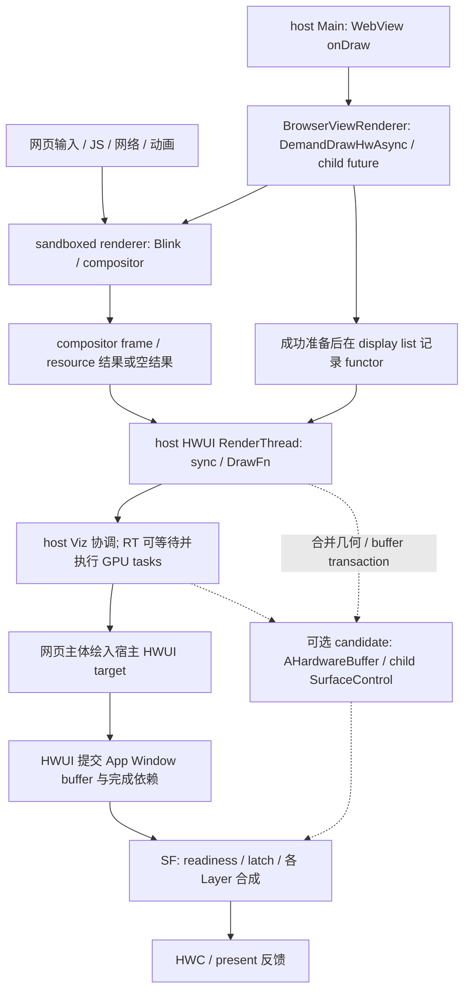

图中实线表达普通主体的请求、记录与消费依赖，虚线表达可选 overlay。读这条主线时要记住：每帧都生成新网页结果并没有保证——Main 可先发起 DemandDrawHwAsync，RT 随后按需等待当前 future；Main 的 SetFrameOnUI 若已有未提交 frame，也可能等待并裁剪旧 future 队列；renderer 还可能没有交出新 frame。所以 Chromium frame、DrawFn CPU 返回、GPU 完成和最终 present 要分别取证。

<!-- gracker-diagram: ch13-09-14-future-wait-sites -->
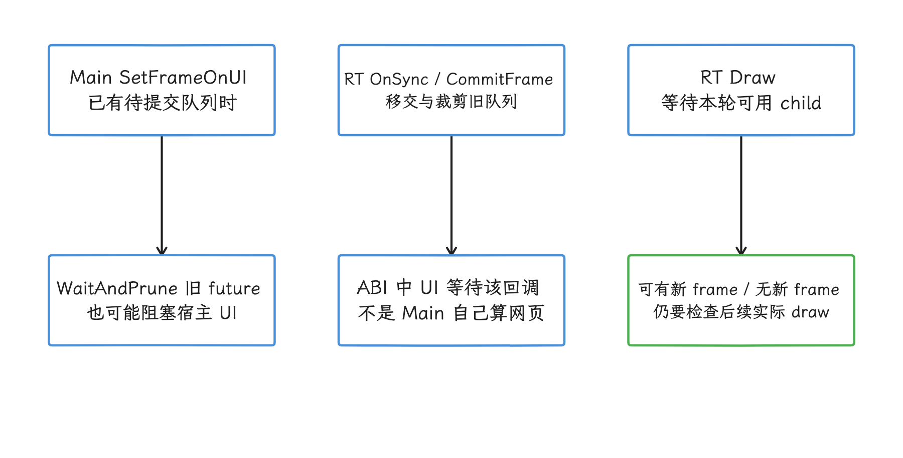

图：当前 future 与旧队列分别影响 Main、sync 和 Draw 阶段。 等待位置取决于队列状态；GetFrame 出现在哪个阶段就按哪里的语义读，别一律当成 RenderThread 的 GPU 计算。

主线程空闲，只说明 Main 这一段空闲：renderer、raster/解码任务、Viz、GPU service、宿主 RenderThread 都可能各自在忙或在等。栅格与图片准备在哪里执行，受 provider 后端和任务策略影响，单凭线程名容易把所有 raster 都归到 renderer 进程。


## 平台版本与 provider 版本要一起记录

Android 5 起，WebView provider 可以独立于系统镜像更新；Android 7 起，设备还可以在多个合格 provider 中选择。所以我们记录版本时要两套一起拿：应用内用 AndroidX WebKit 记录当前实现，设备侧再用 `dumpsys webviewupdate` 交叉核对。

这段代码的用途是把 provider 身份写入复现日志。

```kotlin
val provider = WebViewCompat.getCurrentWebViewPackage(applicationContext)
val versionCode = provider?.let { PackageInfoCompat.getLongVersionCode(it) }
Log.i(
    "WebViewProvider",
    "package=${provider?.packageName}, " +
        "version=${provider?.versionName}, code=$versionCode"
)
```

PackageInfoCompat 来自 `androidx.core.content.pm`，兼容 API 28 以前的 versionCode 读取。固定 WebKit 1.16.0 的 getCurrentWebViewPackage() 契约明确：此查询不会使 WebView 被加载；若尚未加载，返回的是“此刻会选用的包”，之后可以变化。返回值仍可能为 null。用户代理查询、构造或其他 WebView API 则可能触发启动，冷启动基准应区分这些调用与版本查询本身。[来源：WebViewCompat](https://android.googlesource.com/platform/frameworks/support/+/5744fa6296a0f6147952e836b3d92dd87ff7d4dd/webkit/webkit/src/main/java/androidx/webkit/WebViewCompat.java)

<!-- gracker-diagram: ch13-09-08-provider-query -->
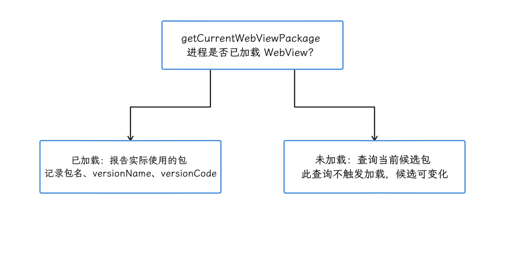

图：getCurrentWebViewPackage 不加载 WebView，返回已加载包或此刻会选用的候选包。 未加载时结果可变化，也可为 null；用户代理查询或构造等其他 API 可能触发初始化。

### provider 怎样装入宿主进程

调用链可以概括为四步：


1. `WebView` 的 provider 代理在第一次需要具体实现时进入 `WebViewFactory.getProvider()`；同一进程会缓存同一个 `WebViewFactoryProvider`。
2. `WebViewFactory` 通过 `WebViewUpdateService.waitForAndGetProvider()` 取得系统选中的包，并校验包名、版本、签名、安装与启用状态。
3. framework 为该包创建可加载代码的 context，取得 provider class loader，加载包声明的 native WebView library，再通过反射创建 provider factory。
4. provider 后续初始化 Chromium browser context、renderer 和图形资源。具体时序属于设备 provider revision，单看 `WebViewFactory.java` 这一份平台源码推不出来。

这条链路解释了 WebView 首次创建为何可能耗时较长：它可能同时包含包选择、RELRO（预重定位只读数据）/native library、Java 类加载、Chromium 初始化、renderer 建立、网络和页面首帧。冷启动的问题，稳态滚动 trace 回答不了，两类要分开采样。


AndroidX WebKit 1.16.0 把带 WebViewOutcomeReceiver 的 startUpWebView 重载转为稳定 API，旧 callback 重载已弃用。它把允许的启动工作安排到配置的 executor，其余任务按 provider 能力与配置处理；回调完成时，renderer、网络或页面首帧可能都还没就绪。


WebViewStartUpConfig 默认允许执行 UI 启动任务；设为 false 时，回调只说明本次允许的启动部分结束，全部 UI 初始化是否完成要看后续。固定兼容实现按 ASYNC_WEBVIEW_STARTUP_V2 / V1 / fallback 分流，旧 provider 可能只有加载 class loader 等收益、没有完整诊断数据。立刻访问其他 WebView API 仍可阻塞 Main；预热收益和内存驻留，要按真实关键路径评估。[来源：WebKit 发布记录](https://developer.android.com/jetpack/androidx/releases/webkit#1.16.0)

<!-- gracker-diagram: ed13-09-startup-capability-and-config -->
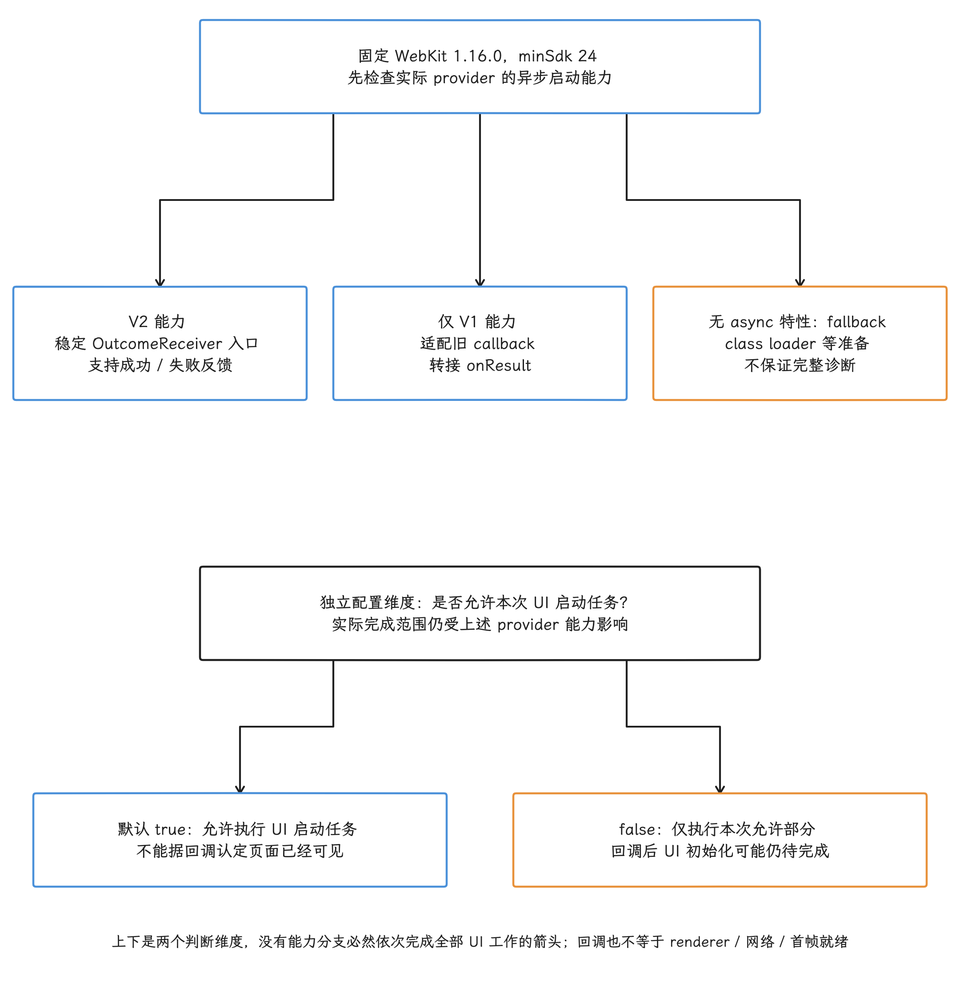

图：固定WebKit1.16.0 minSdk24：稳定OutcomeReceiver重载按provider能力选择ASYNC_WEBVIEW_STARTUP_V2、V1适配或旧fallback。V2可成功/失败反馈，V1转接旧callback，fallback可仅加载class loader等。另核对runUiThreadStartUpTasks配置：默认true允许UI启动任务，false仅完成本次允许部分；实际完成范围和诊断依provider能力，不能把旧fallback当完整启动。启动回调不保证renderer、网络、页面首帧就绪，立即调用其他WebView API仍可阻塞Main。

## 官方 provider 的标准硬件路径：functor / DrawFn

硬件加速的标准 WebView 仍然是宿主 View 树的一员，照常参与 measure、layout、clip、alpha、matrix、invalidate 和窗口生命周期。但宿主并不逐条执行 `Canvas.drawText()` 或 `drawBitmap()` 来重画网页像素：provider 会在宿主 display list 中记录 WebView functor（由 HWUI 在绘制时回调 provider 的特殊绘制节点），等 HWUI RenderThread 执行到这个节点，再接入 Chromium 的合成结果。

### 一次硬件绘制怎样发生

固定平台 / Chromium 样本中的普通硬件路径如下，步骤描述的是依赖关系，部分准备可以并行：


1. 宿主 Main 到达 WebView onDraw，AwContents::OnDraw 在 Canvas 硬件加速、已 attached 且没有强制辅助 bitmap 时调用 OnDrawHardware；满足分支不保证一定产出内容。
2. BrowserViewRenderer 更新约束与 tile 优先级，通过 DemandDrawHwAsync 请求 child frame，把尚未完成的 future 放入 ChildFrame。
3. Java 层确认 native draw 成功后，才调用 mDrawFunctor.requestDraw(canvas) 记录 functor；失败可记录 NativeDrawFailed 并绘制背景，不会自动转去 OnDrawSoftware。
4. RenderThread 的 OnSync / CommitFrame 移交 UI 准备的 frame；后续 Draw 等待并裁剪 future 队列。OnSync ABI 还明确 UI 在该回调期间被阻塞，所以 sync 阶段里的等待未必都是 Main 自己在算网页。
5. DrawGL / DrawVk 经 RenderThreadManager 到 HardwareRenderer；它用 ScheduleOnVizAndBlock 调度 Viz，RT 等待期间还可处理 blocking sequence 的 GPU tasks。
6. 主体内容绘入当前 HWUI target，再由宿主 HWUI 生产并提交 App Window buffer；是否有新 frame、成功 draw 或可选 overlay 都需看实际分支。

下面的时序图示意一次 child future 晚到的硬件绘制，重点是 Chromium 内部完成合成与 Android 窗口提交分属两个阶段。实际 future 也可能早已完成，Main 处理旧队列时也可能等待；图中的返回箭头省略了 browser IPC 转接，真实的 renderer→RT 接口要回到源码里看。


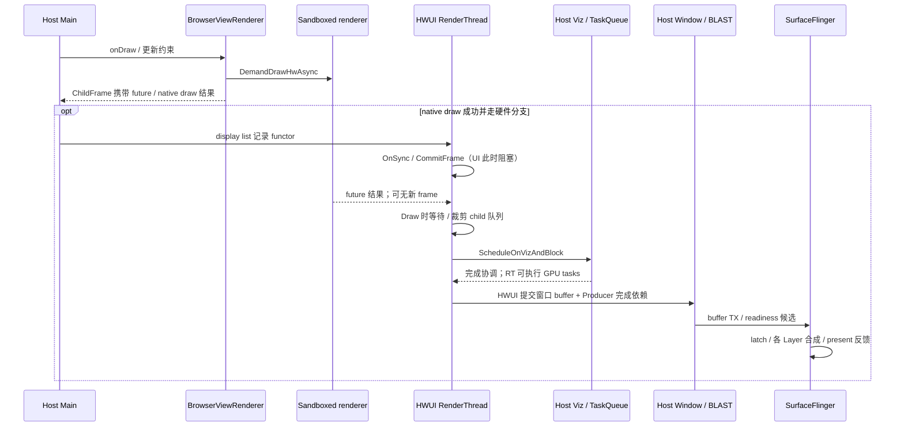

HardwareRenderer::OnViz::DrawAndSwapOnViz 中的 Swap 属于 Chromium 内部 Display 语义，看到它时宿主窗口未必已经 queueBuffer。固定 DrawAndSwap 还会在 CPU 路径用 TimeTicks::Now() 构造 MaybeDidPresent 反馈，但真实显示的 present fence 仍以 SF/HWC 为准。普通主体的 Android 窗口提交由宿主 HWUI 完成。[来源：HardwareRenderer](https://chromium.googlesource.com/chromium/src/+/4e18c703f7cd950c890e14105da8eff42192af6a/android_webview/browser/gfx/hardware_renderer.cc)


### GL 与 Vulkan 的分支识别

`WebViewFunctor.h` 同时定义 GLES 与 Vulkan 回调。`WebViewFunctor_queryPlatformRenderMode()` 查询宿主 HWUI pipeline，HWUI 再按当前 pipeline 校验并调用对应回调。现场我们可以用以下 slice 区分分支：

- 平台侧：`WebViewFunctor::sync`、`WebViewFunctor::drawGl`、`WebViewFunctor::initVk`、`WebViewFunctor::drawVk`、`WebViewFunctor::postDrawVk`；
- Chromium 侧：`DrawFn_DrawGL`、`DrawFn_InitVk`、`DrawFn_DrawVk`、`DrawFn_PostDrawVk`、`DrawFn_RemoveOverlays`。

这段关系比“HWUI 与 Chromium 共用一个 GPU context”复杂：GL/Vulkan context、resource import 和同步实现都取决于 provider revision 与后端；可以确认的是 provider 必须通过平台定义的 functor 模式与当前 HWUI pipeline 协作。

<!-- gracker-diagram: ch13-09-17-drawfn-backends -->
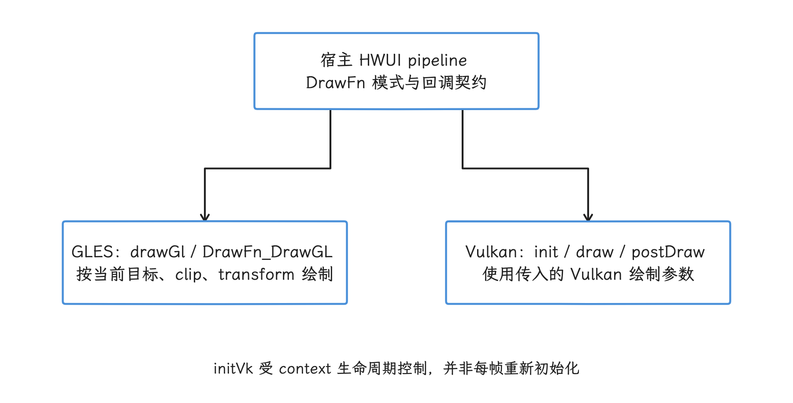

图：平台定义模式和回调契约，provider 按宿主后端协作。 实际 context、资源导入和同步按 revision 核对；“两端共用同一 GPU context”这类笼统说法不要写进结论。

### 这条路径的性能含义

普通网页主体合入 host buffer 后，SurfaceFlinger 通常只看到宿主 App Window layer。DOM layer、CSS transform、canvas 和普通图片已经在 Chromium/HWUI 前半段完成合成，到 SurfaceFlinger 这里不会再逐项出现，HWC 也就没有机会给它们分别分配 overlay plane。

<!-- gracker-diagram: ch13-09-18-dom-vs-system-layer -->
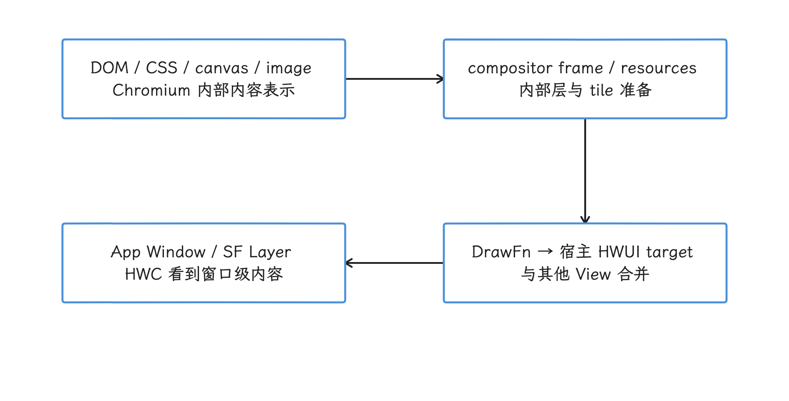

图：网页的内部层与资源通常已合进宿主 target，再由一个窗口 layer 交给系统。 DOM/CSS layer 不逐项映射 SF Layer；可选 overlay 候选才可能另有系统内容 layer。

WebView 的耗时会沿两种方式拖慢宿主帧：

- UI thread 没有及时完成 invalidate、traversal 或 display list 记录；
- RenderThread 执行 functor 时，frame、resource import、GPU service 或 GPU 工作没有按期完成。

所以，宿主主线程负载低，排除不了 WebView 卡顿；SurfaceFlinger 只显示一个 App layer，也说明不了网页侧没经过多线程合成。

## 软件绘制 fallback

固定 AwContents::OnDraw 在“非硬件 Canvas、未 attached 或强制辅助 bitmap”等条件下才进入软件分支；OnDrawHardware 自身返回 false 时，本次调用直接返回，不会顺次落入 OnDrawSoftware。软件分支还可能因空尺寸或拿不到 SoftwareCanvas 而提前结束。成功时经 OnDrawSoftware → CompositeSW → DemandDrawSw 绘入宿主 Canvas。


这里要区分两种宿主形态：

<!-- gracker-diagram: ed13-09-software-entry-and-final-window -->
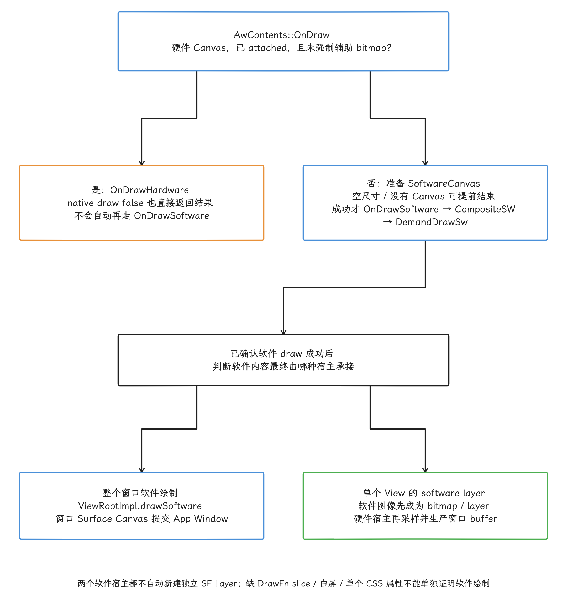

图：固定AwContents::OnDraw先按硬件Canvas、attached且未强制辅助bitmap判断。满足时走OnDrawHardware，返回false也直接返回，不自动落入软件分支；不满足才准备SoftwareCanvas，空尺寸或取不到Canvas可早退，成功才OnDrawSoftware→CompositeSW→DemandDrawSw。软件结果若是整个软件窗口由ViewRootImpl.drawSoftware/Surface Canvas提交，若单View软件layer则由硬件宿主继续采样。两形态不自动创建独立SF Layer，也不能仅凭DrawFn缺失或白屏判软件路径。

- 整个窗口软件绘制时，`ViewRootImpl.drawSoftware()` 通过窗口 Surface 的 Canvas 路径提交 App Window buffer；
- 单个 WebView 使用 software layer 时，软件结果可以先成为 bitmap/layer，再由硬件加速的宿主窗口采样。

两种软件形态都不会自动创建独立 SF layer。确认 fallback 要把软件 draw 调用栈、Canvas acceleration 状态与 CPU 工作放在一起看；硬件 DrawFn slice 缺失也可能只是未采到事件、没有 draw 或提前返回。低端设备、白屏和单个 CSS 属性，任何一项都不足以定型。


## 官方 provider 的 SurfaceControl overlay

平台 HWUI 与 Chromium 都包含 WebView overlay 接口，但它提供的只是候选提升机制：常见结果仍是网页 UI 由 functor 绘入 host buffer，视频、受保护内容或其他满足条件的候选才单独进入 SurfaceControl layer。

### 平台侧先决定“能不能提供 overlay 容器”

`WebViewFunctorManager.cpp` 只有在以下条件成立时，才把 `overlaysMode` 设为 Enabled：


- `Properties::enableWebViewOverlays` 已启用；
- 当前 draw 存在 active `CanvasContext`；
- 该 context 有 root `SurfaceControl`；
- 本次 WebView draw 的目标不是 HWUI 离屏 layer：GL 分支要求 `!drawInfo.isLayer`，Vulkan 分支要求 `!params.is_layer`。

provider 请求父节点时，HWUI 创建名为 Webview Overlay SurfaceControl 的 buffer-state 容器，挂到 App Window root 下并设置相对 root 的层级 -1，以 underlay 方式承接提升内容。prepareSurfaceControlForWebview 准备宿主协作路径；mergeTransaction 尝试合入 active CanvasContext，context 不存在或合并未成功时才单独 apply。到这里，容器、几何更新和实际有 buffer 的 child layer 是三件要分别确认的事。

<!-- gracker-diagram: ch13-09-23-overlay-container -->
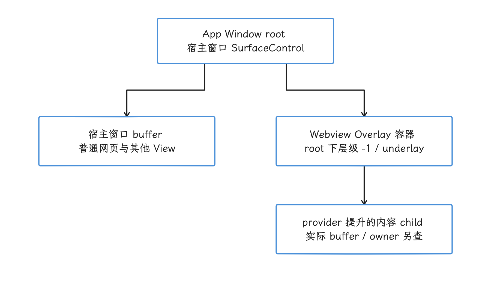

图：HWUI 为 provider 提供 underlay 容器，实际内容与 buffer 再挂到相应 child。 看到容器名称不证明任何候选已出图，更不证明整页搬到独立 Surface。

这一步只创建 overlay 容器并提供 transaction 接口；网页内容是否已获得独立 layer，到这一步还没有答案。


### Chromium 侧再决定“哪个候选能提升”

固定 Chromium 样本的 OverlayProcessorWebView 还会检查：

- HWUI 是否在本次 draw 允许 overlay；
- 完整 GPU service 是否已经就绪；
- `OverlayProcessorSurfaceControl::CheckOverlaySupportImpl()` 是否接受候选；
- 对应 frame sink 是否被临时阻止；
- buffer、crop、transform、颜色空间、保护属性和 acquire fence 是否满足实现要求。

只有通过检查的候选才会获得 AHardwareBuffer 与 SurfaceControl 更新。候选提升失败时，该部分内容会回到网页主体合成路径，但仍可能使用硬件 DrawFn，把它记成 WebView 软件渲染就看错了。


### 一帧里可能同时存在两条提交


网页主体与 overlay 的 Producer/Consumer 关系如下：

| 内容 | Producer | 进入 Android 显示系统的方式 | Consumer |
| --- | --- | --- | --- |
| 普通网页主体 | Chromium 提供绘制内容；宿主 HWUI 生产最终窗口 buffer | functor 绘入 host HWUI target 后提交 App Window | SurfaceFlinger 消费宿主窗口 layer |
| 提升的媒体或受保护候选 | decoder/GPU service/provider | AHardwareBuffer + acquire fence 更新到 SurfaceControl child layer | SurfaceFlinger/HWC 消费独立 layer |
| overlay 几何状态 | 宿主 HWUI draw + provider | crop、position、visibility 等 transaction | SurfaceFlinger transaction state |

buffer 的生产完成依赖与几何状态是两类条件，但它们未必分开、无同步地 apply。固定实现可把几何 transaction 合入 HWUI 的窗口更新；候选 buffer 还携带 acquire fence，实际读取须满足写完成依赖。缺新 buffer 时可能继续旧内容；几何或媒体更新晚到也可能造成错位。独立 layer 最终是否由 HWC DEVICE 处理，仍需查实际 per-layer composition type——“已提升”三个字给不了这个保证。

<!-- gracker-diagram: ed13-09-overlay-transactions-and-buffer-dependencies -->
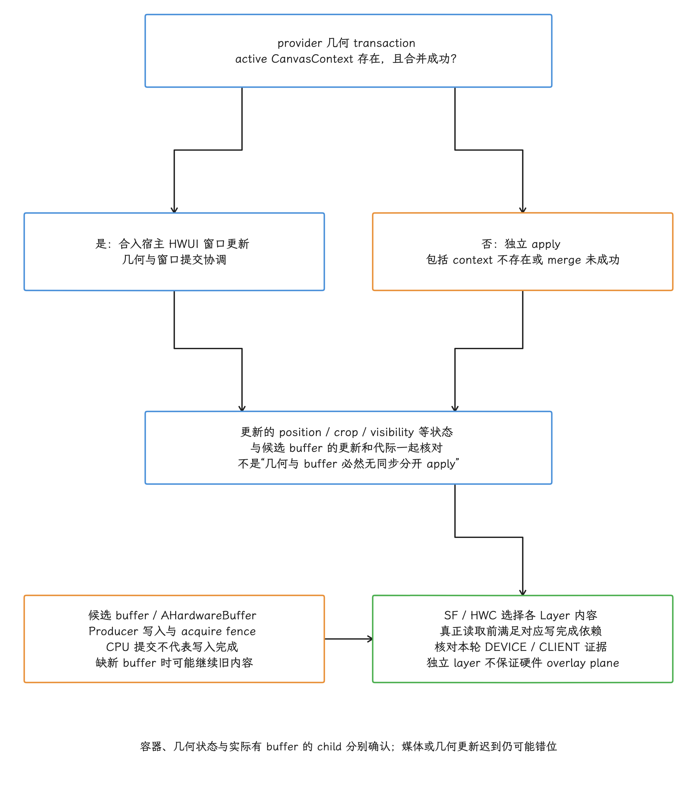

图：固定HWUI mergeTransaction：有active CanvasContext且合并成功则合入HWUI窗口更新，没有context或merge未成功才独立apply。候选buffer携AHardwareBuffer/acquire fence，几何可随宿主更新协调，但实际读取仍须满足Producer写完成依赖；几何和buffer未必分开无同步apply。缺新buffer可继续旧内容，迟到几何或媒体更新仍可错位；独立child layer不保证HWC DEVICE，composition type另取证。

Android 10—11 固定 tag 的现代 functor header 尚无 WebViewOverlayData 的 SurfaceControl/transaction 回调；Android 12 r1 已有 getSurfaceControl / mergeTransaction。Android 17 基线也提供 rendering-thread reporting，但只检查这些 tag，定不出该能力恰好首发于哪个版本。运行设备是否使用 overlay 仍取决于 provider、开关与候选，API level 之外还要看这些条件。


## ImageReader：中间 buffer 与最终 layer

标准 Chromium 本身也可能使用 ImageReader。固定 ImageReaderGLOwner 建立 private-format reader，根据 TextureOwner mode 选择 sampled-image、protected 或 composer-overlay usage。UpdateTexImage 选择 acquireNextImageAsync 或 acquireLatestImageAsync，取得 image 与完成 fence，再提供 AHardwareBuffer；CPU acquire 返回时，生产侧 GPU 可能还没写完，这一步也未必发生 CPU 图像复制。


ImageReader 只划出中间消费这一段，最终落到哪个 SF layer 由后续使用决定：所得资源可以再被采样进宿主窗口，或进入 SurfaceControl overlay。可用 image 额度不足会影响 acquire；固定 max_images == 1 分支还会先释放当前 image，再尝试取新 image，所以取图失败时未必还持有旧图。接下来继续核对 mode、usage、image 引用释放、DrawFn、overlay 与 fence。[来源：ImageReaderGLOwner](https://chromium.googlesource.com/chromium/src/+/4e18c703f7cd950c890e14105da8eff42192af6a/gpu/command_buffer/service/image_reader_gl_owner.cc)


判断 image 的最终去向时，沿 AHardwareBuffer 的后续使用继续追：进入 Chromium/HWUI 采样就回到宿主窗口，成为提升候选则追独立 child SurfaceControl。中间 reader 的类名替代不了这一步。

<!-- gracker-diagram: ed13-09-imagereader-quota-and-output -->
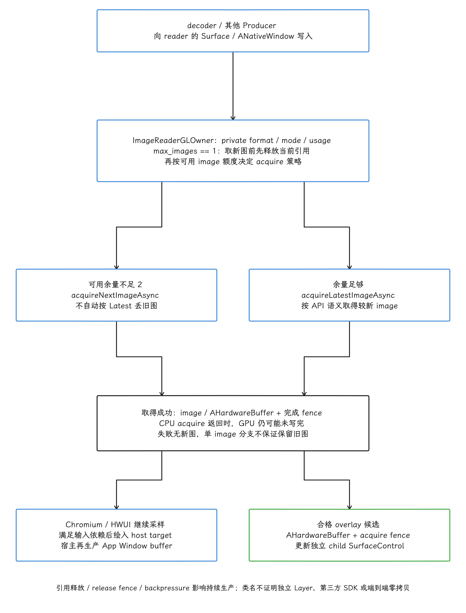

图：固定ImageReaderGLOwner按TextureOwner mode设置private format和sampled/protected/composer-overlay usage。Producer写reader Surface；max_images==1时先释放当前image，再按可用额度选择Next/Latest async acquire：余量不足2用Next，足够用Latest。失败不保证保留旧图；成功取得image/AHardwareBuffer与完成fence，CPU acquire返回不保证GPU已写完，也不证明发生CPU复制。下游可采样进宿主HWUI窗口或作为合格overlay候选更新child SurfaceControl。额度、image引用/release fence和backpressure须核对，类名不识别第三方SDK、独立SF Layer或端到端零拷贝。

## 宿主全屏托管：`onShowCustomView()`

网页进入 fullscreen mode 时，WebView 可以调用 `WebChromeClient.onShowCustomView(View, CustomViewCallback)`。API 注释说明，回调之后，相关 web content 会改画到参数 `view` 中，不再进入原 WebView；宿主需要把该 View 放入合适的全屏 Window，并在退出时移除。仅把 WebView 布局设为 `match_parent`，是触发不了这个托管协议的。


下面的最小实现用于记录交接 View 的运行时类型，并正确维护退出回调。

```kotlin
class FullscreenChromeClient(
    private val container: ViewGroup
) : WebChromeClient() {
    private var fullscreenView: View? = null
    private var exitCallback: WebChromeClient.CustomViewCallback? = null

    override fun onShowCustomView(
        view: View,
        callback: WebChromeClient.CustomViewCallback
    ) {
        if (fullscreenView != null) {
            callback.onCustomViewHidden()
            return
        }

        Log.i("WebViewFullscreen", "view=${view.javaClass.name}")
        fullscreenView = view
        exitCallback = callback
        container.addView(
            view,
            ViewGroup.LayoutParams(
                ViewGroup.LayoutParams.MATCH_PARENT,
                ViewGroup.LayoutParams.MATCH_PARENT
            )
        )
    }

    override fun onHideCustomView() {
        fullscreenView?.let(container::removeView)
        fullscreenView = null
        exitCallback = null
    }

    fun requestExit() {
        val callback = exitCallback ?: return
        exitCallback = null
        callback.onCustomViewHidden()
    }
}
```

宿主主动退出时调用 requestExit 通知 provider，再由 onHideCustomView 移除 View；本例先清除 callback 引用以避免重复请求和回调重入。方法返回本身，说明不了退出已经完成。工程代码仍要在 Activity 销毁时清理承载 View，并恢复系统栏和方向策略。


onShowCustomView 只定义 View 交接与退出协议。固定 Chromium 的 AwContents.enterFullScreen 实际创建 FullScreenView，把同一 AwContents 的绘制委托与 container 切到该 View，并在新 onDraw 时重建 functor；这已足以说明回调 View 不必是视频 SurfaceView。其他 provider/包装层仍需查看参数类型与 child tree；当前类名只是样本，写不成跨版本 API 保证。

<!-- gracker-diagram: ch13-09-33-fullscreen-ownership -->
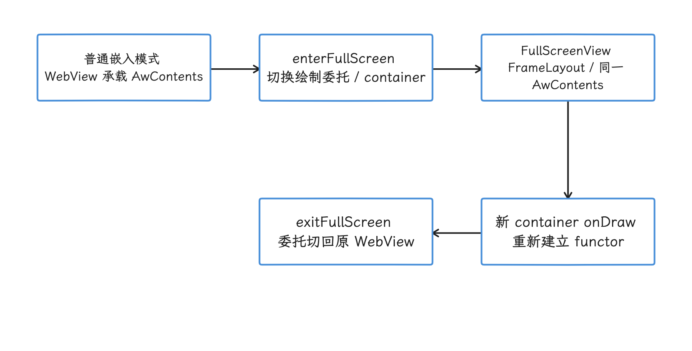

图：同一 AwContents 可迁移到 FullScreenView，网页绘制仍可能继续用 functor。 这是固定实现例子，类名不是公开跨版本保证；媒体 overlay 是另一条可并存机制。

- 如果内部是 `SurfaceView`，常见 Producer 是 MediaCodec/MediaPlayer，buffer 直接交给独立 Surface layer；
- 如果内部是 `TextureView`，Producer 写入 `SurfaceTexture`，宿主 RenderThread 通过纹理采样把结果合入 App Window；
- 若只是容器，继续向下找实际持有 Surface、SurfaceTexture 或播放器的 child。


全屏 custom view 与 provider 内部 overlay 可以同时出现，但属于不同机制。判断 owner 时，我们以回调、View 树和 layer parent 为准。


## 第三方 SDK 的 Texture-like 扩展

X5、UC 或定制 Chromium 可以在包装层中采用 `TextureView`/`SurfaceTexture`、独立 Surface、ImageReader、HardwareBuffer 或私有桥接。不同版本、设备渠道和 feature flag 都可能改变实现，所以第三方 WebView 没有统一的管线描述，要按现场证据归类。

只有下面的证据在 trace 或调用栈里都对上，我们才把现场归为 Texture-like：


- 确认 SDK renderer/decoder 写入的 Surface / ANativeWindow，以及它连接的 SurfaceTexture 消费端；SurfaceTexture 本身不是 Producer endpoint；
- Producer 的 frame-available 回调到达；
- 宿主 RenderThread 执行 `updateTexImage()` 或等价的纹理获取；
- SurfaceFlinger layer tree 仍以宿主 App Window 为主体，没有与该内容对应的独立 Surface layer。

确认 TextureView-like 后继续区分三个时点：frame-available 回调标记更新并 invalidate；Main 的 TextureView.draw 记录 drawTextureLayer；RenderThread 的 DeferredLayerUpdater::apply 再经 ASurfaceTexture_dequeueBuffer 获取可消费 image，后续 GPU 采样进入 App Window。Java 调用栈里未必出现 updateTexImage，回调或 Java draw 的返回也当不成采样完成的标志。


第三方 Producer 的 swapBuffers 只说明源图像提交；接下来仍要核对源完成依赖、宿主是否申请绘制、实际取图与窗口提交。平台链路见 [13.3 SurfaceView 与 TextureView 渲染管线](03-surfaceview-textureview-pipelines.md)。

<!-- gracker-diagram: ed13-09-texture-input-and-host-window -->
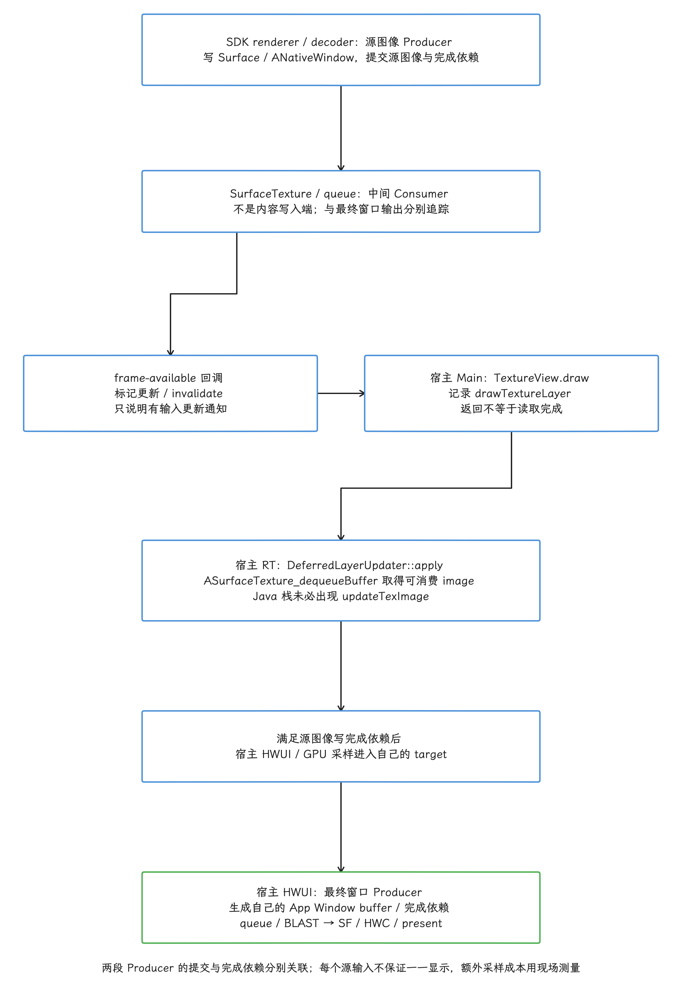

图：仅已由SDK版本/对象证据确认Texture-like的现场：SDK renderer/decoder向Surface/ANativeWindow生产源图像，SurfaceTexture为消费端。frame-available只标记更新/invalidate；Main TextureView.draw记录drawTextureLayer；RT DeferredLayerUpdater::apply经ASurfaceTexture_dequeueBuffer取image，满足源完成依赖后GPU采样进入宿主target；HWUI再生产App Window buffer并queue/BLAST交给SF。源swap、回调或Java draw返回均不等GPU写完/宿主采样完成；每个输入不保证对应一最终显示帧，Java栈未必出现updateTexImage。额外采样/同步成本按实际SDK/页面/设备量测。

这条路径的 Producer 是第三方内核或其 GPU 线程，Consumer 是宿主 HWUI。它会增加一次纹理采样和相应同步，具体开销必须用该 SDK 版本、页面负载和设备 trace 测量，快慢要测了才知道。

## 从网页更新到显示的一帧

拿到一段卡顿现场后，我们可以把一帧拆成六个诊断阶段，逐段对齐执行者与观测点。


1. 网页状态更新：JavaScript、DOM、style、layout、paint、图片或滚动改变待生成内容。
2. 网页帧准备：compositor 与 raster/解码任务按实际后端准备资源；宿主的异步 draw 请求可早于结果完成。
3. 宿主记录：Main onDraw 发起或接续请求，成功时记录 functor，其他 View 也可使窗口绘制。
4. RenderThread / Viz：同步 child 队列，按需等待 future、协调 Viz/GPU tasks，再把主体绘入 HWUI target；可复用旧结果或无新 frame。
5. 输出提交：宿主 HWUI 交付窗口 buffer；可选候选经 SurfaceControl 交付 buffer 与几何/同步 transaction。
6. 系统显示：SF 按 readiness 采纳内容，确定各 Layer 合成类型，满足读取依赖后处理 CLIENT/DEVICE 与 present。

这些阶段可能相互重叠。renderer 可以提前准备 frame，宿主也可以在没有新网页 frame 时重画其他 View；GPU 命令提交与完成又是异步关系。所以关联时要使用 frame token、buffer frame number、flow event、transaction id 和 fence；时间上相邻的 slice 先别自动当成同一帧，要用这些 token 去关联确认。

<!-- gracker-diagram: ed13-09-internal-feedback-and-display-completion -->
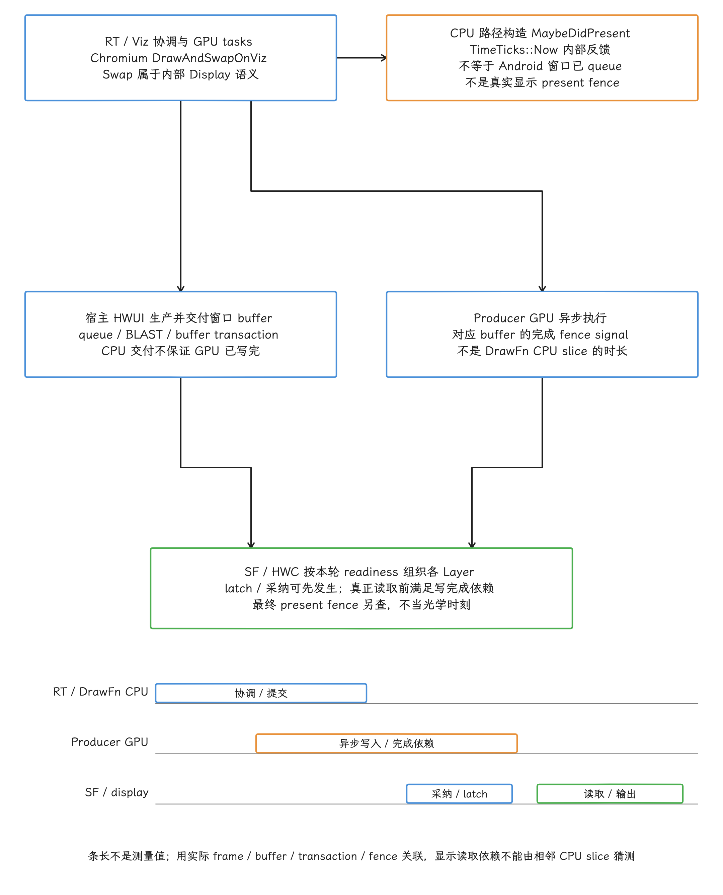

图：固定Chromium DrawAndSwapOnViz的Swap属于内部Display语义；CPU路径TimeTicks::Now构造MaybeDidPresent反馈不证明Android窗口已queue或实际显示。主体由宿主HWUI生产窗口buffer；queue交付与Producer GPU完成为不同观测点，SF可先组织readiness/latch，真正读取需满足对应acquire依赖，最终present fence查SF/HWC。按frame token、buffer frame number、transaction和fence关联同对象，不把相邻slice当同帧，不把DrawFn wall time当GPU设备时长，present也不是光学测量。

## renderer 生命周期、启动与内存压力

### renderer 消失后的恢复

renderer 可能 crash，也可能因内存压力终止。onRenderProcessGone 从 API 26 起提供恢复入口，并对共享受影响 renderer 的 WebView 分别回调；每个实例只清理自己收到的对象。返回 true 表示应用处理了终止，仍必须从 hierarchy 移除、清引用并 destroy，继续展示要新建实例；只清理其中一个，共享 renderer 下其他 WebView 是否已恢复，仍要看它们各自的回调。

<!-- gracker-diagram: ed13-09-profile-sharing-and-renderer-loss -->
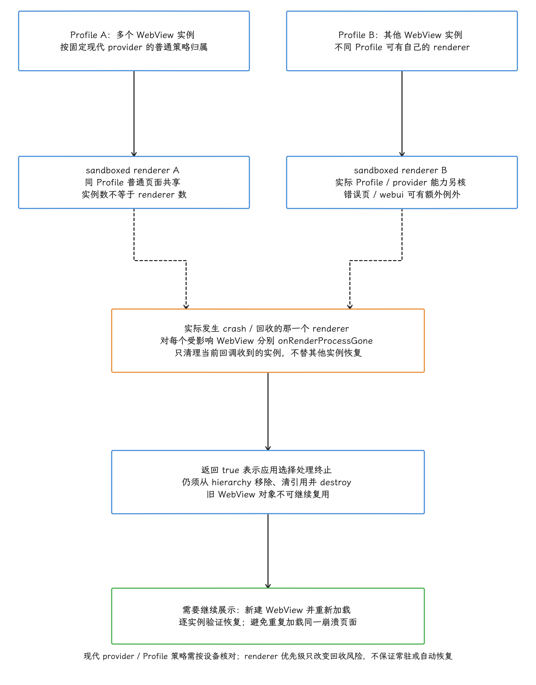

图：固定现代provider普通同Profile共享renderer，多个Profile可各有renderer，内置错误页/webui另有例外；实例数与renderer数不换算。API26+同一受影响renderer消失时，对每个受影响WebView分别调用onRenderProcessGone；每个只处理自己收到的对象，返回true仍需从hierarchy移除、清引用/destroy，继续展示则新建实例。图下方恢复链按实际受影响renderer进入，不表示两个renderer必然同时死亡，优先级降低不保证常驻或自动恢复。

`WebView.setRendererPriorityPolicy()` 可以调整 renderer 的进程重要性。降低不可见 WebView 的优先级会提高它被回收的概率，所以应用要先具备可靠的 process-gone 恢复路径，再谈降级策略。后台返回后出现白屏或重载时，我们先检查 renderer death/OOM，再检查绘制管线。


### 冷启动和稳态卡顿要分开

首次初始化可能包含 provider 装载、native library、Chromium startup、renderer 创建、网络连接和首帧 raster。稳态滚动则更关注 JavaScript 长任务、layout、raster、resource import、DrawFn、GPU queue 和 host window deadline。两类问题的工作集不同，我们把样本分开采集、分开比较，混进同一个平均值会掩盖各自的主要耗时来源。


### Android 17 / kernel 6.18 下的内存证据

大页面会同时占用 DOM/JS heap、解码图片、Skia 资源、tile cache、GPU texture、AHardwareBuffer/dma-buf 和宿主图形内存。内存压力可能触发 GC、tile 淘汰、重新解码、renderer 回收、page fault（缺页）、direct reclaim（业务线程直接回收内存）、`kswapd` 后台回收、zram I/O 或 dma-buf 分配等待。


在内核基线 `android17-6.18-2026-06_r6` 中，跨进程图形 buffer 仍通过 dma-buf 共享，显式同步通过 dma-fence/sync_file 传递。CPU slice 变长时，要结合线程状态区分 Running（正在执行）、Runnable（可运行但等待 CPU）和 blocked（等待依赖）；线程等 fence 的时间混在 wall time 里，要剔出来再看实际计算量。


## 如何判断当前 WebView 走哪条路径

要得到可靠的结论，需要 provider 身份、回调与 View 信息、Perfetto 和 SurfaceFlinger layer tree 相互印证。

### 1. 固定版本与复现场景

这组命令只收集平台、provider、进程和 layer 证据，不会自动判定渲染类型。

```bash
adb shell getprop ro.build.fingerprint
adb shell getprop ro.build.version.sdk
adb shell dumpsys webviewupdate
adb shell ps -A -T | grep -E 'webview|sandboxed_process|<宿主包名>'
adb shell dumpsys SurfaceFlinger --list
```

把完整输出与 Perfetto 时间戳放进同一问题单。`grep` 只用来快速定位入口；正式判断还要回看完整的进程关系和 layer parent，免得被同名线程或同名 layer 误导。


还应记录：

- URL 或本地复现页、登录状态和页面操作；
- hardware acceleration 状态、刷新率、GPU 和窗口模式；
- 是否有 video、WebGL、canvas、复杂 filter、protected content；
- 是否触发 `onShowCustomView()`；
- 第三方 SDK 名称、版本与 feature 配置。

### 2. 先看 fullscreen 交接和 View owner

收到 `onShowCustomView()` 才能确认进入宿主全屏托管分支。我们先记录参数 View 的完整类名与 child tree，再检查它创建的 Surface/SurfaceTexture。没有回调时，单凭满屏画面还判定不了 fullscreen custom view，先把这条分支放下。


### 3. 在 Perfetto 中连接五段证据


| 观察点 | 说明 | 下一步 |
| --- | --- | --- |
| renderer main 长时间 Running | JavaScript、style、layout、paint 可能超预算 | 用 DevTools CPU profile/Performance panel 补充函数与 DOM 证据 |
| raster worker、image decode 或 GPU service 晚 | tile、解码、资源准备或 GPU queue 可能迟到 | 检查 worker queue、Skia/decode、GPU fence 和内存压力 |
| host UI thread 很晚才 traversal | invalidate、主线程调度或其他 View 工作阻塞 | 对齐 `Choreographer#doFrame`、ViewRoot 与 Runnable latency |
| `WebViewFunctor::drawGl/drawVk` 或 `DrawFn_DrawGL/DrawVk` 变长 | functor sync、resource import、Chromium draw 或 GPU 工作影响 host frame | 结合线程状态、flow、GPU queue 与 fence |
| host window queue 按时，SF latch/present 仍晚 | 仍可能是 Producer GPU 完成依赖、transaction 或显示后段迟到 | 对齐 BufferTX、acquire signal、FrameTimeline 与 SF/HWC，不能仅凭 queue 排除 App/GPU |
| 网页 UI 正常，视频卡顿或位置漂移 | media producer、overlay buffer 或几何 transaction 更可疑 | 单独追视频 child layer、codec fence 与 transaction |

线程名和 slice 名随 provider 更新而变化，缺失事件还可能是采集覆盖不足。宿主 HWUI App Window 的 FrameTimeline 替代不了独立 overlay 或 SurfaceTexture 输入流的观测；官方 Perfetto 文档也注明该页面的 FrameTimeline 暂不支持 SurfaceView，缺口要用 buffer / transaction / fence 补齐。复盘时保留 provider revision 与实际目标 Layer。

<!-- gracker-diagram: ch13-09-50-timeline-coverage -->
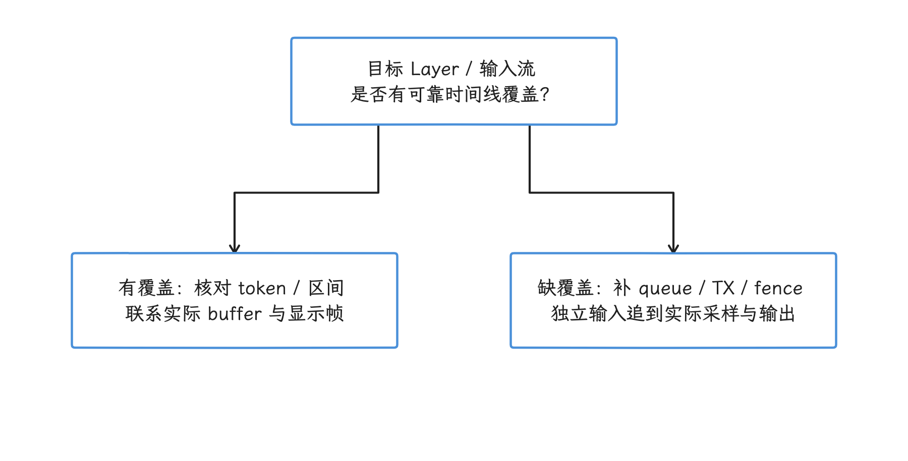

图：先确认目标对象的事件覆盖，缺口用 buffer / transaction / fence 补齐。 官方 FrameTimeline 页面暂不支持 SurfaceView；宿主时间线替代不了独立 overlay 或纹理输入。

### 4. 用 layer tree 验证内容落点


- 只有 host App Window，且 trace 出现 WebView DrawFn，主体更接近标准 functor 路径；
- 出现 `Webview Overlay SurfaceControl` 或其 child 时，还要检查是否有 buffer、owner、parent 和同步更新，看到名字就宣布整页独立出图为时过早；
- 出现 video / protected layer，分别追 decoder producer 与宿主几何 transaction；
- fullscreen 场景同时核对 custom view 容器和播放器 layer；
- 出现 `SurfaceTexture` / `updateTexImage`，先查 owner。标准 provider、第三方 SDK 或宿主包装层都可能留下不同证据。

### 5. 把结论写成可复查记录

写结论时，我们按下面的清单把可复查的信息放齐：

- Android build / API level；
- provider 包名、`versionName`、`versionCode` 或第三方 SDK revision；
- 页面场景与复现时间；
- hardware acceleration 与 GPU backend；
- fullscreen callback 与运行时 View 类型；
- Perfetto artifact、关键进程/tid、slice、flow 或 frame token；
- SurfaceFlinger layer 名称、parent、buffer 与 composition type；
- 已排除的路径和尚未确认的假设。

artifact、版本和页面负载缺了任何一样，固定帧耗、百分比或“某路径必然更快”这类结论就先别写。

## 常见现场对比表


| 现场 | 所属边界 | Producer | Consumer / 最终落点 | 宿主 RenderThread | 关键证据 |
| --- | --- | --- | --- | --- | --- |
| 标准 GL/Vulkan functor | 官方 provider 主体路径 | Chromium 内容 + 宿主 HWUI 窗口 Producer | HWUI host target → App Window → SF | 执行 DrawFn，参与主体合成 | provider revision + DrawFn slice + 只有 host layer |
| SurfaceControl overlay 候选 | 官方 provider 可选路径 | decoder、GPU service 或 provider | child SurfaceControl → SF / HWC | 主体仍走 DrawFn，并协调 overlay transaction | overlay-enabled draw + child layer / buffer + transaction |
| 软件 fallback | 官方 provider fallback | Chromium software compositor/CPU raster | host Canvas 或 software layer → App Window | 不执行硬件 DrawFn，是否参与取决于宿主形态 | software draw stack + Canvas 状态 + DrawFn 缺失 |
| fullscreen custom view | 宿主全屏托管 | 由回调 View 的内部实现决定 | SurfaceView、TextureView 或其他容器对应的路径 | 由实际 View 类型决定 | `onShowCustomView()` + View tree + layer owner |
| 第三方 Texture-like | 第三方 SDK 扩展 | SDK renderer/GPU 线程 | SurfaceTexture → HWUI host target | 消费纹理并合入宿主窗口 | SDK revision + frame-available + `updateTexImage` |

## 常见误判

| 误判 | 修正方法 |
| --- | --- |
| Android 17 唯一确定 WebView 源码 | 同时记录 provider 包版本并匹配 Chromium revision |
| Chromium 有 compositor，所以网页一定是独立 SF layer | 看 host DrawFn 与 SurfaceFlinger layer tree；普通主体通常合入 App Window |
| `Webview Overlay SurfaceControl` 代表整页 WebView | 检查其 child、buffer owner 与 candidate；它是 overlay 容器 |
| DOM layer 对应 SF layer | DOM/cc layer 通常已在 Chromium 与 HWUI 前半段合成 |
| `DrawAndSwapOnViz` 代表 Android 窗口已 swap | 继续追宿主 HWUI `queueBuffer`、SF latch 与 display present |
| 页面铺满屏幕就是 `onShowCustomView()` | 以回调是否发生为准 |
| 全屏回调 View 必然是 SurfaceView | 记录类名、child tree 和 Surface owner |
| renderer frame ready 表示用户已看到 | 继续追 DrawFn、host buffer、SF 和 display |
| 主线程空闲说明 WebView 没问题 | 同看 renderer、raster、GPU service 与 RenderThread |
| renderer 被回收后可复用原实例 | 移除并 destroy 旧 WebView，再创建新实例 |
| 看到 `updateTexImage()` 就是系统 WebView 主路径 | 先查 SurfaceTexture owner 与第三方 SDK / 宿主包装层 |

## Android 12—17 的版本边界

WebView 版本演进要同时保留平台线和 provider 线。下面列出排障时应保留的 Android 平台版本边界；Chromium milestone 与 feature flag 仍按设备 provider 核对。


- Android 12/API 31：BLAST 与 FrameTimeline 成为显示诊断的重要基线。现代 WebView 的主体仍通常经 functor 合入 host window；平台具备 SurfaceControl 集成能力，页面整体也不会自动获得独立 layer。
- Android 13/API 33：WebView 的公开 darkening 控制等能力会影响页面 raster 结果，但不改变 framework/provider/renderer/HWUI 的基本分层。
- Android 14/API 34：标准分层保持稳定。差异常来自 provider milestone、GPU blocklist、Skia/Chromium flag 和 OEM provider。
- Android 15/API 35：16 KB page size 设备要求宿主和 provider native libraries 满足对应 ELF/APK 对齐。加载或运行失败时应先检查二进制兼容，先别急着归因到 functor 帧耗。
- Android 16/API 36：平台图形与安全策略继续演进，定制内核、注入层和非标准 GPU 调试接口需要按设备策略验证；标准 WebView 的可更新 provider 属性不变。
- Android 17/API 37：`android-17.0.0_r1` 的 `WebViewFunctor` 明确定义 GLES/Vulkan draw callback、overlay transaction 和 rendering-thread reporting。平台说明如何承接 provider，但不固定设备上的 Chromium milestone。

在本文固定 ACK `android17-6.18-2026-06_r6` 中，dma-buf 提供共享 buffer 基础，dma-fence/sync_file 传递完成依赖。这里不声明所有 Android 17 设备都统一使用 6.18；codec/GPU/display 的实现与私有调度须按目标设备核对。

## 源码阅读入口

### Android 17 平台

- [`WebView.java`](https://android.googlesource.com/platform/frameworks/base/+/android-17.0.0_r1/core/java/android/webkit/WebView.java)、[`WebViewFactory.java`](https://android.googlesource.com/platform/frameworks/base/+/android-17.0.0_r1/core/java/android/webkit/WebViewFactory.java)：framework 代理、provider 选择和装载；
- [`WebViewUpdateServiceImpl2.java`](https://android.googlesource.com/platform/frameworks/base/+/android-17.0.0_r1/services/core/java/com/android/server/webkit/WebViewUpdateServiceImpl2.java)：系统怎样选择、准备与切换 provider；
- [`WebChromeClient.java`](https://android.googlesource.com/platform/frameworks/base/+/android-17.0.0_r1/core/java/android/webkit/WebChromeClient.java)、[`WebViewClient.java`](https://android.googlesource.com/platform/frameworks/base/+/android-17.0.0_r1/core/java/android/webkit/WebViewClient.java)：全屏托管与 renderer 消失后的宿主责任；
- [`WebViewFunctor.h`](https://android.googlesource.com/platform/frameworks/base/+/android-17.0.0_r1/libs/hwui/private/hwui/WebViewFunctor.h)、[`WebViewFunctorManager.cpp`](https://android.googlesource.com/platform/frameworks/base/+/android-17.0.0_r1/libs/hwui/WebViewFunctorManager.cpp)：GL/Vulkan functor、overlay gate、SurfaceControl 和 transaction；
- [`TextureView.java`](https://android.googlesource.com/platform/frameworks/base/+/android-17.0.0_r1/core/java/android/view/TextureView.java)、[`DeferredLayerUpdater.cpp`](https://android.googlesource.com/platform/frameworks/base/+/android-17.0.0_r1/libs/hwui/DeferredLayerUpdater.cpp)：TextureView-like 分支的 frame available、invalidation 和 image acquire；
- [`SurfaceFlinger.cpp`](https://android.googlesource.com/platform/frameworks/native/+/android-17.0.0_r1/services/surfaceflinger/SurfaceFlinger.cpp)、[`FrameTimeline.cpp`](https://android.googlesource.com/platform/frameworks/native/+/android-17.0.0_r1/services/surfaceflinger/Scheduler/FrameTimeline.cpp)、[`HWComposer.cpp`](https://android.googlesource.com/platform/frameworks/native/+/android-17.0.0_r1/services/surfaceflinger/DisplayHardware/HWComposer.cpp)：host/overlay layer 的 latch、composition 和 present。

### WebView provider

Chromium provider 可更新。本文仅用固定 revision `4e18c703f7cd950c890e14105da8eff42192af6a` 解释路径；设备问题切到实际 provider revision。子 frame 请求、RT/Viz 协调还可查 [RenderThreadManager](https://chromium.googlesource.com/chromium/src/+/4e18c703f7cd950c890e14105da8eff42192af6a/android_webview/browser/gfx/render_thread_manager.cc)、[TaskQueueWebView](https://chromium.googlesource.com/chromium/src/+/4e18c703f7cd950c890e14105da8eff42192af6a/android_webview/browser/gfx/task_queue_webview.cc) 与 [renderer/Profile 说明](https://chromium.googlesource.com/chromium/src/+/4e18c703f7cd950c890e14105da8eff42192af6a/android_webview/renderer/README.md)。

- [`draw_fn.h`](https://chromium.googlesource.com/chromium/src/+/4e18c703f7cd950c890e14105da8eff42192af6a/android_webview/public/browser/draw_fn.h)、[`aw_draw_fn_impl.cc`](https://chromium.googlesource.com/chromium/src/+/4e18c703f7cd950c890e14105da8eff42192af6a/android_webview/browser/gfx/aw_draw_fn_impl.cc)：HWUI DrawFn 和 provider callback；
- [`aw_contents.cc`](https://chromium.googlesource.com/chromium/src/+/4e18c703f7cd950c890e14105da8eff42192af6a/android_webview/browser/aw_contents.cc)、[`browser_view_renderer.cc`](https://chromium.googlesource.com/chromium/src/+/4e18c703f7cd950c890e14105da8eff42192af6a/android_webview/browser/gfx/browser_view_renderer.cc)：硬件/软件 draw 分流和 synchronous compositor；
- [`hardware_renderer.cc`](https://chromium.googlesource.com/chromium/src/+/4e18c703f7cd950c890e14105da8eff42192af6a/android_webview/browser/gfx/hardware_renderer.cc)：child frame 与 Viz 合成；
- [`overlay_processor_webview.cc`](https://chromium.googlesource.com/chromium/src/+/4e18c703f7cd950c890e14105da8eff42192af6a/android_webview/browser/gfx/overlay_processor_webview.cc)：WebView overlay candidate 与 SurfaceControl 更新。
- [`image_reader_gl_owner.cc`](https://chromium.googlesource.com/chromium/src/+/4e18c703f7cd950c890e14105da8eff42192af6a/gpu/command_buffer/service/image_reader_gl_owner.cc)：ImageReader TextureOwner、AHardwareBuffer、acquire/release fence 和 backpressure。

公开 API 与生命周期要求可交叉核对 [WebView 开发指南](https://developer.android.com/develop/ui/views/layout/webapps/webview)、[WebView 对象管理](https://developer.android.com/develop/ui/views/layout/webapps/managing-webview) 和 [WebView 启动优化](https://developer.android.com/develop/ui/views/layout/webapps/optimize-webview-startup)。

### Kernel 6.18

- [`dma-buf.c`](https://android.googlesource.com/kernel/common/+/refs/tags/android17-6.18-2026-06_r6/drivers/dma-buf/dma-buf.c)：dma-buf 对象、fd 和 attachment 基础；
- [`dma-fence.c`](https://android.googlesource.com/kernel/common/+/refs/tags/android17-6.18-2026-06_r6/drivers/dma-buf/dma-fence.c)：fence signal、callback 和 wait；
- [`sync_file.c`](https://android.googlesource.com/kernel/common/+/refs/tags/android17-6.18-2026-06_r6/drivers/dma-buf/sync_file.c)：以 fd 携带 fence 的 sync_file；
- [Linux 6.18 dma-buf 文档](https://docs.kernel.org/6.18/driver-api/dma-buf.html)：import / export、attachment、CPU access 与同步约束。

## 与其他章节的关系

- [22.16 WebView 性能优化实战](../../part5-app/ch22-rendering-practice/16-webview-optimization.md)：从页面、宿主和业务指标处理 WebView 性能；
- [13.3 SurfaceView 与 TextureView 渲染管线](03-surfaceview-textureview-pipelines.md)：全屏 custom view 或第三方 SDK 返回具体 View 类型后，回到对应管线；
- [13.6 SurfaceControl 与 HardwareBufferRenderer](06-surfacecontrol-hardwarebuffer-renderer.md)：overlay transaction、layer tree 和 fence；
- [2.4 MainThread、RenderThread 与 Hardware Layer](../../part1-fundamentals/ch02-rendering/04-main-render-thread-hardware-layer.md)：宿主 View traversal 与 HWUI 提交；
- [2.9 SurfaceFlinger 合成、FrontEnd 与事务队列](../../part1-fundamentals/ch02-rendering/09-surfaceflinger-frontend-transaction.md)：host layer 与可选 overlay 的系统显示后半段。

## 小结

标准硬件 WebView 由沙箱 renderer、宿主 provider 与 HWUI 协作：宿主 onDraw 可发起 child future，Main 成功记录 functor 后由 RenderThread / Viz 按需消费，最终由 HWUI 生产 App Window buffer。CPU 协调完成、GPU 完成与系统显示反馈要分开判断，也不要求每次宿主帧都先得到一张全新的网页帧。

SurfaceControl 能力服务于被提升的 overlay 候选，常见于媒体或受保护内容，由此推不出整页 WebView 独立出图。`onShowCustomView()` 是宿主全屏托管协议，第三方 Texture-like 则属于 SDK 扩展。三者的 owner、producer 和 consumer 不同。

我们排障时先同时固定 Android build 和 provider revision，再依次核对 renderer、host DrawFn、host window、可选 child layer 和 Display present，这样就能区分网页计算、资源准备、宿主消费、overlay 同步和系统显示分别在哪一阶段迟到。
