# Android 17 WebView 渲染管线

WebView 的一帧横跨应用 View 树、Chromium 多进程管线和 Android 合成系统，provider 版本还可能独立于平台版本更新。排查时应同时记录两套版本，并先确认当前走硬件 functor、软件 fallback 还是独立 Surface 路径。

## 这条管线为什么容易看错

WebView 同时跨越 Chromium 与 Android 两套渲染系统。网页侧负责 JavaScript、样式、布局、绘制列表、栅格化和 compositor frame（Chromium 合成器生成的帧）；宿主侧仍要完成 View 遍历、HWUI 绘制、窗口 buffer 提交和 SurfaceFlinger 合成。只检查 App 主线程会遗漏 renderer 与 GPU service；只看到 Chromium compositor，也无法证明网页拥有独立的 SurfaceFlinger layer。

<!-- gracker-diagram: ch13-09-01-two-rendering-systems -->
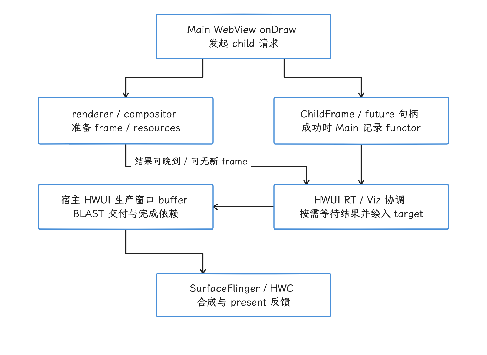

图：Chromium 准备内容，宿主 HWUI 生产最终窗口 buffer，系统再完成合成与显示。 Chromium compositor 不等于独立 SF layer；先确认标准、软件或独立 Surface 分支。

本次图文复核于 2026-10-24 完成，采用固定 Android 17 与 Chromium revision 解释机制，不把该 Chromium 样本称为当前最新版。平台、provider 与 AndroidX WebKit 是不同版本坐标：

<!-- gracker-diagram: ch13-09-02-version-coordinates -->
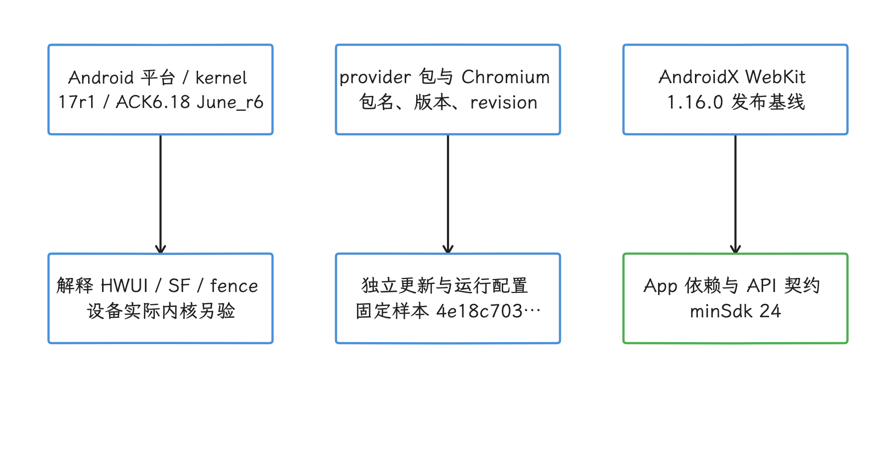

图：固定平台接口、实际 provider 与应用 API 库，才能解释设备上的具体路径。 WebKit 1.16.0 minSdk24；Android 5 历史范围不能覆盖这套依赖，ACK基线也不代表全部设备。

- Android 平台固定在 Android 17/API 37/`android-17.0.0_r1`，解释 framework、HWUI、SurfaceControl 和显示接口；
- 内核固定在 `android17-6.18-2026-06_r6`，解释本文使用的 dma-buf、fence、调度和回收机制，不代表所有 Android 17 设备都采用这条内核；
- provider 必须记录包名、versionName、versionCode，并匹配 Chromium revision；本文用 `4e18c703f7cd950c890e14105da8eff42192af6a` 作固定样本；
- AndroidX WebKit 采用 1.16.0 发布基线。其 minSdk 已升至 24，startUpWebView 等 API 与旧 Android 5 历史范围分别讨论，不能承诺这套依赖运行在 API 21–23。

即使系统都是 Android 17，两台设备也可能安装不同 Chromium milestone（版本里程碑）的 provider，并受不同 feature flag、GPU blocklist 和 OEM 配置影响。平台 tag 只能回答 Android 提供了哪些接口，provider 的实际行为仍要根据设备版本对应的源码判断。

## 先分清三个边界

WebView 现场常被混在一起的内容有三类。

| 边界 | 谁负责 | 常见形态 | 不能直接推出什么 |
| --- | --- | --- | --- |
| 官方 Android System WebView provider 内部 | framework WebView、可更新 provider、Chromium renderer/GPU service、HWUI | 普通页面经 functor/DrawFn 合入宿主窗口；合格的内容候选可走 SurfaceControl overlay | 看到 WebView 就等于存在独立 SF layer |
| 宿主全屏托管 | `WebChromeClient.onShowCustomView()` 与宿主全屏容器 | 页面进入 fullscreen mode 后，WebView 把一个 `View` 交给宿主 | 回调给出的 `View` 必然是 `SurfaceView` 或 `TextureView` |
| 第三方 SDK 扩展 | X5、UC、定制 Chromium 或厂商包装层 | 可能使用 Texture-like、独立 Surface、ImageReader 或私有桥接 | 可以直接套用 Android System WebView 的内部类名与 trace slice |

这里的 “SurfaceControl 子 Surface” 指官方 provider 把合格的 overlay candidate（可提升候选）放入独立 layer 的能力。普通网页主体通常仍由 functor 绘入宿主 App Window；视频、受保护内容或其他满足条件的候选才可能增加独立 layer。分析时必须保留这一适用范围。

<!-- gracker-diagram: ch13-09-03-three-boundaries -->
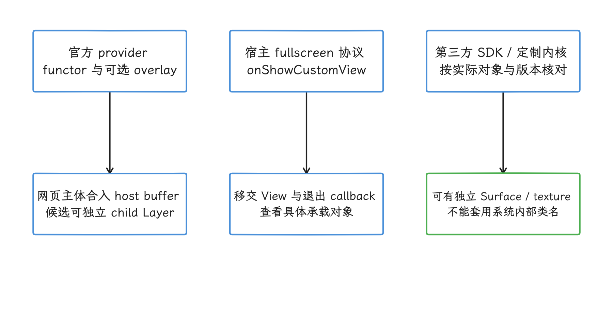

图：三个边界对应不同 owner，运行现场应分别确认。 普通网页主体仍通常进入宿主窗口；overlay 只提升候选，fullscreen callback 也不指定 View 类型。

## 进程模型与宿主线程

Android 12–17 上的现代 provider 把网页 renderer 放在沙箱进程，browser code 与 GPU/network 服务仍在宿主 App 内。Android 5–7.1 历史版本默认曾是进程内 renderer；不能把下面的现代模型外推到全部 API 21+。[来源：Chromium renderer 说明](https://chromium.googlesource.com/chromium/src/+/4e18c703f7cd950c890e14105da8eff42192af6a/android_webview/renderer/README.md)

<!-- gracker-diagram: ch13-09-05-profile-renderers -->
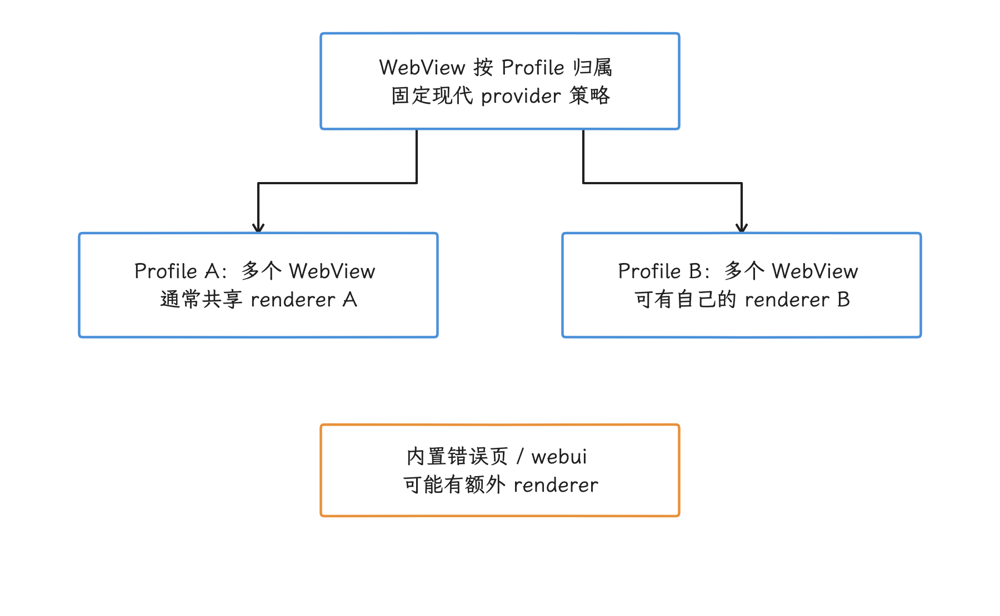

图：同一 Profile 共享 renderer，多 Profile 与内置错误页可能增加进程。 按实际 provider 能力和 Profile 配置核对，不能用 WebView 实例数推导 renderer 数。

1. 宿主 App 进程：framework WebView、provider glue、browser code，以及进程内 GPU/network 服务。Main 做 View 协调与绘制记录，HWUI RenderThread 执行 functor，Viz 线程协调 Chromium 显示工作；服务名称不等于独立进程或唯一执行线程。
2. sandboxed renderer：Blink 执行 JavaScript、style、layout、paint 与 compositor 工作。固定源码说明普通情况下同一 Profile 共享一个 renderer，多个 Profile 可有各自的 renderer，内置错误页还可能有独立例外；不能按 WebView 实例数推导进程数。
3. 系统显示进程与服务：SurfaceFlinger、CompositionEngine、HWC/display。宿主 ViewRootImpl 和 HWUI 仍属于第 1 项，不是 SurfaceFlinger 进程内的对象。

<!-- gracker-diagram: ch13-09-04-process-thread-map -->
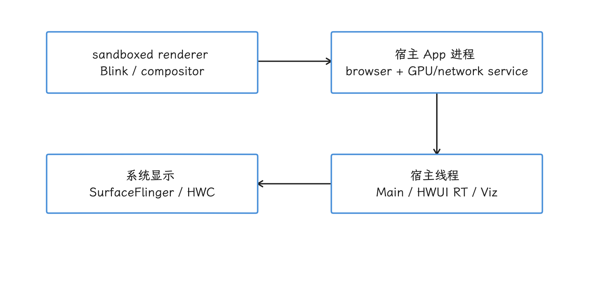

图：browser/GPU 服务在宿主内，renderer 独立沙箱，HWUI 与 Viz 再衔接系统显示。 服务名不等于独立进程；旧 API21–25 的进程内 renderer 属于另一历史模型。

下面的图用于定位 browser code、GPU services 和 renderer。箭头表达主要数据流，其中部分步骤通过异步 IPC 或资源队列衔接。

<!-- gracker-diagram: ch13-09-06-request-to-window -->
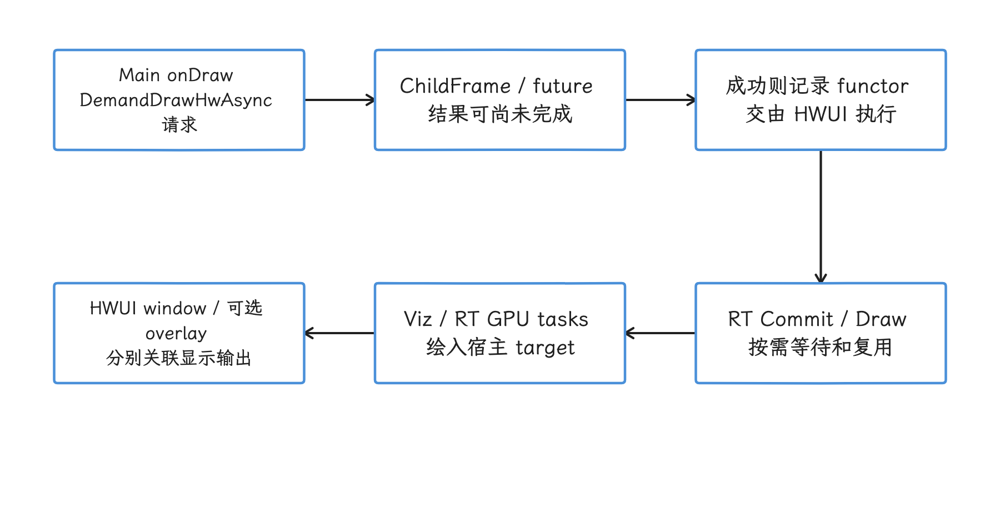

图：宿主请求、renderer 结果与 RT 消费形成依赖，再由 HWUI 输出窗口 buffer。 图表达数据关系；结果可已完成、晚到或为空，overlay 是可选分支。

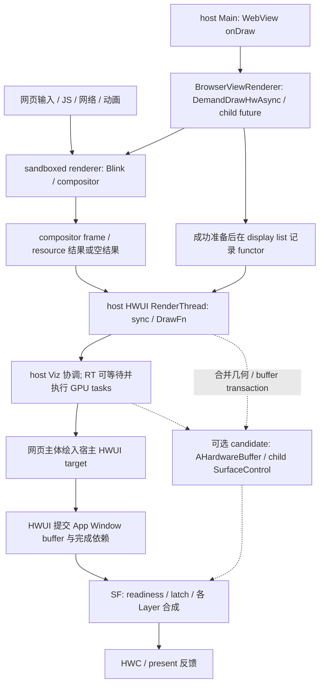

实线表达普通主体的请求、记录与消费依赖，虚线表达可选 overlay；这不是每帧必定生成新网页结果的保证。Main 可先发起 DemandDrawHwAsync，RT 随后按需等待当前 future；Main 的 SetFrameOnUI 若已有未提交 frame，也可能等待并裁剪旧 future 队列。renderer 还可能没有交出新 frame。Chromium frame、DrawFn CPU 返回、GPU 完成和最终 present 分别取证。

<!-- gracker-diagram: ch13-09-14-future-wait-sites -->


图：当前 future 与旧队列分别影响 Main、sync 和 Draw 阶段。 等待位置取决于队列状态；不能把所有 GetFrame 都当成 RenderThread 的 GPU 计算。

主线程空闲不能说明整条 WebView 链路空闲：renderer、raster/解码任务、Viz、GPU service、宿主 RenderThread 可分别忙或等待。栅格与图片准备的执行位置会受 provider 后端和任务策略影响，不应只凭线程名认定所有 raster 都发生在 renderer 进程。

<!-- gracker-diagram: ch13-09-07-independent-bottlenecks -->
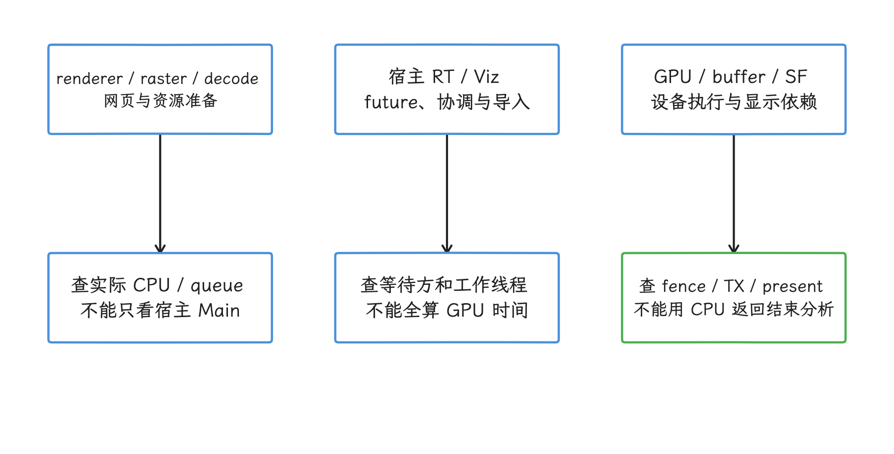

图：网页任务、宿主消费与 GPU/显示依赖可以分别迟到。 raster/解码执行位置随后端变化；线程名与短 Main slice 不能独立排除 WebView 问题。

## 平台版本与 provider 版本要一起记录

Android 5 起，WebView provider 可以独立于系统镜像更新；Android 7 起，设备还可以在多个合格 provider 中选择。应用内可以通过 AndroidX WebKit 记录当前实现，设备侧再用 `dumpsys webviewupdate` 交叉核对。

这段代码的用途是把 provider 身份写入复现日志。

```kotlin
val provider = WebViewCompat.getCurrentWebViewPackage(applicationContext)
val versionCode = provider?.let { PackageInfoCompat.getLongVersionCode(it) }
Log.i(
    "WebViewProvider",
    "package=${provider?.packageName}, " +
        "version=${provider?.versionName}, code=$versionCode"
)
```

PackageInfoCompat 来自 `androidx.core.content.pm`，兼容 API 28 以前的 versionCode 读取。固定 WebKit 1.16.0 的 getCurrentWebViewPackage() 契约明确：此查询不会使 WebView 被加载；若尚未加载，返回的是“此刻会选用的包”，之后可以变化。返回值仍可能为 null。用户代理查询、构造或其他 WebView API 则可能触发启动，冷启动基准应区分这些调用与版本查询本身。[来源：WebViewCompat](https://android.googlesource.com/platform/frameworks/support/+/5744fa6296a0f6147952e836b3d92dd87ff7d4dd/webkit/webkit/src/main/java/androidx/webkit/WebViewCompat.java)

<!-- gracker-diagram: ch13-09-08-provider-query -->


图：getCurrentWebViewPackage 不加载 WebView，返回已加载包或此刻会选用的候选包。 未加载时结果可变化，也可为 null；用户代理查询或构造等其他 API 可能触发初始化。

### Android 17 中 provider 怎样装入宿主进程

Android 17 的调用边界可以概括为：

<!-- gracker-diagram: ch13-09-09-provider-loading -->
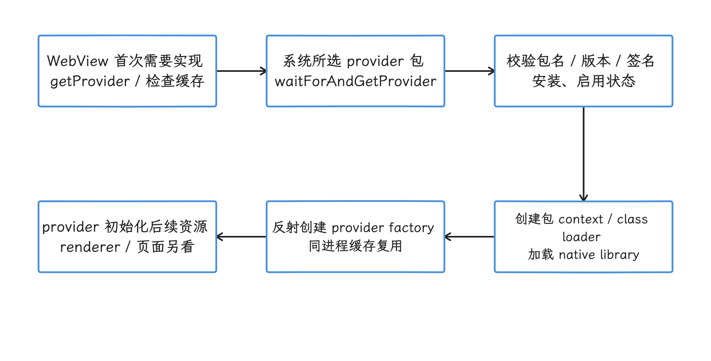

图：首次需要实现时取得选定包、校验并装载代码，之后缓存进程级 factory。 factory 装载不是页面首帧完成；具体 Chromium 与 renderer 初始化由 provider 决定。

1. `WebView` 的 provider 代理在第一次需要具体实现时进入 `WebViewFactory.getProvider()`；同一进程会缓存同一个 `WebViewFactoryProvider`。
2. `WebViewFactory` 通过 `WebViewUpdateService.waitForAndGetProvider()` 取得系统选中的包，并校验包名、版本、签名、安装与启用状态。
3. framework 为该包创建可加载代码的 context，取得 provider class loader，加载包声明的 native WebView library，再通过反射创建 provider factory。
4. provider 后续初始化 Chromium browser context、renderer 和图形资源。具体时序属于设备 provider revision，不能由 `WebViewFactory.java` 一份平台源码完整推导。

这条链路解释了 WebView 首次创建为何可能耗时较长：它可能同时包含包选择、RELRO（预重定位只读数据）/native library、Java 类加载、Chromium 初始化、renderer 建立、网络和页面首帧。稳态滚动 trace 无法回答冷启动问题。

<!-- gracker-diagram: ch13-09-10-cold-start-scope -->
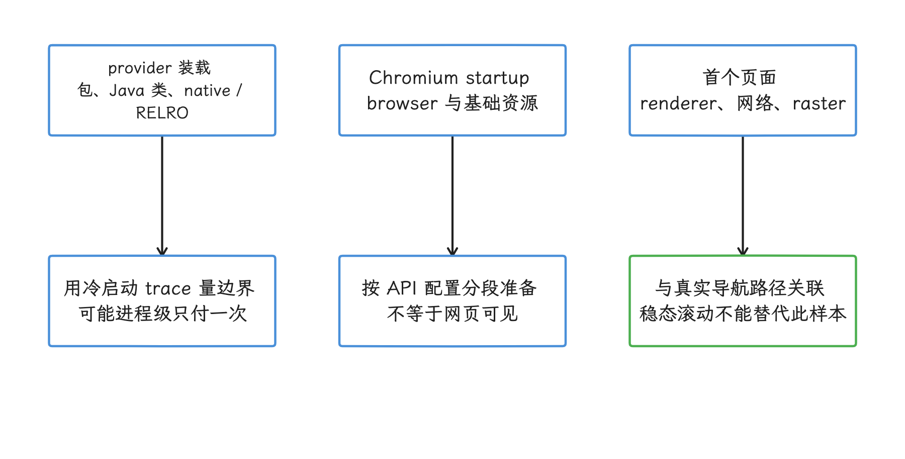

图：包装载、Chromium 启动与页面结果属于不同成本范围。 各步骤按实际路径触发；预热回调不保证 renderer、网络与页面首帧全部就绪。

AndroidX WebKit 1.16.0 把带 WebViewOutcomeReceiver 的 startUpWebView 重载转为稳定 API，旧 callback 重载已弃用。它把允许的启动工作安排到配置的 executor，其余任务按 provider 能力与配置处理；不代表 renderer、网络或页面首帧已准备好。

<!-- gracker-diagram: ch13-09-11-startup-parts -->
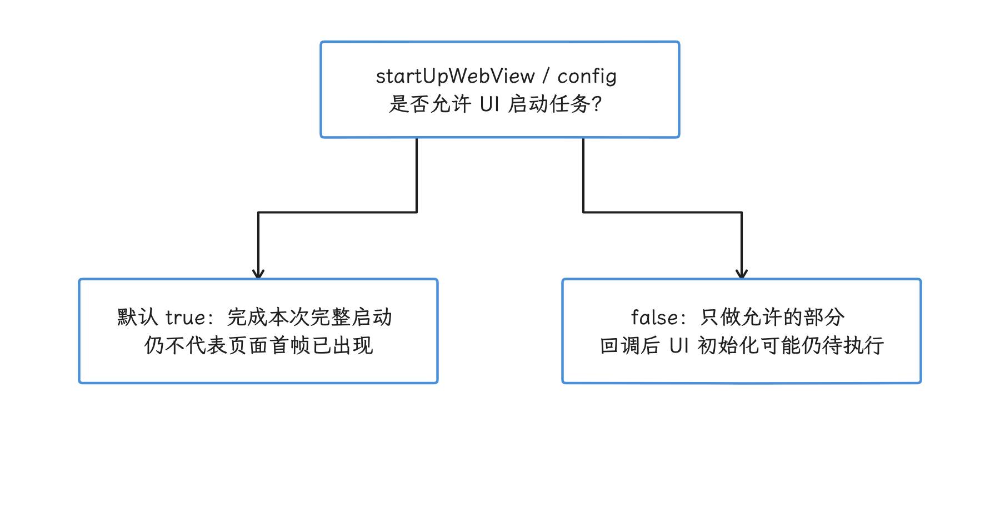

图：稳定重载区分启动成功与失败，配置决定是否本次执行 UI 启动任务。 API 1.16.0 minSdk24；立即触碰其他 WebView API 仍可阻塞 Main。

WebViewStartUpConfig 默认允许执行 UI 启动任务；设为 false 时，回调仅代表本次允许的启动部分结束，不能读成全部 UI 初始化完成。固定兼容实现按 ASYNC_WEBVIEW_STARTUP_V2 / V1 / fallback 分流，旧 provider 可能只有加载 class loader 等收益、没有完整诊断数据。立刻访问其他 WebView API 仍可阻塞 Main；应按真实关键路径评估预热收益和内存驻留。[来源：WebKit 发布记录](https://developer.android.com/jetpack/androidx/releases/webkit#1.16.0)

<!-- gracker-diagram: ch13-09-12-startup-compatibility -->
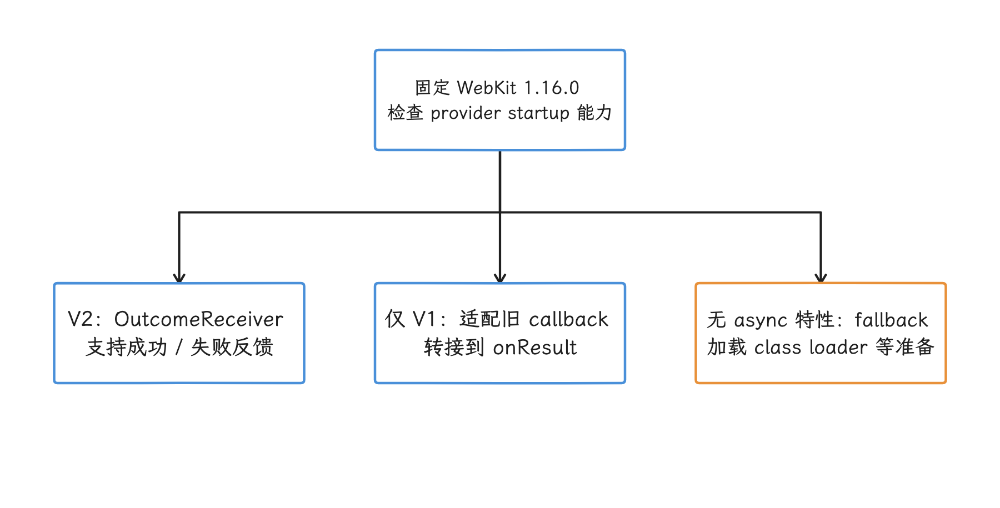

图：兼容库按 V2、V1 与旧 provider fallback 分流。 callback 与诊断能力随分支不同；不能承诺每台设备取得相同预热收益或诊断数据。

## 官方 provider 的标准硬件路径：functor / DrawFn

硬件加速的标准 WebView 仍然是宿主 View 树的一员，参与 measure、layout、clip、alpha、matrix、invalidate 和窗口生命周期。不过，宿主不会逐条执行 `Canvas.drawText()` 或 `drawBitmap()` 来重画网页像素。provider 会在宿主 display list 中记录 WebView functor（由 HWUI 在绘制时回调 provider 的特殊绘制节点），HWUI RenderThread 执行该节点时再接入 Chromium 的合成结果。

### 一次硬件绘制怎样发生

固定 Android 17 / Chromium 样本中的普通硬件路径如下；步骤描述依赖，部分准备可以并行：

<!-- gracker-diagram: ch13-09-13-hardware-main-path -->
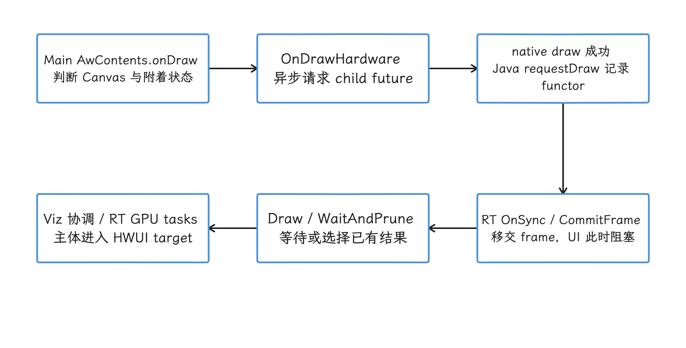

图：Main 请求并记录，RT 同步消费，Viz 与 GPU tasks 协调后写入宿主 target。 不是每次 draw 都有新 frame；native draw 失败不会自动转软件分支。

1. 宿主 Main 到达 WebView onDraw，AwContents::OnDraw 在 Canvas 硬件加速、已 attached 且没有强制辅助 bitmap 时调用 OnDrawHardware；满足分支不保证一定产出内容。
2. BrowserViewRenderer 更新约束与 tile 优先级，通过 DemandDrawHwAsync 请求 child frame，把尚未完成的 future 放入 ChildFrame。
3. Java 层确认 native draw 成功后，才调用 mDrawFunctor.requestDraw(canvas) 记录 functor；失败可记录 NativeDrawFailed 并绘制背景，不会自动转去 OnDrawSoftware。
4. RenderThread 的 OnSync / CommitFrame 移交 UI 准备的 frame；后续 Draw 等待并裁剪 future 队列。OnSync ABI 还明确 UI 在该回调期间被阻塞，不能把全部 sync 等待算成 Main 自己在做网页计算。
5. DrawGL / DrawVk 经 RenderThreadManager 到 HardwareRenderer；它用 ScheduleOnVizAndBlock 调度 Viz，RT 等待期间还可处理 blocking sequence 的 GPU tasks。
6. 主体内容绘入当前 HWUI target，再由宿主 HWUI 生产并提交 App Window buffer；是否有新 frame、成功 draw 或可选 overlay 都需看实际分支。

下面的时序图示意一次 child future 晚到的硬件绘制，强调 Chromium 内部完成合成与 Android 窗口提交是两个边界。实际 future 也可能早已完成，Main 处理旧队列时也可能等待；图中的返回箭头省略 browser IPC 转接，不能据此推导直接 renderer→RT 的接口。

<!-- gracker-diagram: ch13-09-15-late-future-example -->
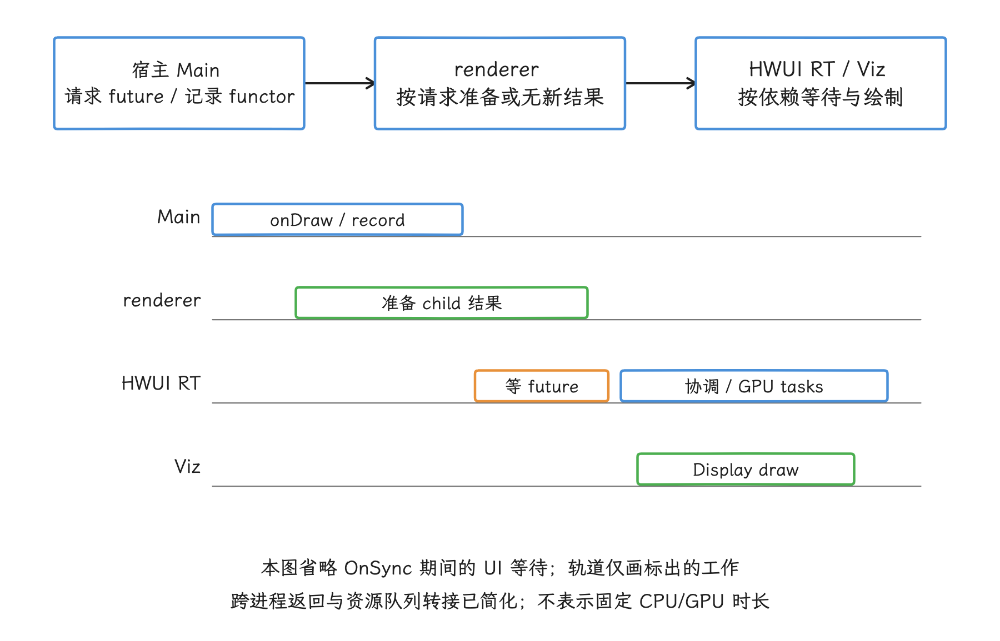

图：请求可以先返回 future，RT 之后才拿到结果并协调 Viz 绘制。 仅示意晚到样本；Main 裁剪旧队列也可能等待，条长不是实测。

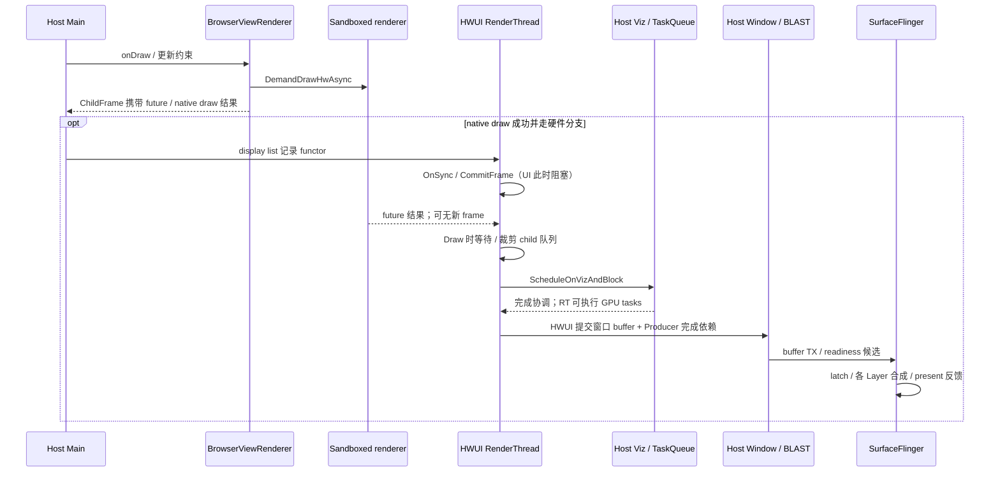

HardwareRenderer::OnViz::DrawAndSwapOnViz 中的 Swap 属于 Chromium 内部 Display 语义，不能证明宿主窗口已经 queueBuffer。固定 DrawAndSwap 还会在 CPU 路径用 TimeTicks::Now() 构造 MaybeDidPresent 反馈；它不能替代 SF/HWC 的实际 present fence。普通主体的 Android 窗口提交由宿主 HWUI 完成。[来源：HardwareRenderer](https://chromium.googlesource.com/chromium/src/+/4e18c703f7cd950c890e14105da8eff42192af6a/android_webview/browser/gfx/hardware_renderer.cc)

<!-- gracker-diagram: ch13-09-16-internal-swap -->
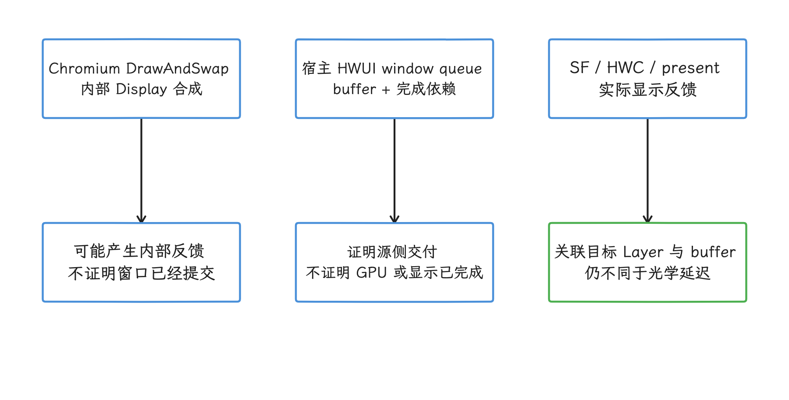

图：Chromium 内部 Display、宿主窗口 queue 与系统 present 是三个观测点。 CPU 路径构造的 MaybeDidPresent 反馈不能替代真实显示 present fence。

### GL 与 Vulkan 的准确口径

Android 17 的 `WebViewFunctor.h` 同时定义 GLES 与 Vulkan 回调。`WebViewFunctor_queryPlatformRenderMode()` 查询宿主 HWUI pipeline，HWUI 再按当前 pipeline 校验并调用对应回调。现场可以用以下 slice 区分分支：

- 平台侧：`WebViewFunctor::sync`、`WebViewFunctor::drawGl`、`WebViewFunctor::initVk`、`WebViewFunctor::drawVk`、`WebViewFunctor::postDrawVk`；
- Chromium 侧：`DrawFn_DrawGL`、`DrawFn_InitVk`、`DrawFn_DrawVk`、`DrawFn_PostDrawVk`、`DrawFn_RemoveOverlays`。

这段关系不能简化为 HWUI 与 Chromium 共用一个 GPU context。GL/Vulkan context、resource import 和同步实现取决于 provider revision 与后端；可以确认的是 provider 必须通过平台定义的 functor 模式与当前 HWUI pipeline 协作。

<!-- gracker-diagram: ch13-09-17-drawfn-backends -->


图：平台定义模式和回调契约，provider 按宿主后端协作。 实际 context、资源导入和同步按 revision 核对；不能笼统说两端共用同一 GPU context。

### 这条路径的性能含义

普通网页主体合入 host buffer 后，SurfaceFlinger 通常只看到宿主 App Window layer。DOM layer、CSS transform、canvas 和普通图片已经在 Chromium/HWUI 前半段完成合成，不会逐项变成 SF layer，也无法由 HWC 分别分配 overlay plane。

<!-- gracker-diagram: ch13-09-18-dom-vs-system-layer -->


图：网页的内部层与资源通常已合进宿主 target，再由一个窗口 layer 交给系统。 DOM/CSS layer 不逐项映射 SF Layer；可选 overlay 候选才可能另有系统内容 layer。

WebView 的耗时会沿两种方式拖慢宿主帧：

- UI thread 没有及时完成 invalidate、traversal 或 display list 记录；
- RenderThread 执行 functor 时，frame、resource import、GPU service 或 GPU 工作没有按期完成。

因此，宿主主线程负载较低不能排除 WebView 卡顿；SurfaceFlinger 只显示一个 App layer，也不能证明网页侧没有经过多线程合成。

## 软件绘制 fallback

固定 AwContents::OnDraw 在“非硬件 Canvas、未 attached 或强制辅助 bitmap”等条件下才进入软件分支；OnDrawHardware 自身返回 false 时，本次调用直接返回，不会顺次落入 OnDrawSoftware。软件分支还可能因空尺寸或无法取得 SoftwareCanvas 而提前结束。成功时经 OnDrawSoftware → CompositeSW → DemandDrawSw 绘入宿主 Canvas。

<!-- gracker-diagram: ch13-09-19-software-branch-guard -->
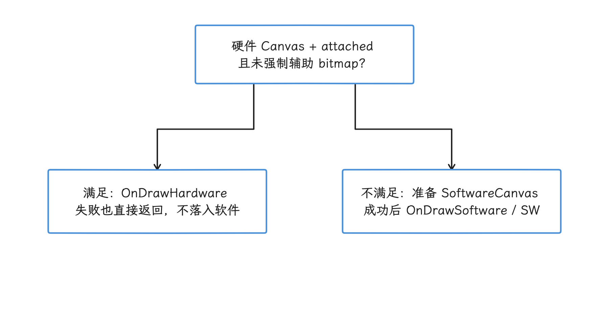

图：先按 Canvas、附着与辅助 bitmap 条件选分支，硬件失败直接返回结果。 硬件 draw 返回 false 不能等同于自动软件 fallback；软件路径也可空尺寸或无 Canvas 早退。

这里要区分两种宿主形态：

<!-- gracker-diagram: ch13-09-20-software-host-forms -->
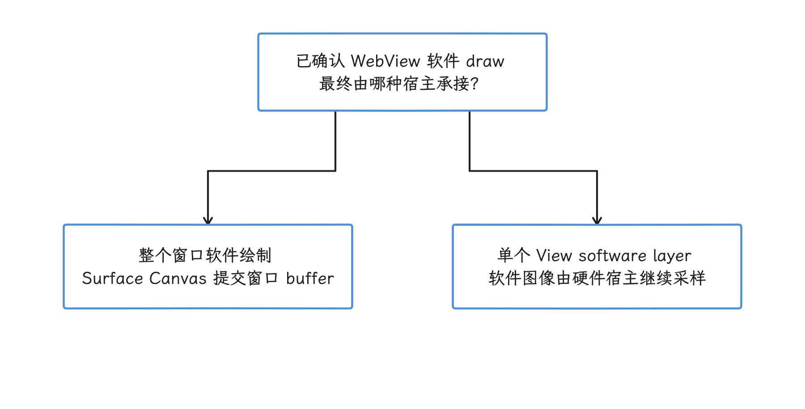

图：软件内容既可经软件窗口提交，也可先成为硬件窗口的输入。 两种都不自动新增独立 SF Layer；是否有宿主 RT/GPU 工作要看最终窗口形态。

- 整个窗口软件绘制时，`ViewRootImpl.drawSoftware()` 通过窗口 Surface 的 Canvas 路径提交 App Window buffer；
- 单个 WebView 使用 software layer 时，软件结果可以先成为 bitmap/layer，再由硬件加速的宿主窗口采样。

两种软件形态都不会自动创建独立 SF layer。确认 fallback 要组合软件 draw 调用栈、Canvas acceleration 状态与 CPU 工作；硬件 DrawFn slice 缺失也可能来自未采到事件、没有 draw 或提前返回。低端设备、白屏和单个 CSS 属性都不足以定型。

<!-- gracker-diagram: ch13-09-21-software-proof -->
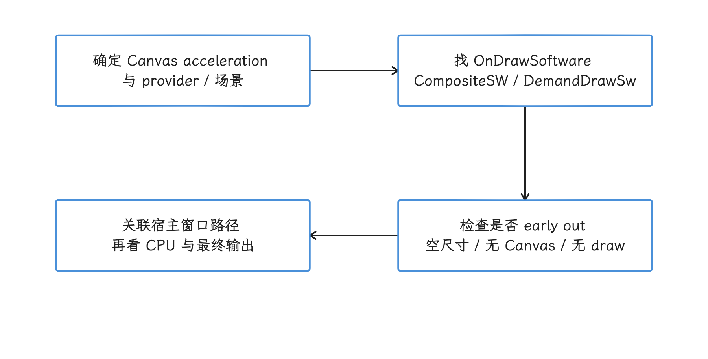

图：结合 Canvas 状态和真实调用栈，区分软件 draw、未采集与没有工作。 缺少 DrawFn slice、白屏或 CSS 属性均不足以单独判断渲染类型。

## 官方 provider 的 SurfaceControl 子 Surface：overlay，不是整页搬家

Android 17 的 HWUI 与 Chromium 都包含 WebView overlay 接口，但该接口只提供候选提升机制。常见结果仍是网页 UI 由 functor 绘入 host buffer，视频、受保护内容或其他满足条件的候选单独进入 SurfaceControl layer。

### 平台侧先决定“能不能提供 overlay 容器”

`WebViewFunctorManager.cpp` 只有在以下条件成立时，才把 `overlaysMode` 设为 Enabled：

<!-- gracker-diagram: ch13-09-22-overlay-platform-gates -->
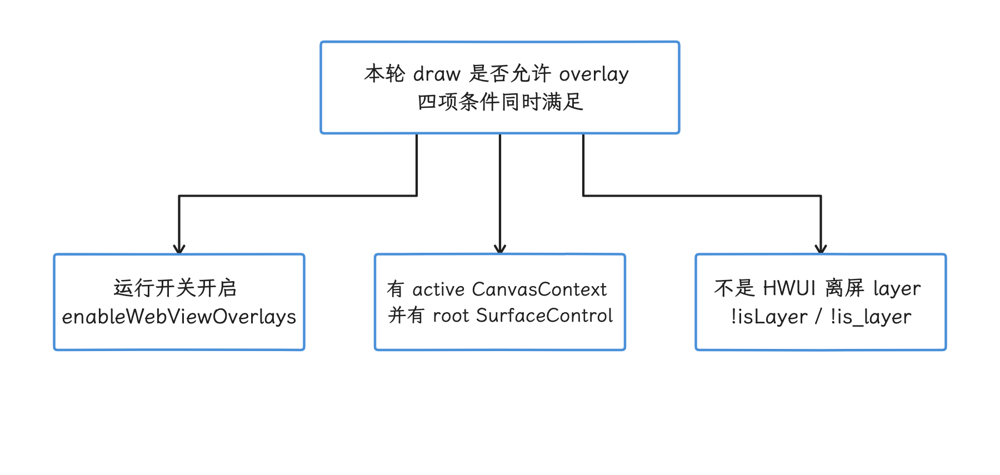

图：平台先决定本次 draw 能否提供 overlay 接口。 四项是共同前提，不是三条任选分支；Enabled 仍不保证候选最终提升。

- `Properties::enableWebViewOverlays` 已启用；
- 当前 draw 存在 active `CanvasContext`；
- 该 context 有 root `SurfaceControl`；
- 本次 WebView draw 的目标不是 HWUI 离屏 layer：GL 分支要求 `!drawInfo.isLayer`，Vulkan 分支要求 `!params.is_layer`。

provider 请求父节点时，HWUI 创建名为 Webview Overlay SurfaceControl 的 buffer-state 容器，挂到 App Window root 下并设置相对 root 的层级 -1，以 underlay 方式承接提升内容。prepareSurfaceControlForWebview 准备宿主协作路径；mergeTransaction 尝试合入 active CanvasContext，context 不存在或合并未成功时才单独 apply。容器、几何更新和实际有 buffer 的 child layer 要分别确认。

<!-- gracker-diagram: ch13-09-23-overlay-container -->


图：HWUI 为 provider 提供 underlay 容器，实际内容与 buffer 再挂到相应 child。 看到容器名称不证明任何候选已出图，更不证明整页搬到独立 Surface。

这一步只创建 overlay 容器并提供 transaction 接口，还没有证明任何网页内容已经获得独立 layer。

<!-- gracker-diagram: ch13-09-24-transaction-merge -->
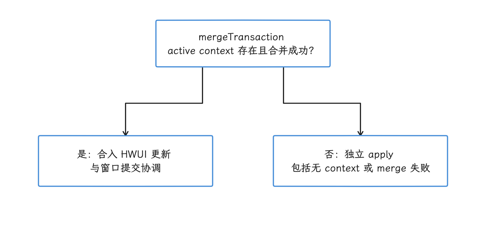

图：有 active context 时先尝试合并；没有或合并未成功才独立 apply。 容器创建、几何状态和 buffer 提交分别核对，不能仅凭接口调用证明已显示。

### Chromium 侧再决定“哪个候选能提升”

固定 Chromium 样本的 OverlayProcessorWebView 还会检查：

- HWUI 是否在本次 draw 允许 overlay；
- 完整 GPU service 是否已经就绪；
- `OverlayProcessorSurfaceControl::CheckOverlaySupportImpl()` 是否接受候选；
- 对应 frame sink 是否被临时阻止；
- buffer、crop、transform、颜色空间、保护属性和 acquire fence 是否满足实现要求。

只有通过检查的候选才会获得 AHardwareBuffer 与 SurfaceControl 更新。候选提升失败时，该部分内容会回到网页主体合成路径，但仍可能使用硬件 DrawFn，不能把它解释为 WebView 软件渲染。

<!-- gracker-diagram: ch13-09-25-overlay-candidates -->
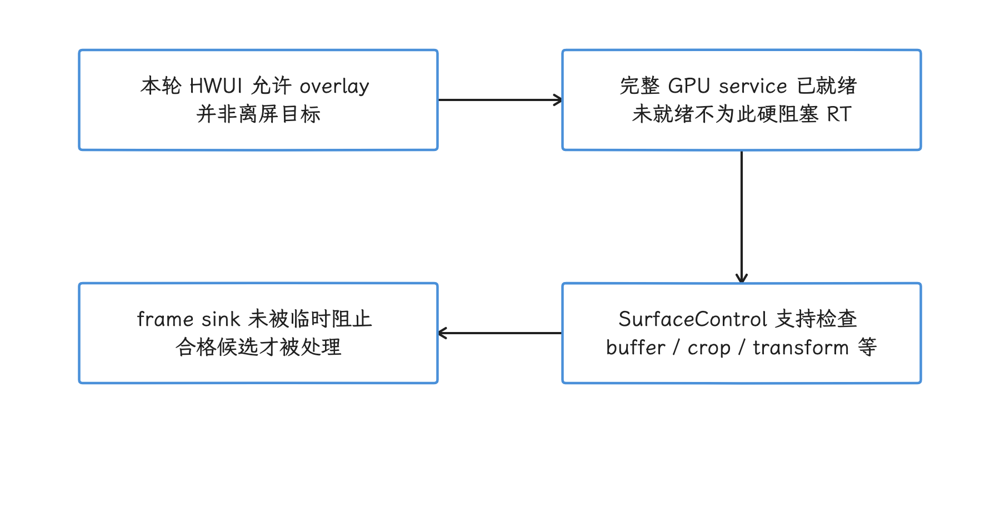

图：平台许可后，Chromium 再检查服务准备、候选支持和临时阻止状态。 候选不能提升仍可回到硬件主体路径；这不是软件 fallback。

### 一帧里可能同时存在两条提交

<!-- gracker-diagram: ch13-09-26-two-output-objects -->
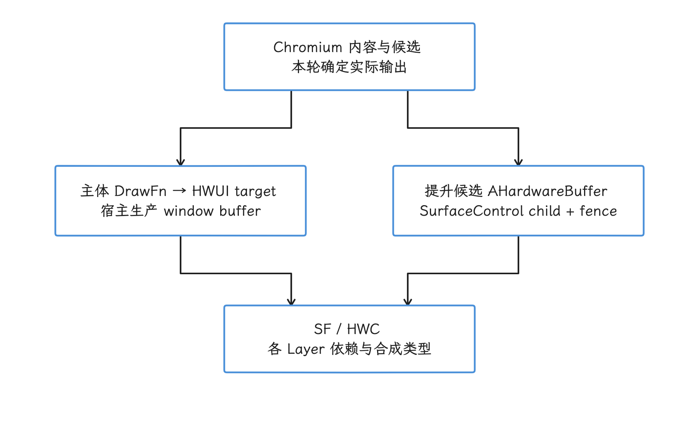

图：主体窗口和提升候选可以同时参与显示，分别追 buffer 与完成依赖。 宿主 HWUI 是最终窗口 Producer；decoder/provider 的候选不必经过传统窗口 BufferQueue。

网页主体与 overlay 的 Producer/Consumer 关系如下：

| 内容 | Producer | 进入 Android 显示系统的方式 | Consumer |
| --- | --- | --- | --- |
| 普通网页主体 | Chromium 提供绘制内容；宿主 HWUI 生产最终窗口 buffer | functor 绘入 host HWUI target 后提交 App Window | SurfaceFlinger 消费宿主窗口 layer |
| 提升的媒体或受保护候选 | decoder/GPU service/provider | AHardwareBuffer + acquire fence 更新到 SurfaceControl child layer | SurfaceFlinger/HWC 消费独立 layer |
| overlay 几何状态 | 宿主 HWUI draw + provider | crop、position、visibility 等 transaction | SurfaceFlinger transaction state |

buffer 的生产完成依赖与几何状态是两类条件，但不意味着它们必定分开、无同步地 apply。固定实现可把几何 transaction 合入 HWUI 的窗口更新；候选 buffer 还携带 acquire fence，实际读取须满足写完成依赖。缺新 buffer 时可能继续旧内容；几何或媒体更新晚到也可能造成错位。独立 layer 是否最终由 HWC DEVICE 处理，仍需查实际 per-layer composition type，不能由“已提升”直接保证。

<!-- gracker-diagram: ch13-09-27-geometry-buffer-readiness -->
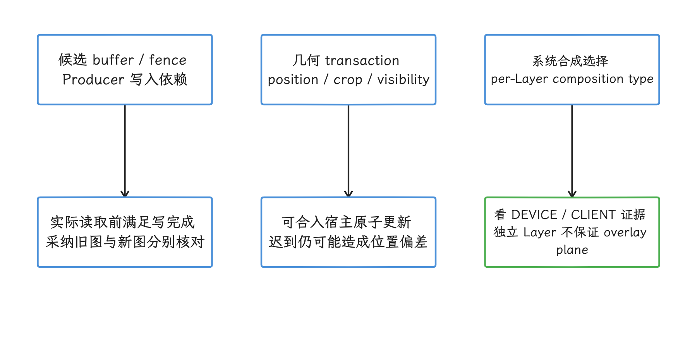

图：几何可合入宿主更新，buffer 的读取仍受 acquire fence 约束。 两类条件不代表必定分开无同步 apply；已提升也不保证 HWC DEVICE。

Android 10—11 固定 tag 的现代 functor header 尚无 WebViewOverlayData 的 SurfaceControl/transaction 回调；Android 12 r1 已有 getSurfaceControl / mergeTransaction。Android 17 基线也提供 rendering-thread reporting，但仅检查这些 tag 不能认定该能力恰好首发于 Android 17。运行设备是否使用 overlay 仍取决于 provider、开关与候选，不由 API level 单独保证。

<!-- gracker-diagram: ch13-09-28-overlay-interface-history -->
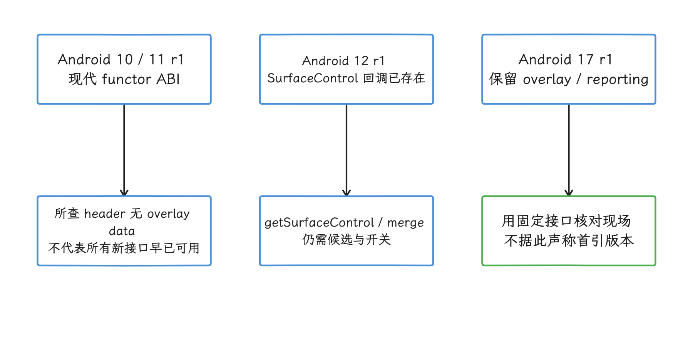

图：已检查的历史 tag 说明接口存在与否，运行路径仍由 provider 和配置决定。 Android 17 有 reporting 不证明恰好首发于 17；API level 不保证整页独立出图。

## ImageReader：中间 buffer 不等于最终 layer

标准 Chromium 本身也可能使用 ImageReader。固定 ImageReaderGLOwner 建立 private-format reader，根据 TextureOwner mode 选择 sampled-image、protected 或 composer-overlay usage。UpdateTexImage 选择 acquireNextImageAsync 或 acquireLatestImageAsync，取得 image 与完成 fence，再提供 AHardwareBuffer；CPU acquire 返回不能证明生产 GPU 已完成，也不等于 CPU 复制了图像。

<!-- gracker-diagram: ch13-09-29-imagereader-middle -->
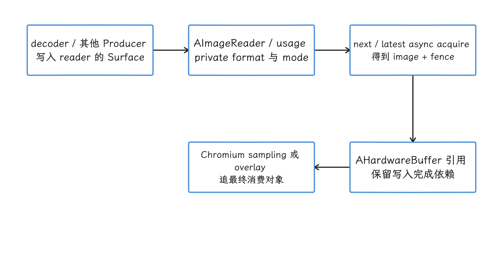

图：reader 从 Surface 接收 image，异步取得 buffer 与完成依赖供下游消费。 标准 provider 也使用它；acquire 返回不等于 GPU 完成，也不代表 CPU 图像复制。

ImageReader 只证明中间消费边界，不决定最终 SF layer。所得资源可以再被采样进宿主窗口，或进入 SurfaceControl overlay。可用 image 额度不足会影响 acquire；固定 max_images == 1 分支还会先释放当前 image，再尝试取新 image，不能保证任何配置失败时都一直持有旧图。继续核对 mode、usage、image 引用释放、DrawFn、overlay 与 fence。[来源：ImageReaderGLOwner](https://chromium.googlesource.com/chromium/src/+/4e18c703f7cd950c890e14105da8eff42192af6a/gpu/command_buffer/service/image_reader_gl_owner.cc)

<!-- gracker-diagram: ch13-09-30-imagereader-limits -->
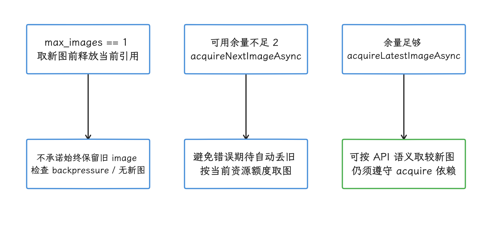

图：acquire 策略取决于额度，单 image 配置还需先释放当前 image。 不能保证取图失败时任何配置都能持有旧图；引用与 release fence 决定持续生产能力。

判断 image 的最终去向时，沿 AHardwareBuffer 的后续使用继续追：进入 Chromium/HWUI 采样就回到宿主窗口，成为提升候选则追独立 child SurfaceControl。中间 reader 的类名不能替代这一步。

<!-- gracker-diagram: ch13-09-31-imagereader-destination -->
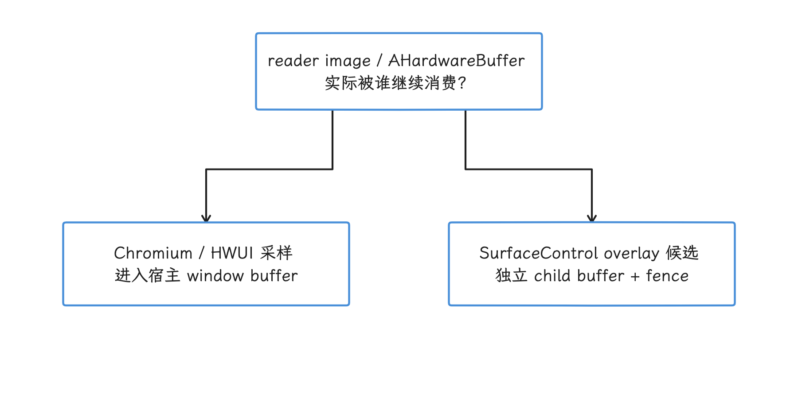

图：取得中间 image 后仍需确认采样目标或独立候选的归属。 看到 ImageReader 名称不能直接判定第三方 SDK、独立 SF Layer 或零拷贝端到端路径。

## 宿主全屏托管：`onShowCustomView()`

网页进入 fullscreen mode 时，WebView 可以调用 `WebChromeClient.onShowCustomView(View, CustomViewCallback)`。Android 17 的 API 注释说明，回调之后，相关 web content 会改画到参数 `view` 中，不再进入原 WebView；宿主需要把该 View 放入合适的全屏 Window，并在退出时移除。仅把 WebView 布局设为 `match_parent` 不会触发该托管协议。

<!-- gracker-diagram: ch13-09-32-fullscreen-view-handoff -->
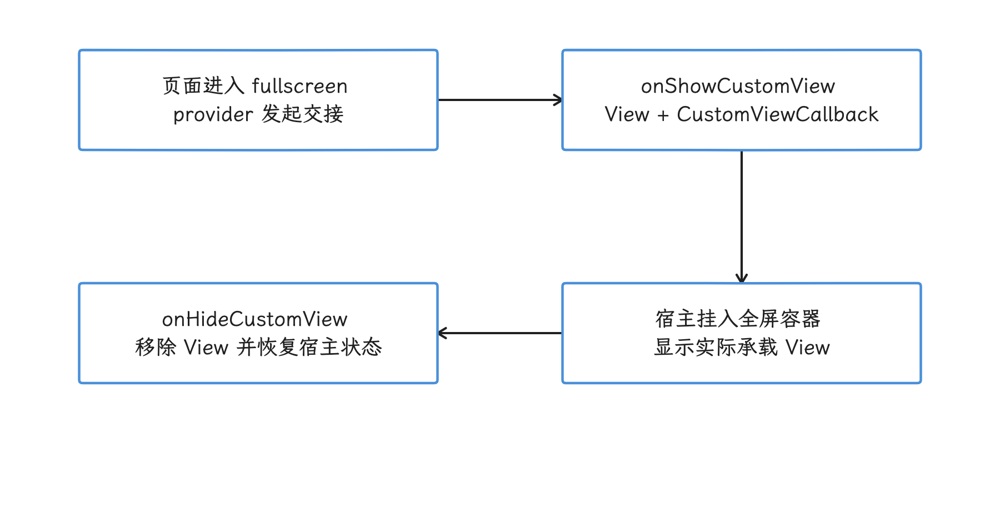

图：WebView 通过回调移交绘制 View，宿主负责挂入全屏承载窗口并处理退出。 仅把布局铺满屏幕不触发协议；回调没有规定内部必须是 SurfaceView。

下面的最小实现用于记录交接 View 的运行时类型，并正确维护退出回调。

```kotlin
class FullscreenChromeClient(
    private val container: ViewGroup
) : WebChromeClient() {
    private var fullscreenView: View? = null
    private var exitCallback: WebChromeClient.CustomViewCallback? = null

    override fun onShowCustomView(
        view: View,
        callback: WebChromeClient.CustomViewCallback
    ) {
        if (fullscreenView != null) {
            callback.onCustomViewHidden()
            return
        }

        Log.i("WebViewFullscreen", "view=${view.javaClass.name}")
        fullscreenView = view
        exitCallback = callback
        container.addView(
            view,
            ViewGroup.LayoutParams(
                ViewGroup.LayoutParams.MATCH_PARENT,
                ViewGroup.LayoutParams.MATCH_PARENT
            )
        )
    }

    override fun onHideCustomView() {
        fullscreenView?.let(container::removeView)
        fullscreenView = null
        exitCallback = null
    }

    fun requestExit() {
        val callback = exitCallback ?: return
        exitCallback = null
        callback.onCustomViewHidden()
    }
}
```

宿主主动退出时调用 requestExit 通知 provider，再由 onHideCustomView 移除 View；本例先清除 callback 引用以避免重复请求和回调重入。方法返回本身不代表退出已完成。工程代码仍要在 Activity 销毁时清理承载 View，并恢复系统栏和方向策略。

<!-- gracker-diagram: ch13-09-34-fullscreen-exit -->
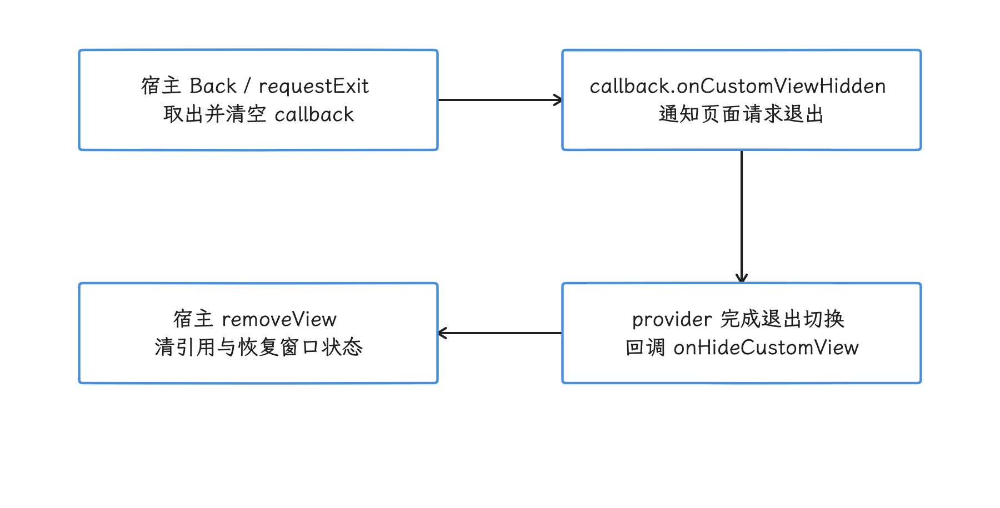

图：宿主发出退出请求后，按 provider 的 onHide 回调移除交接 View。 先清 callback 避免重复请求；requestExit 返回不代表退出完成，销毁和系统栏策略另处理。

onShowCustomView 只定义 View 交接与退出协议。固定 Chromium 的 AwContents.enterFullScreen 实际创建 FullScreenView，把同一 AwContents 的绘制委托与 container 切到该 View，并在新 onDraw 时重建 functor；这已足以说明回调 View 不必是视频 SurfaceView。其他 provider/包装层仍需查看参数类型与 child tree，不能把当前类名写成跨版本 API 保证。

<!-- gracker-diagram: ch13-09-33-fullscreen-ownership -->


图：同一 AwContents 可迁移到 FullScreenView，网页绘制仍可能继续用 functor。 这是固定实现例子，类名不是公开跨版本保证；媒体 overlay 是另一条可并存机制。

- 如果内部是 `SurfaceView`，常见 Producer 是 MediaCodec/MediaPlayer，buffer 直接交给独立 Surface layer；
- 如果内部是 `TextureView`，Producer 写入 `SurfaceTexture`，宿主 RenderThread 通过纹理采样把结果合入 App Window；
- 若只是容器，继续向下找实际持有 Surface、SurfaceTexture 或播放器的 child。

<!-- gracker-diagram: ch13-09-35-fullscreen-content-types -->
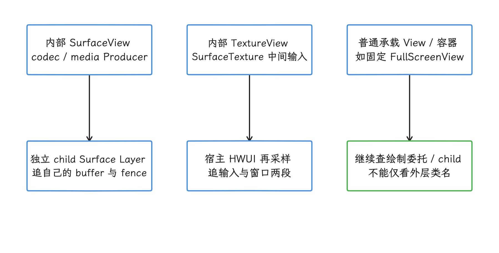

图：从实际交接 View 的子树和 owner 判断显示路径。 FullScreenView、SurfaceView、TextureView 可以出现在不同实现中，回调名称不决定拓扑。

全屏 custom view 与 provider 内部 overlay 可以同时出现，但属于不同机制。判断 owner 时，应以回调、View 树和 layer parent 为准。

<!-- gracker-diagram: ch13-09-36-fullscreen-vs-overlay -->
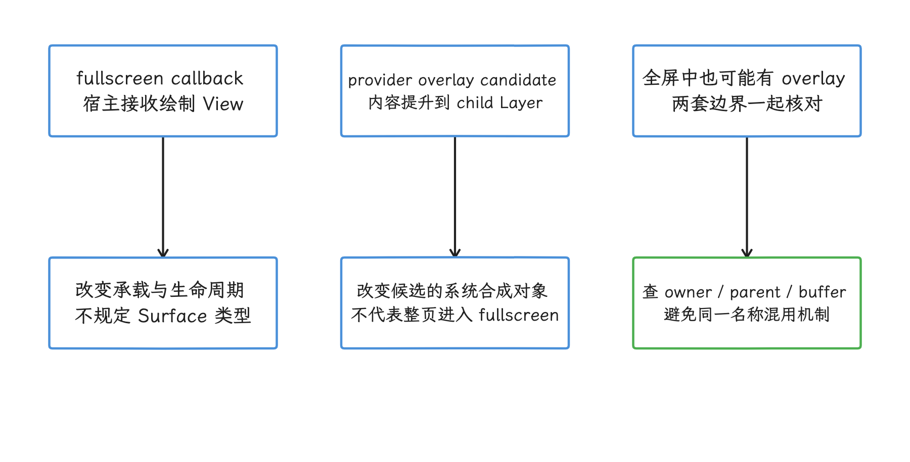

图：View 的 owner 切换与 buffer 候选提升是不同机制。 是否并存由实际场景决定；须同时查看 callback、View tree 与 Layer parent。

## 第三方 SDK 的 Texture-like 扩展

X5、UC 或定制 Chromium 可以在包装层中采用 `TextureView`/`SurfaceTexture`、独立 Surface、ImageReader、HardwareBuffer 或私有桥接。不同版本、设备渠道和 feature flag 都可能改变实现，不能把第三方 WebView 固定描述为一种管线。

只有在 trace 或调用栈中确认以下证据后，才把现场归为 Texture-like：

<!-- gracker-diagram: ch13-09-37-texture-owner-direction -->


图：SDK 向 Surface 或 ANativeWindow 生产，SurfaceTexture 接收供宿主消费。 SurfaceTexture 本身是消费端，方法名或中间对象不能独立识别 SDK 与最终显示路径。

- 确认 SDK renderer/decoder 写入的 Surface / ANativeWindow，以及它连接的 SurfaceTexture 消费端；SurfaceTexture 本身不是 Producer endpoint；
- Producer 的 frame-available 回调到达；
- 宿主 RenderThread 执行 `updateTexImage()` 或等价的纹理获取；
- SurfaceFlinger layer tree 仍以宿主 App Window 为主体，没有与该内容对应的独立 Surface layer。

确认 TextureView-like 后继续区分三个时点：frame-available 回调标记更新并 invalidate；Main 的 TextureView.draw 记录 drawTextureLayer；RenderThread 的 DeferredLayerUpdater::apply 再经 ASurfaceTexture_dequeueBuffer 获取可消费 image，后续 GPU 采样进入 App Window。不能要求 Java 调用栈一定出现 updateTexImage，也不能把回调或 Java draw 返回当成采样完成。

<!-- gracker-diagram: ch13-09-38-texture-three-moments -->
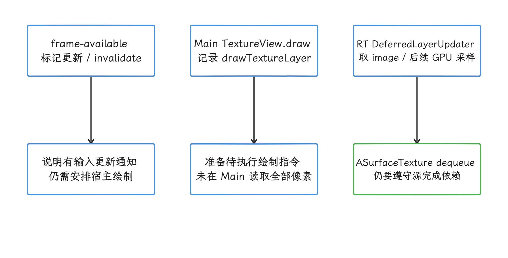

图：frame-available、Main 绘制记录与 RT/GPU 取图采样分别核对。 回调或 Java draw 返回不等于读取完成；native 取图不必出现 Java updateTexImage 方法名。

第三方 Producer 的 swapBuffers 只说明源图像提交；仍要核对源完成依赖、宿主是否申请绘制、实际取图与窗口提交。平台链路见 [13.3 SurfaceView 与 TextureView 渲染管线](03-surfaceview-textureview-pipelines.md)。

<!-- gracker-diagram: ch13-09-39-texture-two-producers -->
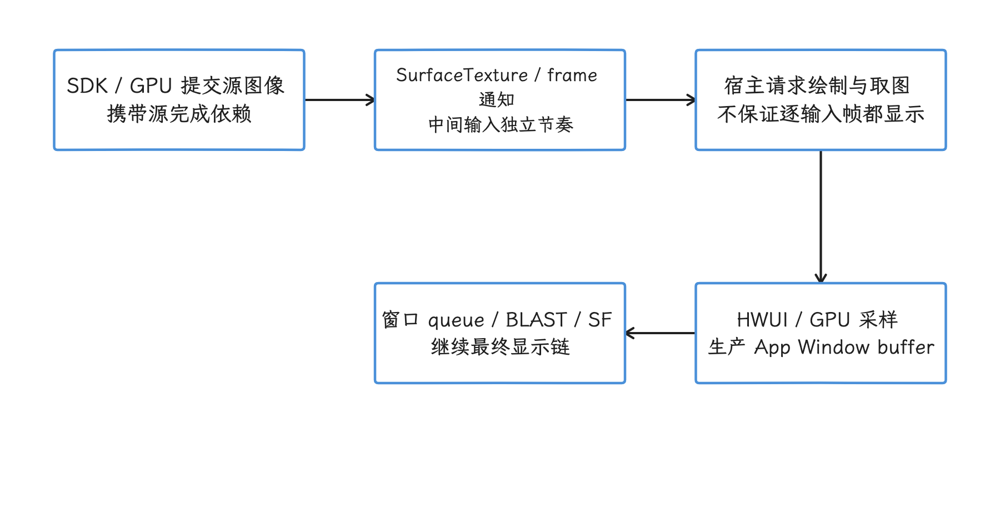

图：输入图像先交付给中间队列，宿主消费后才形成窗口输出。 源 swap 不证明 GPU 写完或宿主已采样；额外采样成本需要按现场量测。

这条路径的 Producer 是第三方内核或其 GPU 线程，Consumer 是宿主 HWUI。它会增加一次纹理采样和相应同步，具体开销必须用该 SDK 版本、页面负载和设备 trace 测量，不能预设更快或更慢。

## 从网页更新到显示的一帧

一帧可以拆成六个诊断阶段。

<!-- gracker-diagram: ch13-09-40-six-diagnostic-stages -->
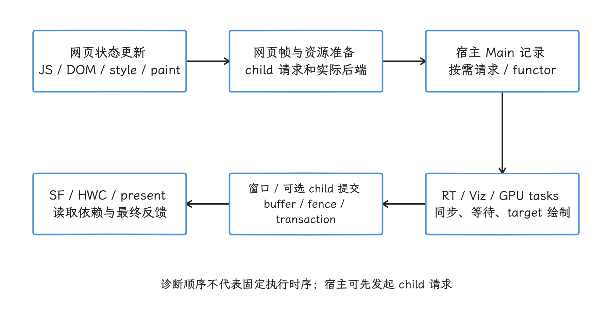

图：把网页更新、宿主记录与显示后段按同一对象的依赖关联。 这是诊断分层，不要求严格串行；可以复用旧结果，也可没有新网页 frame。

1. 网页状态更新：JavaScript、DOM、style、layout、paint、图片或滚动改变待生成内容。
2. 网页帧准备：compositor 与 raster/解码任务按实际后端准备资源；宿主的异步 draw 请求可早于结果完成。
3. 宿主记录：Main onDraw 发起或接续请求，成功时记录 functor，其他 View 也可使窗口绘制。
4. RenderThread / Viz：同步 child 队列，按需等待 future、协调 Viz/GPU tasks，再把主体绘入 HWUI target；可复用旧结果或无新 frame。
5. 输出提交：宿主 HWUI 交付窗口 buffer；可选候选经 SurfaceControl 交付 buffer 与几何/同步 transaction。
6. 系统显示：SF 按 readiness 采纳内容，确定各 Layer 合成类型，满足读取依赖后处理 CLIENT/DEVICE 与 present。

这些阶段可能相互重叠。renderer 可以提前准备 frame，宿主也可以在没有新网页 frame 时重画其他 View；GPU 命令提交与完成又是异步关系。关联时要使用 frame token、buffer frame number、flow event、transaction id 和 fence，不能把时间上相邻的 slice 自动视为同一帧。

<!-- gracker-diagram: ch13-09-41-async-write-display -->
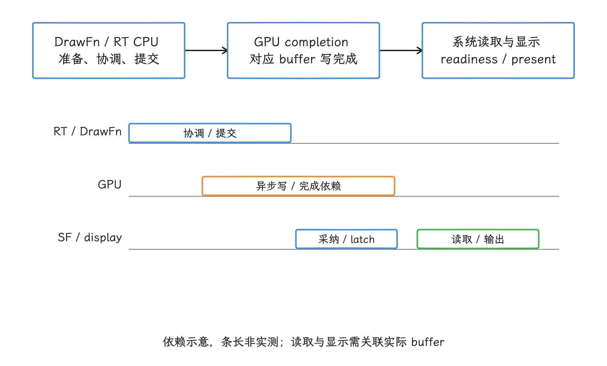

图：用 frame、buffer、transaction 与 fence 联系异步阶段。 相邻 slice 不能自动当成同一帧；queue 或 latch 也不一概意味着写入已完成。

## renderer 生命周期、启动与内存压力

### renderer 消失后不能复用原 WebView

renderer 可能 crash，也可能因内存压力终止。onRenderProcessGone 从 API 26 起提供恢复入口，并对共享受影响 renderer 的 WebView 分别回调；每个实例只清理自己收到的对象。返回 true 表示应用处理了终止，仍必须从 hierarchy 移除、清引用并 destroy，继续展示要新建实例；不能只清理其中一个就认为共享 renderer 下其他 WebView 已恢复。

<!-- gracker-diagram: ch13-09-42-renderer-gone -->
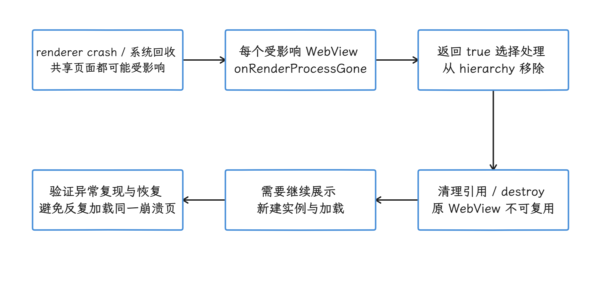

图：受影响 WebView 逐一收到终止回调，旧对象必须清理，恢复需要新实例。 API26+ 恢复入口；一个实例清理不能代替同 renderer 其他实例的处理。

`WebView.setRendererPriorityPolicy()` 可以调整 renderer 的进程重要性。降低不可见 WebView 的优先级会提高它被回收的概率，应用应先具备可靠的 process-gone 恢复路径。后台返回后出现白屏或重载时，应先检查 renderer death/OOM，再检查绘制管线。

<!-- gracker-diagram: ch13-09-43-renderer-priority -->
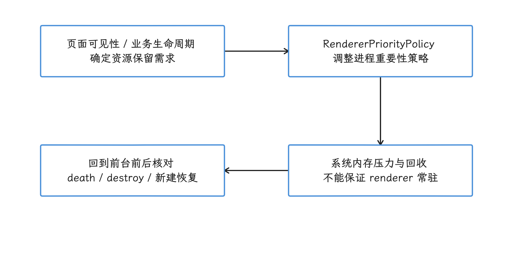

图：降低 renderer 重要性可改变回收风险，先具备 process-gone 恢复能力。 后台白屏先核对 renderer death/OOM；优先级策略不保证常驻或自动重建页面。

### 冷启动和稳态卡顿要分开

首次初始化可能包含 provider 装载、native library、Chromium startup、renderer 创建、网络连接和首帧 raster。稳态滚动则更关注 JavaScript 长任务、layout、raster、resource import、DrawFn、GPU queue 和 host window deadline。两类样本混入同一个平均值，会掩盖各自的主要耗时来源。

<!-- gracker-diagram: ch13-09-44-startup-vs-steady -->
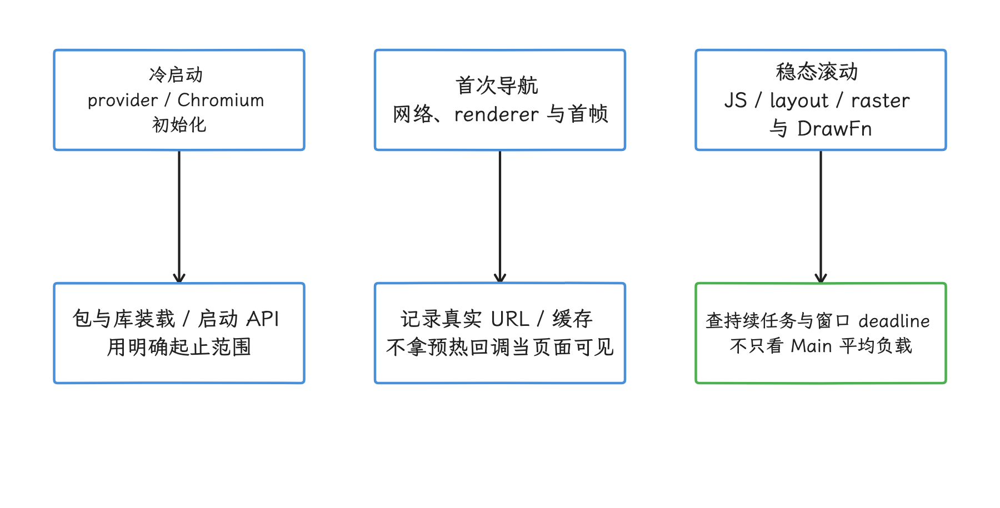

图：冷启动与稳态的关键工作不同，应分别采集和比较。 把两类样本混成一个平均值会掩盖瓶颈；同时固定页面、provider 与构建。

### Android 17 / kernel 6.18 下的内存证据

大页面会同时占用 DOM/JS heap、解码图片、Skia 资源、tile cache、GPU texture、AHardwareBuffer/dma-buf 和宿主图形内存。内存压力可能触发 GC、tile 淘汰、重新解码、renderer 回收、page fault（缺页）、direct reclaim（业务线程直接回收内存）、`kswapd` 后台回收、zram I/O 或 dma-buf 分配等待。

<!-- gracker-diagram: ch13-09-45-memory-owners -->
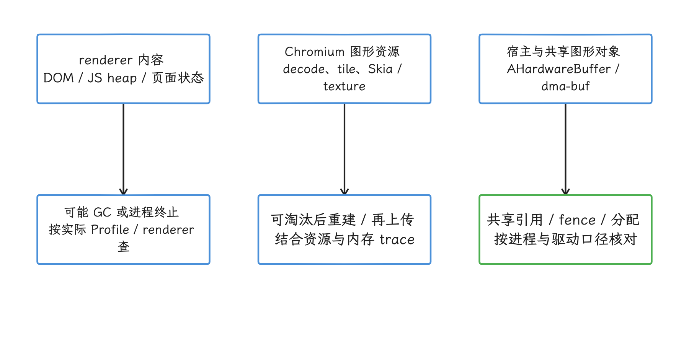

图：DOM/JS、栅格资源与图形 buffer 分属不同对象和执行域。 内存压力可能扩大解码、回收与等待成本；不能把全部图形内存都记作 Java heap。

在内核基线 `android17-6.18-2026-06_r6` 中，跨进程图形 buffer 仍通过 dma-buf 共享，显式同步通过 dma-fence/sync_file 传递。CPU slice 变长时，要结合线程状态区分 Running（正在执行）、Runnable（可运行但等待 CPU）和 blocked（等待依赖）；线程等待 fence 时，CPU wall time 不能当作实际计算量。

<!-- gracker-diagram: ch13-09-46-thread-state-cost -->
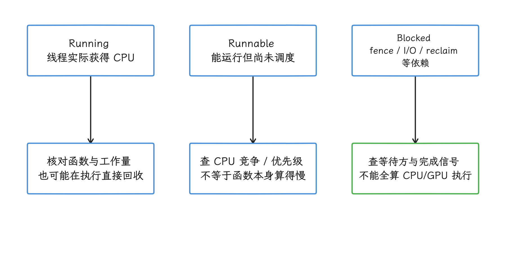

图：Running、Runnable 与 blocked 分别表示执行、等 CPU 与等依赖。 长 slice 不等于等量计算或 GPU 工作；内核证据还需对应目标线程与对象。

## 如何判断当前 WebView 走哪条路径

可靠结论需要 provider 身份、回调/View 证据、Perfetto 和 SurfaceFlinger layer tree 相互印证。

### 1. 固定版本与复现场景

这组命令只收集平台、provider、进程和 layer 证据，不会自动判定渲染类型。

```bash
adb shell getprop ro.build.fingerprint
adb shell getprop ro.build.version.sdk
adb shell dumpsys webviewupdate
adb shell ps -A -T | grep -E 'webview|sandboxed_process|<宿主包名>'
adb shell dumpsys SurfaceFlinger --list
```

把完整输出与 Perfetto 时间戳放入同一问题单。`grep` 仅用于快速定位入口；正式判断还要回看完整进程关系和 layer parent，避免被同名线程或 layer 误导。

<!-- gracker-diagram: ch13-09-47-evidence-collection -->
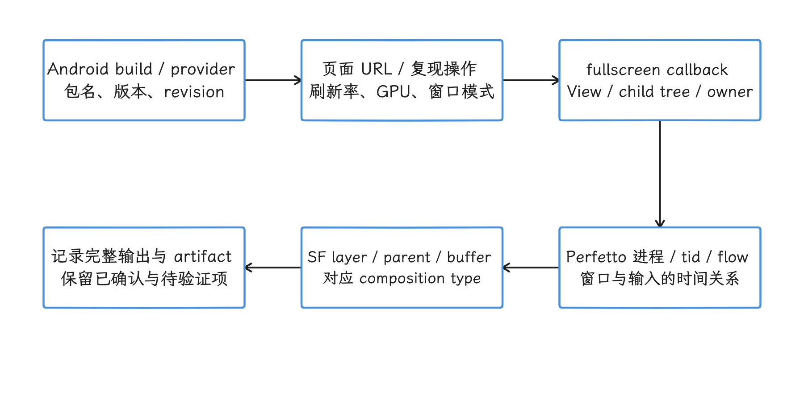

图：同时保存版本、进程、页面场景与真实 layer owner。 命令输出只收集证据，不会自动判定类型；进程名或 layer 名还需关系核对。

还应记录：

- URL 或本地复现页、登录状态和页面操作；
- hardware acceleration 状态、刷新率、GPU 和窗口模式；
- 是否有 video、WebGL、canvas、复杂 filter、protected content；
- 是否触发 `onShowCustomView()`；
- 第三方 SDK 名称、版本与 feature 配置。

### 2. 先看 fullscreen 交接和 View owner

收到 `onShowCustomView()` 才能确认进入宿主全屏托管分支。记录参数 View 的完整类名与 child tree，再检查它创建的 Surface/SurfaceTexture。没有回调时，不能因为画面占满屏幕就标记为 fullscreen custom view。

<!-- gracker-diagram: ch13-09-48-fullscreen-evidence -->
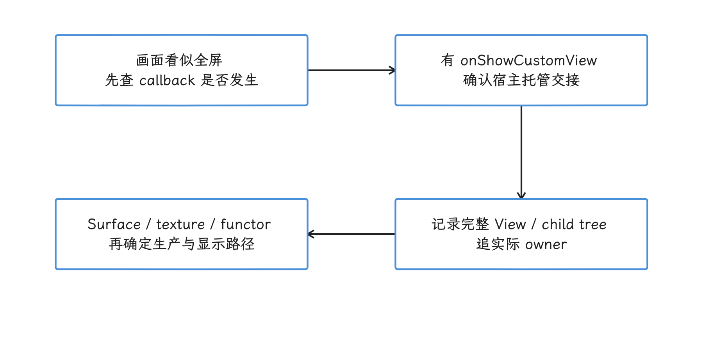

图：先以回调确认托管，再看 View 子树与实际 Surface 对象。 画面铺满屏幕不等于 custom-view 协议，也不能据此断定独立 layer。

### 3. 在 Perfetto 中连接五段证据

<!-- gracker-diagram: ch13-09-49-trace-five-domains -->
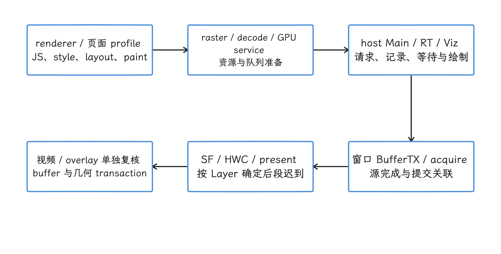

图：从目标 Layer 和时间窗出发，把网页工作、宿主消费与显示后段相连。 按时 queue 仍可能等 App GPU 的 acquire；DrawFn wall time 也不是 GPU 设备时长。

| 观察点 | 说明 | 下一步 |
| --- | --- | --- |
| renderer main 长时间 Running | JavaScript、style、layout、paint 可能超预算 | 用 DevTools CPU profile/Performance panel 补充函数与 DOM 证据 |
| raster worker、image decode 或 GPU service 晚 | tile、解码、资源准备或 GPU queue 可能迟到 | 检查 worker queue、Skia/decode、GPU fence 和内存压力 |
| host UI thread 很晚才 traversal | invalidate、主线程调度或其他 View 工作阻塞 | 对齐 `Choreographer#doFrame`、ViewRoot 与 Runnable latency |
| `WebViewFunctor::drawGl/drawVk` 或 `DrawFn_DrawGL/DrawVk` 变长 | functor sync、resource import、Chromium draw 或 GPU 工作影响 host frame | 结合线程状态、flow、GPU queue 与 fence |
| host window queue 按时，SF latch/present 仍晚 | 仍可能是 Producer GPU 完成依赖、transaction 或显示后段迟到 | 对齐 BufferTX、acquire signal、FrameTimeline 与 SF/HWC，不能仅凭 queue 排除 App/GPU |
| 网页 UI 正常，视频卡顿或位置漂移 | media producer、overlay buffer 或几何 transaction 更可疑 | 单独追视频 child layer、codec fence 与 transaction |

线程名和 slice 名随 provider 更新而变化，缺失事件还可能是采集覆盖不足。宿主 HWUI App Window 的 FrameTimeline 不能替代独立 overlay 或 SurfaceTexture 输入流；官方 Perfetto 文档仍注明该页面所述 FrameTimeline 不支持 SurfaceView，覆盖缺口要用 buffer / transaction / fence 补齐。复盘保留 provider revision 与实际目标 Layer。

<!-- gracker-diagram: ch13-09-50-timeline-coverage -->


图：先确认目标对象的事件覆盖，缺口用 buffer / transaction / fence 补齐。 官方 FrameTimeline 页面暂不支持 SurfaceView；宿主时间线不代表独立 overlay 或纹理输入。

### 4. 用 layer tree 验证内容落点

<!-- gracker-diagram: ch13-09-51-layer-tree-validation -->
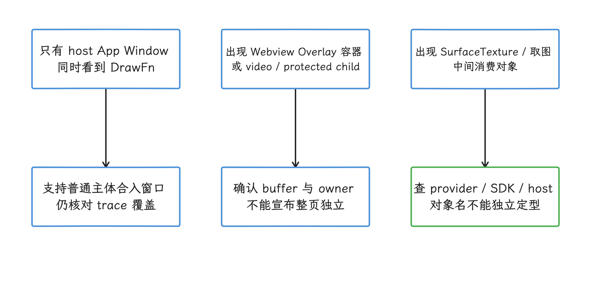

图：宿主窗口、overlay 容器与实际内容 child 需要不同证据。 名字只是线索；还要验证 parent、buffer owner 和随页面变化的提交。

- 只有 host App Window，且 trace 出现 WebView DrawFn，主体更接近标准 functor 路径；
- 出现 `Webview Overlay SurfaceControl` 或其 child 时，还要检查是否有 buffer、owner、parent 和同步更新，不能据此宣布整页独立出图；
- 出现 video / protected layer，分别追 decoder producer 与宿主几何 transaction；
- fullscreen 场景同时核对 custom view 容器和播放器 layer；
- 出现 `SurfaceTexture` / `updateTexImage`，先查 owner。标准 provider、第三方 SDK 或宿主包装层都可能留下不同证据。

### 5. 把结论写成可复查记录

一条足够复查的结论应包含：

- Android build / API level；
- provider 包名、`versionName`、`versionCode` 或第三方 SDK revision；
- 页面场景与复现时间；
- hardware acceleration 与 GPU backend；
- fullscreen callback 与运行时 View 类型；
- Perfetto artifact、关键进程/tid、slice、flow 或 frame token；
- SurfaceFlinger layer 名称、parent、buffer 与 composition type；
- 已排除的路径和尚未确认的假设。

缺少 artifact、版本和页面负载时，不应写出固定帧耗、百分比或“某路径必然更快”之类的结论。

## 常见现场对比表

<!-- gracker-diagram: ch13-09-52-path-comparison -->
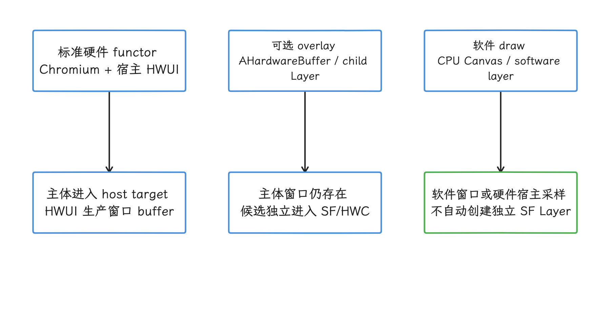

图：普通 functor、overlay 与软件分支在不同位置生成最终窗口内容。 全屏托管和第三方 SDK 另按真实 View 与 Producer 分类；独立 Layer 不保证更快。

| 现场 | 所属边界 | Producer | Consumer / 最终落点 | 宿主 RenderThread | 关键证据 |
| --- | --- | --- | --- | --- | --- |
| 标准 GL/Vulkan functor | 官方 provider 主体路径 | Chromium 内容 + 宿主 HWUI 窗口 Producer | HWUI host target → App Window → SF | 执行 DrawFn，参与主体合成 | provider revision + DrawFn slice + 只有 host layer |
| SurfaceControl overlay 候选 | 官方 provider 可选路径 | decoder、GPU service 或 provider | child SurfaceControl → SF / HWC | 主体仍走 DrawFn，并协调 overlay transaction | overlay-enabled draw + child layer / buffer + transaction |
| 软件 fallback | 官方 provider fallback | Chromium software compositor/CPU raster | host Canvas 或 software layer → App Window | 不执行硬件 DrawFn，是否参与取决于宿主形态 | software draw stack + Canvas 状态 + DrawFn 缺失 |
| fullscreen custom view | 宿主全屏托管 | 由回调 View 的内部实现决定 | SurfaceView、TextureView 或其他容器对应的路径 | 由实际 View 类型决定 | `onShowCustomView()` + View tree + layer owner |
| 第三方 Texture-like | 第三方 SDK 扩展 | SDK renderer/GPU 线程 | SurfaceTexture → HWUI host target | 消费纹理并合入宿主窗口 | SDK revision + frame-available + `updateTexImage` |

## 常见误判

| 误判 | 修正方法 |
| --- | --- |
| Android 17 唯一确定 WebView 源码 | 同时记录 provider 包版本并匹配 Chromium revision |
| Chromium 有 compositor，所以网页一定是独立 SF layer | 看 host DrawFn 与 SurfaceFlinger layer tree；普通主体通常合入 App Window |
| `Webview Overlay SurfaceControl` 代表整页 WebView | 检查其 child、buffer owner 与 candidate；它是 overlay 容器 |
| DOM layer 对应 SF layer | DOM/cc layer 通常已在 Chromium 与 HWUI 前半段合成 |
| `DrawAndSwapOnViz` 代表 Android 窗口已 swap | 继续追宿主 HWUI `queueBuffer`、SF latch 与 display present |
| 页面铺满屏幕就是 `onShowCustomView()` | 以回调是否发生为准 |
| 全屏回调 View 必然是 SurfaceView | 记录类名、child tree 和 Surface owner |
| renderer frame ready 表示用户已看到 | 继续追 DrawFn、host buffer、SF 和 display |
| 主线程空闲说明 WebView 没问题 | 同看 renderer、raster、GPU service 与 RenderThread |
| renderer 被回收后可复用原实例 | 移除并 destroy 旧 WebView，再创建新实例 |
| 看到 `updateTexImage()` 就是系统 WebView 主路径 | 先查 SurfaceTexture owner 与第三方 SDK / 宿主包装层 |

## Android 12—17 的版本边界

WebView 版本演进要同时保留平台线和 provider 线。下面只说明排障时应保留的 Android 平台边界；Chromium milestone 与 feature flag 仍按设备 provider 核对。

<!-- gracker-diagram: ch13-09-53-platform-provider-evolution -->
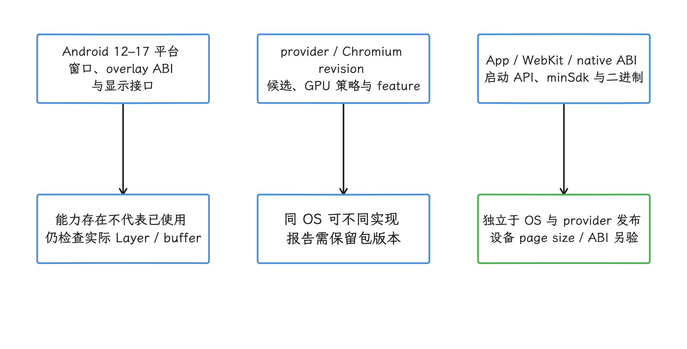

图：平台提供接口与约束，provider 和 App API 库决定实际构建与使用方式。 16KB/ABI 兼容失败先查二进制；ACK6.18 只是本文固定研究基线。

- Android 12/API 31：BLAST 与 FrameTimeline 成为显示诊断的重要基线。现代 WebView 的主体仍通常经 functor 合入 host window；平台具备 SurfaceControl 集成能力，不代表页面整体自动获得独立 layer。
- Android 13/API 33：WebView 的公开 darkening 控制等能力会影响页面 raster 结果，但不改变 framework/provider/renderer/HWUI 的基本分层。
- Android 14/API 34：标准分层保持稳定。差异常来自 provider milestone、GPU blocklist、Skia/Chromium flag 和 OEM provider。
- Android 15/API 35：16 KB page size 设备要求宿主和 provider native libraries 满足对应 ELF/APK 对齐。加载或运行失败时应先检查二进制兼容，不能归因于 functor 帧耗。
- Android 16/API 36：平台图形与安全策略继续演进，定制内核、注入层和非标准 GPU 调试接口需要按设备策略验证；标准 WebView 的可更新 provider 属性不变。
- Android 17/API 37：`android-17.0.0_r1` 的 `WebViewFunctor` 明确定义 GLES/Vulkan draw callback、overlay transaction 和 rendering-thread reporting。平台说明如何承接 provider，但不固定设备上的 Chromium milestone。

在本文固定 ACK `android17-6.18-2026-06_r6` 中，dma-buf 提供共享 buffer 基础，dma-fence/sync_file 传递完成依赖。这里不声明所有 Android 17 设备都统一使用 6.18；codec/GPU/display 的实现与私有调度须按目标设备核对。

## 源码阅读入口

### Android 17 平台

- [`WebView.java`](https://android.googlesource.com/platform/frameworks/base/+/android-17.0.0_r1/core/java/android/webkit/WebView.java)、[`WebViewFactory.java`](https://android.googlesource.com/platform/frameworks/base/+/android-17.0.0_r1/core/java/android/webkit/WebViewFactory.java)：framework 代理、provider 选择和装载；
- [`WebViewUpdateServiceImpl2.java`](https://android.googlesource.com/platform/frameworks/base/+/android-17.0.0_r1/services/core/java/com/android/server/webkit/WebViewUpdateServiceImpl2.java)：系统怎样选择、准备与切换 provider；
- [`WebChromeClient.java`](https://android.googlesource.com/platform/frameworks/base/+/android-17.0.0_r1/core/java/android/webkit/WebChromeClient.java)、[`WebViewClient.java`](https://android.googlesource.com/platform/frameworks/base/+/android-17.0.0_r1/core/java/android/webkit/WebViewClient.java)：全屏托管与 renderer 消失后的宿主责任；
- [`WebViewFunctor.h`](https://android.googlesource.com/platform/frameworks/base/+/android-17.0.0_r1/libs/hwui/private/hwui/WebViewFunctor.h)、[`WebViewFunctorManager.cpp`](https://android.googlesource.com/platform/frameworks/base/+/android-17.0.0_r1/libs/hwui/WebViewFunctorManager.cpp)：GL/Vulkan functor、overlay gate、SurfaceControl 和 transaction；
- [`TextureView.java`](https://android.googlesource.com/platform/frameworks/base/+/android-17.0.0_r1/core/java/android/view/TextureView.java)、[`DeferredLayerUpdater.cpp`](https://android.googlesource.com/platform/frameworks/base/+/android-17.0.0_r1/libs/hwui/DeferredLayerUpdater.cpp)：TextureView-like 分支的 frame available、invalidation 和 image acquire；
- [`SurfaceFlinger.cpp`](https://android.googlesource.com/platform/frameworks/native/+/android-17.0.0_r1/services/surfaceflinger/SurfaceFlinger.cpp)、[`FrameTimeline.cpp`](https://android.googlesource.com/platform/frameworks/native/+/android-17.0.0_r1/services/surfaceflinger/Scheduler/FrameTimeline.cpp)、[`HWComposer.cpp`](https://android.googlesource.com/platform/frameworks/native/+/android-17.0.0_r1/services/surfaceflinger/DisplayHardware/HWComposer.cpp)：host/overlay layer 的 latch、composition 和 present。

### WebView provider

Chromium provider 可更新。本文仅用固定 revision `4e18c703f7cd950c890e14105da8eff42192af6a` 解释路径；设备问题切到实际 provider revision。子 frame 请求、RT/Viz 协调还可查 [RenderThreadManager](https://chromium.googlesource.com/chromium/src/+/4e18c703f7cd950c890e14105da8eff42192af6a/android_webview/browser/gfx/render_thread_manager.cc)、[TaskQueueWebView](https://chromium.googlesource.com/chromium/src/+/4e18c703f7cd950c890e14105da8eff42192af6a/android_webview/browser/gfx/task_queue_webview.cc) 与 [renderer/Profile 说明](https://chromium.googlesource.com/chromium/src/+/4e18c703f7cd950c890e14105da8eff42192af6a/android_webview/renderer/README.md)。

- [`draw_fn.h`](https://chromium.googlesource.com/chromium/src/+/4e18c703f7cd950c890e14105da8eff42192af6a/android_webview/public/browser/draw_fn.h)、[`aw_draw_fn_impl.cc`](https://chromium.googlesource.com/chromium/src/+/4e18c703f7cd950c890e14105da8eff42192af6a/android_webview/browser/gfx/aw_draw_fn_impl.cc)：HWUI DrawFn 和 provider callback；
- [`aw_contents.cc`](https://chromium.googlesource.com/chromium/src/+/4e18c703f7cd950c890e14105da8eff42192af6a/android_webview/browser/aw_contents.cc)、[`browser_view_renderer.cc`](https://chromium.googlesource.com/chromium/src/+/4e18c703f7cd950c890e14105da8eff42192af6a/android_webview/browser/gfx/browser_view_renderer.cc)：硬件/软件 draw 分流和 synchronous compositor；
- [`hardware_renderer.cc`](https://chromium.googlesource.com/chromium/src/+/4e18c703f7cd950c890e14105da8eff42192af6a/android_webview/browser/gfx/hardware_renderer.cc)：child frame 与 Viz 合成；
- [`overlay_processor_webview.cc`](https://chromium.googlesource.com/chromium/src/+/4e18c703f7cd950c890e14105da8eff42192af6a/android_webview/browser/gfx/overlay_processor_webview.cc)：WebView overlay candidate 与 SurfaceControl 更新。
- [`image_reader_gl_owner.cc`](https://chromium.googlesource.com/chromium/src/+/4e18c703f7cd950c890e14105da8eff42192af6a/gpu/command_buffer/service/image_reader_gl_owner.cc)：ImageReader TextureOwner、AHardwareBuffer、acquire/release fence 和 backpressure。

公开 API 与生命周期要求可交叉核对 [WebView 开发指南](https://developer.android.com/develop/ui/views/layout/webapps/webview)、[WebView 对象管理](https://developer.android.com/develop/ui/views/layout/webapps/managing-webview) 和 [WebView 启动优化](https://developer.android.com/develop/ui/views/layout/webapps/optimize-webview-startup)。

### Kernel 6.18

- [`dma-buf.c`](https://android.googlesource.com/kernel/common/+/refs/tags/android17-6.18-2026-06_r6/drivers/dma-buf/dma-buf.c)：dma-buf 对象、fd 和 attachment 基础；
- [`dma-fence.c`](https://android.googlesource.com/kernel/common/+/refs/tags/android17-6.18-2026-06_r6/drivers/dma-buf/dma-fence.c)：fence signal、callback 和 wait；
- [`sync_file.c`](https://android.googlesource.com/kernel/common/+/refs/tags/android17-6.18-2026-06_r6/drivers/dma-buf/sync_file.c)：以 fd 携带 fence 的 sync_file；
- [Linux 6.18 dma-buf 文档](https://docs.kernel.org/6.18/driver-api/dma-buf.html)：import / export、attachment、CPU access 与同步约束。

## 与其他章节的关系

- [22.16 WebView 性能优化实战](../../part5-app/ch22-rendering-practice/16-webview-optimization.md)：从页面、宿主和业务指标处理 WebView 性能；
- [13.3 SurfaceView 与 TextureView 渲染管线](03-surfaceview-textureview-pipelines.md)：全屏 custom view 或第三方 SDK 返回具体 View 类型后，回到对应管线；
- [13.6 SurfaceControl 与 HardwareBufferRenderer](06-surfacecontrol-hardwarebuffer-renderer.md)：overlay transaction、layer tree 和 fence；
- [2.4 MainThread、RenderThread 与 Hardware Layer](../../part1-fundamentals/ch02-rendering/04-main-render-thread-hardware-layer.md)：宿主 View traversal 与 HWUI 提交；
- [2.9 SurfaceFlinger 合成、FrontEnd 与事务队列](../../part1-fundamentals/ch02-rendering/09-surfaceflinger-frontend-transaction.md)：host layer 与可选 overlay 的系统显示后半段。

## 小结

标准硬件 WebView 由沙箱 renderer、宿主 provider 与 HWUI 协作：宿主 onDraw 可发起 child future，Main 成功记录 functor后由 RenderThread / Viz 按需消费，最终由 HWUI 生产 App Window buffer。CPU 协调完成、GPU 完成与系统显示反馈分开判断；不要求每次宿主帧都先得到一张全新的网页帧。

SurfaceControl 能力用于被提升的 overlay 候选，常见于媒体或受保护内容；它不能证明整页 WebView 独立出图。`onShowCustomView()` 是宿主全屏托管协议，第三方 Texture-like 则属于 SDK 扩展。三者的 owner、producer 和 consumer 不同。

排障时要同时固定 Android build 和 provider revision，再依次核对 renderer、host DrawFn、host window、可选 child layer 和 Display present。这样才能区分网页计算、资源准备、宿主消费、overlay 同步和系统显示分别在哪一阶段迟到。


<!-- gracker-diagram: ch13-09-54-end-to-end -->
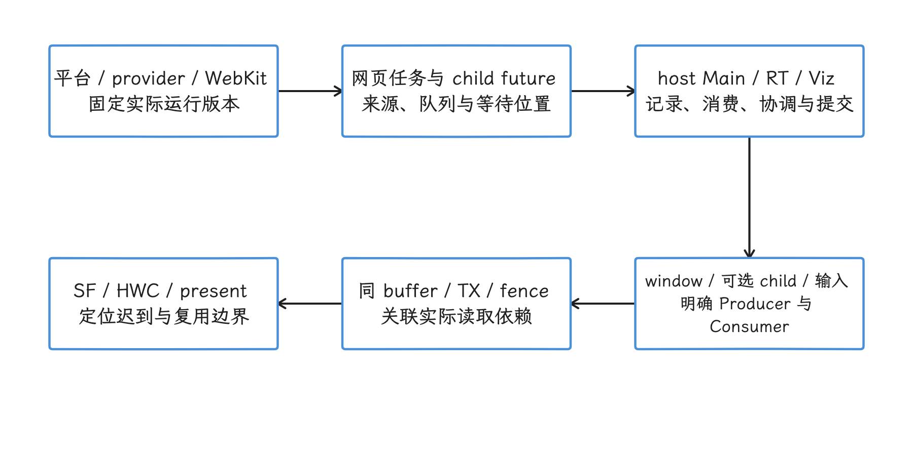

图：固定版本与对象后，再把网页结果、宿主消费和系统显示连接起来。 按实际 topology 分别追 host、overlay、fullscreen 或 texture，不能在 DrawFn CPU 返回处结束。