# Android Camera 平台管线：HAL3、Buffer、ZSL 与显示

Camera 不是单 Producer 到单 Surface 的线性管线：同一 request 可以生成多个 buffer，由预览、拍照、分析或编码按各自的节奏接收。本文把 HAL3 request-result、逐 stream buffer 所有权、ZSL 重处理和预览显示放在一条责任链上讲；我们诊断时，沿 request、result、buffer、fence 与时间戳分别追踪。


> 源码基线：AOSP `android-17.0.0_r1` / API 37；内核研究样本 `android17-6.18-2026-06_r6`，设备可能使用其他内核分支。CameraX 实现固定官方 Maven `camera-camera2`、`camera-core`、`camera-camera2-pipe` 1.6.1 源码包（camera-core 发布 AAR 声明 minSdk 23），库版本与设备 HAL、平台版本分别记录；Android 5 / API 21 仅用于 Camera2 / HAL3 历史主线。本次核对于 2026-10-24 完成。


## Camera 管线和普通 UI 有什么不同

Camera 预览里的像素，通常不经过宿主 View 的绘制逻辑：sensor 完成曝光后，ISP（Image Signal Processor，图像信号处理器）与 vendor pipeline（厂商算法处理链）处理图像，Camera HAL 把结果写进多个输出 buffer。宿主 App 要做的是配置 Surface、下发拍摄控制、消费分析结果，并为预览选择进入窗口系统的承载方式。

同一个 session 可以配置 preview、record、analysis 和 still capture 等多路输出，每一笔 request 只要求它实际选中的目标 Surface 产生结果。常规多流各有格式、尺寸、buffer pool 和归还节奏；Surface sharing 或兼容流内存复用要另核对。某路 consumer 长时间占用 buffer 时，还可能通过共享 ISP stage、HAL pipeline 或内存预算拖慢其他输出，这种下游变慢牵制上游的现象称为 backpressure（反压）。


本文的公共机制依据固定平台源码、官方接口契约与上述 CameraX 发布包。AOSP 覆盖 framework、cameraserver、HAL 接口和显示系统；Camera provider 的 AIDL / HIDL 实现、ISP firmware、sensor driver、vendor tag、算法和 tracepoint 则属于设备侧实现。所以文中给出的是目标设备的核对方法，测量结论要在具体设备上取得。

## HAL3 的 request-result 与多消费者

Camera2 允许多笔 request 同时在途：CaptureRequest 指定控制参数和目标 Surface，CaptureResult 返回 metadata，HAL StreamBuffer 携带 buffer 标识与 fence。同帧 partial / final metadata 和不同 stream 的 buffer 可以分批返回，但有效结果通常仍要遵守同一 stream 内的 FIFO 等顺序契约，ZSL 与错误返回存在特定例外。我们追踪一笔结果时，要区分三个边界：收到 metadata、收到 buffer 描述、图像写入完成——buffer 已返回时，release fence 仍可能尚未 signal。


下面的图把 preview、record、analysis 和 still capture 放在同一组 HAL3 输出里。

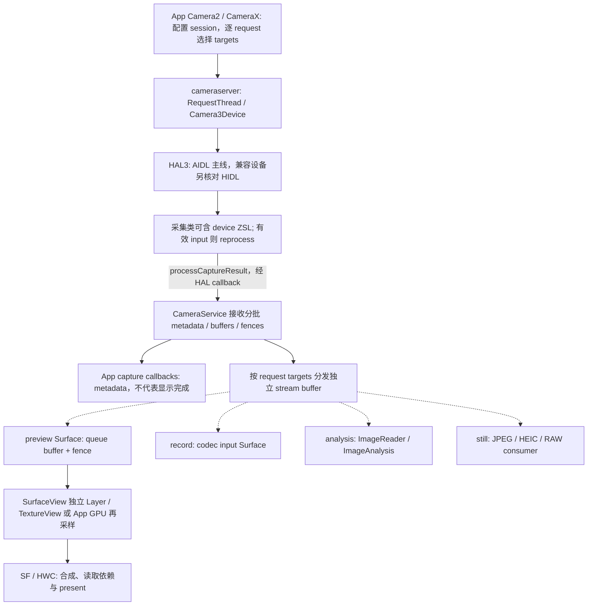

图中的多路输出通常各自使用一组 stream buffer，并不依赖同一块 GraphicBuffer 在多个 consumer 之间顺序传递。HAL 可以让同一次曝光和 ISP 中间结果同时服务多路输出，每个 consumer 仍要独立归还所属 stream 的 buffer。

### 配置阶段决定这组输出能不能成立

App 创建 CameraCaptureSession 时提供 OutputConfiguration，framework 将输出属性交给 Camera3Device::configureStreamsLocked()，再经 AIDL configureStreams / configureStreamsV2 等接口协商。stream 是逻辑通道，输出属性受配置约束：常规路径按具体目标消费；启用 Surface sharing 等机制时，一组配置可以关联多个 Surface，consumer 数量要按实际关联的 Surface 重新数。

HAL 返回每个 stream 的 producer usage、override format 与 `maxBuffers`；判断配置是否成立时，我们要区分三层约束：


1. Camera2 为不同 hardware level 和 capability 定义了 mandatory stream combinations，即符合条件的设备必须支持的输出组合；
2. “单个格式支持某尺寸”和“这组尺寸和格式可以同时开启”是两回事；
3. 即便组合受支持，实际 fps 仍受多个因素影响：`getOutputMinFrameDuration()` 给出连续输出两帧的最短间隔；stall duration 表示某类输出可能额外占用管线、延迟后续请求的时间；sensor mode、热限制与 vendor pipeline 也会改变可达帧率。

创建失败、首帧慢或运行中反复黑屏时，我们先确认 session 是否在反复重配；只检查 `CaptureRequest` 参数，很容易漏掉更早发生的 stream negotiation（输出组合协商）问题。


#### `HalStream` 返回的格式、usage 与 buffer 约束

CameraService 会把宽高、格式、dataspace、旋转和消费方 usage（用途标志）等信息交给 HAL，AIDL HAL 再通过 `HalStream` 返回几项关键结果：

- `overrideFormat`：`IMPLEMENTATION_DEFINED` 输出可由 HAL 选择实际格式；
- `producerUsage`：输出流上 HAL 需要的 gralloc 用途标志；
- `consumerUsage`：输入流上 HAL 需要的用途标志；
- `maxBuffers`：HAL 同时可能持有的最大缓冲区数量；
- `overrideDataSpace`：允许覆盖的色彩数据空间（dataspace）；
- `enableHalBufferManager`：会话级可配置模式下，决定该流是否由 HAL 按需请求缓冲区。

系统框架会合并生产方与消费方的用途标志，再交给图形内存分配器。`IMPLEMENTATION_DEFINED` 格式的最终布局，可能取决于相机写入端以及显示、GPU、编解码器等读取端的组合要求；仅凭公开像素格式推不出 stride（步幅）、plane offset 或压缩方式，这些要以分配器返回的实际布局为准。


#### 队列容量与 `maxBuffers` 的构成

`Camera3OutputStream::configureConsumerQueueLocked()` 会先通过 `NATIVE_WINDOW_MIN_UNDEQUEUED_BUFFERS` 查询消费方要求保留、生产方不可取用的最小缓冲区数（源码变量 `maxConsumerBuffers`），再计算基础队列容量：

```text
mTotalBufferCount =
    maxConsumerBuffers
    + camera_stream::max_buffers
```

这两项的来历不同：消费方要留下自己仍在读取或显示的缓冲区（对应 `maxConsumerBuffers`），HAL 也要有缓冲空间推进它的处理流水线（pipeline，对应 `camera_stream::max_buffers`）。算出的值描述该输出 `Surface` 的基础队列容量；预览显示同步或 `PreviewFrameSpacer` 路径还可能在此基础上追加额外缓冲或 framework 缓存。`Camera3Stream::getBuffer()` 还会检查 HAL 已取走的缓冲区数量，达到 `max_buffers` 时就等缓冲区返回，并把等待时间记进 `wait on max_buffers` 延迟直方图。


想靠增大 `maxBuffers` 掩盖消费方处理缓慢，通常行不通：加大它也许让处理流水线暂时不阻塞，代价是该流中可同时驻留的图像内存随之增加；何况这个字段由 HAL 根据流水线需求声明，随手填一个数值，还可能破坏系统框架与 HAL 之间的流量控制约定。我们把它当作 HAL 声明的协商结果来读就好。

#### `Camera3BufferManager` 与 HAL buffer management

Camera3BufferManager 属于 CameraService 内部，用于在符合 stream set、尺寸、usage 等要求的流之间调度 GraphicBuffer，并以 attachBuffer() 接入具体 BufferQueue；成功注册后，该队列改由它统一分配。固定实现对普通 display / texture 异步流另有排除条件，多分辨率路径有例外；它服务的是满足条件的那部分流，别把它当成所有相机 stream 共用的一个池。

HAL 缓冲区管理 API 则由 HAL 通过 `requestStreamBuffers()` 向 CameraService 取得缓冲区。两套机制可以出现在同一条调用路径中，但调用方、接口和目标都不同：

| 名称 | 所在侧 | 主要作用 |
|---|---|---|
| `Camera3BufferManager` | CameraService 内部 | 在系统框架管理的兼容流之间调度 `GraphicBuffer` |
| HAL 缓冲区管理 | Camera HAL 与 CameraService 之间 | 把捕获请求提交与输出缓冲区获取分开 |

我们排查日志或源码时，先确认上下文所指的是哪一个 BufferManager。


### API 37 的运行中 Surface 替换

Android 17 / API 37 新增 `CameraCaptureSession.updateOutputConfigurations(List)`，可为 deferred output 补上有效 Surface，也可在不关闭整个 session 的前提下替换既有输出 Surface。deferred output 指创建 session 时已经确定尺寸等属性、但尚未绑定实际 Surface 的输出。它适合在照片、录像等 use case 之间切换 Surface，但可变范围比重新配置整个 session 小：


- 新列表的 `OutputConfiguration` 数量必须与 session 当前 output 数量相同；
- 每个配置必须能按 size、format 等属性对应到创建 session 时的既有配置；
- 允许替换关联 Surface 或切回 deferred 状态，不允许通过该调用新增或删除 `OutputConfiguration`；
- 调用会停止仍以旧 Surface 为目标的 active request，应用随后需要提交指向新 Surface 的 request；
- framework 会继续跟踪旧 Surface，待在途 buffer 全部返回后才断开旧连接。

CameraCaptureSessionImpl 把调用交给 CameraDeviceImpl.updateOutputConfigurations()，先按配置属性映射现有 stream id，再调用 camera service；mReplacedOutputs 以 WeakReference<Surface> 辅助识别旧目标。Java 弱引用只负责识别，native buffer 的保活在另一侧：在途对象和旧队列连接由相应原生生命周期管理，旧 buffer 返回须走对应旧 Surface 的回收路径。这个 API 省掉的是整组 session 重建；等待是否为零，契约里没有承诺，数量和属性匹配、配置校验以及新目标 request 都还要满足契约。

<!-- gracker-diagram: ed13-10-dynamic-output-and-old-surface-return -->
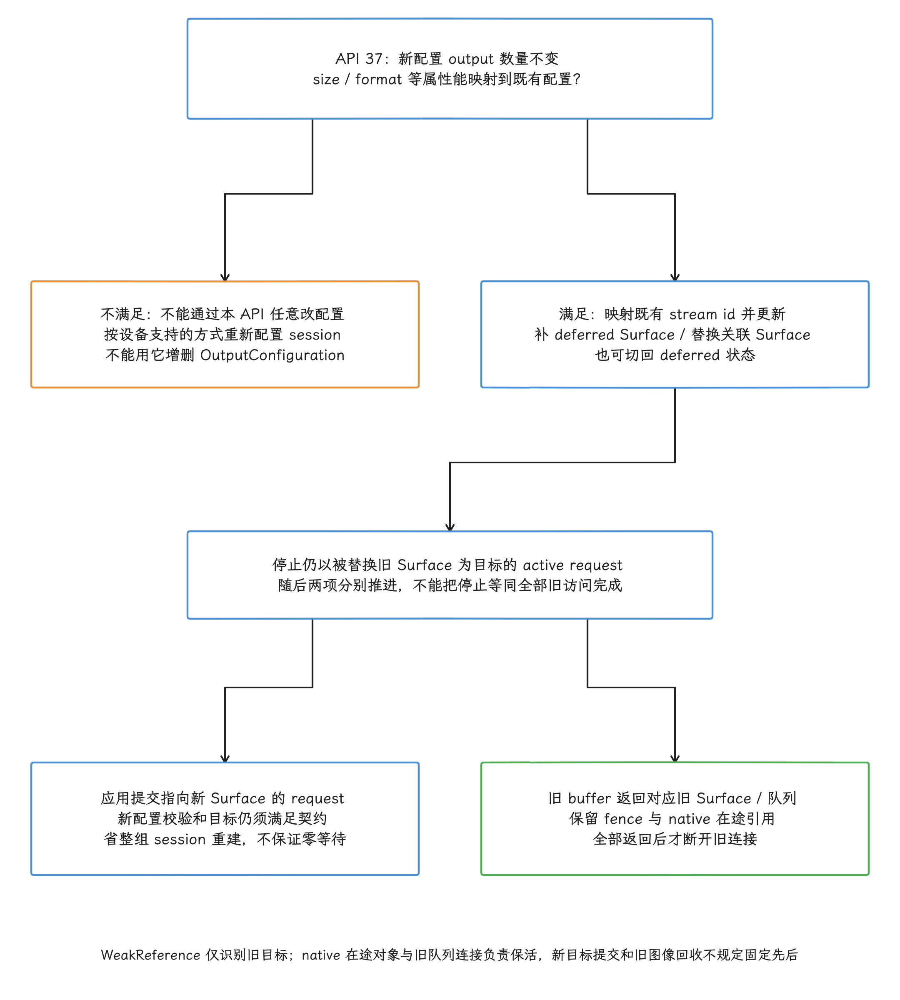

图：固定API37 updateOutputConfigurations需output数量不变、size/format等可映射现有配置，允许补deferred Surface或替换/退回deferred，不允许任意增删output或改属性。CameraDeviceImpl映射已有stream id并更新，针对旧目标active request停止；应用重新提交新Surface目标，同时旧在途buffer依原Surface队列/fence归还后再断连接。mReplacedOutputs的WeakReference只辅助旧目标识别，native引用/旧队列管理在途对象，不靠Java弱引用保活。新提交与旧回收无固定先后，也不保证零停顿。

### Stream Use Case 与 capture intent

Android 13 / API 33 引入 `OutputConfiguration.setStreamUseCase()`，让 App 为单个 output 声明 preview、still capture、video record、preview-video-still、video call 或 cropped RAW 等长期用途，HAL 可以据此选择 sensor mode、厂商 tuning 配置和 image-processing pipeline。它是一项配置提示，帧率和延迟不在它的承诺范围里。

它与 `CONTROL_CAPTURE_INTENT` 的分工不同：

- stream use case 描述单个 output 的长期用途，必须在 session 创建前设置；
- capture intent 描述当前 request 的拍摄意图，主要帮助设备选择整笔请求的 3A（自动对焦、自动曝光、自动白平衡）与处理策略；
- 设备必须声明 `REQUEST_AVAILABLE_CAPABILITIES_STREAM_USE_CASE`，并公布可用 use case 与 mandatory combinations；
- 非 mandatory 组合中的 use case 可能因硬件约束被忽略，帧率或延迟也就无从保证。

所以 Stream Use Case 的延迟收益或切换帧数，要在具体 HAL 与拍摄场景里测量：流配置是否触发 sensor mode 切换、切换需要多久，取决于这两者。


## Request 与 buffer 的生命周期

我们理解 Camera 掉帧时，要先把 request 的执行进度和 buffer 的占用状态分开看。Camera pipeline 需要多笔 request 同时在途，但不必从 request 入队开始就为每笔请求持有全部 output buffer——Android 10 引入 HAL3 buffer management 之后，“请求进入 pipeline”和“HAL 取得输出 buffer”可以发生在不同时间。

### Framework-managed buffer：先借 buffer，再提交 request

某路输出未启用 HAL 缓冲区管理时，`RequestThread` 会在调用 HAL 前为该捕获请求取得输出缓冲区。


#### Surface 交出可写 buffer

Camera3OutputStream::getBufferLockedCommon() 在普通队列路径调用 ANativeWindow::dequeueBuffer()，也可能从 Camera3BufferManager 取出 GraphicBuffer 后 attach，或使用批量预取结果。返回的核心对象是：

<!-- gracker-diagram: ch13-10-14-dequeue-paths -->
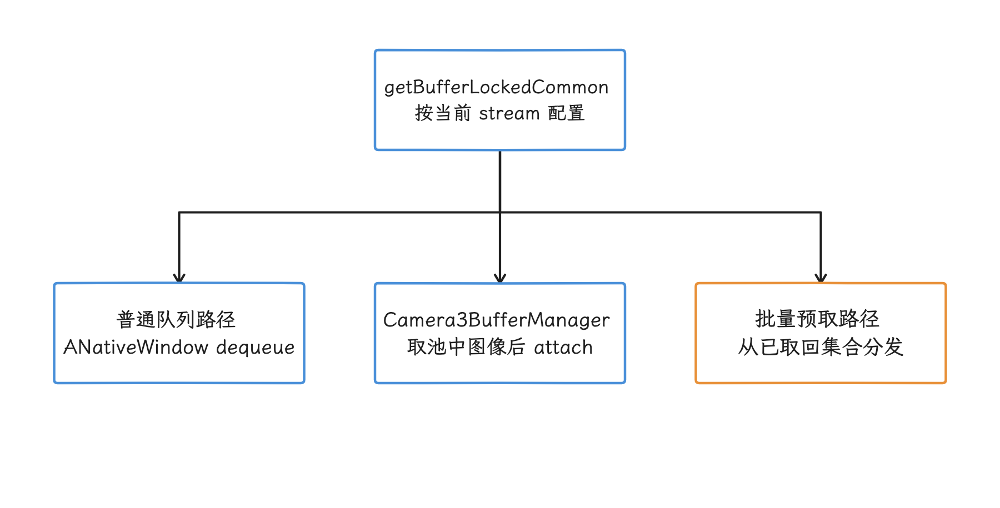

图：普通 dequeue、共享池 attach 与批量预取是不同取得方式。 这些分支都不能省略 buffer 的同步依赖。

- 一个 `ANativeWindowBuffer`，它的 handle 指向 `GraphicBuffer`；
- 一个 fence fd，表示上一个消费方何时结束对该缓冲区的使用。

`Camera3OutputStream::getBufferLocked()` 把栅栏填进 `camera_stream_buffer.acquire_fence`，再把缓冲区交给 HAL；源码注释明确说明，此后这个 fence fd 由 HAL 持有。

#### HAL 等待 acquire fence 后写入

HAL 在读写缓冲区前必须等待 acquire fence。对于输出流，这一步能避免 HAL 覆盖 GPU、SurfaceFlinger、视频编码器或应用仍在读取的旧内容。

如果 acquire fence 为空，表示无需等待。若 HAL 因错误没有等待该栅栏，AIDL `StreamBuffer` 约定要求 HAL 把原 acquire fence 作为 release fence 退回，让系统框架在复用缓冲区前仍能等待正确的完成时刻。

#### HAL 以 release fence 归还结果

HAL 通过 `processCaptureResult()` 返回以下内容：

- 流与缓冲区标识；
- `BufferStatus.OK` 或 `ERROR`；
- release fence，表示 HAL 何时停止访问该缓冲区。

release fence 为空，表示调用 `processCaptureResult()` 时 HAL 已经完成所有访问；若栅栏有效，HAL 可以先返回结果，再由下游异步等待。栅栏发出 signal 后，HAL 不得再次访问该缓冲区。


#### CameraService 决定 queue 或 cancel

`Camera3OutputStream::returnBufferCheckedLocked()` 总会接收 HAL 的 release fence，并根据结果选择以下路径：

<!-- gracker-diagram: ch13-10-17-queue-cancel -->
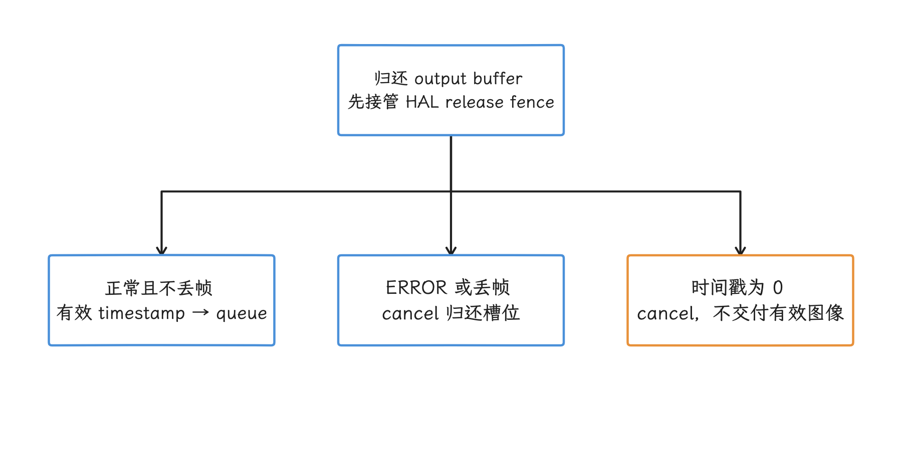

图：CameraService 按状态、丢帧标志与时间戳选择 queue 或 cancel。 两条路径都须保留 HAL release fence，读取不能越过依赖。

- 缓冲区正常且时间戳有效时，调用 `queueBuffer()` 交给 `Surface` 消费方；
- 缓冲区状态为错误、流正在丢帧或时间戳为 0 时，调用 `cancelBuffer()`；
- 两条路径都会传递 HAL release fence；queue / cancel 的 CPU 调用可以在 fence signal 前返回，真正读取或再次写入仍须满足这条完成依赖。

正常 queue 路径将 HAL release fence 传为消费侧 acquire 依赖；fd 可以复制或转交，命名变化并不意味着新增一次硬件写入。调试、格式修补等特殊路径可能另有等待，必须按实际调用链检查。

#### consumer 释放后才能再次出队

消费方归还槽位时，可以附带一条尚未 signal 的 release fence。这时生产方哪怕已经成功 dequeue 到同一槽位，也要等这条依赖满足才能覆盖内容：CameraService 会把它转成 HAL acquire fence，HAL 在访问前等待。槽位取回与旧访问完成是两个时刻，我们要分开判断。


完整顺序可以写成：

```text
consumer release fence
        ↓
BufferQueue dequeueBuffer()
        ↓
HAL acquire fence → HAL wait/write
        ↓
HAL release fence
        ↓
BufferQueue queueBuffer()
        ↓
consumer acquire/wait/read
```

所以判断栅栏方向时，我们要同时写明“谁准备读或写”和“谁已经结束访问”；只记 `acquire`、`release` 两个名字，在 HAL 接口和 BufferQueue 接口之间很容易说反。

<!-- gracker-diagram: ed13-10-fence-cycle-and-async-return -->
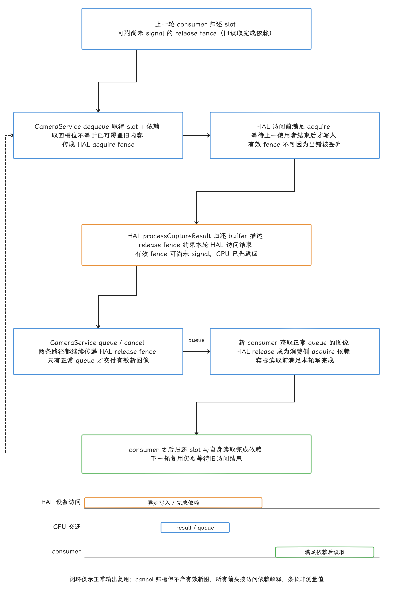

图：同一输出buffer复用：consumer可先归还slot并附未signal release fence，dequeue取回slot与依赖后作为HAL acquire交接；HAL读写前必须等待。HAL result归还buffer可携尚未signal release fence，CameraService按状态queue/cancel仍传依赖；正常queue下它成为新consumer acquire，实际读前满足写完成；consumer归还后下轮复用。空fence按接口表示无需等待/已结束访问，错误未等待acquire须原样退依赖。图示阶段可交叠，dequeue/result/queue/inflight移除都不替代signal；不是同fd数即同对象，cancel不交付有效新图。

### HAL buffer management：request 先走，buffer 按需借

Android 10 引入了可选的 HAL3 缓冲区管理 API：HAL 处理流水线可以同时排队 N 个捕获请求，但可能只在接近输出的阶段需要少量缓冲区；如果系统框架在请求进入 HAL 前就为所有输出取齐缓冲区，暂时用不到的图像内存也会长时间驻留。

两类行为同时存在：


- 未启用的流：系统框架仍随捕获请求提供真实的输出缓冲区；
- 已启用的输出流：request 含 stream 项，但 bufferId=0、handle 与 acquire fence 为空；HAL 稍后调用 requestStreamBuffers 取得真实 buffer。仅看到空 handle 不足以判定占位，缓存复用也可省略 handle。

在 `SESSION_CONFIGURABLE` 模式下，HAL 可以通过 `HalStream.enableHalBufferManager` 逐流选择；在 AIDL 设备级模式下，系统框架会把全部输出流视为由 HAL 管理。

#### `requestStreamBuffers()` 不预先绑定 frame

`AidlCamera3OutputUtils.cpp` 明确说明：一次 `requestStreamBuffers()` 返回的缓冲区不与某个 `CaptureRequest` 预先绑定。HAL 可以：

1. 为多条流批量请求若干缓冲区；
2. 选择其中一个用于某一帧；
3. 把已使用的缓冲区随该帧的 `processCaptureResult()` 返回；
4. 把多取但未使用的缓冲区经 `returnStreamBuffers()` 退回。

CameraService 会逐条流检查：

<!-- gracker-diagram: ed13-10-buffer-management-request-timing -->
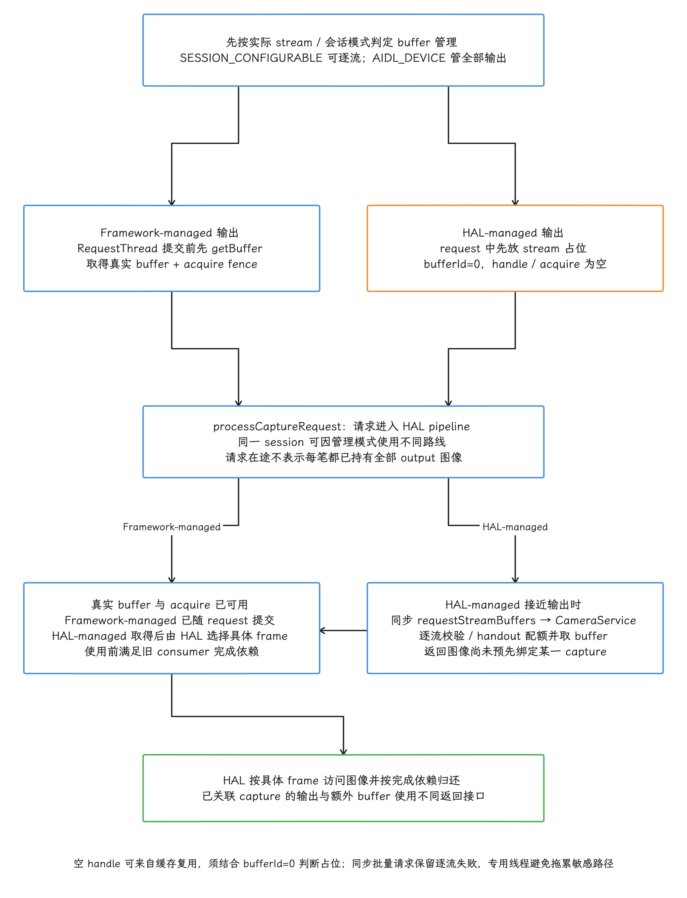

图：固定r1未启用HAL管理的流先getBuffer并随request带真实buffer/acquire；启用输出流的request先带stream占位bufferId0/空handle与acquire，HAL接近输出时同步requestStreamBuffers。CameraService检查流/管理模式/重复id/连接/配额/configure，返回的buffer不预先绑定capture，HAL之后选择frame；多流批量或失败须单独处理，专用线程建议不表示固定开销。SESSION_CONFIGURABLE逐流选，AIDL_DEVICE管理全部输出。空handle也可能缓存省略，不能只看空句柄判占位；所有真实访问遵守fence，已使用与额外buffer归还路径另核。

- 流是否存在且启用了 HAL 缓冲区管理；
- 是否重复请求同一个流 ID；
- `Surface` 是否已断开；
- “当前尚未归还数 + 本次请求数”是否超过 `maxBuffers`；
- 当前是否正在 `configureStreams()`。

返回结果有两层：调用级 BufferRequestStatus（如 OK、FAILED_PARTIAL、FAILED_CONFIGURING）与逐流 StreamBufferRequestError（如 STREAM_DISCONNECTED、NO_BUFFER_AVAILABLE、MAX_BUFFER_EXCEEDED）。读这些错误时，我们把超出 HAL handout 配额的 MAX_BUFFER_EXCEEDED，与超时、分配失败等造成的 NO_BUFFER_AVAILABLE 分开归因。requestStreamBuffers 是同步调用，固定 AIDL 契约建议使用专用线程，并避免在延迟敏感路径一次请求大量 buffer。


#### `bufferId`、handle 与 cache 生命周期

每帧都跨 Binder 重复传递 native handle 会增加开销，`StreamBuffer` 因此采用 `streamId + bufferId` 建立缓存约定：

- 某个缓冲区第一次交给 HAL 时，同时携带 `bufferId` 和原生句柄；
- HAL 记住两者的映射；
- 同一个缓冲区后续再次出现时，只传 `bufferId`，句柄为空；
- `CaptureResult` 返回时句柄也为空，系统框架根据帧、流和缓冲区记录找回原对象；
- `processCaptureRequest(..., cachesToRemove)` 要求 HAL 删除已经失效的缓存项。

流被移除、会话关闭或系统框架通知删除缓存项后，旧映射即告失效，HAL 不可继续使用；把 `bufferId` 当作跨会话稳定的句柄，可能造成对象释放后仍被使用、缓冲区错配或设备错误。


#### `returnStreamBuffers()` 归还未关联 capture 结果的额外 buffer

某个 buffer 一旦作为特定 capture 的输出，就随对应的 processCaptureResult 返回；未关联具体 capture 输出的额外 buffer，则经 returnStreamBuffers 退回。固定源码还允许 HAL 把额外取得的 buffer 用于内部用途，所以这一路退回的像素可能被访问过，解读日志时要留这个余地。返回同样要保留同步依赖。CameraService 将其按错误状态、时间戳 0 归还输出流，通常走 cancel，这条路径不会把有效新图像送给 consumer。

<!-- gracker-diagram: ch13-10-23-extra-buffer-return -->
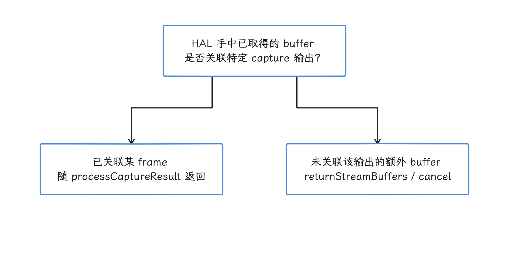

图：关联 capture 输出的图像走 result，额外图像走独立归还。 额外图像可能被内部使用过，返回仍要遵守 fence。

#### `signalStreamFlush()` 与 `flush()` 的责任差异

两个接口都会促使缓冲区返回，但语义不同：


| 接口 | 目的 | 待处理请求的处理 |
|---|---|---|
| `signalStreamFlush()` | 为流的重新配置回收 HAL 手中的缓冲区 | HAL 应正常完成已有请求，并及时归还指定流的缓冲区 |
| `flush()` | 尽快清空整个捕获流水线 | 允许把未完成缓冲区标为 `ERROR`，返回时不得再有尚未完成的请求或尚未归还的缓冲区 |

`signalStreamFlush()` 是异步提示，`streamConfigCounter` 用来判断它是否晚于相应的 `configureStreams()` 到达；HAL 只看 Binder 调用的到达顺序，是判断不出配置代次的。

<!-- gracker-diagram: ch13-10-25-configuration-generation -->
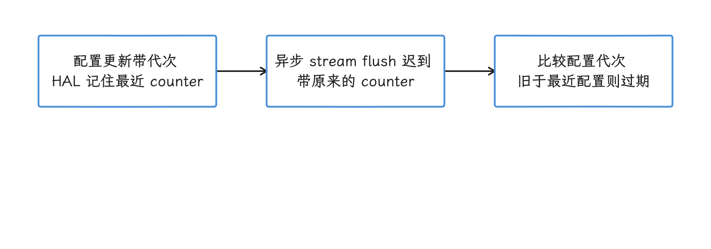

图：并发调用按配置代次判断，不能只看 Binder 到达顺序。 旧 counter 的 stream flush 提示可被识别为过期。

### `maxBuffers` 由 HAL 逐流返回

camera_stream::max_buffers 在 Camera3Stream 构造时为 0，configure 之后由 HAL 逐流声明。getBuffer() 里的 outstanding 指交给 HAL 尚未归还的 buffer；这里的 cached 指 CameraService 暂存、尚未 queue 给最终 consumer 的图像（例如 PreviewFrameSpacer），与 bufferId → handle 缓存是两回事。HAL outstanding 达到上限，或 outstanding + framework cached 达到组合上限时就会等待；普通 returnBuffer() 归还、cached buffer 真正入队之后，会按相应路径通知等待方。

<!-- gracker-diagram: ed13-10-capacity-and-handout-limits -->
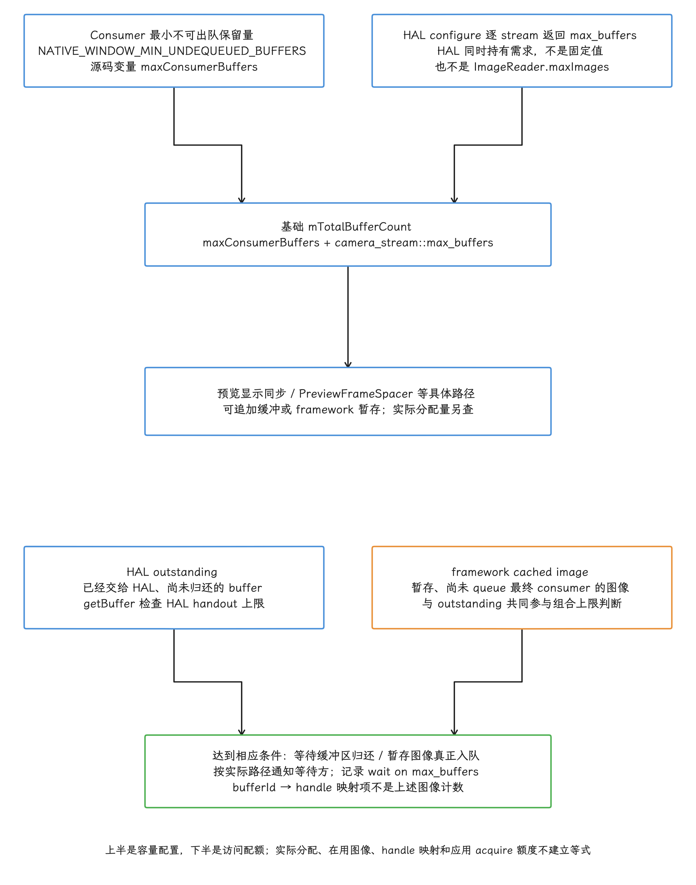

图：固定r1：Consumer最小不可出队保留量由NATIVE_WINDOW_MIN_UNDEQUEUED_BUFFERS查询，基础mTotalBufferCount加HAL逐stream声明max_buffers；显示同步/PreviewFrameSpacer等路径可再加缓冲或framework暂存。HAL outstanding是交给HAL尚未归还，framework cached image是未queue最终consumer的图像，两类进入相应handout/组合上限判断；普通归还或cached实际queue才通知相应等待。bufferId→handle映射不等持有图像数，ImageReader.maxImages另有独立额度。

input stream 也按 HAL 返回的 `max_buffers` 控制 handout（已交出但尚未收回）的数量。这里的 `maxBuffers` 属于 HAL stream 配置，`ImageReader.maxImages` 则限制应用可同时取得且尚未关闭的 `Image` 数量，二者会相互影响，却是两个独立的参数。某台设备或某个 CameraX 版本上的观察值，只代表那台设备；要推 HAL3 通用规则，或估算另一台设备的 ZSL 内存，还得按它自己的配置重新算。

Camera3Device::mInFlightMap 按 frame number 跟踪 metadata、shutter、未归还 input / output buffer 和请求类别。列表增长只说明请求收尾条件尚未满足；这个列表的职责到 result 与 buffer 归还为止，GPU / ISP fence signal 或 display present 要去下游队列和 fence 里继续追——HAL 先返回带未完成 fence 的 buffer 时，framework 这边可能已经满足移除条件。


### 三类 fence 要分别看

| 同步对象 | 表示什么 | 常见等待方 |
| --- | --- | --- |
| framework 交给 HAL 的 acquire fence | output buffer 何时可以被 HAL 写入 | HAL / ISP / vendor GPU |
| HAL 随 result 返回的 release fence | 图像写入何时完成，consumer 何时可以读取 | BufferQueue、ImageReader、MediaCodec、App GPU |
| SF / HWC 对预览 layer 的 release fence | 显示 consumer 何时不再读取该预览 buffer | BufferQueue / 后续 producer |

acquire 与 release 的命名取决于 buffer 正在跨越哪一次所有权交接；要判断一条 fence 属于 Camera 端还是显示端，得看它挂在哪次交接上，光看名字是分不出来的。display present fence 描述一轮显示帧的 present 边界，camera capture completion 要另找对应证据；analysis、record 和 still buffer 可能完全不进显示链路，自然也就没有对应的 display present fence。


### 错误、重配置与关闭时的所有权

#### 错误 buffer 仍要保留 fence 语义

HAL 填充缓冲区失败时会把状态设为 `ERROR`；此时如果它从未等待系统框架给出的 acquire fence，就要把该栅栏原样作为 release fence 返回，如果已经等待完成，则可以返回空的 release fence。出错也跳不过同步这一步。

CameraService 收到错误状态的缓冲区后会调用 `cancelBuffer()`。这会把队列槽位还给 BufferQueue，但仍要携带有效栅栏，防止队列过早复用该缓冲区。

#### Surface 断开是逐 stream 错误

Surface 或 consumer 断开后，相关流可能报 STREAM_DISCONNECTED，dequeue 也可能失败；此时停止向失效目标提交，按具体错误恢复。断开本身说明不了在途访问就此终止：已有引用、HAL 归还、fence、旧队列回收与 cache 删除仍须各自收尾，旧 handle 的失效要以这些流程为准。局部更新还是重建 session，由实际接口状态决定。


#### `flush()`、关闭与 cache 失效

AIDL `flush()` 约定返回时，HAL 中已经没有尚未完成的请求或尚未归还的缓冲区，此后系统框架才能安全地调用 `configureStreams()` 或提交新请求。关闭会话或移除流，还会终止 `bufferId` 缓存的有效期。

关闭控制链与释放应用持有图像是两项工作。若目标是完全释放本次相机图像资源，下面三项要分别验证；CameraDevice.close 管到的只是控制链，ImageReader、Image 或自研 GPU 对象的释放要另行确认：


- 重复请求已经停止，处理中的帧已经完成或报错；
- 所有输出和输入缓冲区都已返回；
- `Surface`、`Image`、编解码器与自研渲染器都没有继续持有旧对象。

## 三种主要消费路径

buffer 交给谁、按什么节奏归还，决定了一条流的内存驻留和吞吐。这一节我们先按 stream 估算内存驻留，再依次看预览、录像、分析三种消费路径：每一路的 consumer 不同，卡住时的现象和检查点也不同。

### 按 stream 估算驻留量与跨流反压

我们粗估相机图像内存时按流求和；下面的公式只用来估计缓冲区驻留量的数量级：

```text
session GraphicBuffer 驻留量
  ≈ Σ（该 stream 已分配 buffer 数 × allocator 返回的单 buffer 大小）
```

这个公式只是排查起点。求和前要先按唯一 allocation / dma-buf 标识去重：兼容流共享池、同一分配跨组件导入都只算一次；队列容量与已分配数量也是两个数。单 buffer 的真实大小还受 stride、平面对齐、压缩元数据、保护属性和 tile 布局影响；HAL、ISP、GPU、codec 的内部工作区，则未必出现在 CameraService 的 stream 统计里。


常见格式的未压缩有效载荷（payload）可以用来检查数量级：

| 格式 | 可见像素数据的粗略量级 | 注意事项 |
|---|---:|---|
| RGBA_8888 | `width × height × 4` | 步幅与压缩会改变物理分配 |
| YUV 4:2:0 | `width × height × 1.5` | 平面步幅与切片高度不能省略 |
| RAW10 | `width × height × 1.25` | 公开 RAW10 规则定义打包；行跨度与分配另查 |
| RAW12 | `width × height × 1.5` | 公开 RAW12 规则定义打包；行跨度与分配另查 |
| RAW14 | `width × height × 1.75` | Android 17 能力仍要查询设备特性 |

RAW14 的公开打包规则是每 4 像素 7 字节，宽度为 4 的倍数、高度为偶数，实际行大小仍要读取 rowStride；有效载荷公式只用来核对数量级，allocator 分配大小要另算。IMPLEMENTATION_DEFINED 没有固定的 bytes-per-pixel；BLOB 流按配置 bufferSize 约束估算分配，而 JPEG 文件的实际长度与 buffer 容量是两个量。


各路输出虽然有独立队列，一次 capture request 仍可能同时要求多路结果。分析流积压、预览也跟着掉帧时，我们先把分析 consumer 列为候选，再用 frame number、各 stream result 返回时间和 buffer 归还记录，验证它是不是通过共享 ISP stage、缩放器、带宽或内部池拖慢了其他流。


### Preview：SurfaceView、TextureView 与自研 renderer

预览 carrier（承载方式）决定相机 buffer 怎样进入最终 App 画面。


| Carrier | Camera buffer 的 consumer | 最终 SF layer | 主要代价与证据 |
| --- | --- | --- | --- |
| `SurfaceView` | Surface / BufferQueue → SurfaceFlinger | preview child layer 与 host App Window 分开 | 少一次宿主纹理采样；查 preview layer buffer、geometry transaction 和 HWC composition type |
| `TextureView` | `SurfaceTexture` → 宿主 HWUI RenderThread | 通常只有 host App Window | 易做 matrix、clip、alpha；增加一次宿主纹理获取、采样与窗口提交 |
| 自研 GL / Vulkan | OES texture、AHardwareBuffer 或 ImageReader → App GPU | 取决于 renderer 的 output Surface | HAL 是第一生产者，App renderer 同时是中间 consumer 与第二生产者 |

`SurfaceView` 预览在现代 Android 上通过 SurfaceControl / BLAST 与宿主窗口协调位置和裁剪，但相机像素仍由独立 BufferQueue 提交。BLAST 是 Surface buffer 与 transaction 协调机制。preview layer 能否采用 HWC DEVICE composition，取决于整组 layer 的格式、缩放、alpha、crop、色彩空间和硬件 plane 资源；SurfaceView 本身只决定承载方式，硬件 overlay 要看这组条件是否凑齐。

<!-- gracker-diagram: ch13-10-35-surfaceview-preview -->
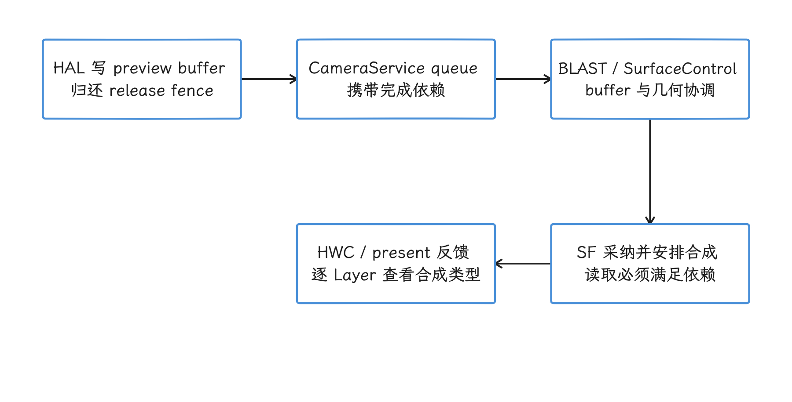

图：相机预览 buffer 经独立队列和 transaction 进入系统显示。 是否 DEVICE composition 要看该帧全部 Layer 的协商结果。

`TextureView` 涉及两条 BufferQueue：camera → SurfaceTexture 负责交付相机纹理，HWUI → App Window 负责提交合成后的应用窗口。所以 camera buffer 到达只说明纹理可供宿主获取，画面还要经过宿主 `Choreographer`、traversal（View 树遍历）、RenderThread 和 host window queue。


TextureView 的 frame-available 回调先标记更新并 invalidate；Main draw 记录 drawTextureLayer，RenderThread 的 DeferredLayerUpdater::apply() 再经 ASurfaceTexture_dequeueBuffer() 获取 image / AHardwareBuffer 并处理 fence，后续由 GPU 采样进宿主窗口。输入通知、Java 记录、RT 取图和 GPU 读取各自落在不同的时刻，Java 调用栈里看不到 updateTexImage，也完全可以是一条正常路径。


自研滤镜、畸变矫正、分割或 AR 管线还会增加一个 App GPU pass，也就是由应用执行的额外渲染阶段。排查时我们分别测量 camera release fence、App GPU completion 与 output Surface present，免得把应用渲染阶段的延迟误判成 ISP 延迟。

<!-- gracker-diagram: ed13-10-texture-input-and-app-output -->
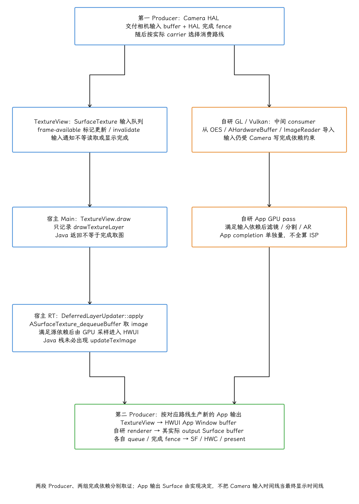

图：Camera是第一Producer，queue相机图像及HAL完成fence。TextureView路线先SurfaceTexture消费输入，frameavailable只标记更新/invalidate，Main draw记录drawTextureLayer，RT DeferredLayerUpdater::apply经ASurfaceTexture_dequeueBuffer取image/AHB并处理fence，GPU满足输入依赖后采样进HWUI宿主窗口；Java栈不必有updateTexImage。自研GL/Vulkan可从OES/AHB/ImageReader导入，满足输入依赖后做滤镜/分割/AR等App GPU pass，再向自己的output Surface生产。二者都另有App输出buffer/完成fence及显示反馈，相机输入到达不等App已绘制/显示，不能将App GPU等待全归ISP；不保证逐输入对应逐显示帧。

### Recording：MediaCodec 是独立 consumer

录像 stream 通常把 `MediaCodec` 或 `MediaRecorder` input Surface 作为 consumer：HAL 交付原始图像 buffer 之后，encoder 还要接收输入、执行颜色处理与编码，再输出码流。预览平滑而录像丢帧时，我们检查 encoder input queue、codec callback、码率 / 分辨率、thermal throttling（温控降频）与 storage writer，单看 SurfaceFlinger 是不够的。

<!-- gracker-diagram: ch13-10-39-recording-consumer -->
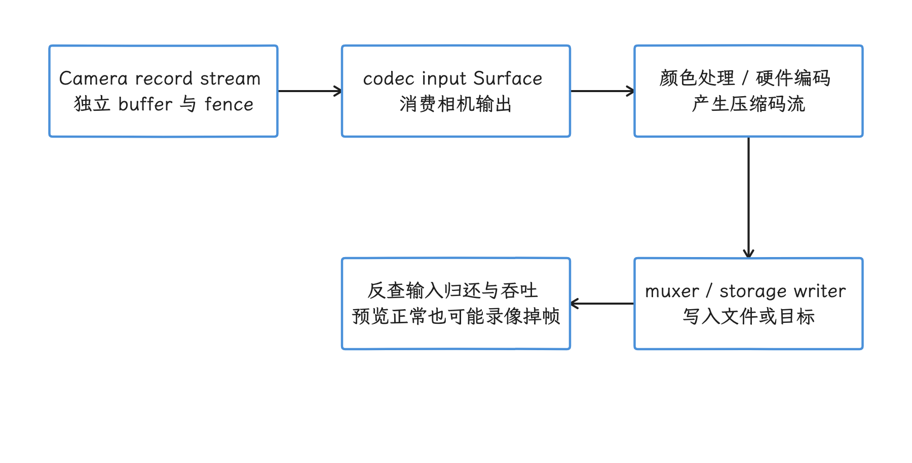

图：编码与存储是独立于预览显示的消费链路。 预览平滑不能证明 codec、muxer 或 storage 正常。

录制与预览可以来自同一组 repeating request，但二者持有不同 stream buffer。encoder 不及时消费会耗尽 recording stream 的可用 buffer；某些 HAL 能隔离该 stream，另一些 pipeline 会因为共享 ISP stage 或资源预算影响后续 request，结论要按设备 trace 判断。

### Analysis：归还速度就是吞吐上限

ImageReader 可按配置交付 YUV、PRIVATE 等图像；CameraX ImageAnalysis 则按其库版本与输出格式配置处理。ImageReader.maxImages 限制同时 acquired 且未 close 的 Image 数，达到上限时再次 acquire 会抛 IllegalStateException；若持续不归还，底层队列还会逐渐耗尽并反压上游。这个上限触发的是应用侧的 acquire 异常，HAL 是否停流另有条件；PRIVATE 图像也未必是 CPU 可直接读取的 YUV planes。


只关心最新结果时，下面的处理骨架展示了怎样缩短持有时间。


```kotlin
imageReader.setOnImageAvailableListener({ reader ->
    val image = reader.acquireLatestImage() ?: return@setOnImageAvailableListener
    try {
        analyzer.consume(image)
    } finally {
        image.close()
    }
}, analysisHandler)
```

这套示例成立的前提，是监听器串行、analyzer.consume() 为耗时有界的同步调用，且其他路径不同时 acquire。acquireLatestImage 要按预期丢弃旧图，至少需要 maxImages - 当前已持有数 ≥ 2，只设 maxImages=1 得不到同样行为。异步任务接管 Image 后，要在任务结束时 close；提前关闭会使 planes 失效，无界排队则把反压移到线程池。逐帧保序可改用 acquireNextImage 并保证持续吞吐。CameraX 场景下应关闭 ImageProxy 本身，由它去关闭底层 Image；增大队列换来的只是缓冲余量。

<!-- gracker-diagram: ed13-10-analysis-quota-and-image-owner -->
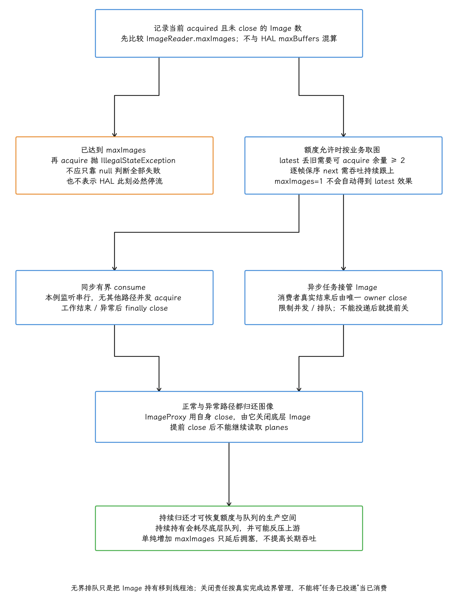

图：ImageReader.maxImages限制同时acquired且未close的Image；达到上限再acquire抛IllegalStateException，不是保证返回null或HAL立刻停流。latest按预期丢旧要求maxImages-当前已持有>=2，maxImages1无此效果；next逐帧需持续吞吐。正文监听串行、consume同步有界、无其他并发acquire，故finally close；异步接管则真实任务结束后close，正常/异常均唯一owner，提前close使planes失效，无界排队把压力移到线程池。CameraX应close ImageProxy本身。持续不归还会耗尽底层队列并可能反压上游，增加额度只缓冲不提高长期消费速度。

## ZSL 的两种机制

“Zero Shutter Lag”（ZSL，零快门延迟）的做法，是尽量拿按下快门前后已经采集的候选帧缩短等待；至于端到端耗时，名字里并没有这个承诺。Camera2 与 CameraX 至少涉及两种控制机制，把它们看成一条固定处理链，很容易误判设备能力。


### ZSL 省掉了哪一段延迟

一次普通静态拍照可以简化为以下过程：

<!-- gracker-diagram: ch13-10-44-zsl-time-saving -->
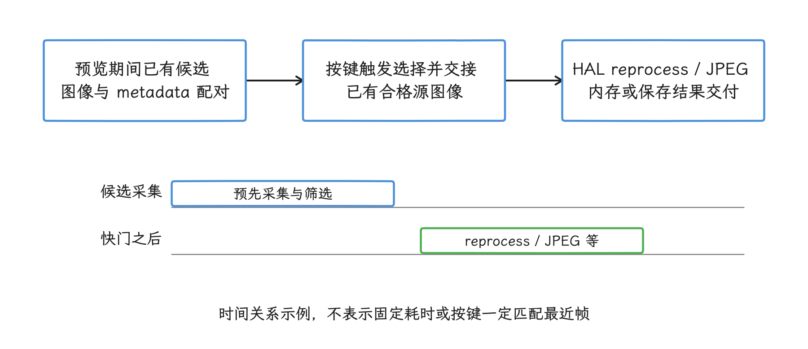

图：复用已经存在的候选图像，可减少按键后等待源图像的时间。 重处理、编码和交付仍有成本，照片时刻也可能早于按键。

```text
按下快门
  → 提交 still capture request
  → 等待 sensor 曝光
  → ISP / 厂商算法处理
  → JPEG 输出
  → CameraX 回调
  → 应用写文件
```

这段流程只用于划分时间段：普通拍照的源帧通常产生于按键之后，曝光以及自动对焦、自动曝光、自动白平衡这三项状态的收敛，都可能增加用户感知到的延迟。

CameraX ZSL 的成功路径是：

```text
持续 repeating request
  → PRIVATE output + TotalCaptureResult
  → 按 timestamp 匹配图像和 metadata
  → 过滤 AF / AE / AWB 状态
  → 3 帧 ring

按下快门
  → 从 ring 取出合格图像及其 TotalCaptureResult
  → CameraPipe 先创建 reprocess request builder 并设置 output target
  → ImageWriter.queueInputImage() 交接已有图像，再提交 capture request
  → HAL reprocess / JPEG output
  → CameraX 回调（内存交付或保存结果按调用重载区分）
```


成功复用候选帧时，这次输出无需再采一张新的 sensor 图像，重处理和 JPEG 等工作仍然存在。固定 CameraX 1.6.1 的 ring 容量为 3，读图额度 MAX_IMAGES 为 9；ZslRingBuffer 只接受 AF 已对焦、AE / AWB 收敛的帧。ArrayRingBuffer 以 addFirst 入队、removeLast 出队，取当前 ring 中最旧的合格帧，并非按快门时间搜索全局最近帧。三帧、九图额度和 HAL maxBuffers 分属三个层次，估算 ZSL 内存时要分别取数，哪一个都代表不了总驻留。


### Device-operated ZSL：`CONTROL_ENABLE_ZSL`

`CaptureRequest.CONTROL_ENABLE_ZSL` 是可选的 request key，应用应先检查设备是否公布该 key。对 `CONTROL_CAPTURE_INTENT_STILL_CAPTURE` 的请求设为 `true` 后，camera device **可以**使用内部保留的历史图像生成结果，但 API 不保证每次都选中历史帧。

<!-- gracker-diagram: ch13-10-48-device-zsl-hint -->
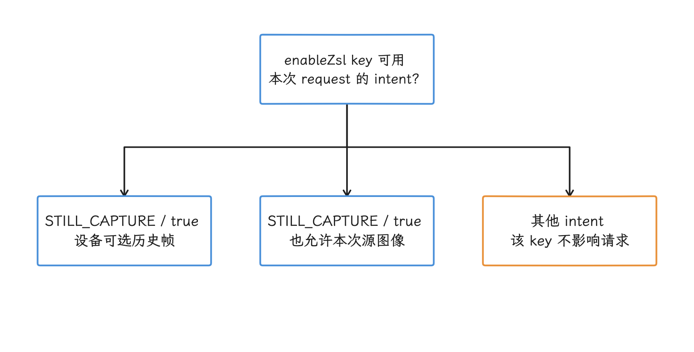

图：key 可用且 STILL_CAPTURE 时，设备可以选择历史图像。 设为 true 并不保证选历史图，也不能证明 App reprocess。

这条机制由设备内部管理候选帧，不要求 App 创建 reprocessable session。它还会带来一个诊断特征：ZSL still 的图像内容与 result metadata 可能对应更早的 sensor 时刻，shutter / result 顺序也遵循专门规则。我们对齐时同时使用该 result 的 `SENSOR_TIMESTAMP` 和 frame number，只按 callback 到达顺序排列会出错。

### Application-operated ZSL：ring buffer + reprocess

应用自管 ZSL 会在预览期间把高分辨率候选帧保存在 ring buffer（循环缓冲区）中，用户按下快门时选择接近触发时刻的帧，再送回 reprocess pipeline 重新处理。该模式需要：


- 设备声明 `PRIVATE_REPROCESSING` 或 `YUV_REPROCESSING`，具体取决于 input format；
- 创建带 `InputConfiguration` 的 reprocessable capture session，使 session 能接收一帧已有图像作为 input；
- 用 `createReprocessCaptureRequest()` 构造重处理请求；
- 控制 input 与 output buffer 的持有、fence 和归还，避免候选帧长期占用管线容量。

CameraX 对这条路径的 1.6.1 实现、三帧 ring、禁用条件和 CameraPipe 调用链见[§22.18 CameraX：UseCase、Camera2 映射与性能](../../part5-app/ch22-rendering-practice/18-camerax-rendering.md)。

<!-- gracker-diagram: ed13-10-zsl-pairing-ring-and-quotas -->
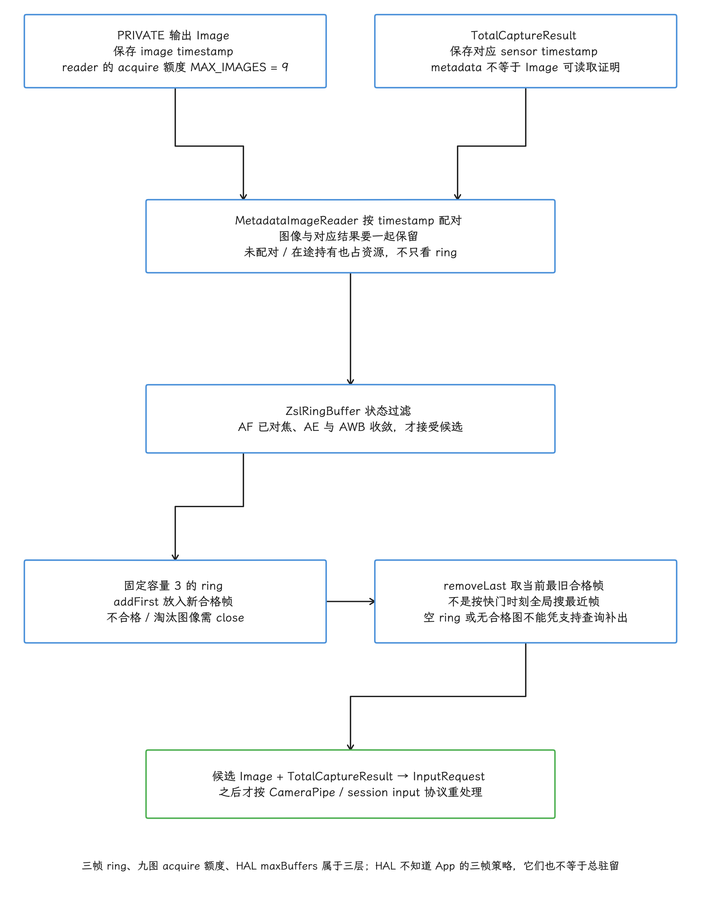

图：固定CameraX1.6.1 PRIVATE image与TotalCaptureResult按timestamp配对后由ZslRingBuffer检查AF已对焦、AE/AWB收敛，合格才进入容量3的ring，不合格/淘汰图像close。ArrayRingBuffer addFirst/removeLast取当前最旧合格帧，不按快门时间全局搜索最近帧。该reader MAX_IMAGES9限制acquire，可有未配对及在途持有；HAL maxBuffers逐stream由HAL声明，三层不等于总驻留/实际分配数。HAL不执行App三帧策略；支持、当前允许使用ZSL、这次候选可用仍分别核对，具体flash/Video/Extensions影响见正文。

#### HAL 以 `inputBuffer` 识别重处理请求

Camera2 请求进入 CameraService 后，`Camera3Device` 会根据请求元数据中的输入流 ID 找到 `mInputStream`。`RequestThread` 在提交 HAL 前从 `Camera3InputStream` 取得下一块输入缓冲区，并填入以下原生请求字段：

```text
camera_capture_request_t.input_buffer
camera_capture_request_t.input_width
camera_capture_request_t.input_height
```

原生请求没有输入流时 input_buffer 为 NULL，属于采集类请求；有输入则为 application-operated reprocess。采集类内部仍可能采用 device-operated ZSL 的历史图像，所以看到“没有 input”，最多说明这笔请求走采集路径，源图像的曝光时刻还要靠 result 里的 sensor timestamp 确认。

CameraService 的 AIDL 适配层再把原生请求转换为 `android.hardware.camera.device.CaptureRequest`：

- `inputBuffer.streamId` 标识输入流；
- `inputBuffer.bufferId` 标识该流中的缓冲区；
- 首次出现的缓冲区还会携带句柄，后续可以只使用 `bufferId`；
- `inputBuffer.acquireFence` 约束 HAL 何时可以读取输入缓冲区；
- `inputWidth` 与 `inputHeight` 描述实际输入尺寸；
- outputBuffers[] 至少有一个输出 stream 项；framework-managed 流携带有效 buffer 标识，HAL-managed 输出项可为 bufferId=0 的占位，之后再按需取图像存储。

AIDL CaptureRequest 的有效 input 表示已有图像重处理，没有 input 表示采集类请求。固定 AidlCamera3Device 的缓存实现还需注意：重复输入 buffer 可以只带有效 streamId / bufferId 而省去 handle；无 input 才设置 streamId=-1、bufferId=0。因此识别有效 input 时，要把 ID、缓存映射和原生 input_buffer 放在一起看，序列化 handle 是否为空，单独说明不了问题。

<!-- gracker-diagram: ed13-10-cached-ids-and-valid-input -->
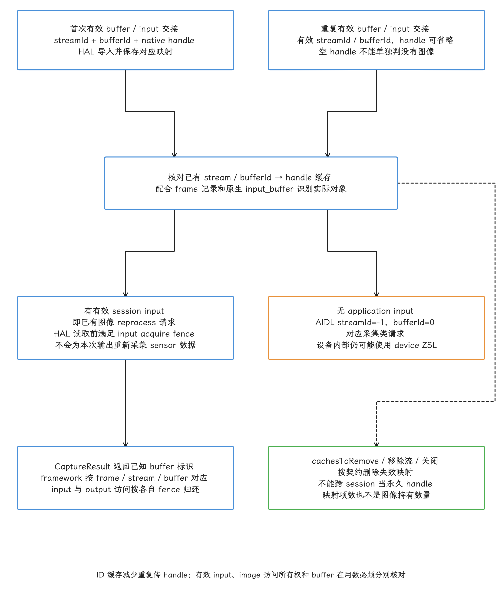

图：固定StreamBuffer首次交接携streamId/bufferId+handle，HAL保存映射；重复有效buffer可只传ID省handle，CaptureResult通常只回已知标识，framework按frame/stream/buffer记录找回对象。cachesToRemove、移除流/关闭按契约失效，不能跨会话复用。识别input还看原生input_buffer与输入流：AIDL无input用streamId=-1/bufferId=0，有效缓存input可无handle仍是reprocess；没有appinput是采集类但deviceZSL仍可能选历史图像。实际input读取前等acquire、随result归还；缓存记录本身不是图像占用或访问权限证明。

- 无有效 inputBuffer：采集类请求，设备内部仍可按 CONTROL_ENABLE_ZSL 策略使用历史图像；
- 有有效 `inputBuffer`：重处理该图像；
- HAL 必须等待输入 acquire fence 后再读取；
- HAL 必须在后续 `CaptureResult` 中归还输入缓冲区；
- 输出缓冲区也有各自的 acquire fence、release fence 和所有权转换。

这就是 CameraX ZSL 到 Camera HAL3 的可靠映射：


```text
CameraX InputRequest
  → Camera2 reprocess CaptureRequest
  → Camera3Device::CaptureRequest.mInputStream
  → camera_capture_request_t.input_buffer
  → AIDL CaptureRequest.inputBuffer
  → HAL reprocessing
```

重处理在 HAL 内部会再次经过 ISP 的哪些处理模块、是否使用专用硬件、怎样执行降噪或 JPEG 编码，都属于设备实现；公共接口只约束输入缓冲区、元数据、输出缓冲区、栅栏、结果和错误行为，从接口名称推断不出厂商算法阶段。

#### 输入 buffer 的所有权与 sensor 边界

ImageWriter.queueInputImage() 将已有图像交给 session input Surface，下游 CameraService / HAL 读取前须满足 acquire fence，访问完成再以 result / release fence 归还。对 App 来说，交接之后原 Image 就到此为止：fence signal 也换不回这个 Java 对象的访问权，后续复用要走池中经正确归还、重新取得的 buffer。调用也可能因 ImageWriter 无空闲输入额度而阻塞。

<!-- gracker-diagram: ed13-10-reprocess-handoff-and-image-validity -->
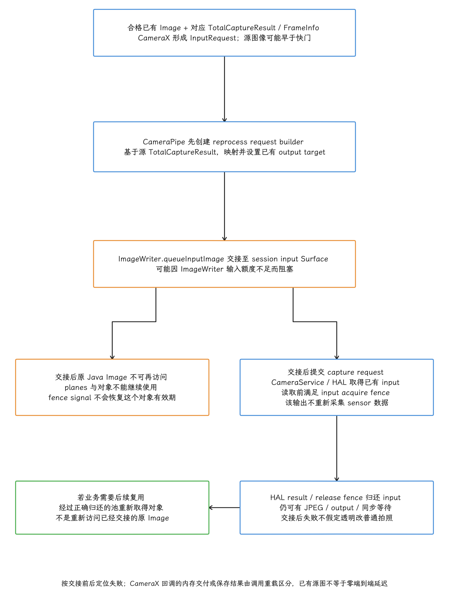

图：固定CameraX/CameraPipe1.6.1从合格图像及FrameInfo形成InputRequest，先基于TotalCaptureResult创建reprocess builder并设置已有output target，再queueInputImage交接到session input Surface，之后提交capture request。queueInputImage可能因输入额度阻塞；交接后原Image不可访问，HAL读取前满足input acquire fence，再随result/release fence归还。后续复用须池中正确归还后重新取得，不会因fence signal恢复原Java Image。input已交接后的失败不保证透明重试普通拍照；reprocess不为该输出采集新sensor数据，但仍可等input/输出/JPEG/fence。

内核的 `dma-fence` 和 `sync_file` 只提供同步原语，CameraX 的三帧策略、AF、AE、AWB 过滤、降级条件和重处理元数据都在用户空间。所以我们分析 ZSL 失败时，先在用户空间找原因，别急着归因于内核。

`CameraDevice` 文档明确规定，重处理请求不会捕获新的图像数据。它从会话输入 `Surface` 取得下一块缓冲区，再为本次请求的输出 `Surface` 生成结果。

这也解释了两个常见现象：


- 输出 JPEG 的 `SENSOR_TIMESTAMP` 可以早于按键时间；
- 重处理仍可能等待输入队列、HAL 流水线、JPEG 输出缓冲区或同步栅栏；源帧已经存在，回调却未必立即返回。

### 怎样判断 ZSL 卡在哪里


| 现象 | 优先检查 |
| --- | --- |
| `CONTROL_ENABLE_ZSL=true` 但照片仍来自当前帧 | 这是允许行为；核对 key 是否可用、capture intent、flash、HAL 策略与 result sensor timestamp |
| CameraX `isZslSupported()` 为 false | 固定 1.6.1 先查 PRIVATE reprocessing 与 ZslDisablerQuirk；flash / VideoCapture / Extensions 影响是否实际使用 ZSL，不能混作该查询直接返回 false 的条件 |
| 快门快，但后台很久才出 JPEG | reprocess / ISP、offline processing、JPEG consumer 与 storage |
| 开启 ZSL 后内存与 buffer wait 上升 | input stream、ring buffer、in-flight request、output stream 与 Image close |
| ZSL still callback 看似“乱序” | 按 frame number 与 source sensor timestamp 重排，不按 callback 到达时刻猜测 |

## 时间戳：先确认每一路的 time base

timestamp base 表示时间戳采用哪一套参考时钟；参考时钟不同，两个数值直接相减没有意义。Android 13 起 `OutputConfiguration` 可以选择 timestamp base，Android 17 的默认值按输出目标调整：


- SurfaceView 默认选 CHOREOGRAPHER_SYNCED；固定相机帧率下会把图像时间改写为显示节奏相关时间。其时钟域大致对应 uptime，但差异不止是换一个时钟偏移：它已不再直接代表原始曝光时间，靠固定换算恢复不了 sensor timestamp；
- `SurfaceTexture` 的交付节奏可按 readout interval（传感器读出间隔）调整，但 image timestamp 仍保留 sensor time base；
- MediaRecorder、MediaCodec 或带 video-encode usage 的 ImageReader 默认使用 MONOTONIC，大致对应 uptime 的单调时钟，便于音视频同步；SENSOR 流的真实时钟域仍查 SENSOR_INFO_TIMESTAMP_SOURCE，比较时间前先确认各路基准；
- 其他输出通常使用 SENSOR time base。

`onCaptureStarted()` 给出曝光开始时间，支持 readout timestamp 的设备还可以使用 `onReadoutStarted()` 观察传感器开始读出的时刻。`onCaptureCompleted()` 只表示 final result metadata 已回到 framework；各 consumer 可能仍在等待或处理 buffer，预览也可能尚未 present。

<!-- gracker-diagram: ed13-10-metadata-inflight-and-device-completion -->
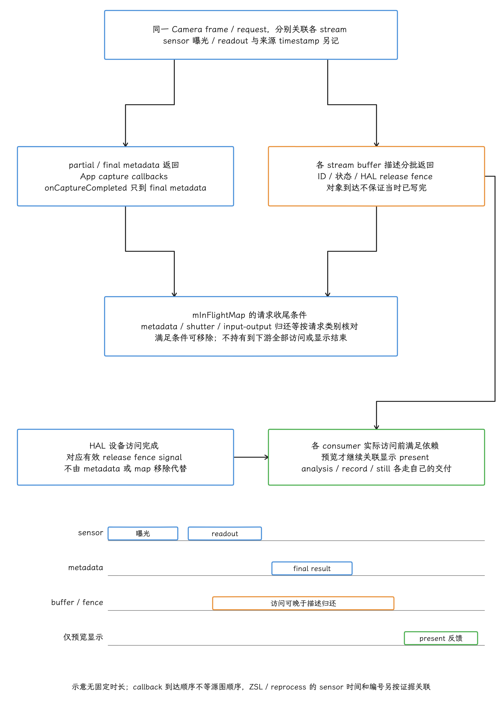

图：固定HAL3同frame partial/final metadata和各stream buffer可分批返回，仍遵守相应FIFO及ZSL/错误例外契约。mInFlightMap按frame跟踪metadata/shutter/input-output归还和请求类型，满足源码条件可移除，此时带回buffer的HAL release fence仍可能未signal。onCaptureStarted/ReadoutStarted描述sensor阶段，onCaptureCompleted是final metadata，buffer实际读取须满足依赖；只有进入显示的输出另追present，analysis/record/still可能完全不进SF。轨道仅普通成功预览一种允许样例，不能推所有callback固定先后或ZSL源图时刻，其他分支各自取证。

复原单帧至少保留 frame number、request id、sensor / readout timestamp、stream、buffer 标识、result 到达、queue / acquire / release 和显示关联对象。换算只用于可校准的时钟域差异；遇到 CHOREOGRAPHER_SYNCED 改写时间的输出，我们改用 buffer、stream 与 trace flow 关联帧，单凭时间值相等认不出帧。Camera frame number、BufferQueue frame number 和显示 token 是三套编号，相互对应要靠证据关联。

<!-- gracker-diagram: ed13-10-timestamp-policy-and-frame-association -->
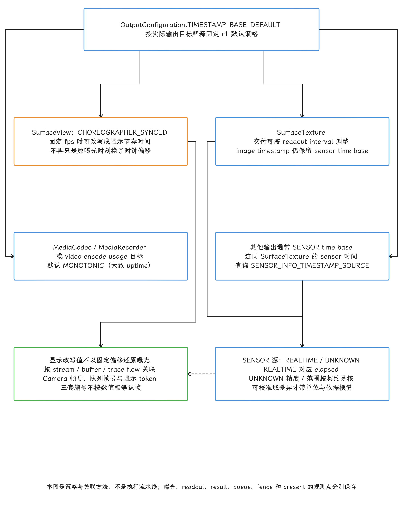

图：固定r1默认策略：SurfaceView用CHOREOGRAPHER_SYNCED，固定fps时改写图像时间为显示节奏相关值，非单纯偏移；SurfaceTexture可调整交付间隔但timestamp保留sensor域；MediaCodec/Recorder或video-encode usage目标用MONOTONIC；其他通常SENSOR。sensor真实域查询SENSOR_INFO_TIMESTAMP_SOURCE，REALTIME对应elapsed，UNKNOWN按契约检查精度/范围；可校准时钟域差异才按单位和依据换算，改写的图像时间不能用固定偏移还原曝光。Camera frame number、BufferQueue frame number、显示token也不直接相等，需stream/buffer/flow关联。

## Secure Camera Path

`REQUEST_AVAILABLE_CAPABILITIES_SECURE_IMAGE_DATA` 表示 camera device 能把图像写入受保护内存：这片内存只对 TEE（Trusted Execution Environment，可信执行环境）等受信任组件开放，Android userspace 和普通 Android kernel 都访问不到。普通 App 在窗口上设置 `FLAG_SECURE`，主要限制的是截图和非安全显示，与 secure camera memory 属于两套机制；普通 DRM video Surface 的处理方式，也套不到 secure camera 上来。


SECURE_IMAGE_DATA 设备若公布 SCALER_DEFAULT_SECURE_IMAGE_SIZE，仅保证该尺寸的 PRIVATE / YUV secure 输出，其他配置在支持查询时调用 isSessionConfigurationSupported。该 key 可为空；固定契约允许此时按 StreamConfigurationMap 公布的输出尺寸判断，key 为空并不说明设备缺少 secure 能力。像素访问范围还受以下限制：

<!-- gracker-diagram: ch13-10-59-secure-size -->
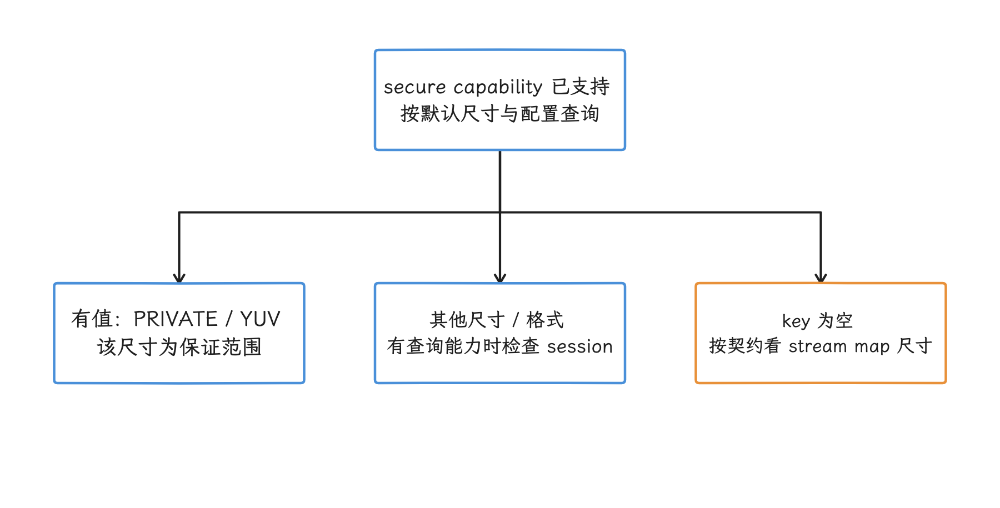

图：secure 默认尺寸 key 与 secure capability 应分别查询。 key 为空不能直接判断不支持 secure camera。

- 标准 CPU `ImageReader` / `Image.Plane` 读取通常不属于允许的 consumer 路径；
- buffer 内容不得进入截图、dump 或普通内存分析；
- Perfetto 仍可观察 request、HAL callback、调度、fence 和显示 transaction，但看不到受保护像素；
- 具体 permission、TEE consumer、protected usage 与显示限制由产品和 vendor 实现决定。

排障文档应明确标记 secure session，避免把“mmap（映射到进程地址空间）失败、截图不可用”误记成普通 buffer 损坏。

## Perfetto：从 request 追到 present

拿到一份相机卡顿的 trace，我们沿 request → HAL → consumer → display 这条链路读它：先固定采集环境，再按阶段找异常，最后拼出单帧的完整时间线。

### 采集前固定现场

每份 trace 至少记录以下环境与配置，保证不同采集结果可以比较：

- Android build、camera id、logical / physical camera 关系，以及用于描述内置、外接等设备类别的 `INFO_DEVICE_TYPE`；
- Camera provider 与 HAL transport（AIDL / HIDL）、vendor build；
- 所有 output 的 format、size、fps range、dynamic range、stream use case、timestamp base；
- CameraX 版本、PreviewView implementation mode 与最终 carrier；
- 是否启用 ZSL、Extensions、Low Light Boost、HDR、stabilization、secure path；
- thermal state、GPU / ISP / memory frequency 与复现时间。

`dumpsys media.camera` 可以查看客户端、stream 与 in-flight 概况，SurfaceFlinger layer tree 用来确认实际预览 carrier。厂商 HAL dump、camera event log 和 vendor trace 要与 Perfetto 对齐到同一时间基准，事件先后才关联得起来。


### 分五个阶段定位

| 阶段 | 观察点 | 典型异常 |
| --- | --- | --- |
| App / CameraX | session configure、repeating / single capture、callback executor | 反复重配、请求间隔异常、callback 被业务阻塞 |
| cameraserver | `Camera3Device` RequestThread、in-flight map、stream dequeue | request 排队、buffer limit wait、stream abandon |
| HAL / sensor / ISP | `processCaptureRequest`、SOF、vendor job、`processCaptureResult` | 曝光变化、ISP stall、算法或 HAL queue 堵塞 |
| consumer | Surface、codec、ImageReader、App GPU acquire / release | Image 未关、encoder 慢、纹理或 GPU pass 晚 |
| display | preview buffer、SF latch、composition type、present | acquire fence、geometry transaction、HWC / display 晚 |

Perfetto slice 是带起止时间的区间事件，可用来观察一次调用或任务占用了多久。线程名和 slice 前缀受 HAL transport 与厂商实现影响。Android 17 的 AIDL 设备可优先搜索 `ICameraDeviceSession`、`processCaptureRequest`、`requestStreamBuffers`、`processCaptureResult`；升级设备仍可能使用兼容的 HIDL HAL。没有 camera atrace slice 时，还可以通过 binder flow（跨进程调用关联）、BufferQueue、dma-buf、fence、thread state 和 SF layer 还原路径。


### 单帧复原顺序

按依赖关系复原同一帧，各分支可以重叠，不是全局 callback 顺序：


1. App 提交 request，Camera3 RequestThread 交给 HAL；framework-managed 输出先取 buffer，HAL-managed 输出可稍后请求；
2. 普通采集走 sensor exposure / readout；device-operated ZSL 可选内部历史图像，reprocess 则读取 session input 的已有图像；
3. HAL 分批返回 metadata、input / output buffer 描述和 fence，写入可能仍未完成；
4. CameraService 正常输出经 queue 交给各 consumer，读取前满足对应 fence；错误 / 丢弃分支另走 cancel；
5. SurfaceView preview 交独立显示队列；TextureView / 自研 renderer 先消费相机输入，再生产并提交宿主或自有输出 Surface；
6. SF 对实际显示输入采纳、合成并取得 present 反馈；consumer release 与 buffer 复用要另行追踪，别统一归到 queue 之前。

各 output 要分别关联取证：analysis callback 只说明 analysis 这一路有了结果，preview 或 JPEG 是否到达要另查；capture metadata callback 同样说明不了 Image 可读或显示完成。采集覆盖按对象核对，官方 Perfetto FrameTimeline 页面仍注明不支持 SurfaceView；宿主 HWUI timeline 也替代不了相机输入和独立 preview layer，这部分要用 buffer / transaction / fence 证据补齐。


### CPU 工作、调度等待和 fence 等待

slice 很长时，要结合线程状态区分实际执行与等待：

- Running：线程正在 CPU 上执行，继续看 ISP control、YUV 转换、推理、codec 或 App GPU submission 的 CPU 栈；
- Runnable：线程具备运行条件但尚未获得 CPU，结合 CPU contention、优先级与 thermal 判断调度延迟；
- Sleeping / blocked：线程正在等待，检查 Binder、condition variable、buffer limit、fence 与 I/O；
- GPU / ISP queue 已提交但没完成：回到设备频率、带宽、driver job 和 fence。

只量 callback 的 wall time（从入口到出口的总耗时）的话，队列等待、CPU 计算和硬件执行会混进同一个数值。


### CameraService 直接证据与 ANR 边界

#### cameraserver 的源码与 dump 锚点

CameraService 源码包含以下可核对点：

- `Camera3Device::RequestThread`：提交请求、按流取得缓冲区；
- `Camera3OutputStream::getBufferLockedCommon()`：`dequeueBuffer()` 或系统框架 BufferManager 路径；
- `Camera3Stream::getBuffer()`：等待 `max_buffers` 的时长；
- `Camera3OutputStream::returnBufferCheckedLocked()`：`queueBuffer()`、`cancelBuffer()` 与 HAL release fence；
- `AidlCamera3OutputUtils.cpp` 中的 `requestStreamBuffers()`：逐流校验 HAL 的缓冲区请求；
- 流的转储信息中，`DequeueBuffer latency histogram` 与 `wait on max_buffers` 两项统计。

设备系统跟踪中是否包含完整的相机、ISP、V4L2、IOMMU 或带宽轨道，由厂商实现决定。看不到厂商事件时，我们把问题定位到系统框架与 HAL 的接口边界为止；要断言某个 ISP 硬件模块的耗时，得先看到厂商事件。


#### buffer 现象的下一步排查

| 现象 | 优先检查 | 不能直接下的结论 |
|---|---|---|
| `dequeueBuffer()` 长时间等待 | 消费方是否归还、`Surface` 是否断开、队列是否达到上限 | 一定是 gralloc 分配慢 |
| requestStreamBuffers 逐流返回 NO_BUFFER_AVAILABLE | dequeue 超时、分配失败、消费方归还；若超 handout 配额则查 MAX_BUFFER_EXCEEDED | HAL 发生内存泄漏 |
| `ImageReader` 延迟持续增长 | 图像的取得与关闭、`maxImages`、分析耗时 | 传感器帧率不稳 |
| `SurfaceView` 已入队但没有换帧 | HAL 栅栏、SurfaceFlinger 锁存、HWC 与呈现时间 | Camera HAL 没有产出 |
| `TextureView` 输入已到但屏幕显示晚 | `SurfaceTexture` 取得时间、应用主线程、`RenderThread`、GPU、宿主输出队列 | SurfaceFlinger 丢帧 |
| dma-buf 总量增长 | 各流数量、分配大小、HAL、ISP、编解码器内部缓冲区 | Java 堆内存泄漏 |

#### buffer wait 与 ANR 的关系

缓冲区不足可能让 CameraService 的 `RequestThread`、HAL 专用线程或应用的同步调用进入等待。Android ANR 仍要求应用主线程、广播、服务或输入事件等路径超过相应的超时阈值。要证明两者存在因果关系，必须找到主线程或关键 Binder 调用等待相机操作的调用栈，再对齐缓冲区与栅栏的阻塞时间。

<!-- gracker-diagram: ed13-10-cross-stream-pressure-and-anr-proof -->
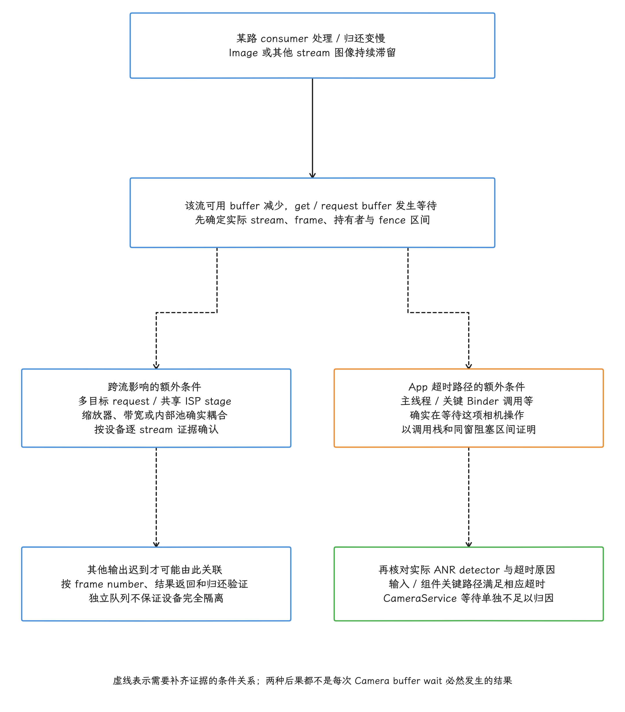

图：consumer处理/归还变慢导致某stream图像滞留，可耗尽可用buffer并出现get/request buffer等待。只有目标设备共享ISP stage、request多目标、带宽/内部池等实际耦合被证实时，才能关联其他stream迟到；独立队列不证明隔离，也不意味着一定全局堵塞。App ANR还需主线程/广播/服务/输入等关键路径实际依赖该相机操作，调用栈/Binder等待与buffer/fence阻塞区间对齐并满足对应detector超时。两种后果分开取证，CameraService线程等待本身不足以证明AppANR或ISP硬件根因。

## 常见掉帧场景与修复方向

下面把前面的追踪方法落到几类常见场景，每一类先认症状，再看修复方向。

### Session 反复重配

尺寸、dynamic range、physical camera、Extensions 或 output 集合发生变化，都可能触发耗时较长的 configure。短时间内频繁 unbind / bind CameraX use case，或在预览期间重建 session，通常会伴随 request 中断、buffer drain（等待在途 buffer 归还）和重新等待首帧。

我们应尽量保持 output 组合稳定，动态 3A、zoom 和 exposure 优先通过 request 更新；必须重配时，分别测量停流、configure 和首个 result 的耗时，别只记一段总时间。


API 37 上，属性能与原配置匹配、且 output 数量保持不变的 Surface 切换，可以评估 updateOutputConfigurations：调用会停止针对被替换目标的 active request，再提交新目标请求。它省掉的是整组重建；停顿是否为零，契约里没有承诺，format / size / output 数量的变更也超出了它的范围，要走支持的重新配置方式。

### Analysis consumer 反压

症状包括 analysis 延迟持续增加、`maxImages` 被占满，以及 stream buffer request 变慢或超时。可以把推理移出回调线程、按需求使用 latest-only（只保留最新帧）策略、减少 YUV 内存拷贝，并保证所有正常和异常路径都会关闭 Image。异步处理仍须明确 Image 的 owner 与关闭时机；单纯增大队列只会延后拥塞并增加内存占用。


### Recording consumer 反压

症状是 preview 仍然稳定，但 record output 的 buffer 归还变慢或 encoder input 持续堆积。我们检查 codec surface、编码 profile、码率、分辨率、thermal，以及 muxer / storage 写入；把所有录像掉帧都归因于 Camera HAL，会漏掉这些环节。

### Sensor / ISP pipeline stall

长曝光、HDR、多帧降噪、night extension、remosaic（把 Quad Bayer 等排列重建为高分辨率 Bayer 数据）或多路高负载输出，都会增加 sensor / ISP 时间。我们结合 exposure、frame duration、SOF（Start of Frame，帧开始）/ readout、HAL result 和 vendor job，区分拍摄场景所需的处理时间与实现异常造成的 stall。

### Preview carrier 晚

SurfaceView preview buffer 已 ready 但迟迟没有 present 时，继续检查 release fence、SF latch、geometry transaction 与 HWC。TextureView camera buffer 已 ready 但画面仍晚时，继续检查宿主 Choreographer、RenderThread、texture acquire、GPU 和 App Window；两者的后半段路径不同。


### 内存、带宽与热限制

多流会增加 GraphicBuffer / dma-buf 占用以及 ISP、内存带宽压力，10-bit、RAW14、高 fps 和大尺寸输出尤其明显。我们诊断时结合 dma-buf 总量、page allocation、IOMMU map、PSI memory（内存压力指标）、direct reclaim（同步内存回收）、GPU / ISP / memory frequency 和 thermal throttling。固定 buffer 数乘以分辨率算不出真实占用：row stride（每行实际字节跨度）、format、HAL cache、中间 buffer 和 vendor algorithm 都会引入额外空间。


## Android 12—17 的版本演进

下面保留平台能力变化；每项能力都要以 `CameraCharacteristics`、session support query 和设备 HAL 为准。

- **Android 10 / API 29**：引入可选的 HAL3 buffer management，request 可以先进入 pipeline，HAL 再按需取得 output buffer。
- **Android 12 / API 31**：Camera2 vendor extensions 进入公开平台，Bokeh、HDR、Night 等模式可以通过 `CameraExtensionSession` 查询；maximum-resolution stream configuration 给出了超高分辨率 sensor 的公开配置范围。
- **Android 13 / API 33**：Camera HAL 的新能力转向 AIDL；Camera2 加入 10-bit HDR video、DynamicRangeProfiles、stream use case 与 output timestamp base。升级设备仍可继续使用兼容的 HIDL HAL。
- **Android 14 / API 34**：Ultra HDR still image 与记录亮度增益信息的 gainmap 进入公开链路，cropped RAW stream use case 可用于 in-sensor zoom。它们不会让普通 preview 自动切换到 HDR 或 RAW。
- **Android 15 / API 35**：Low Light Boost 为支持设备提供连续 preview / video 的低光 AE mode，它与合成多帧的 Night still capture 是两种能力。曝光时间和算法负载变化都会影响可达帧率。
- **Android 16 / API 36**：color temperature / tint、hybrid auto-exposure、night mode indicator、motion photo capture intent 等能力扩展了 request 与 metadata，但 Surface、HAL buffer 和 consumer 归还仍是数据流主线。
- **Android 17 / API 37**：`CameraCaptureSession.updateOutputConfigurations()` 支持在不关闭整个 session 的情况下替换既有、属性可对应的 output Surface；`ImageFormat.RAW14` 支持紧凑的 14-bit RAW，vendor-defined camera extensions 与 `INFO_DEVICE_TYPE` 扩展了能力发现。动态更新只替换属性可对应的配置、output 数量保持不变，RAW14 也只影响设备支持并由 App 显式配置的 RAW stream。

Android 17 平台继续使用 HAL3 request-result 与多 output Surface 模型。新增 metadata 或 extension 会改变配置和处理负载，但每路输出仍须遵守 buffer ownership、fence 与 consumer backpressure 约束。


### 16 KB page size、DMA-BUF heaps 与 ION

#### 16 KB page size 与 Camera buffer 对齐

AOSP 从 Android 15 起支持 16 KB 页大小（page size），主要影响内核页粒度、`mmap()` 映射取整、ELF 文件对齐，以及依赖固定 `PAGE_SIZE` 的原生代码；Android 17 延续了这项兼容能力。

Camera AIDL、`GraphicBuffer` 和 BufferQueue 没有规定：

- 每个相机缓冲区的逻辑宽高必须按 16 KB 对齐；
- 图像有效载荷大小必须是 16 KB 的整数倍；
- 应用或 Camera HAL 应手工把 gralloc 分配结果补齐到 16 KB。

物理页、IOMMU 映射、平面步幅、内存堆粒度和硬件块对齐属于不同层次。内存分配器与驱动可能因为 16 KB 内核产生不同的物理占用，统一的 Camera HAL 缓冲区对齐公式却由此推不出来。排查时我们读取 mapper 返回的布局、dma-buf 大小和设备内存堆配置。


#### Android 17 的共享内存构成

Android 17 AOSP 发布说明要求删除厂商代码中的 ION 调用。Android 12 的 GKI 2.0（通用内核映像）已经用 DMA-BUF heaps（共享缓冲区堆）取代 ION；到 Android 17，所有支持 ION 的内核都已结束维护。

因此 camera 路径应按以下对象理解：

- gralloc 图形内存分配器决定 `GraphicBuffer` 的实现与布局；
- DMA-BUF heaps 或厂商分配器提供可共享的内存分配；
- dma-buf 文件描述符让 HAL、GPU、编解码器、HWC 等组件共享同一块分配；
- dma-fence 与 sync_file 文件描述符传递访问完成关系。

`ashmem` 也不是相机 `GraphicBuffer` 的可选“内存类型”。它用于普通共享内存，不提供 Camera HAL 图形流所需的 gralloc 元数据、用途标志协商和设备导入语义。


## Android 17 / kernel 6.18 源码入口

### Framework 与 cameraserver

- [`CameraCaptureSession.java`](https://android.googlesource.com/platform/frameworks/base/+/refs/tags/android-17.0.0_r1/core/java/android/hardware/camera2/CameraCaptureSession.java)、[`CameraCaptureSessionImpl.java`](https://android.googlesource.com/platform/frameworks/base/+/refs/tags/android-17.0.0_r1/core/java/android/hardware/camera2/impl/CameraCaptureSessionImpl.java)、[`CameraDeviceImpl.java`](https://android.googlesource.com/platform/frameworks/base/+/refs/tags/android-17.0.0_r1/core/java/android/hardware/camera2/impl/CameraDeviceImpl.java)：session、request、动态输出更新与 callback；
- [`OutputConfiguration.java`](https://android.googlesource.com/platform/frameworks/base/+/refs/tags/android-17.0.0_r1/core/java/android/hardware/camera2/params/OutputConfiguration.java)：stream use case、timestamp base、dynamic range 与 output 属性；
- [`CaptureRequest.java`](https://android.googlesource.com/platform/frameworks/base/+/refs/tags/android-17.0.0_r1/core/java/android/hardware/camera2/CaptureRequest.java)、[`CameraCharacteristics.java`](https://android.googlesource.com/platform/frameworks/base/+/refs/tags/android-17.0.0_r1/core/java/android/hardware/camera2/CameraCharacteristics.java)：ZSL、reprocessing、secure image、stream capability 与 device type；
- [`ImageFormat.java`](https://android.googlesource.com/platform/frameworks/base/+/refs/tags/android-17.0.0_r1/graphics/java/android/graphics/ImageFormat.java)：RAW14 与其他公开 image format；
- [`Camera3Device.cpp`](https://android.googlesource.com/platform/frameworks/av/+/refs/tags/android-17.0.0_r1/services/camera/libcameraservice/device3/Camera3Device.cpp)、[`Camera3Stream.cpp`](https://android.googlesource.com/platform/frameworks/av/+/refs/tags/android-17.0.0_r1/services/camera/libcameraservice/device3/Camera3Stream.cpp)、[`Camera3OutputStream.cpp`](https://android.googlesource.com/platform/frameworks/av/+/refs/tags/android-17.0.0_r1/services/camera/libcameraservice/device3/Camera3OutputStream.cpp)：configure、RequestThread、in-flight map、buffer limit、dequeue / queue 与 fence。

### Camera HAL AIDL

- [`ICameraDeviceSession.aidl`](https://android.googlesource.com/platform/hardware/interfaces/+/refs/tags/android-17.0.0_r1/camera/device/aidl/android/hardware/camera/device/ICameraDeviceSession.aidl)：configure、process request、flush 与 offline session；
- [`ICameraDeviceCallback.aidl`](https://android.googlesource.com/platform/hardware/interfaces/+/refs/tags/android-17.0.0_r1/camera/device/aidl/android/hardware/camera/device/ICameraDeviceCallback.aidl)、[`HalStream.aidl`](https://android.googlesource.com/platform/hardware/interfaces/+/refs/tags/android-17.0.0_r1/camera/device/aidl/android/hardware/camera/device/HalStream.aidl)：capture result、request / return stream buffers 与逐流 `maxBuffers`；
- [Camera HAL3 request / result](https://source.android.com/docs/core/camera/camera3_requests_hal)、[Camera HAL3 buffer management](https://source.android.com/docs/core/camera/buffer-management-api)：接口语义与版本演进。

### CameraX 固定发布包与图像所有权

- [camera-camera2 1.6.1 sources](https://dl.google.com/dl/android/maven2/androidx/camera/camera-camera2/1.6.1/camera-camera2-1.6.1-sources.jar)：ZslControl、CaptureConfigAdapter、CameraInfoAdapter 与 reprocessable graph 配置；
- [camera-core 1.6.1 sources](https://dl.google.com/dl/android/maven2/androidx/camera/camera-core/1.6.1/camera-core-1.6.1-sources.jar)：MetadataImageReader、ZslRingBuffer 和 ArrayRingBuffer 的 timestamp 配对、过滤与 FIFO；
- [camera-camera2-pipe 1.6.1 sources](https://dl.google.com/dl/android/maven2/androidx/camera/camera-camera2-pipe/1.6.1/camera-camera2-pipe-1.6.1-sources.jar)：Camera2CaptureSequenceProcessor 的 builder、queueInputImage 与提交分界；
- [ImageReader](https://developer.android.com/reference/android/media/ImageReader)、[ImageWriter](https://developer.android.com/reference/android/media/ImageWriter)：acquire 额度与输入交接后的对象有效期；
- [PreviewFrameSpacer.cpp](https://android.googlesource.com/platform/frameworks/av/+/refs/tags/android-17.0.0_r1/services/camera/libcameraservice/device3/PreviewFrameSpacer.cpp)、[Camera3OutputUtils.cpp](https://android.googlesource.com/platform/frameworks/av/+/refs/tags/android-17.0.0_r1/services/camera/libcameraservice/device3/Camera3OutputUtils.cpp)：framework 暂存图像与 in-flight 收尾；
- [Android 17 正式发布说明](https://developer.android.com/blog/posts/android-17-is-here)：RAW14、vendor-defined extension 与 camera device type。

### Consumer、显示与 kernel

- [Android 17 Camera 更新](https://developer.android.com/about/versions/17/release-notes)、[`CameraCaptureSession`](https://developer.android.com/reference/android/hardware/camera2/CameraCaptureSession)、[Camera2 多流](https://developer.android.com/media/camera/camera2/multiple-camera-streams-simultaneously)：API 37 动态输出更新与多流公开契约；
- [CameraX Preview](https://developer.android.com/media/camera/camerax/preview)、[CameraX Image Analysis](https://developer.android.com/media/camera/camerax/analyze)、[CameraX ZSL](https://developer.android.com/media/camera/camerax/take-photo/zsl)：公开 consumer 与库层约束；
- [`TextureView.java`](https://android.googlesource.com/platform/frameworks/base/+/refs/tags/android-17.0.0_r1/core/java/android/view/TextureView.java)、[`DeferredLayerUpdater.cpp`](https://android.googlesource.com/platform/frameworks/base/+/refs/tags/android-17.0.0_r1/libs/hwui/DeferredLayerUpdater.cpp)：TextureView frame available、宿主 invalidation 与最新 buffer 获取；
- [`SurfaceFlinger.cpp`](https://android.googlesource.com/platform/frameworks/native/+/refs/tags/android-17.0.0_r1/services/surfaceflinger/SurfaceFlinger.cpp)、[`HWComposer.cpp`](https://android.googlesource.com/platform/frameworks/native/+/refs/tags/android-17.0.0_r1/services/surfaceflinger/DisplayHardware/HWComposer.cpp)：预览 layer 的 latch、composition 与 present；
- kernel `android17-6.18-2026-06_r6` 的 [`dma-buf.c`](https://android.googlesource.com/kernel/common/+/refs/tags/android17-6.18-2026-06_r6/drivers/dma-buf/dma-buf.c)、[`dma-fence.c`](https://android.googlesource.com/kernel/common/+/refs/tags/android17-6.18-2026-06_r6/drivers/dma-buf/dma-fence.c)、[`sync_file.c`](https://android.googlesource.com/kernel/common/+/refs/tags/android17-6.18-2026-06_r6/drivers/dma-buf/sync_file.c)：buffer 共享、fence signal / wait 与 fence fd。

## 常见误判

| 误判 | 修正方法 |
| --- | --- |
| 同一 request 的多路输出共用同一块 buffer | 按 stream、buffer id、format 与 consumer 分别追踪 |
| `maxBuffers` 在 HAL3 中固定为 2 | 它由 HAL 在 configure 阶段逐流返回 |
| result metadata 到达表示所有 buffer 都 ready | partial / final metadata 与不同 stream buffer 可以分开返回 |
| `onCaptureCompleted()` 表示预览已经显示 | 继续追 preview queue、SF latch 与 display present |
| `CONTROL_ENABLE_ZSL` 必须配 reprocessable session | 它是 device-operated 提示；应用自管 ZSL 才需要 input stream 与 reprocess |
| ZSL callback 到达顺序就是照片的采集顺序 | 用 frame number 与 source sensor timestamp |
| `Image.close()` 只影响 Java 内存 | 它决定 analysis buffer 能否归池，可能反压 session |
| SurfaceView 一定使用 HWC overlay | 查看实际 composition type 与整组 layer 条件 |
| TextureView buffer 到达就已上屏 | 还要等宿主 traversal、RT、App Window 与 SF |
| 增大 `maxImages` 可以修复慢分析 | 它只增加缓冲与内存，长期吞吐仍由 consumer 决定 |
| API 37 动态更新可以任意增删 output | 只能替换既有同构配置的 Surface，output 数量不变 |
| RAW14 会改变 Android 17 的所有预览 | 只影响设备支持并显式配置的 RAW14 stream |
| `TEMPLATE_ZERO_SHUTTER_LAG` 能证明 HAL 收到历史图像 | 模板只表达上层意图；HAL 边界必须看到有效 `inputBuffer` |
| 重处理会重新曝光一次 | reprocess 从 session input Surface 读取已有图像，不采集新的 sensor 数据 |
| ZSL 失败总会透明重试普通拍照 | 取帧前可以降级；input 已提交后的失败不能假定会自动重试 |

## 与其他章节的关系

- [2.8 BufferQueue、Gralloc 与 Sync Fence](../../part1-fundamentals/ch02-rendering/08-bufferqueue-gralloc-sync-fence.md)：Camera buffer handle 与 fence 的内存模型；
- [15.14 Camera 性能分析工具：Perfetto、SQL 与 GFXReconstruct](../../part3-tools/ch15-other-tools/14-camera-performance-analysis.md)：Camera trace 配置、SQL 与案例；
- [13.3 SurfaceView 与 TextureView 渲染管线](03-surfaceview-textureview-pipelines.md)：预览 carrier 的窗口与显示路径；
- [13.6 SurfaceControl 与 HardwareBufferRenderer](06-surfacecontrol-hardwarebuffer-renderer.md)：SurfaceView preview layer 的 transaction 与 fence；
- [13.11 视频 Overlay、Media3 与专业编解码管线](11-video-overlay-media3-codec-pipeline.md)：录像与预览 layer 进入 HWC 后的 composition 决策；
- [22.18 CameraX：UseCase、Camera2 映射与性能](../../part5-app/ch22-rendering-practice/18-camerax-rendering.md)：CameraX 1.6.1 的 ZSL ring、CameraPipe 重处理、ImageCapture 与用例组合。

## 小结

Camera 诊断从 session outputs 与 HAL3 request-result 开始。preview、record、analysis 和 still capture 各有自己的 buffer 与 consumer，我们把每一路追到 buffer 归还，才能确定是哪一端在限制 session 吞吐。

承载方式上，标准 SurfaceView 预览形成独立 layer，TextureView 预览还要经过宿主 HWUI，自研 GL / Vulkan 预览则增加一段由 App 消费再生产的 GPU 路径。ZSL 要区分 device-operated 与 application-operated 两种机制；`maxBuffers` 要读取 HAL 配置，timestamp 也要先确认 time base。

把 request、frame number、sensor / readout timestamp、HAL result、consumer release、preview queue、SF latch 与 display present 对齐之后，我们就能分别判断 sensor / ISP 处理慢、buffer 不足、analysis / encoder 反压、宿主消费晚和显示端迟到。
